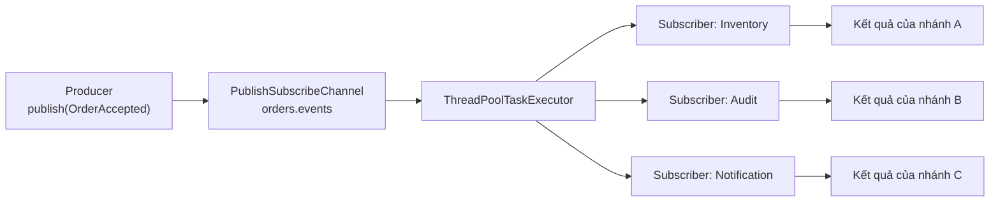
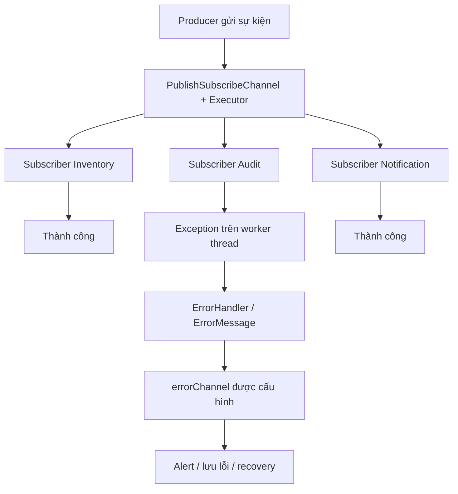
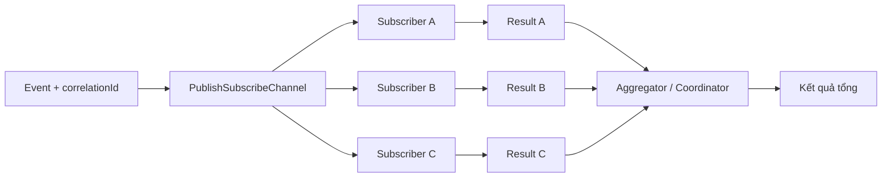

# Executor cho subscriber bất đồng bộ

## 1. Vấn đề: một subscriber chậm có thể giữ cả luồng phát sự kiện

Giả sử hệ thống thương mại điện tử vừa xác nhận đơn `ORD-105` và cần phát sự kiện `OrderAccepted` cho ba subscriber:

- **Inventory:** cập nhật lượng hàng đã đặt giữ.
- **Audit:** ghi lịch sử xử lý.
- **Notification:** gọi dịch vụ gửi email.

Một sự kiện được gửi tới nhiều nơi là mô hình **publish-subscribe**. Trong Spring Integration, `PublishSubscribeChannel` phân phối message tới các subscriber đã đăng ký. Mặc định, nếu không cấu hình `Executor`, các handler thường được gọi **đồng bộ trên thread của sender**. Vì thế, một email API chậm có thể khiến thread phát đơn hàng phải chờ ngay cả khi inventory và audit xử lý nhanh.

Đưa **Executor** vào `PublishSubscribeChannel` cho phép **đưa tác vụ xử lý của các subscriber sang thread pool**, tách thời điểm chấp nhận message khỏi thời điểm từng nhánh hoàn tất.



Trong chương **Publish subscribe** thuộc module **SPRING_INTEGRATION_PATTERN**, đây là kỹ thuật quan trọng khi xây dựng các luồng thông điệp ít phụ thuộc và dễ mở rộng bằng Spring Integration. Executor có thể giúp tách tải giữa các nhánh chứa Router, Filter, Transformer, Splitter, Aggregator hoặc Service Activator; nhưng retry, error channel, correlation, Gateway và kiểm thử cần được thiết kế tương ứng với **ranh giới bất đồng bộ**.

> **Nguyên tắc:** Có executor nghĩa là có khả năng xử lý bất đồng bộ; **không** có nghĩa message đã được lưu bền vững, mọi subscriber đã thành công hoặc các nhánh chạy theo một thứ tự cố định.

## 2. Đồng bộ và bất đồng bộ khác nhau ở đâu?

### 2.1. PublishSubscribeChannel không có Executor

```text
Thread producer
  send(event)
    -> Subscriber A: xử lý
    -> Subscriber B: xử lý
    -> Subscriber C: xử lý
  send(...) trả về / ném exception
```

Các subscriber được gọi trong luồng gửi theo cơ chế dispatch đồng bộ. Nếu handler bị chặn, thread producer có thể bị chặn; nếu handler ném exception, lỗi có thể lan ngược theo cấu hình channel và làm ảnh hưởng các lần dispatch còn lại.

### 2.2. PublishSubscribeChannel có Executor

```text
Thread producer
  send(event)
    -> executor.execute(task A)
    -> executor.execute(task B)
    -> executor.execute(task C)
  send(...) trả về sau khi dispatch được chấp nhận

Worker thread 1 -> Subscriber A xử lý
Worker thread 2 -> Subscriber B xử lý
Worker thread 3 -> Subscriber C xử lý
```

Đây là sơ đồ thời gian **minh họa**: số worker thread thực tế có thể ít hơn số subscriber; một worker có thể chạy nhiều tác vụ liên tiếp. Nếu pool hết tài nguyên, một task có thể chờ trong hàng đợi hoặc bị từ chối theo chính sách executor.

| Thuộc tính | Không có Executor | Có Executor |
| --- | --- | --- |
| Thread thực thi handler | Thường thread gọi `send()` | Thread worker do executor quản lý |
| `send()` trả về | Thường sau khi xử lý đồng bộ | Có thể trước khi subscriber xử lý xong |
| Độ trễ của producer | Bị ảnh hưởng trực tiếp bởi handler chậm | Có thể giảm, nhưng còn chi phí dispatch/backpressure |
| Exception từ subscriber | Có thể lan về sender | Thường phát sinh trên worker thread, cần error handling riêng |
| Thứ tự hoàn tất của các subscriber | Có thứ tự gọi theo dispatcher nhưng không nên dùng làm hợp đồng nghiệp vụ | Không được bảo đảm |
| Lưu message sau khi ứng dụng dừng | Không tự có | **Cũng không tự có** |
| Điều tiết tải | Dựa vào tốc độ caller/handler | Cần cấu hình pool, queue, rejection và giám sát |

Một lời gọi `send()` trả `true` chỉ cho biết channel đã **chấp nhận gửi theo semantics của nó**, không phải xác nhận rằng tất cả subscriber đã ghi dữ liệu, gọi API hoặc commit thành công.

## 3. Executor là gì trong ngữ cảnh Spring Integration?

`Executor` là hợp đồng Java nhận một `Runnable` để thực thi. `PublishSubscribeChannel` có thể sử dụng executor để dispatch message tới subscriber. Trong hệ sinh thái Spring, `ThreadPoolTaskExecutor` là lựa chọn thuận tiện vì hỗ trợ cấu hình pool và vòng đời bean.

Một số tham số quan trọng:

| Tham số | Vai trò | Tác động vận hành |
| --- | --- | --- |
| `corePoolSize` | Số worker cốt lõi | Xác định năng lực xử lý cơ bản |
| `maxPoolSize` | Giới hạn worker tối đa | Giới hạn số thread khi tăng tải |
| `queueCapacity` | Sức chứa backlog chờ thực thi | Queue dài làm tăng độ trễ và dùng RAM |
| `threadNamePrefix` | Tiền tố tên worker | Giúp xác định thread trong log/tracing |
| Rejection policy | Làm gì khi pool không thể nhận task | Ném lỗi, chạy trên caller hoặc các hành vi khác |
| Shutdown policy | Chờ, hoàn tất hoặc hủy task khi dừng | Ảnh hưởng số message còn xử lý lúc triển khai lại |

**Lưu ý về kích thước pool:** với hàng đợi có dung lượng dương, `ThreadPoolExecutor` thường ưu tiên lấp queue sau khi đạt `corePoolSize`, rồi mới mở rộng đến `maxPoolSize` khi queue đã đầy. Vì vậy đặt `maxPoolSize=32` không có nghĩa pool luôn dùng 32 thread. Nếu queue quá dài, latency có thể tăng trước khi số thread mở rộng.

### 3.1. Một executor chung hay nhiều executor riêng?

Một `PublishSubscribeChannel` có executor chung sẽ chia sẻ tài nguyên cho tất cả subscriber của nó. Điều này đơn giản nhưng có thể gây *resource contention*:

- Email API chậm chiếm hết thread.
- Các task inventory mới phải đợi cùng queue.
- Khi queue đầy, tất cả nhánh có nguy cơ gặp rejection.

Nếu một nhánh có SLA rất khác hoặc cần cô lập lỗi/tải, cân nhắc **fan-out vào các queue/broker subscription độc lập**, hoặc thiết kế từng nhánh với executor riêng. Executor chung phù hợp khi các nhánh nhẹ, ngắn và có mức ưu tiên gần nhau.

## 4. Cấu hình PublishSubscribeChannel với ThreadPoolTaskExecutor

Ví dụ dưới đây dùng **Spring Integration Java configuration** và Java 17+. Một `OrderAccepted` được phát tới ba subscriber bằng `@ServiceActivator`. Chúng chạy bất đồng bộ nhờ executor gắn vào channel.

### 4.1. Payload và hợp đồng nghiệp vụ

```java
record OrderAccepted(
        String orderId,
        long amountVnd,
        boolean notifyCustomer) {}

interface OrderEventHandlers {
    void reserveInventory(OrderAccepted order, String eventId);
    void appendAudit(OrderAccepted order, String eventId);
    void notifyCustomer(OrderAccepted order, String eventId);
}
```

`eventId` là ID sự kiện nghiệp vụ ổn định: mỗi subscriber có thể dùng nó làm **khóa idempotency** để không xử lý trùng khi nhận lại message. Đối với một fan-out ba nhánh, tránh dùng một cờ “event đã xử lý” chung làm các nhánh triệt tiêu nhau; khóa nên có dạng `(subscriber, eventId)` hoặc do từng subscriber quản lý riêng.

### 4.2. Khai báo executor và channel

```java
import java.util.concurrent.ThreadPoolExecutor;

import org.springframework.beans.factory.annotation.Qualifier;
import org.springframework.context.annotation.Bean;
import org.springframework.context.annotation.Configuration;
import org.springframework.integration.channel.PublishSubscribeChannel;
import org.springframework.integration.config.EnableIntegration;
import org.springframework.messaging.MessageChannel;
import org.springframework.scheduling.concurrent.ThreadPoolTaskExecutor;

@Configuration
@EnableIntegration
class AsyncEventsConfig {

    @Bean("ordersEventExecutor")
    ThreadPoolTaskExecutor ordersEventExecutor() {
        var executor = new ThreadPoolTaskExecutor();
        executor.setCorePoolSize(4);
        executor.setMaxPoolSize(8);
        executor.setQueueCapacity(100);
        executor.setThreadNamePrefix("order-event-");
        executor.setRejectedExecutionHandler(
                new ThreadPoolExecutor.AbortPolicy());
        executor.setWaitForTasksToCompleteOnShutdown(true);
        executor.setAwaitTerminationSeconds(15);
        return executor;
    }

    @Bean("orders.events")
    MessageChannel ordersEvents(
            @Qualifier("ordersEventExecutor")
            ThreadPoolTaskExecutor executor) {
        return new PublishSubscribeChannel(executor);
    }
}
```

**Cấu hình ở trên chỉ là giá trị ví dụ.** Pool 4–8 worker và queue 100 cần được đo theo thời gian xử lý, số subscriber, tải sự kiện, bộ nhớ và SLA thực tế. `AbortPolicy` giúp làm lộ tình trạng quá tải bằng lỗi từ chối task thay vì bỏ âm thầm. Cấu hình shutdown nêu trên cố gắng đợi những task đang chờ, nhưng không bảo đảm message còn trong RAM sống sót sau crash, kill cưỡng bức hoặc hết thời gian chờ.

Spring quản lý vòng đời `ThreadPoolTaskExecutor` như một bean. Khi không dùng Spring context mà tự tạo instance trong test, cần gọi `initialize()` và `shutdown()` thích hợp.

### 4.3. Đăng ký nhiều subscriber cho cùng một channel

```java
import org.springframework.integration.annotation.ServiceActivator;
import org.springframework.messaging.handler.annotation.Header;
import org.springframework.messaging.handler.annotation.Payload;
import org.springframework.stereotype.Component;

@Component
class OrderEventSubscribers {

    private final OrderEventHandlers handlers;

    OrderEventSubscribers(OrderEventHandlers handlers) {
        this.handlers = handlers;
    }

    @ServiceActivator(inputChannel = "orders.events")
    public void inventory(
            @Payload OrderAccepted order,
            @Header("eventId") String eventId) {
        handlers.reserveInventory(order, eventId);
    }

    @ServiceActivator(inputChannel = "orders.events")
    public void audit(
            @Payload OrderAccepted order,
            @Header("eventId") String eventId) {
        handlers.appendAudit(order, eventId);
    }

    @ServiceActivator(inputChannel = "orders.events")
    public void notification(
            @Payload OrderAccepted order,
            @Header("eventId") String eventId) {
        if (order.notifyCustomer()) {
            handlers.notifyCustomer(order, eventId);
        }
    }
}
```

Với `PublishSubscribeChannel`, **cả ba subscriber đều được đăng ký nhận message**. Phương thức `notification()` tự quyết định có hành động hay không theo payload. Điều này **khác** một `Recipient List` có selector: với Recipient List, chính router có thể quyết định không gửi message tới nhánh notification từ đầu.

Các ví dụ giả định ứng dụng cung cấp bean triển khai `OrderEventHandlers`. Mỗi service method là hành vi nghiệp vụ; `@ServiceActivator` là ranh giới chuyển message thành lời gọi Java.

### 4.4. Gửi message vào channel

```java
import org.springframework.beans.factory.annotation.Qualifier;
import org.springframework.messaging.MessageChannel;
import org.springframework.messaging.support.MessageBuilder;
import org.springframework.stereotype.Component;

@Component
class OrderEventPublisher {
    private final MessageChannel events;

    OrderEventPublisher(
            @Qualifier("orders.events") MessageChannel events) {
        this.events = events;
    }

    boolean publishExample() {
        var event = new OrderAccepted("ORD-105", 350_000L, true);
        return events.send(MessageBuilder.withPayload(event)
                .setHeader("eventId", "evt-105")
                .setHeader("tenantId", "shop-hcm")
                .setHeader("traceId", "trace-105")
                .build());
    }
}
```

Sau khi `publishExample()` trả về, ta **chưa được giả định** cả inventory, audit và notification đã thành công. Việc gửi có thể đã được nhận bởi executor, nhưng các handler đang chờ hoặc chạy trên worker thread. Nếu task bị executor từ chối, lỗi có thể phát sinh ngay trong giai đoạn dispatch; hãy xử lý trường hợp này theo chính sách của producer.

## 5. Cấu hình qua Java DSL và PublishSubscribeChannel

Ngoài việc tạo `PublishSubscribeChannel` như một bean và dùng `@ServiceActivator`, Spring Integration Java DSL còn hỗ trợ việc lồng các **subscriber subflow** vào một flow publish-subscribe.

Ví dụ khái niệm cho các bước nhẹ:

```java
import org.springframework.context.annotation.Bean;
import org.springframework.integration.dsl.IntegrationFlow;

@Bean
IntegrationFlow lightEventFlow() {
    return flow -> flow
            .publishSubscribeChannel(subscribers -> subscribers
                    .subscribe(subflow -> subflow
                            .handle(message -> {
                                // Ghi log/metric nhẹ.
                            }))
                    .subscribe(subflow -> subflow
                            .handle(message -> {
                                // Xử lý một nhánh khác.
                            })));
}
```

Đoạn trên minh họa **cách tổ chức subflow**, không thay thế cho ví dụ `orders.events` ở mục 4 và chưa gắn executor. Khi cần subscriber bất đồng bộ, hãy cấu hình executor thông qua biến thể `publishSubscribeChannel` hỗ trợ executor hoặc dùng một `PublishSubscribeChannel` đã gắn executor như mục 4. Không đăng ký đồng thời hai cấu hình vào cùng kênh khi chưa chủ động xác định topology, vì việc đó có thể tạo subscriber bổ sung ngoài ý muốn.

**Lưu ý API:** DSL có thể thay đổi overload giữa các phiên bản Spring Integration. Đối với bài học về executor, cách rõ ràng và dễ kiểm soát nhất vẫn là bean `new PublishSubscribeChannel(executor)` cộng các subscriber độc lập.

## 6. Lỗi trong subscriber bất đồng bộ được xử lý ở đâu?

Khi dùng executor, exception trong một subscriber thường phát sinh **trên worker thread**, không còn nằm trên stack của thread đang gọi `send()`. Do vậy, đặt `try/catch` quanh `publisher.publishExample()` **không đủ** để bắt toàn bộ lỗi từ audit hoặc notification phát sinh sau đó.



Spring Integration có cơ chế xử lý lỗi dạng `ErrorMessage` và **error channel**; channel hoặc endpoint bất đồng bộ có thể sử dụng `ErrorHandler` phù hợp, ví dụ cơ chế `MessagePublishingErrorHandler` trong những bối cảnh được hỗ trợ. Tuy nhiên, đường đi cụ thể của exception phụ thuộc **channel, executor, endpoint, error handler và cấu hình phiên bản đang sử dụng**. Không mặc định rằng chỉ thêm một header `errorChannel` sẽ tự động biến mọi lỗi thành bản ghi bền vững hoặc kích hoạt retry.

Thiết kế error handling cần trả lời:

1. Subscriber nào lỗi? `inventory`, `audit` hay `notification`?
2. Lỗi là **tạm thời** (timeout, 503) hay **vĩnh viễn** (schema sai, thiếu trường bắt buộc)?
3. Task lỗi được thử lại ở **nhánh riêng** hay sẽ phát lại **toàn bộ event**?
4. Payload, `eventId`, `traceId`, số lần thử và nguyên nhân được lưu ở đâu?
5. Nếu subscriber đã thực hiện side effect trước khi lỗi, làm sao tránh tác động trùng khi retry?

### 6.1. Một nhánh lỗi có ảnh hưởng những nhánh khác?

Nếu các task đã được executor chấp nhận, lỗi trong một task **không tự động rollback** side effect của task khác. Nó cũng không bảo đảm các nhánh khác hoàn thành, vì executor có thể quá tải, ứng dụng có thể dừng hoặc một nhánh có thể lỗi độc lập. Không được coi một `PublishSubscribeChannel` là transaction phân tán của tất cả subscriber.

Ví dụ `inventory` đã đặt giữ hàng và `audit` bị timeout. Phát lại toàn bộ sự kiện có thể làm inventory đặt giữ lần thứ hai. Giải pháp thường là **idempotency theo subscriber**:

```text
processed_events:
  (event_id, subscriber_name)
  ("evt-105", "inventory")
  ("evt-105", "audit")
  ("evt-105", "notification")
```

Mỗi tác vụ phải tự quyết định đã xử lý thành công hay chưa. Khi thao tác và bản ghi idempotency cùng nằm trong một database, nên ghi trong cùng transaction. Với API ngoài, dùng idempotency key hoặc đối soát trạng thái nếu dịch vụ đích hỗ trợ.

### 6.2. Retry, recovery và độ bền

`ThreadPoolTaskExecutor` **không phải broker**. Hàng đợi task trong RAM của executor không tự lưu message vào ổ đĩa; restart ứng dụng có thể làm mất task chưa chạy. Nếu thông điệp quan trọng (đơn hàng, thanh toán, audit bắt buộc), nên cân nhắc:

- **Transactional outbox** khi lưu nghiệp vụ và phát sự kiện cần nhất quán.
- **Broker hoặc message store bền vững** để mỗi subscriber có khả năng nhận lại.
- **Cơ chế retry có giới hạn** và backoff cho lỗi tạm thời.
- **Dead-letter/quarantine và replay** dành cho message không thể xử lý.
- **Idempotency key ổn định** để xử lý an toàn khi cùng event được gửi lại.

Tăng số worker thread chỉ giải quyết được một số vấn đề về throughput/latency; nó không thay thế những cơ chế độ tin cậy trên.

## 7. Backpressure: khi executor không theo kịp lượng message

Giả sử mỗi giây có 1.000 sự kiện, mỗi sự kiện phát tới ba subscriber, nghĩa là có thể cần **khoảng 3.000 tác vụ subscriber/giây**, chưa kể retry. Nếu executor chỉ hoàn thành 500 tác vụ/giây, backlog sẽ tăng hoặc task bị từ chối.

Các lựa chọn cơ bản:

| Chính sách | Ưu điểm | Rủi ro |
| --- | --- | --- |
| Queue có giới hạn + `AbortPolicy` | Báo rõ quá tải; tránh tăng RAM vô hạn | Producer phải xử lý rejection; fan-out có thể mới dispatch được một phần |
| Queue dài | Hấp thụ đỉnh tải ngắn | Tăng độ trễ, chiếm RAM, mất task khi crash |
| `CallerRunsPolicy` | Gây backpressure bằng cách chạy task trên thread gửi | **Có thể phá giả định bất đồng bộ**; producer bị chặn, cần đo tác động |
| Tách các subscription ra queue/broker riêng | Cô lập tải mỗi subscriber, phục hồi linh hoạt | Hạ tầng và vận hành phức tạp hơn |
| Giới hạn producer / rate limit | Giữ hệ thống trong khả năng xử lý | Tăng thời gian chờ hoặc cần trả lỗi quá tải |

**Cẩn thận với fan-out một phần.** Khi executor nhận được task của subscriber A và B nhưng từ chối task của C, một exception ở producer không có nghĩa A và B chưa chạy. Nếu gọi lại toàn bộ sự kiện, phải chuẩn bị khả năng xử lý trùng và lưu trạng thái theo subscriber.

### 7.1. Chọn pool dựa trên thời gian xử lý

Đối với workload nặng CPU, tăng quá nhiều thread có thể gây contention. Với workload chờ I/O, một số worker nhiều hơn số core có thể hữu ích, nhưng cần đặt giới hạn concurrency với database và API đích. Hãy đo **thời gian hoàn thành mỗi subscriber**, **active threads**, **queue depth**, **số task bị từ chối** và **độ trễ end-to-end** trước khi điều chỉnh.

Nếu một subscriber tạo quá nhiều task kéo dài, nên cân nhắc cô lập nó ở một worker pool hoặc broker queue riêng thay vì chỉ tăng `maxPoolSize` chung.

## 8. Ordering, correlation và kết quả trả về

### 8.1. Không dựa vào thứ tự hoàn thành giữa các subscriber

Executor lập lịch độc lập: audit có thể hoàn thành trước inventory; hai sự kiện `evt-105` và `evt-106` gửi liên tiếp cũng không bảo đảm được xử lý cùng thứ tự tại mỗi subscriber nếu có nhiều worker. Khi nghiệp vụ **bắt buộc xử lý theo thứ tự**, thiết kế kênh/partition theo khóa, hàng đợi một consumer, hoặc bộ điều phối tuần tự có định nghĩa rõ.

### 8.2. Nếu cần kết hợp nhiều kết quả, thêm fan-in

Publish-subscribe là **fan-out**; nó không tự tổng hợp reply:



Khi dùng Aggregator, phải định nghĩa **correlation strategy** (thuộc cùng yêu cầu nào), **release strategy** (đợi bao nhiêu kết quả) và **timeout** (làm gì khi một subscriber không trả lời). `PublishSubscribeChannel` có tùy chọn áp dụng sequence/correlation metadata trong những cấu hình thích hợp, nhưng không được mặc định rằng chỉ bật executor đã có đủ thông tin fan-in.

Ví dụ một sự kiện chỉ cần gửi email khi `notifyCustomer=true`; nếu fan-in đợi đủ ba kết quả trong mọi trường hợp nhưng nhánh email không tạo kết quả khi `notifyCustomer=false`, nó có thể chờ mãi. Số kết quả kỳ vọng phải phản ánh **tập subscriber thực sự có nghĩa vụ phản hồi**, không đơn thuần số handler đăng ký.

### 8.3. Gateway và timeout

Gateway thường được dùng cho giao tiếp request-reply. Nếu một Gateway gửi vào flow có executor nhưng downstream không tạo reply rõ ràng, việc `send()` được chấp nhận **không** khiến Gateway tự có kết quả; nó có thể chờ đến timeout. Khi cần kết quả tổng từ các subscriber, hãy thiết kế aggregation và reply channel có chủ đích.

## 9. Kiểm thử subscriber bất đồng bộ một cách xác định

Khác với kênh đồng bộ, không nên gọi `send()` rồi ngay lập tức assert rằng mọi handler đã chạy. Hãy đợi tín hiệu hoàn thành có **timeout hữu hạn**, tránh dùng `Thread.sleep(1000)` vì test dễ chập chờn khi máy chậm hoặc CI bận.

### 9.1. Ví dụ kiểm thử trực tiếp PublishSubscribeChannel + Executor

Đoạn unit test dưới đây xác minh **cả hai subscriber đã nhận message** và được thực thi trên worker có tên từ executor. Nó không cần dựng toàn bộ Spring context.

```java
import java.util.Set;
import java.util.concurrent.ConcurrentHashMap;
import java.util.concurrent.CountDownLatch;
import java.util.concurrent.TimeUnit;
import org.junit.jupiter.api.Test;
import org.springframework.integration.channel.PublishSubscribeChannel;
import org.springframework.messaging.support.MessageBuilder;
import org.springframework.scheduling.concurrent.ThreadPoolTaskExecutor;

import static org.junit.jupiter.api.Assertions.*;

class AsyncPublishSubscribeTest {

    @Test
    void dispatchesToTwoSubscribersUsingExecutor() throws Exception {
        var executor = new ThreadPoolTaskExecutor();
        executor.setCorePoolSize(2);
        executor.setMaxPoolSize(2);
        executor.setQueueCapacity(10);
        executor.setThreadNamePrefix("test-pubsub-");
        executor.initialize();

        try {
            var channel = new PublishSubscribeChannel(executor);
            var done = new CountDownLatch(2);
            Set<String> recipients = ConcurrentHashMap.newKeySet();
            Set<String> workerThreads = ConcurrentHashMap.newKeySet();

            channel.subscribe(message -> {
                recipients.add("audit");
                workerThreads.add(Thread.currentThread().getName());
                done.countDown();
            });
            channel.subscribe(message -> {
                recipients.add("inventory");
                workerThreads.add(Thread.currentThread().getName());
                done.countDown();
            });

            boolean accepted = channel.send(
                    MessageBuilder.withPayload("ORD-105").build());

            assertTrue(accepted);
            assertTrue(done.await(5, TimeUnit.SECONDS),
                    "Some subscribers did not complete");
            assertEquals(Set.of("audit", "inventory"), recipients);
            assertTrue(workerThreads.stream()
                    .allMatch(name -> name.startsWith("test-pubsub-")));
        } finally {
            executor.shutdown();
        }
    }
}
```

Phép kiểm thử chờ `CountDownLatch` thay vì dùng sleep. Bộ sưu tập thread-safe tránh data race giữa các worker. Nó chứng minh **dispatch trên executor và hai handler đã chạy đến tín hiệu hoàn thành**, không chứng minh persistence, retry hay thứ tự giữa các nhánh.

### 9.2. Integration test cho ba Service Activator

Trong Spring Test context chứa `AsyncEventsConfig`, `OrderEventSubscribers` và một bean `OrderEventHandlers` giả lập, có thể dùng `CountDownLatch`, `Awaitility` hoặc cơ chế chờ có giới hạn để đợi ba lời gọi. Nếu dùng Mockito, tránh `verify(mock)` tức thì ngay sau `send()`; chỉ assert sau khi tất cả điều kiện hoàn thành hoặc hết timeout.

Các ca cần có:

| Kịch bản | Điều phải xác minh |
| --- | --- |
| Một event có `notifyCustomer=true` | Inventory, audit, notification đều được gọi |
| `notifyCustomer=false` | Audit và inventory chạy; notification subscriber nhận message nhưng không gửi thông báo |
| Một handler chạy chậm | Producer có thể trả về trước; các nhánh khác vẫn được lập lịch nếu executor còn khả năng |
| Một handler ném exception | Lỗi được quan sát qua ErrorHandler/error flow; không giả định sender thấy exception |
| Pool đạt giới hạn | Rejection/backpressure hiển thị rõ; không mất event âm thầm |
| Cùng `eventId` gửi lại | Idempotency riêng từng subscriber ngăn side effect lặp |
| Ứng dụng dừng khi còn backlog | Xác định task nào hoàn tất và nhu cầu khôi phục từ nguồn bền vững |
| Subscriber cập nhật payload mutable | Phát hiện và loại bỏ phụ thuộc trạng thái dùng chung |
| Fan-in có kết quả trả về | Correlation, số kết quả kỳ vọng, release strategy và timeout đúng |

Khi cấu hình điều kiện kiểm thử bất đồng bộ, đảm bảo các assertion và mock có hành vi thread-safe. Test lỗi và rejection nên có timeout hữu hạn và kiểm soát kích thước pool/queue, tránh phụ thuộc tình cờ vào tốc độ máy chạy.

## 10. Quan sát và vận hành

Executor chuyển chi phí xử lý từ thread gửi sang thread nền, nhưng có thể khiến lỗi và backlog **khó nhìn thấy** nếu không thu thập chỉ số. Nên đo:

| Nhóm | Chỉ số hoặc tín hiệu |
| --- | --- |
| **Producer** | Tốc độ publish, tỷ lệ `send` không được chấp nhận, thời gian submit |
| **Executor** | Active threads, pool size, queue depth, số task bị từ chối, task chờ lâu |
| **Subscriber** | Throughput, thành công/thất bại, duration, retry, timeout |
| **Business** | Số đơn chưa được audit, chưa giữ hàng, chưa gửi thông báo |
| **Recovery** | Dead-letter/quarantine, tuổi backlog, replay thành công/thất bại |
| **End-to-end** | Thời gian từ lúc phát event đến lúc mỗi tác vụ hoàn tất |

Gắn `eventId`, `traceId`, `tenantId` khi thích hợp vào log/traces của các nhánh; thêm `subscriberName` để biết kết quả thuộc tác vụ nào. Tuy nhiên, **thread-local context không mặc nhiên truyền qua executor**. MDC, security context hoặc thông tin request phải được chuyển tiếp bằng cơ chế có chủ đích (message headers và/hoặc task decorator/context propagation) rồi dọn sau khi xử lý, tránh rò ngữ cảnh giữa những task dùng chung worker.

Không dùng `eventId` hoặc `orderId` làm nhãn metric vì cardinality quá cao. Chỉ dùng các loại subscriber/route có số giá trị hữu hạn làm chiều phân tích metric.

## 11. Các lỗi thiết kế thường gặp

1. **Nghĩ `send() == true` nghĩa là mọi handler đã thành công.** Với executor, kết quả nghiệp vụ thường đến sau.
2. **Coi executor như queue bền vững.** Tác vụ trong RAM có thể mất khi process dừng bất thường.
3. **Không giới hạn queue.** Backlog tăng đến khi dùng quá nhiều RAM.
4. **Chỉ tăng `maxPoolSize` mà không đo queue.** Queue có dung lượng lớn có thể trì hoãn việc mở rộng pool.
5. **Dùng `CallerRunsPolicy` nhưng vẫn kỳ vọng không bao giờ chặn producer.** Khi quá tải, caller có thể phải chạy task.
6. **Chỉ catch exception quanh `send()`.** Exception sau đó phát sinh trên worker thread cần đường báo lỗi riêng.
7. **Không có idempotency theo subscriber.** Phát lại toàn bộ fan-out tạo side effect trùng ở nhánh đã thành công.
8. **Giả định payload được sao chép sâu cho từng subscriber.** Payload mutable có thể gây data race.
9. **Dựa vào thứ tự hoàn tất.** Executor không bảo đảm thứ tự nghiệp vụ giữa các nhánh.
10. **Dùng ThreadLocal/MDC mà không truyền context.** Trace/security context có thể mất hoặc rò sang task khác.
11. **Mặc định publish-subscribe sẽ tổng hợp replies.** Muốn fan-in cần correlation và Aggregator/Coordinator.
12. **Không đo backlog và rejection.** Hệ thống nhìn như đã nhận event nhưng subscriber không theo kịp.

## 12. Bài tập thực hành và checklist

**Bài tập:** xây flow nhận sự kiện `PaymentSettled` và publish đến ba subscriber: cập nhật sổ cái, audit và notification. Sự kiện có `paymentId`, `amount`, `currency`; headers có `eventId`, `tenantId`, `traceId`.

1. Tạo `PublishSubscribeChannel` có `ThreadPoolTaskExecutor` với pool và queue **có giới hạn**.
2. Đăng ký ba `@ServiceActivator` cùng lắng nghe channel; mỗi handler gọi một interface nghiệp vụ riêng.
3. Gửi message từ producer, ghi lại tên thread ở producer và subscriber để quan sát ranh giới bất đồng bộ.
4. Dùng `CountDownLatch` hoặc công cụ tương đương để kiểm thử tất cả subscriber đã hoàn tất, không dùng sleep cố định.
5. Cho notification cố tình chậm và đo độ trễ của producer cũng như backlog của executor.
6. Cho audit ném exception; xác định cách error handler/error channel nhận lỗi và nơi lưu sự kiện để replay.
7. Cố ý làm đầy queue, ghi nhận phản ứng của rejection policy. Chú ý có thể đã dispatch thành công một phần fan-out.
8. Gửi cùng `eventId` hai lần, thêm cơ chế idempotency cho **từng subscriber**.
9. Mô phỏng restart giữa chừng; giải thích vì sao executor không đủ và đề xuất broker/outbox cho sự kiện quan trọng.
10. Nếu các nhánh phải trả một kết quả chung, đề xuất correlation ID, release strategy, timeout và luồng fan-in.

Trước khi vận hành, tự trả lời: **`send()` xác nhận điều gì? Exception của subscriber được quan sát ở đâu? Pool bao nhiêu thread và queue sâu bao nhiêu là đủ? Khi một nhánh chậm hoặc lỗi, hệ thống có giữ lại sự kiện cho nhánh đó không?**

**Executor cho subscriber bất đồng bộ** giúp `PublishSubscribeChannel` giảm sự phụ thuộc thời gian giữa producer và các handler, nhưng chuyển trách nhiệm mới sang vận hành: giới hạn tải, xử lý lỗi ngoài thread của sender, bảo đảm context, theo dõi backlog và phục hồi an toàn khi event bị gửi lại. Chọn executor có giới hạn, kiểm thử bất đồng bộ có timeout và bổ sung broker/outbox khi cần độ bền là cách sử dụng publish-subscribe thực tế và có thể mở rộng.
