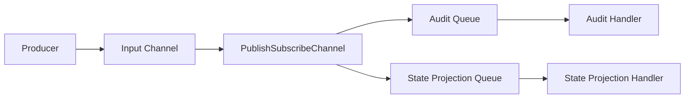
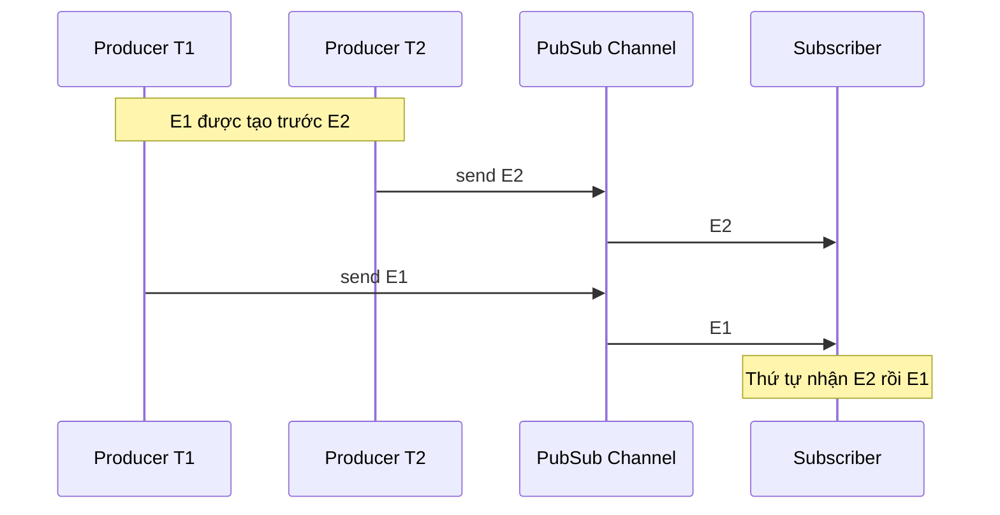
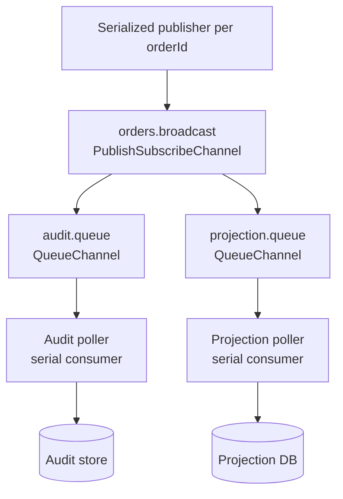
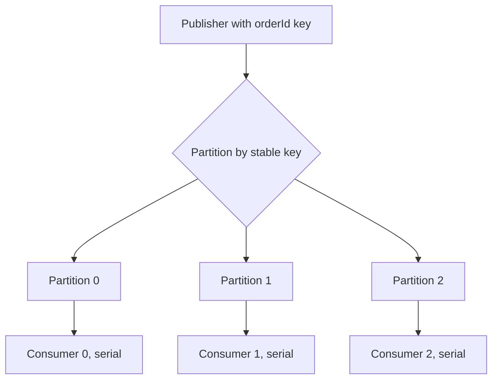
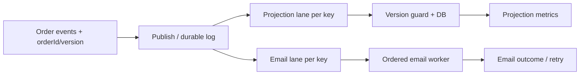

# Đảm bảo thứ tự ở từng subscriber

Trong Enterprise Integration Patterns (EIP), **Publish-Subscribe** cho phép một message được phát đến nhiều subscriber. Đây là cách tách các trách nhiệm như kiểm toán, thông báo, phân tích hoặc đồng bộ dữ liệu khỏi producer. Tuy nhiên, **mọi subscriber đều nhận được message** và **mỗi subscriber xử lý các message đúng thứ tự** là hai yêu cầu hoàn toàn khác nhau.

Ví dụ, một đơn hàng trải qua ba sự kiện:

1. `OrderCreated(orderId="O-101", version=1)`.
2. `OrderPaid(orderId="O-101", version=2)`.
3. `OrderCancelled(orderId="O-101", version=3)`.

Hệ thống mong muốn **audit** và **projection trạng thái đơn hàng** đều hiểu chuỗi diễn biến 1 → 2 → 3. Nếu subscriber cập nhật projection xử lý version 3 trước version 2, dữ liệu có thể bị ghi ngược thành `PAID` sau khi đơn đã bị hủy. Trong khi đó, subscriber analytics có thể không đòi hỏi thứ tự tuyệt đối nếu chỉ tính toán các số liệu có tính giao hoán.

Bài học thuộc chương **Publish subscribe** của module **SPRING_INTEGRATION_PATTERN**. Trong Spring Integration, chúng ta dùng Message Channel, Router, Filter, Transformer, Gateway, Splitter, Aggregator, retry, error channel và correlation để thiết kế các luồng ít phụ thuộc, dễ mở rộng và có thể kiểm thử. Trọng tâm bài này là **đảm bảo thứ tự ở từng subscriber**: phải xác định phạm vi thứ tự, biết yếu tố nào làm đảo thứ tự và bố trí cách phát/nhận/xử lý phù hợp.

> **Kết luận ngắn:** `PublishSubscribeChannel` là cơ chế *fan-out*, không phải lời cam kết mọi subscriber sẽ xử lý các sự kiện theo thứ tự nghiệp vụ trong mọi tình huống. Để có bảo đảm, cần kiểm soát cả **nguồn phát, dispatch, hàng đợi, số consumer, retry, trạng thái và hợp đồng dữ liệu**.

## 1. "Đúng thứ tự" đang nói đến thứ tự nào?

Một kiến trúc thường có nhiều thời điểm khác nhau:



Ở đây có ít nhất bốn cách hiểu về thứ tự:

| Mức | Câu hỏi | Ví dụ |
| --- | --- | --- |
| **Nguồn phát (publication order)** | Producer phát các sự kiện theo thứ tự nào? | `OrderCreated` trước `OrderPaid` |
| **Chuyển phát (dispatch/enqueue order)** | Mỗi nhánh nhận hoặc đưa vào queue theo thứ tự nào? | Audit queue nhận version 1 rồi 2 |
| **Bắt đầu xử lý (start order)** | Handler bắt đầu message nào trước? | Worker A bắt đầu v1 trước v2 |
| **Hoàn tất/ghi trạng thái (completion/commit order)** | Side effect nào được commit trước? | Database ghi v2 rồi v1 nếu hai worker chạy song song |

**Dispatch đúng thứ tự không đồng nghĩa với hoàn tất đúng thứ tự.** Một handler xử lý version 1 trong 10 giây còn version 2 trong 100 ms có thể hoàn thành đảo chiều nếu được chạy song song.

Một subscriber muốn hiển thị lịch sử có thể chỉ yêu cầu lưu các sự kiện rồi sắp theo version khi đọc. Một subscriber cập nhật **trạng thái hiện tại** thường phải bảo vệ thứ tự commit hoặc kiểm tra phiên bản tại database.

### Thứ tự toàn cục hay thứ tự theo khóa?

Hai yêu cầu rất khác nhau:

- **Global order:** mọi sự kiện của mọi đơn hàng được xử lý theo một thứ tự duy nhất. Điều này đơn giản để giải thích nhưng làm giảm khả năng xử lý song song.
- **Per-key order:** chỉ yêu cầu sự kiện có cùng `orderId` được xử lý theo version tăng dần; hai đơn khác nhau có thể chạy song song.

Trong thương mại điện tử, **thứ tự theo aggregate/business key** thường hữu dụng hơn. Cần ghi chính xác khóa nào tạo phạm vi thứ tự, chẳng hạn `orderId`, `accountId` hoặc `tenantId + entityId`. Nếu nhầm khóa, các event có liên quan có thể đi hai luồng song song và kết thúc sai thứ tự.

## 2. PublishSubscribeChannel thực sự đảm bảo điều gì?

Spring Integration có `PublishSubscribeChannel` để phân phối message cho các subscriber đã đăng ký. Cơ chế mặc định **không dùng TaskExecutor** thường gọi các subscriber đồng bộ trong thread gửi, theo cơ chế dispatch của channel.

Ví dụ một sender duy nhất lần lượt gọi:

```text
publish(E1) -> subscriber A nhận E1; subscriber B nhận E1
publish(E2) -> subscriber A nhận E2; subscriber B nhận E2
publish(E3) -> subscriber A nhận E3; subscriber B nhận E3
```

Nếu mọi thao tác ở trên đều **đồng bộ**, **một thread gửi tuần tự**, **không có thành phần xử lý bất đồng bộ phía sau** và **không xảy ra lỗi làm bỏ dở việc phát**, mỗi subscriber có thể quan sát chuỗi E1 → E2 → E3 theo thứ tự gửi. Nhưng đừng biến điều kiện minh họa này thành một bảo đảm cho mọi cấu hình.

Những yếu tố cần phân biệt:

| Cấu hình/tình huống | Ảnh hưởng đối với thứ tự |
| --- | --- |
| Một producer gửi tuần tự, PublishSubscribeChannel đồng bộ | Dễ duy trì thứ tự nhận ở từng subscriber nếu các bước downstream cũng tuần tự |
| Nhiều producer thread cùng gửi | Không có một thứ tự nghiệp vụ toàn cục được xác định chỉ bởi channel |
| PublishSubscribeChannel dùng executor | Subscriber có thể được dispatch bất đồng bộ; thứ tự bắt đầu/hoàn tất phải xem executor và các bước phía sau |
| Subscriber gửi sang ExecutorChannel | Công việc có thể được xử lý đồng thời và hoàn thành khác thứ tự |
| Subscriber gửi sang QueueChannel | Queue hỗ trợ đệm; thứ tự lấy và xử lý còn phụ thuộc số poller/consumer và cách retry |
| Subscriber gửi sang broker/HTTP | Cần xét bảo đảm ordering riêng của transport, partition, group và retry |

**Thứ tự gọi các subscriber A, B, C** cũng không phải **thứ tự sự kiện E1, E2, E3 bên trong subscriber A**. Cấu hình ưu tiên/thứ tự subscriber chỉ giải quyết vấn đề trước; nó không tự giải quyết vấn đề sau.

### Trường hợp áp dụng sequence headers

`PublishSubscribeChannel` có tùy chọn liên quan đến **apply sequence**, giúp đưa metadata trình tự/correlation vào các message phát tới các subscriber theo cách framework hỗ trợ. Nhưng **sequence number của một lần fan-out** không phải **version tăng dần của các sự kiện nghiệp vụ qua nhiều lần publish**.

Nếu `OrderCreated` được phát tới ba subscriber rồi `OrderPaid` cũng được phát tới ba subscriber, sequence header phục vụ một lần phát không đủ để chứng minh `OrderPaid` luôn được xử lý sau `OrderCreated` tại mỗi subscriber. Hãy dùng `orderId` và `version`/`sequence` ở cấp hợp đồng nghiệp vụ khi cần thứ tự liên sự kiện.

## 3. Vì sao một subscriber có thể thấy thứ tự bị đảo?

### 3.1. Nhiều thread cùng publish

Giả sử thread T1 có E1, T2 có E2. Dù T1 bắt đầu tạo E1 trước, T2 có thể gọi `send` trước T1, hoặc việc publish bị xen kẽ. Trong trường hợp đó, channel không thể tự suy ra thứ tự nghiệp vụ nếu producer không gắn sequence/version.



Để có thứ tự per-key, phải tạo thứ tự ở **nguồn chân thực** (ví dụ version tăng cùng transaction cập nhật aggregate), hoặc tuần tự hóa việc publish theo key trước khi fan-out.

### 3.2. Executor và xử lý đồng thời

Một executor với nhiều worker có thể nhận E1, E2 theo thứ tự submit nhưng chạy chúng trên các thread khác nhau. E2 hoàn tất trước E1 nếu E1 xử lý chậm, bị khóa database hoặc phải retry.

Ngay cả khi mỗi subscriber có **một executor riêng**, nếu executor đó chạy nhiều công việc đồng thời, không thể mặc định thứ tự commit được bảo đảm.

### 3.3. Queue có nhiều consumer

Queue thường giữ thứ tự đưa message vào dưới các điều kiện của implementation. Nhưng nếu hai consumer lấy E1 và E2 gần nhau, consumer thứ hai vẫn có thể ghi E2 trước consumer thứ nhất ghi E1. **FIFO ở queue không đủ để bảo đảm thứ tự side effect khi xử lý song song.**

### 3.4. Retry, redelivery và dead-letter

E1 lỗi và được đưa vào retry delay, trong khi E2 vẫn được xử lý. E2 có thể hoàn tất trước E1. Nếu E1 bị gửi tới dead-letter nhưng E2 vẫn tiếp tục, luồng trạng thái sẽ xuất hiện lỗ hổng.

Cần quy định rõ: với một key, **message lỗi có chặn message sau không?** Nếu không chặn, consumer phải có cơ chế chấp nhận xử lý ngoài thứ tự hoặc giữ lại E2 cho tới khi E1 được giải quyết.

### 3.5. Restart, rebalancing và thay đổi số subscriber

Khi ứng dụng restart, queue trong bộ nhớ có thể mất message; broker có thể phát lại message chưa ack. Việc scale thêm consumer hoặc thay đổi partition có thể ảnh hưởng cách dữ liệu được phân phối. Một subscriber mới đăng ký sau khi E1 đã phát thường không tự động nhận lại E1 chỉ vì đang dùng `PublishSubscribeChannel` nội bộ.

**Publish-subscribe nội bộ không đồng nghĩa với durable event log.** Nếu cần replay lịch sử hoặc khôi phục sau restart, hãy chọn transport và message store hỗ trợ yêu cầu đó.

## 4. Xác định rõ hợp đồng thứ tự trước khi chọn cấu hình

Thay vì nói “phải đúng thứ tự”, hãy viết một **ordering contract có thể kiểm thử**.

Ví dụ với projection của đơn hàng:

> Đối với cùng một `orderId`, subscriber chỉ được áp dụng sự kiện version `n + 1` sau khi version `n` đã được áp dụng thành công. Sự kiện trùng version không được gây side effect lặp. Nếu thiếu version, subscriber tạm dừng key tương ứng và yêu cầu khôi phục/đối soát.

Một hợp đồng cần chỉ rõ:

1. **Đơn vị thứ tự:** toàn bộ stream hay theo `orderId`?
2. **Nguồn đánh số:** version do database/aggregate cấp hay số thứ tự tại publisher?
3. **Phạm vi duy trì:** chỉ trong một JVM, giữa các instance, hay qua restart?
4. **Mốc hoàn thành:** bắt đầu handler, commit database, hay acknowledgment từ hệ thống ngoài?
5. **Chính sách lỗ hổng:** thiếu E2 mà nhận E3 thì chờ, retry, đưa vào quarantine hay ghi partial result?
6. **Chính sách duplicate:** cùng event ID/version xuất hiện lại có tạo side effect không?
7. **SLA và throughput:** có chấp nhận block toàn bộ key khi một event lỗi không?

Các subscriber **không nhất thiết có cùng hợp đồng**. Subscriber audit có thể lưu một stream theo version; analytics có thể upsert theo key; email có thể phải giữ thứ tự thông báo; một hệ thống khác có thể xử lý độc lập. Không nên áp đặt tuần tự toàn cục lên tất cả chỉ vì một subscriber có yêu cầu chặt.

## 5. Một thiết kế nội bộ: fan-out sang queue độc lập của từng subscriber

Một kiến trúc dễ giải thích là:

1. Nguồn phát **tuần tự theo phạm vi thứ tự đã chọn**.
2. `PublishSubscribeChannel` chạy **đồng bộ** để fan-out message vào các nhánh.
3. Mỗi nhánh có một `QueueChannel` **riêng**, theo FIFO.
4. Mỗi queue có **một luồng xử lý tuần tự**; không đặt executor nhiều worker sau poller.
5. Nếu một message bị lỗi, chính sách của subscriber quyết định chặn/retry, không để message sau âm thầm vượt qua khi hợp đồng yêu cầu nghiêm ngặt.



**Mỗi subscriber độc lập:** audit có thể xử lý chậm mà không nhất thiết làm projection handler chờ đến khi audit hoàn tất. Tuy nhiên, việc **enqueue** đến mỗi queue vẫn có thể ảnh hưởng publisher: nếu queue đầy, việc gửi có thể bị chặn hoặc thất bại tùy timeout và cấu hình. Điều đó phải được xử lý bằng backpressure/failure policy.

Đây chỉ là **một cách bảo vệ thứ tự trong process** và vẫn có giới hạn: mặc định QueueChannel dùng bộ nhớ; không tự bảo đảm message tồn tại khi tiến trình chết. Nếu yêu cầu vận hành xuyên restart, phải dùng lưu bền thích hợp hoặc broker với cơ chế ordering và redelivery tương ứng.

### 5.1. Hợp đồng message có sequence và business key

```java
import java.time.Instant;

record OrderChanged(
    String eventId,
    String orderId,
    long version,
    String status,
    Instant occurredAt
) {
    OrderChanged {
        if (eventId == null || eventId.isBlank()
                || orderId == null || orderId.isBlank()
                || version < 1 || status == null || status.isBlank()
                || occurredAt == null) {
            throw new IllegalArgumentException("Invalid order event");
        }
    }
}

interface AuditService {
    void append(OrderChanged event);
}

interface ProjectionService {
    void apply(OrderChanged event);
}
```

Trong ví dụ, `eventId` định danh sự kiện để kiểm tra duplicate; `orderId` là key cho ordering; `version` là số phiên bản **do hệ thống nguồn bảo đảm tăng đúng**, không phải tự lấy ngẫu nhiên từ thread gửi.

Constructor chỉ kiểm tra hình thức. Nó **không** chứng minh version 3 được phát sau version 2. Hợp đồng thứ tự phải được tạo và bảo vệ ở producer/source of truth, cộng với consumer xử lý version.

### 5.2. Spring Integration Java DSL: mỗi subscriber có queue riêng

```java
import org.springframework.context.annotation.Bean;
import org.springframework.context.annotation.Configuration;
import org.springframework.integration.annotation.Gateway;
import org.springframework.integration.annotation.IntegrationComponentScan;
import org.springframework.integration.annotation.MessagingGateway;
import org.springframework.integration.channel.DirectChannel;
import org.springframework.integration.channel.PublishSubscribeChannel;
import org.springframework.integration.channel.QueueChannel;
import org.springframework.integration.config.EnableIntegration;
import org.springframework.integration.dsl.IntegrationFlow;
import org.springframework.integration.dsl.Pollers;
import org.springframework.messaging.MessageChannel;
import org.springframework.messaging.PollableChannel;

@MessagingGateway
interface OrderEventGateway {
    @Gateway(requestChannel = "orders.input")
    void publish(OrderChanged event);
}

@Configuration
@EnableIntegration
@IntegrationComponentScan
class SubscriberOrderingConfiguration {

    @Bean("orders.input")
    MessageChannel orderInput() {
        return new DirectChannel();
    }

    @Bean("orders.broadcast")
    PublishSubscribeChannel broadcast() {
        // Không gắn TaskExecutor: dispatch đồng bộ.
        return new PublishSubscribeChannel();
    }

    @Bean("audit.queue")
    PollableChannel auditQueue() {
        return new QueueChannel(500);
    }

    @Bean("projection.queue")
    PollableChannel projectionQueue() {
        return new QueueChannel(500);
    }

    @Bean
    IntegrationFlow toBroadcast() {
        return IntegrationFlow.from("orders.input")
            .channel("orders.broadcast")
            .get();
    }

    // Hai bridge sau đăng ký hai subscriber của cùng PubSub channel.
    @Bean
    IntegrationFlow broadcastToAudit() {
        return IntegrationFlow.from("orders.broadcast")
            .channel("audit.queue")
            .get();
    }

    @Bean
    IntegrationFlow broadcastToProjection() {
        return IntegrationFlow.from("orders.broadcast")
            .channel("projection.queue")
            .get();
    }

    @Bean
    IntegrationFlow auditConsumer(AuditService audit) {
        return IntegrationFlow.from("audit.queue",
                endpoint -> endpoint.poller(
                    Pollers.fixedDelay(100).maxMessagesPerPoll(1)))
            .handle(OrderChanged.class, (event, headers) -> {
                audit.append(event);
                return null; // endpoint một chiều
            })
            .get();
    }

    @Bean
    IntegrationFlow projectionConsumer(ProjectionService projection) {
        return IntegrationFlow.from("projection.queue",
                endpoint -> endpoint.poller(
                    Pollers.fixedDelay(100).maxMessagesPerPoll(1)))
            .handle(OrderChanged.class, (event, headers) -> {
                projection.apply(event);
                return null;
            })
            .get();
    }
}
```

Đây là ví dụ Spring Integration Java DSL cho **một ứng dụng Spring**. Ứng dụng phải có dependency Spring Integration tương ứng, bean triển khai `AuditService` và `ProjectionService`, cũng như khai báo Gateway trong vùng được quét bởi `@IntegrationComponentScan` hoặc đăng ký tương đương.

Cách đọc kiến trúc:

- `orders.input` nhận sự kiện từ Gateway.
- `orders.broadcast` là `PublishSubscribeChannel` không cấu hình executor, phát tới hai flow đã đăng ký.
- Mỗi flow bridge gửi message vào **queue độc lập** của một subscriber.
- Mỗi flow tiêu thụ có poller với `maxMessagesPerPoll(1)`, không thêm executor song song. Trong một cấu hình poller tuần tự và không chồng lấn, handler xử lý message theo thứ tự lấy từ queue.
- Handler trả `null` để kết thúc luồng một chiều, không tự tạo reply.

**Điều kiện quan trọng:** Đoạn cấu hình này **không tự khóa tất cả thread có thể gọi `OrderEventGateway.publish`**. Nếu nhiều caller gửi cùng `orderId` đồng thời, thứ tự thực tế đi vào `orders.broadcast` vẫn có thể khác thứ tự nghiệp vụ. Producer phải tuần tự hóa theo key hoặc dùng một nguồn đã bảo đảm thứ tự trước khi gọi Gateway.

### 5.3. Giới hạn của ví dụ

Đừng coi `QueueChannel(500)` là một durable queue. Bộ đệm 500 message có thể đầy; cần chính sách timeout/backpressure. Khi một handler ném exception, không được mặc định message được **đưa trở lại đầu queue** hoặc sẽ được retry trước message tiếp theo: đường poller error handling và retry phải cấu hình rõ ràng.

`maxMessagesPerPoll(1)` hạn chế số message cho mỗi lần polling, nhưng **không phải một cơ chế phân tán để khóa thứ tự toàn hệ thống**. Không gắn thêm poller thứ hai, không cấu hình task executor song song, và phải kiểm tra scheduler/endpoint thực tế không chạy chồng lấn khi cần bảo đảm chặt.

Nếu yêu cầu là “đã chấp nhận event thì chắc chắn xử lý sau restart”, cần lưu bền ở nguồn phát/broker/message store và quản lý ack/retry phù hợp. Queue trong bộ nhớ chỉ minh họa cơ chế fan-out độc lập và thứ tự tiêu thụ dưới những giả định cụ thể.

## 6. Đảm bảo thứ tự từ producer đến fan-out

Đôi khi vấn đề nằm **trước** `PublishSubscribeChannel`. Nếu hai service cùng cập nhật một đơn và phát event, thứ tự commit và thứ tự publish có thể không tương ứng.

```text
T1: cập nhật Order v10, commit
T2: cập nhật Order v11, commit
T2: publish v11
T1: publish v10

Subscriber nhận v11 -> v10
```

Gắn `version` giúp **nhận diện** đảo thứ tự; nó không tự **ngăn** đảo thứ tự. Các biện pháp phổ biến tùy kiến trúc:

- **Serialize update theo aggregate:** cùng `orderId` chỉ có một thao tác cập nhật tại một thời điểm hoặc sử dụng optimistic concurrency/version check.
- **Transactional Outbox:** ghi event/outbox trong cùng transaction với cập nhật nghiệp vụ để tránh lỗi dual-write. Phải thiết kế publisher đưa các event của cùng aggregate ra theo version/sequence, vì outbox đơn thuần chưa tự hứa thứ tự phát khi nhiều publisher chạy song song.
- **Một luồng publisher theo key:** nhóm sự kiện cùng key về một partition/worker xử lý tuần tự.
- **Sequence/version tại nguồn:** downstream có thể phát hiện duplicate, lỗ hổng và message đến muộn; chỉ dùng timestamp không đủ để xác định thứ tự tuyệt đối.
- **Sticky routing theo business key:** giữ mọi event cùng key vào cùng luồng tuần tự trong suốt một giai đoạn xử lý, có quy trình chuyển ownership khi scale/rebalance.

### Vì sao timestamp không đủ?

Hai event có thể có timestamp trùng độ phân giải, clock giữa các máy bị lệch, hoặc timestamp được tạo **trước** transaction commit. Sắp xếp theo `occurredAt` có thể tiện cho hiển thị, nhưng khi thứ tự quyết định trạng thái nghiệp vụ, nên có version/sequence được cấp theo ranh giới nhất quán.

Nếu dùng **Kafka**, producer có thể dùng `orderId` làm record key để đưa các sự kiện cùng key vào cùng partition theo partitioning đang được áp dụng. Kafka bảo đảm thứ tự record **trong một partition** theo thứ tự được ghi; nó không tự sửa thứ tự sai do producer publish nhầm, và không đảm bảo thứ tự giữa các partition. Mỗi consumer group/subscriber vẫn cần giữ thứ tự xử lý từ poll đến commit side effect.

## 7. Subscriber độc lập: mỗi nhánh cần chính sách lỗi riêng

Hai subscriber có thể cần mức đảm bảo khác nhau.

| Subscriber | Mong muốn | Gợi ý cơ chế |
| --- | --- | --- |
| **Audit ledger** | Không mất event; bảo toàn thứ tự theo order | Durable event store/broker, một consumer tuần tự theo key, idempotency |
| **Projection trạng thái** | Không áp dụng version cũ sau version mới | Version check/optimistic update trong DB; xử lý gap |
| **Email** | Không gửi thông báo “đã trả tiền” trước “đã tạo đơn” khi yêu cầu | Queue riêng, chính sách block/retry theo key, idempotency với provider |
| **Analytics tổng hợp** | Có thể xử lý song song nếu kết quả có tính giao hoán | Per-key order có thể không cần, nhưng phải xử lý duplicate/late event |

Nếu audit bị chậm, projection có thể tiếp tục nếu hai queue độc lập và nguồn đã enqueue thành công cho cả hai. **Điều này không có nghĩa toàn bộ hệ thống không chịu backpressure**: queue audit đầy vẫn có thể ảnh hưởng một lần fan-out mới.

### Định nghĩa rõ khi một nhánh thất bại

Với subscriber yêu cầu thứ tự nghiêm ngặt, chọn một trong các chính sách:

1. **Chặn key:** chưa xử lý E2 nếu E1 chưa hoàn tất. Có thể dùng queue/partition tuần tự và retry E1 cho đến khi thành công hoặc chuyển sang trạng thái cần can thiệp.
2. **Giữ buffer và xử lý gap:** cho E2 đến nơi nhận nhưng chưa áp dụng; lưu nó để đợi E1 hoặc thực hiện khôi phục E1.
3. **Cho phép bỏ qua có chủ đích:** phù hợp với một số analytics, nhưng phải ghi nhận lỗ hổng và biết dữ liệu sẽ được bù lại hay không.
4. **Quarantine/parking:** dữ liệu sai vĩnh viễn cần được tách để tránh retry vô hạn; khi quyết định bỏ E1, cần xác định E2 còn có thể áp dụng hợp lệ hay không.

**Dead-letter không phải tự động bảo đảm thứ tự.** Đưa E1 sang dead-letter rồi tiếp tục E2 có thể làm projection thiếu trạng thái trung gian. Nếu cần bảo toàn thứ tự/consistency, phải có quy trình khôi phục hoặc ngữ nghĩa bỏ qua được nghiệp vụ chấp nhận.

## 8. Version guard: tuyến phòng vệ cuối ở mỗi subscriber

Ngay cả khi transport được thiết kế FIFO, vẫn nên kiểm tra version ở subscriber có side effect quan trọng. Một ví dụ logic trong database:

```text
Khi nhận event (orderId, eventId, version):
  current = trạng thái projection hiện tại theo orderId

  nếu eventId đã xử lý:
      bỏ qua (duplicate)

  nếu version == current.version + 1:
      áp dụng thay đổi và lưu current.version = version
      ghi dấu eventId đã xử lý trong cùng transaction
      commit

  nếu version <= current.version:
      xác định duplicate/late event
      không ghi đè trạng thái mới bằng dữ liệu cũ

  nếu version > current.version + 1:
      ghi nhận GAP, giữ event để xử lý sau hoặc yêu cầu replay
      không âm thầm áp dụng vượt version
```

Đây là **pseudocode**, không phải transaction framework tự cung cấp. Trong database có nhiều consumer, việc đọc version rồi cập nhật phải được bảo vệ bằng khóa hàng hoặc optimistic compare-and-set trong transaction; chỉ kiểm tra bằng `if` trong bộ nhớ có thể gây race condition.

Một vấn đề thiết kế: **có đủ mọi version trong stream hay không?** Nếu producer chỉ phát sự kiện khi có thay đổi nghiệp vụ quan trọng, version domain có thể tăng vì những cập nhật không phát event. Khi đó điều kiện `current.version + 1` không phù hợp; nên dùng **sequence riêng cho stream sự kiện** hoặc hợp đồng cho phép nhảy phiên bản có kiểm soát. Không thể dùng một con số mà không biết nó biểu diễn thứ tự nào.

### Event không thể áp dụng lặp lại an toàn

Nếu handler gửi email, gọi API thanh toán hoặc tác động tới hệ thống ngoài, transaction trong database nội bộ không tự làm side effect ngoài trở thành atomic. Cần dùng idempotency key mà provider hỗ trợ, hoặc outbox/worker có cơ chế đối soát, để tránh side effect lặp khi retry.

Vì vậy, **ordering** và **idempotency** là hai trục độc lập:

- Ordering ngăn áp dụng **v2 trước v1** khi nghiệp vụ cấm.
- Idempotency ngăn **v1 được áp dụng hai lần** khi event bị redelivery.

Cả hai đều cần thiết nếu subscriber duy trì trạng thái.

## 9. Scale nhiều instance mà vẫn giữ thứ tự theo key

Một subscriber tuần tự toàn cục là điểm nghẽn nếu lưu lượng lớn. Hướng mở rộng phổ biến là **chia key thành các lane/partition**, trong đó mỗi lane được một consumer xử lý tuần tự.



Điều kiện cơ bản:

- Cùng một `orderId` phải vào **cùng partition/lane** trong giai đoạn có yêu cầu ordering.
- Một partition được xử lý tuần tự cho subscriber tương ứng; nếu handler giao việc cho executor khác thì phải giữ được thứ tự commit hoặc có version guard.
- Khi scale/rebalance, phải quản lý **ownership, offset/ack và trạng thái đang xử lý** để không có hai worker cùng áp dụng side effect cho một key ngoài chính sách.
- Đổi số partition hoặc chiến lược hashing có thể làm key đổi nơi; cần kế hoạch chuyển tiếp, drain hoặc fencing nếu có trạng thái cục bộ.

### Một topic không nhất thiết giống một subscriber

Trong Kafka, một **consumer group** nhận một bản sao logic của dòng sự kiện từ các partition của topic theo group đó. Hai dịch vụ audit và projection có thể dùng **hai group khác nhau** để nhận cùng các sự kiện. Trong mỗi group, các partition được phân chia cho các consumer; ordering được xem xét **trong từng partition**, không phải toàn topic.

Nếu dùng RabbitMQ, queue có thể giữ thứ tự enqueue trong các điều kiện của nó, nhưng competing consumers, prefetch, requeue, priority và retry có thể làm thứ tự **hoàn tất** khác mong muốn. Đừng dựa vào FIFO của queue để suy ra ordering của side effect khi có nhiều consumer.

Với Spring Integration nội bộ, có thể dùng các queue/lane độc lập hoặc message store bền vững tùy yêu cầu. Dù chọn công nghệ nào, hợp đồng **per-key ordering** và **version guard** vẫn cần được kiểm tra.

## 10. Fan-out không phải Splitter, Aggregator hay Recipient List

Publish-subscribe có quan hệ với các EIP khác nhưng không thay thế nhau.

| Pattern | Vai trò | Quan hệ với ordering |
| --- | --- | --- |
| **Publish-Subscribe Channel** | Phát cùng sự kiện cho các subscriber | Cần thiết kế ordering riêng trong từng nhánh |
| **Recipient List Router** | Chọn danh sách recipient cho một message | Cũng tạo fan-out; mỗi recipient cần chính sách ordering |
| **Splitter** | Tách một message chứa nhiều phần thành nhiều message | Có thể sinh sequence/correlation metadata; phải xét thứ tự các phần |
| **Aggregator** | Ghép nhiều message theo nhóm và điều kiện release | Release strategy không tự tạo thứ tự commit cho các subscriber độc lập |
| **Filter** | Cho message qua hoặc từ chối | Có thể tạo khoảng trống trong sequence nếu lọc bỏ event |
| **Transformer** | Thay đổi payload/schema | Phải giữ business key/version/correlation khi downstream cần |
| **Router** | Chọn channel theo quy tắc | Route cùng key qua hai lane khác nhau có thể phá ordering |

### Sequence của Splitter không thay thế ordering trên stream

Splitter có thể phát nhiều phần thuộc một request và gắn metadata liên quan để Aggregator ghép lại. Nhưng **sequenceNumber của những phần trong cùng một nhóm** khác với **version của nhiều sự kiện thuộc một đơn hàng qua thời gian**.

Ví dụ một order gồm 3 dòng hàng: Splitter sinh các phần 1/3, 2/3, 3/3. Nếu sau đó có `OrderUpdated(version=5)`, con số `5` này không cùng hệ quy chiếu với `sequenceNumber=2` của dòng hàng.

**Correlation ID** giúp biết các message thuộc cùng nhóm, còn **ordering key + version** giúp kiểm soát thứ tự của chuỗi sự kiện. Một message có thể cần cả hai.

### Filter có thể làm xuất hiện gap

Nếu subscriber lọc bỏ E2 nhưng version guard vẫn kỳ vọng E1 → E2 → E3, thì E3 sẽ bị giữ mãi. Do đó, khi thiết kế per-key ordering cần biết Filter ở trước hay sau điểm đánh sequence và “bị lọc bỏ” có được xem là một bước hợp lệ đã giải quyết hay không.

Có thể thiết kế sequence chỉ trên **dòng sự kiện thật sự cấp cho subscriber**, hoặc ghi nhận một trạng thái `SKIPPED` có kiểm soát cho version không áp dụng. Không nên lặng lẽ bỏ E2 mà vẫn đòi E3 có version liên tục.

## 11. Error channel, retry và trạng thái không rõ

Giả sử projection handler ném exception khi xử lý E1:

- Trong luồng `DirectChannel` đồng bộ, exception thường truyền về caller.
- Trong `QueueChannel` với poller hoặc `ExecutorChannel`, lỗi ở thread xử lý có thể được error handler bắt và công bố thành `ErrorMessage` nếu đã cấu hình.
- Với broker, listener container, ack/offset, retry và dead-letter quyết định message được phát lại thế nào.

Chỉ tạo một bean tên `errorChannel` hoặc một channel `projection.errors` **không tự bảo đảm E1 sẽ được retry trước E2**. Đường lỗi phải được cấu hình và kiểm thử theo transport thực tế.

### Ba trạng thái kết quả cần phân biệt

| Trạng thái | Ý nghĩa | Cách xử lý |
| --- | --- | --- |
| `SUCCESS` | Side effect của event đã commit/được xác nhận theo hợp đồng | Cho phép áp dụng event tiếp theo |
| `FAILED_RETRYABLE` | Lỗi tạm thời có thể thử lại | Giữ key/lane theo chính sách; backoff có giới hạn |
| `UNKNOWN` | Timeout, không biết bên ngoài đã xử lý hay chưa | Đối soát/idempotency trước khi áp dụng lại hoặc vượt qua |

Đối với yêu cầu **nghiêm ngặt**, một event có trạng thái `UNKNOWN` không thể được xem chắc chắn đã thất bại để tùy ý cho event sau vượt lên. Ví dụ E1 là thanh toán, E2 là hoàn tiền: xử lý E2 khi trạng thái E1 chưa rõ có thể tạo kết quả sai.

Khi có nhiều subscriber, một nhánh có thể lỗi trong khi các nhánh khác tiếp tục. Mục tiêu “giữ thứ tự ở từng subscriber” **không** có nghĩa phải chặn mọi subscriber chỉ vì một nhánh lỗi. Cần chọn giữa isolation và yêu cầu đồng bộ liên nhánh, rồi xác định hợp đồng rõ ràng.

## 12. Quan sát thứ tự ở từng subscriber

Các metric và log tổng hợp của `PublishSubscribeChannel` không đủ để biết thứ tự thực sự được áp dụng trong database của từng subscriber. Nên quan sát theo các mốc:

```text
event_published
  eventId=evt-21 orderId=O-101 version=1
subscriber_received
  subscriber=projection eventId=evt-21 version=1
subscriber_processing_started
  subscriber=projection eventId=evt-21 version=1
subscriber_committed
  subscriber=projection eventId=evt-21 version=1
subscriber_received
  subscriber=projection eventId=evt-22 version=2
subscriber_committed
  subscriber=projection eventId=evt-22 version=2
```

Khi phát hiện `subscriber_committed(version=3)` trước `version=2` ở cùng key, cần biết đây là vi phạm, một chủ đích cho phép skip hay một trường hợp đang chờ bù dữ liệu.

Các trường quan sát phù hợp:

| Trường | Tác dụng |
| --- | --- |
| `eventId` và `orderId` | Tìm message cụ thể, nhận diện duplicate |
| `streamSequence`/`version` | Xác định thứ tự nghiệp vụ |
| `subscriberId` | Biết nhánh nào đang nhận/xử lý |
| `partition`/`laneId` | Theo dõi nơi xử lý tuần tự |
| `receivedAt`, `startedAt`, `committedAt` | Đo độ trễ và phát hiện đảo thứ tự |
| `lastAppliedVersion` | Biết trạng thái hiện tại của subscriber |
| `retryCount` và `failureReason` | Phân biệt retry/gap với lỗi nghiệp vụ |
| `correlationId`/`traceId` | Liên kết với bước upstream hoặc nhóm công việc |

Metrics nên theo dõi **lag, số gap, duplicate, retry, dead-letter, queue depth và processing latency** theo tên subscriber hoặc partition. Tránh đặt `orderId` hay `eventId` làm tag metric vì cardinality cao; giữ chúng trong log/trace/audit có chính sách bảo vệ dữ liệu.

## 13. Kiểm thử thứ tự như một hợp đồng end-to-end

Một unit test chỉ kiểm tra `QueueChannel` trả ra FIFO chưa đủ để chứng minh side effect giữ thứ tự khi có hai consumer hoặc retry. Cần xác minh **kết quả ở từng subscriber**.

### 13.1. Ma trận kiểm thử

| Tình huống | Kỳ vọng |
| --- | --- |
| Một publisher gửi E1, E2, E3 tuần tự | Audit và projection mỗi bên quan sát đúng 1 → 2 → 3 |
| Audit chậm hơn projection | Hai nhánh độc lập, nhưng nội bộ mỗi nhánh vẫn giữ thứ tự |
| E2 mất thời gian xử lý lâu | E3 không được commit trước E2 nếu cùng key cần ordering nghiêm ngặt |
| Có hai publisher cho cùng key | Hệ thống phát hiện hoặc ngăn publish đảo version |
| Hai subscriber có tốc độ khác nhau | Không giả định audit và projection cùng hoàn tất một thời điểm |
| E1 lỗi tạm thời | Retry/gap policy ngăn E2 vượt E1 khi hợp đồng cấm |
| Event trùng E2 | Không áp dụng E2 hai lần |
| Nhận E3 khi chưa có E2 | Gap được nhận diện, giữ hoặc xử lý theo chính sách |
| Một queue đầy | Producer/fan-out báo lỗi hoặc thực hiện backpressure theo cấu hình, không âm thầm bảo đảm mọi subscriber đã nhận |
| Restart sau khi có message chờ | Kiểm tra cơ chế persistence/recovery đã chọn |
| Subscriber scale từ một lên nhiều instance | Thứ tự theo key vẫn được kiểm soát qua partition/ownership |

### 13.2. Test ví dụ với JUnit 5 và Awaitility

Trong test Spring Integration, bạn có thể dùng các fake service lưu các version nhận được bằng cấu trúc thread-safe rồi gửi E1, E2, E3 tuần tự từ **một test thread**:

```java
import static org.junit.jupiter.api.Assertions.assertEquals;
import static org.awaitility.Awaitility.await;

import java.time.Duration;
import java.time.Instant;
import java.util.List;
import java.util.concurrent.CopyOnWriteArrayList;
import org.junit.jupiter.api.Test;

// Phác thảo test: gateway là bean của Spring Test,
// auditSeen và projectionSeen do fake service ghi nhận khi xử lý xong.
class SubscriberOrderingTest {

    OrderEventGateway gateway; // inject từ test fixture

    List<Long> auditSeen = new CopyOnWriteArrayList<>();
    List<Long> projectionSeen = new CopyOnWriteArrayList<>();

    @Test
    void eachSubscriberAppliesEventsInSourceOrder() {
        for (long version = 1; version <= 3; version++) {
            gateway.publish(new OrderChanged(
                "evt-" + version,
                "O-101",
                version,
                "STATE-" + version,
                Instant.now()));
        }

        await().atMost(Duration.ofSeconds(5))
            .untilAsserted(() -> {
                assertEquals(List.of(1L, 2L, 3L), auditSeen);
                assertEquals(List.of(1L, 2L, 3L), projectionSeen);
            });
    }
}
```

Đây là **phác thảo phần assertion**: test fixture phải inject `gateway` và kết nối `AuditService`/`ProjectionService` giả vào hai danh sách; phụ thuộc Awaitility cần có ở test scope. Đoạn này chưa phải test class hoàn chỉnh tự chạy, và cũng **chưa** kiểm tra trường hợp concurrency, crash hay broker.

Để đánh giá thực sự, bổ sung:

- Cho E1 chậm, E2 nhanh; xác minh không đảo **commit order** trong cùng subscriber.
- Gửi cùng `orderId` từ hai thread; kiểm tra cơ chế tuần tự hóa đầu nguồn hoặc version guard.
- Cho E2 ném exception; kiểm tra không áp dụng E3 khi E2 chưa được giải quyết.
- Khởi động lại consumer trong môi trường có broker/message store bền vững và kiểm tra recovery.
- Test partition/rebalance với nhiều consumer, đảm bảo cùng key không bị cập nhật chồng lấn ngoài chính sách.

### 13.3. Không suy diễn từ kết quả test đơn giản

Nếu test ba event tuần tự chạy PASS, điều đó chỉ chứng minh **cấu hình và điều kiện đã test**. Nó không chứng minh đúng thứ tự trong mọi môi trường nhiều thread, mọi loại message, retry, redelivery hoặc khi policy về key/partition thay đổi. Chỉ được tuyên bố bảo đảm trong phạm vi đã nêu và đã kiểm chứng.

## 14. Những sai lầm thường gặp

**“PublishSubscribeChannel tự đảm bảo thứ tự tuyệt đối cho mọi subscriber.”** Không đúng nếu producer đồng thời, executor nhiều worker hoặc downstream bất đồng bộ làm đảo thứ tự xử lý.

**“Sắp xếp thứ tự subscriber A rồi B là đã giải quyết thứ tự message.”** Thứ tự gọi subscriber cho **một message** khác hoàn toàn thứ tự E1/E2 trong **một subscriber**.

**“Bật applySequence là thứ tự sự kiện liên thời gian được đảm bảo.”** Sequence metadata của fan-out không thay thế version/sequence nghiệp vụ qua nhiều lần publish.

**“Queue FIFO nghĩa là commit cũng FIFO.”** Hai consumer có thể lấy FIFO nhưng ghi database ngược thứ tự. Muốn bảo đảm phải kiểm soát concurrency hoặc dùng version guard/serialization.

**“Chỉ cần maxMessagesPerPoll(1).”** Tham số này giới hạn số message mỗi poll; nó không giải quyết nhiều publisher, nhiều poller, executor downstream, khôi phục sau crash hoặc retry vượt event.

**“Có timestamp là biết được event nào trước.”** Timestamp có thể lệch đồng hồ, trùng giá trị hoặc không phản ánh thứ tự commit/publish.

**“Dead-letter E1 rồi E2 tiếp tục vẫn là đúng thứ tự.”** Có thể sai nếu business state bắt buộc áp dụng E1 trước E2. Dead-letter cần phối hợp gap policy.

**“Có error channel là E1 tự được phát lại đúng vị trí.”** Error channel chuyển thông tin lỗi khi cấu hình; retry/requeue/order phải được thiết kế riêng.

**“Tất cả subscriber phải chờ nhau để giữ thứ tự.”** Mỗi subscriber có thể có lane riêng và tiến độ khác nhau; yêu cầu thứ tự cần được hiểu **bên trong mỗi nhánh**, trừ khi nghiệp vụ thực sự cần đồng bộ liên nhánh.

**“Kafka có ordering nên không cần idempotency.”** Ordering theo partition không ngăn redelivery/duplicate hoặc side effect lặp. Cần cả key, xử lý tuần tự và idempotency.

## 15. Bài tập thiết kế: projection và email từ sự kiện đơn hàng

Một nền tảng bán hàng phát `OrderStateChanged(orderId, version, status)`. Hai subscriber bắt buộc nhận mọi sự kiện:

- **Projection:** cập nhật trạng thái đơn trong database; version mới không được bị ghi đè bởi version cũ.
- **Email:** gửi thông báo theo chuỗi trạng thái; không được gửi email “đã hủy” trước email “đã thanh toán” đối với cùng một đơn nếu cả hai thông báo đều được yêu cầu.

Cần xử lý đến 10.000 đơn/giờ. Một đơn có thể có nhiều cập nhật nhanh, còn hệ thống gửi email đôi khi timeout. Bạn hãy thiết kế:



Trả lời các câu hỏi:

1. Thứ tự cần bảo đảm **toàn cục** hay chỉ theo `orderId`? Vì sao?
2. Nguồn nào gán `version` và ngăn hai producer cùng sinh một version?
3. Nếu email E2 timeout nhưng E3 đã tới queue, E3 được xử lý ngay hay phải chờ? Quy tắc retry/gap nào áp dụng?
4. Làm sao tránh gửi email E2 hai lần khi provider đã gửi thành công nhưng response bị mất?
5. Nếu projection nhận E5 rồi E4, guard ở database sẽ hành xử thế nào? Phải lưu/bù message thiếu ra sao?
6. Nếu dùng Kafka, bạn chọn partition key và nhóm consumer như thế nào cho từng subscriber?
7. Làm thế nào scale subscriber từ 1 lên 5 instance mà giữ được key ownership?
8. Metric/log/trace nào đủ để khẳng định từng subscriber đã áp dụng version nào, không chỉ nhận message?
9. Khi queue đầy hoặc broker ngừng hoạt động, producer phải báo thành công/thất bại theo hợp đồng nào?
10. Một integration test nào có thể chứng minh việc không đảo commit khi E1 chậm hơn E2?

**Tiêu chí đạt:** Mỗi nhánh có ordering contract rõ ràng; có giải pháp ở cả publisher, transport và consumer; error/retry không làm lặng lẽ bỏ version; side effect được bảo vệ khỏi duplicate; các giả định và giới hạn được ghi rõ.

## Ghi nhớ

Để **đảm bảo thứ tự ở từng subscriber**, trước hết cần xác định **thứ tự của điều gì**, theo **khóa nào** và tại **mốc nào** (nhận, bắt đầu hay commit). `PublishSubscribeChannel` giúp fan-out message nhưng không tự bảo đảm ordering xuyên thread, queue, broker, retry hay restart.

Thiết kế có thể bắt đầu với **nguồn phát tuần tự theo key**, **queue/lane độc lập cho mỗi subscriber**, **một consumer tuần tự trong mỗi lane**, và **sequence/version guard cùng idempotency tại ranh giới side effect**. Với hệ thống phân tán, bổ sung partition key, durable delivery, xử lý gap, recovery và observability. Khi hiểu rõ các điều kiện ấy, bạn có thể kết hợp Publish-Subscribe với Gateway, Filter, Transformer, Router, Splitter, Aggregator, error channel và correlation mà vẫn kiểm soát được thứ tự nghiệp vụ.

