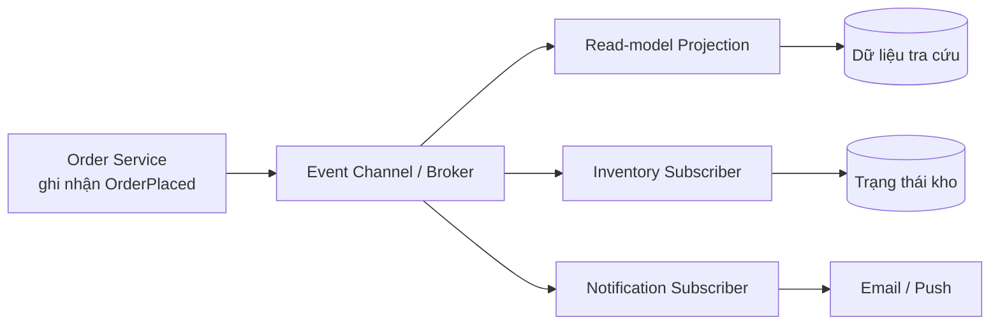
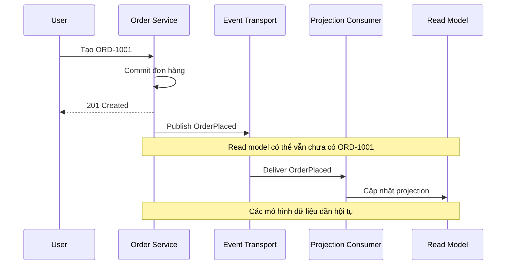
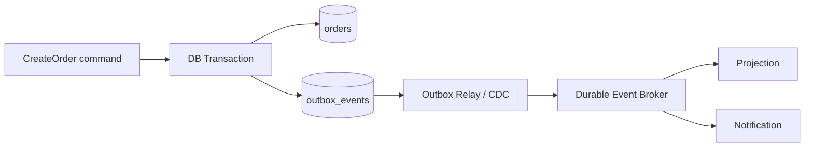
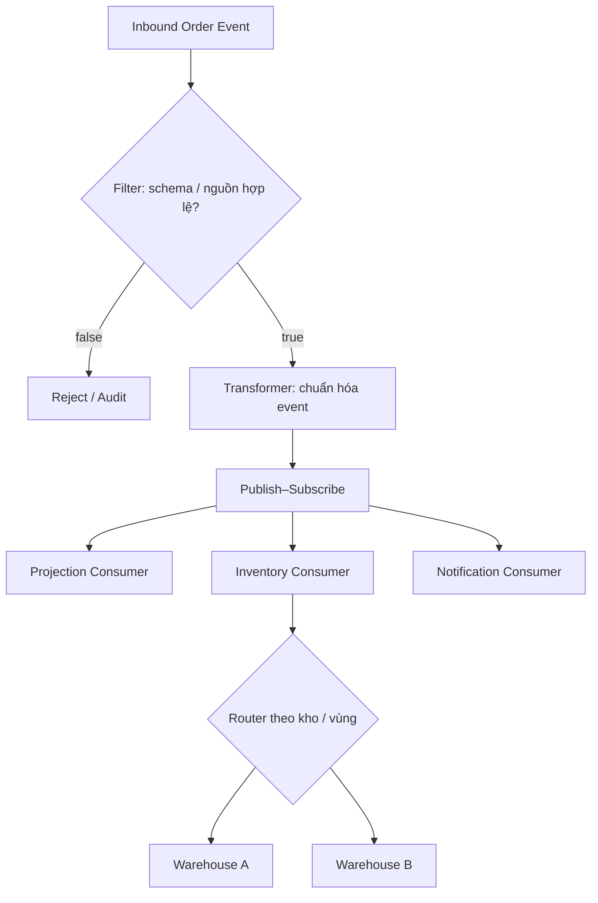

# Fan-out event và eventual consistency trong Publish–Subscribe

Một hệ thống bán hàng có thể cần làm nhiều việc sau khi đơn hàng được tạo: cập nhật màn hình theo dõi, trừ tồn kho dự kiến, tính chỉ số kinh doanh và gửi thông báo. Nếu dịch vụ tạo đơn gọi lần lượt mọi chức năng, thời gian đáp ứng và độ ổn định của chức năng tạo đơn sẽ phụ thuộc vào tất cả thành phần phía sau. Mẫu **Publish–Subscribe** (xuất bản – đăng ký) đưa một sự kiện lên một kênh để nhiều subscriber cùng tiếp nhận, giúp các trách nhiệm được tách ra thành những nhánh xử lý độc lập hơn.

Khi các nhánh cập nhật các mô hình dữ liệu hoặc hệ thống khác nhau vào những thời điểm khác nhau, ta thường chấp nhận **eventual consistency** (*nhất quán cuối cùng*): ngay sau một thay đổi, một số góc nhìn có thể còn cũ; nếu các sự kiện được chuyển phát, xử lý và khôi phục thành công, những góc nhìn đó sẽ dần hội tụ về trạng thái phù hợp. Đây là một **hợp đồng thiết kế**, không phải đặc tính tự xuất hiện chỉ vì đã tạo `PublishSubscribeChannel`.

Bài thuộc chương **Publish subscribe** trong module `SPRING_INTEGRATION_PATTERN`: học triển khai Enterprise Integration Patterns bằng Spring Integration, kết hợp Router, Filter, Transformer, Splitter, Aggregator, Gateway, retry, error channel và correlation để tạo luồng thông điệp ít phụ thuộc và dễ mở rộng, đồng thời kiểm thử và theo dõi các nhánh.

## 1. Phân biệt phát sự kiện, fan-out và eventual consistency

Ba khái niệm có quan hệ nhưng không đồng nghĩa:

| Khái niệm | Trả lời câu hỏi | Ví dụ |
| --- | --- | --- |
| **Event** | Điều gì đã xảy ra trong nghiệp vụ? | `OrderPlaced(eventId, orderId, total)` |
| **Fan-out** | Ai cần được thông báo về sự kiện đó? | Projection, inventory, notification cùng nhận `OrderPlaced` |
| **Eventual consistency** | Các mô hình dữ liệu khác nhau có thể lệch nhau trong bao lâu và phục hồi thế nào? | Đơn đã lưu nhưng trang tổng hợp chưa hiển thị ngay |

Một sự kiện như `OrderPlaced` mô tả **sự thật đã được ghi nhận**. Nó không nên được hiểu như ba lệnh bắt buộc phải thực hiện tức thì. Từng subscriber quyết định công việc phù hợp với sự kiện đó theo hợp đồng của mình.



**Điều kiện quan trọng:** sơ đồ biểu diễn **mô hình logic**. Nếu dùng `PublishSubscribeChannel` thông thường trong một JVM, các subscriber có thể được gọi đồng bộ, không có bộ nhớ bền vững qua restart và không tạo một event broker phân tán. Muốn các dịch vụ độc lập duy trì eventual consistency khi một tiến trình dừng, cần thiết kế thêm cơ chế lưu và chuyển phát sự kiện đáng tin cậy.

## 2. Publish–Subscribe khác Point-to-Point và Recipient List ở đâu?

| Mẫu / channel | Cách chọn người nhận | Kết quả thường gặp |
| --- | --- | --- |
| **Point-to-Point / QueueChannel** | Mỗi Message được một consumer lấy ra khỏi queue cho mỗi lần nhận thành công | Phân chia công việc, không phải mọi consumer đều nhận một bản |
| **PublishSubscribeChannel** | Gửi đến các subscriber đăng ký trên channel | Fan-out cùng Message đến nhiều subscriber |
| **Recipient List Router** | Tính danh sách recipient, có thể theo predicate riêng | Chỉ những channel được chọn mới nhận Message |
| **Content-Based Router đơn đích** | Quyết định một channel theo nội dung hoặc header | Một tuyến xử lý chính |
| **Splitter** | Chia payload thành nhiều Message con | Mỗi phần tử có thể mang correlation/sequence metadata |

Ví dụ, nếu mọi sự kiện đơn hàng đều cần ba chức năng nghe, `PublishSubscribeChannel` thể hiện ý định **broadcast nội bộ** tốt hơn việc viết ba lời gọi service liên tiếp. Nếu chỉ đơn hàng xuyên biên giới mới cần bộ kiểm tra tuân thủ, có thể sử dụng Router/Recipient List hoặc đặt Filter ở nhánh subscriber tương ứng.

**Fan-out không phải Splitter.** Khi một event được đưa tới ba subscriber, nó vẫn là cùng một sự kiện nghiệp vụ. Không thể mặc định mỗi bản gửi có `sequenceNumber=1/3`, `2/3`, `3/3` hoặc một Aggregator tự biết khi nào ba subscriber đã hoàn tất.

## 3. `PublishSubscribeChannel` trong Spring Integration

`org.springframework.integration.channel.PublishSubscribeChannel` là một **SubscribableChannel**. Producer gọi `send(message)` và các `MessageHandler` đã đăng ký nhận Message.

### 3.1. Đồng bộ là hành vi mặc định

Khi không cấp `Executor`, `PublishSubscribeChannel` thông thường gọi các subscriber **trên thread đang gửi Message**. Vì vậy:

- Producer có thể phải chờ các handler thực thi.
- Một handler chậm có thể tăng độ trễ của lời gọi `send()`.
- Một exception ở handler có thể ảnh hưởng quá trình gửi đến các subscriber khác, tùy cấu hình xử lý lỗi.
- Các handler vẫn được tách về mặt cấu trúc, nhưng chưa tách về mặt thời gian thực thi.

**Đừng viết “dùng Publish–Subscribe là bất đồng bộ” như một quy luật.** Bất đồng bộ phụ thuộc loại channel, `Executor`, transport và cách subscriber được triển khai.

### 3.2. Gắn `Executor` để chuyển giao bất đồng bộ

`PublishSubscribeChannel` có thể nhận `Executor` để phân công việc gọi subscriber cho các thread khác. Khi đó producer thường không phải đợi từng handler hoàn thành, nhưng:

- Task có thể bị từ chối khi executor quá tải.
- Lỗi của subscriber xảy ra ở luồng khác, cần error handling phù hợp.
- Không thể suy ra thứ tự hoàn tất từ thứ tự subscriber đăng ký.
- Nếu chỉ dùng executor trong JVM, công việc chưa hoàn tất có thể mất khi tiến trình dừng.

Để có **eventual consistency qua nhiều tiến trình**, thường phải kết hợp message broker, outbox, lưu trạng thái xử lý và retry/idempotency, thay vì chỉ thêm thread pool.

## 4. Ví dụ tối thiểu: một Message được ba subscriber nhận

Ví dụ Java 17+ sau sử dụng trực tiếp `PublishSubscribeChannel` và `MessageBuilder`, không cần tạo một Spring Boot project đầy đủ để thấy cơ chế broadcast. Payload là `record` bất biến, giúp các subscriber không vô tình sửa cùng đối tượng nghiệp vụ.

```java
package example.integration;

import java.util.ArrayList;
import java.util.List;

import org.springframework.integration.channel.PublishSubscribeChannel;
import org.springframework.messaging.Message;
import org.springframework.messaging.support.MessageBuilder;

public class OrderFanOutDemo {

    public record OrderPlaced(
            String eventId,
            String orderId,
            long totalVnd) {
    }

    public static void main(String[] args) {
        PublishSubscribeChannel events = new PublishSubscribeChannel();
        List<String> processedBy = new ArrayList<>();

        events.subscribe(message -> processedBy.add("projection"));
        events.subscribe(message -> processedBy.add("inventory"));
        events.subscribe(message -> processedBy.add("notification"));

        OrderPlaced payload =
                new OrderPlaced("evt-1001", "ORD-1001", 1_250_000L);

        Message<OrderPlaced> event = MessageBuilder.withPayload(payload)
                .setHeader("eventId", payload.eventId())
                .setHeader("businessOrderId", payload.orderId())
                .build();

        boolean sent = events.send(event);

        System.out.println("Sent: " + sent);
        System.out.println("Subscribers invoked: " + processedBy.size());
        System.out.println("Results: " + processedBy);
    }
}
```

Với ba subscriber đăng ký, không có lỗi và channel chạy đồng bộ, `processedBy` chứa ba kết quả. Một Message được phân phối tới ba handler nhưng **không tự động tạo ba sự kiện nghiệp vụ mới**.

Ở ví dụ này, `ArrayList` an toàn vì các handler được gọi đồng bộ trên cùng thread gửi. Nếu chuyển sang `Executor`, phải đổi sang cấu trúc thread-safe (hoặc đồng bộ phù hợp) và chờ các callback hoàn thành trước khi đọc kết quả.

### 4.1. Một Message có thể được subscriber xử lý bao nhiêu lần?

Không nên dùng kết quả của ví dụ trên để cam kết “exactly once”. Khi một event được gửi lại từ upstream, khi retry diễn ra, hoặc khi broker redeliver, một subscriber có thể thấy cùng **sự kiện nghiệp vụ** nhiều lần. Cần phân biệt:

- `MessageHeaders.ID`: định danh một Message trong Spring Messaging.
- `eventId`: định danh ổn định của **sự kiện nghiệp vụ**, có thể được giữ nguyên khi phát lại.
- `orderId`: định danh thực thể nghiệp vụ; cùng một đơn có thể phát nhiều sự kiện khác nhau.

Với chức năng không được thực thi trùng, thường cần idempotency theo `eventId` kết hợp tên subscriber hoặc loại tác vụ.

## 5. Cấu hình event channel với nhiều endpoint trong Spring

Trong ứng dụng Spring, có thể khai báo `PublishSubscribeChannel` thành bean và dùng các endpoint `@ServiceActivator` để đăng ký consumer. Ví dụ cấu hình dưới đây tập trung vào cách nối nhiều handler; danh sách xử lý chỉ đóng vai trò minh họa, chưa thay cho database hoặc broker.

```java
package example.integration;

import java.util.List;
import java.util.concurrent.CopyOnWriteArrayList;

import org.springframework.context.annotation.Bean;
import org.springframework.context.annotation.Configuration;
import org.springframework.integration.annotation.ServiceActivator;
import org.springframework.integration.channel.PublishSubscribeChannel;
import org.springframework.integration.config.EnableIntegration;

@Configuration
@EnableIntegration
public class OrderEventsConfiguration {

    public record OrderPlaced(String eventId, String orderId, long totalVnd) {
    }

    @Bean
    public PublishSubscribeChannel orderEvents() {
        return new PublishSubscribeChannel();
    }

    @Bean
    public List<String> processingLog() {
        return new CopyOnWriteArrayList<>();
    }

    @ServiceActivator(inputChannel = "orderEvents")
    public void updateReadModel(OrderPlaced event) {
        processingLog().add("READ_MODEL:" + event.eventId());
    }

    @ServiceActivator(inputChannel = "orderEvents")
    public void updateInventory(OrderPlaced event) {
        processingLog().add("INVENTORY:" + event.eventId());
    }

    @ServiceActivator(inputChannel = "orderEvents")
    public void sendNotification(OrderPlaced event) {
        processingLog().add("NOTIFICATION:" + event.eventId());
    }
}
```

Với cách khai báo bean trong một `@Configuration` thông thường, phương thức `processingLog()` trả về singleton bean do Spring quản lý, nên cả ba handler ghi vào cùng danh sách. Dùng một record payload giúp giữ ví dụ tự chứa.

Những điểm cần hiểu:

1. Mỗi phương thức `@ServiceActivator(inputChannel = "orderEvents")` là một endpoint **đăng ký làm subscriber** của channel.
2. Một Message đi vào `orderEvents` được phân phối tới các subscriber đã đăng ký.
3. Các phương thức trả `void` biểu diễn xử lý một chiều; đây không phải thiết kế request-reply yêu cầu một kết quả tổng hợp.
4. Trong thực tế, các nhánh cần dịch vụ nghiệp vụ riêng, idempotency, transaction, giám sát và xử lý lỗi. Không nên đưa mọi logic vào một class như ví dụ.
5. Nếu đã cấu hình endpoint subscriber bằng annotation, không đăng ký thêm các subscriber trùng chức năng bằng tay rồi mặc định mỗi event chỉ được xử lý một lần.

### Khi nào cần gateway hoặc adapter?

Một Gateway hoặc inbound adapter có thể gửi Message đến `orderEvents`. Nếu Gateway cần phản hồi nghiệp vụ, phải thiết kế **một reply rõ ràng**; phát sự kiện cho ba subscriber `void` không tự sinh một câu trả lời cho Gateway. Với event phát sau khi lệnh nghiệp vụ hoàn thành, một mẫu thường hợp lý là trả kết quả của lệnh trước, rồi xử lý các subscriber không đồng bộ hoặc bằng cơ chế broker đáng tin cậy.

## 6. Eventual consistency diễn ra như thế nào?

Giả sử hệ thống có một **nguồn sự thật** lưu đơn hàng và một **read model** phục vụ tìm kiếm. Event `OrderPlaced` được phát sau khi đơn được ghi nhận.



Ngay sau khi API trả về thành công, người dùng có thể tìm kiếm đơn hàng và chưa nhìn thấy kết quả, dù hệ thống đã lưu đơn. Một lúc sau, projection cập nhật và kết quả xuất hiện. Đây là **độ trễ nhất quán** (*consistency lag*).

**Eventual consistency không có nghĩa “sau vài giây thì chắc chắn đúng”.** Muốn các bản sao thật sự hội tụ, cần giả định và bảo đảm phù hợp: event không mất vĩnh viễn, consumer có khả năng hồi phục, lỗi được thử lại hoặc khắc phục và thứ tự sự kiện được xử lý nhất quán. Nếu event mất hoặc một consumer hỏng mãi, dữ liệu có thể lệch vô thời hạn.

### 6.1. Một timeline ví dụ

| Mốc | Order database | Read model | Người dùng có thể quan sát |
| --- | --- | --- | --- |
| `t0` trước khi tạo | Không có đơn | Không có đơn | Không thấy ORD-1001 |
| `t1` sau commit | Đã có ORD-1001 | Chưa có | API tạo đơn thành công; tìm kiếm chưa thấy |
| `t2` khi event chờ xử lý | Đã có | Có thể vẫn cũ | Trạng thái “đang cập nhật” |
| `t3` sau khi projection áp dụng | Đã có | Đã có | Kết quả tra cứu nhất quán với sự kiện |

Từ mô hình này, một API có thể trả `orderId` và trạng thái `ACCEPTED`, cung cấp endpoint đọc trực tiếp từ nguồn sự thật khi cần *read-your-writes*, hoặc hiển thị trạng thái “đang đồng bộ” cho view cập nhật bất đồng bộ.

Không nên dùng từ `COMPLETED` cho toàn bộ nghiệp vụ chỉ vì event đã được enqueue; mỗi nhánh có thể chưa hoàn tất hoặc gặp lỗi.

## 7. Bất đồng bộ không tự mang lại độ bền

Có ba tầng thường bị nhầm:

| Tầng | Cơ chế | Điều được giải quyết | Điều chưa được giải quyết |
| --- | --- | --- | --- |
| **In-process synchronous** | `PublishSubscribeChannel()` không executor | Gửi đến nhiều handler trong cùng ứng dụng | Chậm/lỗi có thể lan vào producer; không bền |
| **In-process asynchronous** | `PublishSubscribeChannel(executor)` | Chuyển tác vụ gọi handler sang thread khác | Không bền khi JVM dừng; không chia sẻ subscriber giữa các instance |
| **Durable event delivery** | Broker/topic + consumer/subscription phù hợp | Lưu, chuyển phát, phục hồi khi lỗi theo cấu hình | Không tự bảo đảm exactly-once side effects, thứ tự toàn cục hoặc hội tụ nếu consumer sai |

Với nhiều replica ứng dụng, một `PublishSubscribeChannel` **chỉ phát tới subscriber trong application context/JVM tương ứng**. Nó không tự chuyển một event tới mọi instance đang chạy. Nếu các dịch vụ độc lập cùng cần nhận event, phải dùng transport/pub-sub bên ngoài hoặc một cơ chế phân phối được thiết kế cho hệ thống phân tán.

### 7.1. Cấu hình executor là thay đổi ranh giới thực thi

Ví dụ tối giản:

```java
import java.util.concurrent.ExecutorService;
import java.util.concurrent.Executors;

import org.springframework.integration.channel.PublishSubscribeChannel;

ExecutorService executor = Executors.newFixedThreadPool(3);
try {
    PublishSubscribeChannel asyncEvents =
            new PublishSubscribeChannel(executor);
    // Đăng ký subscriber và gửi Message tại đây.
    // send() không phải bằng chứng các subscriber đã hoàn tất.
} finally {
    executor.shutdown();
}
```

Trong code ứng dụng thật, executor cần được quản lý theo vòng đời Spring, có chính sách queue/rejection, metrics và chờ shutdown phù hợp. Đoạn trên chỉ minh họa constructor; nó không phải một hệ thống chuyển phát event có lưu trữ.

### 7.2. Subscriber lỗi có thể ảnh hưởng fan-out

Ở chế độ đồng bộ, nếu subscriber đầu tiên ném exception, các subscriber sau có thể không được gọi tùy error handling và cấu hình channel. Ở chế độ executor, các nhánh có thể đang chạy song song và lỗi xuất hiện sau khi producer đã kết thúc `send`.

Không được giả định “một subscriber lỗi thì các nhánh khác chắc chắn vẫn nhận được event”. Cần quyết định:

- Lỗi ở một subscriber có được ảnh hưởng tới producer không?
- Có chấp nhận một số nhánh thành công, một số nhánh thất bại không?
- Retry thực hiện **từng nhánh** hay phát lại **cả event**?
- Đâu là nơi giữ event và trạng thái retry nếu ứng dụng hoặc thread dừng?

Tùy phiên bản, `PublishSubscribeChannel` cung cấp các tùy chọn xử lý lỗi, yêu cầu số subscriber và quản lý metadata sequence. Các tùy chọn đó cần được kiểm tra theo hạ tầng thực tế, nhưng **không thay thế broker hoặc outbox**.

## 8. Transactional Outbox: giảm nguy cơ mất event giữa database và publisher

Một rủi ro phổ biến là **dual write**: ứng dụng vừa ghi database vừa phát event bằng hai thao tác độc lập.

```text
1. INSERT Order -> COMMIT thành công
2. JVM dừng trước khi publish OrderPlaced
3. Read model không bao giờ nhận event nếu không có cơ chế phục hồi
```

Đổi thứ tự cũng không an toàn:

```text
1. Publish OrderPlaced thành công
2. INSERT Order -> ROLLBACK
3. Subscriber đã thấy sự kiện về một đơn chưa được ghi nhận
```

Mẫu **Transactional Outbox** khắc phục khoảng hở này bằng cách ghi **thực thể nghiệp vụ** và **bản ghi outbox** trong cùng một giao dịch database:



Giao dịch chỉ commit khi cả `orders` và `outbox_events` đều được ghi. Một worker hoặc CDC relay đọc outbox, phát event tới broker và đánh dấu/ghi nhận tiến độ phát. Nếu relay dừng, outbox còn lưu để phát lại.

### 8.1. Pseudocode nghiệp vụ

```java
@Transactional
public String createOrder(CreateOrder command) {
    Order order = orderRepository.save(Order.from(command));

    OutboxEvent event = OutboxEvent.orderPlaced(
            UUID.randomUUID().toString(), // eventId ổn định khi relay retry
            order.getId(),
            order.getTotal());
    outboxRepository.save(event);

    return order.getId();
}

// Relay riêng:
// - đọc outbox chưa phát
// - gửi event vào broker
// - ghi nhận tiến độ phát sau khi broker xác nhận theo hợp đồng
// - retry khi lỗi
```

Đây là **pseudocode kiến trúc**, không phải đoạn tự chạy độc lập: các class repository, entity và relay phải được triển khai theo hệ thống. Điểm mấu chốt là `eventId` được tạo **một lần trong transaction** và **giữ nguyên khi relay phát lại**, không tạo ID mới sau mỗi lần retry.

Outbox giảm nguy cơ mất event do dual write, nhưng một relay có thể gửi event rồi dừng trước khi đánh dấu đã phát. Khi khôi phục, event được gửi lần nữa. Do đó, consumer vẫn phải **idempotent**.

## 9. Idempotency và duplicate delivery

Giả sử projection nhận `OrderPlaced(eventId="evt-1001")` hai lần. Nếu mỗi lần đều cộng `totalVnd` vào doanh số mà không kiểm tra trùng, số liệu sẽ sai.

Một chiến lược phổ biến:

1. Nhận event và kiểm tra schema/version.
2. Mở transaction ở consumer (nếu dữ liệu và deduplication dùng cùng database).
3. Ghi `eventId + consumerName` vào bảng ghi nhận đã xử lý với unique constraint.
4. Nếu khóa đã tồn tại, coi đó là bản gửi lặp và bỏ qua **side effect**.
5. Nếu khóa chưa tồn tại, cập nhật projection rồi commit cùng transaction.
6. Chỉ xác nhận với broker theo giao thức phù hợp khi đã xử lý ổn định.

Ví dụ khóa logic:

```text
evt-1001:READ_MODEL
evt-1001:INVENTORY
evt-1001:NOTIFICATION
```

Cùng một `eventId` ở ba subscriber là ba **trách nhiệm khác nhau**. Nếu dedupe chỉ theo `eventId` chung cho toàn hệ thống, subscriber `NOTIFICATION` có thể nhầm rằng `READ_MODEL` đã xử lý thay cho mình. Khóa cần có phạm vi consumer/nhánh phù hợp.

Đối với cập nhật theo trạng thái cuối, việc *upsert bằng khóa tự nhiên cùng version* có thể tốt hơn một phép cộng. Với email/SMS bên ngoài, deduplication nội bộ và idempotency key của nhà cung cấp cần được thiết kế song song; giao dịch database không thể hoàn tác một email đã gửi.

## 10. Thứ tự sự kiện, version và hội tụ trạng thái

Ngay cả khi không mất event, eventual consistency vẫn có thể bị phá vỡ bởi **xử lý sai thứ tự**:

```text
OrderPlaced(orderId=ORD-1001, version=1)
OrderCancelled(orderId=ORD-1001, version=2)

Consumer có thể thấy version=2 trước version=1 nếu transport/worker
không giữ thứ tự theo orderId.
```

Nếu projection áp dụng v2 rồi ghi đè bằng v1 đến muộn, trạng thái quay lại `PLACED` dù đơn đã bị hủy. Một cách phòng tránh:

- Mỗi aggregate có **version tăng đơn điệu**.
- Consumer lưu `lastAppliedVersion`.
- Khi event đến, so sánh version; không ghi đè trạng thái mới bằng phiên bản cũ.
- Nếu phiên bản bị nhảy (đang v1 nhưng nhận v3), có chính sách giữ chờ/replay/đọc lại source of truth tùy yêu cầu.
- Partition hoặc key event theo `orderId` nếu transport hỗ trợ duy trì thứ tự **trong phạm vi khóa**.

Không nên hứa có **thứ tự toàn cục** cho mọi đơn hàng khi chạy nhiều partition hay nhiều consumer. Thứ tự cần được xác định theo phạm vi nghiệp vụ thực sự, ví dụ một `orderId`.

### Event time và processing time

Một event có thể có:

| Trường | Ý nghĩa |
| --- | --- |
| `occurredAt` | Thời điểm nghiệp vụ xảy ra |
| `recordedAt` | Thời điểm outbox hoặc nguồn sự thật ghi nhận |
| `publishedAt` | Thời điểm relay/broker nhận phát |
| `processedAt` | Thời điểm subscriber hoàn thành |

Những mốc này khác nhau và có thể lệch do retry hoặc đồng hồ giữa các máy. Đo lag phải dùng nguồn timestamp nhất quán và ghi rõ loại lag đang đo.

## 11. Retry, error channel và dead-letter

Mỗi subscriber nên có chính sách lỗi riêng. Một sự kiện có thể được projection xử lý thành công nhưng notification thất bại vì nhà cung cấp email bị gián đoạn.

| Sự cố | Hướng xử lý phù hợp |
| --- | --- |
| Timeout khi gọi dịch vụ ngoài | Retry có giới hạn, exponential backoff/jitter nếu phù hợp |
| Event sai schema không thể xử lý | Đưa vào luồng lỗi/kiểm tra thủ công, không retry vô hạn |
| Broker phát lại do consumer chưa ack | Idempotency theo event và subscriber |
| Projection bị thiếu một dải event | Replay từ nơi lưu bền vững hoặc rebuild projection |
| Subscriber chết trong nhiều giờ | Duy trì backlog và cảnh báo lag nếu transport hỗ trợ |
| Một handler đồng bộ ném exception | Quy định ảnh hưởng tới producer và các subscriber khác |

**Error channel trong Spring Integration** xử lý `ErrorMessage` theo cách các endpoint/poller/executor được cấu hình. Nó không đồng nghĩa với **dead-letter topic** của broker, cũng không tự động lưu Message lỗi qua restart.

Đối với các Message không thể xử lý sau số lần retry quy định, một dead-letter queue/topic bền vững có thể giữ event, nguyên nhân lỗi, số lần thử và thông tin correlation để phân tích. Việc phát lại từ dead-letter cần giữ `eventId` hoặc có quan hệ rõ với event gốc.

### Vì sao retry cả fan-out nguy hiểm?

Giả sử ba subscriber được kích hoạt; hai đã hoàn tất, một bị lỗi. Nếu phát lại event cho **cả ba nhánh** mà không có idempotency, projection có thể cộng dồn số liệu lần nữa và notification có thể gửi trùng. Hệ thống cần lưu tiến độ theo subscriber hoặc thiết kế cơ chế phát lại với idempotency đúng nghĩa.

## 12. Fan-out với Router, Filter, Transformer và Aggregator

Các EIP không loại trừ nhau; chúng có thể được kết hợp để tạo một luồng rõ ràng:



- **Filter** loại các event không hợp lệ hoặc không liên quan trước khi fan-out.
- **Transformer** chuẩn hóa payload, bổ sung metadata đáng tin cậy và giữ `eventId`.
- **Publish–Subscribe** giúp các subscriber độc lập nhận sự kiện.
- **Router** có thể hoạt động bên trong một subscriber nếu nó phải chọn đường đi tiếp.
- **Splitter** có thể tạo Message con khi payload chứa tập phần tử, nhưng không bắt buộc cho fan-out.
- **Aggregator** phù hợp khi nghiệp vụ cần **đợi đủ các kết quả** từ các nhánh, không phải khi chỉ phát sự kiện để mỗi subscriber xử lý độc lập.

### 12.1. Nếu cần chờ mọi nhánh hoàn thành thì sao?

Khi Gateway cần trả một quyết định tổng hợp từ Risk, Inventory và Compliance, đó là **Scatter–Gather** hoặc bài toán orchestration/reply aggregation, không còn là “phát sự kiện rồi quên”.

Một thiết kế có thể dùng:

```text
requestId = attempt-101
expectedBranches = [RISK, INVENTORY, COMPLIANCE]

RiskResult(requestId, branch=RISK, status=OK)
InventoryResult(requestId, branch=INVENTORY, status=OK)
ComplianceResult(requestId, branch=COMPLIANCE, status=REVIEW)
```

Aggregator phải biết tập nhánh kỳ vọng, correlation key, điều kiện hoàn tất, cách xử lý bản trùng và timeout. `PublishSubscribeChannel` không tự bảo đảm ba kết quả này sẽ xuất hiện; việc fan-out Message không đồng nghĩa fan-in kết quả.

### 12.2. Giữ correlation qua nhiều dịch vụ

Nên phân biệt:

- **`eventId`**: định danh của sự kiện nghiệp vụ.
- **`aggregateId`/`orderId`**: thực thể liên quan.
- **`correlationId` hoặc `requestId`**: nhóm các Message thuộc một lượt xử lý.
- **`traceId`**: theo dõi hành trình qua nhiều thành phần.

Khi đi qua HTTP, AMQP hoặc Kafka, cần cấu hình header mapping/tracing đúng; không phải mọi header nội bộ Spring Messaging đều được bảo toàn qua mọi adapter. Khi hệ thống yêu cầu durable replay, các ID quan trọng nên có hợp đồng serializable rõ ràng trong event envelope.

## 13. Thiết kế giao diện và hợp đồng API cho eventual consistency

Một hệ thống chấp nhận eventual consistency nên thể hiện điều đó ở API và UX:

| Tình huống | Phương án |
| --- | --- |
| Lệnh tạo đơn đã commit | Trả `orderId` và trạng thái nguồn sự thật |
| Read model cập nhật chậm | Hiển thị “đang đồng bộ”; cho phép refresh hoặc truy vấn theo `orderId` |
| Cần đọc lại ngay dữ liệu vừa ghi | Đọc từ nguồn có tính nhất quán phù hợp thay vì projection đang chậm |
| Subscriber gửi thông báo lỗi | Hiển thị trạng thái thông báo riêng; không giả định đơn hàng bị tạo thất bại |
| Event quá SLA chờ xử lý | Cảnh báo lag và có quy trình khôi phục |
| Cần cam kết cứng về tiền hoặc tồn kho | Giữ invariants ở transaction/source of truth hoặc cơ chế điều phối thích hợp |

Ví dụ, **giá trị giao dịch tài chính và số dư được ghi nhận** có thể yêu cầu kiểm soát nguyên tử hoặc nhất quán mạnh. Không thể dùng lý do “eventual consistency” để cho phép hai nhánh cùng tự ý ghi thay đổi cuối cùng lên tài khoản.

**Eventual consistency phù hợp với các bản sao/read model và tác vụ hậu xử lý** khi nghiệp vụ chấp nhận cửa sổ trễ, có cách phục hồi và có nguồn sự thật đáng tin.

## 14. Kiểm thử fan-out nội bộ bằng JUnit 5

Trước khi thêm broker và hệ thống bên ngoài, cần một bài kiểm thử chứng minh **một Message đi đến tất cả subscriber đã đăng ký**. Với channel đồng bộ, phép kiểm thử có thể chạy thuần Java:

```java
package example.integration;

import static org.junit.jupiter.api.Assertions.*;

import java.util.ArrayList;
import java.util.List;

import org.junit.jupiter.api.Test;
import org.springframework.integration.channel.PublishSubscribeChannel;
import org.springframework.messaging.Message;
import org.springframework.messaging.support.MessageBuilder;

class PublishSubscribeChannelTest {

    record OrderPlaced(String eventId, String orderId) {}

    @Test
    void oneEventIsDeliveredToAllThreeSubscribers() {
        PublishSubscribeChannel channel = new PublishSubscribeChannel();
        List<String> delivered = new ArrayList<>();

        channel.subscribe(message -> delivered.add("READ_MODEL"));
        channel.subscribe(message -> delivered.add("INVENTORY"));
        channel.subscribe(message -> delivered.add("NOTIFICATION"));

        Message<OrderPlaced> event = MessageBuilder
                .withPayload(new OrderPlaced("evt-401", "ORD-401"))
                .setHeader("eventId", "evt-401")
                .build();

        assertTrue(channel.send(event));
        assertEquals(3, delivered.size());
        assertTrue(delivered.containsAll(
                List.of("READ_MODEL", "INVENTORY", "NOTIFICATION")));
    }
}
```

Test này chứng minh fan-out nội bộ đồng bộ, **không chứng minh eventual consistency**, độ bền sự kiện hoặc xử lý chính xác một lần khi hệ thống phân tán. Vì nó không dùng executor, việc đọc `delivered` sau `send()` phù hợp; với channel bất đồng bộ cần cơ chế đồng bộ kiểm thử.

### 14.1. Kiểm thử việc gửi bất đồng bộ

Một cách chờ các callback là `CountDownLatch`:

```java
import java.util.concurrent.CountDownLatch;
import java.util.concurrent.ExecutorService;
import java.util.concurrent.Executors;
import java.util.concurrent.TimeUnit;

import org.springframework.integration.channel.PublishSubscribeChannel;
import org.springframework.messaging.support.MessageBuilder;

ExecutorService executor = Executors.newFixedThreadPool(3);
try {
    PublishSubscribeChannel asyncChannel =
            new PublishSubscribeChannel(executor);
    CountDownLatch completed = new CountDownLatch(3);

    asyncChannel.subscribe(message -> completed.countDown());
    asyncChannel.subscribe(message -> completed.countDown());
    asyncChannel.subscribe(message -> completed.countDown());

    asyncChannel.send(MessageBuilder.withPayload("evt-501").build());

    boolean allReceived = completed.await(3, TimeUnit.SECONDS);
    if (!allReceived) {
        throw new AssertionError("At least one subscriber did not run");
    }
} finally {
    executor.shutdownNow();
}
```

Đoạn trên chỉ minh họa cách **chờ kết quả có timeout**. Trong một test đầy đủ, nên kiểm tra trạng thái và tác dụng của từng subscriber; tránh dùng `Thread.sleep()` cố định để dự đoán lúc các thread hoàn tất.

### 14.2. Kiểm thử eventual consistency trên hệ thống thật

Những bài kiểm thử bổ sung nên xác minh:

1. **Event gửi lặp:** một `eventId` được chuyển hai lần không tạo side effect kép.
2. **Subscriber ngừng hoạt động:** event có được lưu lại và xử lý sau khi consumer phục hồi hay không?
3. **Relay/broker lỗi tạm thời:** outbox giữ dữ liệu, retry không đổi `eventId`.
4. **Sai thứ tự:** version cũ không ghi đè version mới trên read model.
5. **Lỗi một nhánh:** notification lỗi không làm mất projection đã hoàn tất; có khả năng thử lại từng nhánh.
6. **Không có subscriber:** ứng dụng có chính sách chấp nhận, từ chối hoặc cảnh báo rõ ràng.
7. **Backlog lớn:** giám sát được độ trễ từ lúc phát đến lúc áp dụng, queue không tăng ngoài kiểm soát.
8. **Header mapping:** `eventId`, `orderId`, `correlationId` và trace context cần thiết được bảo toàn qua transport.
9. **Gateway hoặc Scatter–Gather:** yêu cầu nào cần reply có đường trả lời và timeout đúng hợp đồng.

## 15. Giám sát fan-out và độ trễ nhất quán

Một luồng Publish–Subscribe nên đo được cả **khả năng chuyển phát** và **tiến độ hội tụ dữ liệu**.

| Chỉ số gợi ý | Ý nghĩa | Tín hiệu bất thường |
| --- | --- | --- |
| `events.published.count` | Số event được publisher ghi nhận | Giảm bất thường so với số lệnh thành công |
| `events.delivered.count{consumer=...}` | Số lần subscriber nhận event | Một consumer đột ngột không nhận |
| `events.processed.count{consumer=...}` | Số event xử lý thành công | Thấp hơn tốc độ sự kiện đến |
| `events.retry.count` | Số lượt retry | Tăng liên tục |
| `events.dead_letter.count` | Số event phải cách ly | Có sự kiện không thể xử lý |
| `outbox.pending.count` | Số event chưa phát từ outbox | Relay chậm hoặc dừng |
| `consumer.lag` | Mức tồn đọng của từng consumer | Tăng liên tục |
| `projection.staleness` | Độ cũ của read model so với nguồn | Vượt SLA đã công bố |
| `projection.version_gap` | Khoảng cách phiên bản chờ áp dụng | Có event thiếu hoặc xử lý sai thứ tự |

Các metric này là **gợi ý thiết kế**, không mặc định có sẵn trong Spring Integration. Có thể đo bằng Micrometer, Spring Boot Actuator, broker metrics, structured logging và tracing. Không đưa `orderId`/`eventId` vào metric tags vì số giá trị khác nhau quá lớn; nên đưa vào log hoặc trace.

Một log tối thiểu cho mỗi subscriber:

```json
{
  "eventId": "evt-1001",
  "eventType": "OrderPlaced",
  "orderId": "ORD-1001",
  "consumer": "READ_MODEL",
  "attempt": 2,
  "result": "APPLIED",
  "aggregateVersion": 1,
  "correlationId": "attempt-101"
}
```

Chỉ ghi metadata cần cho truy vết và chẩn đoán; không đưa token, thông tin cá nhân, toàn bộ payload nhạy cảm vào log.

## 16. Những lỗi thiết kế thường gặp

| Biểu hiện | Nguyên nhân | Hướng xử lý |
| --- | --- | --- |
| API tạo đơn chậm sau khi thêm subscriber | PublishSubscribeChannel đồng bộ; handler chạy trên thread của producer | Tách xử lý thời gian dài hoặc dùng transport/executor phù hợp |
| Subscriber không nhận khi JVM restart | Event chỉ được phát trong bộ nhớ | Thiết kế outbox và durable broker nếu yêu cầu phục hồi |
| Có ba replica nhưng không phải cả ba cùng nhận | Mỗi instance có channel nội bộ riêng | Xác định topology broker/subscription và fan-out liên dịch vụ |
| Số liệu bị cộng đôi | Event bị phát lại nhưng consumer không idempotent | Dedupe theo eventId và consumer, hoặc upsert theo version |
| Projection đi ngược trạng thái | Event cũ đến sau event mới | Kiểm soát version, partition key và replay |
| Một subscriber lỗi làm hệ thống tạo đơn lỗi | Fan-out đồng bộ hoặc xử lý exception không phù hợp | Xác định ranh giới transaction, async/error flow |
| Gateway timeout | Nhiều subscriber không tạo một reply tổng hợp | Dùng hợp đồng event một chiều hoặc thiết kế aggregation |
| “Đã publish” bị hiểu là “đã xử lý xong” | Không phân biệt enqueue/dispatch với xử lý nghiệp vụ | Có trạng thái theo subscriber và độ trễ xử lý |
| Read model lệch vô thời hạn | Event mất, consumer lỗi mà không có replay | Lưu event bền vững, giám sát lag và có cơ chế rebuild |
| Retry gây gửi thông báo nhiều lần | Side effect ngoài database không idempotent | Khóa tác vụ, provider idempotency và quản lý trạng thái gửi |

## 17. Checklist triển khai fan-out có eventual consistency

- **Xác định nguồn sự thật:** dữ liệu nào phải commit trước khi phát sự kiện?
- **Đặt event theo sự thật đã xảy ra:** `OrderPlaced` khác một lệnh yêu cầu “hãy đặt đơn”.
- **Biết subscriber nào cần event:** nhánh nào bắt buộc, nhánh nào chỉ là tác vụ phụ?
- **Chọn cơ chế phát đúng yêu cầu:** channel nội bộ cho xử lý trong một JVM; broker/outbox khi cần bền vững và đa dịch vụ.
- **Không nhầm async với durable:** executor không bảo đảm event còn sau khi tiến trình chết.
- **Thiết kế idempotency cho từng subscriber:** cùng event có thể được phát lại.
- **Quy định thứ tự/version:** tránh event cũ ghi đè trạng thái mới.
- **Có retry, dead-letter và replay phù hợp:** mỗi subscriber có thể lỗi độc lập.
- **Thiết kế read-your-writes nếu cần:** API và giao diện phải nhận diện cửa sổ dữ liệu chưa đồng bộ.
- **Giữ correlation và observability:** truy vết `eventId`, `orderId`, `requestId`, độ trễ và trạng thái từng nhánh.
- **Kiểm thử cả tình huống lỗi:** crash, duplicate, out-of-order, backlog và timeout.
- **Định nghĩa thế nào là “hoàn thành”:** event được chấp nhận, được phát hay đã được toàn bộ subscriber xử lý là các mốc khác nhau.

**Publish–Subscribe giải quyết việc phân phối cùng một sự kiện đến nhiều bên quan tâm; eventual consistency giải quyết hợp đồng dữ liệu giữa những bên xử lý vào các thời điểm khác nhau.** Kết hợp đúng hai ý tưởng, cùng outbox, idempotency, xử lý lỗi, correlation và theo dõi độ trễ, giúp xây dựng integration flow Spring Integration vừa tách biệt các trách nhiệm vừa có khả năng phục hồi và hội tụ trạng thái khi vận hành thực tế.
