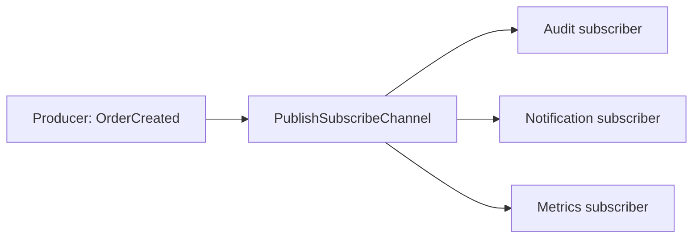
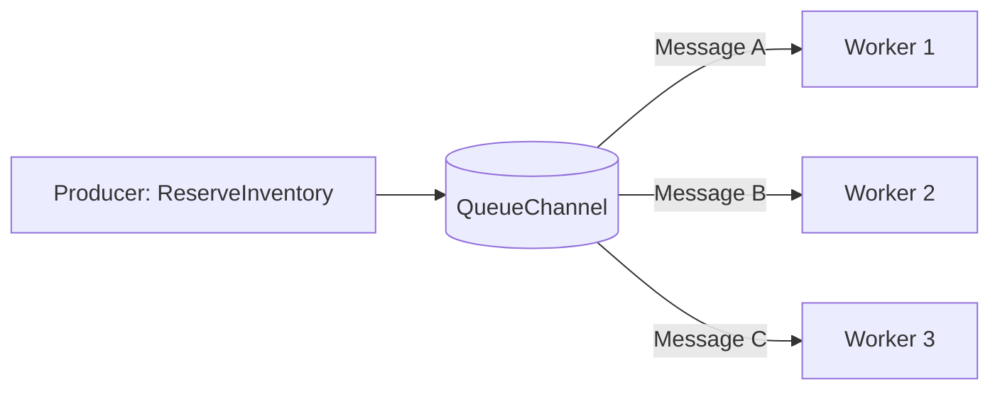
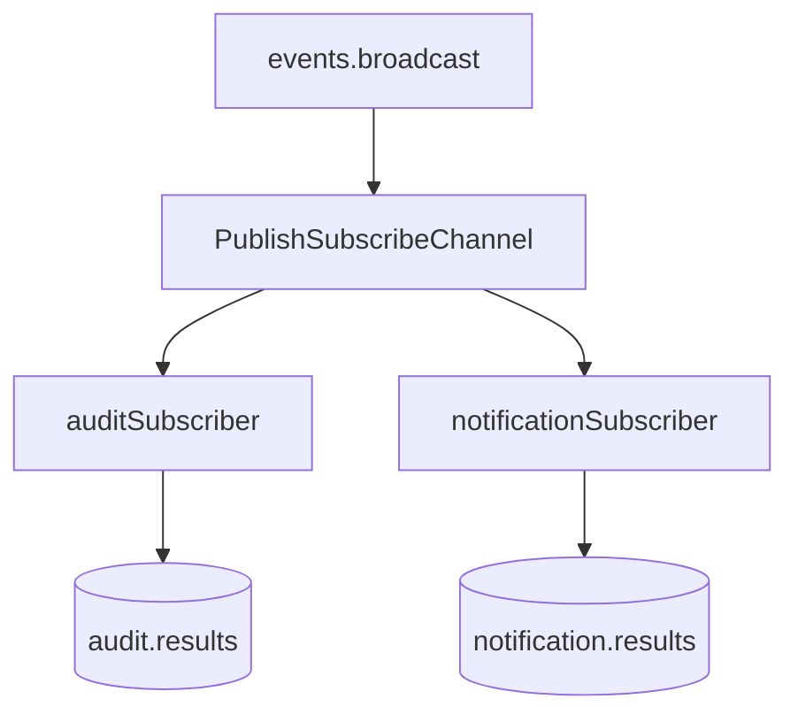
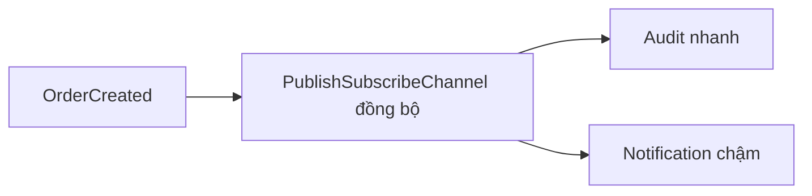
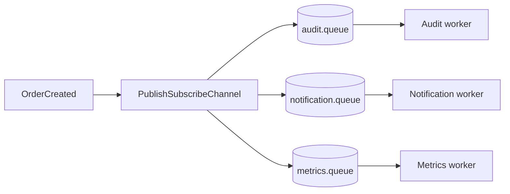
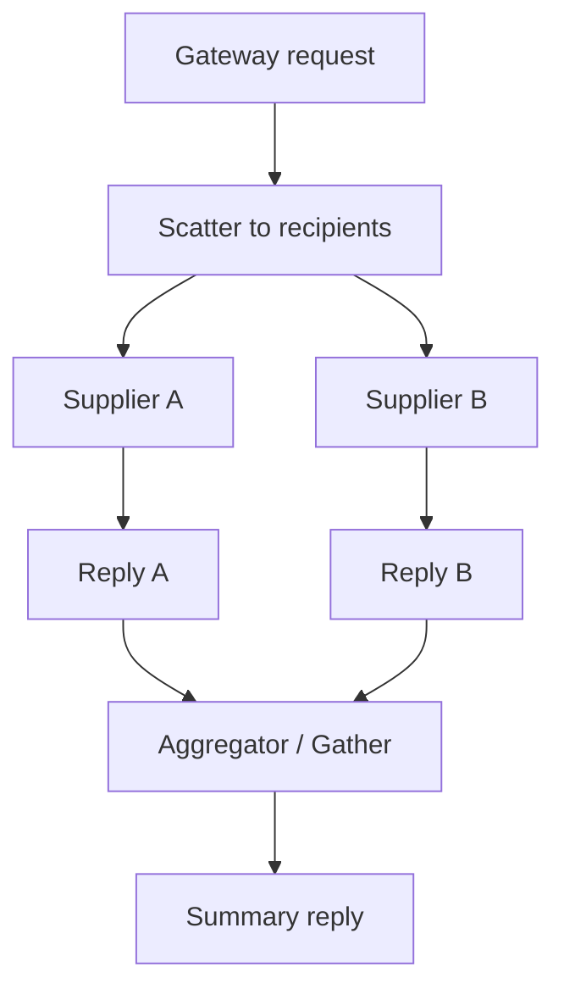

# So sánh Publish-Subscribe với Queue trong Spring Integration

## Mục tiêu bài học

Khi hệ thống nhận sự kiện `OrderCreated`, cả dịch vụ audit, thông báo và phân tích dữ liệu đều cần biết sự kiện ấy đã xảy ra. Nhưng khi hệ thống nhận một **tác vụ xử lý đơn hàng** cần thực hiện một lần, không nên để ba worker độc lập cùng trừ tồn kho cho một đơn. Hai yêu cầu tưởng giống nhau — “đưa message cho nhiều thành phần” — thực chất cần **hai cơ chế phân phối khác nhau**.

- **Publish-Subscribe**: một message được **phát đến các subscriber** của một channel. Mỗi subscriber có thể thực hiện một trách nhiệm riêng.
- **Queue**: một message được **đưa vào hàng đợi** và được **một consumer lấy ra** trong mỗi lần nhận thành công; nhiều consumer có thể cạnh tranh nhận những message đang chờ.

Bài thuộc chương **Publish subscribe** của module **SPRING_INTEGRATION_PATTERN**. Module hướng tới xây dựng luồng thông điệp ít phụ thuộc, dễ mở rộng bằng Enterprise Integration Patterns với Spring Integration; thực hành Router, Filter, Transformer, Splitter, Aggregator, Gateway, retry, error channel và correlation, đồng thời kiểm thử, quan sát các nhánh xử lý.

Sau bài này, bạn có thể:

1. Phân biệt **broadcast/fan-out** với **competing consumers**, tránh nhầm tên gọi “subscriber” trong các kiến trúc khác nhau.
2. Chọn `PublishSubscribeChannel`, `QueueChannel` và các channel kết hợp theo hợp đồng nghiệp vụ.
3. Hiểu ảnh hưởng của **đồng bộ/bất đồng bộ, ordering, backpressure, lỗi và giao dịch** đến cả hai mô hình.
4. Xây hai luồng Java DSL và dùng JUnit kiểm tra thực tế một message có được gửi tới **mọi nhánh** hay chỉ **được lấy một lần**.
5. Thiết kế fan-out bền vững với queue riêng cho mỗi nhánh khi cần xử lý độc lập và có backlog.
6. Xử lý retry, idempotency, correlation, timeout và quan sát kết quả từng subscriber.

## 1. Phân biệt ngay bằng hai tình huống

### Tình huống A — Event cần nhiều nhánh cùng biết

Một đơn hàng đã được tạo thành công. Hệ thống muốn thực hiện ba trách nhiệm riêng:

- Ghi nhật ký audit.
- Gửi thông báo đến khách hàng.
- Cập nhật thống kê.



**Một sự kiện** được chuyển tới **ba subscriber**. Mỗi subscriber nhận thông tin sự kiện để thực hiện trách nhiệm của mình. Chúng không nên cùng thực hiện một side effect duy nhất như trừ tồn kho ba lần.

### Tình huống B — Công việc cần phân phối cho một trong nhiều worker

Một tác vụ `ReserveInventory` cần một worker xử lý. Hệ thống có ba worker giống nhau để tăng throughput.



Hình minh họa ba message khác nhau đang được ba worker nhận. **Mỗi message được lấy khỏi queue một lần trong một lượt dequeue thành công**, không được phát đồng thời cho cả ba worker. Điều đó **không đồng nghĩa exactly-once business processing**: retry, sự cố giữa chừng hoặc redelivery từ broker có thể khiến cùng công việc bị thực hiện lại nếu không có idempotency.

### Quy tắc chọn ngắn gọn

> **Nếu mỗi nơi nhận đều cần biết cùng một sự kiện, nghĩ tới Publish-Subscribe. Nếu một tác vụ cần được một worker trong nhóm nhận để xử lý, nghĩ tới Queue.**

Từ đây, chúng ta phân tích các ngoại lệ và cách kết hợp hai cơ chế.

## 2. Publish-Subscribe và Queue khác nhau về hợp đồng

| Tiêu chí | `PublishSubscribeChannel` | `QueueChannel` |
| --- | --- | --- |
| Mục đích | Phát một message đến nhiều subscriber | Đệm công việc để consumer chủ động lấy |
| Mô hình phân phối | **Fan-out / broadcast** tới các subscriber của channel | **Point-to-point**: một lượt nhận lấy một message khỏi queue |
| Số nơi nhận một message | Có thể nhiều subscriber | Một consumer nhận mỗi lần dequeue thành công |
| Cách tiêu thụ | Handler subscribe vào channel; channel dispatch khi `send()` | Consumer gọi `receive()` hoặc polling endpoint |
| Lưu backlog mặc định | Không phải một message queue | Có queue trong tiến trình để giữ message chưa lấy |
| Nhiều handler | Các handler nhận event theo chính sách publish-subscribe | Nhiều poller/consumer cạnh tranh lấy message |
| Đồng bộ mặc định | Thường dispatch đồng bộ nếu không chỉ định executor | `send()` enqueue; handler chỉ chạy khi có consumer/poller |
| Bất đồng bộ | Có thể cấu hình executor cho dispatch | Queue đã tách thời điểm gửi khỏi thời điểm nhận |
| Thứ tự | Phụ thuộc dispatcher, executor, thứ tự subscriber và tốc độ xử lý | Queue thông thường FIFO khi lấy; hoàn tất có thể khác thứ tự |
| Không có nơi nhận | Có thể không có subscriber; cần xét cấu hình tối thiểu subscriber | Message có thể nằm chờ khi chưa có consumer |
| Backpressure | Subscriber chậm có thể kéo dài dispatch đồng bộ; executor có queue riêng | Capacity/timeout của queue quyết định phản ứng khi đầy |
| Độ bền dữ liệu | Channel không tự là kho lưu sự kiện bền vững | Queue in-memory mặc định cũng không tự bền vững; có cấu hình message store |
| Lỗi | Lỗi một subscriber có thể ảnh hưởng đường gửi tùy chế độ | Producer và consumer thường xử lý lỗi ở hai thời điểm khác nhau |
| Scaling | Nhiều subscriber để thêm **chức năng nhận cùng event** | Nhiều consumer để tăng **công suất cùng loại công việc** |

Bảng mô tả các channel của **Spring Integration trong một ứng dụng**. Trong Kafka, RabbitMQ, JMS hoặc cloud messaging, khái niệm *topic*, *subscription*, *consumer group* và *queue* có thêm semantics riêng. Đừng suy rằng một `PublishSubscribeChannel` in-memory tự có toàn bộ khả năng lưu bền, replay hoặc phân phối đa tiến trình của message broker.

## 3. Spring Integration quản lý message và endpoint ra sao?

Một message gồm **payload** và **headers**:

```text
Message<OrderCreated>
  payload:
    orderId = ORD-42
    eventId = EV-42
  headers:
    traceId = trace-42
    tenantId = tenant-a
    eventType = OrderCreated
```

Trong Pipes and Filters, **channel** nối producer với endpoint phía sau:

- `MessageChannel` định nghĩa thao tác `send()`.
- `SubscribableChannel` cho phép handler đăng ký nhận message theo dispatch.
- `PollableChannel` có `receive()` để consumer chủ động lấy message.
- `PublishSubscribeChannel` là một `SubscribableChannel`.
- `QueueChannel` là một `PollableChannel`.

Điều này giải thích khác biệt cơ bản: `PublishSubscribeChannel` đẩy event tới subscriber, còn `QueueChannel` giữ message chờ ai đó đến lấy.

### Đừng nhầm DirectChannel với PublishSubscribeChannel

`DirectChannel` cũng là `SubscribableChannel` và handler được gọi đồng bộ trong cấu hình thông thường. Nhưng nếu có nhiều subscriber, `DirectChannel` sử dụng cơ chế dispatcher để chọn handler, **không phải broadcast đến tất cả** như `PublishSubscribeChannel`.

Nếu muốn mỗi subscriber đều nhận cùng một event, chỉ đăng ký thêm handler vào `DirectChannel` là sai hợp đồng.

### Đừng nhầm Filter với Publish-Subscribe

`Filter` trong Spring Integration cho phép hoặc loại **một message** theo predicate. Nó không tự tạo nhánh nhận. Với một `PublishSubscribeChannel`, từng subscriber có thể đặt Filter riêng để chỉ xử lý các event phù hợp, nhưng Filter của nhánh A không nên vô tình quyết định nhánh B có nhận event hay không.

## 4. Ví dụ Java DSL: Một event tới hai subscriber

Ví dụ sau tạo một ứng dụng minh họa độc lập với hai subscriber:

- `audit` nhận một event `OrderCreated` và ghi ra kết quả mô phỏng của nhánh.
- `notification` cũng nhận **chính event đó** và tạo kết quả riêng.
- Hai kết quả được lưu trong hai `QueueChannel` khác nhau để kiểm thử bằng `receive()`.

Chúng ta dùng queue **ở cuối từng nhánh chỉ làm test sink**; điều này không làm thay đổi bản chất đầu vào của luồng đang là publish-subscribe.



### Cấu hình đầy đủ

```java
import org.springframework.context.annotation.Bean;
import org.springframework.context.annotation.Configuration;
import org.springframework.integration.channel.PublishSubscribeChannel;
import org.springframework.integration.channel.QueueChannel;
import org.springframework.integration.config.EnableIntegration;
import org.springframework.integration.dsl.IntegrationFlow;
import org.springframework.messaging.PollableChannel;

@Configuration
@EnableIntegration
public class PubSubVsQueueConfig {

    public record OrderCreated(String orderId, String eventId) {}

    public record BranchResult(
        String branch,
        String eventId,
        String status
    ) {}

    // Đầu vào của luồng broadcast.
    @Bean("events.broadcast")
    PublishSubscribeChannel broadcast() {
        return new PublishSubscribeChannel();
    }

    // Hai test sink; ứng dụng thực tế thay bằng handler nghiệp vụ.
    @Bean("audit.results")
    PollableChannel auditResults() {
        return new QueueChannel();
    }

    @Bean("notification.results")
    PollableChannel notificationResults() {
        return new QueueChannel();
    }

    @Bean
    IntegrationFlow auditSubscriber() {
        return IntegrationFlow.from("events.broadcast")
            .transform(OrderCreated.class, event ->
                new BranchResult("AUDIT", event.eventId(), "SUCCEEDED"))
            .channel("audit.results")
            .get();
    }

    @Bean
    IntegrationFlow notificationSubscriber() {
        return IntegrationFlow.from("events.broadcast")
            .transform(OrderCreated.class, event ->
                new BranchResult(
                    "NOTIFICATION", event.eventId(), "SUCCEEDED"))
            .channel("notification.results")
            .get();
    }

    // Đầu vào của một workflow queue độc lập để so sánh.
    @Bean("work.queue")
    PollableChannel workQueue() {
        return new QueueChannel(100);
    }
}
```

Các điểm chính:

1. `PublishSubscribeChannel` có **hai flow subscribe** qua `IntegrationFlow.from("events.broadcast")`.
2. Gửi **một** event sẽ khiến cả hai flow được dispatch, trừ khi xảy ra lỗi hoặc có chính sách điều kiện khác.
3. `QueueChannel` ở `audit.results` và `notification.results` nhận **kết quả riêng**; chúng không phải hai consumer cạnh tranh của một queue chung.
4. `work.queue` là queue công việc **độc lập**, dành cho phần so sánh.
5. `BranchResult` là DTO do bài học định nghĩa; Spring Integration không tự tạo trạng thái `SUCCEEDED` khi channel gửi thành công.

Các ví dụ dùng Java 17+ vì có `record`, đồng thời giả định dependency Spring Integration, Spring Context và Spring Messaging phù hợp.

### Producer gửi sự kiện

```java
import org.springframework.messaging.Message;
import org.springframework.messaging.support.MessageBuilder;

Message<PubSubVsQueueConfig.OrderCreated> message =
    MessageBuilder.withPayload(
        new PubSubVsQueueConfig.OrderCreated("ORD-42", "EV-42"))
        .setHeader("traceId", "trace-42")
        .setHeader("tenantId", "tenant-a")
        .build();

broadcastChannel.send(message);
```

`broadcastChannel` là bean `MessageChannel` hoặc `PublishSubscribeChannel` tên `events.broadcast` được inject từ Spring context. Trong ví dụ không cấu hình executor, hai subscriber thực thi qua cơ chế dispatch đồng bộ của channel; tuy nhiên không nên biến thứ tự subscriber thành hợp đồng nghiệp vụ.

### Không phải một event bị chia thành hai payload

Ở trên, **hai subscriber cùng nhận payload `OrderCreated`**. Chúng tự biến đổi thành `BranchResult` khác nhau. Điều này khác `Splitter`, nơi một payload như `List<OrderLine>` được phân thành message con mang **những phần dữ liệu khác nhau**.

## 5. Ví dụ QueueChannel: Nhiều consumer lấy công việc từ một nơi

`QueueChannel` nhận message vào hàng đợi. Một consumer gọi `receive()` lấy message khỏi queue; consumer khác không thể lại nhận **cùng phần tử đang tồn tại đó** từ queue in-memory này nếu nó đã được lấy ra thành công.

```java
import org.springframework.integration.channel.QueueChannel;
import org.springframework.messaging.Message;
import org.springframework.messaging.support.MessageBuilder;

QueueChannel jobs = new QueueChannel(10);

jobs.send(MessageBuilder.withPayload("job-1").build());
jobs.send(MessageBuilder.withPayload("job-2").build());

Message<?> first = jobs.receive(0);  // job-1
Message<?> second = jobs.receive(0); // job-2
Message<?> empty = jobs.receive(0);  // null
```

Ba lần nhận trên có thể được thực hiện bởi ba worker cạnh tranh. Với queue FIFO không có consumer khác và không cấu hình ưu tiên, message `job-1` được lấy trước `job-2`. Nhưng:

- Worker thực hiện `job-1` có thể chạy chậm hơn worker thực hiện `job-2`.
- `QueueChannel` không tự gửi kết quả từ handler nào cả; ứng dụng cần consumer/poller.
- Khi một consumer đã lấy message và xử lý thất bại, **queue in-memory không tự hiểu nghiệp vụ để rollback message**. Cần thiết kế retry, bù trừ và idempotency riêng.
- Khi cần dữ liệu còn tồn tại sau restart, một queue mặc định trong RAM chưa đáp ứng được yêu cầu; phải xem xét message store bền vững hoặc broker.

### Hai polling consumer cạnh tranh

Trong hệ thống thực tế, có thể gắn hai Service Activator vào cùng một `QueueChannel`, mỗi cái có poller. Minh họa:

```java
import org.springframework.integration.annotation.Poller;
import org.springframework.integration.annotation.ServiceActivator;
import org.springframework.messaging.Message;

public class InventoryWorkers {

    @ServiceActivator(
        inputChannel = "work.queue",
        poller = @Poller(fixedDelay = "200", maxMessagesPerPoll = "1")
    )
    public void workerA(Message<String> job) {
        process(job, "A");
    }

    @ServiceActivator(
        inputChannel = "work.queue",
        poller = @Poller(fixedDelay = "200", maxMessagesPerPoll = "1")
    )
    public void workerB(Message<String> job) {
        process(job, "B");
    }

    private void process(Message<String> job, String worker) {
        // Logic nghiệp vụ idempotent, theo dõi jobId/traceId.
        System.out.printf("Worker %s: %s%n",
            worker, job.getPayload());
    }
}
```

Đây là đoạn minh họa cần đăng ký bean `InventoryWorkers` trong Spring context và cần chính sách thread/poller tương ứng. Hai endpoint cùng **poll** từ một hàng đợi, không phải hai subscriber mỗi người nhận tất cả message.

Không có hợp đồng công bằng tuyệt đối rằng worker A và B luôn nhận số lượng bằng nhau. Tốc độ poll, thời gian xử lý, số thread và các yếu tố thực thi quyết định phân bố thực tế.

## 6. Kiểm thử sự khác biệt bằng JUnit

Một bộ test cần chứng minh **số nơi nhận**. Đừng chỉ assert `send()` thành công rồi kết luận đã xử lý đúng.

```java
import static org.assertj.core.api.Assertions.assertThat;

import org.junit.jupiter.api.Test;
import org.springframework.beans.factory.annotation.Autowired;
import org.springframework.beans.factory.annotation.Qualifier;
import org.springframework.messaging.Message;
import org.springframework.messaging.MessageChannel;
import org.springframework.messaging.PollableChannel;
import org.springframework.messaging.support.MessageBuilder;
import org.springframework.test.context.junit.jupiter.SpringJUnitConfig;

@SpringJUnitConfig(PubSubVsQueueConfig.class)
class PubSubVsQueueTest {

    @Autowired
    @Qualifier("events.broadcast")
    MessageChannel broadcast;

    @Autowired
    @Qualifier("audit.results")
    PollableChannel auditResults;

    @Autowired
    @Qualifier("notification.results")
    PollableChannel notificationResults;

    @Autowired
    @Qualifier("work.queue")
    PollableChannel workQueue;

    @Test
    void publishSubscribeDeliversAnEventToBothSubscribers() {
        var event = new PubSubVsQueueConfig.OrderCreated(
            "ORD-42", "EV-42");

        Message<?> request = MessageBuilder.withPayload(event)
            .setHeader("traceId", "trace-42")
            .build();

        assertThat(broadcast.send(request)).isTrue();

        Message<?> audit = auditResults.receive(2_000);
        Message<?> notification = notificationResults.receive(2_000);

        assertThat(audit).isNotNull();
        assertThat(notification).isNotNull();

        var a = (PubSubVsQueueConfig.BranchResult) audit.getPayload();
        var n = (PubSubVsQueueConfig.BranchResult)
            notification.getPayload();

        assertThat(a.branch()).isEqualTo("AUDIT");
        assertThat(n.branch()).isEqualTo("NOTIFICATION");
        assertThat(a.eventId()).isEqualTo("EV-42");
        assertThat(n.eventId()).isEqualTo("EV-42");

        assertThat(audit.getHeaders().get("traceId"))
            .isEqualTo("trace-42");
        assertThat(notification.getHeaders().get("traceId"))
            .isEqualTo("trace-42");

        assertThat(auditResults.receive(0)).isNull();
        assertThat(notificationResults.receive(0)).isNull();
    }

    @Test
    void oneQueueMessageIsRemovedByOneSuccessfulReceive() {
        var job = MessageBuilder.withPayload("job-42").build();

        assertThat(workQueue.send(job)).isTrue();

        Message<?> firstConsumer = workQueue.receive(2_000);
        Message<?> secondConsumer = workQueue.receive(0);

        assertThat(firstConsumer).isNotNull();
        assertThat(firstConsumer.getPayload()).isEqualTo("job-42");
        assertThat(secondConsumer).isNull();
    }
}
```

Bộ test này cô lập hai cơ chế với những queue riêng và không có consumer nền. Khi chạy test song song hoặc dùng chung context có state tồn đọng, cần thiết kế cách cô lập/reset queue cho từng test.

Điều kiểm thử **không** chứng minh: việc hệ thống đã lưu database thật, gửi SMS thật hoặc đạt exactly-once trong mọi tình huống lỗi. Chúng ta mới xác nhận topology và các kết quả giả lập theo hợp đồng của flow.

### Các test mở rộng cần có

- Thêm subscriber thứ ba và xác nhận event có mặt ở cả ba nhánh.
- Gửi hai job vào queue, dùng hai worker độc lập và xác nhận tổng số job được xử lý bằng hai, không phải bốn.
- Cho một subscriber ném exception; ghi nhận ảnh hưởng đến producer và subscriber khác trong cấu hình đồng bộ.
- Đổi PublishSubscribeChannel sang executor rồi kiểm tra kết quả với timeout thay vì dựa vào thứ tự hoàn thành.
- Không tạo subscriber; quyết định liệu hệ thống cho phép chấp nhận event khi chưa có người nhận hay phải báo lỗi.
- Làm queue đầy với capacity nhỏ và xác nhận producer xử lý send timeout.

## 7. Đồng bộ và bất đồng bộ: hai trục khác với topology

**Broadcast không bắt buộc bất đồng bộ. Queue không tự đảm bảo xử lý song song.**

### PublishSubscribeChannel đồng bộ

Nếu không cấu hình executor, PublishSubscribeChannel dispatch message tới subscriber theo cách đồng bộ. Khi một subscriber gọi API lâu, đường `send()` có thể bị giữ lại trong thời gian handler chạy.

```text
Producer.send(event)
  -> Audit handler       (30 ms)
  -> Notification handler (800 ms)
  -> Metrics handler     (10 ms)
Producer được trả về sau dispatch đồng bộ
```

Đây là minh họa thời lượng, không phải cam kết thứ tự subscriber hay thời gian thực tế. Một subscriber ném exception có thể làm gián đoạn việc dispatch hoặc truyền lỗi về sender tùy cấu hình dispatcher, vì vậy không dùng giả định “mọi nhánh luôn chạy hết” để thiết kế giao dịch.

### PublishSubscribeChannel với executor

Có thể dùng `TaskExecutor` để dispatch đến các subscriber bất đồng bộ.

```java
import org.springframework.core.task.TaskExecutor;
import org.springframework.integration.channel.PublishSubscribeChannel;

PublishSubscribeChannel asynchronousBroadcast(TaskExecutor executor) {
    return new PublishSubscribeChannel(executor);
}
```

Với executor:

- `send()` có thể trở về trước khi subscriber thực hiện xong nghiệp vụ.
- Các subscriber có thể hoàn tất khác thứ tự được dispatch.
- Lỗi có thể xảy ra ở thread khác; cần xử lý error channel/error handler theo cấu hình endpoint.
- MDC/`ThreadLocal` của sender không tự chuyển sang thread executor; hãy truyền context bằng headers và cấu hình propagation nếu cần.
- Executor/queue nội bộ cũng cần giới hạn tài nguyên và chính sách khi quá tải.

Đừng bật executor chỉ để “chạy nhanh hơn” nếu flow cần transaction cùng thread hoặc thứ tự xử lý có ý nghĩa nghiệp vụ.

### QueueChannel và poller

`QueueChannel` lưu message. Một consumer hoặc poller lấy rồi xử lý. Nếu không có consumer, queue có thể vẫn giữ message — đó là backlog, không phải một subscriber đã thất bại.

```text
Producer -- send --> QueueChannel (backlog)
                        |
                 Poller / receive()
                        |
                      Handler
```

Chọn số poller/worker, chính sách concurrency, thời gian chờ và capacity theo SLA. Nhiều worker có thể tăng throughput, nhưng không bảo đảm kết quả hoàn tất FIFO.

## 8. Backpressure và khi một nhánh chậm

Một câu hỏi kiến trúc quan trọng: **Notification bị chậm có được phép làm chậm Audit không?**

### Fan-out đồng bộ trực tiếp



Trong một broadcast đồng bộ, producer có thể chịu độ trễ của subscriber chậm. Nếu một subscriber lỗi, cần hiểu cách exception ảnh hưởng đến quá trình dispatch.

### Fan-out rồi queue riêng theo nhánh



Ở sơ đồ này, **mỗi nhánh có một queue riêng**. Event được fan-out đến ba queue (mỗi queue giữ một message cho nhánh của nó), sau đó consumer mỗi nhánh tự xử lý. Nhờ vậy một nhánh chậm có thể tạo backlog **ở queue của chính nó**, không nhất thiết làm các handler còn lại chậm tương ứng.

Tuy nhiên, fan-out vẫn phải gửi message vào tất cả queue. Nếu `notification.queue` đầy hoặc gặp lỗi, thao tác gửi tới queue ấy có thể làm producer chờ hoặc phát sinh lỗi. Vì vậy **queue riêng giúp cách ly nhịp xử lý nhưng không tự bảo đảm cách ly tuyệt đối lỗi phát sự kiện**.

### Capacity và giới hạn tài nguyên

Ví dụ `QueueChannel(2)`:

```java
QueueChannel bounded = new QueueChannel(2);

boolean a = bounded.send(
    MessageBuilder.withPayload("A").build(), 0);
boolean b = bounded.send(
    MessageBuilder.withPayload("B").build(), 0);
boolean c = bounded.send(
    MessageBuilder.withPayload("C").build(), 0);
```

Giả sử chưa có consumer và queue rỗng, `a` và `b` thành công, `c` trả `false` vì đầy khi timeout bằng 0. Producer cần xử lý kết quả này: báo quá tải, retry có backoff, dùng storage hoặc chuyển sang kênh lỗi được quản lý.

**Một QueueChannel được đặt sau PublishSubscribeChannel không khiến hệ thống tự trở thành durable pub/sub.** Mặc định queue vẫn trong bộ nhớ và có thể mất dữ liệu khi tiến trình dừng đột ngột. Khi cần replay hoặc bảo đảm qua restart, phải xét message store hoặc broker phù hợp.

## 9. Độ tin cậy: không đồng nhất với kiểu phân phối

Một thiết kế publish-subscribe và một thiết kế queue đều có thể cần retry, nhưng lỗi xảy ra ở những mức khác nhau:

| Tầng | Publish-Subscribe | Queue |
| --- | --- | --- |
| **Acceptance** | Channel đã chấp nhận và dispatch event theo cấu hình | Queue đã chấp nhận message vào buffer/store |
| **Delivery** | Mỗi subscriber có thể nhận hoặc gặp lỗi gửi/dispatch | Consumer có thể chưa poll hoặc không nhận được |
| **Processing** | Mỗi subscriber có thể thành công/thất bại độc lập | Worker đã nhận vẫn có thể thất bại |
| **Retry** | Retry một nhánh hoặc phát lại toàn event; cần chống side effect lặp | Retry job hoặc phát lại job; cần idempotency |
| **Persistence** | Phụ thuộc kiến trúc bên ngoài hoặc storage từng nhánh | Phụ thuộc message store/broker, không tự có từ queue RAM |
| **Completion** | Có thể cần tổng hợp trạng thái mọi subscriber | Cần xác định một job đã hoàn tất theo business status |

### Một sự kiện, ba nhánh, một nhánh lỗi

Giả sử:

```text
OrderCreated EV-42
    Audit         -> SUCCEEDED
    Notification  -> FAILED
    Metrics       -> SUCCEEDED
```

Nếu producer **retry toàn bộ event** qua PublishSubscribeChannel, Audit và Metrics có thể xử lý lại. Nếu retry **riêng Notification**, cần biết nó có thực sự nhận event và side effect đã xảy ra một phần hay chưa.

Giải pháp thông dụng:

1. Mỗi event có `eventId` ổn định.
2. Mỗi nhánh có khóa idempotency `eventId + subscriberName`.
3. Mỗi handler ghi nhận trạng thái xử lý bền vững nếu yêu cầu cần theo dõi sau restart.
4. Retry có backoff và giới hạn số lần, có kênh xử lý kết thúc thất bại khi vượt giới hạn.
5. Theo dõi duplicate, late result và policy khi replay.

### Queue cũng không đồng nghĩa exactly-once

Dù một lượt `receive()` đưa message khỏi queue, hai vấn đề vẫn tồn tại:

- Worker cập nhật database thành công nhưng crash trước khi đánh dấu công việc hoàn tất. Một cơ chế retry bên ngoài có thể thực hiện lại cùng job.
- Job có thể được producer gửi hai lần vì timeout/không biết chắc lần gửi trước đã thành công.

Do đó cần idempotency key theo nghiệp vụ, giao dịch ở nơi phù hợp và cơ chế xác nhận kết quả. Đừng lấy “một message được một consumer nhận” làm bằng chứng “side effect chỉ xảy ra đúng một lần”.

### Message broker có semantics khác

Khi dùng Kafka, một topic với **hai consumer group** có thể để cả hai nhóm xử lý cùng record; bên trong **một** group, partitions được phân công theo cơ chế của broker. Với AMQP, exchange và queue có cách binding, fan-out, acknowledgment và durability riêng. Khi kết nối Spring Integration với broker qua adapter, phải thiết kế theo **cả contract của channel và contract của broker**, không suy diễn từ tên gọi queue/pub-sub.

## 10. Ordering: gửi, nhận và hoàn tất không phải một thứ

Xét hai sự kiện:

```text
EV-1 được producer gửi trước EV-2.
```

### Publish-Subscribe

Mỗi subscriber có thể quan sát thứ tự khác nhau khi sử dụng executor, chạy song song, broker hoặc retry. Một nhánh xử lý EV-2 rất nhanh có thể hoàn tất trước EV-1. Nếu yêu cầu “đối với mỗi `orderId`, event phải được xử lý theo thứ tự”, cần một chính sách ordering theo khóa hoặc cơ chế tuần tự riêng cho nhánh đó.

### Queue

`QueueChannel` thông thường lấy message theo FIFO khi không có consumer khác và không có chính sách ưu tiên riêng. Nhưng hai worker cạnh tranh có thể hoàn tất jobs khác thứ tự dequeue. Với `PriorityChannel`, ngay cả **thứ tự dequeue** có thể khác FIFO vì ưu tiên message cao.

### Dùng correlation để khôi phục mối quan hệ

Header `traceId` dùng cho tracing. `correlationId` và `sequenceNumber` giúp nhóm và sắp xếp những message có quan hệ, chẳng hạn sau Splitter hoặc Scatter-Gather. **PublishSubscribeChannel không tự nghĩa là Aggregator biết có bao nhiêu subscriber đã hoàn tất**.

Nếu mỗi nhánh cần tạo kết quả, bạn nên đưa `eventId`, `subscriber`, `status` và thời điểm xử lý vào một `BranchOutcome`, rồi tổng hợp theo hợp đồng đã định nghĩa. Không dùng thứ tự trả reply để suy ra tên subscriber.

## 11. Kết hợp với Router, Filter, Splitter, Aggregator và Gateway

| Pattern | Kết hợp với Publish-Subscribe | Kết hợp với Queue |
| --- | --- | --- |
| **Router** | Chỉ phát event tới nhóm người nhận hợp lệ, hoặc route trước khi fan-out | Chọn queue xử lý theo loại công việc |
| **Filter** | Mỗi subscriber lọc event không liên quan | Lọc trước khi enqueue hoặc ở phía worker, cân nhắc mất công việc |
| **Transformer** | Mỗi nhánh biến event thành DTO phù hợp nhu cầu | Chuẩn hóa job trước khi đưa vào queue |
| **Splitter** | Chia một message rồi có thể phát từng phần cho nhiều subscriber | Chia batch thành nhiều job độc lập để worker chia tải |
| **Aggregator** | Gom các `BranchOutcome` khi cần một bản tổng kết | Gom kết quả nhiều job theo `correlationId` |
| **Gateway** | Cần reply contract rõ nếu phát request tới nhiều subscriber | Chờ worker trả reply; có nguy cơ timeout khi không có consumer |
| **Retry / error channel** | Theo dõi lỗi riêng từng subscriber, không mặc định retry toàn bộ | Retry job, xử lý lỗi poller/worker và xác nhận kết quả |
| **Correlation** | Gắn `eventId`, branch ID, sequence nếu cần fan-out có join | Gắn `jobId`, batch ID để chống trùng và gom kết quả |

### Nếu cần tất cả kết quả, cân nhắc Scatter-Gather



Publish-Subscribe là lựa chọn phát event, **không tự là Scatter-Gather**. Muốn chờ một kết quả chung, có thể thiết kế Recipient List + Aggregator hoặc Spring Integration Scatter-Gather, có correlation strategy, release strategy và timeout.

Cần xác định:

- Những recipient nào thực sự được chọn?
- Mỗi recipient có trả `BranchOutcome` thành công/thất bại hay có nhánh chỉ side effect?
- Có phải tất cả reply đã đến, hay đến hạn thì trả kết quả một phần?
- Nếu một nhánh Filter loại event thì Aggregator có đợi sai `sequenceSize` không?
- Khi reply đến muộn hoặc bị lặp do retry, kết quả cuối có thay đổi không?

Nếu một nhánh không bao giờ reply, Gateway có thể chờ đến timeout. Không mặc định rằng “event đã phát tới các subscriber” đồng nghĩa “gather đã hoàn tất”.

## 12. Theo dõi hoạt động từng subscriber và consumer

Để quan sát chính xác, nên tách các trạng thái:

```text
PUBLISHED / ENQUEUED
    -> RECEIVED
    -> STARTED
    -> SUCCEEDED | FAILED | TIMED_OUT
```

Các trạng thái này là **hợp đồng do ứng dụng thiết kế**, không phải mọi trạng thái đều tự có từ Spring Integration.

### Metric gợi ý

| Metric minh họa | Đơn vị cần theo dõi |
| --- | --- |
| `event_published_total` | Số event đầu vào PublishSubscribeChannel |
| `subscriber_selected_total{subscriber}` | Số nhánh dự kiến nhận event |
| `subscriber_processed_total{subscriber,status}` | Số nhánh đã hoàn tất thành công/thất bại |
| `subscriber_processing_duration{subscriber}` | Thời gian xử lý của từng subscriber |
| `subscriber_retry_total{subscriber}` | Số lần retry |
| `queue_depth{queue}` | Số job chờ trong mỗi QueueChannel |
| `queue_send_failed_total{queue}` | Số lần enqueue thất bại |
| `queue_wait_duration{queue}` | Thời gian từ enqueue đến lúc consumer bắt đầu |
| `job_processing_duration{workerType}` | Thời gian thực hiện mỗi job |
| `branch_summary_partial_total` | Số event có kết quả một phần |

Đây là **tên metric minh họa do ứng dụng tự đặt**, không khẳng định framework xuất tất cả theo tên đó. Có thể dùng Micrometer, Spring Integration observation, structured logging và trạng thái nghiệp vụ bền vững.

Ví dụ log:

```text
traceId=trace-42 eventId=EV-42 subscriber=AUDIT
state=SUCCEEDED durationMs=24

traceId=trace-42 eventId=EV-42 subscriber=NOTIFICATION
state=FAILED errorCode=PROVIDER_TIMEOUT

traceId=trace-42 jobId=JOB-99 worker=inventory-2
state=SUCCEEDED durationMs=135
```

Tránh đặt `eventId`/`jobId` làm metric label nếu cardinality lớn. Dùng chúng cho log/trace hoặc truy vấn DB, và không ghi token, dữ liệu cá nhân hay nội dung thanh toán nhạy cảm.

## 13. Những lỗi thiết kế thường gặp

| Triệu chứng | Nguyên nhân thường gặp | Hướng khắc phục |
| --- | --- | --- |
| Chỉ một trong nhiều handler nhận event | Dùng `DirectChannel` với nhiều subscriber thay cho PublishSubscribeChannel | Dùng channel có broadcast semantics |
| Hai worker cùng thực thi một job | Dùng broadcast cho loại công việc chỉ cần một consumer | Dùng queue/competing consumers và idempotency |
| Subscriber mới không nhận event lịch sử | PublishSubscribeChannel không tự lưu lịch sử | Dùng log/broker lưu bền, replay có kiểm soát |
| Queue tăng vô hạn | Producer nhanh hơn consumer hoặc thiếu poller | Capacity, backpressure, mở rộng consumer và giám sát |
| `send()` thành công nhưng nghiệp vụ chưa xong | Queue hoặc executor chỉ nhận/chuyển task | Theo dõi outcome ở consumer |
| Producer chậm vì subscriber chậm | PublishSubscribeChannel đồng bộ | Queue riêng từng nhánh, executor hoặc broker theo SLA |
| Một subscriber lỗi làm nhánh khác chưa chạy | Exception ảnh hưởng dispatch đồng bộ | Cách ly nhánh, retry/error strategy và test partial failure |
| Retry notification làm audit chạy lại | Replay toàn event fan-out | Retry từng nhánh hoặc idempotency theo subscriber |
| Kết quả các nhánh bị lẫn | Nhầm `eventId`, dùng thứ tự arrival thay vì branch ID | Correlation + subscriber ID |
| Gateway không có reply | Nhánh chỉ làm side effect hoặc queue không có worker | Reply contract, timeout và error response |
| Chọn queue nhưng vẫn cần hai hệ thống nhận event | Một queue chỉ cho một consumer lấy mỗi message | Fan-out sang hai queue hoặc broker topics/subscriptions riêng |
| Kỳ vọng exactly-once từ QueueChannel | Nhầm dequeue với business commit | Idempotency và quản lý giao dịch/ack theo công nghệ |
| Mất message khi restart | Dùng queue in-memory hoặc broadcast không lưu bền | Persistent message store/broker/outbox khi cần |

## 14. Bài tập thực hành

### Bài 1 — Một event đến hai subscriber

Dùng `PubSubVsQueueConfig`, gửi `OrderCreated(EV-100)`. Kiểm tra audit và notification đều có `BranchResult`, cùng eventId, header `traceId`, và mỗi sink chỉ có một kết quả.

### Bài 2 — Queue và hai consumer

Đưa 100 job vào một `QueueChannel` có capacity phù hợp. Gắn hai polling Service Activator cùng xử lý những job ấy. Ghi `jobId` vào tập kết quả và xác nhận tổng số jobId duy nhất là 100, không phải 200; kiểm tra riêng retry/idempotency khi có lỗi.

### Bài 3 — So sánh thời gian

Giả lập subscriber audit mất 20 ms và notification mất 500 ms. So sánh độ trễ `send()` khi dùng PublishSubscribeChannel đồng bộ với khi dùng executor. Giải thích tại sao send nhanh hơn không có nghĩa mọi subscriber đã hoàn thành.

### Bài 4 — Một nhánh queue bị đầy

Fan-out event đến `audit.queue` và `notification.queue`, capacity mỗi queue bằng 2. Làm nhánh Notification ngừng tiêu thụ rồi gửi nhiều event. Kiểm tra phản ứng của producer khi queue Notification đầy và thiết kế chính sách backpressure.

### Bài 5 — Partial failure

Cho Audit thành công, Notification thất bại sau khi gọi provider. Định nghĩa `BranchOutcome` và khóa `eventId + subscriberName`. So sánh retry toàn event với retry Notification và ghi nhận trường hợp side effect có thể đã xảy ra dù caller thấy lỗi.

### Bài 6 — Gateway và Aggregator

Thay mô hình event một chiều bằng request-reply: phát yêu cầu tới hai supplier, thu đủ hai reply mới trả Gateway. Khi một supplier không phản hồi, kiểm tra timeout và chính sách kết quả một phần.

### Bài 7 — Durable event distribution

Thiết kế một lựa chọn dùng broker có hai consumer group/subscription độc lập để Audit và Notification có thể tiếp tục xử lý sau restart. So sánh nó với PublishSubscribeChannel in-memory và queue riêng từng nhánh, chú ý persistence, ack, retry và ordering.

### Bài 8 — Observability

Thêm metric số message published, số job enqueued, queue depth, subscriber latency và thất bại theo nhánh. Kiểm chứng không nhầm message đã được chấp nhận với công việc đã hoàn tất.

## 15. Checklist trước khi triển khai

1. Message này là **event cần mọi subscriber nhận** hay **job chỉ một worker cần xử lý**?
2. Nếu có nhiều subscriber, từng nhánh có **trách nhiệm riêng** và idempotency key không?
3. Nếu có nhiều worker, chúng có cạnh tranh từ **cùng một queue** hay đang vô tình cùng nhận broadcast?
4. Đường nào đồng bộ, đường nào dùng executor, queue, poller hoặc broker?
5. Nếu một nhánh chậm/lỗi, các nhánh còn lại cần tiếp tục không? Đã có chính sách cách ly chưa?
6. Queue có capacity, send timeout, consumer, retention và phương án khi backlog tăng không?
7. Nếu cần bền vững qua restart, đã cấu hình store/broker/outbox phù hợp chưa?
8. Có phân biệt send accepted, handler started, business succeeded và timeout trong log/metric không?
9. Nếu cần tổng hợp kết quả, correlation, release, timeout và xử lý missing reply đã rõ chưa?
10. Có test với 0 subscriber, 1 subscriber, nhiều subscriber, nhiều competing consumers và nhánh lỗi không?
11. Có xác định rõ retry ở cấp **event**, **subscriber**, **job** hay **message group**?
12. Có tránh giả định mọi hoạt động giữ FIFO hoặc exactly-once khi có concurrency và redelivery không?

### Ghi nhớ

**Publish-Subscribe và Queue giải quyết hai bài toán khác nhau:** broadcast một sự kiện đến các subscriber, hoặc phân phối những công việc đang chờ cho các consumer. Chúng có thể **kết hợp**: PublishSubscribeChannel fan-out đến nhiều queue, mỗi queue có worker riêng. Nhưng topology chỉ giải quyết *ai có cơ hội nhận message*; độ bền, xử lý thành công, retry, idempotency, correlation, ordering và observability phải được thiết kế ở các tầng phù hợp.

Hiểu rõ sự khác biệt này giúp tránh hai lỗi nghiêm trọng: **mất nhánh nhận sự kiện khi dùng queue chung**, và **thực thi một tác vụ nhiều lần khi broadcast nhầm cho nhiều worker**.

### Tài liệu tham khảo

- [Spring Integration Reference — Message Channel Implementations](https://docs.spring.io/spring-integration/reference/channel/implementations.html)
- [Spring Integration Reference — Configuring Message Channels](https://docs.spring.io/spring-integration/reference/channel/configuration.html)
- [Spring Integration Reference — Publish-Subscribe Channel](https://docs.spring.io/spring-integration/reference/channel/implementations.html#publish-subscribe-channel)
