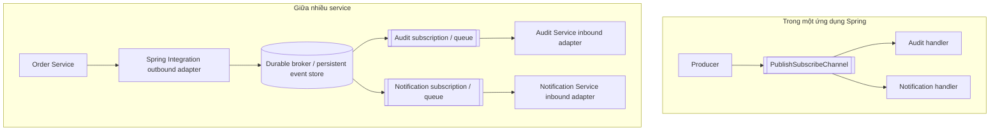
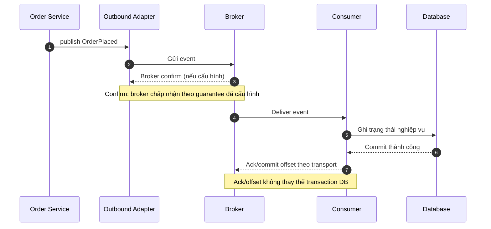
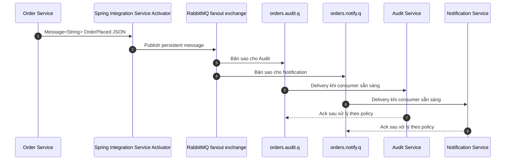
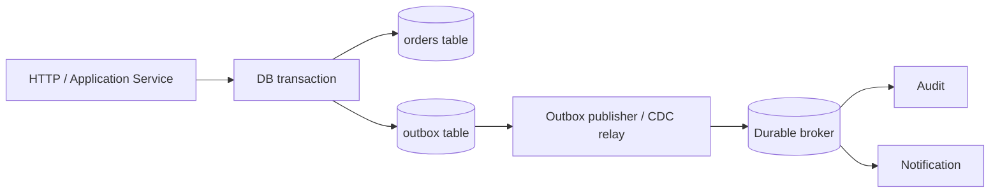

# Khi cần durable broker thay cho channel nội bộ

Một hệ thống nhận đơn hàng và phát sự kiện `OrderPlaced` cho ba consumer: Audit, Notification và Analytics. Khi mọi thành phần chạy trong cùng ứng dụng, ta có thể nối chúng bằng `PublishSubscribeChannel` của Spring Integration. Nhưng điều gì sẽ xảy ra khi **ứng dụng producer bị tắt ngay sau khi phát sự kiện**, consumer Notification bảo trì trong một giờ, hoặc hệ thống cần **phát lại những sự kiện chưa xử lý sau khi triển khai phiên bản mới**?

Nếu yêu cầu là “sự kiện quan trọng phải có khả năng phục hồi và xử lý lại dù tiến trình gửi/nhận bị khởi động lại”, một **channel nội bộ trong bộ nhớ** thường không đáp ứng đủ. Ta có thể cần **durable message broker** — ví dụ RabbitMQ, Kafka hoặc một broker JMS phù hợp — cùng với cấu hình lưu bền, xác nhận gửi/nhận, retry, dead-letter và idempotency.

Trong chương **Publish subscribe** của module `SPRING_INTEGRATION_PATTERN`, bài học này tập trung vào **khi nào nên chuyển từ pub/sub nội bộ sang broker bền vững**, và cách nối các thành phần đó vào kiến trúc **Enterprise Integration Patterns (EIP)** của Spring Integration. Việc sử dụng Router, Filter, Transformer, Splitter, Aggregator, Gateway, retry, error channel và correlation vẫn quan trọng; broker bổ sung **ranh giới giao nhận và phục hồi**, chứ không thay thế những pattern ấy.

> **Thông điệp cốt lõi:** `PublishSubscribeChannel` giúp **phân phối message cho nhiều subscriber đang hoạt động trong cùng ứng dụng**. Durable broker giúp **tách producer khỏi consumer theo không gian/thời gian** và có thể lưu message để xử lý khi consumer trở lại. Tuy nhiên, broker chỉ thực sự đáp ứng yêu cầu bền vững khi **topology, persistence, acknowledgment, retention, transaction và hành vi xử lý lỗi** được cấu hình, vận hành và kiểm thử đúng.

## 1. Bài toán thay đổi khi consumer không còn luôn sẵn sàng

Giả sử `Order Service` phát một sự kiện sau khi tạo đơn:

```json
{
  "eventId": "evt-101",
  "eventType": "ORDER_PLACED",
  "orderId": "ORD-101",
  "occurredAt": "2026-11-21T03:00:00Z"
}
```

Đây là dữ liệu ví dụ, không chứa token hoặc thông tin thanh toán. Có ba consumer độc lập:

- **Audit:** lưu sự kiện để đối soát; không được mất.
- **Notification:** tạo yêu cầu gửi thông báo, có thể trễ vài phút.
- **Analytics:** cập nhật chỉ số; có thể dừng triển khai rồi chạy tiếp.

Khi consumer ở các service khác nhau, yêu cầu phát triển:

| Yêu cầu | Channel nội bộ đơn giản | Durable broker được thiết kế đúng |
| --- | --- | --- |
| Nhiều handler **cùng process** nhận một sự kiện | Phù hợp với `PublishSubscribeChannel`. | Làm được, nhưng có thêm độ phức tạp vận hành. |
| Consumer chạy **ở service/process khác** | Cần adapter/transport; channel tự thân không đủ. | Là mục đích thường gặp của broker. |
| Consumer **offline** khi event phát | Thường không có khả năng nhận lại tự động với pub/sub in-memory. | Có thể giữ event để consumer nhận sau, tùy mô hình broker. |
| Producer crash, JVM restart | Không mặc nhiên khôi phục event đang ở trong memory. | Có thể phục hồi thông điệp đã được broker chấp nhận và lưu bền theo cấu hình. |
| Retry, DLQ và phát lại có kiểm soát | Phải tự bổ sung cơ chế phù hợp. | Broker/consumer thường cung cấp building blocks nhưng vẫn cần policy. |
| Audit/replay trong nhiều ngày | Channel in-memory không phải event log. | Một số broker như Kafka hỗ trợ lưu log theo retention; RabbitMQ có semantics queue khác. |
| “Exactly once” cho database và API đối tác | Không. | Cũng không được bảo đảm end-to-end chỉ vì có broker. |

**Không có nghĩa mọi ứng dụng đều cần broker.** Một message chỉ kích hoạt hai handler cùng JVM, không cần lưu bền và có thể tạo lại từ trạng thái chuẩn, thường không đáng để vận hành thêm một cụm broker chỉ nhằm tránh một lời gọi method.

## 2. Ba mức độ tách rời thường bị đánh đồng

Tách producer và consumer có nhiều chiều:

1. **Tách ở cấp mã nguồn:** producer không biết class của từng consumer; chúng giao tiếp qua channel/interface.
2. **Tách ở cấp tiến trình:** producer và consumer có thể chạy trên những JVM/service/máy khác nhau.
3. **Tách theo thời gian:** producer có thể gửi khi consumer chưa chạy, consumer vẫn có cơ hội xử lý khi hoạt động trở lại.

`PublishSubscribeChannel` nội bộ giải quyết tốt cấp thứ nhất. Durable broker thường giúp thực hiện cả cấp thứ hai và thứ ba **nếu thông điệp được giữ và subscription/queue có thể tồn tại khi consumer offline**.



Sơ đồ phân tán không hàm ý broker luôn là **event store lưu vô thời hạn**. RabbitMQ, Kafka và JMS có các mô hình queue/topic, giới hạn dung lượng, retention và xác nhận khác nhau. Khi chọn kiến trúc, phải dùng đúng semantics của broker thật.

## 3. Điều gì xảy ra nếu chỉ dùng channel nội bộ?

### 3.1. `PublishSubscribeChannel`: subscriber hiện tại, không phải nhật ký sự kiện

Một `PublishSubscribeChannel` thông thường:

- Broadcast message đến các subscriber **đã đăng ký**.
- Có thể dispatch **đồng bộ** hoặc qua `TaskExecutor`.
- Không mặc nhiên ghi message ra ổ đĩa.
- Không mặc nhiên phát lại sự kiện cho subscriber đăng ký sau khi message đã được gửi.
- Không có transaction phân tán cho toàn bộ subscriber.

Nếu chương trình crash trước khi một subscriber async xử lý xong, các task chưa hoàn tất có thể biến mất. Một subscriber bị tắt trong lúc producer phát event cũng không thể kỳ vọng ứng dụng tự giữ tất cả event để gửi lại khi subscriber khởi động.

### 3.2. `ExecutorChannel`: bất đồng bộ không có nghĩa bền vững

Đưa dispatch sang executor có thể giúp producer không chờ handler:

```text
Producer → ExecutorChannel / PublishSubscribeChannel + executor
          → hàng đợi công việc trong bộ nhớ của TaskExecutor
          → worker thread
```

Nhưng **thread pool queue** không phải durable message store. Nếu process chết, những task chỉ còn trong memory sẽ không tự được khôi phục. Nếu pool bão hòa, task có thể bị từ chối. “Async” và “durable” là hai thuộc tính **khác nhau**.

### 3.3. `QueueChannel`: buffer không đồng nghĩa durability

Một `QueueChannel(100)` có thể giữ tạm message khi consumer chưa nhận. Tuy nhiên, khi dùng hàng đợi trong bộ nhớ thông thường, message chưa được tiêu thụ có thể mất sau khi ứng dụng dừng đột ngột.

Spring Integration có các cơ chế **persistent MessageStore** và `QueueChannel` có thể dùng message store phù hợp; vì vậy **không nên nói mọi channel nội bộ đều không thể lưu bền**. Song message store gắn vào queue vẫn khác với một **durable pub/sub broker đa service**: cần tự giải quyết consumer độc lập, transport, acknowledgment, khả năng replay, transaction, HA và vận hành.

> **Kết luận phần này:** Chọn broker khi cần **hợp đồng giao nhận vượt quá phạm vi JVM**, không phải chỉ vì “hàng đợi nội bộ chậm” hoặc “muốn chạy async”.

## 4. Durable thực sự gồm những cam kết nào?

Từ “durable” dễ tạo cảm giác rằng **message chắc chắn không bao giờ mất**. Thực tế, phải phân tách các ranh giới:

| Ranh giới | Câu hỏi kiểm chứng |
| --- | --- |
| Producer → adapter | Event đã được tạo đúng, có schema/event ID hợp lệ chưa? |
| Adapter → broker | Gửi qua mạng thành công hay chỉ được client xếp trong buffer? |
| Broker nhận → broker lưu | Broker có xác nhận theo cơ chế phù hợp, có ghi bền/replicate theo cấu hình không? |
| Broker → consumer | Consumer đã nhận delivery hay chưa? |
| Consumer → side effect | Database/API đích đã commit thành công chưa? |
| Consumer → acknowledgment | Broker đã được báo rằng xử lý xong chưa? |
| Restart/replay | Event còn trong retention/queue không, ai được phát lại và deduplicate ra sao? |

Một cuộc gọi API gửi message trả về **không mặc nhiên chứng minh** broker đã lưu bền, và broker giao message đến consumer **không chứng minh** nghiệp vụ đã commit.

### 4.1. Ví dụ ba trạng thái cần phân biệt



Đường đi “bền” chỉ có nghĩa thực tế khi xác định rõ điều gì xảy ra **nếu tiến trình chết ở mỗi mũi tên**. Ví dụ consumer ghi DB thành công rồi crash **trước ack**: broker có thể giao lại cùng event. Đây là trường hợp phổ biến dẫn đến **at-least-once** và cần idempotency.

## 5. Khi nào nên ưu tiên durable broker?

Một số dấu hiệu mạnh:

1. **Service độc lập:** Producer và consumer triển khai/restart không đồng bộ.
2. **Consumer vắng mặt vẫn phải nhận dữ liệu sau đó:** Có queue/subscription tồn tại độc lập hoặc retention hỗ trợ replay.
3. **Không được mất sự kiện quan trọng:** Có yêu cầu phục hồi sau crash và truy vết việc giao nhận.
4. **Backpressure vượt khả năng của bộ nhớ tiến trình:** Cần buffer có kiểm soát, giới hạn dung lượng và chính sách quá tải.
5. **Nhiều nhóm consumer nhận cùng sự kiện theo lịch độc lập:** Audit, Analytics, Notification có tiến độ riêng.
6. **Retry và kiểm soát lỗi:** Cần xử lý poison message, retry delay, dead-letter, replay có quyền.
7. **Phân tán tải:** Có nhiều instance của một consumer để chia việc.
8. **Yêu cầu giữ lịch sử có giới hạn:** Có retention và khả năng đọc lại theo nghiệp vụ.

Nếu thiếu hầu hết các yêu cầu trên, **channel nội bộ** có thể vẫn là lựa chọn đơn giản, hiệu quả và dễ kiểm thử hơn.

### 5.1. Ma trận quyết định nhanh

| Trường hợp | Phương án nên cân nhắc |
| --- | --- |
| Hai handler trong cùng JVM, sự kiện có thể tạo lại | `PublishSubscribeChannel` nội bộ. |
| Một consumer cần nhận công việc trễ vài giây, cùng app | Bounded queue/async executor; nếu crash không được mất thì cần persistence hoặc broker. |
| Một message phải tới ba service độc lập và có thể offline | Durable broker với **subscription/queue riêng cho từng nhóm nhận**. |
| Muốn lưu event để backfill/replay trong thời hạn xác định | Log broker có retention thích hợp, chẳng hạn Kafka, hoặc event store phù hợp. |
| Hàng đợi cần competing consumers để mở rộng xử lý | Queue/work queue hoặc consumer group, không dùng broadcast cho mọi worker. |
| Thao tác cần kết quả đồng bộ ngay dưới deadline ngắn | Gateway request–reply hoặc gọi trực tiếp phù hợp; broker chỉ dùng nếu hợp đồng chịu được async/reply correlation. |
| Chuyển tiền/đặt hàng phải atomic với phát event | Transactional outbox hoặc cơ chế transaction được kiểm chứng, không chỉ thêm `send(...)` sau `save(...)`. |

## 6. Lựa chọn broker: RabbitMQ, Kafka hay JMS?

Không có broker “tốt nhất” cho mọi hệ thống. Bài toán quan trọng là **cách subscription/queue giữ sự kiện và cách consumer xác nhận kết quả**.

| Khía cạnh | RabbitMQ (queue/exchange) | Kafka (topic/log) | JMS broker (queue/topic) |
| --- | --- | --- | --- |
| Mô hình nổi bật | Exchange định tuyến bản sao tới queue, consumer đọc queue. | Topic/partition lưu log; consumer group đọc theo offset. | Queue point-to-point và topic pub/sub theo broker/JMS. |
| Fan-out cho ba consumer độc lập | Thường **một queue cho mỗi logical subscriber** cùng bind exchange. | **Ba consumer group khác nhau** cùng đọc topic. | Durable topic subscriptions hoặc queue/topology thích hợp. |
| Consumer nhóm có nhiều instance | Nhiều consumer cạnh tranh trên cùng queue. | Nhiều instance trong cùng group chia partition. | Tùy destination/provider và mô hình subscription. |
| Replay | Thường cần message vẫn ở queue hoặc cơ chế lưu/replay riêng. | Có thể đọc lại từ log trong giới hạn retention và quyền/offset. | Tùy broker và subscription/retention. |
| Ack/progress | Consumer ack/nack theo cơ chế broker/client. | Commit offset/consumer position. | Ack/transaction theo session và provider. |
| Bền vững | Durable exchange/queue, persistent delivery, HA/confirm theo cấu hình. | Replication, acks, retention, ISR và cấu hình producer/broker. | Persistent delivery, durable subscription và cấu hình provider. |
| Phù hợp thường gặp | Routing queue, work distribution, fan-out, retry/DLQ. | Event streams, audit log có retention, replay, analytics. | Tích hợp enterprise dùng chuẩn JMS và broker phù hợp. |

### 6.1. RabbitMQ: exchange fanout không tự lưu message

Một **fanout exchange** gửi bản sao tới các queue được bind. Exchange là **điểm định tuyến**, không phải queue lưu message. Nếu chỉ khai báo exchange mà không có **queue phù hợp được bind**, message có thể không có nơi lưu để consumer sau này đọc.

Để ba dịch vụ nhận một sự kiện độc lập:

```text
orders.events.fanout exchange
    ├── orders.audit.q        → Audit consumer(s)
    ├── orders.notification.q → Notification consumer(s)
    └── orders.analytics.q    → Analytics consumer(s)
```

**Quan trọng:** Nếu cả Audit và Notification cùng nghe **một queue**, chúng thường **chia việc**, không phải mỗi bên nhận bản riêng. Muốn pub/sub theo nhóm, phải có **queue riêng cho mỗi logical recipient** hoặc topology tương đương.

Một thiết kế RabbitMQ bền vững phải xét ít nhất **durable queue/exchange, persistent message, publisher confirm, consumer ack, queue type/replication, broker disk capacity và chính sách DLQ**. Chỉ có tên “fanout” không làm message durable.

### 6.2. Kafka: consumer group quyết định ai thấy event

Một topic Kafka có thể có ba consumer group:

```text
                       Topic: order-events
                        /       |       \
               group=audit  group=notify  group=analytics
                     |           |             |
                 instances    instances      instances
```

Mỗi group quản lý tiến độ riêng và thường có thể đọc những bản ghi còn trong **retention**. Nhưng **hai consumer trong cùng group không có nghĩa mỗi consumer nhận mọi record**; chúng thường chia partition. Muốn ba chức năng mỗi bên đọc đủ các event phù hợp, chúng phải dùng **group ID khác nhau**.

Kafka không giữ event “mãi mãi” theo mặc định. Khi message bị xóa do retention hoặc log compaction theo cấu hình, một consumer group quá chậm có thể không đọc lại được những bản ghi đã bị xóa. Broker durable không thay thế thiết kế retention/replay.

### 6.3. JMS: durable subscription là cấu hình riêng

Với JMS topic, một subscriber **không durable** thường không nhận lại thông điệp đã phát trong lúc nó offline. Để topic subscription bền vững, cần tạo subscription theo semantics JMS/provider, quản lý identity và lifecycle phù hợp. Queue JMS có mô hình khác topic.

Không nên suy từ việc dùng `Jms.inboundAdapter(...)` rằng consumer đã có **durable topic subscription** nếu chưa xem cấu hình connection factory, destination, subscription name/client ID và provider.

## 7. Cách nối Spring Integration với RabbitMQ: ví dụ minh họa

Ví dụ sau dùng:

- Spring Integration cho **message flow nội bộ**.
- Spring AMQP cho **broker topology và RabbitTemplate**.
- Hai queue bền vững để **hai logical subscriber độc lập** có thể nhận cùng sự kiện.
- Payload là **JSON String đã được tạo/kiểm tra ở application boundary** để không phụ thuộc một message converter cho object tùy ý.

Đây là bài minh họa **kiến trúc và API cơ bản**, không phải bản triển khai production bảo đảm không mất message. Để chạy thật cần dependency Spring Integration AMQP, Spring AMQP, một RabbitMQ broker, cấu hình connection, xác thực, publisher confirms/returns, RabbitAdmin hoặc cơ chế provision topology, retention/HA và integration tests theo phiên bản đang dùng.

### 7.1. Khai báo exchange và queue bền vững

```java
import org.springframework.amqp.core.Binding;
import org.springframework.amqp.core.BindingBuilder;
import org.springframework.amqp.core.FanoutExchange;
import org.springframework.amqp.core.Queue;
import org.springframework.beans.factory.annotation.Qualifier;
import org.springframework.context.annotation.Bean;
import org.springframework.context.annotation.Configuration;

@Configuration
class OrderBrokerTopology {

    static final String EXCHANGE = "orders.events.fanout";
    static final String AUDIT_QUEUE = "orders.audit.q";
    static final String NOTIFY_QUEUE = "orders.notify.q";

    @Bean
    FanoutExchange ordersExchange() {
        return new FanoutExchange(EXCHANGE, true, false);
    }

    @Bean("auditQueue")
    Queue auditQueue() {
        return new Queue(AUDIT_QUEUE, true);
    }

    @Bean("notifyQueue")
    Queue notifyQueue() {
        return new Queue(NOTIFY_QUEUE, true);
    }

    @Bean
    Binding auditBinding(
            @Qualifier("auditQueue") Queue queue,
            FanoutExchange ordersExchange) {
        return BindingBuilder.bind(queue).to(ordersExchange);
    }

    @Bean
    Binding notifyBinding(
            @Qualifier("notifyQueue") Queue queue,
            FanoutExchange ordersExchange) {
        return BindingBuilder.bind(queue).to(ordersExchange);
    }
}
```

Trong ví dụ:

1. Fanout exchange có `durable=true`, `autoDelete=false`.
2. Mỗi logical recipient có **queue riêng** với `durable=true`.
3. Binding bảo đảm message đến exchange được route tới cả hai queue **khi topology tồn tại và message đủ điều kiện được broker chấp nhận**.
4. Các `@Bean` mô tả topology; phải có cơ chế **provision/declaration** thực sự với RabbitMQ (ví dụ RabbitAdmin được cấu hình) mới tạo resource trên broker.

**Cần phân biệt:** queue `durable` bảo đảm định nghĩa queue có thể tồn tại sau broker restart theo semantics broker; để **message** tồn tại cần thiết lập persistent delivery và cơ chế storage/replication/ack phù hợp. Dù có durable queue và persistent message, vẫn phải đối phó outage, disk failure và xác nhận gửi.

### 7.2. Producer qua Service Activator và RabbitTemplate

Application code có thể gửi event vào một `MessageChannel`; một **Service Activator** thực hiện outbound action tới RabbitMQ:

```java
import org.springframework.amqp.core.MessageDeliveryMode;
import org.springframework.amqp.rabbit.core.RabbitTemplate;
import org.springframework.integration.annotation.ServiceActivator;
import org.springframework.stereotype.Component;

@Component
class BrokerEventPublisher {
    private final RabbitTemplate rabbitTemplate;

    BrokerEventPublisher(RabbitTemplate rabbitTemplate) {
        this.rabbitTemplate = rabbitTemplate;
    }

    @ServiceActivator(inputChannel = "orders.publish")
    public void publish(String eventJson) {
        rabbitTemplate.convertAndSend(
            OrderBrokerTopology.EXCHANGE,
            "",
            eventJson,
            message -> {
                message.getMessageProperties()
                    .setDeliveryMode(MessageDeliveryMode.PERSISTENT);
                return message;
            });
    }
}
```

Channel nội bộ để kích hoạt publisher:

```java
import org.springframework.context.annotation.Bean;
import org.springframework.context.annotation.Configuration;
import org.springframework.integration.channel.DirectChannel;
import org.springframework.integration.config.EnableIntegration;
import org.springframework.messaging.MessageChannel;

@Configuration
@EnableIntegration
class ProducerChannelConfiguration {
    @Bean("orders.publish")
    MessageChannel outboundEventsChannel() {
        return new DirectChannel();
    }
}
```

Ở đây `@ServiceActivator` là endpoint của Spring Integration; `RabbitTemplate` là client AMQP ở ranh giới transport. Một lựa chọn khác là **Spring Integration AMQP outbound channel adapter**, giảm phần code gọi template thủ công. Dù lựa chọn nào, **gửi tới client thành công ≠ broker confirm thành công ≠ consumer xử lý xong**.

Để sử dụng trong môi trường cần không mất sự kiện, phải cấu hình và **theo dõi publisher confirms và xử lý unroutable messages/returns**, cũng như tình huống mạng rớt đúng thời điểm confirm. Đặt delivery mode `PERSISTENT` trong message chưa phải cam kết end-to-end.

### 7.3. Consumer qua Spring Integration AMQP inbound adapter

Trong **một service Audit**, có thể nối inbound adapter nhận message từ queue Audit vào handler. Mẫu Java DSL dưới đây minh họa dạng cấu hình được Spring Integration AMQP hỗ trợ; cần đối chiếu API/import với phiên bản thực tế của dự án:

```java
import org.springframework.amqp.rabbit.connection.ConnectionFactory;
import org.springframework.context.annotation.Bean;
import org.springframework.context.annotation.Configuration;
import org.springframework.integration.amqp.dsl.Amqp;
import org.springframework.integration.config.EnableIntegration;
import org.springframework.integration.dsl.IntegrationFlow;

@Configuration
@EnableIntegration
class AuditConsumerFlowConfiguration {

    @Bean
    IntegrationFlow auditEventsInbound(
            ConnectionFactory connectionFactory,
            AuditEventHandler auditHandler) {
        return IntegrationFlow
            .from(Amqp.inboundAdapter(
                connectionFactory, OrderBrokerTopology.AUDIT_QUEUE))
            .handle(auditHandler, "record")
            .get();
    }
}

// Bean/implementation giả định đã được cung cấp bởi ứng dụng Audit.
// class AuditEventHandler {
//     public void record(String eventJson) { ... }
// }
```

**Các thành phần không nhất thiết chạy trong cùng một ứng dụng.** Ở deployment thật, `OrderBrokerTopology` nên được provision bằng hạ tầng chung hoặc migration/configuration được quản lý. Audit Service chỉ cần queue/binding thuộc hợp đồng của mình; Notification Service có inbound flow **tương tự nhưng đọc `orders.notify.q`**. Không triển khai cùng một queue cho hai nhóm nếu yêu cầu mỗi nhóm nhận một bản sự kiện.

Inbound adapter/consumer container phải được cấu hình **acknowledgment, retry, backoff, lỗi không thể retry, DLQ, concurrency và shutdown** theo hợp đồng. Không tự suy ra rằng snippet trên đã thiết lập đầy đủ các chính sách ấy.

### 7.4. Hành trình của một sự kiện



Đây là mô hình logic; RabbitMQ không nhất thiết trả các bước trên thành những lời gọi đồng bộ theo đúng thứ tự vẽ. Sự cố có thể xảy ra ở bất kỳ ranh giới nào. Bởi vậy, cần **integration test có broker thật** cho những yêu cầu bảo đảm giao nhận.

## 8. Sự khác nhau giữa publisher confirm, consumer ack và kết quả nghiệp vụ

Ba sự kiện này thường bị gộp thành một “success”, dẫn đến báo cáo sai:

| Tín hiệu | Ý nghĩa | Không chứng minh |
| --- | --- | --- |
| `send(...)` hoặc API publish trở về | Client/adapter hoàn thành bước được gọi theo API. | Broker đã ghi bền và consumer đã xử lý. |
| **Publisher confirm** của RabbitMQ | Broker xác nhận message theo cơ chế publisher confirms đã cấu hình. | Handler đã ghi DB hoặc gửi email xong. |
| **Consumer ack** | Consumer báo hoàn tất delivery theo policy của broker/container. | Mọi side effect ở hệ thống thứ ba đều không thể rollback/lặp. |
| **Kafka offset commit** | Consumer group ghi nhận vị trí xử lý, tùy thời điểm commit. | Transaction DB ngoài Kafka đã commit nguyên tử. |
| **Business completion** | Nghiệp vụ xác nhận trạng thái cuối trong hệ thống của mình. | Các consumer khác cũng đã hoàn tất. |

### 8.1. Điểm crash quan trọng nhất: sau DB commit, trước ack

```text
Broker --deliver--> Consumer --commit DB--> [CRASH] --X--> Ack
Broker thấy delivery chưa ack / offset chưa commit
         ↓
Có thể giao lại cùng event
         ↓
Consumer phải nhận ra event đã xử lý
```

Vì vậy, thiết kế **at-least-once** thường đi cùng **idempotent consumer**. Ví dụ một subscriber có thể lưu dấu `(eventId, subscriberId)` trong database bằng ràng buộc unique, cùng transaction với side effect chính. Khi event được gửi lại, consumer kiểm tra/ghi nhận atomically và không tạo thêm tác dụng phụ trùng.

Một biến `Set` trong memory không giải quyết được tình huống nhiều instance hoặc restart.

### 8.2. Có “exactly once” không?

Một số broker/framework có cơ chế transaction hoặc exactly-once **trong phạm vi nhất định**, ví dụ xử lý read–process–write **trong Kafka** với transactional producer và cấu hình tương ứng. Nhưng một sự kiện dẫn đến **gọi API thanh toán bên ngoài** hoặc ghi vào database khác không tự được bao phủ bởi guarantee đó.

**Không hứa exactly-once end-to-end chỉ vì dùng Kafka, RabbitMQ, JMS hoặc Spring Integration.** Hãy mô tả rõ phạm vi bảo đảm, cách xử lý duplicate, xác nhận trạng thái và recovery.

## 9. Bài toán “ghi DB rồi publish”: tại sao cần transactional outbox?

Giả sử một HTTP request tạo đơn hàng:

```text
1. INSERT order vào database
2. COMMIT thành công
3. Publish OrderPlaced lên broker
```

Nếu process crash **sau commit nhưng trước publish**, đơn đã tồn tại nhưng không có event, Audit và Notification không biết để xử lý. Đảo thứ tự publish trước commit cũng nguy hiểm: consumer có thể thấy event cho một đơn hàng mà transaction DB sau đó rollback.

### 9.1. Mẫu Transactional Outbox

Thay vì ghi DB rồi gửi broker như hai thao tác độc lập, application service ghi **đơn hàng và bản ghi outbox trong cùng transaction database**:



Pseudocode Java minh họa ý tưởng:

```java
// Pseudocode: phụ thuộc repository/transaction của ứng dụng.
@Transactional
public void placeOrder(PlaceOrderCommand command) {
    Order order = orderRepository.save(Order.from(command));

    OutboxEvent event = new OutboxEvent(
        eventIdGenerator.newId(),
        "ORDER_PLACED",
        order.id(),
        serializeMinimalPayload(order)
    );

    outboxRepository.save(event);
    // Hai bản ghi thuộc cùng một transaction DB.
    // Không gọi RabbitTemplate trực tiếp trong đoạn transaction này.
}
```

Một **relay** khác đọc outbox, publish và cập nhật trạng thái đã gửi khi có bằng chứng phù hợp. Nếu relay crash sau publish nhưng trước đánh dấu “đã gửi”, cùng event có thể được publish lại. Vì vậy outbox **giải quyết khoảng trống dual-write**, nhưng vẫn cần **idempotent consumer và cơ chế retry**.

### 9.2. Quy trình relay cần những gì?

- Bản ghi outbox có `eventId` ổn định, loại sự kiện, phiên bản schema, payload tối thiểu.
- Cơ chế chọn/bắt bản ghi chưa gửi mà không có hai relay cùng xử lý sai.
- Publisher confirm hoặc acknowledgment phù hợp trước khi đánh dấu trạng thái.
- Retry có backoff, giới hạn/alert đối với bản ghi “kẹt”.
- Không xóa dữ liệu quá sớm khi consumer còn cần replay/đối soát.
- Giữ tính nhất quán giữa transaction DB và outbox record, có kiểm thử crash.

Đừng xem outbox là một tính năng Spring Integration tự bật khi gửi vào `PublishSubscribeChannel`. Nó là **pattern giao dịch và phát sự kiện** cần được thiết kế ở tầng lưu trữ cùng relay.

## 10. Subscriber offline, retention, replay và dead-letter

### 10.1. “Durable subscriber” phải hiểu đúng theo từng broker

| Tình huống | RabbitMQ | Kafka | JMS topic |
| --- | --- | --- | --- |
| Consumer offline khi event phát | Queue vẫn có thể nhận message nếu binding/topology đã tồn tại, còn dung lượng và broker giữ message. | Record có thể được đọc sau nếu còn trong retention; group/offset hợp lệ. | Cần durable subscription phù hợp khi muốn nhận lại lúc offline. |
| Consumer triển khai lần đầu sau nhiều ngày | Không tự nhận lại message đã phát trước khi queue/binding được tạo. | Có thể đọc lịch sử còn lưu nếu group/offset policy cho phép. | Phụ thuộc subscription đã tồn tại và broker policy. |
| Consumer muốn replay dữ liệu đã ack/commit | Thường phải có bản ghi/replay mechanism riêng. | Có thể reset/seeks offsets nếu record còn tồn tại và policy cho phép. | Tùy provider và cơ chế recovery. |
| Không đủ dung lượng lưu | Có thể block/reject/expire/DLQ tùy chính sách. | Retention, disk pressure và broker limits ảnh hưởng dữ liệu còn giữ. | Tùy provider/quotas và policy. |

**Thông điệp quan trọng:** Có broker không đồng nghĩa **mọi subscriber tương lai sẽ tự nhận lịch sử**. Broker phải được provision với đúng queue/subscription **trước thời điểm cần giữ message**, hoặc phải có cơ chế replay từ log còn retention.

### 10.2. Poison message

Một message sai schema khiến consumer ném exception mỗi lần nhận. Nếu không có chính sách, nó có thể bị giao lại liên tục, chặn các message sau hoặc gây tải lớn.

Một flow có thể áp dụng:

1. Kiểm tra schema/version tại inbound boundary.
2. Phân biệt lỗi **tạm thời** (service down) và **không thể khôi phục** (payload sai).
3. Retry hữu hạn, backoff có giới hạn, tránh retry storm.
4. Khi vượt ngưỡng, chuyển đến **DLQ/quarantine** theo policy broker/consumer.
5. Đưa metadata an toàn `eventId`, `reasonCode`, số lần thử và thời điểm lỗi để điều tra.
6. Chỉ replay khi đã sửa nguyên nhân, và bảo vệ idempotency để không tạo side effect trùng.

Không log hoặc lưu trữ bừa bãi toàn bộ payload nhạy cảm vào DLQ không được phân quyền. DLQ cũng cần retention, quota, alerts và quy trình xử lý.

## 11. Khi nào không cần durable broker?

Broker mang lại khả năng phục hồi và tách rời theo thời gian, nhưng có **chi phí không nhỏ**:

- Phải quản lý cluster, storage, quotas, authentication/authorization, monitoring và backup/recovery.
- Cần thống nhất schema/version, serialization, contract giữa các service.
- Có các tình huống delivery trùng, thứ tự thay đổi, handler lỗi và consumer lag.
- Debug flow trở nên phân tán qua nhiều tiến trình.
- Cần chính sách retention, replay, DLQ và data classification.
- Phải xác định ai sở hữu topology, ai vận hành subscriber và ai xử lý message lỗi.

Ví dụ **không nhất thiết cần broker**: trong cùng application, một event UI nội bộ chỉ được hai handler cập nhật cache tạm thời và các cache đó có thể tái tạo; khi ứng dụng restart, không có yêu cầu lưu lại mọi sự kiện.

Giải pháp đáng cân nhắc khi chưa cần broker:

- Dùng `PublishSubscribeChannel` cho fan-out đồng bộ đơn giản.
- Dùng `TaskExecutor` nếu cần tách thread và **chấp nhận rủi ro công việc chưa hoàn tất khi process chết**.
- Dùng `QueueChannel` với capacity hợp lý để kiểm soát tải ngắn hạn.
- Dùng persistent `MessageStore` cho một số trường hợp queue nội bộ có yêu cầu phục hồi, nếu semantics và chi phí phù hợp.

Đừng chọn broker chỉ vì “microservice thì phải có Kafka”. Chọn theo **hợp đồng giao nhận và khả năng vận hành**.

## 12. Tích hợp broker với các Enterprise Integration Patterns khác

Broker thay đổi **nơi message được bàn giao và lưu giữ**; các EIP vẫn cần thiết để xử lý nội dung và phân nhánh.

| Pattern | Vai trò trước/sau broker | Điểm cần chú ý |
| --- | --- | --- |
| **Transformer** | Chuẩn hóa DTO/schema, serialize/deserialize ở boundary. | Version và tương thích, không deserialize class tùy ý từ header. |
| **Filter** | Chặn message sai hoặc không thuộc quyền xử lý. | Sai schema có thể vào DLQ; không retry vô hạn. |
| **Router** | Chọn loại xử lý hoặc kênh đích. | Không trộn routing key transport với định danh nghiệp vụ. |
| **Recipient List** | Chọn nhiều destination nội bộ/ngoài theo policy. | Không tự làm durable; mỗi destination cần đường bền phù hợp. |
| **Publish–Subscribe** | Fan-out tới nhiều subscriber/consumer group. | Trong broker, topology fan-out phụ thuộc queue/group/subscription. |
| **Gateway** | Facade request–reply hoặc publish command/event. | Có deadline/reply correlation; accepted khác completed. |
| **Splitter** | Chia batch thành message con. | Fan-out cho từng phần có thể làm tăng số message và side effect. |
| **Aggregator** | Gom kết quả từ các consumer. | Correlation, release, expiry, missing/duplicate/late replies. |
| **Error Flow** | Xử lý lỗi adapter/consumer, retry/quarantine. | Không coi mọi nack/error là cùng một lỗi nghiệp vụ. |

### 12.1. Gateway không thể coi broker ack là kết quả nghiệp vụ

Một API gọi `orderGateway.submit(...)` có thể gửi event thành công tới broker nhưng consumer xử lý sau vài phút. Caller nên nhận một hợp đồng rõ như:

```text
202 Accepted
{
  "orderId": "ORD-101",
  "processingStatus": "PENDING"
}
```

Đây là ví dụ API, không phải giá trị Spring Integration tự sinh. Nếu người dùng cần kết quả xử lý cuối, hãy cung cấp cơ chế tra cứu trạng thái/callback/sự kiện hoàn tất; không giữ HTTP thread đợi mọi subscriber vô hạn.

### 12.2. Splitter/Aggregator qua broker

Nếu Splitter tách một đơn thành năm dòng rồi gửi lên topic, consumer có thể xử lý song song, nhận trùng hoặc không theo đúng thứ tự ban đầu. Aggregator phải:

- Nhận diện nhóm bằng **correlation ID ổn định**.
- Phân biệt `eventId`/`partId` để loại duplicate.
- Xác định **sequence size** hoặc completion policy theo hợp đồng.
- Quản lý **group timeout/expiry** khi một phần thất bại.
- Chấp nhận hoặc từ chối **late replies** có chủ đích.
- Có **message group store bền vững** khi trạng thái nhóm phải tồn tại qua restart.

Broker lưu bản tin không có nghĩa **trạng thái Aggregator trong memory** được phục hồi sau crash. Đó là một trạng thái khác cần durability riêng.

## 13. Ordering, partitions và consumer concurrency

Trong channel nội bộ đồng bộ, người học có thể thấy các handler xử lý message theo đúng trình tự gửi. Sang broker và nhiều instance, **thứ tự xử lý có thể thay đổi**, ngay cả khi message được publish theo một thứ tự.

| Mục tiêu | Điều cần thiết kế |
| --- | --- |
| Thứ tự cho **từng orderId** | Routing/partition key ổn định, consumer serialization phù hợp cho cùng key. |
| Tăng throughput | Nhiều consumer instance, partition/queue phù hợp, backpressure. |
| Tránh hai consumer cùng cập nhật trạng thái cũ | Versioning/optimistic locking hoặc quy tắc tuần tự theo khóa. |
| Xử lý redelivery | Idempotent handler và trạng thái xử lý bền vững. |
| Tái cân bằng consumer | Recovery không mất trạng thái, không nhân đôi side effect. |

Kafka thường cung cấp thứ tự theo **partition**, không phải toàn bộ topic khi có nhiều partition. RabbitMQ queue có thứ tự delivery riêng nhưng concurrency, retry/requeue, ưu tiên và các yếu tố khác có thể làm **thứ tự hoàn tất nghiệp vụ** khác thứ tự publish. Không coi “broker durable” là “FIFO toàn hệ thống”.

## 14. Bảo mật và quyền truy cập khi chuyển sang broker

Trong cùng JVM, một message có thể chỉ đi qua vài bean. Khi gửi lên broker, dữ liệu đi qua **mạng, storage, broker operators, nhiều nhóm consumer, DLQ và hệ thống quan sát**.

Cần thiết kế:

1. **Authentication/authorization** của producer và consumer, ACL theo queue/topic/group.
2. **TLS/encryption** trong truyền tải, mã hóa lưu trữ theo mức nhạy cảm.
3. **Schema validation** và danh sách loại message cho phép tại ingress; không trust type headers từ client để instantiate class Java tùy ý.
4. **Header allowlist**, không tự phát `Authorization`, `Cookie`, token hoặc thông tin phiên HTTP lên broker.
5. **Payload tối thiểu:** event chỉ mang dữ liệu đủ cho subscriber cần thiết, có thể tách sự kiện công khai và nội bộ.
6. **Retention/erase policy** cho cả topic, queue, DLQ, backup và logs.
7. **Audit và replay quyền hạn:** ai được xem, phát lại hoặc tải xuống event?
8. **Log an toàn:** metadata, mã lỗi, event ID mờ; tránh dump raw payload.

Ví dụ log vận hành:

```text
event=broker_consumer_delivery
transport=rabbitmq
consumer=audit
event_type=ORDER_PLACED
attempt=2
outcome=committed
correlation_id=opaque-correlation-id
```

Đây là ví dụ format do ứng dụng định nghĩa. Không đưa correlation ID hoặc event ID riêng từng message vào **metric label** gây cardinality cao; dùng chúng trong logs/traces đã phân quyền khi cần điều tra.

## 15. Observability: đo lag, redelivery và backlog thay vì chỉ `send=true`

Khi chuyển sang broker, cần nhìn **hai nửa** của flow: publisher và từng consumer.

| Tín hiệu | Giải thích |
| --- | --- |
| `events_produced_total` | Số event do ứng dụng yêu cầu phát. |
| `publisher_confirm_success/failure` | Số publish được broker xác nhận hoặc bị lỗi theo semantics transport. |
| `outbox_pending`/`outbox_age` | Bản ghi chưa publish; phát hiện relay bị kẹt. |
| `queue_depth` hoặc `consumer_lag` | Backlog theo queue/group, không chỉ số request gửi. |
| `delivery_attempts`/`redeliveries` | Tần suất giao lại và rủi ro xử lý trùng. |
| `consumer_processing_latency` | Thời gian thực hiện nghiệp vụ của từng nhánh. |
| `ack/commit_failures` | Lỗi hoặc chậm ghi nhận tiến độ xử lý. |
| `DLQ_count`/`oldest_age` | Số message lỗi và thời gian message cũ nhất đang chờ xử lý. |
| `last_success_timestamp` | Phát hiện subscriber bị ngừng dù broker vẫn nhận event. |
| `replay_count`/`dedup_count` | Mức độ phát lại và hiệu quả chống trùng. |

Không phải metric nào cũng có sẵn với mọi phiên bản Spring Integration hoặc broker. Tên gọi trên là gợi ý thiết kế; cần cấu hình instrumentation phù hợp.

### 15.1. Phân biệt triệu chứng

| Triệu chứng | Nguyên nhân nên xem xét |
| --- | --- |
| Producer báo gửi nhưng broker không có event | Thiếu publisher confirm, lỗi route, broker/client buffer hoặc lỗi outbox relay. |
| Audit xử lý đủ nhưng Notification thiếu | Queue/group riêng, consumer lỗi, backlog, DLQ hoặc retention. |
| Consumer lag tăng liên tục | Tốc độ xử lý thấp hơn tốc độ publish, batch/concurrency chưa phù hợp. |
| Số lần retry tăng và DB có dữ liệu trùng | Handler thiếu idempotency hoặc ack/commit sai thời điểm. |
| Broker còn event nhưng Aggregator không release | Sai correlation/sequence, thiếu phần hoặc group expiry. |
| Message biến mất khỏi Kafka trước khi replay | Retention/compaction và policy đọc lại chưa phù hợp. |

## 16. Kiểm thử điều kiện crash và offline

Một unit test với `PublishSubscribeChannel` không thể chứng minh broker bền vững. Cần kiểm thử với broker/container thực hoặc môi trường tích hợp có semantics tương đương.

### 16.1. Ma trận kiểm thử

| Thử nghiệm | Cách thực hiện | Kết quả cần chứng minh |
| --- | --- | --- |
| **Fan-out** | Publish một event, có hai queue/group độc lập. | Cả Audit và Notification có cơ hội xử lý cùng event. |
| **Consumer offline** | Dừng Notification trước khi publish, chạy lại sau. | Event được xử lý sau khi restart nếu còn trong retention/queue. |
| **Producer crash trước confirm** | Gây lỗi đúng lúc gửi. | Outbox/retry không làm mất event nghiệp vụ. |
| **Consumer crash trước DB commit** | Dừng handler khi chưa commit/ack. | Event có thể được xử lý lại, không báo thành công giả. |
| **Consumer crash sau DB commit trước ack** | Dừng tại ranh giới này. | Redelivery không tạo side effect trùng. |
| **Poison message** | Gửi schema không hợp lệ. | Retry giới hạn, DLQ/quarantine và cảnh báo. |
| **Broker restart** | Restart broker theo topology/HA thật. | Những message thuộc phạm vi persistence được phục hồi theo guarantee. |
| **Retention/replay** | Cho consumer nghỉ dài, rồi đọc lại/seek. | Hiểu rõ giới hạn dữ liệu còn tồn tại. |
| **Broker đầy** | Áp dụng quota/pressure trong môi trường test. | Có backpressure, timeout, alert và không báo business success sai. |
| **Nhiều consumer instance** | Tăng số instance mỗi group/queue. | Không hiểu nhầm competing consumers thành broadcast nhiều bản. |

### 16.2. Một bài thử nghiệm nhỏ để chứng minh nhu cầu

1. Dùng `PublishSubscribeChannel` không persistence, phát event và dừng application ngay sau đó trong khi một handler async chưa kịp chạy. Quan sát rủi ro mất tác vụ.
2. Dựng RabbitMQ fanout exchange với **hai queue durable** và publisher confirm; dừng Notification consumer.
3. Publish hai event, xác minh queue Notification giữ message theo giới hạn và cấu hình đã đặt.
4. Khởi động lại Notification consumer, xác minh các event được xử lý và ack.
5. Gây lỗi sau khi consumer đã ghi DB nhưng trước ack, xác minh **idempotency** ngăn tạo bản ghi trùng.
6. Kiểm tra metrics, DLQ và logs không tiết lộ thông tin nhạy cảm.

**Không dùng kết quả từ unit test giả lập để kết luận có khả năng chịu mất máy, mất ổ hoặc network partition.** Những yêu cầu đó cần integration/load/failure testing đúng kiến trúc triển khai.

## 17. Các lỗi thiết kế thường gặp

### 17.1. “Đổi `PublishSubscribeChannel` sang `ExecutorChannel` là durable”

**Sai.** Executor chỉ chuyển cách dispatch và thread, không tự lưu event qua restart.

### 17.2. “RabbitMQ fanout exchange đã durable nên không cần durable queue”

**Sai.** Exchange định tuyến; **queue/subscription** là nơi giữ message cho logical consumer. Còn phải xét persistent delivery và broker confirms/HA.

### 17.3. “Kafka có ba consumer thì cả ba đọc mọi message”

**Không hẳn.** Ba consumer **cùng group** thường chia partition; ba nhóm độc lập mới có tiến độ đọc riêng trên cùng topic.

### 17.4. “Có broker là không có duplicate”

**Sai.** Retry, redelivery, producer retry và crash sau commit trước ack có thể tạo xử lý lặp. Idempotency là một yêu cầu riêng.

### 17.5. “Publish trả về không lỗi thì DB và các consumer đã hoàn tất”

**Sai.** Cần quan sát broker confirm/ack và kết quả nghiệp vụ riêng. API `202 Accepted` có ý nghĩa khác `200 Completed`.

### 17.6. “Durable nghĩa là giữ vô thời hạn”

**Sai.** Kafka có retention/compaction; RabbitMQ có TTL, max length, quota, DLQ; JMS có chính sách provider. Phải tính cả dung lượng, tuổi thông điệp và quyền replay.

### 17.7. “Outbox cho exactly-once ở mọi nơi”

**Sai.** Outbox giảm rủi ro dual-write nhưng relay có thể publish trùng. Consumer vẫn cần idempotency và trạng thái.

### 17.8. “Broker khôi phục cả Aggregator”

**Sai.** Nếu Aggregator dùng group store trong memory, nhóm có thể mất khi process restart dù các message broker vẫn tồn tại. Cần quản lý group store/recovery.

## 18. Bài tập thực hành

**Bài 1 — Chọn giải pháp.** Một ứng dụng desktop nội bộ có hai handler cùng JVM, dữ liệu có thể tính lại. So sánh `PublishSubscribeChannel` với broker về sự đơn giản, chi phí và mức rủi ro chấp nhận được.

**Bài 2 — Durable fan-out RabbitMQ.** Mô tả topology fanout exchange + ba queue riêng cho Audit, Notification và Analytics. Điều gì xảy ra nếu chỉ dùng một queue chung?

**Bài 3 — Kafka group.** Một topic có 12 partition, ba nhóm `audit`, `notify`, `analytics`. Mỗi nhóm có bốn instance. Giải thích một event được xử lý bởi bao nhiêu logical group và tại sao bốn instance trong nhóm không cùng nhận bản riêng.

**Bài 4 — Outbox.** Vẽ lại hai điểm crash: sau commit DB trước publish, và sau publish trước khi relay đánh dấu đã gửi. Giải thích vì sao outbox + idempotent consumer xử lý được cả hai mà không hứa exactly-once tuyệt đối.

**Bài 5 — Ack và duplicate.** Consumer cập nhật bảng `invoice` xong nhưng crash trước ack. Đề xuất unique key/transaction để event được giao lại không tạo hai hóa đơn.

**Bài 6 — Poison message.** Một event có `schemaVersion=99` không hỗ trợ. Thiết kế retry decision, DLQ, alert, retention, quyền replay và cách ngăn việc retry vô hạn.

**Bài 7 — Gateway.** API tạo công việc async có SLA 300 ms để trả xác nhận nhận việc, trong khi Notification mất hai phút. Thiết kế response `ACCEPTED/PENDING` và cơ chế kiểm tra kết quả thay vì giữ request hai phút.

**Bài 8 — Aggregator.** Splitter tạo bốn phần, consumer xử lý qua broker có một phần bị phát lại và một phần đến trễ. Thiết kế correlation, dedup, group expiry và partial result.

## 19. Checklist lựa chọn và vận hành durable broker

| Câu hỏi | Bằng chứng cần có |
| --- | --- |
| Consumer có thể offline khi event được phát không? | Đã xác định queue/subscription/retention bảo đảm đọc lại. |
| Các consumer thuộc service khác nhau hay cùng JVM? | Topology phù hợp, không thêm broker vô cớ. |
| Mỗi logical subscriber có nhận riêng không? | RabbitMQ queue riêng, Kafka group riêng hoặc durable JMS subscription đúng. |
| Message có được broker lưu bền không? | Cấu hình persistence/replication và thử nghiệm broker restart. |
| Producer biết broker đã nhận chưa? | Publisher confirm/acks và xử lý lỗi, không chỉ gọi API send. |
| Event có thể mất giữa DB commit và publish không? | Outbox hoặc một giao dịch phù hợp được kiểm chứng. |
| Consumer ack khi nào? | Sau side effect phù hợp, có test crash trước/sau commit. |
| Redelivery có gây duplicate không? | Idempotency key và transaction/dedup store. |
| Có retention và policy replay rõ không? | Giới hạn thời gian/dung lượng và quy trình replay được công bố. |
| Có poison message hoặc DLQ không? | Retry hữu hạn, quarantine, alert và quy trình xử lý. |
| Có backpressure/quota không? | Đo lag, queue depth, disk pressure và giới hạn tải. |
| Cần ordering theo key không? | Partition/routing/consumer concurrency được thiết kế và test. |
| Có Gateway request–reply không? | Accepted khác completed, reply correlation/deadline minh bạch. |
| Có Splitter/Aggregator không? | Correlation, group store, release/expiry và xử lý duplicate/late results. |
| Dữ liệu có nhạy cảm không? | ACL, TLS, header allowlist, schema, retention và log tối thiểu. |
| Có observability theo publisher và consumer không? | Confirm, lag, ack, retry, DLQ, handler outcome và cảnh báo. |
| Có thử crash/restart thật chưa? | Kiểm thử qua broker và state store đúng deployment. |

## Kết luận

**Khi cần durable broker thay cho channel nội bộ** là câu hỏi về **hợp đồng giao nhận**, không phải sở thích công nghệ. `PublishSubscribeChannel` đơn giản, hiệu quả cho fan-out giữa các subscriber trong cùng ứng dụng; `QueueChannel` hoặc executor hữu ích để đệm và tách thread. Nhưng nếu producer/consumer phải hoạt động **độc lập theo thời gian**, message quan trọng phải **phục hồi sau crash**, hoặc cần **retention, replay và các logical subscriber độc lập**, một durable broker được cấu hình đúng thường phù hợp hơn.

Tuy nhiên, **durable không tự đồng nghĩa exactly-once, “mọi consumer đã xử lý”, giao dịch xuyên hệ thống hay lưu vĩnh viễn**. Cần kết hợp **broker topology, publisher confirms/acks, outbox, consumer acknowledgment, idempotency, retry/DLQ, correlation và observability**; thêm Transformer, Filter, Router, Gateway, Splitter và Aggregator theo yêu cầu luồng nghiệp vụ. Một kiến trúc đáng tin là kiến trúc **biết chính xác mình bảo đảm điều gì ở mỗi ranh giới và có cách phục hồi khi một ranh giới thất bại**.
