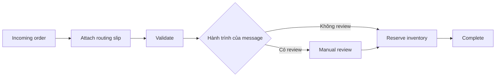
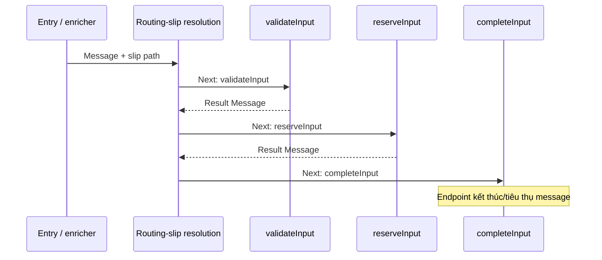
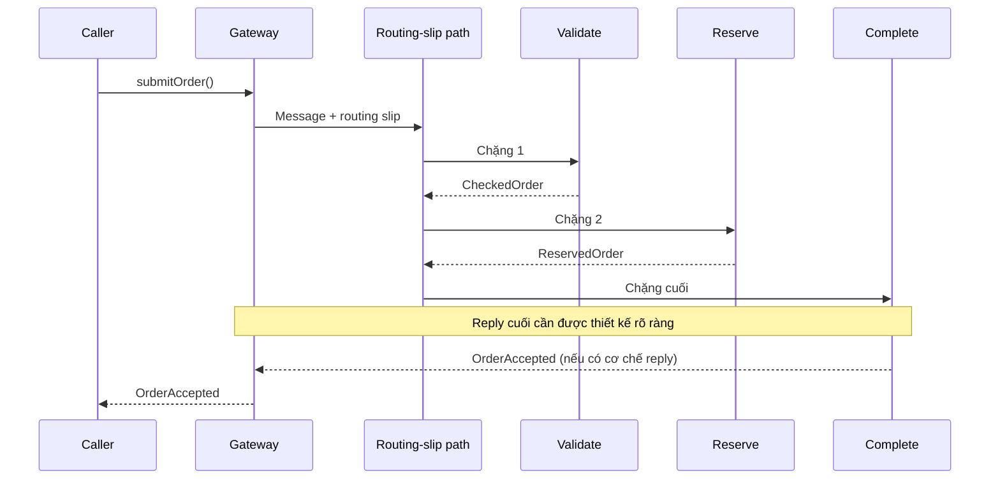
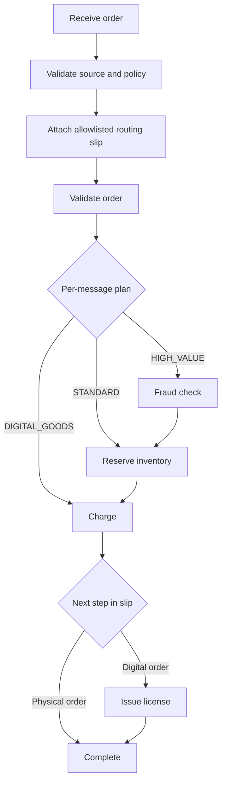

# Routing Slip lưu danh sách bước cần đi qua

Trong nhiều luồng tích hợp, message luôn đi qua một chuỗi bước cố định: kiểm tra dữ liệu → đặt chỗ tồn kho → ghi kết quả. Nhưng cũng có những trường hợp **mỗi message cần đi qua một danh sách bước khác nhau**. Đơn hàng giá trị cao phải qua thẩm định; đơn thông thường có thể bỏ qua. Đối với bài toán này, mẫu **Routing Slip** của Enterprise Integration Patterns (EIP) cho phép **đính kèm hành trình xử lý vào message**, để các endpoint lần lượt chuyển tiếp theo hành trình ấy.

Trong **Spring Integration**, routing slip được biểu diễn bằng **metadata trên message**, nhờ đó các endpoint phù hợp có thể tìm **đích tiếp theo** sau khi đã hoàn thành một bước. Bài học thuộc chương **Routing slip** của module `SPRING_INTEGRATION_PATTERN`, với mục tiêu triển khai Router, Filter, Transformer, Splitter, Aggregator, Gateway, retry, error channel và correlation thành những luồng message ít phụ thuộc, dễ mở rộng, có thể kiểm thử và theo dõi.

Sau bài này, bạn có thể:

- Giải thích vì sao **danh sách điểm đến gắn với message** khác với một Router chỉ quyết định nhánh tại một thời điểm.
- Mô tả cấu trúc hành trình, vị trí bước hiện tại và cơ chế chuyển tiếp của Routing Slip.
- Dùng cấu hình **Header Enricher** để thêm routing slip rồi nối các endpoint trả kết quả trong Spring Integration.
- Nhận biết các điều kiện khiến hành trình dừng: endpoint một chiều, channel được chỉ định cứng, lỗi, thiếu đích hoặc đường đi kết thúc.
- Thiết kế an toàn, retry/idempotency, correlation, timeout và khả năng quan sát cho mỗi lượt chuyển bước.
- Kiểm thử một hành trình hoàn chỉnh lẫn trường hợp bỏ bước, lỗi và giá trị đường đi không hợp lệ.

## 1. Ý tưởng: mang kế hoạch định tuyến cùng message

Với tuyến xử lý cố định, cấu trúc flow có thể quyết định mọi bước:

```text
ordersInput -> Validate -> ReserveInventory -> PublishResult
```

Nếu yêu cầu thay đổi theo loại đơn, ta có thể tạo nhiều flow hoặc Router chia nhánh. **Routing Slip** là lựa chọn khác: kế hoạch xử lý nằm cùng message, dưới dạng **danh sách các đích sẽ ghé qua theo thứ tự**.

```text
Message A (đơn thông thường):
  routing slip = [validateInput, reserveInput, completeInput]

Message B (đơn giá trị cao):
  routing slip = [validateInput, manualReviewInput, reserveInput, completeInput]
```



Sơ đồ cho thấy hai message có thể đi qua **cùng các endpoint tái sử dụng** nhưng mang hành trình khác nhau. Một endpoint `Validate` không nhất thiết phải biết khách hàng thuộc phân khúc nào để tự chọn nhánh; nó thực hiện công việc của mình, tạo kết quả, còn cơ chế routing slip xác định bước kế tiếp.

### Khi nào nên cân nhắc?

| Tình huống | Routing Slip có phù hợp? | Vì sao |
| --- | --- | --- |
| Mỗi message có một danh sách bước xử lý thay đổi theo chính sách. | **Có thể phù hợp.** | Hành trình được chọn cho từng message trước hoặc trong quá trình xử lý. |
| Mọi message luôn đi qua cùng ba bước. | Thường **không cần**. | Một `IntegrationFlow` tuần tự đơn giản dễ theo dõi hơn. |
| Chỉ cần chọn một trong hai channel. | Thường dùng **Router**. | Không cần biểu diễn cả hành trình khi chỉ có một quyết định. |
| Cùng một message phải được xử lý đồng thời bởi nhiều subscriber. | Dùng **Publish–Subscribe** hoặc Recipient List Router. | Routing Slip biểu diễn hành trình tuần tự, không tự có nghĩa fan-out. |
| Quy trình kéo dài nhiều giờ, có phê duyệt con người, bù trừ và lưu trạng thái. | Cân nhắc workflow/saga engine hoặc thiết kế lưu bền vững. | Một routing slip trên message không tự cung cấp tiến trình bền vững hay orchestration đầy đủ. |

## 2. Routing Slip được biểu diễn như thế nào?

Trong Spring Integration, routing slip là một **message header đặc biệt**, thường được nhắc đến qua hằng `IntegrationMessageHeaderAccessor.ROUTING_SLIP` (tên header `routingSlip`). Metadata này lưu **đường đi** và **vị trí tiến trình** để framework xác định channel tiếp theo khi endpoint tạo message đầu ra.

Về mặt khái niệm, có thể hình dung:

```text
Message<OrderCommand>
├── payload: OrderCommand(orderId="ORD-201", ...)
└── headers
    ├── routingSlip
    │   ├── path  = [validateInput, reserveInput, completeInput]
    │   └── index = vị trí bước kế tiếp
    ├── traceId = "trace-201"
    └── correlationId = "request-201"
```

Đây là **sơ đồ logic**, không phải một JSON schema bắt buộc hay lời khuyên tự dựng giá trị header tùy ý. Trong ứng dụng Spring Integration, hãy dùng cơ chế làm giàu header/routing slip được hỗ trợ thay vì tự chèn một chuỗi bất kỳ vào tên header đặc biệt rồi kỳ vọng framework tự hiểu.

**Hai phần quan trọng:**

1. **Path:** danh sách có thứ tự gồm các điểm đến/chiến lược định tuyến phù hợp với cơ chế Routing Slip. Trong ví dụ đơn giản, chúng là **tên message channel** đã được Spring đăng ký.
2. **Index/tiến trình:** xác định phần tử nào của danh sách sẽ được sử dụng kế tiếp. Đây là trạng thái **thuộc về hành trình message**, không phải một bộ đếm toàn cục chia sẻ giữa mọi đơn hàng.

Khi một message hoàn thành một bước và được chuyển tiếp theo routing slip, vị trí tiến trình được cập nhật theo cơ chế framework. Mỗi message có thể ở một bước khác nhau dù cùng đi qua một endpoint.

### Header hành trình khác payload nghiệp vụ

`orderId`, số tiền, danh sách mặt hàng, thời điểm phát sinh sự kiện vẫn là **dữ liệu nghiệp vụ**. Routing slip là **metadata điều phối**: nó mô tả **đường xử lý dự kiến**, không chứng minh nghiệp vụ đã hoàn thành hoặc được thanh toán. Nếu cần audit hoặc replay chính xác kế hoạch đã chọn, nên lưu quyết định và phiên bản chính sách trong dữ liệu bền vững phù hợp, thay vì phụ thuộc hoàn toàn vào một header nội bộ.

## 3. Cách một message đi qua các bước

Một hành trình có ba bước `validateInput`, `reserveInput`, `completeInput` có thể được diễn giải theo tiến trình:

| Thời điểm | Đích kế tiếp từ slip | Việc diễn ra |
| --- | --- | --- |
| Sau khi gắn slip | `validateInput` | Gửi message tới endpoint kiểm tra. |
| Sau khi bước validate phát kết quả | `reserveInput` | Gửi message đã xử lý sang bước giữ chỗ tồn kho. |
| Sau khi bước reserve phát kết quả | `completeInput` | Đưa message tới bước kết thúc. |
| Sau bước cuối | Không còn đích trong path. | Chấm dứt hành trình hoặc dùng reply/output policy khác nếu flow yêu cầu. |



**Điểm then chốt:** Để hành trình tự tiến, endpoint tại mỗi bước phải **phát một message đầu ra** qua cơ chế hỗ trợ routing slip. Một endpoint nhận message rồi chỉ ghi log và không tạo output thì **không tự làm message nhảy sang bước tiếp theo**.

### Routing Slip không phải một background scheduler

Routing slip không tự đánh thức một worker nếu bước trước chưa phát kết quả. Nó cũng không tự chuyển message sang broker, không tự khởi tạo retry hay tự xác nhận bên ngoài đã hoàn tất một tác vụ. Các bước được thực hiện theo semantics thực tế của channel và endpoint: đồng bộ, bất đồng bộ hoặc qua adapter ngoài nếu người triển khai đã thiết kế các ranh giới đó.

## 4. Các điều kiện để tự chuyển sang bước tiếp theo

Một số đặc điểm cần hiểu khi thiết kế:

1. **Endpoint có reply:** Bước trước cần tạo đầu ra (payload hoặc `Message<?>`) để hệ thống có thứ chuyển tiếp. Với Service Activator, handler một chiều trả `null` không tạo reply mới.
2. **Phân giải output channel:** Routing slip được dùng bởi những endpoint/thành phần Spring Integration có hỗ trợ cơ chế này để chọn đích **khi không có một output channel cụ thể được ưu tiên theo cấu hình**. Nếu bạn chỉ định đầu ra cứng ở endpoint, hãy kiểm tra thứ tự ưu tiên: có thể chính channel tường minh được dùng thay vì routing slip.
3. **Đích phải tồn tại và phù hợp:** Tên trong path phải phân giải được thành channel/route hợp lệ. Một typo hoặc target không có consumer có thể gây lỗi hoặc khiến tiến trình dừng.
4. **Không coi thao tác gửi là kết quả nghiệp vụ:** `send()` thành công ở một channel chỉ cho biết trạng thái gửi tại ranh giới đó, không cam kết mọi tác động phụ downstream đã commit.
5. **Chặng cuối cần hợp đồng rõ ràng:** Có thể là một handler một chiều ghi audit hoặc một endpoint tạo reply cho Gateway. Đừng mặc định hết phần tử trong slip tương đương một `Approved` cho caller.

| Cấu hình của bước | Kỳ vọng đối với hành trình |
| --- | --- |
| Handler trả payload/`Message<?>` và không khóa cứng output channel | Có thể chuyển tiếp theo routing slip được framework hỗ trợ. |
| Handler xử lý một chiều, `return null` | Không có reply để thúc đẩy bước tiếp theo. |
| Filter loại message | Message không đi tiếp; có thể cần discard/rejection policy. |
| Transformer đổi payload nhưng vẫn mang metadata cần thiết | Các bước sau có thể tiếp tục nếu slip được bảo toàn đúng. |
| Endpoint chỉ định output channel cố định | Cần xác minh tương tác/ưu tiên với routing slip; không giả định slip sẽ tự thắng. |
| Endpoint bất đồng bộ hoặc broker adapter | Cần kiểm tra lifecycle, mapping header và ack/retry; routing slip không tự đồng bộ giao nhận xuyên hệ thống. |

## 5. Ví dụ Java DSL: thêm slip rồi tái sử dụng ba endpoint

Ví dụ mô tả topology đơn giản với Java 17+, Spring Integration và các Service Activator trả kết quả. Sử dụng `Header Enricher` để đưa đường đi vào message, ba endpoint độc lập và một `QueueChannel` làm điểm quan sát kết quả.

### 5.1. Mô hình dữ liệu

```java
record OrderCommand(String orderId, long amountCents) {}

record CheckedOrder(String orderId, long amountCents) {}

record ReservedOrder(String orderId, String reservationId) {}
```

### 5.2. Các channel và IntegrationFlow

```java
import org.springframework.context.annotation.Bean;
import org.springframework.context.annotation.Configuration;
import org.springframework.integration.channel.QueueChannel;
import org.springframework.integration.dsl.IntegrationFlow;

@Configuration
class OrderRoutingSlipConfig {

    @Bean
    QueueChannel completeInput() {
        return new QueueChannel();
    }

    @Bean
    IntegrationFlow startOrderSlip() {
        return IntegrationFlow.from("ordersInput")
                .enrichHeaders(headers -> headers
                        .routingSlip(
                                "validateInput",
                                "reserveInput",
                                "completeInput"))
                .get();
    }

    @Bean
    IntegrationFlow validateOrder() {
        return IntegrationFlow.from("validateInput")
                .handle(OrderCommand.class, (order, headers) -> {
                    if (order.amountCents() <= 0) {
                        throw new IllegalArgumentException("INVALID_AMOUNT");
                    }
                    return new CheckedOrder(order.orderId(), order.amountCents());
                })
                .get();
    }

    @Bean
    IntegrationFlow reserveInventory() {
        return IntegrationFlow.from("reserveInput")
                .handle(CheckedOrder.class, (order, headers) ->
                        new ReservedOrder(order.orderId(),
                                "RES-" + order.orderId()))
                .get();
    }
}
```

**Ý nghĩa của đoạn mã:**

- `ordersInput` là điểm gửi request vào đầu flow. Bước `enrichHeaders` gắn danh sách ba channel vào **routing-slip header**.
- `validateInput` là đích đầu tiên, nhận `OrderCommand` và tạo `CheckedOrder`.
- `reserveInput` là đích thứ hai, nhận `CheckedOrder` và tạo `ReservedOrder`.
- `completeInput` là chặng cuối; ở ví dụ dùng `QueueChannel` để test có thể lấy `ReservedOrder` ra mà chưa cần kết nối hệ thống ngoài.
- Hai bước xử lý không khai báo một output channel cố định và **đều trả kết quả**; đây là điều kiện quan trọng để cơ chế chuyển tiếp của routing slip có cơ hội hoạt động.

**Lưu ý về API:** Đoạn cấu hình dùng cách khai báo routing slip trong Spring Integration Java DSL. Cần kiểm tra overload và khả năng hỗ trợ trên phiên bản Spring Integration mà dự án dùng khi đưa vào source thực tế; bài học đang minh họa cơ chế, chưa chạy biên dịch/kiểm thử Gradle. Không ghép thêm một `.channel("someFixedChannel")` ở cuối các endpoint nếu mục đích là để slip tự quyết định đích kế tiếp.

### 5.3. Gửi yêu cầu

```java
import org.springframework.messaging.MessageChannel;
import org.springframework.messaging.support.MessageBuilder;

void submit(MessageChannel ordersInput) {
    ordersInput.send(MessageBuilder
            .withPayload(new OrderCommand("ORD-201", 150_000))
            .setHeader("traceId", "trace-201")
            .build());
}
```

**Kết quả mong muốn trong ví dụ:** `completeInput` nhận một `Message<ReservedOrder>`. Đây là **điểm cuối của hành trình nội bộ**, không phải chứng cứ rằng hàng đã được giữ chỗ thật ở một dịch vụ ngoài. Trong mã minh họa, `reservationId` được dựng tại handler; sản phẩm thực tế phải gọi hệ thống tồn kho và xử lý khả năng thao tác thất bại hoặc được thực hiện lặp.

### 5.4. Thay đổi đường đi theo từng message

Một routing slip có ích nhất khi **path có thể được quyết định theo chính sách**, không phải luôn cố định. Ví dụ:

```text
STANDARD:
  [validateInput, reserveInput, completeInput]

HIGH_VALUE:
  [validateInput, riskReviewInput, reserveInput, completeInput]

DIGITAL_GOODS:
  [validateInput, issueLicenseInput, completeInput]
```

Ứng dụng có thể chọn path phù hợp sau validation bằng một **service phân loại** hoặc cơ chế làm giàu header/processor có hỗ trợ tạo routing slip. Điều quan trọng là **không nhận tên channel tùy ý trực tiếp từ client**. Hãy ánh xạ loại yêu cầu đã xác minh (`STANDARD`, `HIGH_VALUE`, `DIGITAL_GOODS`) thành **các route đã cho phép**.

Trong cấu hình code thực tế, một cách tổ chức dễ kiểm thử là dùng một component `RoutePlanPolicy` trả về một danh sách có giới hạn và được kiểm tra, rồi một bước tạo routing slip theo API tương ứng của Spring Integration. Đoạn pseudocode dưới đây thể hiện **chính sách nghiệp vụ**, không phải API framework:

```java
List<String> routeFor(OrderCategory category) {
    return switch (category) {
        case STANDARD -> List.of(
                "validateInput", "reserveInput", "completeInput");
        case HIGH_VALUE -> List.of(
                "validateInput", "riskReviewInput", "reserveInput", "completeInput");
        case DIGITAL_GOODS -> List.of(
                "validateInput", "issueLicenseInput", "completeInput");
    };
}
```

Nếu dùng cách khai báo động, hãy bảo đảm bước gắn header tạo **đúng kiểu routing slip mà Spring Integration hỗ trợ**, không chỉ `setHeader("routingSlip", List.of(...))` một cách tùy tiện. Một routing slip có thể được biểu diễn/duy trì dưới dạng metadata riêng của framework, bao gồm trạng thái tiến trình.

## 6. So sánh Routing Slip với các EIP định tuyến khác

| Pattern | Câu hỏi trọng tâm | Khác Routing Slip ở đâu? |
| --- | --- | --- |
| **Content-Based Router** | “Message này cần đi nhánh nào ngay lúc này?” | Một quyết định tại một Router, không nhất thiết mang cả hành trình về sau. |
| **Header Value Router** | “Giá trị header này ánh xạ tới channel nào?” | Đọc một khóa và chọn đích; không mặc nhiên quản lý danh sách nhiều chặng. |
| **Recipient List Router** | “Những recipient nào cần nhận message này?” | Thường hướng tới nhiều người nhận; Routing Slip nhấn mạnh **thứ tự các chặng**. |
| **Publish–Subscribe** | “Làm sao broadcast message tới tất cả subscriber?” | Fan-out, không phải một hành trình tuyến tính qua từng điểm. |
| **Filter** | “Message có được tiếp tục đi tiếp không?” | Chấp nhận/từ chối; một Filter loại message có thể **dừng hành trình slip**. |
| **Splitter/Aggregator** | “Tách và gom nhiều message liên quan như thế nào?” | Có nhiều phần tử và correlation/release; slip mô tả thứ tự bước của một message. |
| **Gateway** | “Làm sao gọi flow và nhận một reply?” | Gateway định nghĩa request–reply; slip chỉ định đường đi và không tự bảo đảm reply. |

### Routing Slip khác một chuỗi hard-coded

Với flow cố định:

```text
Inbound -> Validate -> Reserve -> Notify
```

Các bước gắn với nhau bằng cấu hình `.channel(...)`/output channel. Routing Slip phù hợp hơn khi cần **tái sử dụng các bước ở nhiều tổ hợp** mà không tạo một lượng lớn flow gần giống nhau. Bù lại, hành trình không còn thể hiện hoàn toàn trong một đoạn DSL tuyến tính: **phải có logging, tracing và test** để xác định message cụ thể đã đi đâu.

## 7. Routing slip, reply và Gateway

Trong hệ thống request–reply, một Gateway có thể đưa yêu cầu vào flow và chờ kết quả. Nếu routing slip chứa nhiều bước, chỉ **khi hành trình tạo ra reply đúng contract** thì Gateway mới nhận được kết quả phù hợp. Bản thân slip không đảm bảo có một reply cuối cùng.



Trong ví dụ code ở mục 5, `completeInput` chỉ là **QueueChannel để kiểm thử**; nó không phải một endpoint có sẵn khả năng gửi kết quả về Gateway. Nếu triển khai Gateway thực tế, hãy tạo endpoint kết thúc trả về kết quả và định nghĩa đường reply cùng timeout/no-reply behavior phù hợp.

Một handler kết thúc có thể **không trả kết quả** nếu mục đích là phát một event một chiều. Nhưng nếu caller cần response đồng bộ, chặng cuối phải trả kết quả hoặc một trạng thái từ chối/lỗi có nghĩa. Không giả định “hết danh sách slip” tự động đồng nghĩa `OrderAccepted`.

### Cẩn thận với `replyChannel`

`replyChannel` dùng cho request–reply, còn `routingSlip` dùng để điều phối các chặng trong luồng. Hai metadata có mục đích khác nhau và có thể tương tác ở quá trình xác định đích của một reply. Không thay `replyChannel` bằng một routing key nghiệp vụ, không tự sửa slip index để “nhảy bước”, và **kiểm thử trên đúng phiên bản Spring Integration** nếu flow có cả output channel tường minh, Gateway và routing slip.

## 8. Routing Slip có giống workflow engine hay saga không?

**Không.** Routing Slip ghi lại *đường muốn đi*, nhưng bản thân nó không cung cấp đầy đủ các khả năng của workflow engine:

| Vấn đề | Routing Slip trên message | Workflow/saga có lưu trạng thái |
| --- | --- | --- |
| Chỉ định chuỗi bước | Có, qua metadata của message. | Có, thường dưới dạng mô hình quy trình. |
| Chạy các bước sau khi có output | Phụ thuộc endpoint/channel và cơ chế chuyển tiếp. | Engine điều phối theo trạng thái của quy trình. |
| Lưu tiến trình qua crash | Không mặc định có. | Có thể có nếu engine/store hỗ trợ. |
| Chờ phê duyệt nhiều giờ/ngày | Không tự cung cấp. | Thường phù hợp hơn với stateful workflows. |
| Tự rollback side effect | Không. | Thường cần định nghĩa compensation ngay cả khi dùng saga. |
| Retry, timeout, deduplication | Cần cấu hình/triển khai độc lập. | Có thể cung cấp cơ chế riêng nhưng vẫn cần contract nghiệp vụ. |

Ví dụ đơn hàng đi `validate → reserve → charge` rồi `charge` thất bại: Routing Slip **không tự hoàn tác** thao tác giữ hàng. Nếu cần bù trừ `releaseReservation`, hãy thiết kế một nhánh lỗi/saga rõ ràng, có lưu trạng thái cần thiết và idempotency key. Việc thêm chuỗi `releaseReservation` vào slip mà không có điều kiện/lifecycle phù hợp không tạo ra transaction nguyên tử.

## 9. Các tình huống làm hành trình dừng hoặc sai hướng

### 9.1. Endpoint không phát reply

Ví dụ một handler cuối chặng gọi API rồi trả `null`:

```java
.handle(OrderCommand.class, (order, headers) -> {
    auditService.write(order);
    return null; // Không có reply message để đi tiếp.
})
```

Nếu chặng này chưa phải chặng cuối nhưng không tạo output, **routing slip không có message đầu ra để chuyển**. Hãy dùng handler trả payload/kết quả hợp lệ khi phải đi tiếp, hoặc thiết kế một cơ chế chuyển tiếp khác có chủ đích. **Trả `null` từ handler không phải tạo `Message` với payload null**.

### 9.2. Filter loại message

Nếu một Filter trong chặng `validate` trả `false`, message có thể bị loại khỏi nhánh chính. Từ đó danh sách slip không tự chạy hết. Khi nghiệp vụ cần phản hồi từ chối, hãy tạo kết quả có kiểu `Rejected`/`ValidationFailed` hoặc nhánh discard có kết thúc/giám sát phù hợp; không mặc định caller sẽ nhận được một `Rejected`.

### 9.3. Channel không tồn tại hoặc không có consumer

Một mục `validateInpt` viết sai có thể không phân giải được thành channel. Cần **kiểm tra danh sách route trước khi gắn**, hạn chế cho phép tên động và kiểm thử topology. Một bean channel tồn tại nhưng không có subscriber nhận message cũng có thể làm hành trình thất bại hoặc dừng tùy loại channel.

### 9.4. Header bị thay đổi hoặc mất qua adapter

Nếu một message đi qua Kafka/AMQP/HTTP adapter, không đảm bảo mọi **Spring message header** — đặc biệt metadata nội bộ như routing slip — được giữ nguyên. Một consumer khác JVM có thể nhận message mới thiếu slip/path/index và không thể tiếp tục đúng hành trình. Muốn chạy luồng xuyên process, cần hợp đồng transport và cơ chế lưu/tái tạo routing plan bền vững, hoặc một workflow orchestrator.

### 9.5. Vòng lặp, lặp bước và chính sách độc hại

Nếu path bị tạo từ dữ liệu chưa được xác minh, message có thể bị dẫn vào các endpoint nhạy cảm, một bước bị lặp nhiều lần hoặc một danh sách dài bất thường. Ngay cả khi cơ chế duyệt slip theo chỉ số chứ không quay lại đầu danh sách, việc cấu hình **cùng một chặng nhiều lần** vẫn có thể gây side effect trùng. Nên giới hạn độ dài path, cho phép chỉ những channel được biết trước và kiểm tra chuỗi bước hợp lệ theo nghiệp vụ.

## 10. Retry, idempotency và phân biệt “gửi” với “xử lý xong”

Một hành trình có thể gặp lỗi ở bất cứ chặng nào:

```text
Validate  ->  ReserveInventory  ->  ChargePayment  ->  Complete
   OK              OK                 FAIL
```

Ở ví dụ này, **ReserveInventory đã có tác động phụ**, dù `ChargePayment` sau đó thất bại. Nếu retry toàn bộ message từ đầu mà không có bảo vệ, hệ thống có thể giữ hàng nhiều lần. Vì vậy:

- **Gắn `eventId`/`commandId` bền vững** vào payload hoặc event envelope; không dựa duy nhất vào Spring `MessageHeaders.id` để khử trùng lặp qua replay.
- **Idempotency theo chặng:** thao tác `reserve` và `charge` có thể cần khóa riêng, ví dụ `(commandId, stepName)` để nhận diện lần thử cùng một công việc.
- **Retry có giới hạn:** chỉ thử lại lỗi tạm thời (network timeout, rate limit), có backoff/timeout; lỗi dữ liệu không hợp lệ không tự sửa bằng retry.
- **Đánh dấu tiến trình khi cần lưu bền vững:** nếu phải phục hồi sau crash, lưu trạng thái đã hoàn thành từng chặng trong database/store phù hợp.
- **Bù trừ có chủ đích:** khi không thể tiếp tục, xác định có giải phóng giữ chỗ hay hoàn tiền hay không; đây là chính sách nghiệp vụ, không phải chức năng tự sinh của slip.

### Index tiến trình không phải acknowledgement

Vị trí bước của routing slip cho biết framework sẽ tìm đích nào kế tiếp theo cơ chế hiện tại. Nó **không** thay thế một bản ghi transaction, broker acknowledgement, hoặc xác nhận dịch vụ bên ngoài đã commit side effect. Một message có thể đã đi tới chặng kế tiếp trong JVM nhưng vẫn có xử lý bất đồng bộ chưa hoàn tất ở đâu đó. Nếu hợp đồng cần đảm bảo một bước chỉ chuyển tiếp khi bên ngoài xác nhận thành công, phải thiết kế điểm xác nhận đó vào endpoint trước khi phát reply.

## 11. Error channel, correlation và quan sát hành trình

### Error flow phải biết message dừng ở đâu

Phân biệt ít nhất ba loại lỗi:

| Loại lỗi | Ví dụ | Cách xử lý |
| --- | --- | --- |
| **Lỗi xây dựng slip** | Policy trả channel không được phép. | Reject/fallback trước khi gửi, log quyết định và nguyên nhân. |
| **Lỗi phân giải/chuyển tiếp** | Sai tên channel, không có consumer. | Error policy, cảnh báo cấu hình, không coi route thành công. |
| **Lỗi xử lý ở chặng** | Dịch vụ tồn kho timeout hoặc báo hết hàng. | Retry có giới hạn, business result hoặc compensation theo yêu cầu. |

`errorChannel` và `ErrorMessage` thuộc cơ chế xử lý lỗi của Spring Integration, nhưng **exception có đi tới error channel hay lan về caller** còn tùy endpoint, đồng bộ/bất đồng bộ, poller và cấu hình. Một routing slip không tự chuyển mọi exception thành một ErrorMessage, cũng không tự chọn một kênh bù trừ sau khi chặng thất bại.

### Correlation khác routing slip

| Trường | Vai trò |
| --- | --- |
| `routingSlip` | Danh sách chặng và tiến trình định tuyến của message. |
| `correlationId` | Nhận diện nhóm message liên quan trong Splitter/Aggregator hoặc vòng đời yêu cầu theo hợp đồng. |
| `sequenceNumber` / `sequenceSize` | Thông tin vị trí/kích thước nhóm khi một pattern sinh sequence. |
| `traceId` | Quan sát hành trình qua các bước và dịch vụ. |
| `eventId` / `commandId` | ID bền vững để nhận diện sự kiện/lệnh và phục vụ idempotency khi cần. |

Nếu một message được Splitter tách thành nhiều message con và **mỗi con mang một slip riêng**, chúng vẫn có thể cần cùng `correlationId` để Aggregator tổng hợp. Ngược lại, hai đơn hàng có slip giống hệt nhau **không** có nghĩa chúng thuộc cùng một nhóm correlation. Đừng dùng chuỗi đường đi làm khóa group hoặc khóa deduplication.

### Log và metrics nên theo dõi

Một log gợi ý:

```text
eventId=evt-201 orderId=ORD-201 planVersion=v2
currentStep=reserveInput nextStep=completeInput
routeOutcome=COMPLETED traceId=trace-201
```

Các tên trường ở đây là **quy ước quan sát của ứng dụng**. Nên theo dõi số message vào từng chặng, latency, số lần lỗi/trì hoãn, số lần retry, số hành trình dừng sớm và số bước chưa được gọi. Nếu cần audit, lưu `routePlanId`/phiên bản chính sách và trạng thái theo bước ngoài message.

**Không gắn `orderId`, `eventId` hoặc toàn bộ path tùy biến làm nhãn metric** vì high cardinality; dùng các nhãn hữu hạn như `step`, `outcome`, `planType`. Khi chuyển thread qua Executor/Reactive bridge, cần truyền tracing context đúng công nghệ, không giả định MDC/`ThreadLocal` được tự giữ nguyên.

## 12. Kiểm thử toàn bộ hành trình bằng Spring Test

Một unit test chỉ kiểm tra `routeFor(category)` trả đúng danh sách là cần thiết nhưng **chưa đủ**. Để xác nhận routing slip thật sự chuyển tiếp qua các endpoint, hãy khởi chạy application context với một flow nhỏ và quan sát message tới chặng cuối.

### Kiểm thử đường đi cơ bản

Ví dụ dưới đây dùng `OrderRoutingSlipConfig` ở mục 5, JUnit 5 và Spring Test:

```java
import static org.junit.jupiter.api.Assertions.assertEquals;
import static org.junit.jupiter.api.Assertions.assertNotNull;
import static org.junit.jupiter.api.Assertions.assertTrue;

import org.junit.jupiter.api.Test;
import org.springframework.beans.factory.annotation.Autowired;
import org.springframework.beans.factory.annotation.Qualifier;
import org.springframework.integration.channel.QueueChannel;
import org.springframework.messaging.Message;
import org.springframework.messaging.MessageChannel;
import org.springframework.messaging.support.MessageBuilder;
import org.springframework.test.context.junit.jupiter.SpringJUnitConfig;

@SpringJUnitConfig(OrderRoutingSlipConfig.class)
class RoutingSlipFlowTest {

    @Autowired
    @Qualifier("ordersInput")
    MessageChannel ordersInput;

    @Autowired
    @Qualifier("completeInput")
    QueueChannel complete;

    @Test
    void visitsStepsAndReachesTheFinalChannel() {
        OrderCommand order = new OrderCommand("ORD-201", 150_000);

        assertTrue(ordersInput.send(MessageBuilder.withPayload(order)
                .setHeader("traceId", "trace-201")
                .build()));

        Message<?> finished = complete.receive(1_000);
        assertNotNull(finished);
        ReservedOrder result = (ReservedOrder) finished.getPayload();
        assertEquals("ORD-201", result.orderId());
        assertEquals("RES-ORD-201", result.reservationId());
        assertEquals("trace-201", finished.getHeaders().get("traceId"));
    }
}
```

Đây là ví dụ kiểm tra **kết quả cuối hành trình**. Để chứng minh thứ tự chặng không chỉ bằng kiểu kết quả, có thể thêm `StepRecorder` test-only ghi lại các mốc `validate`, `reserve`, `complete`; assert đúng thứ tự và số lần gọi. Trong flow có executor, nên dùng công cụ chờ có điều kiện/latch với timeout rõ ràng; không dùng `Thread.sleep()` tùy tiện.

**Lưu ý:** Nếu ứng dụng dùng một phiên bản Spring Integration với API wiring/routing slip khác ví dụ, hãy điều chỉnh cấu hình theo tài liệu của phiên bản đó và kiểm chứng bằng integration test. Bài học ở STEP 4 chưa thực hiện biên dịch hoặc Content QA học thuật.

### Ma trận kiểm thử trước production

| Ca | Điều cần chứng minh |
| --- | --- |
| Đường `[validate, reserve, complete]` | Mỗi bước chạy đúng một lần theo thứ tự; kết quả cuối đúng. |
| Đường bổ sung `[validate, riskReview, reserve, complete]` | Review được thực hiện, các bước còn lại vẫn đúng hợp đồng. |
| Handler giữa trả `null`/không có reply | Hành trình dừng hoặc có policy no-reply rõ ràng; không giả định bước sau vẫn chạy. |
| Filter từ chối tại bước validate | Reject/discard business result hoặc exception được xử lý đúng. |
| Path chứa channel không tồn tại | Báo lỗi/quarantine trước hoặc trong routing, không im lặng coi là thành công. |
| Output channel cứng ở một endpoint | Cơ chế ưu tiên và tác động tới slip được xác minh bằng test trên phiên bản thực tế. |
| Retry sau lỗi mạng ở bước reserve | Không tạo reservation trùng; giữ event/command ID bền vững. |
| Flow có Gateway | Caller nhận reply hoặc lỗi/timeout đúng contract. |
| Qua transport ngoài | Routing plan/tiến trình được lưu/tái tạo đúng hoặc được thay bằng orchestration bền vững. |
| Nhiều message đồng thời | Mỗi message có tiến trình riêng, không lẫn index hoặc correlation. |

## 13. Sai lầm thường gặp

**Sai lầm 1 — Tưởng slip tự thực hiện các bước.** Header chỉ hướng dẫn việc chuyển tiếp, không tự khởi tạo side effect. Cần endpoint nhận và phát kết quả phù hợp ở từng chặng.

**Sai lầm 2 — Chèn một `List<String>` tùy ý vào header rồi coi là slip hợp lệ.** Cấu trúc framework có metadata tiến trình; hãy dùng cơ chế tạo routing slip được Spring Integration hỗ trợ.

**Sai lầm 3 — Mọi handler đều trả `null`.** Endpoint một chiều không có reply để đi tiếp. Chỉ dùng một chiều ở chặng kết thúc hoặc thiết kế cơ chế chuyển tiếp riêng.

**Sai lầm 4 — Cố định output channel trên mọi handler.** Có thể làm mất tác dụng của slip vì endpoint đã có đích ưu tiên. Kiểm thử việc xác định output channel và bỏ cấu hình cứng khi muốn slip điều khiển.

**Sai lầm 5 — Dùng slip thay cho một workflow bền vững.** Khi process chết, header in-memory không đảm bảo khôi phục. Dùng store/outbox/workflow engine khi hợp đồng yêu cầu.

**Sai lầm 6 — Tin tên channel do client tự gửi.** Có thể dẫn tới endpoint không được phép, lặp chặng hoặc quá tải. Tạo route bằng policy allowlist tại ranh giới tin cậy.

**Sai lầm 7 — Coi index tăng là transaction đã commit.** Hành trình đi tiếp chưa chứng minh side effect ở broker/DB đã được xác nhận. Cần kết quả nghiệp vụ và idempotency.

**Sai lầm 8 — Dùng `routingSlip` làm correlation ID.** Hai message có path giống nhau vẫn là hai yêu cầu riêng. Dùng correlation ID/command ID đúng mục đích.

**Sai lầm 9 — Không có đường xử lý lỗi hoặc timeouts.** Một chặng lỗi có thể khiến Gateway chờ, nghiệp vụ dở dang hoặc message nằm ở queue không người nhận. Thiết kế retry/error/compensation và giám sát.

## 14. Bài tập tình huống: xử lý thanh toán theo loại đơn hàng

Một hệ thống thương mại điện tử nhận các yêu cầu `OrderCommand`. Tùy loại đơn, thứ tự bước khác nhau:

| Nhóm đơn | Routing Slip mong muốn |
| --- | --- |
| `STANDARD` | `validate → reserve → charge → complete` |
| `HIGH_VALUE` | `validate → fraudCheck → reserve → charge → complete` |
| `DIGITAL_GOODS` | `validate → charge → issueLicense → complete` |



### Yêu cầu triển khai

1. **Xây dựng route policy** nhận loại đơn đã được xác thực, trả path từ danh sách cho phép; không lấy raw channel names từ HTTP header hoặc Kafka message chưa xác minh.
2. **Giữ contract của mỗi bước**: validate trả kết quả có kiểu, fraudCheck từ chối hoặc chấp thuận, reserve trả reservation ID, charge trả payment ID. Một endpoint không được làm mất metadata cần cho slip/correlation.
3. **Thiết kế chặng cuối**: `complete` phải tạo reply/event hoặc cập nhật trạng thái đã xác nhận theo yêu cầu; không coi hết slip là đã hoàn tất nghiệp vụ.
4. **Phân biệt lỗi**: `INVALID_AMOUNT` là từ chối nghiệp vụ; `PAYMENT_TIMEOUT` có thể retry; `FRAUD_REJECTED` là kết quả quyết định; lỗi lưu bền vững phải có recovery policy.
5. **Idempotency và compensation**: giữ cùng command ID khi retry charge; nếu đã reserve rồi charge thất bại, quyết định khi nào release reservation.
6. **Quan sát**: ghi loại route, version policy, bước hiện tại, bước kế tiếp, số lần thử và outcome; không đưa ID đơn hàng vào nhãn metrics.
7. **Kiểm thử**: ba path hợp lệ, path lạ, handler trả null, timeout, restart, và trường hợp gửi nhiều yêu cầu đồng thời với slip khác nhau.

### Câu hỏi tự đánh giá

**Câu 1:** Nếu `validate` trả một `CheckedOrder` rồi `reserve` không phát reply, routing slip có tự chuyển tới `charge` không? **Không.** Cần một output message hoặc cơ chế điều phối thay thế phù hợp.

**Câu 2:** Nếu một message chứa path `[validate, reserve, charge]` và phần tử `reserve` đã gọi thành công dịch vụ tồn kho, có thể kết luận giao dịch thanh toán đã hoàn thành không? **Không.** Chặng `charge` chưa được xác nhận, còn side effect giữ hàng có thể cần bù trừ.

**Câu 3:** Nếu hai message có slip giống nhau, có thể dùng đường đi để gom chúng vào một Aggregator không? **Không.** Đường đi không phải khóa correlation của nhóm nghiệp vụ.

**Câu 4:** Có nên cho client gửi thẳng `routingSlip=[internalAdminChannel, refundChannel]` không? **Không.** Đây là dữ liệu điều khiển topology nhạy cảm; chỉ sinh đường đi từ policy đáng tin cậy, giới hạn channel và quyền.

## Tổng kết

- **Routing Slip** là mẫu EIP lưu **danh sách các bước cần đi qua** trên message, giúp từng message có thể mang một hành trình riêng thay vì phụ thuộc hoàn toàn vào flow cố định.
- Trong Spring Integration, routing slip là **metadata có path và trạng thái tiến trình**; dùng công cụ Header Enricher/API hỗ trợ để tạo, không tự gắn dữ liệu không đúng cấu trúc vào header đặc biệt.
- Hành trình chỉ tiến khi các endpoint phù hợp **phát output message** và cơ chế phân giải output chọn được đích tiếp theo; handler một chiều/Filter drop/channel cứng có thể làm dừng hoặc đổi đường đi.
- Routing Slip **khác Router một nhánh, Publish–Subscribe fan-out, Gateway request–reply và workflow/saga bền vững**; không tự cung cấp transaction, ACK, replay, rollback hay kết quả nghiệp vụ.
- Thiết kế **allowlist đường đi, error/retry, idempotency, correlation, compensation, timeout và observability** theo từng chặng, đặc biệt khi có hệ thống ngoài hoặc xử lý bất đồng bộ.
- Kiểm thử **toàn bộ thứ tự hành trình, các đường đi khác nhau và trường hợp thất bại**, không chỉ kiểm tra nội dung của routing-slip header.
