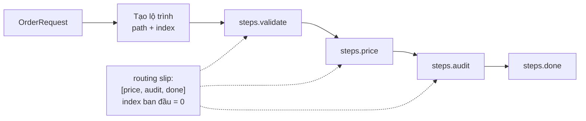
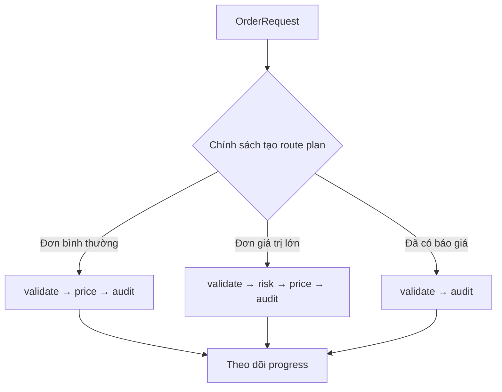

# Route sequence trong header hoặc message state

## 1. Bài toán: một message cần đi qua một lộ trình có thứ tự

Trong hệ thống bán hàng, sau khi tiếp nhận yêu cầu thanh toán, thông điệp có thể phải đi qua một **chuỗi bước theo thứ tự**: kiểm tra dữ liệu → tính phí → ghi nhật ký kiểm toán → kết thúc. Một quy trình khác có thể chèn thêm bước kiểm tra rủi ro hoặc bỏ bước tính phí tùy sản phẩm. Nếu cố định toàn bộ quan hệ giữa các endpoint bằng một sơ đồ nối channel duy nhất, việc thêm hoặc thay đổi lộ trình dễ làm cấu hình trở nên phức tạp.

**Routing Slip** là mẫu *Enterprise Integration Patterns* (EIP) mang theo **hành trình dự kiến** của một message. Mỗi khi hoàn tất một chặng, hệ thống xác định **chặng kế tiếp** dựa trên lộ trình và **vị trí hiện tại**. Có thể xem nó như một phiếu hướng dẫn xử lý đi kèm thông điệp.

Trong chương **Routing slip** của module **SPRING_INTEGRATION_PATTERN**, mục tiêu là triển khai Enterprise Integration Patterns với Spring Integration để xây dựng flow ít phụ thuộc, dễ mở rộng. Routing Slip giúp nối các Endpoint theo hành trình; những Endpoint này có thể chứa Filter, Transformer, Router, Splitter, Aggregator, Gateway và hành vi nghiệp vụ. Việc retry, error channel, correlation, kiểm thử và theo dõi các nhánh cần được thiết kế theo chính sách vận hành thực tế.



Sơ đồ trên sử dụng `steps.validate` làm chặng đầu tiên theo kết nối được cấu hình tường minh. Header Routing Slip chứa **các chặng sau đó**. Khi Validate trả kết quả, framework chọn Price; khi Price trả kết quả, nó chọn Audit; sau đó là Done.

### 1.1. Routing Slip giải quyết điều gì?

| Nhu cầu | Không có lộ trình đi kèm | Với Routing Slip |
| --- | --- | --- |
| Nhiều hành trình dùng chung các endpoint | Cần nhiều dây nối hoặc nhiều router | Message mang chuỗi chặng tương ứng |
| Chèn một bước xử lý cho một nhóm message | Có thể phải thay topology | Có thể chọn path khác từ đầu hoặc qua strategy |
| Theo dõi message đang ở đâu | Phải suy ra từ channel/log | Theo dõi path, index, event ID và lịch sử xử lý |
| Thực thi từng bước theo thứ tự | Flow cố định thường làm được | Path mô tả thứ tự ngay trong ngữ cảnh message |
| Khôi phục một quy trình dài | Phải lưu trạng thái ngoài | **Vẫn phải lưu trạng thái bền vững**; header đơn thuần không đủ |

Một Routing Slip **không phải** hàng đợi bền vững, không tự bảo đảm exactly-once và không biến nhiều tác vụ thành một transaction. Nó chủ yếu giải quyết câu hỏi: **“Bước nào sẽ nhận kết quả tiếp theo của message này?”**

## 2. Hiểu route sequence: path và cursor/index

Về mặt ý tưởng, một route sequence có hai phần:

1. **Path**: danh sách chặng hoặc quy tắc quyết định chặng, ví dụ `["steps.price", "steps.audit", "steps.done"]`.
2. **Cursor/index**: vị trí sẽ được đọc tiếp, ví dụ `0` trước khi vào `steps.price`.

Sau mỗi chặng hoàn thành và tạo reply hợp lệ, cursor tiến tới vị trí tiếp theo. Với các chặng cố định, trạng thái tưởng tượng có thể viết như sau:

```text
Lúc nhận tại steps.validate:
  path  = [steps.price, steps.audit, steps.done]
  index = 0

Validate tạo reply:
  next  = steps.price
  index = 1

Price tạo reply:
  next  = steps.audit
  index = 2

Audit tạo reply:
  next  = steps.done
  index = 3

Done kết thúc công việc:
  không tạo reply mới
```

**Lưu ý:** đoạn trên diễn giải hành vi bằng văn bản; nó **không** phải một ví dụ giá trị Java hợp lệ để tự gán nguyên văn vào header chuẩn của Spring Integration. Framework có định dạng nội bộ cho `routingSlip`; không nên thay nó bằng một `List<String>` tùy ý rồi mong hệ thống tự định tuyến.

### 2.1. Tại sao không chỉ lưu tên channel kế tiếp?

Nếu chỉ lưu `nextChannel="steps.price"`, khi Price xử lý xong thì cần một nguồn khác để biết chặng sau Price. Route sequence chứa cả lộ trình và vị trí hiện tại giúp từng endpoint được sử dụng lại trong nhiều hành trình.

Ví dụ:

| Loại yêu cầu | Route sequence |
| --- | --- |
| Đơn bình thường | Validate → Price → Audit → Done |
| Đơn đã được báo giá trước | Validate → Audit → Done |
| Đơn cần kiểm tra rủi ro | Validate → Risk Check → Price → Audit → Done |

Các đường đi có thể chia sẻ cùng một endpoint `Audit` và `Done`, nhưng message mang thông tin quyết định chặng nào cần thực hiện.

### 2.2. Path là dữ liệu điều phối, không phải payload nghiệp vụ

| Thành phần | Ví dụ | Vai trò |
| --- | --- | --- |
| Payload | `OrderRequest("ORD-105", 350000)` | Dữ liệu nghiệp vụ |
| Routing Slip path | `["steps.price","steps.audit","steps.done"]` | Lộ trình xử lý |
| Routing Slip index | `1` | Chặng tiếp theo sẽ được chọn |
| `eventId` | `"evt-105"` | Chống xử lý trùng khi phát lại |
| `correlationId` | `"checkout-105"` | Gom/đối chiếu các message thuộc cùng yêu cầu |
| `traceId` | `"trace-105"` | Quan sát toàn bộ luồng |
| Workflow status | `"WAITING_FOR_PAYMENT"` | Trạng thái nghiệp vụ nếu workflow kéo dài |

Các định danh có mục đích khác nhau. **Routing index không thay thế event ID**, và không nên dùng `MessageHeaders.ID` làm khóa idempotency vì một sự kiện có thể được phát lại trong một message mới.

## 3. Routing Slip được Spring Integration thực thi như thế nào?

Spring Integration cung cấp cơ chế **Routing Slip** từ phiên bản 4.1. Nó sử dụng header hệ thống `routingSlip` (constant `IntegrationMessageHeaderAccessor.ROUTING_SLIP`) để xác định channel tiếp theo cho các **message-producing endpoints** khi chúng **không** có `outputChannel` được chỉ định.

Với path chứa các channel cố định, thuật toán khái niệm:

1. Endpoint xử lý message và **tạo reply**.
2. Nếu endpoint đã khai báo output channel tường minh, cấu hình output đó có hiệu lực; không coi Routing Slip là cơ chế thay thế mọi output.
3. Khi endpoint không chỉ định output channel, framework tham chiếu header `routingSlip`.
4. Framework lấy phần tử ở `routingSlipIndex`. Nếu đó là tên `MessageChannel` đã đăng ký, nó gửi reply tới channel ấy và **tăng index trong reply**.
5. Chặng kế tiếp tiếp tục xử lý. Khi đã hết path, cơ chế reply channel thông thường được áp dụng nếu có.

Đây là cơ chế dựa trên **reply/output resolution**, không phải một scheduler tự đánh thức bước tiếp theo. Nếu một Service Activator trả `void` hoặc `null` và không tạo reply, flow không tự tiến sang chặng kế tiếp chỉ vì header còn phần tử.

### 3.1. Header của framework không phải danh sách chuỗi đơn giản

Đối với API chuẩn, `RoutingSlipHeaderValueMessageProcessor` tạo một giá trị biểu diễn **path và index** (trong các API được tài liệu hóa là cấu trúc map với đường đi làm key và index ban đầu bằng `0`). Framework tự tạo, cập nhật và đọc cấu trúc đó.

**Không làm thế này:**

```java
// Ví dụ SAI cho cơ chế Routing Slip tự động của framework:
// MessageBuilder.withPayload(order)
//     .setHeader("routingSlip", List.of("steps.price", "steps.audit"))
//     .build();
```

Việc tự gán một danh sách vào header chuẩn có thể không thỏa định dạng framework kỳ vọng. Thay vào đó, dùng **Header Enricher** và `RoutingSlipHeaderValueMessageProcessor`, hoặc dùng API Routing Slip tương đương của phiên bản đang chạy.

### 3.2. Chặng tĩnh và RoutingSlipRouteStrategy

Phần tử path có thể là:

- **Tên `MessageChannel` bean**: đi thẳng đến channel đó và tiến index.
- **Tên bean `RoutingSlipRouteStrategy`**: strategy xác định đích kế tiếp dựa trên request và reply. Khi strategy trả một channel hợp lệ, framework có thể tiếp tục dùng **cùng vị trí path** để gọi strategy ở lần sau; khi strategy trả `null` hoặc chuỗi rỗng, framework mới chuyển sang phần tử path kế tiếp.
- **Biểu thức SpEL** được framework chuyển thành strategy để tính đích động.

Strategy cho phép diễn đạt các lộ trình có điều kiện mà không cần dựng nhiều Router rời rạc, nhưng cũng dễ tạo vòng lặp nếu không có điều kiện dừng. Nếu một strategy luôn trả một channel không rỗng, path có thể **không bao giờ tiến qua strategy** theo cơ chế trên.

## 4. Ví dụ Spring Integration: route sequence trong header chuẩn

Để làm rõ cơ chế, ta tạo luồng:

```text
slip.in
  -> HeaderEnricher (routingSlip = [steps.price, steps.audit, steps.done])
  -> steps.validate               [outputChannel explicit của HeaderEnricher]
  -> steps.price                  [routingSlip index 0]
  -> steps.audit                  [routingSlip index 1]
  -> steps.done                   [routingSlip index 2]
```

Trong ví dụ này, **Validate, Price và Audit đều tạo reply**, không khai báo output channel riêng; `Done` là bước kết thúc một chiều. Ta dùng `DirectChannel` để việc mô phỏng dễ theo dõi và kiểm thử đồng bộ. Mã minh họa dùng Java có `record` và Spring Integration Java config.

### 4.1. Mô hình payload và interface nghiệp vụ

```java
record OrderRequest(String orderId, long amountVnd) {}
record PricedOrder(String orderId, long amountVnd, long feeVnd) {}

interface CheckoutActions {
    void validate(OrderRequest order);
    PricedOrder price(OrderRequest order);
    void audit(PricedOrder order);
    void complete(PricedOrder order);
}
```

Business service thực hiện nghiệp vụ thực tế. Các Endpoint chỉ chuyển `Message` thành lời gọi phương thức và đưa **kết quả** tới chặng tiếp theo. `CheckoutActions` cần có một bean triển khai trong Spring context.

### 4.2. Cấu hình Header Enricher và channels

```java
import java.util.Collections;
import org.springframework.context.annotation.Bean;
import org.springframework.context.annotation.Configuration;
import org.springframework.integration.IntegrationMessageHeaderAccessor;
import org.springframework.integration.annotation.Transformer;
import org.springframework.integration.channel.DirectChannel;
import org.springframework.integration.config.EnableIntegration;
import org.springframework.integration.transformer.HeaderEnricher;
import org.springframework.integration.transformer.support.RoutingSlipHeaderValueMessageProcessor;
import org.springframework.messaging.MessageChannel;

@Configuration
@EnableIntegration
class RoutingSlipConfig {

    @Bean("slip.in")
    MessageChannel inputChannel() {
        return new DirectChannel();
    }

    @Bean("steps.validate")
    MessageChannel validationChannel() {
        return new DirectChannel();
    }

    @Bean("steps.price")
    MessageChannel pricingChannel() {
        return new DirectChannel();
    }

    @Bean("steps.audit")
    MessageChannel auditChannel() {
        return new DirectChannel();
    }

    @Bean("steps.done")
    MessageChannel doneChannel() {
        return new DirectChannel();
    }

    @Bean
    @Transformer(
            inputChannel = "slip.in",
            outputChannel = "steps.validate")
    HeaderEnricher routingSlipHeaderEnricher() {
        return new HeaderEnricher(Collections.singletonMap(
                IntegrationMessageHeaderAccessor.ROUTING_SLIP,
                new RoutingSlipHeaderValueMessageProcessor(
                        "steps.price",
                        "steps.audit",
                        "steps.done")));
    }
}
```

Đây là cách cấu hình sát với **API Routing Slip được Spring Integration tài liệu hóa**: `HeaderEnricher` khởi tạo header hệ thống với danh sách path, thay vì gán `List<String>` tùy ý.

**Hai chi tiết quyết định:**

1. `outputChannel = "steps.validate"` của Header Enricher đặt điểm xuất phát **trước** phần path; phần tử đầu tiên trong `routingSlip` là `steps.price`.
2. Các handler ở `steps.validate`, `steps.price` và `steps.audit` **không khai báo output channel**. Khi chúng trả kết quả, Routing Slip mới có cơ hội chỉ định chặng tiếp theo.

Nếu vô tình đưa `steps.validate` vào **cả** output channel của Header Enricher **lẫn** phần tử đầu tiên của path, message có nguy cơ chạy Validate hai lần. Vì vậy phải xác định rõ chặng đầu được gửi bằng cấu hình trực tiếp hay là phần tử số 0 của path.

### 4.3. Các Service Activator thực hiện từng bước

```java
import org.springframework.integration.annotation.ServiceActivator;
import org.springframework.stereotype.Component;

@Component
class CheckoutSteps {
    private final CheckoutActions actions;

    CheckoutSteps(CheckoutActions actions) {
        this.actions = actions;
    }

    @ServiceActivator(inputChannel = "steps.validate")
    public OrderRequest validate(OrderRequest order) {
        actions.validate(order);
        return order;  // Reply để Routing Slip chuyển sang Price.
    }

    @ServiceActivator(inputChannel = "steps.price")
    public PricedOrder price(OrderRequest order) {
        return actions.price(order); // Trả payload đã chuyển kiểu.
    }

    @ServiceActivator(inputChannel = "steps.audit")
    public PricedOrder audit(PricedOrder order) {
        actions.audit(order);
        return order;  // Reply để Routing Slip chuyển sang Done.
    }

    @ServiceActivator(inputChannel = "steps.done")
    public void complete(PricedOrder order) {
        actions.complete(order);
    }
}
```

Mỗi phương thức được Spring Integration nhận diện là một Endpoint bằng annotation `@ServiceActivator`. `validate` trả cùng payload; `price` trả payload kiểu `PricedOrder`; `audit` trả payload để flow tiếp tục. Bước `complete` trả `void` vì không cần chuyển message sang chặng khác.

Nếu thay `price` bằng một handler chỉ trả `null`, **Routing Slip dừng tại đó** thay vì tự vượt qua bước này. Nếu khai báo `outputChannel` riêng trên một handler, kết quả sẽ được gửi theo output đã chỉ định, không tuân theo đường đi tự động như ví dụ.

### 4.4. Producer gửi một message có ngữ cảnh ổn định

```java
import org.springframework.beans.factory.annotation.Qualifier;
import org.springframework.messaging.MessageChannel;
import org.springframework.messaging.support.MessageBuilder;
import org.springframework.stereotype.Component;

@Component
class CheckoutPublisher {
    private final MessageChannel ingress;

    CheckoutPublisher(@Qualifier("slip.in") MessageChannel ingress) {
        this.ingress = ingress;
    }

    void submit() {
        var request = new OrderRequest("ORD-105", 350_000L);
        ingress.send(MessageBuilder.withPayload(request)
                .setHeader("eventId", "evt-105")
                .setHeader("traceId", "trace-105")
                .setHeader("tenantId", "shop-hcm")
                .build());
    }
}
```

Producer **không cần tự tạo `routingSlip`**; Header Enricher ở đầu flow sẽ khởi tạo lộ trình. Đối với ví dụ `DirectChannel`, các bước thường chạy đồng bộ theo chuỗi. Nếu nghiệp vụ cần bền vững hoặc bất đồng bộ, cần thay đổi thiết kế transport/state chứ không chỉ đổi kiểu channel.

## 5. Route sequence trong message state: phương án ứng dụng tự quản lý

Không phải mọi quy trình đều phù hợp với header `routingSlip` nội bộ của Spring Integration. Một workflow nhiều giờ, kéo dài qua restart hoặc chạy giữa nhiều dịch vụ có thể cần **tiến độ xử lý được lưu bền vững**. Trong trường hợp này, ta có thể xây **message state riêng**, không giả vờ đó là header Routing Slip chuẩn.

Ví dụ một state bất biến:

```java
import java.util.List;
import java.util.Set;

record RouteProgress(List<String> path, int nextIndex, String version) {
    private static final Set<String> ALLOWED_STEPS = Set.of(
            "steps.validate", "steps.price",
            "steps.audit", "steps.done");

    RouteProgress {
        path = List.copyOf(path); // Sao chép phòng vệ.
        if (nextIndex < 0 || nextIndex > path.size()) {
            throw new IllegalArgumentException("Invalid route index");
        }
        if (version == null || version.isBlank()
                || path.isEmpty()
                || !ALLOWED_STEPS.containsAll(path)) {
            throw new IllegalArgumentException("Invalid route plan");
        }
    }

    boolean isFinished() {
        return nextIndex == path.size();
    }

    String nextStep() {
        if (isFinished()) {
            throw new IllegalStateException("No remaining route step");
        }
        return path.get(nextIndex);
    }

    RouteProgress advance() {
        if (isFinished()) {
            throw new IllegalStateException("Route already finished");
        }
        return new RouteProgress(path, nextIndex + 1, version);
    }
}
```

**Đây là mô hình ứng dụng**, không phải lớp `RoutingSlip` của Spring Integration. Một route plan được khởi tạo như sau:

```java
RouteProgress progress = new RouteProgress(
        List.of("steps.validate", "steps.price",
                "steps.audit", "steps.done"),
        0,
        "checkout-v2");

assert "steps.validate".equals(progress.nextStep());
RouteProgress afterValidation = progress.advance();
assert "steps.price".equals(afterValidation.nextStep());
```

Trong một luồng tùy biến, có thể gắn state vào **header riêng** `appRouteProgress` hoặc vào envelope payload có version. Khi một bước hoàn thành, tạo message mới với state đã tăng index:

```java
import org.springframework.messaging.Message;
import org.springframework.messaging.support.MessageBuilder;

Message<?> withAdvancedRoute(Message<?> original) {
    RouteProgress progress =
            (RouteProgress) original.getHeaders().get("appRouteProgress");
    if (progress == null) {
        throw new IllegalArgumentException("Missing route progress");
    }
    return MessageBuilder.fromMessage(original)
            .setHeader("appRouteProgress", progress.advance())
            .build();
}
```

Một **Router do ứng dụng định nghĩa** đọc `progress.nextStep()`, ánh xạ tới một tập channel đã được cho phép và gửi message đến chặng đó. Sau khi handler thành công, nó chuyển state sang index kế tiếp và tiếp tục qua Router. Cơ chế này phải được tự lập trình/kiểm thử; Spring Integration **không tự đọc header `appRouteProgress`** như thể nó là `routingSlip` chuẩn.

### 5.1. Header state khác persistence ở đâu?

| Thuộc tính | Header trong message nội bộ | State bền vững bên ngoài |
| --- | --- | --- |
| Nằm ở đâu? | Trong `MessageHeaders` của message hiện tại | DB, state store hoặc workflow engine |
| Sống qua restart? | Không tự có | Có nếu lưu/transaction đúng |
| Chuyển qua broker? | Tùy serialization và header mapping | Có thể truyền ID rồi tải state lại |
| Đảm bảo không xử lý hai lần? | Không | Chỉ khi có khóa idempotency và giao dịch/cạnh tranh đúng |
| Đổi route giữa chừng? | Có thể nhưng dễ sai trạng thái | Có thể quản trị bằng plan version và quy tắc migration |
| Theo dõi/audit từng bước? | Chỉ khi có log riêng | Có thể lưu lịch sử rõ ràng |

Với quy trình dài, thường lưu `workflowId`, `planVersion`, `currentStep`, trạng thái từng chặng, số lần thử, thời điểm cập nhật, lỗi cuối và một **version/concurrency token**. Message chỉ cần mang `workflowId` và khóa sự kiện để worker tải trạng thái rồi xử lý. Nếu hai worker cùng cập nhật progress, dùng optimistic locking hoặc chiến lược đồng bộ để tránh *double advance*.

### 5.2. Trường hợp nào nên chọn cách nào?

| Tình huống | Hướng phù hợp |
| --- | --- |
| Flow nội bộ, ngắn, request-reply và các Endpoint tạo reply | Routing Slip chuẩn trong header |
| Muốn path động có strategy nhưng vẫn trong cùng integration flow | Routing Slip chuẩn + `RoutingSlipRouteStrategy` |
| Quy trình kéo dài qua giờ/ngày, phải chờ phản hồi ngoài hệ thống | Persisted workflow state / coordinator |
| Message qua nhiều JVM và broker | State định dạng ổn định; tránh các object/SpEL không serializable trong header |
| Cần công khai lịch sử và người phê duyệt của từng chặng | State nghiệp vụ bền vững và audit trail |

Đừng đưa mọi bài toán orchestration dài hạn vào một header nếu hệ thống cần khôi phục từng chặng sau crash hoặc có bước chờ con người.

## 6. Route path động: khi thứ tự không cố định

Không phải đơn hàng nào cũng trải qua cùng các bước. Ví dụ một đơn có tổng tiền lớn cần thêm `steps.risk`; đơn đã được định giá từ trước có thể bỏ `steps.price`.



Có hai cách chính:

1. **Chọn một route plan ngay từ đầu:** một bước phân loại đáng tin tạo path hoàn chỉnh theo dữ liệu nghiệp vụ. Những chặng tiếp theo chỉ thi hành path, tránh tự tính lại quy tắc ở mỗi nơi.
2. **Dùng `RoutingSlipRouteStrategy` ở vị trí động:** strategy tính channel tiếp theo dựa trên request và reply; chỉ khi strategy báo không còn đích (`null`/chuỗi rỗng), framework tiến sang phần tử path tiếp theo.

Ví dụ quy tắc route ứng dụng, không phụ thuộc Spring:

```java
import java.util.List;

List<String> choosePath(boolean highRisk, boolean alreadyPriced) {
    if (highRisk) {
        return List.of("steps.validate", "steps.risk",
                "steps.price", "steps.audit", "steps.done");
    }
    if (alreadyPriced) {
        return List.of("steps.validate", "steps.audit", "steps.done");
    }
    return List.of("steps.validate", "steps.price",
            "steps.audit", "steps.done");
}
```

Trong thực tế, nếu quy tắc sau `validate` phụ thuộc vào **reply** của endpoint đó, dùng một `RoutingSlipRouteStrategy` hoặc lưu state có chủ đích sẽ phù hợp hơn việc dự đoán toàn bộ path trước khi có dữ liệu.

### 6.1. Giới hạn vòng lặp

Đường đi động có thể tạo chu trình:

```text
steps.risk -> steps.review -> steps.risk -> ...
```

Nếu đây là yêu cầu thực tế, cần **giới hạn số lần**, chính sách timeout và trạng thái chờ rõ ràng; nếu không, route sequence có thể chạy mãi, gây tăng tải hoặc lặp thao tác. Với Routing Slip chuẩn, strategy liên tục trả channel không rỗng có thể được hỏi nhiều lần ở cùng vị trí path. Việc triển khai strategy phải có **điều kiện thoát** và được kiểm thử riêng.

## 7. Quan hệ với Router, Filter, Transformer, Splitter và Aggregator

| Pattern | Câu hỏi chính | Quan hệ với Routing Slip |
| --- | --- | --- |
| **Content-Based Router** | Đi nhánh nào dựa trên nội dung hiện tại? | Có thể dùng để chọn route plan ban đầu |
| **Header-Based Router** | Đi nhánh nào theo giá trị header? | Đọc một key; không tự quản lý toàn bộ path + progress |
| **Recipient List** | Gửi tới những recipient nào? | Chủ yếu fan-out, không phải một chuỗi chặng tuần tự |
| **Filter** | Message có hợp lệ để tiếp tục không? | Nếu loại message không trả reply thì chuỗi có thể dừng |
| **Transformer** | Payload cần đổi kiểu/hình dạng gì? | Trả payload mới; cần giữ header Routing Slip trong reply |
| **Service Activator** | Chạy hành vi nghiệp vụ nào? | Reply giúp chuyển sang chặng tiếp theo |
| **Splitter/Aggregator** | Chia/gom nhiều message thuộc một nhóm? | Cần quản lý correlation/sequence riêng, không giả định một slip cho nhiều nhánh |
| **Gateway** | Mã ứng dụng gọi flow và chờ gì? | Hết path có thể quay về `replyChannel` nếu flow tạo reply |

### 7.1. Transformer đổi payload nhưng không nên phá route

Ví dụ `OrderRequest` sau bước tính phí trở thành `PricedOrder`. Header `routingSlip` và các header điều phối cần được framework truyền theo quy tắc của handler. Nếu tự tạo `Message` mới với một `MessageBuilder.withPayload(...)` rồi quên copy headers, downstream có thể mất Routing Slip và quay sang hành vi reply mặc định.

Với logic thủ công, `MessageBuilder.fromMessage(original)` giúp kế thừa headers trước khi thay đổi payload/state, nhưng phải xem xét các header hệ thống và định dạng khi chuyển qua broker. Không giả định mọi header Java đều phù hợp để serialize.

### 7.2. Splitter + Aggregator không chỉ cần route index

Khi một chặng Splitter tạo nhiều message con, mỗi message con có thể có vòng đời riêng. Aggregator cần correlation key và release strategy để biết khi nào các phần tử đầy đủ. Không sử dụng routing index như correlation ID: nhiều đơn hàng khác nhau đều có thể ở `nextIndex=2`.

Khi fan-out nhiều nhánh rồi muốn quay lại route sequence, nên có **điểm fan-in** phát ra một message kết quả có state/correlation phù hợp trước khi bước tiếp theo chạy. Nếu không, nhiều nhánh có thể tiếp tục cùng Routing Slip và khiến bước cuối chạy nhiều lần ngoài ý muốn.

## 8. Retry, lỗi và tiến độ: tránh bỏ chặng hoặc chạy trùng

Một Routing Slip không tự quyết định nghiệp vụ nào đã **thực sự thành công**. Ví dụ Audit gọi API từ xa thành công, nhưng reply của nó bị mất hoặc một exception phát sinh ngay sau thao tác. Nếu message được gửi lại, Audit có thể chạy lần nữa.

| Tình huống | Nguy cơ | Cách xử lý |
| --- | --- | --- |
| Handler ném exception trước khi tạo reply | Slip không tiến như mong đợi | Retry phù hợp loại lỗi hoặc lưu để recovery |
| Handler trả `null` ngoài ý muốn | Dừng tại chặng đang xử lý | Test contract phải tạo reply khi cần tiến |
| Có `outputChannel` explicit | Bỏ qua lựa chọn output tự động từ slip | Không cấu hình đích cố định trên các bước cần đi theo slip |
| Message bị replay từ chặng trước | Chạy lại side effect đã hoàn thành | Idempotency key cho từng workflow step |
| Hai worker đồng thời cập nhật state | Double advance hoặc ghi đè trạng thái | CAS/optimistic locking, token phiên bản |
| Route path bị sửa không kiểm soát | Bỏ chặng kiểm tra bắt buộc | Plan version, quyền thay đổi và audit |
| Channel tiếp theo không tồn tại | Lỗi dispatch/route | Validate route, fail fast, alert |
| Chặng bất đồng bộ lỗi | Upstream không còn ở cùng call stack | Error channel/handler, recovery bền vững |

**Một nguyên tắc quan trọng:** chỉ đánh dấu một bước `COMPLETED` trong state nghiệp vụ khi tác vụ đã hoàn tất theo contract của nó; **không** tiến cursor rồi mới xử lý side effect mà không có cơ chế khôi phục. Với operation không thể transaction chung, hãy thiết kế idempotency hoặc compensation.

### 8.1. Retry có thể lặp một chặng

Với bước xử lý thanh toán, đặt khóa idempotency như:

```text
workflowId = checkout-105
stepId     = charge-payment
requestKey = checkout-105:charge-payment
```

Khi retry/replay, bước thanh toán nhận cùng `requestKey` để không thực hiện thu tiền hai lần nếu dịch vụ đích hỗ trợ idempotency. Đối với state store, có thể ghi:

```text
workflow_id | step_id         | status      | attempts
checkout-105| validate        | COMPLETED   | 1
checkout-105| charge-payment  | IN_PROGRESS | 2
checkout-105| audit           | PENDING     | 0
```

Nếu có lỗi khi cập nhật trạng thái sau khi đã gọi dịch vụ ngoài, cần tra cứu/đối soát kết quả bên ngoài trước khi phát lại, không tự suy luận rằng bước chưa chạy.

### 8.2. Lỗi đồng bộ và bất đồng bộ

Với `DirectChannel`, exception của một handler đồng bộ có thể truyền về thread gửi. Khi dùng executor, poller hoặc broker, exception có thể xảy ra ở thread khác và cần `ErrorHandler`/`errorChannel` tương ứng.

Một `errorChannel` chỉ là cơ chế chuyển lỗi thành message trong các bối cảnh được cấu hình thích hợp; nó **không tự làm dead-letter storage** hay retry. Cần phân biệt lỗi dữ liệu không thể khắc phục bằng thử lại (route sai, schema sai) với lỗi tạm thời (timeout, 503) và định nghĩa recovery cụ thể.

## 9. Header Routing Slip qua broker và vấn đề serialization

Routing Slip chuẩn có thể chứa tên bean channel, strategy và cả những đối tượng biểu thức. Với **flow thuần trong một JVM**, việc tham chiếu bean/strategy có thể hợp lý. Khi message qua broker, message store hoặc giữa nhiều JVM, phải xem xét tính **serializable** của từng thành phần header.

Tài liệu Spring Integration cảnh báo rằng biểu thức inline trong path có thể được chuyển thành `ExpressionEvaluatingRoutingSlipRouteStrategy`, phụ thuộc `BeanFactory`, và **không serializable**. Khi message chứa đối tượng như vậy đi qua ranh giới phân tán, có thể phát sinh `NotSerializableException`. Nếu vẫn dùng routing strategy với hạ tầng phân tán, nên đăng ký strategy như **Spring bean** và tham chiếu theo tên bean theo khuyến nghị của framework; đồng thời kiểm tra cách adapter map/serialize header thực tế.

Hướng tiếp cận an toàn hơn cho quy trình phân tán:

1. Chọn một **route plan ID/version** đã được phê duyệt, thay vì cho client gửi tên bean tùy ý.
2. Lưu danh sách bước ở state store hoặc schema JSON/DTO có version.
3. Chỉ đưa `workflowId`, `eventId`, `traceId` và metadata cần thiết qua broker.
4. Đích đọc state từ kho đáng tin cậy, kiểm tra quyền/phiên bản và xử lý một bước.
5. Cập nhật tiến độ có bảo vệ cạnh tranh rồi phát lệnh/sự kiện cho chặng sau.

Không dùng route sequence như một **danh sách tên endpoint do caller không đáng tin cung cấp**. Nếu mở quyền điều phối tùy ý, bên gửi có thể cố bỏ qua kiểm tra rủi ro hoặc chuyển message tới endpoint không phù hợp. Nên áp dụng whitelist channel, phân quyền và kiểm tra các bước bắt buộc.

## 10. Kiểm thử route sequence, reply và recovery

### 10.1. Unit test state do ứng dụng quản lý

Các phép tăng chỉ số nên có test cho đầu, cuối và dữ liệu không hợp lệ:

```java
import java.util.List;
import org.junit.jupiter.api.Test;
import static org.junit.jupiter.api.Assertions.*;

class RouteProgressTest {

    @Test
    void advancesExactlyOneStepAtATime() {
        RouteProgress initial = new RouteProgress(
                List.of("steps.validate", "steps.audit"), 0, "v1");

        assertEquals("steps.validate", initial.nextStep());
        RouteProgress afterFirst = initial.advance();

        assertEquals("steps.audit", afterFirst.nextStep());
        assertEquals(0, initial.nextIndex()); // Đối tượng cũ không đổi.
        assertTrue(afterFirst.advance().isFinished());
    }

    @Test
    void rejectsUnknownStepAndInvalidCursor() {
        assertThrows(IllegalArgumentException.class, () ->
                new RouteProgress(List.of("admin.secret"), 0, "v1"));
        assertThrows(IllegalArgumentException.class, () ->
                new RouteProgress(List.of("steps.audit"), 2, "v1"));
    }
}
```

Các test này **chỉ** xác minh state tự quản lý, không xác nhận cơ chế `routingSlip` của Spring.

### 10.2. Integration test cho Routing Slip chuẩn

Một integration test với Spring context có `RoutingSlipConfig`, `CheckoutSteps` và mock `CheckoutActions` có thể xác minh rằng **Validate → Price → Audit → Done** được gọi đúng thứ tự. Với `DirectChannel`, kiểm tra có thể thực hiện sau `send()` đồng bộ:

```java
import org.junit.jupiter.api.Test;
import org.springframework.beans.factory.annotation.Autowired;
import org.springframework.beans.factory.annotation.Qualifier;
import org.springframework.context.annotation.Bean;
import org.springframework.context.annotation.Configuration;
import org.springframework.messaging.MessageChannel;
import org.springframework.messaging.support.MessageBuilder;
import org.springframework.test.context.junit.jupiter.SpringJUnitConfig;
import org.mockito.InOrder;

import static org.mockito.Mockito.*;

@SpringJUnitConfig(classes = {
        RoutingSlipConfig.class,
        CheckoutSteps.class,
        RoutingSlipFlowTest.MockActions.class
})
class RoutingSlipFlowTest {

    @Autowired
    @Qualifier("slip.in")
    MessageChannel ingress;

    @Autowired
    CheckoutActions actions;

    @Test
    void followsAllConfiguredStepsInOrder() {
        var request = new OrderRequest("ORD-105", 350_000L);
        var priced = new PricedOrder("ORD-105", 350_000L, 15_000L);
        when(actions.price(request)).thenReturn(priced);

        ingress.send(MessageBuilder.withPayload(request)
                .setHeader("eventId", "evt-105")
                .build());

        InOrder steps = inOrder(actions);
        steps.verify(actions).validate(request);
        steps.verify(actions).price(request);
        steps.verify(actions).audit(priced);
        steps.verify(actions).complete(priced);
        steps.verifyNoMoreInteractions();
    }

    @Configuration
    static class MockActions {
        @Bean
        CheckoutActions checkoutActions() {
            return mock(CheckoutActions.class);
        }
    }
}
```

Ví dụ test minh họa hợp đồng thứ tự và payload: `price` trả `PricedOrder` để Audit/Done sử dụng. Trong test suite nhiều ca, cần reset mock giữa các test hoặc quản lý vòng đời mock/context phù hợp. Để test flow bất đồng bộ, không verify ngay sau `send()`; hãy đợi một tín hiệu hoàn thành có timeout hữu hạn rồi mới assert.

### 10.3. Ma trận các ca bắt buộc

| Trường hợp | Kỳ vọng |
| --- | --- |
| Path bình thường | Mỗi step chạy đúng một lần, đúng thứ tự |
| Step trả reply payload kiểu mới | Chặng sau nhận đúng kiểu và headers cần thiết |
| Step trả `null` hoặc `void` | Không tự tiến path nếu không có reply |
| Handler có output channel cố định | Thấy rõ vì sao route tự động không còn được áp dụng |
| Path có channel không tồn tại | Lỗi cấu hình/dispatch được phát hiện, không bỏ message lặng lẽ |
| Strategy trả nhiều đích rồi `null` | Chỉ chuyển index khi strategy kết thúc |
| Có vòng lặp động | Chặn bằng max hops/timeout và báo lỗi |
| Replay cùng `workflowId` + step | Side effect không bị lặp nếu đã xử lý |
| Hai worker cùng cập nhật progress | Một cập nhật thắng theo lock/version; không double advance |
| Qua broker hoặc message store | Header/schema có thể serialize và khôi phục đúng |
| Có Splitter/Aggregator giữa các step | Correlation, release strategy và route tiếp theo chính xác |
| Lỗi bước trung gian | Có recovery và biết được bước đã chạy đến đâu |

### 10.4. Metrics và truy vết

Theo dõi các chỉ số: số workflow mới, số message vào từng step, duration và tỷ lệ lỗi của từng step, số lần retry, **tuổi workflow chưa kết thúc**, số lần dead-letter/replay và số quy trình bị kẹt ở cùng index quá lâu. Với dynamic strategy, ghi số lần strategy được gọi và số lượt quay về cùng một chặng.

Log/trace có thể dùng `workflowId`, `eventId`, `traceId`, `planVersion`, `stepName` và `nextIndex`. Không dùng `workflowId` hoặc `eventId` làm nhãn metric có cardinality cao. Tránh log payload nhạy cảm hoặc thông tin định tuyến chứa dữ liệu bí mật.

## 11. Những lỗi thiết kế thường gặp

1. **Coi `routingSlip` là `List<String>` bất kỳ.** Header chuẩn có cấu trúc path/index do framework quản lý.
2. **Đặt output channel cố định trên các step** rồi kỳ vọng Routing Slip tự điều khiển kết quả.
3. **Cho step trả `void` khi còn chặng.** Không có reply để framework chuyển tiếp.
4. **Chèn chặng đầu hai lần**: vừa làm output của Header Enricher, vừa là phần tử đầu của path.
5. **Tăng index trước khi nghiệp vụ thành công** mà không có transaction/recovery.
6. **Dùng route index làm ID nghiệp vụ hoặc correlation.** Nhiều quy trình có cùng index.
7. **Dùng biểu thức động không serializable qua broker** rồi gặp lỗi serialization.
8. **Không kiểm soát route từ input ngoài.** Caller có thể bỏ qua chặng bắt buộc hoặc chọn endpoint ngoài danh sách cho phép.
9. **Không có điều kiện dừng cho strategy.** Một step có thể lặp vô hạn.
10. **Fan-out mà không fan-in rõ ràng.** Nhiều nhánh cùng tiến path và gây side effect trùng.
11. **Chỉ kiểm thử hàm chọn path.** Không kiểm chứng thực tế header propagation, reply và thứ tự chạy.
12. **Coi header là dữ liệu bền vững.** Process crash có thể làm mất tiến độ chưa được lưu ra ngoài.

## 12. Bài tập thực hành và tự đánh giá

**Bài tập:** Xây flow xử lý `PaymentRequest` với hai lộ trình:

- Thanh toán thường: `validate → charge → audit → finish`.
- Thanh toán giá trị lớn: `validate → riskReview → charge → audit → finish`.

Yêu cầu:

1. Giải thích đâu là **route path**, đâu là **index**, đâu là payload nghiệp vụ.
2. Tạo một ví dụ `HeaderEnricher` gắn `routingSlip` bằng processor chuyên dụng; các step trả reply phù hợp và không khai báo output channel cố định.
3. Chạy thử đường thường; ghi lại thứ tự các handler và thời điểm index tiến.
4. Cho `riskReview` trả lỗi; giải thích vì sao không được tự nhảy sang Charge.
5. Cho Charge xử lý thành công rồi giả lập mất reply; đề xuất idempotency key giúp tránh thu tiền hai lần khi replay.
6. Cài đặt `RouteProgress` hoặc một state model riêng, lưu `workflowId`, `planVersion`, `nextIndex` và trạng thái từng step.
7. Kiểm thử optimistic locking khi hai worker cố tăng index cùng lúc.
8. So sánh hai phương án: header trong một JVM và state bền vững qua broker/restart.
9. Nếu một bước phải fan-out tới ba hệ thống, đề xuất fan-in/correlation và điều kiện được phép tiếp tục route.
10. Bổ sung metric phát hiện workflow kẹt, tăng retry hoặc chạy vượt số hop tối đa.

Hãy tự trả lời: **Routing Slip tự quyết định chặng tiếp theo vào lúc nào? Header `routingSlip` khác `appRouteProgress` như thế nào? Khi một Endpoint không trả reply, điều gì xảy ra? Vì sao lưu index trong header không đủ để khôi phục quy trình sau crash?**

**Route sequence trong header hoặc message state** giúp tách lịch trình xử lý khỏi logic của từng Endpoint. Spring Integration hỗ trợ Routing Slip chuẩn bằng `routingSlip` header và cơ chế chọn output channel từ reply; còn quy trình phân tán dài hạn thường cần state bền vững do ứng dụng quản lý. Chọn cách biểu diễn đúng, kiểm soát quyền thay đổi path, chỉ tiến sau khi bước hoàn tất và kiểm thử cả thứ tự, lỗi, correlation lẫn replay sẽ giúp flow EIP dễ quan sát và phục hồi.

### Tham khảo kỹ thuật

- Spring Integration Reference — **Routing Slip**: https://docs.spring.io/spring-integration/reference/router/routing-slip.html
- Spring Integration Javadoc — `RoutingSlipHeaderValueMessageProcessor`: https://docs.spring.io/spring-integration/docs/6.5.5/api/org/springframework/integration/transformer/support/RoutingSlipHeaderValueMessageProcessor.html
