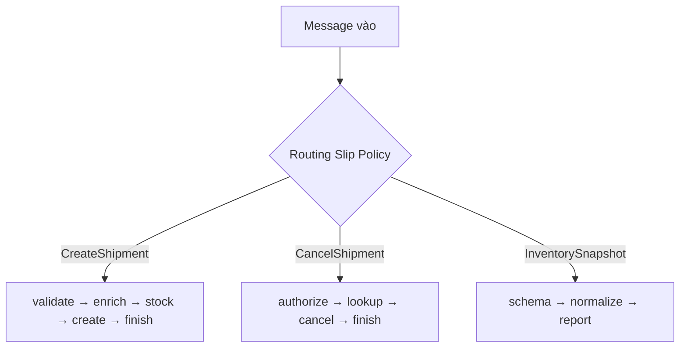
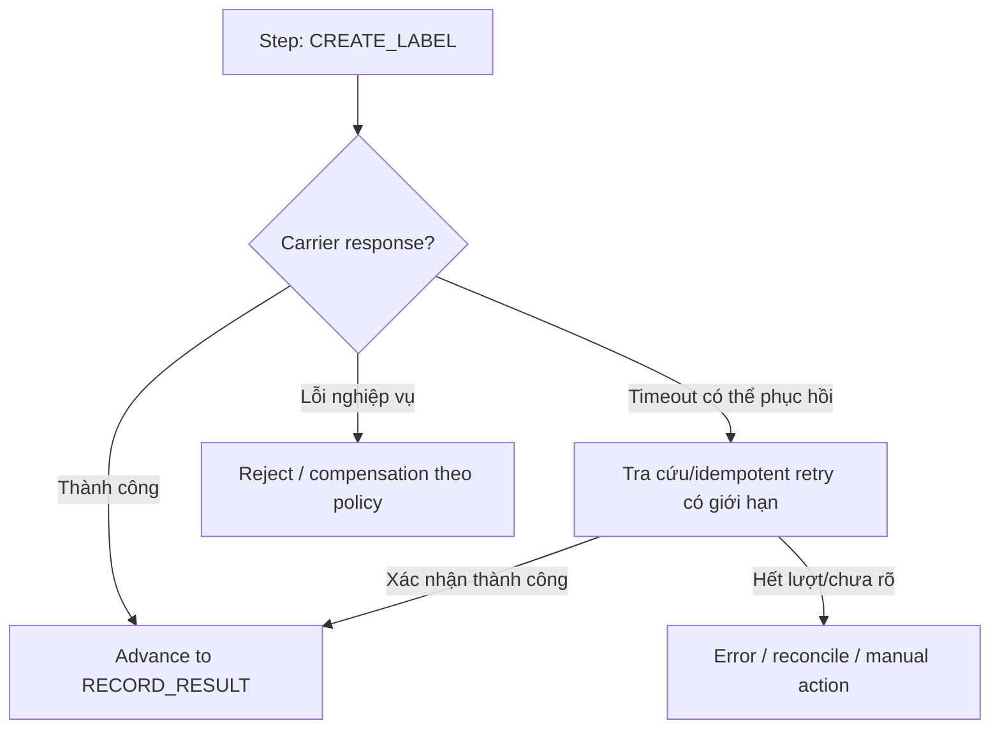

# Routing slip động theo loại message

> **Chương:** Routing slip  
> **Module:** `SPRING_INTEGRATION_PATTERN` — triển khai Enterprise Integration Patterns (EIP) với Spring Integration để xây dựng luồng thông điệp ít phụ thuộc và dễ mở rộng; thực hành Router, Filter, Transformer, Splitter, Aggregator, Gateway, retry, error channel, correlation, kiểm thử và quan sát từng nhánh. Bài này tập trung vào **lộ trình xử lý tuần tự được chọn động dựa trên loại message**.

## 1. Mục tiêu học tập

Sau bài này, bạn có thể:

1. Giải thích **Routing Slip** là gì, khác gì so với Content-Based Router, Recipient List và một flow có các bước cố định.
2. Thiết kế một **itinerary** (danh sách các điểm xử lý có thứ tự) được tính theo **loại thông điệp nghiệp vụ** thay vì viết một chuỗi `if/else` lớn trong mỗi handler.
3. Hiểu vai trò của **routing-slip header**, trạng thái tiến độ, output message và điều kiện để chuyển sang điểm kế tiếp.
4. Xây dựng một **routing policy thuần Java** có allowlist, version, kiểm tra kiểu message và các bước được phép đi qua.
5. Biết cách tích hợp plan với Spring Integration mà không nhầm thao tác **gắn header** với **tự động thực thi toàn bộ itinerary**.
6. Phân tích lỗi, timeout, retry, idempotency, correlation, thay đổi lộ trình và kiểm thử đúng thứ tự của các bước.

## 2. Tại sao một message cần mang theo lộ trình?

Giả sử hệ thống fulfillment nhận ba loại thông điệp:

- **`CreateShipment` (command):** kiểm tra dữ liệu → làm giàu địa chỉ → kiểm tra tồn kho → tạo vận đơn → ghi kết quả.
- **`CancelShipment` (command):** kiểm tra quyền hủy → truy vấn trạng thái vận đơn → hủy với nhà vận chuyển → cập nhật kết quả.
- **`InventorySnapshot` (document):** kiểm tra schema → chuẩn hóa dữ liệu → cập nhật hệ thống báo cáo.

Tất cả đều đi qua một điểm tiếp nhận, nhưng **thứ tự và số bước xử lý khác nhau**. Một Router có thể chọn nhánh đầu, còn Routing Slip có thể mang **cả hành trình dự kiến** để các bước tiếp theo biết cần chuyển message tới đâu.



Sơ đồ trên thể hiện **ba itinerary khác nhau được tính theo loại message**. Đây không phải ba recipient nhận cùng một message cùng lúc: mỗi itinerary là **chuỗi chặng theo thứ tự**.

**Routing Slip (phiếu định tuyến)** là một mẫu EIP cho phép một message mang thông tin về **các điểm đến kế tiếp theo một danh sách có thứ tự**. Sau mỗi bước có kết quả phù hợp, cơ chế định tuyến tiếp tục chuyển message đến điểm kế tiếp trong phiếu. Khi không còn bước, flow kết thúc hoặc chuyển đến nơi nhận kết quả đã được thiết kế.

> **Ý nghĩa quan trọng:** Quyết định “message có lộ trình A → B → C” khác với việc “A, B và C đều cùng nhận message”. Routing Slip diễn tả **tiến trình tuần tự**, còn Recipient List diễn tả **phân phối đến một tập người nhận**.

## 3. Khái niệm cốt lõi: itinerary, step, cursor và continuation

Ta có thể hình dung một routing slip logic như sau:

```text
Message envelope
  payload: CreateShipment(shipmentId="SHP-301", ...)
  business headers:
    correlationId: SHP-301
    messageType: CREATE_SHIPMENT
    policyVersion: fulfillment-v2
  routing slip (biểu diễn khái niệm):
    steps:
      [validateShipment,
       enrichAddress,
       reserveStock,
       createCarrierShipment,
       recordOutcome]
    nextIndex: 0
```

`steps` và `nextIndex` ở ví dụ là **mô hình để học**, **không phải lời khẳng định Spring Integration lưu header theo đúng cấu trúc này**. Cách Spring Integration biểu diễn/tiến hành routing slip là chi tiết của cơ chế framework và phiên bản đang sử dụng. Khi triển khai thật, cần dùng cơ chế Routing Slip mà framework hỗ trợ, không tự ý viết một header rồi cho rằng nó được thực thi.

### 3.1. Các thành phần của một phiếu định tuyến

| Thành phần | Ý nghĩa | Ví dụ |
| --- | --- | --- |
| **Loại message** | Nhận diện contract nghiệp vụ đang được xử lý | `CREATE_SHIPMENT` |
| **Danh sách bước** | Các điểm xử lý cần đi qua, theo thứ tự | `validate → enrich → reserve → create` |
| **Điểm đang/chưa đi qua** | Cơ chế biết bước kế tiếp | `nextIndex` theo mô hình logic |
| **Policy version** | Giúp tái hiện vì sao lập itinerary như vậy | `fulfillment-v2` |
| **Correlation ID** | Liên kết message và kết quả thuộc cùng quy trình | `SHP-301` |
| **Outcome/error state** | Ghi nhận bước thành công/thất bại | `step=reserveStock`, `outcome=FAILED` |

Một hệ thống không bắt buộc đặt mọi dữ liệu trên vào header. Chẳng hạn, lịch sử tiến độ bền vững có thể nằm trong **workflow state store**, đặc biệt khi quy trình kéo dài, có retry hoặc qua nhiều broker. Đừng dùng `MessageHeaders.id` thay cho business correlation và idempotency key.

### 3.2. Message phải tạo đầu ra để còn đi tiếp

Khi một handler trong hành trình chỉ nhận message, thực hiện side effect rồi **không phát kết quả nào**, luồng không nhất thiết có message để tiếp tục sang bước sau. Vì vậy thiết kế từng chặng phải xác định rõ:

- Handler nhận kiểu payload nào và tạo **reply/output message** nào?
- Output giữ lại metadata nào: routing slip, correlation, trace context, policy version?
- Bước tiếp theo chờ kết quả **thành công**, hay được phép tiếp tục với outcome “đã từ chối”?
- Handler xử lý **đồng bộ hay bất đồng bộ**, và ai chịu trách nhiệm khởi động bước kế tiếp?

Không nên giả định một Service Activator kiểu `void` sẽ tự tạo reply cho Routing Slip sau khi chạy xong. Nếu cần tiếp tục hành trình, phải sử dụng kiểu xử lý/adapter trả output phù hợp hoặc một cơ chế continuation có chủ đích.

## 4. Routing Slip khác những EIP liên quan

| Mẫu | Ý định | Dạng đích | Minh họa |
| --- | --- | --- | --- |
| **Content-Based Router** | Chọn chặng kế tiếp theo nội dung hiện tại | Một hoặc nhiều output theo router | Loại CREATE → `createFlow`, CANCEL → `cancelFlow` |
| **Routing Slip** | Mang lộ trình tuần tự để lần lượt đi qua các chặng | Danh sách **có thứ tự** | `validate → enrich → reserve → create` |
| **Recipient List** | Chọn tập đích nhận message | Nhiều recipient, không mặc định tuần tự nghiệp vụ | Gửi event tới audit + analytics |
| **Publish-Subscribe Channel** | Phát message tới các subscriber đăng ký | Fan-out tại một channel | `ShipmentCreated` tới nhiều consumer |
| **Pipes and Filters** | Xây pipeline các bước xử lý độc lập | Thường topology được khai báo tĩnh | `Filter → Transformer → Handler` |
| **Splitter / Aggregator** | Tách và gom các message liên quan | Nhiều phần và một nhóm kết quả | Tách từng kiện, rồi gom kết quả |

**Động theo loại message** không có nghĩa lúc nào cũng cần Routing Slip. Nếu chỉ có hai loại và mỗi loại một pipeline cố định ngắn, một **Content-Based Router** chuyển sang hai flow rõ ràng có thể đơn giản hơn. Routing Slip có giá trị khi itinerary có nhiều biến thể, khi cần mang theo danh sách chặng hoặc khi quy trình cần thay đổi tuyến theo một chính sách tập trung.

### 4.1. Routing Slip không phải một vòng lặp tùy ý

Một danh sách có thứ tự thường phải **tiến dần đến điểm kết thúc**. Nếu mỗi handler tự thêm chính nó vào slip hoặc điều hướng ngược không giới hạn, có thể xảy ra vòng lặp, retry vô hạn và side effect lặp. Với tiến trình có điều kiện rẽ nhánh phức tạp, state machine/process manager hoặc một workflow engine có thể diễn đạt dễ kiểm soát hơn.

## 5. Thiết kế itinerary theo loại message

Chúng ta dùng ba loại thông điệp trong ví dụ fulfillment. Các bước được đặt tên bằng **khóa logic**, không lấy trực tiếp tên channel từ người gửi bên ngoài.

### 5.1. Bảng policy

| Loại message | Itinerary logic | Ngữ nghĩa chính |
| --- | --- | --- |
| `CREATE_SHIPMENT` | `VALIDATE_CREATE → ENRICH_ADDRESS → RESERVE_STOCK → CREATE_LABEL → RECORD_RESULT` | Tạo một vận đơn mới |
| `CANCEL_SHIPMENT` | `AUTHORIZE_CANCEL → LOOKUP_SHIPMENT → CANCEL_LABEL → RECORD_RESULT` | Hủy vận đơn đã tồn tại |
| `INVENTORY_SNAPSHOT` | `VALIDATE_SNAPSHOT → NORMALIZE_SNAPSHOT → UPDATE_REPORTING` | Cập nhật dữ liệu báo cáo |

Những tên trên đại diện cho **các chặng do ứng dụng sở hữu**, không phải endpoint Spring Integration mặc định. Trong hệ thống thực, `CREATE_LABEL` và `CANCEL_LABEL` có thể phải gọi carrier API, còn `RESERVE_STOCK` có side effect cần idempotency.

### 5.2. Chọn theo loại, sau đó mới xét đặc điểm nghiệp vụ

Chính sách có thể được mở rộng một cách có kiểm soát. Ví dụ yêu cầu `CREATE_SHIPMENT` quốc tế cần bước kiểm tra hải quan:

```text
CREATE_SHIPMENT + country=VN:
    VALIDATE_CREATE → ENRICH_ADDRESS → RESERVE_STOCK
    → CREATE_LABEL → RECORD_RESULT

CREATE_SHIPMENT + country=SG:
    VALIDATE_CREATE → ENRICH_ADDRESS → CUSTOMS_REVIEW
    → RESERVE_STOCK → CREATE_LABEL → RECORD_RESULT
```

Điểm quan trọng là **loại message chọn khung chính của hành trình**, các thuộc tính nghiệp vụ hợp lệ quyết định những bước tùy chọn. Không nhầm `country=SG` với một message type khác và không cho dữ liệu chưa validate tự chèn tên step tùy ý.

### 5.3. Gắn version cho quyết định

Hôm nay itinerary có `ENRICH_ADDRESS`; ngày mai thêm `VERIFY_FRAUD`. Một command đã gửi và nằm trong queue từ phiên bản trước sẽ phải đi theo policy nào?

Hai hướng thường gặp:

1. **Pin itinerary lúc tiếp nhận:** lưu danh sách và `policyVersion` đã chọn, giúp tái hiện kết quả khi replay/retry. Phải đảm bảo các step cũ vẫn còn khả dụng trong thời gian tồn tại của message.
2. **Recalculate ở một checkpoint được kiểm soát:** dùng policy hiện tại tại thời điểm chặng mới bắt đầu, nếu hợp đồng nghiệp vụ cho phép. Phải xử lý trường hợp một số side effect đã hoàn tất trước khi policy thay đổi.

Không nên **tự động tính lại từ đầu** ở mọi lần retry nếu có thể bỏ qua hoặc lặp lại các bước đã hoàn thành.

## 6. Ví dụ Java: tạo routing-slip plan an toàn

Ví dụ sau dùng Java 17+ và mô hình **policy thuần Java**. Mục tiêu là tính **lộ trình hợp lệ**, không gọi I/O và không thực thi các bước. Những class này có thể được dùng trong một ứng dụng Spring Integration, độc lập với phiên bản API Router đang chọn.

```java
import java.util.List;
import java.util.Set;

enum MessageKind {
    CREATE_SHIPMENT,
    CANCEL_SHIPMENT,
    INVENTORY_SNAPSHOT
}

enum Stage {
    VALIDATE_CREATE,
    ENRICH_ADDRESS,
    CUSTOMS_REVIEW,
    RESERVE_STOCK,
    CREATE_LABEL,
    AUTHORIZE_CANCEL,
    LOOKUP_SHIPMENT,
    CANCEL_LABEL,
    RECORD_RESULT,
    VALIDATE_SNAPSHOT,
    NORMALIZE_SNAPSHOT,
    UPDATE_REPORTING
}

record WorkMessage(
    String businessId,
    MessageKind kind,
    String country
) {}

record SlipPlan(String policyVersion, List<Stage> stages) {
    SlipPlan {
        if (policyVersion == null || policyVersion.isBlank()) {
            throw new IllegalArgumentException("policyVersion is required");
        }
        stages = List.copyOf(stages);
        if (stages.isEmpty()) {
            throw new IllegalArgumentException("Routing slip cannot be empty");
        }
    }
}

final class SlipPolicy {
    private static final String VERSION = "fulfillment-v2";
    private static final Set<String> SUPPORTED_COUNTRIES =
        Set.of("VN", "SG", "TH");

    private SlipPolicy() {}

    static SlipPlan plan(WorkMessage message) {
        if (message == null || message.businessId() == null
                || message.businessId().isBlank()
                || message.kind() == null) {
            throw new IllegalArgumentException("Invalid message identity/type");
        }

        return switch (message.kind()) {
            case CREATE_SHIPMENT -> createPlan(message);
            case CANCEL_SHIPMENT -> new SlipPlan(VERSION, List.of(
                Stage.AUTHORIZE_CANCEL,
                Stage.LOOKUP_SHIPMENT,
                Stage.CANCEL_LABEL,
                Stage.RECORD_RESULT));
            case INVENTORY_SNAPSHOT -> new SlipPlan(VERSION, List.of(
                Stage.VALIDATE_SNAPSHOT,
                Stage.NORMALIZE_SNAPSHOT,
                Stage.UPDATE_REPORTING));
        };
    }

    private static SlipPlan createPlan(WorkMessage message) {
        if (message.country() == null) {
            throw new IllegalArgumentException("Destination country is required");
        }

        String country = message.country().trim()
            .toUpperCase(java.util.Locale.ROOT);

        if (!SUPPORTED_COUNTRIES.contains(country)) {
            throw new IllegalArgumentException("Unsupported destination country");
        }

        if ("VN".equals(country)) {
            return new SlipPlan(VERSION, List.of(
                Stage.VALIDATE_CREATE,
                Stage.ENRICH_ADDRESS,
                Stage.RESERVE_STOCK,
                Stage.CREATE_LABEL,
                Stage.RECORD_RESULT));
        }

        return new SlipPlan(VERSION, List.of(
            Stage.VALIDATE_CREATE,
            Stage.ENRICH_ADDRESS,
            Stage.CUSTOMS_REVIEW,
            Stage.RESERVE_STOCK,
            Stage.CREATE_LABEL,
            Stage.RECORD_RESULT));
    }
}
```

### 6.1. Điểm mạnh của cách tạo plan này

- **Tách nghiệp vụ và topology:** `Stage.RESERVE_STOCK` là khóa logic; mapping đến channel/handler do ứng dụng cấu hình.
- **Dữ liệu đầu vào không được phép chọn tên channel:** tránh định tuyến đến bean nội bộ hoặc endpoint nhạy cảm bằng chuỗi do client gửi.
- **Kết quả bất biến:** `List.copyOf(...)` bảo vệ cấu trúc danh sách step và `Stage` là enum, không chứa object mutable.
- **Chính sách có version:** phục vụ audit, replay và kiểm thử khi logic thay đổi.
- **Mọi loại message đều có đường đi rõ ràng:** `switch` theo enum bắt buộc xử lý đủ các case hiện có.
- **Bước quốc tế có điều kiện:** `CUSTOMS_REVIEW` chỉ được thêm khi chính sách yêu cầu.

Đây là ví dụ **lập lộ trình**, không có nghĩa Java `List<Stage>` trở thành routing-slip header mà Spring Integration tự động hiểu. Cần ánh xạ **Stage → channel/endpoint được phép** và cấu hình phần **tiếp tục sau từng bước**.

### 6.2. Sử dụng plan

```java
WorkMessage createDomestic = new WorkMessage(
    "SHP-301", MessageKind.CREATE_SHIPMENT, "VN");

WorkMessage createInternational = new WorkMessage(
    "SHP-302", MessageKind.CREATE_SHIPMENT, "SG");

WorkMessage cancel = new WorkMessage(
    "SHP-303", MessageKind.CANCEL_SHIPMENT, null);

System.out.println(SlipPolicy.plan(createDomestic).stages());
System.out.println(SlipPolicy.plan(createInternational).stages());
System.out.println(SlipPolicy.plan(cancel).stages());
```

Ví dụ này cho ba danh sách có thứ tự khác nhau. `country=null` hợp lệ đối với cancel trong **contract minh họa**, nhưng không hợp lệ khi tạo vận đơn. Validation phải phụ thuộc vào **loại message**, không áp chung những trường mà loại đó không sử dụng.

## 7. Đưa policy vào Spring Integration: kế hoạch khác thực thi

Trong Spring Integration, **Routing Slip** là EIP có cơ chế chuyên biệt liên quan đến **header enricher** và **việc chuyển tiếp output message sau mỗi endpoint**. API cấu hình cụ thể (Java DSL, XML hoặc annotation/các class hỗ trợ) có thể khác giữa phiên bản thư viện. Điểm cần hiểu là hai trách nhiệm tách biệt:

1. **Tạo itinerary** từ `MessageKind`, policy và metadata đáng tin cậy.
2. **Cho các endpoint thực thi theo itinerary**: xác định bước tiếp theo, dispatch qua channel và tiếp tục khi có output hợp lệ.

Không phải cứ đặt một header tên `plannedSlip` là Spring Integration sẽ tự động chạy lần lượt các stage. Header tùy biến chỉ lưu **dữ liệu kế hoạch**; để vận hành theo Routing Slip EIP, cần cấu hình đúng cơ chế routing-slip của framework hoặc một orchestrator được thiết kế rõ ràng.

### 7.1. Ví dụ Java DSL: enrich metadata về plan

Đoạn sau minh họa **phần chuẩn bị kế hoạch** bằng header enrichment và channel kế tiếp. Nó **chưa** tự thi hành toàn bộ routing slip.

```java
import org.springframework.context.annotation.Bean;
import org.springframework.context.annotation.Configuration;
import org.springframework.integration.config.EnableIntegration;
import org.springframework.integration.dsl.IntegrationFlow;

@Configuration
@EnableIntegration
class RoutingPlanConfiguration {

    @Bean
    IntegrationFlow prepareRoutingPlan() {
        return IntegrationFlow.from("workflow.input")
            .enrichHeaders(h -> h
                .headerFunction("plannedSlip", m ->
                    SlipPolicy.plan((WorkMessage) m.getPayload()).stages())
                .headerFunction("routingPolicyVersion", m ->
                    SlipPolicy.plan((WorkMessage) m.getPayload())
                        .policyVersion()))
            .channel("workflow.planReady")
            .get();
    }
}
```

**Giới hạn cố ý:** `plannedSlip` và `routingPolicyVersion` là **headers ứng dụng tự đặt**, không phải sự thay thế cho cấu trúc header Routing Slip mà framework cần. Code trên gọi `SlipPolicy.plan(...)` hai lần để ngắn gọn; production nên **tính một lần**, kiểm tra và lưu snapshot để tránh tính toán lặp hoặc sai khác khi policy có phụ thuộc dữ liệu động.

Để làm việc với Routing Slip thực tế, cấu hình kế tiếp cần dùng cơ chế routing-slip/header enricher được Spring Integration hỗ trợ và bảo đảm endpoint trả message để tiếp tục. Một phương án khác, khi pipeline ngắn và cố định, là dùng Router chọn **một flow tường minh** cho từng loại; phương án đó có thể đơn giản hơn Routing Slip và không nên gọi nhầm là Routing Slip.

### 7.2. Mô hình thi hành từng chặng (pseudocode)

```text
plan = policy.plan(incomingMessage)
state = { message: incomingMessage, nextStep: 0, planVersion: plan.version }

while state.nextStep < plan.steps.size:
    step = allowedResolver.resolve(plan.steps[state.nextStep])
    output = executeAndAwaitRequiredOutcome(step, state.message)

    if output == failure:
        handleFailureForThisStep()  // retry/error/compensation theo policy
        stopOrSuspend()

    state.message = preserveRequiredHeadersAndPayloadContract(output)
    state.nextStep = state.nextStep + 1

emitFinalOutcome(state.message)
```

Đây là **pseudocode để giải thích thứ tự**, **không phải mã Java/Spring Integration để copy vào production**. Flow bất đồng bộ không thể đơn giản `while` rồi chờ không giới hạn. Trong hệ thống thực, progression cần dùng cơ chế routing-slip của Spring Integration hoặc một stateful orchestrator có persistence/timeout thích hợp.

### 7.3. Routing Slip làm việc với output handler

Giả sử itinerary đang ở `ENRICH_ADDRESS`. Handler nhận payload của yêu cầu và trả về payload đã làm giàu:

```java
record ShipmentDraft(String shipmentId, String address,
                     String country) {}

record EnrichedShipment(String shipmentId, String normalizedAddress,
                        String country) {}

EnrichedShipment enrich(ShipmentDraft input) {
    String normalized = input.address().trim();
    return new EnrichedShipment(
        input.shipmentId(), normalized, input.country());
}
```

Khi hợp đồng từng bước đổi kiểu payload, bước kế tiếp phải chấp nhận loại output mới. Trong một itinerary có thể tồn tại chuyển đổi `WorkMessage → ValidatedDraft → EnrichedShipment → ReservedShipment`; **không thể yêu cầu mọi step đều nhận cùng một kiểu DTO nếu contract không như vậy**. Cơ chế chuyển tiếp cũng phải giữ những header tiến trình cần thiết.

## 8. Quy tắc thay đổi lộ trình giữa chặng

Routing Slip động có hai kiểu thường được thảo luận:

1. **Tính một lần tại ingress theo loại message:** plan đã rõ trước khi xử lý. Dễ tái hiện, đơn giản và phù hợp nhiều trường hợp.
2. **Điều chỉnh tại checkpoint:** sau khi một bước sinh ra metadata mới (ví dụ xác định vận chuyển quốc tế cần phê duyệt), một thành phần được phép thay đổi phần còn lại của itinerary theo chính sách.

Điều chỉnh giữa chặng không được làm một cách tùy tiện. Nên xác định:

| Điều cần kiểm soát | Nguyên tắc |
| --- | --- |
| **Ai có quyền sửa** | Chỉ policy/orchestrator đáng tin cậy, không phải message do client chỉnh header |
| **Thay đổi phần nào** | Thông thường chỉ thay đổi **các chặng chưa xử lý**; không giả vờ xóa side effect đã xảy ra |
| **Version** | Lưu policy version/decision reason khi thay đổi |
| **Giới hạn độ dài** | Chặn itinerary quá dài hoặc lặp vô hạn |
| **Idempotency** | Bước đã hoàn tất phải được nhận diện nếu message phát lại |
| **Fallback** | Nếu không có đích hợp lệ, fail rõ ràng thay vì điều hướng mặc định nguy hiểm |

Ví dụ, sau `ENRICH_ADDRESS` phát hiện dữ liệu cần xét duyệt hải quan; orchestrator có thể chèn `CUSTOMS_REVIEW` trước `CREATE_LABEL` nếu chính sách cho phép. **Không nên** để một carrier API trả về chuỗi tên bean bất kỳ rồi tự gắn vào slip.

## 9. Thứ tự, đồng bộ và bất đồng bộ

**Routing Slip định nghĩa thứ tự logic**, nhưng không tự bảo đảm mọi endpoint chạy trên một thread, cùng transaction hoặc có đúng-once delivery. Hành vi phụ thuộc loại channel/adapter và cách continuation được cấu hình.

| Cơ chế | Ý nghĩa khi thực thi một chặng | Rủi ro cần xét |
| --- | --- | --- |
| `DirectChannel` | Thường dispatch đồng bộ tới handler | Handler chậm giữ thread gửi; exception có thể truyền ngược |
| `ExecutorChannel` | Chuyển việc cho executor | Gửi thành công không chứng minh handler đã trả output để đi bước sau |
| `QueueChannel` + poller | Message chờ được poll xử lý | Queue wait, timeout, lưu bền/restart và bảo toàn metadata |
| Outbound Gateway | Gọi hệ thống khác, có thể chờ reply | Timeout không có nghĩa phía ngoài chưa thực hiện tác vụ |
| Broker adapter | Chuyển tiếp qua ranh giới mạng | Ack, redelivery, headers, replay và thứ tự cần được thiết kế riêng |

### 9.1. Một bước phải hoàn tất trước khi tới bước phụ thuộc

Nếu `CREATE_LABEL` phụ thuộc kết quả giữ hàng, phải có **kết quả `RESERVE_STOCK`** xác nhận phù hợp trước khi tiến tới `CREATE_LABEL`. Không được hiểu “đã enqueue lệnh giữ hàng” thành “đã giữ hàng thành công”. Các step có side effect cần tách rõ:

- **Command accepted:** một điểm nhận đã nhận yêu cầu.
- **Step succeeded:** nghiệp vụ tại bước đó đã thực sự hoàn tất.
- **Slip advanced:** cơ chế đã chuyển hành trình sang chặng tiếp theo.

Ba mốc này không mặc nhiên xảy ra cùng lúc, nhất là qua queue hoặc broker.

### 9.2. Bước nào có thể chạy song song?

Nếu hai tác vụ độc lập cần thực hiện cùng lúc, chẳng hạn kiểm tra rủi ro và đọc tồn kho, một chuỗi tuyến tính đơn thuần sẽ không biểu diễn concurrency hiệu quả. Có thể dùng **Recipient List**, **Splitter**, nhánh song song và **Aggregator** để chờ kết quả, rồi quay lại chặng tiếp theo của workflow. **Routing Slip không phải bản thay thế tự động cho fan-out/fan-in**.

## 10. Trạng thái, correlation và khả năng tiếp tục sau sự cố

Với workflow nhiều bước, cần quyết định trạng thái tiến độ có nằm hoàn toàn trong message hay phải lưu ở một kho bền vững. Nếu message bị lỗi ở bước thứ tư và ứng dụng khởi động lại, cần biết **ba bước trước đã hoàn tất hay chưa**.

| Trường/khái niệm | Vai trò | Ví dụ |
| --- | --- | --- |
| `businessId` | Định danh đối tượng đang xử lý | `SHP-301` |
| `commandId`/`operationId` | Chống thực hiện lặp một yêu cầu | `cmd-301` |
| `correlationId` | Liên kết các message thuộc cùng workflow | `SHP-301` |
| `messageId` | Định danh message/envelope theo framework | UUID, có thể thay qua bước |
| `policyVersion` | Tái hiện quy tắc lập itinerary | `fulfillment-v2` |
| `stepKey` | Chặng đang thực hiện | `RESERVE_STOCK` |
| `stepAttempt` | Lần thử hiện tại | `2` |
| `stepOutcome` | Kết quả đã ghi nhận | `SUCCEEDED` |

**Correlation không thay idempotency.** Một chặng tạo vận đơn cần khóa ổn định như `(commandId, stepKey)` hoặc khóa nghiệp vụ theo hợp đồng carrier; chỉ có `correlationId=SHP-301` chưa chắc phân biệt được nhiều tác vụ hợp lệ liên quan tới cùng shipment.

Nếu phải tiếp tục sau restart hoặc chờ callback nhiều giờ, nên có một state store/orchestrator phù hợp để ghi trạng thái từng chặng. Message headers hữu ích để vận chuyển ngữ cảnh, nhưng **không thay thế toàn bộ persistent workflow history**.

## 11. Lỗi, retry, timeout và compensation

Giả sử itinerary `VALIDATE_CREATE → RESERVE_STOCK → CREATE_LABEL → RECORD_RESULT` chạy đến `CREATE_LABEL`, nhưng carrier API timeout. Khó biết carrier đã tạo nhãn hay chưa. Nếu retry từ **đầu slip**, hệ thống có thể giữ hàng lần hai hoặc tạo trùng nhãn.



### 11.1. Chính sách retry nên đặt ở từng chặng

- **Lỗi mạng tạm thời:** retry hữu hạn tại endpoint tương ứng, với timeout và backoff.
- **Dữ liệu không hợp lệ:** từ chối/đi đường lỗi nghiệp vụ, không retry vô hạn.
- **Bước có side effect:** dùng idempotency key và/hoặc tra cứu trạng thái trước khi thử lại.
- **Lỗi không xác định kết quả:** không tự tuyên bố thất bại cuối cùng nếu hệ thống đích có thể đã hoàn tất.
- **Hết lượt retry:** error flow, dead-letter/reconciliation hoặc manual review phù hợp.

Không nên chỉ gửi message trở lại **bước đầu tiên của Routing Slip** để “thử lại”, vì những chặng đã xong có thể bị thực hiện lại. Cần giữ **trạng thái chặng**, trạng thái đã commit và thông tin điều phối đủ để tiếp tục an toàn.

### 11.2. Error channel không phải bước tiếp theo mặc định

Ở channel đồng bộ, exception có thể truyền lên caller; ở ranh giới async/poller, lỗi có thể được biểu diễn thành `ErrorMessage` và gửi tới error channel theo cấu hình. **Routing-slip continuation** và **error handling** là hai trách nhiệm riêng. Việc có `errorChannel` không tự động có nghĩa message sẽ nhảy qua chặng lỗi rồi tiếp tục các chặng sau.

Một bước bị từ chối vì chính sách (ví dụ khách không được hủy đơn) là **business outcome** khác với lỗi mạng của carrier API. Nên có mã lý do và cách kết thúc/chuyển manual review rõ ràng.

### 11.3. Compensation không phải rollback transaction đơn giản

Nếu `RESERVE_STOCK` đã giữ hàng nhưng `CREATE_LABEL` không thể thành công, có thể cần phát lệnh **release stock** theo quy trình bù trừ. Đó là **một hành động nghiệp vụ mới**, có thể thất bại và cần retry/idempotency riêng. Routing Slip đơn thuần không tự động biến một chuỗi side effect phân tán thành transaction có rollback nguyên tử.

## 12. Bảo mật: itinerary không được trở thành lệnh tùy ý

Nếu consumer có thể gửi:

```json
{
  "type": "CREATE_SHIPMENT",
  "routingSlip": ["internalAdminChannel", "deleteAllRecords"]
}
```

và ứng dụng dùng trực tiếp các tên channel đó, message có thể vượt qua ranh giới quyền truy cập. Vì vậy:

1. **Không tin routing-slip header do bên ngoài tự cung cấp.** Strip/validate và tái tạo plan từ nguồn policy được kiểm soát tại ingress.
2. **Ánh xạ enum/khóa logic sang channel qua allowlist**; không cho input tùy ý chọn bean/endpoint.
3. Kiểm tra **quyền theo tenant/message type**, nhất là những bước có tác dụng phụ.
4. Giới hạn số chặng, kích thước header và khả năng tạo chu trình.
5. Không đưa token, PII hoặc bí mật vào itinerary chỉ để handler truy cập tiện hơn.
6. Khi chuyển qua mạng, xác định rõ header nào được ánh xạ/serialize và nguồn nào có quyền sửa chúng.

Một header `messageType=CREATE_SHIPMENT` cũng cần được đối chiếu với **payload và quyền của người gửi**. Header tự khai có thể bị giả mạo; routing policy nên làm việc với một kiểu message đã được xác thực/deserialized an toàn.

## 13. Kiểm thử policy: loại message nào đi qua bước nào?

Trước tiên, test **policy thuần Java**. Những test này giúp phát hiện lỗi thứ tự, thiếu bước và nhầm điều kiện quốc tế mà không cần khởi động Spring context.

```java
import static org.junit.jupiter.api.Assertions.*;

import java.util.List;
import org.junit.jupiter.api.Test;

class SlipPolicyTest {

    @Test
    void createDomesticUsesExpectedSequence() {
        SlipPlan plan = SlipPolicy.plan(new WorkMessage(
            "SHP-301", MessageKind.CREATE_SHIPMENT, "VN"));

        assertEquals("fulfillment-v2", plan.policyVersion());
        assertEquals(List.of(
            Stage.VALIDATE_CREATE,
            Stage.ENRICH_ADDRESS,
            Stage.RESERVE_STOCK,
            Stage.CREATE_LABEL,
            Stage.RECORD_RESULT), plan.stages());
    }

    @Test
    void internationalCreateAddsCustomsReviewBeforeReserve() {
        SlipPlan plan = SlipPolicy.plan(new WorkMessage(
            "SHP-302", MessageKind.CREATE_SHIPMENT, "SG"));

        assertTrue(plan.stages().contains(Stage.CUSTOMS_REVIEW));
        assertTrue(plan.stages().indexOf(Stage.CUSTOMS_REVIEW)
            < plan.stages().indexOf(Stage.RESERVE_STOCK));
    }

    @Test
    void cancelNeverRunsCreateLabel() {
        SlipPlan plan = SlipPolicy.plan(new WorkMessage(
            "SHP-303", MessageKind.CANCEL_SHIPMENT, null));

        assertEquals(List.of(
            Stage.AUTHORIZE_CANCEL,
            Stage.LOOKUP_SHIPMENT,
            Stage.CANCEL_LABEL,
            Stage.RECORD_RESULT), plan.stages());
        assertFalse(plan.stages().contains(Stage.CREATE_LABEL));
    }

    @Test
    void inventorySnapshotDoesNotTriggerCarrierSideEffects() {
        SlipPlan plan = SlipPolicy.plan(new WorkMessage(
            "SNAP-1", MessageKind.INVENTORY_SNAPSHOT, null));

        assertEquals(List.of(
            Stage.VALIDATE_SNAPSHOT,
            Stage.NORMALIZE_SNAPSHOT,
            Stage.UPDATE_REPORTING), plan.stages());
        assertFalse(plan.stages().contains(Stage.RESERVE_STOCK));
        assertFalse(plan.stages().contains(Stage.CREATE_LABEL));
    }

    @Test
    void unsupportedCountryIsRejectedForCreate() {
        assertThrows(IllegalArgumentException.class, () ->
            SlipPolicy.plan(new WorkMessage(
                "SHP-304", MessageKind.CREATE_SHIPMENT, "FR")));
    }

    @Test
    void planCannotBeMutatedByConsumer() {
        SlipPlan plan = SlipPolicy.plan(new WorkMessage(
            "SHP-305", MessageKind.CREATE_SHIPMENT, "VN"));

        assertThrows(UnsupportedOperationException.class, () ->
            plan.stages().add(Stage.CANCEL_LABEL));
    }
}
```

**Lưu ý:** những test này kiểm chứng **itinerary được tạo đúng**. Chúng chưa xác minh message đã thật sự đi theo itinerary trong một hệ thống Spring Integration.

## 14. Kiểm thử integration: thứ tự từng chặng và continuation

Đối với Routing Slip thực thi, nên dùng fake endpoint/handler nhận đúng kiểu payload và trả output có thể được chuyển tới bước tiếp theo. Một bài integration test cần quan sát **trình tự thực tế** chứ không chỉ danh sách được tạo.

### 14.1. Ma trận kiểm thử

| Kịch bản | Itinerary mong đợi | Điều phải xác minh |
| --- | --- | --- |
| CREATE nội địa | Validate → Enrich → Reserve → Create → Record | Đúng thứ tự, mỗi step được gọi đúng số lần |
| CREATE quốc tế | Validate → Enrich → Customs → Reserve → Create → Record | Customs chạy **trước** khi giữ hàng |
| CANCEL | Authorize → Lookup → Cancel → Record | Không chạy `CREATE_LABEL` hoặc `RESERVE_STOCK` |
| INVENTORY_SNAPSHOT | Schema → Normalize → Reporting | Không gọi carrier API |
| Type null/unknown | Không tạo plan | Từ chối có lý do; không dispatch bất kỳ step nghiệp vụ |
| Country không hỗ trợ | Không tạo CREATE plan | Không tự chọn hành trình mặc định nguy hiểm |
| Bước không có reply | Slip dừng/chờ theo contract | Không âm thầm nhảy sang step sau |
| Bước ném exception đồng bộ | Error/exception theo cấu hình | Không chuyển step tiếp theo như thể thành công |
| Handler timeout bất đồng bộ | Retry/error/reconcile theo SLA | Không nhận `send=true` là step succeeded |
| Redelivery cùng command | Idempotency tại step có side effect | Không tạo nhãn/giữ hàng lặp không kiểm soát |
| Policy thay đổi khi đang chạy | Pin/recalculate đúng contract | Không mất bước hoặc chạy lại bước đã commit |
| Header/correlation mất khi qua broker | Test phát hiện và xử lý theo contract | Không nhầm workflow của hai shipment |

### 14.2. Test bằng recording step handlers

Thay các handler thật bằng **recording handlers** ở test context: mỗi handler ghi `Stage` vào một danh sách và trả một message/output hợp lệ để progression tiếp tục. Với test đồng bộ có thứ tự rõ ràng, kết quả quan sát nên khớp chính xác:

```text
expectedStages = [VALIDATE_CREATE, ENRICH_ADDRESS,
                  RESERVE_STOCK, CREATE_LABEL, RECORD_RESULT]

observedStages = recorded by fake handlers in actual dispatch order

assert observedStages == expectedStages
assert createLabelCalls == 1
assert cancelLabelCalls == 0
assert businessCorrelationId is retained at each step
```

Đây là **pseudocode assertion**, không phải một test đã chạy. Nếu hệ thống sử dụng executor/queue/broker, cần cơ chế đợi với timeout (ví dụ `CountDownLatch` hoặc `BlockingQueue.poll(timeout)`) và bộ lưu thứ tự an toàn thread. Không dùng `Thread.sleep()` ngẫu nhiên rồi kết luận thứ tự chính xác.

### 14.3. Cần tách ba loại test

1. **Policy unit test:** thông điệp loại A tạo itinerary A, thứ tự và allowlist chính xác.
2. **Routing Slip integration test:** framework tiếp tục từ step này sang step kế tiếp khi có output, giữ headers/correlation và kết thúc đúng lúc.
3. **End-to-end/contract test:** outbound API/broker tương thích, retry và side effect được bảo vệ, kết quả nghiệp vụ thực sự được xác nhận.

Một unit test cho `SlipPolicy.plan(...)` PASS **không chứng minh** cơ chế Routing Slip trong Spring Integration đã được wiring đúng. Đặc biệt, **một header ứng dụng chứa List<Stage> không tự thực thi các endpoint**.

## 15. Quan sát từng chặng để giải thích lộ trình

Khi một shipment bị kẹt, điều tra cần biết **được lập itinerary nào**, **đang ở bước nào**, **vì sao chưa đi tiếp** và **có tác dụng phụ nào đã xảy ra**.

| Điểm quan sát | Thông tin hữu ích | Câu hỏi cần trả lời |
| --- | --- | --- |
| Ingress/Gateway | Message kind, business ID, correlation ID | Đang xử lý loại yêu cầu nào? |
| Plan creation | `policyVersion`, stage keys, reason code | Vì sao itinerary có những bước này? |
| Before step | Step key, attempt, trace context | Message đã đến đúng chặng chưa? |
| After step | Outcome, processing duration, output type | Bước đã thật sự thành công chưa? |
| Async boundary | Queue wait, enqueue/dequeue, timeout | Message đang chờ hay handler lỗi? |
| Error/retry | Error type, retry count, target step | Tại sao bị kẹt hoặc lặp? |
| Final outcome | Succeeded/rejected/compensated/incomplete | Workflow hoàn tất theo nghĩa nghiệp vụ chưa? |

Spring Integration có thể kết hợp **ChannelInterceptor**, Wire Tap, metrics và distributed tracing ở những channel thích hợp. Tuy nhiên, `postSend(sent=true)` tại một channel chỉ nói về **ranh giới gửi tại channel**, không chứng minh mọi bước của Routing Slip đã hoàn tất.

Không dùng `businessId`, `messageId`, `correlationId` làm metric tags có cardinality rất cao; nên dùng `stepKey`, `messageKind`, `outcome`, `errorClass` làm tag ổn định, còn các ID đặt trong log/trace được kiểm soát quyền. Không dump toàn bộ payload chứa dữ liệu khách hàng vào log ở mỗi step.

## 16. Anti-pattern và cách tránh

| Anti-pattern | Hậu quả | Hướng cải thiện |
| --- | --- | --- |
| Gắn header `plannedSlip` rồi tưởng hệ thống sẽ tự chạy | Không có cơ chế dispatch/continuation thực tế | Cấu hình Routing Slip được framework hỗ trợ hoặc orchestrator rõ ràng |
| Lấy route từ dữ liệu client tùy ý | Có thể truy cập endpoint nội bộ trái phép | Map key logic qua allowlist, xác thực ở ingress |
| Mỗi handler tự quyết định toàn bộ bước tiếp | Logic bị phân tán và khó truy vết | Policy tập trung; cho phép thay đổi plan chỉ ở checkpoint kiểm soát |
| Không có output từ step nhưng mong tự đi tiếp | Workflow dừng hoặc treo | Định nghĩa reply/continuation contract cho từng step |
| Coi `send=true` là hoàn tất bước remote | Tạo bước sau khi bước trước chưa thực sự thành công | Phân biệt delivery, processing và business outcome |
| Retry từ đầu slip sau khi chặng thứ tư timeout | Lặp side effect ở các chặng đã commit | Retry theo chặng, idempotency và persisted progress |
| Không pin/ghi policy version | Replay cho kết quả khác không giải thích được | Ghi snapshot/version và rule áp dụng |
| Cho chèn bước không giới hạn | Vòng lặp, resource exhaustion | Allowlist, giới hạn số chặng, kiểm tra chu trình |
| Dùng Routing Slip để fan-out song song | Chờ tuần tự không cần thiết và sai semantics | Recipient List, Splitter/Aggregator, pub/sub khi phù hợp |
| Dùng `messageId` làm workflow key | ID có thể thay đổi qua bước hoặc redelivery | Business correlation và operation ID ổn định |

## 17. Checklist khi triển khai

- [ ] Xác định **loại message** từ payload/schema đã xác thực, không tin một header tự khai.
- [ ] Có decision table/contract cho itinerary từng loại message, kể cả nhánh phụ theo dữ liệu.
- [ ] Dùng **stage key có allowlist** và mapping tới channel/endpoint đáng tin cậy.
- [ ] Xác định **nơi sinh routing-slip header** và **cơ chế thực thi/continuation** đúng phiên bản Spring Integration.
- [ ] Mỗi step có input/output contract rõ ràng; output cần thiết được phát để đi tiếp.
- [ ] Có kiểm tra thứ tự, điểm kết thúc, route không tồn tại và giới hạn độ dài/vòng lặp.
- [ ] Có policy version, correlation ID và trace context qua các ranh giới.
- [ ] Bước có side effect có idempotency key, timeout, retry hữu hạn và đường lỗi.
- [ ] Có trạng thái bền vững nếu workflow phải sống qua restart hoặc chờ callback dài.
- [ ] Có quy tắc khi policy thay đổi giữa lúc message đang được xử lý.
- [ ] Có unit test plan, integration test progression và contract test outbound.
- [ ] Theo dõi time spent per step, queue wait, retries và final business outcome.

## 18. Bài tập vận dụng

Một nền tảng xử lý đơn hàng nhận bốn loại message: `CreateOrder`, `CancelOrder`, `ReturnOrder` và `CatalogSnapshot`. Quy định minh họa:

- `CreateOrder`: validate → kiểm tra tồn kho → giữ hàng → tạo đơn → ghi kết quả.
- `CancelOrder`: xác thực quyền hủy → tra trạng thái đơn → hủy → hoàn tồn kho nếu cần → ghi kết quả.
- `ReturnOrder`: xác minh đơn → kiểm tra điều kiện trả → nhận hàng hoàn → hoàn tiền → ghi kết quả.
- `CatalogSnapshot`: kiểm tra schema → chuẩn hóa → cập nhật chỉ mục.

**Yêu cầu:**

1. Xây `enum MessageKind`, `Stage` và bảng itinerary theo loại.
2. Thêm policy cho `ReturnOrder` giá trị cao cần `MANUAL_REVIEW` trước bước hoàn tiền.
3. Viết unit test khẳng định `CatalogSnapshot` không đi qua các step có side effect tạo/hủy đơn.
4. Thiết kế cách tính plan một lần và giữ `policyVersion`/`correlationId` khi đi qua hàng đợi.
5. Với bước `REFUND` timeout, xác định retry/idempotency và cách biết tiền đã hoàn hay chưa; tránh chạy lại toàn bộ slip.
6. Vẽ error flow, compensation nếu đã nhận hàng hoàn nhưng hoàn tiền không thực hiện được.
7. Viết kế hoạch integration test thu lại thứ tự các chặng, assert không bỏ qua bước bắt buộc và không chạy bước sau khi bước trước thất bại.

**Gợi ý:** dựng các handler test trả output, ghi thứ tự gọi, kiểm tra tiến trình theo itinerary; dùng state store nếu cần chờ bất đồng bộ lâu. Tách Router chọn luồng đầu vào, Routing Slip điều phối các chặng **tuần tự**, và Recipient List chỉ khi cần phát event cho nhiều subscriber.

## 19. Tổng kết

**Routing Slip động theo loại message** cho phép một thông điệp mang **lộ trình tuần tự phù hợp với nghiệp vụ của nó**: tạo, hủy, đồng bộ dữ liệu có thể đi qua những bước khác nhau mà không buộc producer biết chi tiết các endpoint downstream. Điều quan trọng là lộ trình có **thứ tự, nguồn đáng tin cậy, version, cơ chế tiếp tục và điều kiện kết thúc**, chứ không chỉ là một mảng chuỗi được gắn vào header.

Với Spring Integration, hãy tách **policy tạo itinerary**, **endpoint thực hiện từng bước**, **cơ chế Routing Slip/continuation**, và **xử lý lỗi theo chặng**. Kết hợp Filter/Transformer/Enricher để chuẩn hóa đầu vào, Router khi cần rẽ nhánh, Gateway cho trao đổi request–reply, Splitter/Aggregator khi có nhiều công việc con, cùng retry, error channel, correlation, idempotency và khả năng quan sát. Kiểm thử cả **plan được tạo đúng** lẫn **message thật sự đi đúng thứ tự và không lặp side effect**.

**Tài liệu tham khảo:** Gregor Hohpe & Bobby Woolf, *Enterprise Integration Patterns* (Routing Slip, Pipes and Filters, Content-Based Router, Recipient List); tài liệu chính thức của Spring Integration về Routing Slip, Header Enricher, Java DSL, Message Channels, Gateways và Error Handling.
