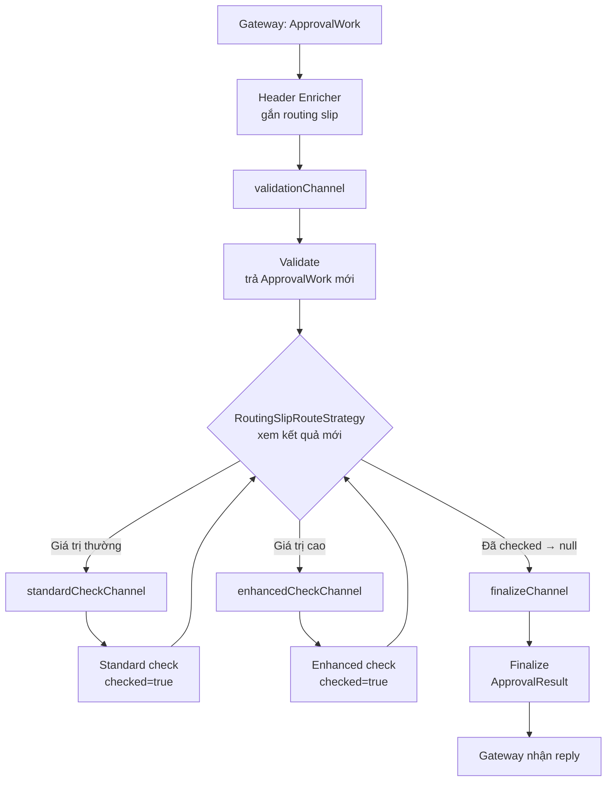
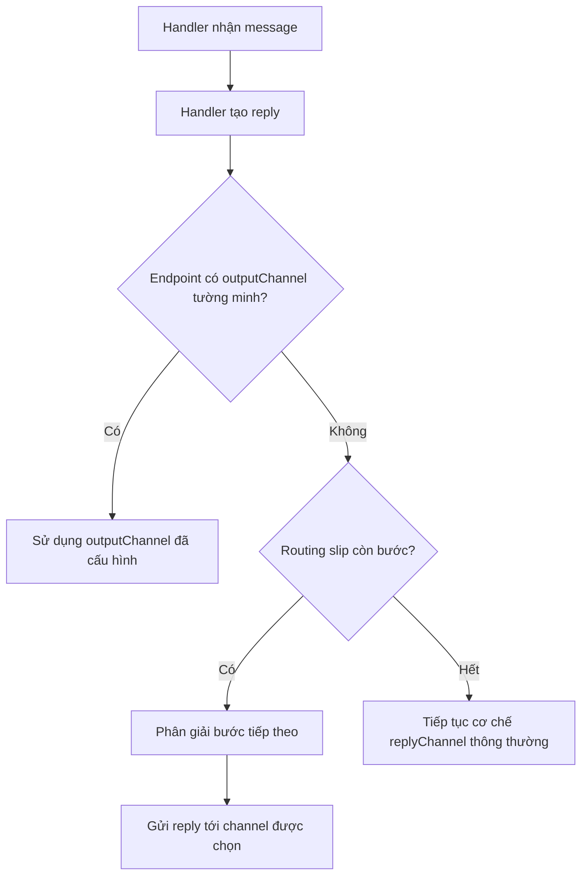
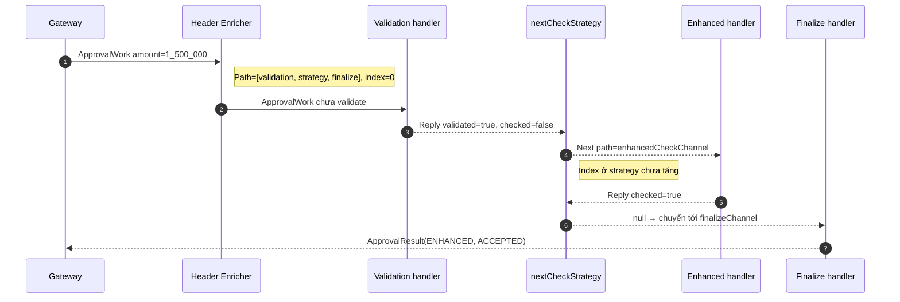
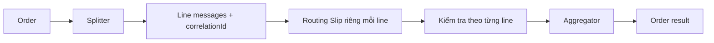

# Điều chỉnh route sau mỗi bước với Routing Slip trong Spring Integration

> **Chương:** Routing slip  
> **Bài học:** Điều chỉnh route sau mỗi bước  
> **Phạm vi:** Thực hành Enterprise Integration Patterns bằng Spring Integration, xây dựng các luồng thông điệp ít phụ thuộc và dễ mở rộng; kết hợp Transformer, Service Activator, Router, Gateway, Filter, Splitter/Aggregator, retry, error channel và correlation.

## 1. Bài toán: bước tiếp theo phụ thuộc kết quả bước vừa chạy

Giả sử một hệ thống xét duyệt đơn hàng phải thực hiện những công việc sau:

1. Kiểm tra dữ liệu đơn hàng.
2. Xem xét kết quả kiểm tra và chọn **bước đánh giá phù hợp**:
   - Đơn thông thường: kiểm tra tiêu chuẩn.
   - Đơn giá trị cao: kiểm tra nâng cao.
3. Sau khi bước đánh giá hoàn tất, chuyển sang bước chốt kết quả.
4. Trả phản hồi cho caller.

Chúng ta không thể cố định mọi đơn đi qua đúng một nhánh đánh giá, vì thông tin quyết định chỉ trở nên đáng tin sau khi validation kết thúc. Hơn nữa, trong tương lai một đơn có thể cần kiểm tra bổ sung lần nữa trước khi chuyển bước.



**Routing Slip** là EIP lưu một hành trình xử lý trong metadata của message. Điểm mạnh của Spring Integration là hành trình có thể chứa cả **channel cố định** và **chiến lược chọn channel động**, được xem xét lại khi handler vừa trả một kết quả mới.

Trong bài này, “điều chỉnh route sau mỗi bước” **không có nghĩa** tự viết code tăng một biến con trỏ hoặc sửa header liên tục. Cách triển khai đúng của Routing Slip là để framework quản lý vị trí trong hành trình, còn một `RoutingSlipRouteStrategy` quyết định bước động dựa trên `requestMessage` và `reply` hiện tại.

### Mục tiêu

Sau bài học, bạn có thể:

- Giải thích `routingSlip` header, danh sách path và `routingSlipIndex`.
- Phân biệt path cố định với một entry chiến lược động.
- Hiểu vì sao cùng một chiến lược có thể được gọi nhiều lần trước khi đi đến bước kế.
- Xây pipeline request-reply với các Service Activator không khai báo `outputChannel` cứng.
- Kiểm thử đường đi tiêu chuẩn/giá trị cao, bước hoàn tất và điều kiện dừng.
- Nhận diện nguy cơ vòng lặp, reply bị mất, cấu hình channel sai và mất metadata.
- Thiết kế error handling, correlation, observability và delivery phù hợp.

## 2. Routing Slip khác Router thông thường ở đâu?

**Content-Based Router** thường xem một message tại một điểm nhất định rồi chọn channel. **Routing Slip** mang theo *lộ trình tiếp theo* trong headers và để những endpoint có reply đi tiếp theo lộ trình đó.

```text
Content-Based Router:
  Input --> Router --key=HIGH--> highValueChannel

Routing Slip:
  Input
    |
    +-- routingSlip:
        [validateChannel, nextCheckStrategy, finalizeChannel]
                               ^
                               |
                    quyết định lại từ reply
```

| Tiêu chí | Router thông thường | Routing Slip |
| --- | --- | --- |
| Vị trí quyết định | Tại endpoint Router | Khi handler tạo reply và cần tìm output channel |
| Nguồn route | Payload, header, biểu thức hoặc mapping | Hành trình nằm trong `routingSlip` header |
| Bước tiếp theo | Channel đã được Router chọn | Entry đang xét trong path hoặc kết quả route strategy |
| Quyết định sau mỗi bước | Cần đặt thêm Router/flow phù hợp | Có thể dùng cùng `RoutingSlipRouteStrategy` lặp lại |
| Kết thúc | Theo output channel và cấu hình của Router/flow | Khi path hết, quay về cơ chế `replyChannel` thông thường |

Routing Slip đặc biệt hữu ích khi mỗi message có thể mang một *chuỗi bước xử lý* khác nhau, hoặc khi quyết định ở một bước phụ thuộc vào **kết quả mới nhất** của handler trước đó.

Không nên dùng Routing Slip cho mọi bài toán định tuyến. Nếu chỉ cần chọn nhánh một lần theo trạng thái cố định, `.route(...)` hoặc `@Router` thường đơn giản và dễ quan sát hơn.

## 3. Cơ chế chính của Spring Integration

Spring Integration hỗ trợ Routing Slip thông qua header có tên tương ứng với `IntegrationMessageHeaderAccessor.ROUTING_SLIP` (thường hiển thị là `routingSlip`).

Đây **không** chỉ là một chuỗi tên channel ngăn cách bởi dấu phẩy. Framework dùng một cấu trúc biểu diễn **danh sách path** và **chỉ số hiện tại**; trong API liên quan, giá trị header được biểu diễn theo cấu trúc dạng `Map<List<Object>, Integer>`. Các API như `HeaderEnricherSpec.routingSlip(...)` hoặc `RoutingSlipHeaderValueMessageProcessor` tạo cấu trúc phù hợp thay vì để ứng dụng tự dựng nó.

Một path có thể chứa:

- Tên bean `MessageChannel`.
- Tham chiếu `MessageChannel` phù hợp.
- Tên bean hoặc đối tượng `RoutingSlipRouteStrategy`.
- Biểu thức SpEL theo cơ chế framework hỗ trợ.

### 3.1. Điều kiện Routing Slip được sử dụng

Khi một endpoint thuộc loại tạo reply (ví dụ Transformer hoặc Service Activator trả kết quả) **không chỉ định `outputChannel` rõ ràng**, cơ chế chọn output channel có thể tham khảo `routingSlip` header.



**Hệ quả:** nếu đặt một output channel cứng trên endpoint đang muốn điều khiển bằng Routing Slip, hành trình động có thể không được dùng tại điểm đó. Khi thiết kế, hãy kiểm tra thật kỹ endpoint nào có output channel tường minh và endpoint nào trông cậy vào routing slip.

### 3.2. Entry là channel cố định

Ví dụ path:

```text
[validationChannel, nextCheckStrategy, finalizeChannel]
 index = 0
```

Entry `validationChannel` được phân giải ra một channel. Khi framework dùng channel đó làm next output, vị trí trong routing slip được **tăng sang entry tiếp theo** trên message reply.

Điều này khác với việc ứng dụng phải ghi đè toàn bộ header sau mỗi lần chạy.

### 3.3. Entry là RoutingSlipRouteStrategy

Khi entry hiện tại là một strategy:

1. Framework gọi `getNextPath(requestMessage, reply)`.
2. Nếu strategy trả tên channel hợp lệ, reply được gửi tới channel đó.
3. **Chỉ số routing slip vẫn đứng ở entry strategy.**
4. Khi handler ở channel vừa chọn tiếp tục tạo reply, strategy lại được hỏi.
5. Khi strategy trả `null` hoặc chuỗi rỗng, framework **chuyển sang entry tiếp theo** trong routing slip.

```text
index=1, entry=nextCheckStrategy
  -> reply.checked=false  -> "enhancedCheckChannel"
  -> handler chạy và trả reply.checked=true
index vẫn =1
  -> reply.checked=true   -> null
index tăng lên 2
  -> entry=finalizeChannel
```

Đây chính là cách **điều chỉnh route sau mỗi bước**: cùng một entry chiến lược đánh giá lại trạng thái mới, lặp cho đến khi nó tuyên bố hoàn tất công việc của mình.

### 3.4. Khi path đã hết

Khi chỉ số vượt hết danh sách path, Spring Integration trở lại cơ chế chọn kênh phản hồi thông thường, bao gồm header `replyChannel` nếu có. Với Messaging Gateway request-reply, kết quả cuối có thể quay về lời gọi Gateway.

Điều này **không có nghĩa** mọi flow tự trả kết quả: nếu một handler trả `void`/`null`, route có thể dừng do không có reply để dispatch. Nếu không có người nhận reply, lời gọi Gateway có thể chờ đến timeout hoặc gặp lỗi theo cấu hình.

## 4. Mô hình điều chỉnh từng bước: nhìn từ state của message

Để tránh bị lặp vô hạn, ta mô hình hóa trạng thái nghiệp vụ bằng một object bất biến `ApprovalWork`:

| Thuộc tính | Giá trị minh họa | Mục đích |
| --- | --- | --- |
| `orderId` | `ORD-2048` | Định danh đơn |
| `amount` | `1500000` | Xác định có cần kiểm tra nâng cao không |
| `validated` | `true/false` | Đánh dấu đã qua validation |
| `checked` | `true/false` | Đánh dấu đã hoàn tất kiểm tra tương ứng |
| `checkPath` | `UNDECIDED`, `STANDARD`, `ENHANCED` | Ghi nhận nhánh đã thực hiện |

Một message khi đến flow có thể mang `validated=false` và `checked=false`. Sau validation, service trả object mới với `validated=true`. Strategy thấy `checked=false`, chọn một channel. Sau khi một trong hai handler đánh giá trả object có `checked=true`, strategy trả `null` để tiếp tục tới bước finalize.

**Không dựa vào biến dùng chung trong singleton service để nhớ đang ở bước nào.** Khi nhiều message chạy đồng thời, state dùng chung có thể làm lẫn hành trình. Đưa trạng thái cần thiết vào payload bất biến, headers có hợp đồng rõ hoặc kho trạng thái riêng được thiết kế cho nghiệp vụ.

### Tại sao không ghi trực tiếp vào routingSlip header?

Về nguyên tắc, khi muốn thay hành trình cho một message, cần cấu hình Header Enricher hoặc xử lý message phù hợp. Nhưng tự chỉnh `routingSlipIndex` và cấu trúc header nội bộ là cách dễ phá vỡ quy tắc của framework.

Trong bài toán “bước kế phụ thuộc reply của bước trước”, `RoutingSlipRouteStrategy` là công cụ tự nhiên hơn: **đổi lựa chọn channel**, không chỉnh sửa cấu trúc path bằng tay.

## 5. Java DSL hoàn chỉnh: route tự thay đổi sau khi kiểm tra

Ví dụ Spring Integration sau minh họa pipeline trong cùng JVM. Các class được đặt trong package `example.integration`; khi đưa vào dự án, mỗi `public` record/class/interface nên đặt trong tệp `.java` cùng tên. Ví dụ dự kiến môi trường có Spring Integration Java DSL, Java 17+ và Spring Test/JUnit 5 cho phần kiểm thử.

### 5.1. Hai kiểu dữ liệu

```java
package example.integration;

public record ApprovalWork(
    String orderId,
    long amount,
    boolean validated,
    boolean checked,
    String checkPath
) {}

public record ApprovalResult(
    String orderId,
    String selectedCheck,
    String status
) {}
```

`ApprovalWork` mô tả trạng thái hiện tại của pipeline; `ApprovalResult` là kết quả cuối cùng trả về cho Gateway.

Trong ví dụ, amount là số nguyên theo đơn vị tiền nhỏ nhất/đơn vị kế toán đã được chuẩn hóa. Với ứng dụng xử lý tiền thật, nên dùng kiểu tiền có quy tắc currency và precision rõ ràng, không tùy tiện coi mọi đơn vị tiền tệ như nhau.

### 5.2. Các service method là endpoint có reply

```java
package example.integration;

import org.springframework.integration.annotation.ServiceActivator;

public class ApprovalStages {

    @ServiceActivator(inputChannel = "validationChannel")
    public ApprovalWork validate(ApprovalWork work) {
        if (work.orderId() == null
                || work.orderId().isBlank()
                || work.amount() <= 0) {
            throw new IllegalArgumentException("Đơn hàng không hợp lệ");
        }

        // Reset trạng thái điều khiển: không tin cờ checked từ client.
        return new ApprovalWork(
            work.orderId().trim(),
            work.amount(),
            true,
            false,
            "UNDECIDED");
    }

    @ServiceActivator(inputChannel = "standardCheckChannel")
    public ApprovalWork standardCheck(ApprovalWork work) {
        requireValidated(work);

        return new ApprovalWork(
            work.orderId(), work.amount(), true, true, "STANDARD");
    }

    @ServiceActivator(inputChannel = "enhancedCheckChannel")
    public ApprovalWork enhancedCheck(ApprovalWork work) {
        requireValidated(work);

        // Minh họa: ở ứng dụng thật có thể cần kiểm tra rủi ro,
        // timeout, phản hồi bất đồng bộ hoặc phê duyệt riêng.
        return new ApprovalWork(
            work.orderId(), work.amount(), true, true, "ENHANCED");
    }

    @ServiceActivator(inputChannel = "finalizeChannel")
    public ApprovalResult finish(ApprovalWork work) {
        if (!work.validated() || !work.checked()) {
            throw new IllegalStateException(
                "Không thể finalize trước khi hoàn tất kiểm tra");
        }

        return new ApprovalResult(
            work.orderId(), work.checkPath(), "ACCEPTED");
    }

    private static void requireValidated(ApprovalWork work) {
        if (!work.validated()) {
            throw new IllegalStateException(
                "Phải validate trước khi kiểm tra");
        }
    }
}
```

Điểm chủ ý của ví dụ:

- Mỗi method tạo **một reply payload** để routing slip có thể tính bước tiếp theo.
- Không method nào khai báo output channel tường minh.
- Hai nhánh kiểm tra trả trạng thái `checked=true`, là tín hiệu kết thúc đoạn route động.
- `finish` trả một kiểu kết quả khác, sau đó lộ trình được sử dụng hết và reply đi về Gateway nếu có `replyChannel` thích hợp.
- Ví dụ không mô phỏng quy trình phê duyệt thủ công kéo dài nhiều ngày. Một quy trình dài cần lưu state bền vững và có thể dùng Process Manager hoặc broker ngoài JVM.

### 5.3. Cấu hình channel, Routing Slip và strategy

```java
package example.integration;

import org.springframework.context.annotation.Bean;
import org.springframework.context.annotation.Configuration;
import org.springframework.integration.annotation.IntegrationComponentScan;
import org.springframework.integration.channel.DirectChannel;
import org.springframework.integration.config.EnableIntegration;
import org.springframework.integration.dsl.IntegrationFlow;
import org.springframework.integration.routingslip.RoutingSlipRouteStrategy;
import org.springframework.messaging.Message;
import org.springframework.messaging.MessageChannel;

@Configuration
@EnableIntegration
@IntegrationComponentScan
public class RoutingSlipConfiguration {

    @Bean
    public MessageChannel ordersInput() {
        return new DirectChannel();
    }

    @Bean
    public MessageChannel validationChannel() {
        return new DirectChannel();
    }

    @Bean
    public MessageChannel standardCheckChannel() {
        return new DirectChannel();
    }

    @Bean
    public MessageChannel enhancedCheckChannel() {
        return new DirectChannel();
    }

    @Bean
    public MessageChannel finalizeChannel() {
        return new DirectChannel();
    }

    @Bean
    public ApprovalStages approvalStages() {
        return new ApprovalStages();
    }

    @Bean("nextCheckStrategy")
    public RoutingSlipRouteStrategy nextCheckStrategy() {
        return (requestMessage, reply) -> {
            // Trong ví dụ, service method trả POJO ApprovalWork.
            // Strategy cũng hỗ trợ trường hợp reply là Message.
            Object result = reply instanceof Message<?> message
                ? message.getPayload()
                : reply;

            if (!(result instanceof ApprovalWork work)) {
                throw new IllegalStateException(
                    "Routing strategy cần ApprovalWork reply");
            }

            if (!work.validated()) {
                throw new IllegalStateException(
                    "Chưa validate nhưng đã đến dynamic step");
            }

            // Handler của nhánh đã chạy xong: thoát strategy
            // để framework chuyển tới finalizeChannel.
            if (work.checked()) {
                return null;
            }

            // Còn thiếu bước kiểm tra: chọn theo reply mới nhất.
            return work.amount() >= 1_000_000L
                ? "enhancedCheckChannel"
                : "standardCheckChannel";
        };
    }

    @Bean
    public IntegrationFlow entryFlow() {
        return IntegrationFlow.from("ordersInput")
            .enrichHeaders(h -> h.routingSlip(
                "validationChannel",
                "nextCheckStrategy",
                "finalizeChannel"))
            .get();
    }
}
```

`HeaderEnricherSpec.routingSlip(...)` tạo header Routing Slip theo API chuyên dụng. Ta không tự đặt một header mang giá trị chuỗi tùy ý rồi kỳ vọng framework đoán đúng format.

**Cách hoạt động theo thứ tự:**

1. Gateway đưa `ApprovalWork` vào `ordersInput`.
2. Header Enricher bổ sung path ba entry.
3. Header Enricher không có output channel tường minh; route slip chọn `validationChannel`.
4. `ApprovalStages.validate` trả object đã validate.
5. Entry `nextCheckStrategy` được hỏi, chọn `standardCheckChannel` hoặc `enhancedCheckChannel`.
6. Handler của nhánh đã chọn trả object có `checked=true`.
7. Framework vẫn đang ở entry strategy, hỏi lại; strategy trả `null`.
8. Framework sang `finalizeChannel`; `finish` tạo `ApprovalResult`.
9. Path đã hết; reply về caller theo `replyChannel` nếu request-reply được cấu hình.

**Điều cốt lõi:** strategy được gọi **lặp lại sau một reply mới**. Nếu nó cứ trả cùng một channel dù state đã hoàn tất, flow có thể tự lặp vô hạn. Điều kiện dừng `work.checked()` không phải chi tiết phụ; đó là một phần của hợp đồng an toàn.

#### Lưu ý về kiểu reply

Hợp đồng `RoutingSlipRouteStrategy.getNextPath(Message<?> requestMessage, Object reply)` không yêu cầu `reply` luôn là một POJO. Trong những ngữ cảnh khác, nó có thể là `Message<?>` hoặc một message builder của framework. Ví dụ chỉ dùng service method trả domain object, nên strategy xử lý trực tiếp `ApprovalWork` và trường hợp `Message<?>`.

Nếu thay handler bằng loại endpoint trả builder hoặc message format khác, hãy điều chỉnh strategy theo kiểu reply thật sự, thay vì giả định mọi thứ đều có thể ép kiểu `ApprovalWork`.

### 5.4. Gateway request-reply

```java
package example.integration;

import org.springframework.integration.annotation.MessagingGateway;

@MessagingGateway(defaultRequestChannel = "ordersInput")
public interface ApprovalGateway {

    ApprovalResult submit(ApprovalWork work);
}
```

`@IntegrationComponentScan` trong cấu hình giúp đăng ký Gateway interface trong package được quét.

Ví dụ phía caller:

```java
ApprovalResult ordinary = approvalGateway.submit(
    new ApprovalWork("ORD-101", 250_000L,
        false, false, "UNDECIDED"));

ApprovalResult highValue = approvalGateway.submit(
    new ApprovalWork("ORD-102", 1_500_000L,
        false, false, "UNDECIDED"));

// ordinary.selectedCheck() = "STANDARD"
// highValue.selectedCheck() = "ENHANCED"
// Cả hai có status "ACCEPTED" nếu không phát sinh lỗi.
```

`approvalGateway` ở đoạn này là bean đã được inject. Các giá trị `validated` và `checked` do caller gửi vào được bước validation thiết lập lại để không thể dựa vào cờ của đầu vào không đáng tin.

Vì các channel trong ví dụ là `DirectChannel`, flow chạy đồng bộ ở thread gọi theo cấu hình thông thường. Gateway vẫn chờ kết quả hoặc lỗi; đây chưa phải workflow bất đồng bộ/bền vững.

## 6. Trace chi tiết: từng lần điều chỉnh route

Một message giá trị cao đi qua những quyết định sau:

| Thời điểm | Reply mới nhất | Entry hiện tại | Quyết định |
| --- | --- | --- | --- |
| Header Enricher hoàn tất | `ApprovalWork` ban đầu | `validationChannel`, index 0 | Chuyển tới validation, rồi tăng index |
| Validation trả về | `validated=true, checked=false` | `nextCheckStrategy`, index 1 | Trả `enhancedCheckChannel`; index giữ nguyên |
| Enhanced check trả về | `validated=true, checked=true` | `nextCheckStrategy`, index 1 | Trả `null`; tăng index |
| Bước động kết thúc | `checked=true` | `finalizeChannel`, index 2 | Gửi tới finalize, rồi tăng index |
| Finalize trả kết quả | `ApprovalResult` | Path đã hết | Dùng cơ chế reply channel |



Sơ đồ dùng các mũi tên phản ánh thứ tự logic của pipeline. Trong Spring Integration, strategy tham gia vào cơ chế chọn output channel của reply, không nhất thiết tồn tại dưới dạng một Message Endpoint độc lập luôn nhận message trên channel riêng.

### Trường hợp có nhiều bước động liên tiếp

Giả sử một đơn cần:

- Kiểm tra tiêu chuẩn.
- Kiểm tra bổ sung nếu phát hiện bất thường.
- Kiểm tra lại sau khi bổ sung dữ liệu.

Ta có thể mở rộng state bằng `needsExtraCheck`, `extraCheckDone`, `attempt`. Strategy dựa trên reply mới nhất để tiếp tục chọn channel phù hợp cho đến khi một điều kiện hoàn tất được thỏa.

Ví dụ giả mã:

```java
Object getNextPath(Message<?> request, Object reply) {
    ApprovalWork work = extractWork(reply);

    if (!work.checked()) {
        return "standardCheckChannel";
    }
    if (work.needsExtraCheck() && !work.extraCheckDone()) {
        return "extraCheckChannel";
    }
    return null; // Sang entry tiếp theo của routing slip.
}
```

Đây là **giả mã mở rộng**: các field và method `needsExtraCheck`, `extraCheckDone`, `extractWork` không nằm trong record của ví dụ hoàn chỉnh mục 5. Khi triển khai thực tế, định nghĩa chúng cùng state transition và test để mọi nhánh cuối cùng đều có điều kiện dừng.

## 7. Điều chỉnh route khác với thay toàn bộ routing slip

Có ba cách thay đổi hành trình thường bị trộn lẫn.

| Nhu cầu | Cách làm | Lưu ý |
| --- | --- | --- |
| Chọn channel khác cho bước hiện tại dựa trên reply | `RoutingSlipRouteStrategy` | Strategy được hỏi lại cho đến khi trả `null`/rỗng |
| Định nghĩa path ban đầu khác nhau cho từng loại message | Header Enricher/khởi tạo Routing Slip theo rule | Input contract cần giới hạn danh sách đích |
| Thay toàn bộ plan giữa một workflow | Một bước orchestration hoặc message enrichment có kiểm soát | Cần quản lý phiên bản, index, lịch sử và tính tương thích |

Ví dụ `routingSlip` path ban đầu có thể là:

```text
Đơn thường:
  validate -> strategy -> finalize

Đơn cần bổ sung hồ sơ:
  validate -> strategy -> complianceCheck -> finalize
```

Tuy nhiên, trong ví dụ chính chúng ta **không đổi path**. Strategy giải quyết đích tiếp theo, nhờ đó cùng một path phù hợp cho cả đơn thường lẫn đơn giá trị cao.

**Không nên:** sao chép bất kỳ Map header nào sang `routingSlip`, tự chỉnh index từ 1 về 0 hoặc đặt lại cùng path sau mỗi handler. Những thao tác như vậy dễ làm flow lặp, nhảy bước hoặc gây lỗi phân giải channel.

### Nếu có yêu cầu tái cấu hình khi đang chạy

Một hệ thống có thể muốn sửa workflow cho message mới theo cấu hình của doanh nghiệp. Hãy phân biệt:

- **Đổi policy cho message mới:** cấu hình tạo path ban đầu hoặc versioned routing policy.
- **Đổi route của message đang xử lý:** state phải có version và điều kiện chuyển bước rõ; không sửa ngầm trên toàn hệ thống.
- **Tạm dừng lâu chờ con người:** cần persistence/scheduler/broker hoặc workflow engine, không chỉ một routing slip chạy đồng bộ trong JVM.

## 8. Vì sao handler phải có reply và không có outputChannel cứng?

Routing Slip tham gia việc phân giải **output channel cho reply**. Do đó, một đoạn pipeline chỉ hoạt động nếu endpoint tạo ra reply phù hợp.

Ví dụ tốt:

```java
@ServiceActivator(inputChannel = "validationChannel")
public ApprovalWork validate(ApprovalWork work) {
    return new ApprovalWork(
        work.orderId(), work.amount(), true, false, "UNDECIDED");
}
```

Ví dụ không phù hợp với việc tự chuyển bước bằng routing slip:

```java
@ServiceActivator(inputChannel = "validationChannel")
public void validate(ApprovalWork work) {
    externalService.validate(work);
    // Không có reply payload để gửi sang entry tiếp theo.
}
```

Method `void` có thể hoàn toàn đúng cho một tác vụ one-way, nhưng nếu dùng nó giữa pipeline cần tiếp tục bằng routing slip, hành trình không có reply để dispatch tiếp. Lúc đó Gateway request-reply có thể hết timeout.

### Output channel tường minh có thể bỏ qua slip

Ví dụ:

```java
@ServiceActivator(
    inputChannel = "validationChannel",
    outputChannel = "fixedNextChannel"
)
public ApprovalWork validate(ApprovalWork work) {
    return work;
}
```

Nếu endpoint đã ấn định `outputChannel`, output có thể đi đến `fixedNextChannel` thay vì tham khảo entry hiện tại trong routing slip. Cấu hình như vậy phù hợp khi bạn muốn route cố định tại endpoint, **không phù hợp** nếu đang kỳ vọng strategy quyết định đường tiếp theo ở đó.

Trong ứng dụng thật, nên vẽ sơ đồ các outputChannel tường minh và những nơi dùng routing slip; tránh đặt hai cơ chế khác nhau vào cùng điểm rồi không biết cơ chế nào chi phối.

## 9. Phân biệt RoutingSlipRouteStrategy với Content-Based Router

Một `RoutingSlipRouteStrategy` có vẻ giống Router vì cũng tính channel từ message, nhưng vòng đời khác:

- Router nhận message từ **input channel của Router** rồi phát thông điệp đến channel được chọn.
- Routing Slip strategy được gọi trong quá trình **endpoint tìm output channel cho reply**.
- Router có thể có mapping, default channel và policy resolution riêng.
- Strategy trong routing slip có thể trả channel nhiều lần rồi trả null để chuyển index.

| Khía cạnh | `@Router` hoặc `.route(...)` | `RoutingSlipRouteStrategy` |
| --- | --- | --- |
| Thời điểm gọi | Một endpoint định tuyến nhận message | Endpoint khác đã tạo reply và cần xác định output |
| Input chính | Message/payload/header theo Router | `requestMessage` và `reply` |
| Có thể trả channel nhiều lần từ cùng vị trí? | Thường mỗi lần nhận một message quyết định một tuyến | Có, cho đến khi strategy trả null/rỗng |
| Dừng chuyển bước | Theo flow và output channel | Null/rỗng để nhường chỗ cho entry tiếp theo |
| Khi dùng | Phân tuyến rõ ràng tại một điểm | Hành trình nhiều bước phụ thuộc kết quả trung gian |

Trong hệ thống tích hợp có nhiều EIP, hai cơ chế có thể cùng tồn tại. Ví dụ một Router đầu vào chọn loại workflow, sau đó mỗi workflow dùng Routing Slip riêng để điều chỉnh các bước bên trong.

## 10. Kiểm thử JUnit 5: chứng minh điều chỉnh route

Chỉ gọi trực tiếp `nextCheckStrategy.getNextPath(...)` sẽ kiểm thử được logic chọn channel, nhưng chưa chứng minh `Gateway → Header Enricher → Service Activator → Routing Slip → Gateway` được nối đúng. Nên kiểm thử cả hai mức.

### 10.1. Integration test đi qua Gateway

Ví dụ dùng các class trong mục 5:

```java
package example.integration;

import static org.junit.jupiter.api.Assertions.*;

import org.junit.jupiter.api.Test;
import org.springframework.beans.factory.annotation.Autowired;
import org.springframework.test.context.junit.jupiter.SpringJUnitConfig;

@SpringJUnitConfig(RoutingSlipConfiguration.class)
class RoutingSlipIntegrationTest {

    @Autowired
    private ApprovalGateway gateway;

    @Test
    void normalOrderUsesStandardCheckThenFinalizes() {
        ApprovalResult result = gateway.submit(
            new ApprovalWork(
                "ORD-101", 250_000L,
                false, false, "UNDECIDED"));

        assertEquals("ORD-101", result.orderId());
        assertEquals("STANDARD", result.selectedCheck());
        assertEquals("ACCEPTED", result.status());
    }

    @Test
    void highValueOrderUsesEnhancedCheckThenFinalizes() {
        ApprovalResult result = gateway.submit(
            new ApprovalWork(
                "ORD-102", 1_500_000L,
                false, false, "UNDECIDED"));

        assertEquals("ORD-102", result.orderId());
        assertEquals("ENHANCED", result.selectedCheck());
        assertEquals("ACCEPTED", result.status());
    }

    @Test
    void invalidOrderFailsBeforeDynamicCheck() {
        assertThrows(RuntimeException.class, () ->
            gateway.submit(
                new ApprovalWork(
                    "ORD-BAD", -1L,
                    false, false, "UNDECIDED")));
    }
}
```

Các test này xác nhận:

- Cùng một path routing slip tạo hai hành trình dựa trên kết quả validation.
- Strategy không lặp mãi tại bước kiểm tra: cả hai nhánh đều tới finalize.
- Kết quả cuối quay về Gateway theo cơ chế request-reply.
- Khi validation thất bại, không nên âm thầm đi sang nhánh kiểm tra tiếp theo.

Trong hệ thống thật, exception có thể được framework bọc lại; nên kiểm tra cause/error code theo hợp đồng của API thay vì chỉ dựa trên `RuntimeException` tổng quát.

### 10.2. Unit test trực tiếp cho strategy

```java
package example.integration;

import static org.junit.jupiter.api.Assertions.*;

import org.junit.jupiter.api.Test;
import org.springframework.integration.routingslip.RoutingSlipRouteStrategy;
import org.springframework.messaging.support.GenericMessage;

class NextCheckStrategyTest {

    private final RoutingSlipRouteStrategy strategy =
        new RoutingSlipConfiguration().nextCheckStrategy();

    @Test
    void selectsEnhancedCheckUntilWorkIsChecked() {
        ApprovalWork validated = new ApprovalWork(
            "ORD-201", 1_500_000L,
            true, false, "UNDECIDED");

        Object next = strategy.getNextPath(
            new GenericMessage<>(validated), validated);

        assertEquals("enhancedCheckChannel", next);

        ApprovalWork checked = new ApprovalWork(
            "ORD-201", 1_500_000L,
            true, true, "ENHANCED");

        assertNull(strategy.getNextPath(
            new GenericMessage<>(checked), checked));
    }

    @Test
    void selectsStandardPathForOrdinaryOrder() {
        ApprovalWork validated = new ApprovalWork(
            "ORD-202", 100_000L,
            true, false, "UNDECIDED");

        assertEquals("standardCheckChannel",
            strategy.getNextPath(
                new GenericMessage<>(validated), validated));
    }
}
```

Ở đây test gọi một method tạo bean thuần Java và không cần khởi tạo Spring context; nó chỉ kiểm tra **quy tắc lựa chọn**. Test mục 10.1 mới kiểm tra framework thực sự tham khảo routing slip và nhận reply.

### Những test quan trọng khi mở rộng

| Test case | Mục tiêu |
| --- | --- |
| Handler trả `checked=false` sau lần kiểm tra | Strategy quyết định bước tiếp theo như thế nào? |
| Handler trả `checked=true` | Strategy trả `null` và chuyển sang finalize |
| Handler trả `null` | Flow có mất reply hoặc Gateway timeout không? |
| Channel từ strategy không tồn tại | Exception/error channel có nhận biết không? |
| Có outputChannel cứng trên một handler | Bước đó có bỏ qua route slip như dự kiến không? |
| Nhiều message đồng thời | State của đơn này không lẫn sang đơn khác |
| Retry handler sau timeout | Có vòng lặp, side effect hoặc gửi trùng không? |
| Hết routing slip | Kết quả có quay về `replyChannel` đúng không? |

## 11. Chống vòng lặp vô hạn và route sai

Routing Slip cho phép strategy được hỏi lại, nên cũng có nguy cơ tự lặp.

### 11.1. Strategy trả mãi cùng một channel

Phản mẫu:

```java
return (request, reply) -> "enhancedCheckChannel";
```

Nếu handler ở `enhancedCheckChannel` luôn tạo reply, strategy cứ chọn lại chính channel đó. Flow có thể chạy rất lâu, tràn call stack ở nhánh đồng bộ hoặc tiêu tốn tài nguyên ở nhánh bất đồng bộ.

**Cách phòng tránh:** đặt điều kiện dừng trên state mới nhất, ví dụ `checked=true`. Khi hoàn tất, trả `null` để framework chuyển sang entry sau.

### 11.2. Handler trả state không tiến triển

Nếu `enhancedCheck` trả một `ApprovalWork` vẫn `checked=false` dù nghiệp vụ đã hoàn tất, strategy không thấy sự thay đổi. Đây là lỗi transition/state contract, không phải lỗi của header Routing Slip.

Nên kiểm tra các bất biến:

- Validation chỉ diễn ra trước check.
- Mỗi lần check làm thay đổi state theo hướng tiến triển, hoặc phát lỗi rõ.
- Số lần đánh giá lại có giới hạn khi phải gọi hệ thống ngoài.
- Không “tự lặp” chỉ để chờ một tác vụ dài; dùng workflow bất đồng bộ có lưu trạng thái.

### 11.3. Strategy trả channel không tồn tại

Nếu strategy trả `"highValueChanel"` sai chính tả, framework không thể phân giải bean/channel như mong đợi. Lỗi này cần được phát hiện trong integration test và error flow. Không nên bắt exception rồi tự chuyển sang route ít kiểm tra hơn mà không có quyết định nghiệp vụ phù hợp.

### 11.4. Tên channel được lấy trực tiếp từ client

Không nên cho payload/header do client gửi tùy ý quyết định tên bean channel nội bộ. Strategy nên trả một giá trị từ **tập channel được phép**, ví dụ hai nhánh đã định nghĩa trong code. Nếu cần route theo tenant hoặc quyền truy cập, trước hết phải xác thực và chuẩn hóa dữ liệu.

## 12. Đường lỗi, retry và trách nhiệm của từng bước

Trong một pipeline nhiều bước, lỗi có thể xuất hiện ở những nơi khác nhau:

| Nơi phát sinh | Ví dụ | Xử lý |
| --- | --- | --- |
| Bước validation | Mã đơn rỗng, amount âm | Reject/exception; không retry mù |
| RoutingSlipRouteStrategy | Reply sai kiểu hoặc state bất hợp lệ | Báo lỗi cấu hình/hợp đồng |
| Phân giải channel | Strategy trả tên bean không tồn tại | Sửa mapping/config, ghi nhận lỗi |
| Handler nghiệp vụ | DB hoặc API bên ngoài timeout | Retry có giới hạn và idempotency |
| Gateway | Không nhận reply trước timeout | Kiểm tra handler trả `null`, route loop, async wait |
| Executor | Queue đầy, task bị từ chối | Backpressure hoặc phản hồi quá tải |

### Đồng bộ và bất đồng bộ

Với `DirectChannel`, lỗi thường có thể quay về thread caller, tùy endpoint và cách exception được framework propagate. Nếu dùng `ExecutorChannel`, lỗi tại worker có thể xảy ra **sau khi sender đã tiếp tục**. Khi đó cần error handler/error channel và quan sát tại nhánh async.

`RoutingSlipRouteStrategy` không thay thế error channel. Nó chỉ quyết định **đích tiếp theo**, không tự cung cấp cơ chế khôi phục khi một bước thất bại.

### Retry ở đâu?

Một lỗi API tạm thời có thể được retry tại Service Activator hoặc endpoint advice phù hợp. Nhưng đừng mặc định rằng **retry toàn bộ routing slip từ đầu** là an toàn:

- Validation có thể được chạy lại không cần thiết.
- Một bước đã ghi DB hoặc thu tiền có thể bị thực thi trùng.
- State/headers có thể không phản ánh đúng lần thử hiện tại.

Dùng idempotency key gắn với thao tác nghiệp vụ và giới hạn retry/backoff. Khi một tác vụ phải chờ lâu hoặc không thể hoàn thành trong một request, cân nhắc persist state và phát một event mới để tiếp tục, thay vì giữ một call stack/worker lâu.

## 13. Transaction và điều chỉnh route qua nhiều thread

Routing Slip xác định thứ tự điều hướng, **không** bảo đảm transaction trải qua nhiều bước.

Ví dụ cùng thread:

```text
Caller thread
  -> validation
  -> standard/enhanced check
  -> finalize
```

Nếu toàn bộ phần xử lý đang nằm trong một transaction thích hợp, các method có thể tham gia theo cấu hình. Nhưng một lời gọi API ngoài DB không thể tự rollback chỉ nhờ routing slip.

Khi chuyển sang `ExecutorChannel`:

```text
Thread A:
  create message + routingSlip
  send

Thread B:
  validate -> strategy -> check -> finalize
```

Transaction context gắn với thread A không tự đi theo B. MDC và security context cũng không tự được sao chép. Metadata nghiệp vụ nên ở payload/headers với quy tắc rõ; cơ chế tracing/security cần propagation phù hợp.

Với yêu cầu không mất message giữa các bước khi ứng dụng crash, cần broker, persistent message store, transactional outbox hoặc workflow state store. Một routing slip chạy trong bộ nhớ **không** tạo ra khả năng tiếp tục sau restart.

### Lưu state ở đâu?

Có thể chọn:

- **Payload bất biến:** phù hợp flow ngắn, xử lý liên tục trong JVM.
- **Headers:** phù hợp metadata/trace/correlation kỹ thuật, không nên đặt toàn bộ business state vào headers.
- **Database/workflow state store:** phù hợp quy trình dài, có retry giữa nhiều lần chạy.
- **Broker/topic:** phù hợp tách tiến trình và bảo đảm giao nhận theo hợp đồng transport.

Routing Slip có thể tham gia điều phối ở mỗi chặng, nhưng cơ chế lưu state nghiệp vụ vẫn cần được thiết kế riêng.

## 14. Correlation, Splitter và Aggregator

Khi Routing Slip được dùng trong flow có Splitter/Aggregator, cần phân biệt các header:

| Header | Vai trò |
| --- | --- |
| `routingSlip` | Lộ trình và vị trí đang sử dụng để chọn bước tiếp theo |
| `businessCorrelationId` | Liên kết các event thuộc cùng yêu cầu nghiệp vụ |
| `correlationId` | Thường giúp Aggregator ghép các message con |
| `sequenceNumber`, `sequenceSize` | Metadata thứ tự/kích thước nhóm message con |
| `replyChannel` | Đường reply cuối theo cơ chế request-reply |

`routingSlip` **không phải** `correlationId`. Routing Slip chỉ đường đi, còn correlation của Aggregator chỉ định các message nào thuộc cùng một nhóm.



Mỗi message con có thể được gửi qua một chuỗi bước khác nhau, nhưng vẫn cần giữ metadata nhóm để Aggregator biết lúc nào tập hợp kết quả hoàn tất.

Nếu một dynamic strategy vô tình đưa message con vào một nhánh không có reply, Aggregator có thể thiếu một phần tử. Cần thiết kế kết quả lỗi có cấu trúc hoặc timeout/release strategy thích hợp, không tự bỏ message quan trọng.

**Lưu ý:** với nhiều nhóm lồng nhau, việc tự sửa `correlationId` và sequence headers có thể làm mất thông tin grouping. Hãy để Splitter/Aggregator và các correlation strategy được cấu hình đúng trách nhiệm.

## 15. Quan sát quyết định sau mỗi bước

Một flow định tuyến động khó debug nếu chỉ có log “message đã vào Gateway”. Nên quan sát tối thiểu:

1. Message nào đang được xử lý? `businessCorrelationId`, `eventId`.
2. Bước vừa hoàn thành là gì?
3. State mới nhất dẫn đến quyết định route nào?
4. Strategy trả channel nào hay trả `null`?
5. Reply đã được gửi đến channel nào?
6. Lần thử/latency/lỗi của mỗi bước là gì?

Ví dụ log:

```text
correlation=order:ORD-2048 stage=validate result=VALIDATED
correlation=order:ORD-2048 slipEntry=nextCheckStrategy
    checked=false amount=1500000 next=enhancedCheckChannel
correlation=order:ORD-2048 stage=enhancedCheck result=CHECKED
correlation=order:ORD-2048 slipEntry=nextCheckStrategy
    checked=true next=ADVANCE
correlation=order:ORD-2048 stage=finalize result=ACCEPTED
```

Log này biểu diễn kết quả ứng dụng cần quan sát. Spring Integration **không tự động sinh chính xác các dòng này**; ta phải cấu hình logging/metrics/observation ở các endpoint và trong strategy nếu thực sự cần.

### Metric hữu ích

| Chỉ số | Ý nghĩa |
| --- | --- |
| Số message tới từng bước | Bước nào được chọn nhiều nhất |
| Số lần strategy được gọi | Có đường lặp nhiều hơn dự kiến không |
| Số lần strategy trả null | Có thoát dynamic segment đúng không |
| Số lỗi không resolve channel | Có route trả tên channel sai không |
| Thời gian hoàn tất từng handler | Bước nào chậm hoặc timeout |
| Retry count theo business key | Có tác dụng phụ trùng hoặc vòng retry |
| Gateway timeout | Có flow mất reply hoặc giữ worker quá lâu |
| Số workflow chưa finalize | Backlog/state treo có tăng không |

Micrometer Observation/OpenTelemetry có thể giúp nối trace giữa các bước. Nếu cần correlation nghiệp vụ, giữ một header ổn định và không gắn dữ liệu nhạy cảm vào log. Không dùng số thẻ, token hoặc toàn bộ payload làm tên span/tag có cardinality cao.

## 16. Routing Slip đi qua broker hoặc persistent MessageStore

Có một giới hạn kỹ thuật quan trọng: một số path entry là **đối tượng strategy/biểu thức** được tạo từ SpEL, gắn với `BeanFactory` trong JVM và không thể serialize an toàn.

Trong tài liệu Spring Integration, inline SpEL trong path có thể được biến thành `ExpressionEvaluatingRoutingSlipRouteStrategy`; đối tượng này phụ thuộc context và không `Serializable` theo cách cần để gửi nguyên message qua JVM hoặc persist vào store. Nếu message mang đối tượng như vậy đi qua serialization, có thể gặp `NotSerializableException`.

Vì vậy:

- Với distributed flow, tránh nhét **inline expression tạo strategy không serializable** vào routing slip header.
- Ưu tiên chiến lược được khai báo thành **bean có tên rõ ràng** khi cấu hình path.
- Xác minh cơ chế serialize/deserialize của header mapper thực tế; không mặc định mọi Java object trong header đều mang qua Kafka, AMQP hoặc HTTP.
- Với workflow dài, cân nhắc lưu một **workflow state thuần dữ liệu** và dựng lại hành trình khi tiếp tục, thay vì persist mọi object runtime của Spring Integration.

Ngay cả khi dùng bean strategy theo tên, cần kiểm thử end-to-end với transport và phiên bản Spring Integration đang dùng; **không** suy ra rằng toàn bộ routing slip header tự động bền vững hay tương thích cross-process.

## 17. Các sai lầm thường gặp

### 17.1. Tưởng strategy chỉ chạy một lần

Thực tế, với một entry strategy, framework có thể gọi lại sau mỗi reply cho đến khi trả `null` hoặc chuỗi rỗng. Logic chỉ trả tên channel mà không có điều kiện thoát dễ gây lặp vô hạn.

### 17.2. Sửa `routingSlipIndex` thủ công

Framework quản lý index theo các path entry và kết quả strategy. Tự sửa sẽ làm skip, chạy lại bước hoặc gây route sai. Hãy mô hình hóa state nghiệp vụ và dùng strategy phù hợp.

### 17.3. Đặt outputChannel cứng ở mỗi Service Activator

Endpoint đã biết output channel có thể không tra routing slip tại chặng đó. Bài tập Routing Slip phải xác định rõ những handler có reply nhưng không ấn định output channel.

### 17.4. Dùng handler void ở giữa chuỗi

Không có reply thì không có message tiếp tục cho cơ chế định tuyến theo reply. Nếu cần workflow one-way, thiết kế sự kiện tiếp nối riêng thay vì giả định routing slip vẫn tự chạy.

### 17.5. Strategy đọc state cũ thay vì reply mới

Vì route tiếp theo phải phản ánh kết quả bước vừa chạy, strategy cần phân biệt `requestMessage` và `reply`. Nếu luôn đọc payload của request ban đầu, nó có thể không nhìn thấy cờ `checked=true` vừa được handler cập nhật.

### 17.6. Lấy tên channel trực tiếp từ dữ liệu client

Routing key tùy ý có thể trỏ tới channel nội bộ không được phép. Chỉ cho phép các channel đã định nghĩa theo policy, dựa trên state đã validation và xác thực.

### 17.7. Retry cả pipeline sau một side effect

Nếu một bước đã thu tiền hoặc ghi dữ liệu rồi lỗi xảy ra ở bước sau, chạy lại từ đầu có thể tạo tác dụng phụ trùng. Cần idempotency, state persistence và recovery có kiểm soát.

### 17.8. Cho rằng Routing Slip là durable workflow engine

Routing Slip là cơ chế chọn kênh từ message header trong Spring Integration, không tự cung cấp scheduling, audit bền vững, human task, retry xuyên restart hay transaction phân tán.

## 18. Bài thực hành: điều chỉnh hành trình duyệt hồ sơ

**Bối cảnh:** hệ thống nhận `ApplicationRequest(id, amount, customerType)`. Mọi hồ sơ phải validate, sau đó chọn kiểm tra thông thường hoặc nâng cao. Sau bước kiểm tra, nếu thiếu tài liệu thì thực hiện bước yêu cầu bổ sung; khi đủ tài liệu mới finalize.

### Yêu cầu

1. Tạo message payload bất biến mang `id`, `amount`, `validated`, `riskChecked`, `documentsComplete` và trạng thái hiện tại.
2. Gắn một routing slip có path gồm `validateChannel`, `approvalStrategy`, `finalizeChannel`.
3. Tạo `RoutingSlipRouteStrategy` lựa chọn:
   - Chưa `riskChecked`: `standardCheckChannel` hoặc `enhancedCheckChannel`.
   - Đã kiểm tra nhưng thiếu tài liệu: `documentCheckChannel`.
   - Đã hoàn tất: `null` để chuyển sang finalize.
4. Đảm bảo mỗi handler trả một payload mới thể hiện state thực tế; không dựa vào biến mutable dùng chung.
5. Thêm điều kiện dừng hoặc giới hạn số lượt kiểm tra tài liệu để tránh lặp vô hạn.
6. Viết test đường tiêu chuẩn, đường nâng cao, thiếu tài liệu và trường hợp state không tiến triển.
7. Thêm test Gateway nhận kết quả khi routing slip đã hết.
8. Mô phỏng channel đích không tồn tại và mô tả cách lỗi được ghi nhận.
9. Giải thích điều gì thay đổi khi dùng `ExecutorChannel` trước một bước.
10. Đề xuất cơ chế lưu workflow state nếu phải chờ khách bổ sung tài liệu trong nhiều ngày.

### Bảng quyết định tham khảo

| State mới nhất | Strategy trả về | Ý nghĩa |
| --- | --- | --- |
| `riskChecked=false, amount=100000` | `standardCheckChannel` | Kiểm tra thường |
| `riskChecked=false, amount=2000000` | `enhancedCheckChannel` | Kiểm tra nâng cao |
| `riskChecked=true, documentsComplete=false` | `documentCheckChannel` | Cần xử lý tài liệu |
| `riskChecked=true, documentsComplete=true` | `null` | Bước động hoàn tất, sang finalize |

**Lưu ý:** nếu kiểm tra tài liệu đòi con người gửi file sau nhiều ngày, một lời gọi Gateway đồng bộ không nên bị giữ mở chờ. Lưu trạng thái yêu cầu, phản hồi “đã tiếp nhận/đang chờ”, và dùng một sự kiện mới để tiếp tục hành trình sau.

### Câu hỏi tự kiểm tra

**Câu 1.** Vì sao strategy có thể được gọi lần hai sau khi một handler đã xử lý xong?

*Vì khi strategy chọn một channel, index vẫn đứng tại entry đó. Reply của handler tiếp tục làm framework hỏi lại strategy.*

**Câu 2.** Khi nào strategy trả `null`?

*Khi phân đoạn định tuyến động đã hoàn tất và framework cần chuyển sang entry tiếp theo trong routing slip.*

**Câu 3.** Nếu một Service Activator giữa đường trả `void` thì sao?

*Thường không có reply để Routing Slip chuyển sang bước kế. Nếu Gateway chờ kết quả, nó có thể timeout.*

**Câu 4.** Routing Slip có thay thế `correlationId` của Splitter/Aggregator không?

*Không. Routing Slip chọn lộ trình; correlation ID phục vụ nhóm và truy vết theo mục đích riêng.*

**Câu 5.** Vì sao không dùng inline SpEL tùy ý trong routing slip khi message cần serialize qua broker?

*Vì các đối tượng strategy phụ thuộc BeanFactory có thể không serializable. Cần dùng cấu hình strategy và header mapping phù hợp, kiểm thử với transport thực.*

## 19. Checklist trước khi áp dụng

- **Bài toán:** đúng là lộ trình nhiều bước phụ thuộc reply mới, không phải routing một lần đơn giản.
- **Input contract:** payload, state, headers nghiệp vụ được xác thực.
- **Routing Slip:** được tạo bằng API dành riêng; không tự viết sai cấu trúc header nội bộ.
- **Điểm chuyển bước:** handler tạo reply và không có outputChannel tường minh khi cần routing slip quyết định.
- **State transition:** mỗi bước làm tiến triển state hoặc báo lỗi; có điều kiện dừng.
- **Strategy:** trả tên channel từ danh sách hợp lệ; trả `null`/rỗng khi hoàn tất đoạn động.
- **Gateway:** có đường reply khi path hết và timeout hợp lý.
- **Lỗi:** tách lỗi validation, channel resolution, dispatch và business failure.
- **Retry:** giới hạn số lần, backoff và idempotency theo side effect.
- **Transaction:** không giả định transaction đi theo ExecutorChannel hoặc broker.
- **Correlation:** bảo toàn business ID, tracing và group headers đúng vai trò.
- **Độ bền:** lưu state bằng DB/outbox/broker nếu cần tiếp tục sau crash hoặc chờ lâu.
- **Quan sát:** ghi từng quyết định route, bước xử lý, lỗi và độ trễ.
- **Kiểm thử:** đủ nhánh thường/nâng cao, state đã hoàn tất, lặp sai, output channel và reply.

## 20. Tài liệu tham khảo

- [Spring Integration Reference — Routing Slip](https://docs.spring.io/spring-integration/reference/router/routing-slip.html): cơ chế `routingSlip`, `RoutingSlipRouteStrategy`, index, cách chọn output channel và những lưu ý serialization.
- [Spring Integration Reference — Service Activator](https://docs.spring.io/spring-integration/reference/service-activator.html): method endpoint, reply và xử lý message.
- [Enterprise Integration Patterns — Routing Slip](https://www.enterpriseintegrationpatterns.com/patterns/messaging/RoutingTable.html): ý tưởng thông điệp mang hành trình xử lý.

**Kết luận:** Với Routing Slip, Spring Integration có thể chọn *bước tiếp theo dựa trên kết quả mới nhất của bước vừa chạy*. Một entry `RoutingSlipRouteStrategy` có thể điều hướng qua nhiều channel, được hỏi lại khi có reply và trả `null` để nhường chỗ cho entry sau. Bằng cách để framework quản lý routing slip index, giữ state transition rõ ràng và thiết kế reply, lỗi, correlation, retry và độ bền phù hợp, ta có một pipeline động dễ kiểm thử và mở rộng mà không phải tự viết một hệ thống Router chồng chéo.
