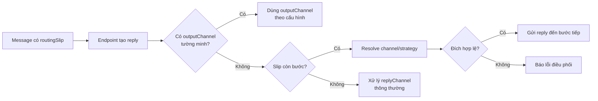
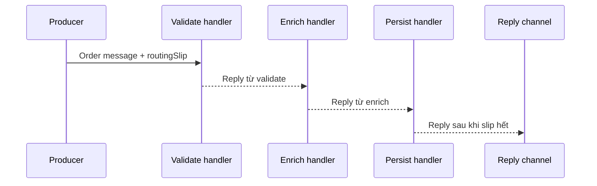
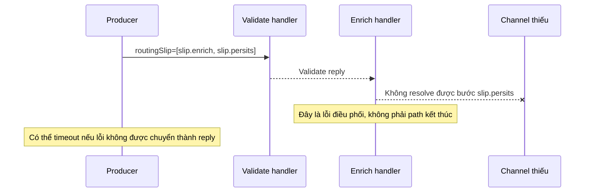
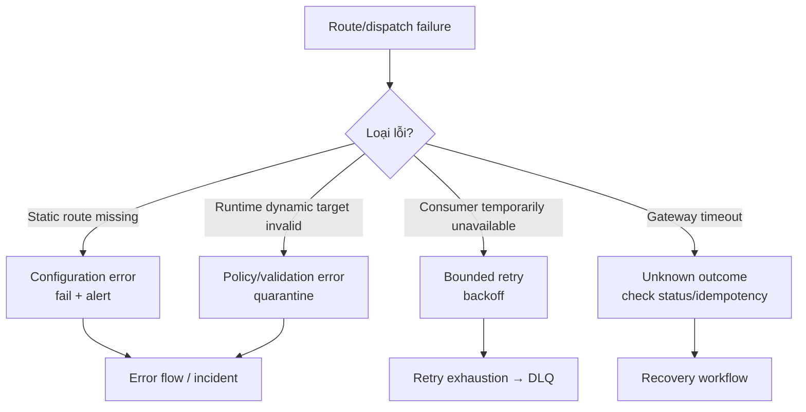

# Route không hợp lệ hoặc bước không tồn tại

## 1. Bối cảnh: một hành trình xử lý nằm trong message

Trong **Routing Slip** (phiếu lộ trình), message mang thông tin về các chặng tiếp theo cần đi qua. Thay vì buộc một chuỗi Router cố định quyết định mọi bước, ứng dụng có thể gắn **lộ trình** và để các endpoint có hỗ trợ Routing Slip lần lượt gửi reply đến channel tiếp theo.

Ví dụ một lệnh xử lý đơn hàng có hành trình:

```text
slip.validate → slip.enrich → slip.persist → replyChannel
```

Giả sử đội vận hành đổi tên bean `slip.persist` thành `slip.save` nhưng quên cập nhật lộ trình. Hoặc hệ thống sinh route từ dữ liệu bên ngoài với giá trị `slip.persits`. Sau khi các bước trước hoàn thành, framework cố tìm bước tiếp theo mà không có đích phù hợp. Đây là **lỗi cấu hình/định tuyến**, không phải tình huống “message đã xử lý xong”.

Bài **“Route không hợp lệ hoặc bước không tồn tại”** thuộc chương **Routing slip** của module **SPRING_INTEGRATION_PATTERN**. Mục tiêu module là triển khai Enterprise Integration Patterns với Spring Integration để xây dựng luồng ít phụ thuộc, dễ mở rộng; phối hợp Router, Filter, Transformer, Splitter, Aggregator, Gateway, retry, error channel và correlation, đồng thời kiểm thử và theo dõi các nhánh xử lý.

Sau bài này, bạn cần:

- Biết **khi nào Routing Slip được áp dụng** và vì sao một endpoint có `outputChannel` tường minh có thể không theo slip.
- Phân biệt **lộ trình hết hợp lệ**, **bước tùy chọn được bỏ qua**, **tên bước không hợp lệ**, **channel thiếu subscriber** và **handler có lỗi nghiệp vụ**.
- Kiểm tra các tên channel/strategy bằng allowlist và preflight, đồng thời kiểm soát kết quả route động lúc chạy.
- Chọn xử lý fail-fast, error flow, quarantine và retry có idempotency; không làm mất message trong im lặng.
- Tạo ví dụ Java, kiểm thử đường đi hợp lệ và tình huống bước không tồn tại.
- Bảo vệ routing slip khi đi qua HTTP, AMQP/JMS/Kafka hoặc persistent MessageStore.

## 2. Routing Slip vận hành trong Spring Integration

Spring Integration hiện thực Routing Slip bằng header `routingSlip`. Nó được tham chiếu trong quá trình chọn **output channel** của các endpoint thuộc nhóm `AbstractMessageProducingHandler`, **khi endpoint tạo reply và không có `outputChannel` được chỉ định**.

Nói cách khác, một bước trong slip không phải một câu lệnh chạy độc lập. Cần có:

1. Message đã mang header Routing Slip hợp lệ.
2. Message đến một endpoint có khả năng tạo reply.
3. Endpoint tạo reply và không ghi đè destination bằng `outputChannel` tường minh.
4. Framework resolve đích tiếp theo từ trạng thái lộ trình và chuyển reply đến channel đó.

Khi các mục trong lộ trình đã được dùng hết, Spring Integration quay về cách xử lý header `replyChannel` thông thường. **Hết lộ trình không có nghĩa tự phát một message ra network, tự ghi database hoặc tự coi nghiệp vụ hoàn tất**. Nếu `replyChannel` không tồn tại hoặc không có nơi nhận, cần đối chiếu hành vi cụ thể của endpoint, handler và nguồn gửi.



**Điểm đặc biệt:** Routing Slip điều phối **reply phát ra từ endpoint**. Nó không phải một worker tự động lấy message từ bất kỳ nơi nào, cũng không thay thế cơ chế lifecycle/retry của channel.

### Lộ trình được lưu và tiến lên thế nào?

Một Routing Slip do framework khởi tạo chứa danh sách `path` cùng chỉ số vị trí (thường được gọi là `routingSlipIndex` trong mô tả thuật toán). Các giá trị trong path có thể là:

- **Tên bean `MessageChannel`**: ví dụ `slip.enrich`.
- **Tên bean `RoutingSlipRouteStrategy`**: chiến lược trả về tên channel tiếp theo.
- **Biểu thức SpEL** được framework hỗ trợ trong cấu hình lộ trình.

Với một mục tên channel hợp lệ, framework chọn channel làm đích và tăng chỉ số. Với một strategy, framework gọi strategy để tìm đích; nếu nó trả tên channel không rỗng thì vẫn có thể tiếp tục dùng cùng mục strategy ở lượt xử lý sau. Nếu strategy trả `null` hoặc chuỗi rỗng, framework chuyển sang phần tử kế tiếp của slip.

Không được tự giả định rằng mọi lần gọi strategy sẽ tăng chỉ số hay rằng một string rỗng đồng nghĩa một channel bị lỗi. Hai tình huống đó có semantics khác nhau.

## 3. Phân biệt bốn trạng thái dễ nhầm

| Trạng thái | Ví dụ | Ý nghĩa | Hành động đúng |
| --- | --- | --- | --- |
| **Hết path hợp lệ** | Đã dùng xong `slip.enrich`, `slip.persist` | Routing Slip hoàn tất và đường reply thông thường tiếp tục | Trả reply nếu có hợp đồng request/reply; không coi là lỗi route |
| **Bước tùy chọn được bỏ qua** | Strategy chủ động trả `null`/rỗng | Đây là kết quả của **chiến lược**, được thiết kế để chuyển sang mục tiếp | Kiểm thử luật skip và lý do skip |
| **Bước không hợp lệ** | `slip.persits`, bean thiếu, bean sai kiểu | Không tìm được channel phù hợp, hoặc đánh giá route động thất bại | Báo lỗi, ghi context, chuyển recovery/failure flow theo chính sách |
| **Channel có nhưng xử lý không được** | `slip.persist` là `DirectChannel` nhưng không có subscriber | Tên bean hợp lệ nhưng dispatch không thành công | Kiểm tra endpoint consumer, lifecycle và exception/timeout |

Không nên xử lý lỗi “không thấy channel” bằng cách tự động bỏ mục đó và chuyển sang mục sau. Trong quy trình bắt buộc như *validate → reserve → charge*, bỏ qua bước vì lỗi cấu hình có thể dẫn tới kết quả nghiệp vụ không hợp lệ.

## 4. Bước không tồn tại có thể lỗi theo cách ít ngờ tới

Tài liệu Spring Integration mô tả rằng `RoutingSlipHeaderValueMessageProcessor` sẽ đối chiếu từng phần tử path với `BeanFactory` khi xử lý cấu hình ban đầu. **Những mục không trùng tên bean** có thể được diễn giải thành biểu thức và chuyển thành một `ExpressionEvaluatingRoutingSlipRouteStrategy`.

Ví dụ:

```text
Expected channel: slip.persist
Mistyped path:    slip.persits
```

Trong trường hợp này, không nên mặc định bạn sẽ luôn nhận một `NoSuchBeanDefinitionException` trực tiếp. Tùy cách mục path được chuyển đổi và đánh giá, lỗi có thể phát sinh ở bước phân tích/evaluate SpEL hoặc khi giải tên channel kết quả. Phiên bản framework, kiểu path và cách thiết lập BeanFactory đều ảnh hưởng đến ngoại lệ cụ thể.

**Kết luận:** hãy phân loại lỗi theo ý nghĩa *“route không phân giải được”* thay vì viết test hoặc monitoring phụ thuộc hoàn toàn vào một exception class duy nhất.

### Năm dạng lỗi cần phân biệt

| Loại | Ví dụ | Vị trí phát hiện |
| --- | --- | --- |
| Sai chính tả/bean không tồn tại | `slip.persits` | Preflight path, evaluate/resolution lúc runtime |
| Bean có tên nhưng không phải `MessageChannel` hoặc strategy hợp lệ | Bean service được đặt nhầm tên channel | Preflight kiểm tra loại bean |
| Strategy trả channel không tồn tại | `chooseNext() → slip.unknown` | Runtime ngay khi strategy trả kết quả |
| Channel tồn tại nhưng không có subscriber/consumer phù hợp | `DirectChannel` trống | Khi gửi tới channel, hoặc kiểm tra topology |
| Endpoint có `outputChannel` khác | Slip không được consult ở chặng dự kiến | Khi đọc topology, kiểm thử đường đi và message history |

Đặc biệt, **channel bean tồn tại chưa đủ để chứng minh bước có thể xử lý**. Một `QueueChannel` cũng có thể chấp nhận message dù chưa có polling consumer; lúc đó sender đã gửi nhưng công việc chưa được thực hiện.

## 5. Ví dụ lỗi với lộ trình xử lý đơn hàng

Hành trình hợp lệ:



Nếu tên channel ở chặng cuối sai:



Cần chú ý rằng **validate và enrich có thể đã tạo side effect** trước khi gặp lỗi chặng cuối. Nếu retry từ đầu, các bước đã hoàn thành có thể chạy lần nữa. Vì vậy failure handling phải biết **lỗi nằm ở chặng nào và chặng nào đã thực sự commit**.

Một log có ý nghĩa tối thiểu:

```text
event=routing_slip_failure
requestId=req-204
businessMessageId=order-204-attempt-1
slipVersion=order-v2
stepIndex=1
stepKey=slip.persits
failureKind=UNRESOLVED_TARGET
lastCompletedStep=slip.enrich
```

Các trường trên là **schema log đề xuất cho ứng dụng**, không khẳng định framework luôn tự sinh chúng. Cần xác nhận `lastCompletedStep` dựa trên bằng chứng nghiệp vụ, không chỉ dựa trên việc router cố gửi message.

## 6. Nguyên tắc thiết kế: từ khóa nghiệp vụ đến channel phải có allowlist

Đừng cho HTTP client hoặc nguồn không đáng tin tự gắn header `routingSlip` với nội dung tùy ý. Header này có thể quyết định đường thực thi trong ApplicationContext, và các mục path của Spring Integration còn có thể được giải thành SpEL/strategy.

Thiết kế an toàn hơn:

1. Nhận một **mã kế hoạch nghiệp vụ** đơn giản, ví dụ `STANDARD_ORDER` hoặc `MANUAL_REVIEW`, sau bước xác thực.
2. Tra một **RouteCatalog** thuộc phía server để lấy các channel được phép.
3. Kiểm tra **tất cả bước tĩnh**: tên bean tồn tại và có kiểu `MessageChannel`.
4. Với route động, strategy chỉ được trả tên thuộc allowlist channel có sẵn.
5. Gắn slip bằng code/processor do server quản lý; không copy nguyên header nội bộ từ request bên ngoài.
6. Đặt giới hạn số chặng, thời gian toàn hành trình và chính sách chống lặp.
7. Ghi phiên bản lộ trình cùng business correlation ID để phân tích hoặc replay.

Ví dụ một bảng allowlist:

| Route plan | Các channel được phép | Chính sách |
| --- | --- | --- |
| `STANDARD_ORDER` | `slip.enrich` → `slip.persist` | Bắt buộc cả hai bước |
| `MANUAL_REVIEW` | `slip.review` → `slip.persist` | Cần quyết định duyệt trước khi ghi |
| `ARCHIVE_ONLY` | `slip.archive` | Chỉ dùng với message được đánh dấu đúng loại |
| Mã khác/không được cấp phép | Không có | Từ chối sớm, không biến mã thành bean name |

**Không dùng** cấu trúc như `"slip." + request.header("nextStep")` khi giá trị `nextStep` chưa qua kiểm soát. Không tự động route sang `nullChannel` để che lỗi cấu hình nếu thông điệp bắt buộc phải được xử lý.

### Preflight không thể thay thế kiểm tra runtime

Preflight bảo vệ các path tĩnh. Nó **không** chứng minh:

- Strategy sẽ luôn trả channel hợp lệ ở mọi input.
- Subscriber/consumer luôn hoạt động.
- Queue còn capacity hoặc executor còn nhận task.
- Remote adapter không lỗi.
- Downstream sẽ xử lý nghiệp vụ và trả reply.

Vì vậy cần **hai lớp bảo vệ**: kiểm tra cấu hình lúc startup và xác minh đường đi/lỗi dispatch khi message thực sự chạy.

## 7. Java: kiểm tra channel tồn tại trước khi triển khai

Đoạn sau dùng `BeanFactory` để kiểm tra danh sách channel **cố định**. Việc phân giải theo kiểu `MessageChannel` ngăn route vô tình tham chiếu một bean service hoặc strategy không đúng mục đích.

```java
import java.util.Collection;

import org.springframework.beans.factory.BeanFactory;
import org.springframework.messaging.MessageChannel;

final class RoutingSlipPlanGuard {

    private RoutingSlipPlanGuard() {}

    static void requireChannels(
            BeanFactory beans,
            Collection<String> requiredChannelNames) {

        for (String channelName : requiredChannelNames) {
            if (channelName == null || channelName.isBlank()) {
                throw new IllegalArgumentException(
                    "Routing Slip contains an empty channel name");
            }

            if (!beans.containsBean(channelName)) {
                throw new IllegalStateException(
                    "Missing Routing Slip channel: " + channelName);
            }

            if (!beans.isTypeMatch(channelName, MessageChannel.class)) {
                throw new IllegalStateException(
                    "Routing Slip target is not MessageChannel: "
                        + channelName);
            }
        }
    }
}
```

Công cụ này **chỉ kiểm tra những bước được quy định là channel tĩnh**. Không gọi nó lên toàn bộ phần tử trong slip nếu có `RoutingSlipRouteStrategy`, vì một strategy bean hợp lệ không phải `MessageChannel`. Đối với strategy, hãy kiểm tra loại bean là `RoutingSlipRouteStrategy`, sau đó kiểm soát **giá trị channel mà strategy trả ra**.

Nếu ứng dụng có nhiều tenant, tên channel phải được quy định theo phạm vi quyền được phép. Một channel tồn tại trong BeanFactory chưa chắc là nơi recipient của tenant đó được phép nhận dữ liệu.

## 8. Ví dụ Java: một Routing Slip hợp lệ có startup validation

Cấu hình dưới đây cho thấy:

- Header Enricher gắn path tĩnh `slip.enrich → slip.persist`.
- Handler `slip.validate` nhận message sau bước enrich header và tạo reply.
- Hai handler tiếp theo **không cấu hình outputChannel**, nên khi chúng tạo reply, Spring Integration có cơ hội đọc Routing Slip để chuyển sang bước tiếp.
- Khi path hết, reply quay về `replyChannel` trên request, nếu được thiết lập.
- Một bước preflight kiểm tra hai đích trong slip ngay khi Spring khởi tạo singleton.

Ví dụ nhấn mạnh đường đi của message; không có database hay HTTP thật.

```java
import java.util.List;
import java.util.Map;

import org.springframework.beans.factory.BeanFactory;
import org.springframework.beans.factory.SmartInitializingSingleton;
import org.springframework.context.annotation.Bean;
import org.springframework.context.annotation.Configuration;
import org.springframework.integration.annotation.ServiceActivator;
import org.springframework.integration.annotation.Transformer;
import org.springframework.integration.channel.DirectChannel;
import org.springframework.integration.config.EnableIntegration;
import org.springframework.integration.transformer.HeaderEnricher;
import org.springframework.integration.transformer.support.RoutingSlipHeaderValueMessageProcessor;
import org.springframework.integration.IntegrationMessageHeaderAccessor;

@Configuration
@EnableIntegration
public class SafeRoutingSlipConfig {

    private static final List<String> PATH = List.of(
        "slip.enrich", "slip.persist");

    @Bean("slip.in")
    DirectChannel input() {
        return new DirectChannel();
    }

    @Bean("slip.validate")
    DirectChannel validateChannel() {
        return new DirectChannel();
    }

    @Bean("slip.enrich")
    DirectChannel enrichChannel() {
        return new DirectChannel();
    }

    @Bean("slip.persist")
    DirectChannel persistChannel() {
        return new DirectChannel();
    }

    @Bean
    @Transformer(
        inputChannel = "slip.in",
        outputChannel = "slip.validate")
    HeaderEnricher addRoutingSlip() {
        return new HeaderEnricher(Map.of(
            IntegrationMessageHeaderAccessor.ROUTING_SLIP,
            new RoutingSlipHeaderValueMessageProcessor(
                "slip.enrich", "slip.persist")
        ));
    }

    @ServiceActivator(inputChannel = "slip.validate")
    public String validate(String payload) {
        if (payload == null || payload.isBlank()) {
            throw new IllegalArgumentException("Empty order");
        }
        return payload.strip() + "|validated";
    }

    @ServiceActivator(inputChannel = "slip.enrich")
    public String enrich(String payload) {
        return payload + "|enriched";
    }

    @ServiceActivator(inputChannel = "slip.persist")
    public String persist(String payload) {
        // Production: chỉ đánh dấu đã persist sau khi commit thật.
        return payload + "|persisted";
    }

    @Bean
    SmartInitializingSingleton checkRoutingSlipTargets(
            BeanFactory beanFactory) {
        return () ->
            RoutingSlipPlanGuard.requireChannels(
                beanFactory, PATH);
    }
}
```

**Lưu ý khi tích hợp:** các import và API phải được đối chiếu theo phiên bản Spring Integration của dự án. Đoạn code mô tả mô hình **request/reply**: `HeaderEnricher` có output channel tường minh `slip.validate` (đích ban đầu), trong khi các service activator trả kết quả mà không khai báo output channel, nhờ đó lộ trình được áp dụng.

`RoutingSlipPlanGuard` là class trong mục 7, đặt cùng package với cấu hình. Framework xử lý việc chọn output channel dựa trên Routing Slip; ứng dụng không cần tự gọi API nội bộ để tăng chỉ số path.

### Vì sao không đưa `slip.validate` vào path?

`HeaderEnricher` đã gửi message đến `slip.validate` bằng `outputChannel` tường minh; Routing Slip sẽ được tham chiếu **sau khi handler validate tạo reply**. Nếu vừa dùng output tường minh vừa đặt validate làm phần tử đầu tiên của slip, bạn có thể khiến hệ thống thực thi validate lần nữa hoặc tạo hành trình sai. Mọi path cần được thiết kế theo đúng điểm mà framework bắt đầu consult slip.

### Khi nào nhận được reply cuối?

Khi `slip.persist` trả reply, path đã hết và Spring Integration xử lý `replyChannel` thông thường. Nếu caller không cấu hình reply channel, hoặc một handler trong tuyến không trả reply, kết quả không thể được giả định là tự quay về nơi gửi. Một Gateway có thể dùng reply channel của nó theo hợp đồng request/reply; nếu yêu cầu HTTP đang chờ, phải đặt deadline phù hợp.

## 9. Java/JUnit: kiểm thử đường đi thành công

Ví dụ với JUnit 5 + AssertJ; caller tự cung cấp một `QueueChannel` làm reply channel để quan sát kết quả cuối.

```java
import static org.assertj.core.api.Assertions.assertThat;

import org.junit.jupiter.api.Test;
import org.springframework.beans.factory.annotation.Autowired;
import org.springframework.beans.factory.annotation.Qualifier;
import org.springframework.integration.channel.QueueChannel;
import org.springframework.messaging.Message;
import org.springframework.messaging.MessageChannel;
import org.springframework.messaging.MessageHeaders;
import org.springframework.messaging.support.MessageBuilder;
import org.springframework.test.context.junit.jupiter.SpringJUnitConfig;

@SpringJUnitConfig(SafeRoutingSlipConfig.class)
class SafeRoutingSlipFlowTest {

    @Autowired
    @Qualifier("slip.in")
    MessageChannel input;

    @Test
    void completesEveryStepAndRepliesToCaller() {
        QueueChannel replies = new QueueChannel();

        Message<String> request = MessageBuilder
            .withPayload(" order-42 ")
            .setHeader(MessageHeaders.REPLY_CHANNEL, replies)
            .setHeader("businessCorrelationId", "req-42")
            .build();

        assertThat(input.send(request)).isTrue();

        Message<?> response = replies.receive(1_000);
        assertThat(response).isNotNull();
        assertThat(response.getPayload()).isEqualTo(
            "order-42|validated|enriched|persisted");
        assertThat(response.getHeaders().get(
            "businessCorrelationId")).isEqualTo("req-42");

        assertThat(replies.receive(0)).isNull();
    }
}
```

Kiểm thử này xác nhận ba handler **trả reply theo tuyến hợp lệ**. Nó chưa kiểm tra một giao dịch persist thật, không thể bảo đảm exactly-once và chưa xác minh hành vi khi lỗi mạng. Với các loại channel bất đồng bộ, thời gian nhận sẽ phụ thuộc worker, timeout và retry; test cần được điều chỉnh.

## 10. Java/JUnit: phát hiện bước thiếu ở preflight

Lợi ích của `RoutingSlipPlanGuard` là ngăn một cấu hình sai được đưa vào sử dụng. Có thể kiểm thử thuần túy với một `BeanFactory` giả lập, không cần khởi tạo toàn bộ IntegrationFlow.

```java
import static org.assertj.core.api.Assertions.assertThatThrownBy;

import java.util.List;

import org.junit.jupiter.api.Test;
import org.springframework.beans.factory.support.StaticListableBeanFactory;
import org.springframework.integration.channel.DirectChannel;

class RoutingSlipPlanGuardTest {

    @Test
    void rejectsMissingChannel() {
        StaticListableBeanFactory beans =
            new StaticListableBeanFactory();
        beans.addBean("slip.enrich", new DirectChannel());

        assertThatThrownBy(() ->
            RoutingSlipPlanGuard.requireChannels(
                beans,
                List.of("slip.enrich", "slip.persits")))
            .isInstanceOf(IllegalStateException.class)
            .hasMessageContaining("slip.persits");
    }

    @Test
    void rejectsBeanOfWrongType() {
        StaticListableBeanFactory beans =
            new StaticListableBeanFactory();
        beans.addBean("slip.enrich", "not a MessageChannel");

        assertThatThrownBy(() ->
            RoutingSlipPlanGuard.requireChannels(
                beans, List.of("slip.enrich")))
            .isInstanceOf(IllegalStateException.class)
            .hasMessageContaining("not MessageChannel");
    }
}
```

**Tại sao test này đáng có?** Nếu cấu hình yêu cầu `slip.persist` nhưng ứng dụng chỉ đăng ký `slip.save`, khởi động sẽ thất bại với thông tin lỗi do ứng dụng kiểm soát. Bạn không phải chờ message đầu tiên chạy đến chặng cuối và gặp lỗi kiểu SpEL hoặc bean resolution.

Nhưng test này chỉ bảo vệ **danh sách channel tĩnh đã truyền vào validator**. Nếu một strategy có thể trả chuỗi `slip.persits` vào runtime, validator trên không nhìn thấy trước kết quả đó. Cần thêm kiểm soát đầu ra strategy và kiểm thử các nhánh trả về.

### Kiểm thử lỗi thật của framework

Nếu muốn kiểm tra behavior của Routing Slip với path sai trong IntegrationFlow:

1. Tạo một cấu hình test riêng có route sai nhưng **không bật preflight guard** (để thử đường lỗi framework).
2. Gửi message qua input channel trong mô hình đồng bộ.
3. Xác nhận caller nhận một lỗi dispatch/evaluation phù hợp, **không** nhận success reply.
4. Kiểm tra `failedMessage`, `requestId`, stage đang xử lý và destination đã thử nếu có.
5. Không cố khóa test vào đúng một exception class hoặc message text giữa các phiên bản.

Với flow bất đồng bộ, lỗi có thể đến error channel hoặc error handler của poller/executor; lúc đó cần test nhận ErrorMessage từ cơ chế đã cấu hình thay vì chờ exception trực tiếp ở thread gửi.

## 11. Route động: chỉ bỏ qua bước khi policy chủ động quyết định

Một `RoutingSlipRouteStrategy` có thể dựa trên request và reply để quyết định channel tiếp theo. Đây là khả năng mạnh khi route thay đổi theo kết quả của từng chặng.

Ví dụ nghiệp vụ:

- Nếu kiểm tra rủi ro yêu cầu xem xét thủ công, đi qua `slip.review`.
- Nếu đã được phê duyệt, không cần đi qua review và chuyển tới `slip.persist`.
- Nếu chiến lược không còn channel nào ở mục hiện tại, nó chủ động trả `null` hoặc chuỗi rỗng để đi tới path item kế tiếp theo hợp đồng Routing Slip.

**Đừng dùng `null` để che giấu tên channel sai.** Nếu strategy quyết định phải gọi `slip.review` nhưng bean `slip.review` không tồn tại, đó là lỗi cấu hình hoặc triển khai, không phải “không cần review”.

Có thể tổ chức policy độc lập với framework:

```java
import java.util.Set;

final class SafeSlipDestinationPolicy {

    private static final Set<String> ALLOWED =
        Set.of("slip.review", "slip.persist");

    static String requireAllowedChannel(String chosen) {
        if (chosen == null || chosen.isBlank()) {
            throw new IllegalArgumentException(
                "Required next channel is missing");
        }

        if (!ALLOWED.contains(chosen)) {
            throw new IllegalArgumentException(
                "Unapproved Routing Slip channel: " + chosen);
        }

        return chosen;
    }
}
```

Khi dùng strategy thực tế, gọi phương thức này **trước khi trả tên đích bắt buộc**. Nếu policy đã quyết định **chặng tùy chọn không áp dụng**, đó là nhánh khác và có thể chủ động trả rỗng theo semantics của Routing Slip. Nên viết unit test cho cả trường hợp skip có chủ đích và trường hợp phải báo lỗi.

### Lưu ý tránh vòng lặp

Theo thuật toán Routing Slip, một strategy trả tên channel không rỗng có thể được hỏi lại mà **chưa tăng chỉ số path**. Nếu strategy luôn trả về cùng channel và không có tiến triển trạng thái, message có thể lặp giữa các bước.

Cần:

- Định nghĩa rõ điều kiện thoát ở mỗi strategy.
- Giới hạn số chặng và thời gian xử lý end-to-end ở tầng ứng dụng.
- Theo dõi `requestId`, tên bước và số lần đến bước, không chỉ số lượng message đầu vào.
- Đảm bảo những thao tác có side effect là idempotent hoặc có kiểm soát state/retry.

## 12. Chọn phản ứng với một route lỗi

Khi một chặng **bắt buộc** không tồn tại, cách an toàn thường là **fail closed**: không bỏ qua bước, không gửi tới một destination tùy ý và không đánh dấu thành công.

| Chính sách | Ý nghĩa | Phù hợp | Rủi ro cần kiểm soát |
| --- | --- | --- | --- |
| **Fail fast** | Ném lỗi khi validate/resolve không thành công | Sai cấu hình, lỗi bảo mật hoặc thiếu bước bắt buộc | Caller phải xử lý exception và giữ context |
| **Quarantine/failure channel** | Đưa message và nguyên nhân vào hàng chờ xử lý lỗi | Cần sửa cấu hình hoặc can thiệp vận hành | Phải lưu bền vững nếu message quan trọng |
| **Retry có giới hạn** | Thử lại sau backoff khi lỗi tạm thời | Kênh/consumer có sẵn nhưng đang quá tải hoặc đích ngoài không sẵn sàng | Không giúp sửa typo hoặc bean không tồn tại |
| **Fallback có kiểm soát** | Chuyển sang đường dự phòng được phê duyệt | Hợp đồng nghiệp vụ cho phép bỏ qua/thay đích | Không được bypass validation/authentication/transaction bắt buộc |
| **Manual intervention** | Dừng ở trạng thái `NEEDS_REPAIR` hoặc `MANUAL_REVIEW` | Route không thể khôi phục tự động | Cần owner, SLA, replay và audit trail |

**Một route sai chính tả không thể được sửa bằng retry giống hệt message hàng nghìn lần.** Nếu bean chưa được triển khai, lỗi chỉ được khắc phục khi cấu hình/topology thay đổi. Trường hợp này nên alert rõ và đưa message vào vùng sửa lỗi, thay vì chiếm thread và gây retry storm.

## 13. Error channel, timeout và reply của Gateway

Phân biệt ba luồng lỗi:

**1. Lỗi đồng bộ.** Với `DirectChannel`, nếu handler hoặc bước resolve channel ném exception trong thread gửi, caller có thể quan sát exception. Cần xử lý ở ingress/Gateway hoặc catch tại ranh giới thích hợp. Đừng giả định một exception như vậy luôn tự động đi vào global `errorChannel`.

**2. Lỗi bất đồng bộ.** Với `ExecutorChannel`, `QueueChannel` có poller hoặc broker consumer, lỗi xuất hiện ở thread/endpoint khác. Cần cấu hình error handling để nhận `ErrorMessage`, giữ `failedMessage` nếu có, đưa vào failure flow hoặc retry đúng phạm vi.

**3. Timeout request/reply.** Gateway có thể hết thời gian chờ reply trong khi một chặng vẫn đang xử lý, hoặc một route lỗi không trả response. Timeout phía caller **không tự rollback** side effect downstream. Nếu có retry từ đầu, cần idempotency để không lặp thao tác đã thành công.



Đối với những nhánh chịu trách nhiệm tài chính hoặc dữ liệu bắt buộc, một error handler chỉ log lỗi rồi bỏ message là không đủ. Nên lưu trạng thái thất bại hoặc phát thông báo lỗi nghiệp vụ có correlation rõ ràng.

## 14. Vẫn phải xử lý trùng khi một chặng đã chạy xong

Giả sử chuỗi:

```text
validate → reserveInventory → chargePayment → persistOrder
```

Nếu `persistOrder` không tồn tại, các bước reserve và charge có thể đã hoàn thành. Nếu sửa cấu hình rồi gửi lại toàn bộ message, hệ thống có nguy cơ giữ hàng hai lần hoặc thanh toán hai lần.

Gợi ý theo dõi một **workflow state** độc lập với routing slip:

| Trường | Ví dụ | Ý nghĩa |
| --- | --- | --- |
| `businessMessageId` | `order-204-attempt-1` | Định danh hành trình |
| `slipVersion` | `order-v2` | Phiên bản route |
| `lastCommittedStep` | `chargePayment` | Bước cuối đã hoàn tất theo bằng chứng nghiệp vụ |
| `failedStep` | `persistOrder` | Bước không hoàn thành |
| `state` | `NEEDS_REPAIR` | Không trả thành công |
| `idempotencyKey` | `order-204:chargePayment` | Khóa chống lặp side effect |
| `retryAttempt` | `2` | Số lần thử phục hồi |

Đây là **schema đề xuất ở tầng ứng dụng**, không phải các header framework bắt buộc phải có. Khi có nhiều process tham gia, state và việc commit side effect phải được quản lý với transaction/outbox/broker hoặc quy trình phục hồi phù hợp.

**Đừng dựa vào routingSlipIndex như bằng chứng commit.** Chỉ số này mô tả cách định tuyến reply; nó không xác nhận database đã commit hoặc API downstream đã thực hiện thành công.

Nếu cần tiếp tục từ bước lỗi, phải có hợp đồng **resume/replay** có kiểm soát; không tự ý sửa header index trên một message từ bên ngoài rồi gửi vào arbitrary channel.

## 15. Đi qua broker hoặc persistent MessageStore: chú ý serialization

Routing Slip có thể mang các mục expression/strategy. Spring Integration cảnh báo khi dùng **inline SpEL expression** trong Routing Slip qua các ranh giới như:

- Chuyển message qua JVM khác.
- Request/reply đi qua AMQP/JMS.
- Lưu message trong persistent MessageStore.

Lý do là expression inline có thể được `RoutingSlipHeaderValueMessageProcessor` chuyển thành đối tượng `ExpressionEvaluatingRoutingSlipRouteStrategy` trong header. Đối tượng này phụ thuộc `BeanFactory` và **không serializable**, nên message có thể gặp lỗi `NotSerializableException` khi qua ranh giới lưu trữ hoặc truyền tải.

Cách giảm rủi ro:

1. Với route tĩnh, ưu tiên path gồm **tên bean channel/strategy** có kiểm soát.
2. Nếu cần SpEL route strategy, có thể đăng ký `ExpressionEvaluatingRoutingSlipRouteStrategy` thành **bean có tên** rồi tham chiếu tên đó trong slip, thay vì nhúng expression trực tiếp trong path.
3. Kiểm tra cách adapter/header mapper vận chuyển header Routing Slip qua mạng; có transport không giữ nguyên object Java trong header.
4. Nếu nhiều dịch vụ không chia sẻ cùng BeanFactory/topology, cân nhắc truyền **route plan ID** hoặc danh sách bước nghiệp vụ theo schema chung, rồi xây lại routing slip cục bộ ở mỗi service.
5. Kiểm thử round-trip serialization, restart và message replay trên stack thật.

Một bean name có thể hợp lệ ở service A nhưng không tồn tại ở service B. **Tên channel chỉ có nghĩa trong ApplicationContext nơi nó được resolve**. Không coi Routing Slip chứa bean name là giao thức liên dịch vụ ổn định nếu chưa định nghĩa ranh giới và cách ánh xạ.

## 16. Security: không thực thi lộ trình do client tự nhập

Rủi ro đặc thù của Routing Slip là header có thể ảnh hưởng trực tiếp tới quá trình định tuyến và biểu thức có quyền truy cập các bean/hàm trong evaluation context. Vì vậy:

- Không nhận nguyên `routingSlip` từ HTTP header hoặc payload chưa được xác thực và đưa thẳng vào message nội bộ.
- Xóa hoặc bỏ qua các header routing nội bộ khi nhận từ bên ngoài, chỉ tạo lại bằng policy trusted phía server.
- Tách **mã nghiệp vụ** (ví dụ `ORDER_STANDARD`) khỏi **tên channel nội bộ** (ví dụ `slip.persist`).
- Dùng allowlist và kiểm tra quyền theo tenant; không để client chọn channel vượt phạm vi truy cập.
- Hạn chế cho nhập SpEL tùy ý; không cung cấp một evaluation context mở cho cấu hình không đáng tin cậy.
- Ghi event bị từ chối với mã nguyên nhân và trace/correlation phù hợp; tránh log secret hoặc payload nhạy cảm.
- Khi có route động, giới hạn số chặng và chống vòng lặp để bảo vệ thread pool/tài nguyên.

Nếu cần workflow tùy biến bởi người dùng, xây dựng **ngôn ngữ cấu hình hữu hạn có schema và validator**, thay vì cho phép nhập tên bean hoặc biểu thức Spring trực tiếp.

## 17. Quan sát và khoanh vùng sự cố

### Metric nên có

Đề xuất nhóm metric:

- `routing_slip.incoming.total`: số message đi vào hành trình.
- `routing_slip.invalid_path.total{reason}`: số lần path bị từ chối khi validate.
- `routing_slip.step.resolve.failed.total{stepKey}`: số lỗi chọn đích; chú ý cardinality.
- `routing_slip.step.dispatch.failed.total{stage}`: số lỗi dispatch tới channel.
- `routing_slip.workflow.timeout.total`: số workflow hết deadline.
- `routing_slip.workflow.completed.total{routePlan}`: số workflow trả kết quả thành công.
- `routing_slip.workflow.quarantined.total`: số workflow cần can thiệp.

Đây là **tên metric đề xuất cho ứng dụng**, không có nghĩa Spring Integration luôn tạo sẵn như vậy. Đối với label, không dùng giá trị step tùy ý do client cung cấp; chỉ cho phép mã stage thuộc tập nhỏ, hoặc chuẩn hóa thành `UNKNOWN` để tránh cardinality vô hạn.

### Bảng lỗi thường gặp

| Triệu chứng | Khả năng | Việc cần làm |
| --- | --- | --- |
| Gửi message nhưng không chạy bước kế tiếp | Endpoint không tạo reply, có `outputChannel` tường minh hoặc thiếu slip | Kiểm tra handler, header và topology trước/sau bước |
| Exception khi đi tới tên channel | Bean không tồn tại, sai kiểu, expression/strategy trả sai tên | Validate path và runtime result; log route key và stage |
| Có channel nhưng không thấy xử lý | `DirectChannel` thiếu subscriber, `QueueChannel` không có poller | Xem registration, lifecycle và queue depth |
| Gateway chờ tới timeout | Lỗi chặng cuối không trả reply, worker chậm hoặc mất correlation/replyChannel | Quan sát error flow, replyChannel, deadline và tracking theo request |
| Một chặng chạy lặp nhiều lần | Strategy không tiến triển index hoặc replay không idempotent | Đo số lần đến bước, kiểm soát điều kiện thoát và chống trùng |
| Message bị mất sau restart | Channel/store không bền vững | Đánh giá persistent store/broker, replay và ack |
| Chỉ lỗi khi gửi qua broker/JMS | Header có inline expression không serializable hoặc bị mapper bỏ | Dùng strategy bean name / route plan ID; test serialization |
| Message đi sai nhánh theo tenant | Tin giá trị path/header bên ngoài | Bảo vệ ingress, identity, allowlist và policy |
| Error channel không có lỗi dù client nhận exception | Lỗi xảy ra đồng bộ trên thread caller | Bắt/ánh xạ lỗi tại ingress hoặc cấu hình flow xử lý đúng context |

### Quy trình điều tra nhanh

1. Từ `requestId` tìm input message và route plan/version gốc.
2. Xác nhận header Routing Slip thực sự đã được gắn, cùng bước hiện hành nếu có.
3. Kiểm tra endpoint tạo reply và **có `outputChannel` tường minh không**.
4. Resolve tên channel/strategy theo BeanFactory của instance đang chạy.
5. Phân biệt channel thiếu với channel có nhưng thiếu consumer hoặc bị quá tải.
6. Tìm lỗi tại thread gửi, poller, executor hoặc transport adapter đúng chỗ.
7. Kiểm tra chặng nào đã commit trước khi quyết định retry/replay.

## 18. Checklist triển khai

- [ ] Mọi route plan có tên, version và nghiệp vụ sở hữu.
- [ ] Những bước tĩnh bắt buộc đã được kiểm tra tên/kiểu bean trước khi phục vụ traffic.
- [ ] Kết quả dynamic strategy được giới hạn vào allowlist đích hợp lệ.
- [ ] Mọi stage được thiết kế để tạo reply nếu cần cho Routing Slip.
- [ ] Không gắn `outputChannel` tường minh vào endpoint mà muốn nó đi theo slip.
- [ ] Hết path hợp lệ được phân biệt với channel không tồn tại.
- [ ] Những bước tùy chọn có semantics skip riêng, không lạm dụng `null` che lỗi.
- [ ] Error handler biết requestId, route plan, stage lỗi và nguyên nhân.
- [ ] Gateway timeout, retry và backoff phù hợp với deadline end-to-end.
- [ ] Side effect có idempotency và policy resume/replay rõ.
- [ ] Không tin header Routing Slip do client tự cung cấp.
- [ ] Đã kiểm tra serialization/header mapping khi vượt ranh giới JVM/broker.
- [ ] Có test đường đi đúng, path sai, thiếu subscriber, xử lý lỗi và timeout.
- [ ] Có dashboard/cảnh báo khi số lượng invalid route tăng hoặc backlog không giảm.

## 19. Bài thực hành

### Bài 1 — Chẩn đoán một bước bị đổi tên

Cho cấu hình Routing Slip `slip.enrich → slip.persist` nhưng sau refactor ứng dụng chỉ còn `slip.enrich` và `slip.save`. Hãy:

1. Dùng `RoutingSlipPlanGuard` để phát hiện lỗi.
2. Ghi một test chứng minh ứng dụng từ chối route không hợp lệ.
3. Giải thích vì sao retry message không sửa được typo.
4. Nêu cách triển khai đổi tên channel có kiểm soát mà không làm lỗi message đang xử lý.

### Bài 2 — Phân biệt kết thúc và lỗi

Xây dựng hai kịch bản:

- Một Routing Slip kết thúc sau `slip.persist` và trả về `replyChannel` hợp lệ.
- Một Routing Slip cố đi tới `slip.unknown`.

Dùng assertion xác minh kịch bản đầu có reply còn kịch bản sau được ghi nhận là lỗi; **không** được đối xử như một kết thúc hợp lệ.

### Bài 3 — Bước tùy chọn với strategy

Thiết kế một strategy chọn bước `slip.review` khi risk score vượt ngưỡng; nếu không cần review thì strategy chuyển sang phần tử tiếp. Viết test cho ba tình huống: cần review, bỏ qua review có chủ đích, cần review nhưng channel không tồn tại. Trường hợp thứ ba phải thất bại chứ không chuyển sang `slip.persist` như thể review không cần thiết.

### Bài 4 — Lỗi sau side effect

Một workflow đã reserve tồn kho và gọi thanh toán thành công, nhưng không tìm thấy channel `slip.persist`. Thiết kế một recovery record với `lastCommittedStep`, `failedStep`, `idempotencyKey` và trạng thái. Đề xuất hai cách phục hồi: tiếp tục từ bước thiếu sau khi sửa cấu hình, hoặc rollback/compensation nếu không thể hoàn tất.

### Bài 5 — Route đi qua broker

Một flow dùng inline SpEL trong header Routing Slip và lưu message vào persistent MessageStore. Phân tích nguy cơ serialization; sửa thiết kế bằng strategy bean name hoặc route plan ID. Viết test round-trip qua transport thực tế, quan sát header mapping và xử lý tình huống bean name hợp lệ ở service A nhưng không tồn tại ở service B.

### Bài 6 — Review bảo mật

Đầu vào HTTP cho phép truyền `X-Next-Channel`. Hãy chứng minh rủi ro của việc dùng `"slip." + header` làm route; thay bằng một policy ánh xạ enum lộ trình được phép. Viết test với giá trị không nằm trong allowlist và tenant không có quyền dùng một route nhạy cảm.

**Tiêu chí hoàn thành:** người học phải chỉ ra được **nơi route thất bại**, **cách phát hiện trước và khi chạy**, **nguyên tắc không bỏ qua bước bắt buộc**, **cách giữ thông tin lỗi và tránh side effect trùng**.

## 20. Tổng kết

Khi triển khai Routing Slip trong Spring Integration, **“không còn bước tiếp theo”** và **“bước tiếp theo không tồn tại”** là hai tình huống hoàn toàn khác nhau. Path kết thúc hợp lệ cho phép cơ chế `replyChannel` thông thường tiếp tục; một route sai hoặc channel thiếu phải được coi là lỗi điều phối nếu bước đó là bắt buộc.

Thiết kế tốt bắt đầu từ route catalog tin cậy, kiểm tra các channel tĩnh khi khởi động, giới hạn output của dynamic strategy, phân biệt lỗi dispatch với lỗi nghiệp vụ, và có error flow cùng idempotency phù hợp. Khi message đi qua nhiều process, cần chú ý header serialization và tính cục bộ của bean names.

**Không tự động bỏ qua một bước chỉ vì không resolve được tên.** Chính sách bỏ qua chỉ hợp lệ khi đó là quyết định nghiệp vụ được định nghĩa và kiểm thử rõ.

## Tài liệu tham khảo

- [Spring Integration Reference — Routing Slip](https://docs.spring.io/spring-integration/reference/router/routing-slip.html)
- [Spring Integration Reference — Message Routing](https://docs.spring.io/spring-integration/reference/router.html)
- [Spring Integration API — RoutingSlipHeaderValueMessageProcessor](https://docs.spring.io/spring-integration/api/org/springframework/integration/transformer/support/RoutingSlipHeaderValueMessageProcessor.html)
- [Spring Integration API — RoutingSlipRouteStrategy](https://docs.spring.io/spring-integration/api/org/springframework/integration/routingslip/RoutingSlipRouteStrategy.html)
- [Spring Integration Reference — Message Channels](https://docs.spring.io/spring-integration/reference/channel.html)
- [Spring Integration Reference — Error Handling](https://docs.spring.io/spring-integration/reference/error-handling.html)
- [Spring Integration Reference — Java DSL](https://docs.spring.io/spring-integration/reference/dsl.html)
- [Enterprise Integration Patterns — Routing Slip](https://www.enterpriseintegrationpatterns.com/patterns/messaging/RoutingTable.html)

Các ví dụ dùng Java 17+, Spring Integration và JUnit 5 để trình bày hành vi. Trước khi dùng trong production, cần đối chiếu phiên bản framework, API của endpoint, cách cấu hình error flow và chính sách delivery của adapter thật.
