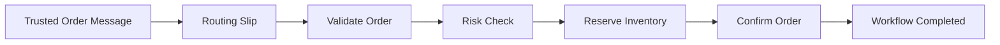
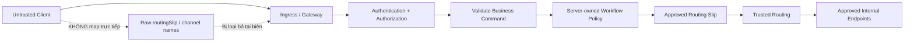
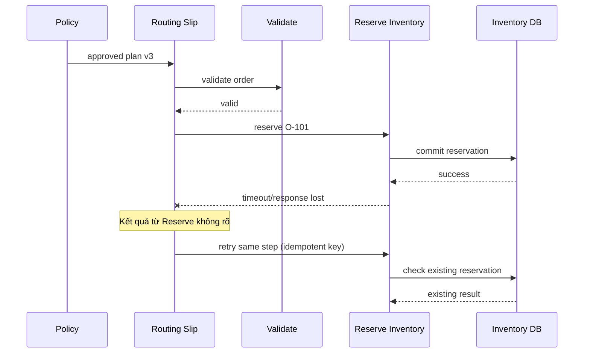
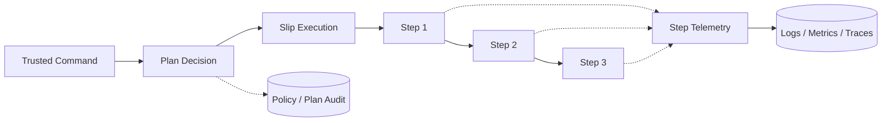
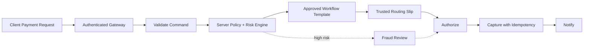

# Tránh để client kiểm soát route tùy ý

**Routing Slip** là một Enterprise Integration Pattern (EIP) cho phép message mang theo **lộ trình xử lý tuần tự**: sau khi qua một bước, message được chuyển đến bước kế tiếp theo thông tin định tuyến. Với **Spring Integration**, cách tổ chức này hữu ích khi quy trình có nhiều endpoint như Filter, Transformer, Service Activator, Gateway hoặc Router mà thứ tự bước có thể thay đổi theo loại nghiệp vụ.

Tính linh hoạt ấy cũng tạo ra một rủi ro bảo mật đặc biệt: **nếu client bên ngoài có thể tự chọn channel, tên bean hoặc biểu thức dùng trong routing slip, client có thể tác động trực tiếp tới luồng xử lý nội bộ**. Một yêu cầu độc hại có thể cố bỏ qua kiểm tra, gọi bước có side effect trước khi được phép, lặp bước để gây quá tải hoặc chuyển dữ liệu tới nhánh không dành cho nó.

Bài học thuộc chương **Routing slip** của module **SPRING_INTEGRATION_PATTERN**, với mục tiêu triển khai Enterprise Integration Patterns bằng Spring Integration theo cách ít phụ thuộc, dễ mở rộng, có kiểm thử, retry, error channel và correlation rõ ràng. Trọng tâm của bài là biến Routing Slip thành công cụ điều phối **do server kiểm soát**, thay vì trao cho client quyền lập trình một workflow tùy ý.

Sau bài học, bạn sẽ biết cách xác định ranh giới tin cậy, thiết kế hợp đồng API an toàn, chọn lộ trình từ policy do server sở hữu, phòng chống sửa header, giới hạn số bước, xử lý replay và kiểm thử các tình huống route injection.

## 1. Routing Slip hoạt động như thế nào?

Một routing slip biểu diễn danh sách những **điểm xử lý kế tiếp** mà message cần đi qua, chẳng hạn:

```text
validate.order -> check.risk -> reserve.inventory -> confirm.order
```

Khác với router chỉ chọn một channel tại một thời điểm dựa trên điều kiện, Routing Slip gắn một lộ trình vào message để các bước tiếp theo biết đường cần đi. Trong quá trình thực thi, framework hoặc thành phần định tuyến được cấu hình sẽ xác định **điểm dừng kế tiếp** và theo dõi tiến độ qua danh sách.



Ví dụ, hai lộ trình hợp lệ có thể là:

| Loại công việc được server chấp thuận | Lộ trình |
| --- | --- |
| Đơn thông thường | Validate → Reserve → Confirm |
| Đơn cần kiểm tra rủi ro | Validate → Risk Check → Reserve → Confirm |

Trong một lộ trình như vậy:

- **Thứ tự bước có ý nghĩa nghiệp vụ**: không được xác nhận đơn trước khi xử lý điều kiện giữ hàng nếu hợp đồng yêu cầu.
- **Mỗi bước có tiền điều kiện riêng**: `reserve.inventory` không nên xử lý một yêu cầu chưa được validate.
- **Message và metadata phải còn hợp lệ** khi đi từ endpoint này sang endpoint khác.
- **Lỗi tại một bước phải có kết quả rõ ràng**: retry, dừng quy trình, bồi hoàn, chuyển chờ xử lý hoặc yêu cầu can thiệp.
- **Bước cuối chỉ là điểm kết thúc lộ trình**, chưa chắc là mọi side effect bên ngoài đã được xác nhận nếu các bước được thiết kế bất đồng bộ.

Trong Spring Integration, routing slip được hỗ trợ bằng cơ chế header/enrichment và routing tương ứng. Những giá trị channel hoặc strategy bên trong routing slip phải được coi là **quyền điều hướng nội bộ**, không phải dữ liệu client được tự do quyết định.

## 2. Ranh giới tin cậy: client cung cấp ý định, server quyết định lộ trình

Giả sử API nhận một yêu cầu đặt hàng. Một client hợp lệ có thể gửi:

```json
{
  "requestId": "req-1001",
  "orderId": "ORD-101",
  "deliveryType": "STANDARD"
}
```

API cần hiểu **ý định nghiệp vụ**: khách muốn đặt đơn nào và chọn hình thức giao hàng gì. Server chịu trách nhiệm xác thực khách, kiểm tra quyền và xác định workflow phù hợp.

Một thiết kế nguy hiểm cho phép client gửi thêm:

```json
{
  "requestId": "req-1001",
  "orderId": "ORD-101",
  "routingSlip": [
    "confirm.order",
    "reserve.inventory",
    "internal.export"
  ]
}
```

Nếu backend lấy nguyên danh sách này rồi gán vào routing slip, client đang quyết định **bước nào chạy, thứ tự nào và thậm chí có thể truy cập endpoint nội bộ nào**. Tên `internal.export` ở đây chỉ minh họa một đích nội bộ mà client không được phép chỉ định.

**Nguyên tắc thiết kế:** Client được yêu cầu *một hoạt động nghiệp vụ*; client **không được tự chọn các endpoint nội bộ để thi hành hoạt động ấy**.



### Quyền tin cậy cần chia thành ba tầng

1. **Tầng client:** Dữ liệu không tin cậy cho đến khi được xác thực, kiểm tra định dạng và kiểm tra quyền. Ngay cả client đăng nhập hợp lệ cũng không nên có quyền đặt tùy ý tên channel.
2. **Tầng quyết định workflow:** Policy do server kiểm soát chuyển ý định hợp lệ thành một **lộ trình được phép**. Policy có thể dựa trên role/tenant/risk score, nhưng những dữ liệu ấy phải có nguồn tin cậy và phạm vi được kiểm chứng.
3. **Tầng thực thi:** Các endpoint chỉ nhận message theo contract của mình, thực hiện kiểm tra bất biến cần thiết và ghi nhận kết quả; không mặc định message là an toàn chỉ vì có routing slip.

Một workflow an toàn không dựa vào một lần validation ở gateway rồi tin mọi bước phía sau. Quyền truy cập và điều kiện side effect quan trọng vẫn cần được kiểm soát tại endpoint thực thi.

## 3. Những kiểu route injection và rủi ro thường gặp

| Kiểu dữ liệu đầu vào nguy hiểm | Client cố làm gì? | Hậu quả nếu tin nguyên giá trị | Cách phòng vệ |
| --- | --- | --- | --- |
| Danh sách channel tùy ý | Chọn `internal.admin` thay cho bước thông thường | Gọi chức năng ngoài phạm vi quyền | Chỉ dùng template/path do server khai báo |
| Đổi thứ tự bước | `confirm` trước `validate` | Bỏ qua tiền điều kiện nghiệp vụ | Kiểm tra thứ tự và quan hệ phụ thuộc |
| Bỏ bước bắt buộc | Không chạy `fraud.check` | Xử lý lệnh chưa được thẩm định | Bước bắt buộc được chốt trong policy |
| Lặp bước có side effect | `charge` → `charge` | Trừ tiền hoặc giữ hàng nhiều lần | Không cho path tùy ý; idempotency tại handler |
| Vòng lặp hoặc path quá dài | Route lặp A → B → A liên tục | Tốn CPU, queue, thread; DoS | Giới hạn hops/length; cấm chu trình không chủ đích |
| Tên bean hoặc biểu thức động | Chọn route qua bean/SpEL không được phép | Gọi nhầm thành phần hoặc lộ thông tin | Không đánh giá chuỗi/biểu thức do client cấp |
| Header định tuyến giả | Gửi `routingSlip` qua HTTP/JMS/Kafka headers | Bypass bước tạo lộ trình tin cậy | Không map header điều khiển từ inbound không tin cậy |
| Tenant ID giả | Chỉ định tenant của người khác | Xử lý chéo tenant | Tenant từ principal/claims đã xác minh |
| Reply/error channel giả | Chuyển phản hồi/lỗi tới channel không phù hợp | Rò rỉ dữ liệu hoặc mất thông tin lỗi | Ánh xạ metadata theo allowlist tại ingress |
| Replay dùng policy mới | Route lần sau tới đích khác | Trạng thái không nhất quán, side effect trùng | Ghi/lưu route decision khi nghiệp vụ cần cố định |

Lưu ý: **allowlist tên channel là cần nhưng chưa đủ**. Một client có thể chọn toàn các channel hợp lệ mà vẫn xếp sai thứ tự, bỏ qua bước bảo mật hoặc thực hiện lặp một thao tác. Vì vậy phải kiểm soát **toàn bộ workflow hợp lệ**, không chỉ kiểm tra từng phần tử có nằm trong danh sách hay không.

## 4. Đừng cho client truyền thông tin điều khiển workflow

### 4.1. Thiết kế DTO đầu vào chỉ chứa dữ liệu nghiệp vụ

Một DTO HTTP hoặc sự kiện từ bên ngoài nên có những trường phục vụ yêu cầu người dùng, không có `channelName`, `nextEndpoint`, `routingSlip`, `beanName` hay `expression`.

```java
record PlaceOrderRequest(
    String requestId,
    String orderId,
    String deliveryType
) {}

record AuthenticatedActor(
    String userId,
    String tenantId
) {}

record TrustedOrderCommand(
    String requestId,
    String orderId,
    String deliveryType,
    String tenantId,
    String requestedBy
) {}
```

`AuthenticatedActor` phải được tạo từ thông tin đã xác thực tại server, **không deserialize trực tiếp từ request body**. Không lấy `tenantId` hoặc `requestedBy` từ một trường client tự khai rồi coi là quyền truy cập hợp lệ.

Một lớp chuyển đổi ở ingress có thể tạo trusted command:

```java
final class OrderIngress {
    TrustedOrderCommand toCommand(
            PlaceOrderRequest request,
            AuthenticatedActor actor) {

        if (request == null || actor == null
                || actor.userId() == null || actor.tenantId() == null
                || request.orderId() == null
                || request.orderId().isBlank()
                || request.requestId() == null
                || request.requestId().isBlank()
                || request.deliveryType() == null) {
            throw new IllegalArgumentException("Invalid order request");
        }

        return new TrustedOrderCommand(
            request.requestId(),
            request.orderId(),
            request.deliveryType(),
            actor.tenantId(),
            actor.userId());
    }
}
```

Đây là validation minh họa, chưa có kiểm tra quyền theo order/tenant, giới hạn độ dài chuỗi hoặc business rules cụ thể. Những kiểm tra đó phải được bổ sung theo hợp đồng ứng dụng. Điểm quan trọng là **không có trường nào cho client nhập tên bước xử lý**.

### 4.2. Không chỉ xóa một field trong JSON

Kẻ gửi message có thể không đi qua HTTP JSON DTO, mà gửi message qua broker, JMS hoặc một gateway đã cho phép ánh xạ headers. Hãy xem tất cả payload/headers tại inbound adapter là **không tin cậy** cho tới khi policy của hệ thống xác nhận.

Nếu deserializer bỏ qua một field `routingSlip` trong body nhưng header mapper vẫn sao chép header `routingSlip` từ transport bên ngoài, lỗ hổng chưa được xử lý. Cần kiểm soát cả **body, headers và metadata transport**.

Đối với luồng nội bộ vốn được tạo bởi server, đừng xóa tùy tiện các header điều khiển hợp lệ tại mọi endpoint: có thể làm hỏng reply/error routing hoặc routing slip đang hoạt động. Việc lọc/ghi đè phải xảy ra **tại đúng ranh giới tin cậy**.

## 5. Server chọn workflow từ những template hợp lệ

Phương án thường an toàn và dễ kiểm thử là khai báo một số **workflow template** cố định, sau đó chọn template theo điều kiện do server kiểm soát.

### 5.1. Biểu diễn bước xử lý bằng kiểu dữ liệu giới hạn

```java
import java.util.List;
import java.util.Map;

enum Step {
    VALIDATE,
    FRAUD_CHECK,
    RESERVE,
    CONFIRM
}

record TrustedPlan(
    String policyVersion,
    List<Step> steps
) {
    TrustedPlan {
        steps = List.copyOf(steps);
        if (steps.isEmpty()) {
            throw new IllegalArgumentException("Empty workflow");
        }
    }
}

record TrustedOrderContext(
    TrustedOrderCommand command,
    boolean fraudCheckRequired
) {}

final class OrderWorkflowPolicy {

    private static final List<Step> STANDARD =
        List.of(Step.VALIDATE, Step.RESERVE, Step.CONFIRM);

    private static final List<Step> REVIEW_REQUIRED =
        List.of(
            Step.VALIDATE,
            Step.FRAUD_CHECK,
            Step.RESERVE,
            Step.CONFIRM
        );

    private static final Map<Step, String> CHANNELS = Map.of(
        Step.VALIDATE, "step.validate",
        Step.FRAUD_CHECK, "step.fraud",
        Step.RESERVE, "step.reserve",
        Step.CONFIRM, "step.confirm"
    );

    TrustedPlan decide(TrustedOrderContext context) {
        if (context == null || context.command() == null) {
            throw new IllegalArgumentException("Missing trusted context");
        }

        // Cờ này phải do risk engine/policy ở server tạo ra.
        List<Step> chosen = context.fraudCheckRequired()
            ? REVIEW_REQUIRED
            : STANDARD;

        return new TrustedPlan("orders-policy-v3", chosen);
    }

    List<String> toApprovedChannelNames(TrustedPlan plan) {
        return plan.steps().stream()
            .map(CHANNELS::get)
            .toList();
    }
}
```

Tính chất quan trọng:

- `Step` là enum nội bộ, không phải chuỗi tên channel từ client.
- `STANDARD` và `REVIEW_REQUIRED` là **hai lộ trình được xét duyệt trọn vẹn**; client không được tự ghép chúng.
- `Map<Step, String>` là ánh xạ nội bộ đã được code/config server kiểm soát.
- `List.copyOf` giữ danh sách bước trong plan không bị sửa ngoài ý muốn qua một tham chiếu mutable.
- `policyVersion` giúp giải thích lộ trình được chọn, nhất là khi rule thay đổi về sau.

**Điểm cần giữ đúng:** `fraudCheckRequired` phải được tính bởi logic đáng tin cậy phía server. Nếu API chỉ đọc `fraudCheckRequired=false` do client gửi, toàn bộ policy trở thành vô nghĩa.

### 5.2. Từ template thành routing slip

Trong Spring Integration Java DSL, **Header Enricher** có khả năng gắn thông tin routing slip theo một lộ trình được khai báo. Phác thảo cấu hình theo hai channel đầu vào **đã được bảo vệ**:

```java
import org.springframework.context.annotation.Bean;
import org.springframework.context.annotation.Configuration;
import org.springframework.integration.config.EnableIntegration;
import org.springframework.integration.dsl.IntegrationFlow;

@Configuration
@EnableIntegration
class TrustedRoutingSlipPaths {

    @Bean
    IntegrationFlow standardPath() {
        return IntegrationFlow.from("trusted.orders.standard")
            .enrichHeaders(h -> h.routingSlip(
                "step.validate",
                "step.reserve",
                "step.confirm"))
            .channel("workflow.start")
            .get();
    }

    @Bean
    IntegrationFlow reviewedPath() {
        return IntegrationFlow.from("trusted.orders.reviewed")
            .enrichHeaders(h -> h.routingSlip(
                "step.validate",
                "step.fraud",
                "step.reserve",
                "step.confirm"))
            .channel("workflow.start")
            .get();
    }
}
```

Đoạn mã này **minh họa điểm tạo routing slip tin cậy**, chưa phải ứng dụng Routing Slip hoàn chỉnh: các channel `trusted.orders.*`, `workflow.start`, các endpoint `step.*` và cơ chế tiếp tục route theo slip phải được wire/cấu hình đầy đủ bằng thành phần routing tương ứng của Spring Integration. Không nên suy diễn rằng **chỉ gắn header** là mọi bước sẽ tự chạy thành công trong mọi flow.

Trong kiến trúc thực tế:

1. Gateway/Filter/authorization quyết định đơn được phép đi template nào.
2. Logic server chuyển command sang **một trong hai input channel tin cậy**.
3. Header Enricher đặt routing slip bằng tên các endpoint/channel đã khai báo từ trước.
4. Các endpoint và router thực thi đúng lộ trình theo cấu hình Spring Integration.
5. Handler ở từng bước tự kiểm tra tiền điều kiện cần thiết trước side effect.

Nếu dùng policy động thay vì hai template cố định, chỉ nên chuyển **`TrustedPlan` đã được validate** thành tên channel từ ánh xạ server. Không đổi sang cách lấy tên trực tiếp từ request.

## 6. Một allowlist an toàn phải kiểm tra cả lộ trình

Khi workflow có hàng chục mẫu và template được lưu trong database, việc chỉ viết `List.of(...)` có thể không đủ linh hoạt. Tuy vậy, policy động vẫn phải được kiểm soát.

Cần xét tối thiểu:

| Quy tắc | Ví dụ |
| --- | --- |
| **Cho phép những bước nào** | Chỉ Step enum thuộc hệ thống đặt hàng |
| **Ai có quyền sử dụng** | Người dùng/tenant được phép kích hoạt quy trình tương ứng |
| **Bước bắt buộc** | Validate luôn xuất hiện trước Reserve |
| **Thứ tự phụ thuộc** | Fraud Check phải trước Reserve khi policy yêu cầu |
| **Không được lặp side effect** | Reserve/Confirm không được lặp trong một plan bình thường |
| **Độ dài tối đa** | Không quá số bước đã quy định |
| **Không có vòng lặp tự do** | Không cho A → B → A trừ khi đó là workflow lặp đã được thiết kế riêng |
| **Đích cuối hợp lệ** | Không kết thúc trước khi có xác nhận/kết quả cần thiết |
| **Tương thích hợp đồng** | Output của bước trước là input hợp lệ của bước sau |
| **Phiên bản và kiểm toán** | Lưu phiên bản policy đã chọn, người thay đổi, thời điểm có hiệu lực |

Đối với lộ trình định nghĩa bằng policy, có thể dùng bước **lint/validate khi publish policy** để loại quy tắc sai, sau đó kiểm tra lại các bất biến quan trọng khi tải cấu hình. Điều này tốt hơn đợi một request thật bị gửi sai channel rồi mới phát hiện.

### Ví dụ hàm kiểm tra lộ trình bổ sung

```java
import java.util.List;
import java.util.Set;

final class PlanValidator {

    void validate(List<Step> steps, boolean fraudCheckRequired) {
        if (steps == null || steps.isEmpty() || steps.size() > 4) {
            throw new IllegalArgumentException("Invalid path length");
        }

        if (Set.copyOf(steps).size() != steps.size()) {
            throw new IllegalArgumentException("Duplicate step");
        }

        List<Step> expected = fraudCheckRequired
            ? List.of(
                Step.VALIDATE,
                Step.FRAUD_CHECK,
                Step.RESERVE,
                Step.CONFIRM)
            : List.of(Step.VALIDATE, Step.RESERVE, Step.CONFIRM);

        if (!steps.equals(expected)) {
            throw new IllegalArgumentException("Unapproved workflow");
        }
    }
}
```

Đây là **một ví dụ đơn giản của validation theo template**. Nó chặt chẽ hơn việc hỏi mỗi tên channel có hợp lệ không. Trường hợp workflow thật sự có vòng lặp/retry hợp pháp cần mô hình và giới hạn riêng; đừng nới lỏng policy toàn hệ thống chỉ để hỗ trợ một ngoại lệ.

## 7. Header injection: cần bảo vệ ngay từ inbound adapter

Spring Messaging message gồm **payload và headers**. Routing Slip trong Spring Integration sử dụng metadata của message, nên bất kỳ thành phần inbound nào sao chép header từ client vào message nội bộ đều cần được xem xét kỹ.

Các nguồn có thể là:

- HTTP headers do client gửi.
- Kafka record headers từ producer bên ngoài hoặc topic dùng chung.
- JMS properties hoặc AMQP headers từ hệ thống khác.
- Dữ liệu trong JSON bị ứng dụng chuyển thành message headers.
- Một gateway hoặc bridge nối message giữa hai application context.

Một client có thể gửi header tên giống với metadata nội bộ, hoặc cố giả mạo `replyChannel`, `errorChannel`, `tenantId`. Không phải tất cả tên header đều được framework/transport ánh xạ giống nhau, nhưng **không được dựa vào may mắn rằng header độc hại sẽ bị bỏ qua**.

### Phương án an toàn: tạo message mới từ dữ liệu đã xác thực

Thay vì sao chép message không tin cậy rồi cố xóa một số header nguy hiểm, ingress có thể **tạo message nội bộ mới**, chỉ gắn metadata đã được server quyết định.

```java
import org.springframework.beans.factory.annotation.Qualifier;
import org.springframework.messaging.Message;
import org.springframework.messaging.MessageChannel;
import org.springframework.messaging.support.MessageBuilder;

final class TrustedOrderPublisher {
    private final MessageChannel input;
    private final OrderIngress ingress = new OrderIngress();

    TrustedOrderPublisher(
            @Qualifier("orders.trusted.input") MessageChannel input) {
        this.input = input;
    }

    void accept(
            PlaceOrderRequest request,
            AuthenticatedActor authenticatedActor) {

        TrustedOrderCommand command =
            ingress.toCommand(request, authenticatedActor);

        Message<TrustedOrderCommand> trusted =
            MessageBuilder.withPayload(command)
                .setHeader("tenantId", command.tenantId())
                .setHeader("correlationId", command.requestId())
                .build();

        if (!input.send(trusted)) {
            throw new IllegalStateException("Trusted input rejected");
        }
    }
}
```

Trong ví dụ:

- Message nội bộ chứa payload đã được kiểm tra ở ingress và metadata được tạo từ nguồn tin cậy.
- Không hề lấy `routingSlip`, `replyChannel`, `errorChannel` hay tên bean từ client.
- `orders.trusted.input` phải được nối tiếp tới bước chọn template server-side; **chưa có bước nào để client chọn channel**.
- Gửi thành công vào channel chỉ có ý nghĩa theo loại channel và các endpoint đằng sau; không mặc nhiên chứng minh hoàn tất nghiệp vụ.

Lớp ví dụ chưa phải một HTTP controller hay adapter hoàn chỉnh và không thay thế việc xác thực/ủy quyền ở tầng giao thức. Đặc biệt, hãy giới hạn quyền gửi vào các channel tin cậy: một code path khác không được bỏ qua ingress rồi gửi thẳng tới bước Reserve.

### Nếu bắt buộc phải chuyển tiếp một số header

Hãy dùng **allowlist các header dữ liệu** được phép đi qua; kiểm soát kiểu và độ dài; ghi đè metadata nhạy cảm từ server; ánh xạ các header cần thiết như trace context theo chính sách trust của ứng dụng. Không nên cho raw header tùy ý trở thành property của `RoutingSlipRouter` hoặc selector/expression.

Việc **loại header ở inbound boundary** khác với **xóa header giữa một workflow nội bộ đang chạy**. Ở giữa flow, routing slip và các metadata tiến độ có thể cần được giữ nguyên để quy trình tiếp tục. Phải xác định chính xác ranh giới trước khi strip hoặc enrich.

## 8. Quyền truy cập phải được kiểm tra tại endpoint có side effect

Ngay cả khi policy tạo đúng lộ trình, mỗi endpoint quan trọng vẫn cần tự bảo vệ bất biến:

- `step.validate` xác minh command, hợp đồng payload, tenant và dữ liệu cần thiết.
- `step.fraud` kiểm tra điều kiện rủi ro dựa trên nguồn tin cậy.
- `step.reserve` chỉ giữ hàng khi đơn có trạng thái được phép và chưa giữ trùng.
- `step.confirm` chỉ xác nhận sau khi đã ghi nhận kết quả cần thiết từ bước trước.

**Không nên dùng routing slip như một capability token tự xác thực**. Một header cho biết “bước kế là reserve” không chứng minh message đã vượt qua bước Validate hoặc Fraud Check. Với hệ thống có nhiều producer, một message khác có thể đi trực tiếp vào channel Reserve.

Ví dụ về tiền điều kiện ở bước Reserve:

```java
record ValidatedReservation(
    String orderId,
    String tenantId,
    String validationId
) {}

interface ReservationService {
    void reserve(ValidatedReservation command);
}

final class ReserveEndpoint {
    private final ReservationService reservations;

    ReserveEndpoint(ReservationService reservations) {
        this.reservations = reservations;
    }

    void handle(ValidatedReservation command) {
        if (command == null
                || command.validationId() == null
                || command.validationId().isBlank()) {
            throw new IllegalArgumentException(
                "Missing validated reservation");
        }

        // Service vẫn phải xác nhận state/tenant/quyền giao dịch
        // và bảo đảm idempotency trong ranh giới lưu dữ liệu thật.
        reservations.reserve(command);
    }
}
```

Dùng một kiểu `ValidatedReservation` giúp thể hiện hợp đồng ở cấp code, nhưng nếu client có thể tự tạo kiểu ấy qua deserialization, tên kiểu không tạo bảo đảm bảo mật. Trạng thái xác thực thực sự cần được ghi nhận/kiểm tra ở nguồn đáng tin cậy, đặc biệt trước khi cập nhật database hoặc gọi API có side effect.

### Không lạm dụng SpEL hoặc bean name động

Routing trong Spring Integration có những cơ chế chọn đích linh hoạt. Khi lộ trình được ánh xạ từ tên bean, biểu thức hoặc resolver, không được sử dụng **chuỗi biểu thức do client tự soạn** làm mã điều khiển. Có thể dùng expression do **server khai báo cố định** để đọc dữ liệu đã được validate, nhưng phải giới hạn đầu ra vào những key/channel được phép.

Cần kiểm soát cả **đích cuối** và **nơi được quyền tính ra đích**. Một policy server-side có xác thực, phân quyền và versioning khác về bản chất với một field `nextChannel` trong payload request.

## 9. Giới hạn độ dài, số hop và ngăn loop

Ngay cả khi mọi endpoint đều hợp lệ, một lộ trình quá dài hoặc có chu trình có thể làm cạn tài nguyên:

```text
validate -> reserve -> validate -> reserve -> ...
```

Rủi ro gồm:

- Vòng lặp routing vô hạn hoặc gần vô hạn.
- Handler có side effect bị gọi lặp.
- CPU/thread bị chiếm bởi bước xử lý vô nghĩa.
- Queue/backlog tăng mạnh, làm chậm message của người dùng khác.
- Log/trace phát sinh quá nhiều dữ liệu.
- Routing slip có kích thước lớn gây tốn bộ nhớ và băng thông khi serialize.

Nên có ít nhất hai lớp hạn chế:

1. **Khi xây policy:** giới hạn chiều dài, cấm chu trình không mong muốn, không cho thêm duplicate step và chỉ chấp nhận template đã duyệt.
2. **Khi thực thi:** theo dõi số hop và thời gian xử lý tổng thể bằng metadata do server quản lý; nếu vượt budget thì dừng/quarantine và phát tín hiệu vận hành.

Ví dụ hợp đồng:

```text
maxApprovedSteps = 6
maxExecutionHops = 8
maxWorkflowDuration = 2 minutes
allowedFinalState = COMPLETED | REJECTED | REVIEW_REQUIRED
```

Các giá trị trên **chỉ minh họa**, không phải mặc định Spring Integration. Để xử lý retry hoặc nhánh vòng lặp được thiết kế riêng, nên đưa retry vào chính sách có số lần, backoff và trạng thái tường minh; không để client tự chèn lặp channel như một cách “retry”.

## 10. Replay và retry: đường đi phải nhất quán

Giả sử một đơn bình thường được route theo policy phiên bản v3:

```text
policy v3:
  validate -> reserve -> confirm
```

Sau đó policy chuyển sang v4:

```text
policy v4:
  validate -> fraud -> reserve -> confirm
```

Nếu một message đã chạy qua Validate và đang chờ Reserve bị phát lại từ đầu, liệu nó nên sử dụng v3 hay v4? **Không có câu trả lời chung cho mọi nghiệp vụ**. Nhưng hệ thống phải quyết định trước:

- **Replay giữ lộ trình cũ:** lưu route decision/path và version, tiếp tục hoặc phát lại theo đúng plan đã chốt.
- **Reroute có chủ đích:** tạo một quyết định mới, kiểm tra trạng thái bước đã chạy, ghi lý do và quyền phê duyệt thay đổi.
- **Áp dụng policy mới bắt buộc vì an toàn:** có thể cần dừng những công việc chưa hoàn tất để thẩm định lại thay vì âm thầm bỏ qua thay đổi.

Khi retry, phải biết lỗi xảy ra **trước hay sau** bước có side effect:



Khi mất response, bên gửi không thể chắc Reserve chưa hoàn thành. **Cố định lộ trình không thay thế idempotency**; bước có side effect cần khóa nghiệp vụ/event ID và cơ chế kiểm tra đã xử lý phù hợp.

### Không tin vị trí hiện tại từ client

Routing slip thường đi kèm thông tin tiến độ hoặc vị trí bước hiện tại. Dù biểu diễn cụ thể phụ thuộc vào cơ chế framework, **client không được quyết định rằng nó đã đi qua Validate** bằng cách gửi một progress index hoặc “completedSteps” tùy ý.

Nếu client cố gửi `nextStep=confirm` hay `currentIndex=3`, hệ thống phải bỏ qua hoặc từ chối theo hợp đồng inbound. Tiến độ đáng tin cậy phải do workflow engine/endpoint thực thi hoặc kho trạng thái được quản lý phía server ghi nhận.

### Lưu bền quyết định khi cần tính nhất quán

Một record cho lộ trình đã chọn có thể gồm:

```json
{
  "workflowId": "wf-1001",
  "orderId": "ORD-101",
  "policyVersion": "orders-policy-v3",
  "approvedSteps": [
    "VALIDATE",
    "RESERVE",
    "CONFIRM"
  ],
  "currentStep": "RESERVE",
  "attempt": 2,
  "status": "IN_PROGRESS"
}
```

Đây là **mô hình lưu trữ nghiệp vụ minh họa**, không phải format header do Spring Integration tự tạo. Nếu cần khôi phục sau restart, record phải được ghi bền vững với concurrency control/transaction phù hợp.

Đặc biệt, khi message được gửi qua broker hoặc topic, không giả định một thông tin tiến độ nằm trong bộ nhớ của tiến trình trước sẽ tự động xuất hiện trong tiến trình sau. Phải xác định hợp đồng serialize/deserialize và nguồn sự thật của trạng thái workflow.

## 11. Error channel, failure policy và dead-letter

Một routing slip gồm nhiều bước có thể thất bại theo nhiều cách:

| Nguồn lỗi | Ví dụ | Cách xử lý cần xem xét |
| --- | --- | --- |
| Input không hợp lệ | Thiếu orderId | Reject ngay, không tạo plan |
| Không có template hợp lệ | Loại nghiệp vụ chưa hỗ trợ | Báo lỗi/đưa review, không route tùy ý |
| Header routing slip bị giả mạo | Header gửi từ nguồn không tin cậy | Loại bỏ/từ chối ở inbound boundary |
| Không có channel/subscriber | Mapping sai hoặc endpoint chưa đăng ký | Cảnh báo cấu hình, dừng có kiểm soát |
| Filter từ chối | Điều kiện nghiệp vụ không đạt | Kết quả REJECTED hoặc discard theo hợp đồng |
| Service Activator lỗi | Database hoặc API timeout | Retry có giới hạn, idempotency, trạng thái UNKNOWN nếu cần |
| Loop/hop budget vượt giới hạn | Policy/hop không hợp lệ | Dừng/quarantine; không retry vô hạn |
| Adapter/broker redelivery | Message được phát lại | Tái sử dụng plan đã chốt và xử lý trùng an toàn |

Với `DirectChannel`, exception của endpoint thường quay về caller đồng bộ. Với executor, poller hoặc adapter bên ngoài, lỗi có thể được bắt ở thread khác và công bố thành `ErrorMessage` vào **error channel** theo cấu hình. **Chỉ tạo một channel tên `errors` không bảo đảm mọi exception sẽ tự đến đó**.

Error channel giúp vận chuyển thông tin lỗi, không tự thay thế:

- Retry policy (thử lại lỗi nào, bao nhiêu lần, backoff thế nào).
- Dead-letter/quarantine (giữ trường hợp không thể xử lý).
- Compensation/saga (bồi hoàn side effect đã thực hiện).
- Idempotency (không chạy trùng nghiệp vụ).
- Workflow state (biết đã qua bước nào, bước nào còn chờ).

Không nên để một error handler chỉ log rồi **nuốt lỗi** khiến workflow bị báo hoàn tất trong khi bước bắt buộc chưa thực hiện. Bản ghi trạng thái cần phản ánh đúng `FAILED`, `RETRYING`, `UNKNOWN` hoặc `REVIEW_REQUIRED` theo hợp đồng.

## 12. Quan sát quyết định và tiến độ routing slip

Khi xảy ra sự cố, vận hành cần trả lời:

1. Ai yêu cầu thao tác, thuộc tenant nào và đã qua authorization nào?
2. Server chọn template nào, policy version nào, dựa trên điều kiện gì?
3. Message đã đi qua các bước nào, kết quả từng bước ra sao?
4. Lỗi xảy ra ở việc chọn plan, chuyển channel hay xử lý nghiệp vụ?
5. Replay có dùng plan gốc hay được reroute có phê duyệt?
6. Có message nào vượt hop budget, đi vào channel không hợp lệ hoặc thiếu correlation?



Các trường nên ghi nhận theo từng bước:

| Trường | Mục đích |
| --- | --- |
| `workflowId`/`requestId` | Liên kết các bước của cùng yêu cầu |
| `businessKey`/`eventId` | Idempotency và đối soát nghiệp vụ |
| `policyVersion`/`planId` | Biết workflow nào đã được chấp thuận |
| `stepId`/`targetChannel` | Bước cụ thể nào được thực thi |
| `stepIndex`/`attemptNumber` | Thứ tự tiến độ và retry |
| `correlationId`/`traceId` | Theo dõi xuyên thread/adapter |
| `decisionReason` | Vì sao chọn template/nhánh đó |
| `startedAt`/`finishedAt` | Đo độ trễ từng bước |
| `outcome`/`errorType` | Thành công, bị từ chối, timeout hoặc lỗi |

**Đừng log toàn bộ routing slip và payload nhạy cảm một cách vô điều kiện.** Đường đi nội bộ có thể tiết lộ kiến trúc hoặc endpoint có quyền cao. Nên ghi plan ID, step ID được chuẩn hóa và những thuộc tính cần đối soát, bảo vệ log/audit theo quyền truy cập và thời hạn lưu trữ.

Metrics nên có số lượng nhãn nhỏ như `workflowType`, `step` và `result`. Không nên đưa `orderId`, `requestId` hay `workflowId` làm metric tag vì độ phân mảnh thời gian cao; dùng chúng trong log/trace/audit phù hợp.

### Phân biệt kết quả của ba mốc

| Mốc | Ý nghĩa | Không được suy ra |
| --- | --- | --- |
| `PLAN_APPROVED` | Policy đã chọn đường đi hợp lệ | Mọi endpoint đã chạy |
| `STEP_DISPATCHED` | Message đã được thử chuyển đến một bước | Side effect đã commit |
| `STEP_COMPLETED` | Bước xác nhận kết quả theo hợp đồng | Toàn bộ workflow đã hoàn tất |
| `WORKFLOW_COMPLETED` | Các bước bắt buộc đã đạt trạng thái kết thúc | Hệ thống ngoài cũng đã hoàn tất nếu có thao tác async chưa chờ |

Trong các workflow bất đồng bộ, một lệnh gửi vào queue thành công có thể chỉ mang nghĩa **đã tiếp nhận**; trạng thái hoàn tất cần được ghi nhận tại handler tiêu thụ sau khi tác vụ thật sự kết thúc.

## 13. Kiểm thử cả đường hợp lệ và đường tấn công

Một unit test chỉ xác minh `OrderWorkflowPolicy.decide` tạo plan `STANDARD` chưa chứng minh hệ thống từ chối header injection hoặc chặn bypass endpoint. Nên kiểm thử theo từng ranh giới:

### 13.1. Ma trận test bảo mật

| Tình huống | Đầu vào | Kỳ vọng |
| --- | --- | --- |
| Đơn thông thường | Client gửi `deliveryType=STANDARD` | Server chọn plan STANDARD đã duyệt |
| Đơn bắt buộc fraud | Risk engine trả flag cần kiểm tra | Policy chèn Fraud Check trước Reserve |
| Client yêu cầu bỏ Validate | Body gửi thêm `routingSlip=["step.reserve"]` | Bị từ chối hoặc bỏ qua; không có quyền định tuyến |
| Header giả mạo | HTTP/Kafka header mang routing slip | Không được giữ như header điều khiển ở nội bộ |
| Client giả tenant | Body gửi `tenantId` của người khác | Tenant đến từ authenticated principal, không từ body |
| Đổi thứ tự | `CONFIRM, VALIDATE, RESERVE` | Plan validation từ chối |
| Lặp side effect | `RESERVE, RESERVE` | Plan validation từ chối |
| Vòng lặp | `VALIDATE, RESERVE, VALIDATE` | Bị chặn theo policy/hop budget |
| Channel ngoài allowlist | `internal.admin` | Không thể map tới đích nội bộ |
| Path quá dài | 1.000 bước | Bị chặn trước khi điều phối |
| Replay sau đổi policy | Message đã có plan v3, policy v4 | Giữ hoặc reroute có chủ đích theo hợp đồng |
| Timeout sau Reserve | DB đã ghi nhưng reply mất | Idempotency ngăn reserve trùng |
| Endpoint lỗi bất đồng bộ | Consumer ném exception | Error/retry/state phản ánh đúng; không báo workflow success |
| Nhiều tenant/instance | Hai request trùng business key khác tenant | Không xâm phạm dữ liệu/route của nhau |

### 13.2. Unit test policy bằng JUnit 5

```java
import static org.junit.jupiter.api.Assertions.*;
import java.util.List;
import org.junit.jupiter.api.Test;

class WorkflowPolicyTest {
    private final OrderWorkflowPolicy policy =
        new OrderWorkflowPolicy();
    private final PlanValidator validator =
        new PlanValidator();

    private TrustedOrderContext context(boolean requiresFraud) {
        TrustedOrderCommand command = new TrustedOrderCommand(
            "req-1", "ORD-101", "STANDARD", "tenant-a", "user-1");
        return new TrustedOrderContext(command, requiresFraud);
    }

    @Test
    void standardOrderUsesApprovedSteps() {
        TrustedPlan plan = policy.decide(context(false));
        assertEquals(
            List.of(Step.VALIDATE, Step.RESERVE, Step.CONFIRM),
            plan.steps());
        validator.validate(plan.steps(), false);
        assertEquals(
            List.of(
                "step.validate", "step.reserve", "step.confirm"),
            policy.toApprovedChannelNames(plan));
    }

    @Test
    void riskyOrderCannotSkipFraudCheck() {
        TrustedPlan plan = policy.decide(context(true));
        assertEquals(Step.FRAUD_CHECK, plan.steps().get(1));
        validator.validate(plan.steps(), true);

        assertThrows(IllegalArgumentException.class,
            () -> validator.validate(
                List.of(Step.VALIDATE, Step.RESERVE, Step.CONFIRM),
                true));
    }

    @Test
    void duplicateSideEffectStepIsRejected() {
        assertThrows(IllegalArgumentException.class,
            () -> validator.validate(
                List.of(
                    Step.VALIDATE, Step.RESERVE,
                    Step.RESERVE, Step.CONFIRM),
                false));
    }
}
```

Những test này kiểm tra **policy nội bộ**, chưa chứng minh inbound adapter đã chặn raw headers. Để kiểm tra ranh giới bảo mật thật, cần một integration test gửi request với body/header giả mạo vào đúng endpoint HTTP/Kafka/JMS đang sử dụng rồi quan sát message đã vào luồng nội bộ.

### 13.3. Integration test phải kiểm tra đích thực thi, không chỉ plan

Trong Spring Integration test, có thể dùng mock/spy cho các service ở những endpoint nội bộ:

1. Gửi một yêu cầu hợp lệ qua ingress với principal được xác minh; kiểm tra plan được chọn và các bước chạy theo thứ tự cho phép.
2. Gửi yêu cầu có header `routingSlip` do client tạo; kiểm tra header này **không điều khiển luồng**.
3. Gửi yêu cầu mong bỏ qua Fraud Check; xác minh Reserve không được gọi trước bước kiểm tra rủi ro khi policy yêu cầu.
4. Gửi giá trị channel lạ trong body/header; xác minh không endpoint ngoài allowlist được kích hoạt.
5. Cho Reserve timeout sau khi side effect thực hiện; kiểm tra retry và idempotency.
6. Giả lập một endpoint/route chưa đăng ký; xác minh exception/error state được ghi nhận, workflow không “thành công giả”.
7. Cho plan thay phiên bản giữa lúc xử lý; kiểm tra replay/reroute theo hợp đồng đã chốt.
8. Đo số bước thực thi và thời hạn; test vòng lặp/hop limit nếu workflow hỗ trợ path động.

Đối với flow dùng executor, poller hoặc broker, hãy đợi điều kiện trong thời hạn hữu hạn và quan sát **kết quả thực** của handler. Không được suy ra chỉ từ việc `MessageChannel.send` trả về thành công rằng side effect đã commit.

## 14. Khi nào nên dùng Routing Slip, khi nào nên chọn thiết kế khác?

Routing Slip mạnh khi có **lộ trình nhiều bước thay đổi theo loại công việc**, nhưng cũng có các trường hợp không cần sự linh hoạt ấy.

| Nhu cầu | Hướng thiết kế phù hợp | Điểm cân nhắc |
| --- | --- | --- |
| Pipeline ngắn cố định | IntegrationFlow tuyến tính với channel rõ ràng | Dễ đọc, ít metadata/nhánh |
| Chọn đúng một nhánh | Content-Based Router | Không cần danh sách bước tuần tự |
| Gửi cùng message đến nhiều đích | Recipient List hoặc Publish-Subscribe | Fan-out khác tiến trình tuần tự |
| Chia một message thành nhiều phần | Splitter | Có nhiều message con, không chỉ đổi route |
| Ghép kết quả nhiều nhánh | Aggregator | Cần correlation và release strategy |
| Chuỗi nhiều bước được phê duyệt theo template | Routing Slip với policy server-side | Cần bảo vệ path, version, tiến độ |
| Quy trình kéo dài qua ngày và có bồi hoàn | Process Manager/Saga/workflow engine | Cần trạng thái bền vững, timeout, recovery |
| Client muốn tự tạo workflow bất kỳ | **Không** trao quyền route nội bộ trực tiếp | Cần workflow definition API với sandbox, approval và quyền hạn tách biệt nếu thực sự là yêu cầu sản phẩm |

**Không nên chọn Routing Slip chỉ vì muốn giấu một chuỗi `if/else`.** Nếu chỉ có hai bước cố định, flow tuyến tính có thể dễ bảo trì hơn. Nếu quy trình bao gồm thanh toán, đối soát, bồi hoàn và chờ callback lâu, Routing Slip đơn thuần cũng không thay thế một process manager có trạng thái.

## 15. Bài tập thiết kế: chặn workflow giả mạo trong hệ thống thanh toán

Một nền tảng xử lý thanh toán có endpoint tạo giao dịch. Workflow thông thường:

```text
validate.payment -> authorize.payment -> capture.payment -> notify.payment
```

Với giao dịch rủi ro cao, cần thêm:

```text
validate.payment -> fraud.review
  -> authorize.payment -> capture.payment -> notify.payment
```

Một lập trình viên đề xuất cho client gửi:

```json
{
  "paymentId": "PAY-101",
  "workflowSteps": [
    "validate.payment",
    "capture.payment",
    "notify.payment"
  ]
}
```

Hãy thiết kế lại hệ thống để thỏa các yêu cầu:

1. Client chỉ yêu cầu thanh toán và cung cấp dữ liệu nghiệp vụ, **không chọn bước**.
2. Risk engine và quyền hạn ở server quyết định lộ trình áp dụng.
3. `capture.payment` không chạy nếu chưa có bằng chứng authorize hợp lệ.
4. Một payment không bị capture hai lần dù message bị redelivery.
5. Routing slip không được vượt quá độ dài và hop budget đã duyệt.
6. Chỉ các channel được cấu hình cho workflow thanh toán mới được tham gia.
7. Mọi thay đổi policy đều có version/audit và replay phải có quy tắc rõ ràng.
8. Lỗi giữa chừng tạo trạng thái thích hợp và có đường retry/đối soát, không bị nuốt.



Câu hỏi mở rộng: Nếu cổng thanh toán báo timeout trong khi capture đã thành công, có nên chạy tiếp `capture.payment` ngay khi retry không? Nếu risk score tăng sau khi plan được chốt, liệu workflow cũ có cần dừng? Nếu một header `routingSlip` từ Kafka được map vào message tin cậy, kiểm thử nào phát hiện? Những trường hợp này buộc thiết kế xem xét **authorization, thời điểm chốt policy, kết quả side effect và độ tin cậy của metadata**.

## Ghi nhớ

**Tránh để client kiểm soát route tùy ý** nghĩa là không lấy danh sách channel, bean name, biểu thức hay tiến độ routing slip do client cung cấp làm lệnh thực thi. Client chỉ nên gửi yêu cầu nghiệp vụ; **server xác thực, phân quyền, chọn một workflow được duyệt và tự thiết lập routing slip**.

Với Spring Integration, hãy bảo vệ header ở inbound boundary, dùng template/allowlist do server sở hữu, kiểm tra **toàn bộ thứ tự bước** chứ không chỉ từng tên channel, giới hạn hop/loop, giữ policy version và route decision khi cần replay, và áp dụng authorization cùng idempotency tại endpoint có side effect. Kết hợp retry, error channel, correlation, log/audit và integration test giả mạo để Routing Slip vừa linh hoạt, vừa không trở thành cửa ngõ cho client điều khiển hệ thống nội bộ.

