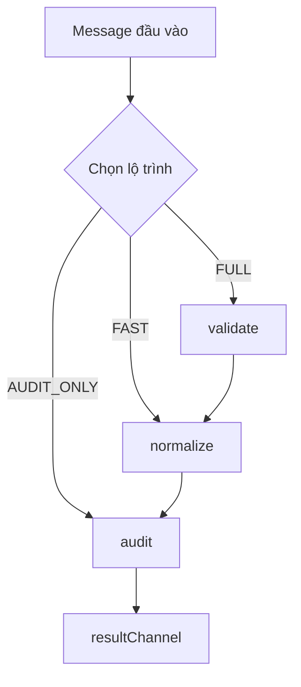
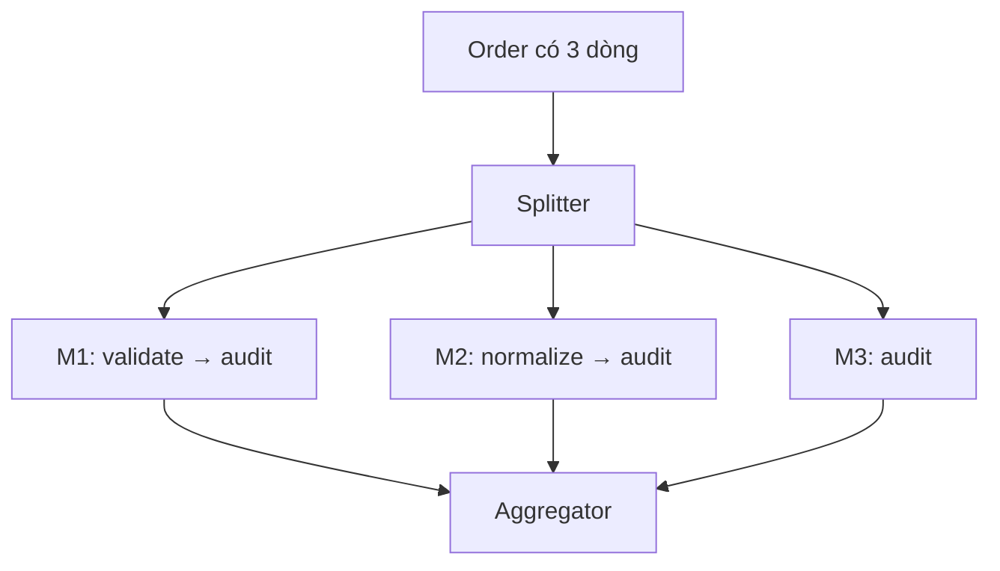

# Test nhiều route sequence trong Routing Slip với Spring Integration

Khi xây dựng một luồng thông điệp, có những yêu cầu phải đi qua **một chuỗi endpoint theo thứ tự xác định**. Chẳng hạn, đơn hàng thông thường phải qua `validate → normalize → audit`, trong khi đơn đã được xác minh từ trước có thể chỉ cần `normalize → audit`. Thứ tự và tập chặng có thể khác nhau tùy loại Message, nhưng mỗi Message vẫn phải tiếp tục đúng hành trình đã chọn.

Đây là bài toán của mẫu **Routing Slip** trong Enterprise Integration Patterns (EIP): thay vì hardcode toàn bộ đường đi trong từng endpoint, ta gắn **lộ trình gồm các chặng** vào Message và để cơ chế routing slip đưa Message lần lượt qua các chặng đó. Khi có nhiều lộ trình, kiểm thử không chỉ hỏi “Message có đến đích cuối không?” mà còn phải chứng minh **đúng những chặng nào đã chạy, thứ tự có đúng không, có chặng nào bị lặp hoặc bỏ qua ngoài ý định không, và chuyện gì xảy ra nếu một chặng lỗi**.

Bài này thuộc chương **Routing slip** của module `SPRING_INTEGRATION_PATTERN`. Module hướng đến triển khai Router, Filter, Transformer, Splitter, Aggregator, Gateway, retry, error channel và correlation trong các luồng Spring Integration dễ mở rộng, dễ kiểm thử và có thể theo dõi. Trọng tâm ở đây là **thiết kế và test nhiều route sequence** ở cả mức logic và mức message flow thực tế.

## 1. Routing Slip là gì và giải quyết vấn đề nào?

Một **routing slip** giống như một tờ lộ trình đi kèm Message. Nó mô tả chuỗi kênh/đích mà Message phải qua; sau mỗi bước xử lý phù hợp, Message được chuyển tới chặng tiếp theo.

Ví dụ với ba lộ trình:

```text
FULL:
  validateChannel → normalizeChannel → auditChannel → resultChannel

FAST:
  normalizeChannel → auditChannel → resultChannel

AUDIT_ONLY:
  auditChannel → resultChannel
```

Đích cuối trong ví dụ là `resultChannel`, nơi kiểm thử có thể nhận Message và kiểm tra payload. Trong một hệ thống request-reply thật, lộ trình có thể kết thúc bằng bước tạo reply cho Gateway hoặc một kênh xử lý tiếp theo, tùy cấu hình.



Một Routing Slip có hai đặc trưng quan trọng:

1. **Đường đi theo trình tự:** chặng sau chỉ nhận Message sau khi chặng trước đã tạo đầu ra và chuyển tiếp thành công.
2. **Lộ trình đi cùng Message:** các endpoint không cần chứa danh sách tất cả những chặng tiếp theo trong logic nghiệp vụ.

Routing Slip **không phải** cơ chế fan-out: Message không được tự động gửi đồng thời tới mọi chặng trong danh sách. Nếu cần gửi một event đến nhiều consumer độc lập, hãy xem xét Publish–Subscribe hoặc Recipient List Router. Nếu cần tách một payload thành nhiều Message, hãy dùng Splitter.

## 2. Routing Slip hoạt động thế nào trong Spring Integration?

Spring Integration hỗ trợ thông tin lộ trình qua **routing slip header** và các cơ chế header enrichment/routing tương ứng. Có thể biểu diễn một route path như:

```text
Message<Order>
  payload: { orderId: "ORD-001", ... }
  headers:
    eventId: "evt-001"
    businessOrderId: "ORD-001"
    routingSlip: [validateChannel, normalizeChannel, auditChannel, resultChannel]
```

Đây là **biểu diễn khái niệm để dễ đọc**, không phải cam kết rằng giá trị nội bộ của `routingSlip` là một `List<String>` thuần hoặc đúng định dạng JSON. Spring Integration duy trì trạng thái lộ trình/chặng hiện hành trong cấu trúc header của framework; **không nên tự sửa index hay nội dung nội bộ bằng tay** khi xây dựng flow.

Tại mỗi chặng:

1. Message đến input channel hiện tại.
2. Endpoint xử lý Message, có thể giữ nguyên hoặc biến đổi payload.
3. Endpoint phát đầu ra mà vẫn bảo toàn thông tin routing slip cần thiết.
4. Cơ chế routing slip chọn **chặng tiếp theo chưa được thực hiện**.
5. Quá trình tiếp tục cho đến khi đến đích cuối hoặc có lỗi.

Lưu ý rằng routing slip áp dụng cho **endpoint có đầu ra để tiếp tục Message**. Nếu một handler chỉ thực hiện side effect và không tạo đầu ra, hoặc một bước ép gửi đến `outputChannel` khác theo cấu hình, Message có thể không còn tiếp tục theo routing slip như dự kiến. Đây là lý do cần kiểm thử *đường đi thực tế*, không chỉ kiểm tra header ban đầu.

### 2.1. Tên chặng và channel

| Thành phần | Ví dụ | Vai trò |
| --- | --- | --- |
| Tên chặng trong lộ trình | `validateChannel` | Định danh đích mà routing slip sẽ chuyển Message đến |
| `MessageChannel` | Bean `DirectChannel` tên `validateChannel` | Chuyển Message đến handler của chặng |
| Endpoint xử lý | `@ServiceActivator(inputChannel="validateChannel")` | Thực hiện nghiệp vụ và tạo đầu ra |
| Chặng cuối | `resultChannel` | Nơi quan sát kết quả hoặc chuyển tiếp sang flow khác |
| Correlation nghiệp vụ | `eventId`, `businessOrderId`, `requestId` | Theo dõi cùng sự kiện/yêu cầu qua nhiều chặng |

Đừng nhầm **thứ tự tên chặng trong routing slip** với **thứ tự hoàn tất giữa nhiều Message**. Với một Message đang chạy trên chuỗi `DirectChannel` đồng bộ, các chặng có quan hệ trước–sau rõ ràng; với nhiều Message xử lý trên executor hoặc broker, thứ tự giữa các Message có thể thay đổi.

## 3. Test nhiều route sequence phải chứng minh những gì?

Một test routing slip tốt kiểm tra được **cả lộ trình lẫn kết quả nghiệp vụ**.

| Thuộc tính | Câu hỏi cần trả lời | Cách quan sát |
| --- | --- | --- |
| **Đúng chặng** | `FULL` có gọi validate, normalize, audit không? | Ghi dấu các handler đã được gọi |
| **Đúng thứ tự** | Validate có chạy trước Normalize không? | So sánh danh sách dấu vết có thứ tự |
| **Không chạy thừa** | `FAST` có bỏ validate như thiết kế không? | Khẳng định danh sách không có validate |
| **Đúng số lần** | Mỗi chặng được gọi đúng một lần trong lần xử lý bình thường không? | Đếm invocation theo `eventId` |
| **Đúng payload** | Normalize có tạo dữ liệu như mong đợi không? | Đọc output channel, so sánh payload |
| **Giữ metadata** | `eventId` và khóa nghiệp vụ có còn không? | So sánh headers đầu vào/đầu ra |
| **Dừng khi lỗi** | Chặng normalize lỗi thì audit có bị bỏ qua không? | Assert exception hoặc error flow và dấu vết |
| **Không lẫn lộ trình** | Hai Message chạy đồng thời có đi đúng route riêng không? | Trace theo `eventId` thay vì biến chung |
| **Giới hạn hành trình** | Route trống, sai tên, vòng lặp có được xử lý rõ ràng? | Negative tests và timeout hữu hạn |

Đặc biệt, **chỉ kiểm tra payload ở cuối là chưa đủ**. Hai lộ trình khác nhau có thể tình cờ tạo cùng payload, dù một chặng bắt buộc đã bị bỏ qua. Ngược lại, chỉ kiểm tra danh sách handler được gọi cũng chưa chứng minh kết quả nghiệp vụ và headers còn đúng.

## 4. Ma trận kiểm thử cho các sequence tiêu biểu

Trước khi viết code, lập một ma trận thể hiện đầy đủ các tuyến hợp lệ và tình huống lỗi:

| Kịch bản | Route path | Trace mong đợi | Kết quả |
| --- | --- | --- | --- |
| `FULL` | validate → normalize → audit → result | `[validate, normalize, audit]` | Có Message ở result |
| `FAST` | normalize → audit → result | `[normalize, audit]` | Có Message ở result |
| `AUDIT_ONLY` | audit → result | `[audit]` | Có Message ở result |
| `INVALID` | validate → normalize → audit → result | `[validate]` | Validate từ chối, không vào result |
| `BROKEN_HOP` | validate → missingChannel → result | Chỉ các bước trước lỗi | Có lỗi giải quyết/sử dụng route |
| `LOOP` | A → B → A → ... | Không được lặp vô hạn | Có cơ chế ngăn vòng lặp/giới hạn hop |
| `CONCURRENT` | Hai Message, hai path khác nhau | Trace đúng theo từng `eventId` | Không lẫn trạng thái |

`BROKEN_HOP` và `LOOP` là **test bổ sung theo cấu hình thực tế**, không nhất thiết tạo ngay trong ví dụ chạy chính. Với route lỗi, quan trọng là hệ thống **phát hiện và báo lỗi**, không giả vờ hoàn tất. Với route động, cần thêm trường hợp strategy trả về route không có đích hoặc lặp lại chặng.

## 5. Cấu hình flow đồng bộ phục vụ test

Ta bắt đầu bằng một cấu hình Spring Integration Java 17+ có ba route path. Các chặng được nối qua các `DirectChannel`; `resultChannel` là `QueueChannel` để kiểm thử lấy kết quả. Dùng danh sách thread-safe để ghi lại **thứ tự chặng đã thực thi**.

Các đoạn mã Java bên dưới dùng package minh họa `example.integration`. Chúng trình bày cách cấu hình routing slip qua **header enricher**; khi tích hợp vào dự án, cần bảo đảm API DSL phù hợp phiên bản Spring Integration đang dùng.

### 5.1. Cấu hình channel và routing slip

```java
package example.integration;

import java.util.List;
import java.util.Locale;
import java.util.concurrent.CopyOnWriteArrayList;

import org.springframework.context.annotation.Bean;
import org.springframework.context.annotation.Configuration;
import org.springframework.integration.annotation.ServiceActivator;
import org.springframework.integration.channel.DirectChannel;
import org.springframework.integration.channel.QueueChannel;
import org.springframework.integration.config.EnableIntegration;
import org.springframework.integration.dsl.IntegrationFlow;
import org.springframework.messaging.MessageChannel;
import org.springframework.messaging.PollableChannel;

@Configuration
@EnableIntegration
public class RoutingSlipTestConfiguration {

    @Bean
    public MessageChannel fullInput() {
        return new DirectChannel();
    }

    @Bean
    public MessageChannel fastInput() {
        return new DirectChannel();
    }

    @Bean
    public MessageChannel auditOnlyInput() {
        return new DirectChannel();
    }

    @Bean
    public MessageChannel validateChannel() {
        return new DirectChannel();
    }

    @Bean
    public MessageChannel normalizeChannel() {
        return new DirectChannel();
    }

    @Bean
    public MessageChannel auditChannel() {
        return new DirectChannel();
    }

    @Bean
    public PollableChannel resultChannel() {
        return new QueueChannel(20);
    }

    @Bean
    public List<String> executionTrace() {
        return new CopyOnWriteArrayList<>();
    }

    @Bean
    public IntegrationFlow fullRoute() {
        return IntegrationFlow.from("fullInput")
                .enrichHeaders(h -> h.routingSlip(
                        "validateChannel",
                        "normalizeChannel",
                        "auditChannel",
                        "resultChannel"))
                .get();
    }

    @Bean
    public IntegrationFlow fastRoute() {
        return IntegrationFlow.from("fastInput")
                .enrichHeaders(h -> h.routingSlip(
                        "normalizeChannel",
                        "auditChannel",
                        "resultChannel"))
                .get();
    }

    @Bean
    public IntegrationFlow auditOnlyRoute() {
        return IntegrationFlow.from("auditOnlyInput")
                .enrichHeaders(h -> h.routingSlip(
                        "auditChannel",
                        "resultChannel"))
                .get();
    }

    @ServiceActivator(inputChannel = "validateChannel")
    public String validate(String value) {
        executionTrace().add("validate");
        if (!value.trim().toUpperCase(Locale.ROOT).startsWith("ORD-")) {
            throw new IllegalArgumentException("Invalid order code");
        }
        return value;
    }

    @ServiceActivator(inputChannel = "normalizeChannel")
    public String normalize(String value) {
        executionTrace().add("normalize");
        return value.trim().toUpperCase(Locale.ROOT);
    }

    @ServiceActivator(inputChannel = "auditChannel")
    public String audit(String value) {
        executionTrace().add("audit");
        return value;
    }
}
```

Ba flow đầu vào dùng **các sequence khác nhau** nhưng chia sẻ cùng tập endpoint xử lý. Điều này phản ánh lợi ích của Routing Slip: các endpoint `validate`, `normalize`, `audit` không cần biết Message sẽ đến từ tuyến nào hoặc chặng tiếp theo là gì.

`@ServiceActivator` trả `String` để tạo đầu ra cho chặng tiếp theo. Trong flow thực tế, một bước trả `void` hoặc làm mất metadata routing slip có thể khiến Message không đi tiếp. Cần kiểm thử rõ trường hợp đó khi bổ sung Transformer, gateway hoặc handler tùy chỉnh.

**Không cấu hình một `outputChannel` cố định cho những chặng cần đi tiếp theo slip trong ví dụ này.** Một đường output được ép tường minh có thể làm hành trình thực tế khác với lộ trình mong đợi. Việc endpoint tiếp tục tới hop kế tiếp còn phụ thuộc quy tắc reply/output và cách header được bảo toàn.

### 5.2. Điều gì đang được ghi vào trace?

`executionTrace()` ghi các tên `validate`, `normalize`, `audit` khi phương thức tương ứng được gọi. Nó **không ghi** `resultChannel` vì đây là nơi chứa kết quả cuối, không phải một handler nghiệp vụ.

Trong test đơn luồng, một trace dạng:

```text
[validate, normalize, audit]
```

cho biết thứ tự ba handler. Danh sách này được dùng **chỉ để kiểm chứng đường đi trong môi trường test**, không phải nhật ký kiểm toán đáng tin cậy cho production. Với nhiều Message cùng lúc, cần gắn `eventId` hoặc `requestId` vào từng bản ghi trace để tránh trộn kết quả.

## 6. Test FULL: mọi chặng chạy đúng thứ tự

JUnit 5 có thể khởi tạo context cho từng test, gửi Message qua `fullInput`, rồi nhận kết quả từ `resultChannel`.

```java
package example.integration;

import static org.junit.jupiter.api.Assertions.*;

import java.util.ArrayList;
import java.util.List;

import org.junit.jupiter.api.Test;
import org.springframework.context.annotation.AnnotationConfigApplicationContext;
import org.springframework.messaging.Message;
import org.springframework.messaging.MessageChannel;
import org.springframework.messaging.PollableChannel;
import org.springframework.messaging.support.MessageBuilder;

class RoutingSlipSequenceTest {

    @Test
    void fullRouteVisitsThreeHandlersInOrder() {
        try (var context = new AnnotationConfigApplicationContext(
                RoutingSlipTestConfiguration.class)) {

            MessageChannel input =
                    context.getBean("fullInput", MessageChannel.class);
            PollableChannel result =
                    context.getBean("resultChannel", PollableChannel.class);

            @SuppressWarnings("unchecked")
            List<String> trace = (List<String>) context.getBean(
                    "executionTrace", List.class);

            Message<String> message = MessageBuilder
                    .withPayload(" ord-1001 ")
                    .setHeader("eventId", "evt-1001")
                    .setHeader("businessOrderId", "ORD-1001")
                    .build();

            assertTrue(input.send(message));

            Message<?> output = result.receive(0);
            assertNotNull(output);
            assertEquals("ORD-1001", output.getPayload());
            assertEquals(
                    List.of("validate", "normalize", "audit"),
                    new ArrayList<>(trace));
            assertEquals(
                    "evt-1001", output.getHeaders().get("eventId"));
            assertEquals(
                    "ORD-1001",
                    output.getHeaders().get("businessOrderId"));
            assertNull(result.receive(0));
        }
    }
}
```

Test cùng lúc xác nhận:

1. `FULL` đi qua ba handler đúng **thứ tự**.
2. `normalize` đã chuẩn hóa payload.
3. `eventId` và `businessOrderId` còn ở kết quả sau các bước.
4. Chỉ có một Message đến `resultChannel` cho lượt gửi bình thường.

Vì ví dụ dùng `DirectChannel` đồng bộ và `QueueChannel` còn chỗ, `result.receive(0)` có thể nhận kết quả ngay sau `send()`. Đây **không phải** cách chờ thích hợp với mọi flow có executor hoặc polling consumer.

## 7. Test FAST và AUDIT_ONLY: cùng endpoint, khác sequence

Ở các route rút gọn, test phải chứng minh **chặng bị bỏ qua không chạy**, chứ không chỉ kiểm tra đích cuối.

Ví dụ JUnit 5 dưới đây dùng cùng cấu hình. Mỗi test tạo context mới để trace và queue không mang dữ liệu từ test trước.

```java
package example.integration;

import static org.junit.jupiter.api.Assertions.*;

import java.util.ArrayList;
import java.util.List;

import org.junit.jupiter.api.Test;
import org.springframework.context.annotation.AnnotationConfigApplicationContext;
import org.springframework.messaging.MessageChannel;
import org.springframework.messaging.PollableChannel;
import org.springframework.messaging.support.MessageBuilder;

class RoutingSlipAlternativeSequenceTest {

    @Test
    void fastRouteSkipsValidationButRunsNormalizeAndAudit() {
        try (var context = new AnnotationConfigApplicationContext(
                RoutingSlipTestConfiguration.class)) {
            MessageChannel input =
                    context.getBean("fastInput", MessageChannel.class);
            PollableChannel result =
                    context.getBean("resultChannel", PollableChannel.class);
            @SuppressWarnings("unchecked")
            List<String> trace = (List<String>) context.getBean(
                    "executionTrace", List.class);

            assertTrue(input.send(
                    MessageBuilder.withPayload(" ord-2002 ").build()));

            assertNotNull(result.receive(0));
            assertEquals(
                    List.of("normalize", "audit"),
                    new ArrayList<>(trace));
        }
    }

    @Test
    void auditOnlyRouteRunsExactlyOneHandler() {
        try (var context = new AnnotationConfigApplicationContext(
                RoutingSlipTestConfiguration.class)) {
            MessageChannel input =
                    context.getBean("auditOnlyInput", MessageChannel.class);
            PollableChannel result =
                    context.getBean("resultChannel", PollableChannel.class);
            @SuppressWarnings("unchecked")
            List<String> trace = (List<String>) context.getBean(
                    "executionTrace", List.class);

            assertTrue(input.send(
                    MessageBuilder.withPayload("ORD-3003").build()));

            assertNotNull(result.receive(0));
            assertEquals(List.of("audit"), new ArrayList<>(trace));
        }
    }
}
```

Ở đây, việc `FAST` bỏ validation là **chủ đích của lộ trình**. Trong production, quyền sử dụng lộ trình ngắn phải được bảo vệ bằng chính sách tin cậy: không để một client bên ngoài tự chọn `FAST` nhằm vượt qua bước kiểm soát bắt buộc.

## 8. Test chặng bị lỗi: không được âm thầm đi tiếp

Giả sử validate từ chối payload `BAD-4004`. Trước khi xử lý lỗi/retry, các chặng normalize và audit **không được coi là đã hoàn tất**.

```java
package example.integration;

import static org.junit.jupiter.api.Assertions.*;

import java.util.ArrayList;
import java.util.List;

import org.junit.jupiter.api.Test;
import org.springframework.context.annotation.AnnotationConfigApplicationContext;
import org.springframework.messaging.MessageChannel;
import org.springframework.messaging.PollableChannel;
import org.springframework.messaging.support.MessageBuilder;

class RoutingSlipFailureTest {

    @Test
    void validationFailurePreventsFollowingSteps() {
        try (var context = new AnnotationConfigApplicationContext(
                RoutingSlipTestConfiguration.class)) {

            MessageChannel input =
                    context.getBean("fullInput", MessageChannel.class);
            PollableChannel result =
                    context.getBean("resultChannel", PollableChannel.class);

            @SuppressWarnings("unchecked")
            List<String> trace = (List<String>) context.getBean(
                    "executionTrace", List.class);

            RuntimeException failure = assertThrows(
                    RuntimeException.class,
                    () -> input.send(
                            MessageBuilder.withPayload("BAD-4004").build()));

            assertNotNull(failure);
            assertEquals(List.of("validate"), new ArrayList<>(trace));
            assertNull(result.receive(0));
        }
    }
}
```

Đây là ví dụ **flow đồng bộ** qua `DirectChannel`; exception từ handler có thể lan ngược qua `send()`, thường được bọc trong exception của Spring Messaging. Test không cố định kiểu exception con vì còn phụ thuộc cách framework bọc nguyên nhân lỗi. Khi chuyển sang executor, queue, broker hoặc poller, lỗi có thể được xử lý bất đồng bộ; lúc đó test cần quan sát `ErrorMessage`/error channel hoặc trạng thái retry, **không dùng `assertThrows` quanh `send()` như điều kiện duy nhất**.

### 8.1. Một chặng sau lỗi thì sao?

Nếu `validate` thành công rồi `normalize` lỗi, trace có thể là:

```text
[validate, normalize]
```

nhưng không có `audit`. Khi retry toàn bộ từ đầu, có thể thấy `validate` chạy lại. Nếu `validate` đã ghi database hoặc tạo side effect, việc lặp lại phải được kiểm soát bằng **idempotency**. Nếu retry chỉ phần `normalize`, cần xác định cách khôi phục **routing slip ở chặng hiện hành** thay vì bắt đầu lại toàn bộ pipeline một cách ngầm định.

## 9. Test header, payload và trạng thái routing slip

Một Message trải qua nhiều chặng thường mang thông tin phục vụ cả routing và nghiệp vụ:

| Loại metadata | Mục đích | Cần test điều gì? |
| --- | --- | --- |
| `eventId` | Nhận diện sự kiện qua retry/redelivery | Không bị thay đổi ngoài hợp đồng |
| `businessOrderId` | Gắn log với đơn hàng | Có mặt sau các bước Transformer |
| `correlationId` / `requestId` | Liên hệ các Message thuộc cùng yêu cầu | Không bị lẫn giữa hai yêu cầu |
| Routing slip header | Điều khiển chặng tiếp theo | Các endpoint thực sự theo đúng route path |
| `replyChannel` / `errorChannel` | Nơi trả kết quả hoặc xử lý lỗi | Được bảo toàn nếu Gateway/error flow cần dùng |
| Message ID / timestamp | Metadata do framework cấp | Không giả định chúng bất biến qua mọi phép tạo Message |

**Không nên test nội bộ routing slip bằng một chuỗi `toString()` cố định.** Format, index và kiểu nội bộ có thể thay đổi theo phiên bản thư viện. Kiểm thử có giá trị cao nhất là **quan sát các endpoint thực sự được gọi theo đúng thứ tự** và metadata nghiệp vụ còn phù hợp.

### 9.1. Transformer có thể làm rơi header nếu tự dựng Message

Một Transformer hoặc handler có thể tạo Message mới:

```java
// Cách cần thận trọng: tạo Message từ đầu có thể thiếu headers cũ.
Message<String> newMessage =
        MessageBuilder.withPayload(normalizedPayload).build();
```

Nếu các header điều hướng/correlation không được chuyển tiếp, route có thể dừng hoặc tạo kết quả không ghép được. Khi cần giữ header từ một Message cũ, nên dùng cách xây dựng có sao chép headers hoặc để cơ chế trả payload của endpoint bảo toàn metadata theo hợp đồng.

Ví dụ:

```java
Message<String> newMessage = MessageBuilder
        .withPayload(normalizedPayload)
        .copyHeaders(original.getHeaders())
        .build();
```

Đây là gợi ý ở mức Messaging API. Khi dùng các header nội bộ của Spring Integration, cần để framework quản lý thông tin đặc biệt như routing slip và các channel nội bộ. **Không ép copy toàn bộ các header tới transport bên ngoài mà không xem xét bảo mật và khả năng serialize.**

## 10. Test route động và sequence không xác định trước

Trong thực tế, routing slip có thể phụ thuộc vào trạng thái nghiệp vụ hoặc cấu hình. Ví dụ:

```text
Order NORMAL:
  validate → normalize → audit → result

Order VIP:
  validate → riskCheck → normalize → audit → result

Order PREVALIDATED:
  normalize → audit → result
```

Một cách thiết kế dễ kiểm thử là **tách bước lập kế hoạch lộ trình** khỏi các bước thực thi:

```java
import java.util.List;

public final class RoutePlanner {

    public List<String> plan(OrderContext order) {
        if (order.prevalidated()) {
            return List.of("normalizeChannel",
                    "auditChannel", "resultChannel");
        }
        if (order.vip()) {
            return List.of("validateChannel", "riskCheckChannel",
                    "normalizeChannel", "auditChannel", "resultChannel");
        }
        return List.of("validateChannel", "normalizeChannel",
                "auditChannel", "resultChannel");
    }
}
```

`OrderContext` là kiểu domain minh họa. Đoạn code trên là **một planner thuần Java**, không tự gắn routing slip vào Message. Phần tích hợp Spring Integration phải chuyển route path đã được phép sang cấu hình/header routing slip thông qua API phù hợp của phiên bản dự án.

### 10.1. Unit test planner và integration test routing

Unit test planner cần kiểm tra thứ tự:

```java
assertEquals(
        List.of("validateChannel", "riskCheckChannel",
                "normalizeChannel", "auditChannel", "resultChannel"),
        planner.plan(vipOrder));
```

Integration test tiếp tục kiểm chứng chặng `riskCheckChannel` thực sự chạy **giữa validate và normalize**. Không nên coi một test `List<String>` của planner là đủ để chứng minh ứng dụng đã nối đúng channel và handler.

### 10.2. Route strategy trả về chặng sai

Khi một strategy động hoặc planner tạo ra tên channel chưa được đăng ký, cần test:

- Hệ thống có báo lỗi giải quyết channel hoặc chuyển sang nhánh lỗi được cấu hình không?
- Message có được giữ lại để chẩn đoán/phục hồi không?
- Có log tên chặng bị lỗi và `eventId` không?
- Có ngăn việc lặp lại vô hạn khi strategy liên tục trả về cùng một hop không?

Lỗi route không tồn tại là **lỗi cấu hình hoặc dữ liệu điều hướng**, không phải một kết quả bình thường cần được coi là `SUCCESS`.

## 11. Test sequence có executor hoặc channel bất đồng bộ

Ví dụ ở mục 5–8 dùng `DirectChannel`, nên trace của một Message được ghi theo thứ tự đồng bộ. Khi đưa một chặng sang executor hoặc broker:

```text
Message A: validate → normalize -------> audit
Message B: validate -------> normalize → audit
```

Hai Message có thể hoàn tất không theo thứ tự đến. Không thể lấy một danh sách trace chung rồi khẳng định mỗi ba phần tử liên tiếp là một Message.

### 11.1. Ghi trace theo định danh sự kiện

Thay vì:

```java
trace.add("validate");
```

hãy ghi:

```java
trace.add(new StepTrace(
        eventId, "validate", sequenceWithinMessage));
```

Ở đây, `StepTrace` là kiểu minh họa chứa `eventId`, tên chặng và thứ tự quan sát. Trong hệ thống thật, để kiểm thử chính xác nhiều Message, có thể dùng một map theo `eventId`, `BlockingQueue`, `CountDownLatch` hoặc một collector thread-safe. `sequenceWithinMessage` cần được đo từ cơ chế được đồng bộ rõ ràng; không dùng timestamp hệ thống làm chứng cứ duy nhất về quan hệ trước–sau.

### 11.2. Không dùng `Thread.sleep()` để phỏng đoán

Với async flow, test nên:

1. Gửi Message và giữ `eventId`.
2. Chờ **đích cuối hoặc sự kiện lỗi** với timeout hữu hạn.
3. Truy xuất trace đúng theo `eventId`.
4. So sánh sequence riêng của Message đó.
5. Xác nhận không có chặng thừa hoặc bản phát lặp bất thường.

Một phép kiểm thử chờ có giới hạn thời gian giúp phân biệt đường đi bị đứt với đường đi chậm. Tuy nhiên, test cũng cần quan sát exception/error channel khi Message không đến đích; không kết luận “bị drop” chỉ vì hết timeout trong môi trường CI chậm.

## 12. Test song song và tính cô lập giữa các Message

Một lỗi nguy hiểm là vô tình dùng **biến mutable dùng chung** để lưu trạng thái chặng hiện hành, ví dụ `currentHopIndex` ở singleton bean. Khi hai Message đi qua routing slip khác nhau, chúng có thể làm thay đổi hành trình của nhau.

Test cô lập cần gửi đồng thời:

- Message A theo `FULL`.
- Message B theo `FAST`.
- Message C theo `AUDIT_ONLY`.

Sau đó quan sát:

| Message | Trace riêng theo `eventId` |
| --- | --- |
| A | `validate → normalize → audit` |
| B | `normalize → audit` |
| C | `audit` |

Những điều cần xác nhận:

1. Không có chặng A bị ghi nhầm vào trace của B hoặc C.
2. Header `eventId`, `businessOrderId`, `requestId` được gắn đúng Message.
3. Không có message bị chuyển nhầm sang result channel dành riêng cho yêu cầu khác.
4. Khi chặng xử lý bất đồng bộ, test không dựa vào thứ tự hoàn tất **giữa** A, B, C.
5. Không có state mutable của chặng hiện hành bị chia sẻ không an toàn giữa các lượt gọi.

Với Routing Slip, trạng thái lộ trình nên gắn với **Message** hoặc context xử lý tương ứng, không nên đặt trong một biến toàn cục bị các message ghi đè.

## 13. Routing Slip với Gateway, Filter, Splitter và Aggregator

### 13.1. Gateway request-reply

Một Gateway có thể gửi request đi qua nhiều chặng. Nếu chặng cuối không gửi reply hoặc lộ trình bị dừng vì handler trả `void`, Gateway có thể chờ đến timeout.

Test Gateway cần kiểm tra:

- Route thành công tạo đúng một reply theo hợp đồng.
- Route lỗi trả exception hoặc phản hồi lỗi có chủ đích.
- Route không có bước tạo reply không được đánh dấu “hoàn tất” chỉ vì các chặng trước đã chạy.
- `replyChannel`/correlation cần thiết không bị Transformer làm rơi.

**Routing Slip không tự thay cho reply aggregation.** Nếu một chặng gửi nhiều Message ra nhiều nhánh và cần gom kết quả, phải thiết kế thêm cơ chế phù hợp.

### 13.2. Filter chặn giữa lộ trình

Nếu có Filter trước `auditChannel` và predicate trả `false`, routing slip có thể **không đi đến chặng kế** vì Message bị loại khỏi nhánh hiện tại.

Trong test, cần xác định chính sách từ chối:

| Kết quả Filter | Hành vi mong muốn | Kiểm chứng |
| --- | --- | --- |
| `true` | Tiếp tục theo slip | Chặng sau chạy |
| `false`, có discard flow | Rẽ sang nhánh xử lý từ chối | Chặng sau không chạy; discard nhận Message |
| `false`, bỏ im lặng | Dừng flow theo chủ đích | Không có reply nếu không thiết kế riêng |
| Predicate ném exception | Error flow xử lý | Không ghi nhầm là reject hợp lệ |

Nếu Gateway đang chờ, cần trả từ chối hoặc lỗi thay vì chỉ chặn Message.

### 13.3. Splitter/Aggregator

Giả sử Splitter tạo ba Message con, mỗi Message mang `correlationId` và sequence metadata. Những Message con có thể có routing slip khác nhau:



Điều kiện để Aggregator hoạt động đúng là **các Message kết quả thực sự đi về điểm gom**, có đủ correlation metadata và thỏa release strategy. Nếu một Message con lỗi giữa slip, Aggregator có thể chờ thiếu phần tử.

Test cần quan sát:

1. Mỗi Message con thực thi đúng sequence riêng.
2. Các kết quả quay về Aggregator với `correlationId` phù hợp.
3. `sequenceSize`/release strategy phản ánh số kết quả kỳ vọng.
4. Khi một Message con không tới, nhóm có timeout hoặc chính sách lỗi/partial result rõ ràng.
5. Retry một Message con không làm Aggregator nhận kết quả trùng gây sai nhóm.

Routing Slip quyết định **đường đi tuần tự của từng Message**; nó không tự tạo đủ các Message con, không tự bảo đảm fan-in và cũng không tự đồng bộ nhiều tuyến song song.

## 14. Retry, idempotency và khôi phục route giữa chặng

Một route nhiều chặng có thể chạy qua nhiều tác vụ có side effect. Xét:

```text
validate (không side effect)
    ↓
reserveInventory (giữ tồn kho thành công)
    ↓
chargePayment (timeout)
    ↓
sendConfirmation (chưa chạy)
```

Nếu retry **từ đầu**, `reserveInventory` có thể được gọi lại. Nếu retry **từ chặng lỗi**, cần lưu đủ bối cảnh để biết chặng nào đã thành công và Message phải đi tiếp từ đâu.

### 14.1. Ba câu hỏi cần trả lời

| Câu hỏi | Vì sao quan trọng |
| --- | --- |
| Retry phạm vi nào: toàn Message hay riêng chặng? | Quyết định chặng nào bị thực thi lại |
| Có lưu tiến độ/chặng hiện hành bền vững không? | Giúp khôi phục sau khi JVM hoặc consumer chết |
| Các side effect có idempotent hoặc bù trừ được không? | Ngăn giữ tồn kho/trừ tiền nhiều lần |

Một header routing slip trong bộ nhớ **không biến chuỗi endpoint thành một workflow engine có lưu trạng thái bền vững**. Khi cần phục hồi từ đúng chặng sau crash, phải có lưu trạng thái, outbox/queue hoặc orchestration phù hợp.

### 14.2. Khóa idempotency theo chặng

Ví dụ một khóa:

```text
eventId = evt-5005
idempotency keys:
  evt-5005:RESERVE_INVENTORY
  evt-5005:CHARGE_PAYMENT
  evt-5005:SEND_CONFIRMATION
```

Những chặng khác nhau mang cùng `eventId` nhưng là công việc khác nhau. Chỉ dùng `eventId` chung cho mọi chặng có thể khiến một bước tưởng chặng khác đã thực hiện thay mình.

Đối với các tác vụ bên ngoài, một transaction database cục bộ không thể hoàn tác một khoản thanh toán đã gửi. Cần thiết kế idempotency với nhà cung cấp và/hoặc cơ chế bù trừ đúng nghiệp vụ.

## 15. Theo dõi nhiều route sequence trong production

Một log có cấu trúc nên phân biệt **route dự kiến**, **chặng vừa hoàn tất**, **chặng tiếp theo**, **kết quả** và **lý do lỗi**.

Ví dụ:

```json
{
  "eventId": "evt-1001",
  "businessOrderId": "ORD-1001",
  "routeName": "FULL",
  "plannedHops": [
    "validateChannel",
    "normalizeChannel",
    "auditChannel",
    "resultChannel"
  ],
  "currentHop": "normalizeChannel",
  "hopStatus": "COMPLETED",
  "nextHop": "auditChannel",
  "attempt": 1,
  "correlationId": "attempt-1001"
}
```

Đây là **schema log minh họa của ứng dụng**, không phải tập header hoặc log mặc định do Spring Integration tự tạo. Không nên log toàn bộ payload có dữ liệu nhạy cảm. Nếu cần lưu tiến độ bền vững, nên có cơ chế riêng thay vì xem log là source of truth.

| Metric gợi ý | Mục tiêu |
| --- | --- |
| `routing_slip.started` | Số Message bắt đầu hành trình |
| `routing_slip.completed` | Số Message đến đích cuối |
| `routing_slip.failed` | Số Message dừng vì lỗi |
| `routing_slip.hop.duration` | Thời gian xử lý mỗi chặng |
| `routing_slip.hop.retries` | Số lần retry tại chặng |
| `routing_slip.unresolved_hop` | Phát hiện tên chặng không tồn tại |
| `routing_slip.timeout` | Lộ trình không hoàn tất đúng hạn |
| `routing_slip.route.count` | Phân bố số Message theo loại lộ trình |

Các tên metric là **đề xuất**, không phải tên chắc chắn đã có trong Micrometer hoặc Actuator. Tránh gắn `eventId`/`orderId` vào metric tags để không tăng cardinality quá mức; các khóa đó phù hợp với log và tracing.

### 15.1. Điều tra một Message bị kẹt

Trình tự kiểm tra:

1. Message có routing slip được gắn đúng không?
2. Chặng cuối ghi nhận thành công là chặng nào?
3. Đích tiếp theo có tồn tại dưới tên channel đúng không?
4. Handler tại đó có tạo output Message hay đã trả `void`?
5. Các header routing/correlation có bị mất khi Transformer tạo Message mới không?
6. Có exception, error flow, retry hoặc timeout nào tại chặng đó không?
7. Nếu dùng executor/broker, Message có đang chờ trong queue hay consumer không hoạt động?
8. Nếu có Aggregator/Gateway, đích cuối đã tạo reply hoặc kết quả gom đúng hợp đồng chưa?

Những câu hỏi này giúp phân biệt lỗi **lộ trình**, lỗi **chuyển giao Message** và lỗi **nghiệp vụ**.

## 16. Những lỗi kiểm thử và thiết kế thường gặp

| Biểu hiện | Nguyên nhân thường gặp | Cách khắc phục |
| --- | --- | --- |
| Test chỉ xác nhận payload cuối | Không kiểm tra thứ tự chặng | Ghi trace và so sánh sequence mong đợi |
| `FAST` vô tình chạy validation | Header slip hoặc flow input cấu hình sai | Test danh sách handler chính xác |
| Audit không chạy sau normalize | Handler trả `void`, output channel bị ép, header mất | Kiểm tra output và propagation của routing slip |
| `resultChannel` rỗng | Chặng trước lỗi hoặc chưa phát đầu ra | Kiểm tra trace, exception, error flow |
| Message chạy vòng lặp | Route động có chu kỳ, không có giới hạn hop | Ràng buộc route path và kiểm thử cycle/timeout |
| Test bất đồng bộ chập chờn | Dùng `Thread.sleep()` hoặc đọc queue quá sớm | Chờ kết quả có timeout, trace theo `eventId` |
| Hai Message lẫn thứ tự | Trace chung hoặc biến current-hop mutable ở singleton | Tách trace theo Message và quản lý state an toàn |
| Retry làm chạy lại chặng đã thành công | Retry toàn route không idempotent | Quy định phạm vi retry và khóa idempotency theo chặng |
| Gateway hết timeout | Route kết thúc không tạo reply | Thiết kế chặng cuối trả kết quả |
| Aggregator không gom đủ | Một Message con lỗi giữa route | Xử lý lỗi/timeout/partial group có chủ đích |
| Test phụ thuộc chuỗi nội bộ routing slip | Giả định cấu trúc/index của framework không đổi | Test hành vi endpoint và metadata nghiệp vụ |

## 17. Checklist cho một bộ test nhiều route sequence

- **Lập ma trận route:** liệt kê mọi lộ trình được hỗ trợ và kết quả mong đợi.
- **Xác minh từng chặng:** kiểm tra tên, thứ tự, số lần gọi và những chặng phải bỏ qua.
- **Kiểm tra đích cuối:** payload, headers, số kết quả và reply/error khi cần.
- **Kiểm thử nhánh lỗi:** chặng đầu, chặng giữa và chặng cuối có chính sách rõ ràng.
- **Không cố định vào header nội bộ:** xem routing slip như cơ chế của framework, kiểm chứng bằng hành vi.
- **Tách đồng bộ/bất đồng bộ:** dùng trace theo `eventId` và timeout hữu hạn khi chạy async.
- **Chống nhầm lẫn giữa Message:** kiểm thử song song nhiều path và kiểm soát state dùng chung.
- **Kiểm tra lộ trình động:** route không tồn tại, vòng lặp, thiếu chặng bắt buộc và dữ liệu không tin cậy.
- **Thiết kế retry/idempotency:** tránh side effect lặp khi phục hồi từ chặng lỗi.
- **Giữ correlation:** đảm bảo Gateway/Aggregator nhận đúng kết quả theo yêu cầu.
- **Theo dõi được tiến độ:** có planned route, completed hop, next hop, error reason và metrics.

**Test Routing Slip phải xác minh cả hành trình, không chỉ kết quả cuối.** Khi các route sequence được mô tả rõ, từng hop được quan sát, metadata được bảo toàn và đường lỗi được kiểm thử, một integration flow Spring Integration có thể thay đổi lộ trình theo nhu cầu nghiệp vụ mà vẫn giữ được tính đúng đắn, khả năng phục hồi và khả năng bảo trì.
