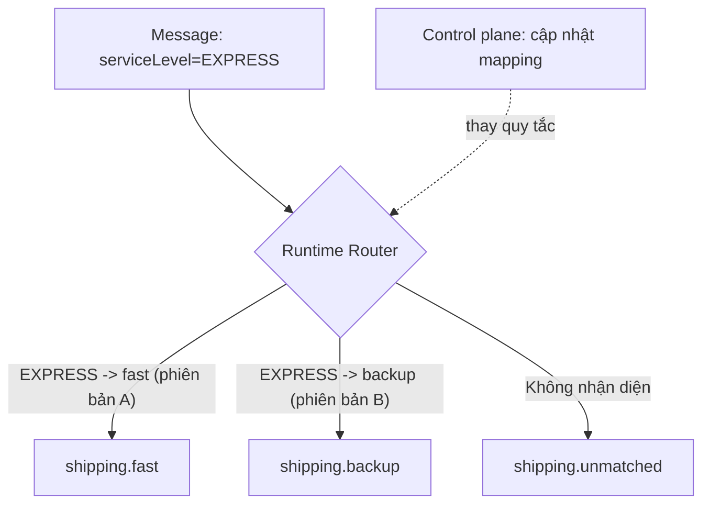
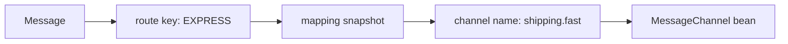
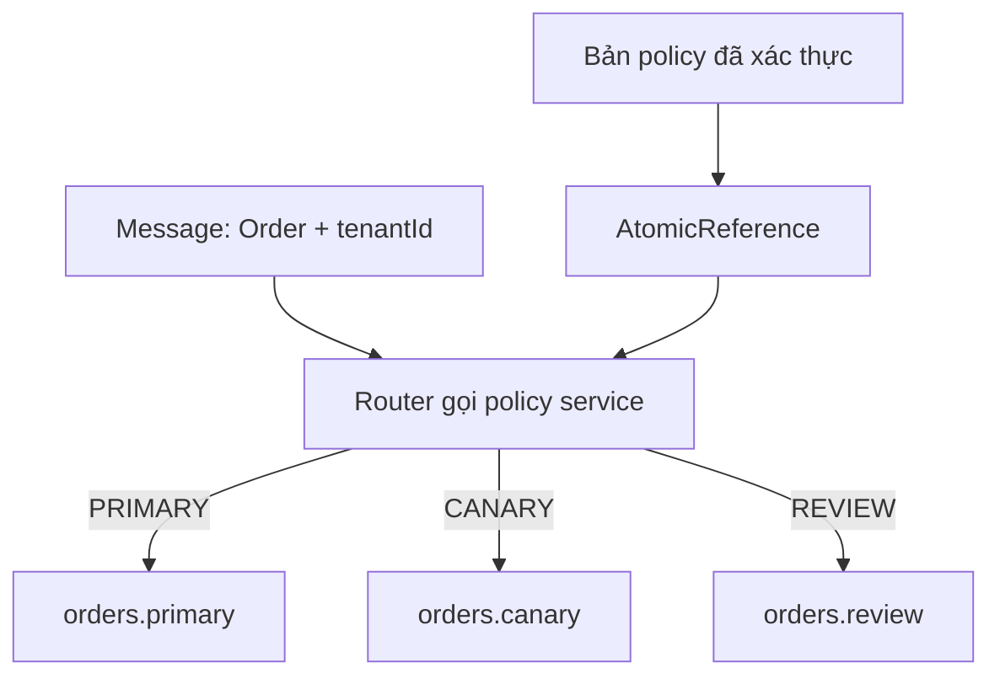
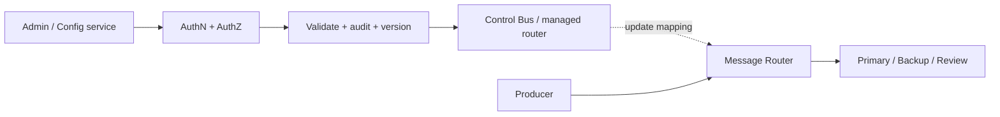
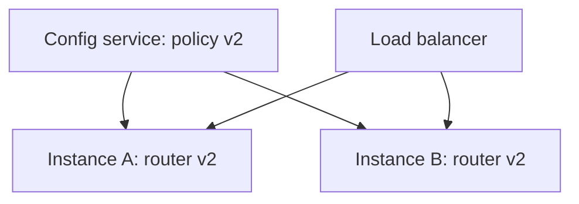

# Dynamic Router chọn route từ dữ liệu runtime trong Spring Integration

## Mục tiêu bài học

Ở một hệ thống tích hợp có nhiều đối tác, đích xử lý message đôi khi phải thay đổi **khi ứng dụng vẫn đang chạy**: chuyển đơn giao nhanh sang cụm dự phòng khi bảo trì, mở route cho loại yêu cầu mới, hoặc dùng một chính sách triển khai theo tenant và phiên bản. Khởi động lại toàn bộ hệ thống mỗi lần thay đổi là chậm và có thể gián đoạn công việc.

**Dynamic Router** là mẫu Enterprise Integration Patterns (EIP) cho phép **quy tắc hoặc bảng ánh xạ định tuyến thay đổi tại runtime**. Trong Spring Integration, nhiều Router thông dụng đã có khả năng thay đổi mapping; không nhất thiết phải đi tìm một class tên `DynamicRouter` để sử dụng.

Bài thuộc chương **Dynamic router** trong module **SPRING_INTEGRATION_PATTERN**. Module tập trung triển khai Router, Filter, Transformer, Splitter, Aggregator, Gateway, retry, error channel, correlation, kiểm thử và giám sát để tạo luồng thông điệp ít phụ thuộc và dễ mở rộng.

Học xong, bạn có thể:

1. Phân biệt **giá trị route tính từ message tại thời điểm nhận** với **quy tắc route có thể thay đổi trong lúc hệ thống chạy**.
2. Giải thích ba bước `route key → channel name → MessageChannel` và vai trò của `AbstractMappingMessageRouter`.
3. Dùng `HeaderValueRouter`, `setChannelMapping` và `removeChannelMapping` để thay tuyến mà không khởi động lại context.
4. Cập nhật nhiều quy tắc có kiểm soát và biết giới hạn của cập nhật riêng lẻ.
5. Thiết kế lựa chọn tuyến dựa trên **snapshot chính sách runtime** nhưng vẫn giữ channel đích trong danh sách cho phép.
6. Kiểm thử trước/sau khi thay route, nhánh dự phòng, dữ liệu chưa biết, header propagation và tính cô lập giữa các bài test.
7. Nhận diện rủi ro vận hành: race condition, nhiều instance, message đang xử lý, retry, bảo mật control plane, correlation và observability.

## 1. Tại sao cần Dynamic Router?

Hãy xét tuyến xử lý đơn hàng:

```text
Message:
  payload = Order(id="ORD-42")
  headers.serviceLevel = "EXPRESS"

Ban đầu:
  EXPRESS -> shipping.fast

Trong đợt bảo trì:
  EXPRESS -> shipping.backup

Sau bảo trì:
  EXPRESS -> shipping.fast
```

**Message đầu vào không thay đổi**. Thay đổi nằm ở **bảng ánh xạ route** mà Router sử dụng tại thời điểm định tuyến. Khi một cập nhật có hiệu lực, message mới có thể đi sang đích mới mà không thay mã nguồn hoặc khởi động lại.



Một số nhu cầu thực tế:

| Tình huống | Điều thay đổi tại runtime | Kết quả cần đạt |
| --- | --- | --- |
| Bảo trì một hệ thống downstream | `EXPRESS: fast → backup` | Message mới đi sang tuyến còn hoạt động |
| Mở thêm một loại nghiệp vụ | Thêm mapping `PARTNER → partnerChannel` | Hỗ trợ loại message mới mà không sửa flow chính |
| Ngừng một đối tác | Xóa mapping `PARTNER` hoặc chuyển sang quarantine | Không gửi message tiếp tới đối tác đã ngưng |
| Triển khai canary | Chính sách chọn `primary`/`canary` theo tenant hoặc tỷ lệ | Kiểm soát phạm vi rollout và rollback |
| Cô lập sự cố | Policy chuyển một nhóm key sang review | Giảm tác động sang nhánh chính |

**Dynamic Router không thay thế service discovery, load balancer, circuit breaker hoặc workflow orchestrator.** Nó chọn **đường đi message**; mức độ sẵn sàng của đích, rollback side effect và bảo đảm thực thi nghiệp vụ cần cơ chế riêng.

## 2. Hai chiều “động” cần phân biệt

“Chọn route từ dữ liệu runtime” thường gồm **hai tầng độc lập**.

### Tầng A — Message mang dữ kiện thay đổi theo lần gửi

Ví dụ header `tenantId`, `serviceLevel`, payload `amount` hoặc trạng thái khách hàng. Một Router tính route key khác nhau cho các message khác nhau:

```text
Message A: serviceLevel=EXPRESS  -> key EXPRESS
Message B: serviceLevel=STANDARD -> key STANDARD
```

Ngay cả khi bảng mapping cố định, routing vẫn *phụ thuộc dữ liệu message lúc chạy*. Đây là đặc tính của Header-Based Router hay Content-Based Router.

### Tầng B — Chính sách hoặc bảng mapping cũng thay đổi tại runtime

```text
Trước update:
  EXPRESS -> shipping.fast

Sau update:
  EXPRESS -> shipping.backup
```

Đây là **Dynamic Router theo nghĩa cấu hình thay đổi mà không dừng ứng dụng**. Cả hai tầng có thể kết hợp: route key tính từ message, sau đó được phân giải qua một bảng mapping đã được thay đổi lúc runtime.

| Câu hỏi | Dữ liệu theo từng message | Chính sách runtime |
| --- | --- | --- |
| Khi nào đổi? | Mỗi lần message tới | Khi quản trị viên/hệ thống điều khiển kích hoạt |
| Nguồn dữ liệu | Payload/header đã được xác thực | Config service, database, control bus, admin API |
| Ví dụ | `serviceLevel=EXPRESS` | `EXPRESS → shipping.backup` |
| Đơn vị kiểm thử | Các message có key khác nhau | Cùng một key trước và sau cập nhật |
| Rủi ro chính | Header giả mạo, dữ liệu sai schema | Race condition, cập nhật thiếu/nhầm và drift giữa instance |

## 3. Ba bước Spring Integration phân giải route

Các mapping Router thông dụng như `HeaderValueRouter` và `PayloadTypeRouter` thuộc họ `AbstractMappingMessageRouter`. Một quyết định định tuyến dựa trên mapping có thể được hiểu thành ba bước:

1. **Compute channel identifier:** tính khóa route từ message, ví dụ `"EXPRESS"`.
2. **Resolve identifier to channel name:** tra mapping `"EXPRESS" → "shipping.fast"`.
3. **Resolve channel name to MessageChannel:** tìm bean channel `shipping.fast` trong Spring context và gửi message.



Vì **bước 2** là một lớp ánh xạ độc lập, ứng dụng có thể đổi destination mà không cần sửa logic tạo route key. Theo tài liệu Spring Integration, những Router kế thừa `AbstractMappingMessageRouter` có các thao tác quản lý mapping tại runtime.

| API | Ý nghĩa |
| --- | --- |
| `setChannelMapping(key, channelName)` | Thêm hoặc thay đích của **một** route key |
| `removeChannelMapping(key)` | Xóa mapping của một key |
| `getChannelMappings()` | Xem bảng mapping hiện tại theo interface quản lý |
| `setChannelMappings(Map<String, String>)` | Cung cấp bảng mapping từ Java, phù hợp khi cập nhật nhiều key |
| `replaceChannelMappings(Properties)` | Cách tiện dụng để thay bảng mapping qua Control Bus; cần dữ liệu kiểu chuỗi |
| `setChannelKeyFallback(false)` | Không để key lạ tự được coi là tên channel có sẵn |
| `setDefaultOutputChannelName(...)` | Đưa message không có đích đến nơi dự phòng |

Với một Router trả trực tiếp đối tượng `MessageChannel`, bước phân giải tên có thể được bỏ qua; khi đó việc sửa **mapping theo key** không còn ý nghĩa tương tự. Vì vậy muốn quản lý tuyến bằng mapping, hãy để Router tính **khóa logic**, không đưa channel bean tùy ý vào payload.

### Chú ý: “tĩnh” và “động” không phải hai class hoàn toàn khác nhau

Ví dụ `HeaderValueRouter("serviceLevel")` ban đầu có mapping `EXPRESS → shipping.fast`. Nó đã là một Router dùng header, đồng thời cũng có thể thay mapping lúc chạy. Vì vậy đừng nhân đôi toàn bộ kiến trúc chỉ để “bật dynamic”; điều quan trọng là **cách quản lý bảng mapping và kiểm soát cập nhật**.

## 4. Ví dụ Java DSL: thay đổi mapping khi ứng dụng đang chạy

Ta xây một flow nhận message có header `serviceLevel`. Có bốn đích:

- `shipping.fast`: tuyến chính cho EXPRESS.
- `shipping.backup`: tuyến dự phòng cho EXPRESS.
- `shipping.standard`: xử lý STANDARD.
- `shipping.unmatched`: giá trị chưa nhận diện hoặc mapping đã bị xóa.

Đầu ra dùng `QueueChannel` để kiểm thử chủ động đọc; trong hệ thống thật, các channel này phải có consumer hoặc được kết nối tới adapter/broker phù hợp.

### Cấu hình Spring

```java
import org.springframework.context.annotation.Bean;
import org.springframework.context.annotation.Configuration;
import org.springframework.integration.channel.DirectChannel;
import org.springframework.integration.channel.QueueChannel;
import org.springframework.integration.config.EnableIntegration;
import org.springframework.integration.dsl.IntegrationFlow;
import org.springframework.integration.router.HeaderValueRouter;
import org.springframework.messaging.MessageChannel;
import org.springframework.messaging.PollableChannel;

@Configuration
@EnableIntegration
public class RuntimeRouterConfig {

    @Bean("shipping.input")
    MessageChannel input() {
        return new DirectChannel();
    }

    @Bean("shipping.fast")
    PollableChannel fast() {
        return new QueueChannel();
    }

    @Bean("shipping.backup")
    PollableChannel backup() {
        return new QueueChannel();
    }

    @Bean("shipping.standard")
    PollableChannel standard() {
        return new QueueChannel();
    }

    @Bean("shipping.unmatched")
    PollableChannel unmatched() {
        return new QueueChannel();
    }

    @Bean
    HeaderValueRouter dynamicHeaderRouter() {
        HeaderValueRouter router = new HeaderValueRouter("serviceLevel");

        // Mapping ban đầu tại thời điểm khởi tạo ứng dụng.
        router.setChannelMapping("EXPRESS", "shipping.fast");
        router.setChannelMapping("STANDARD", "shipping.standard");

        // Không cho client chọn tên bean channel tùy ý.
        router.setChannelKeyFallback(false);
        router.setDefaultOutputChannelName("shipping.unmatched");
        return router;
    }

    @Bean
    IntegrationFlow shippingFlow(HeaderValueRouter dynamicHeaderRouter) {
        return IntegrationFlow.from("shipping.input")
            .route(dynamicHeaderRouter)
            .get();
    }
}
```

Ở đây `dynamicHeaderRouter` là **Spring bean** dùng chung giữa flow và thành phần quản lý cấu hình. Có bean tham chiếu là điều quan trọng: cập nhật mapping trên **đúng router instance đang thực thi**, không tạo một router mới không nối vào flow.

### Producer gửi message ban đầu

```java
import org.springframework.messaging.MessageChannel;
import org.springframework.messaging.support.MessageBuilder;
import org.springframework.beans.factory.annotation.Qualifier;
import org.springframework.stereotype.Component;

@Component
public class ShippingProducer {
    private final MessageChannel input;

    public ShippingProducer(
        @Qualifier("shipping.input") MessageChannel input
    ) {
        this.input = input;
    }

    public void submitExpress(String orderId) {
        input.send(MessageBuilder.withPayload(orderId)
            .setHeader("serviceLevel", "EXPRESS")
            .setHeader("traceId", "trace-" + orderId)
            .setHeader("tenantId", "tenant-a")
            .build());
    }
}
```

`ShippingProducer` nhận bean `shipping.input` thông qua constructor injection; gọi `submitExpress("ORD-42")` để phát message. Message EXPRESS ban đầu đi tới `shipping.fast`.

### Thay route khi đang chạy

Giả sử có một admin service được xác thực và cấp quyền:

```java
import org.springframework.integration.router.HeaderValueRouter;

public final class RoutingAdminService {

    private final HeaderValueRouter router;

    public RoutingAdminService(HeaderValueRouter router) {
        this.router = router;
    }

    public void failOverExpress() {
        router.setChannelMapping("EXPRESS", "shipping.backup");
    }

    public void restoreExpress() {
        router.setChannelMapping("EXPRESS", "shipping.fast");
    }

    public void disableExpress() {
        router.removeChannelMapping("EXPRESS");
    }
}
```

`RoutingAdminService` là mã minh họa; trong ứng dụng thật hãy đăng ký bằng `@Service` hoặc `@Bean`, inject **đúng** `dynamicHeaderRouter`, và bảo vệ mọi thao tác cập nhật bằng authorization, audit, policy validation.

Tác động:

```text
T0: EXPRESS -> shipping.fast
T1: admin gọi failOverExpress()
T2: EXPRESS -> shipping.backup
T3: admin gọi disableExpress()
T4: EXPRESS -> shipping.unmatched
```

Sau khi xóa mapping EXPRESS, vì `channelKeyFallback(false)` và có default channel, message EXPRESS mới không bị dùng như tên channel, mà vào `shipping.unmatched`.

**Đổi route không hủy hoặc chuyển lại những message đã gửi đi trước đó.** Message đã enqueued ở `shipping.fast` vẫn ở hàng đợi ấy; message đã đến handler có thể đang xử lý. Để bảo trì an toàn, cần một quy trình drain, pause và theo dõi in-flight riêng.

## 5. Kiểm thử một key trước và sau cập nhật runtime

Kiểm thử dynamic routing phải gửi **cùng một route key qua nhiều phiên bản mapping**. Chỉ gửi hai message có header khác nhau chưa chứng minh Router thực sự đổi cấu hình.

### Test tích hợp với Spring Test và AssertJ

```java
import static org.assertj.core.api.Assertions.assertThat;

import org.junit.jupiter.api.Test;
import org.springframework.beans.factory.annotation.Autowired;
import org.springframework.beans.factory.annotation.Qualifier;
import org.springframework.integration.router.HeaderValueRouter;
import org.springframework.messaging.Message;
import org.springframework.messaging.MessageChannel;
import org.springframework.messaging.PollableChannel;
import org.springframework.messaging.support.MessageBuilder;
import org.springframework.test.annotation.DirtiesContext;
import org.springframework.test.context.junit.jupiter.SpringJUnitConfig;

@SpringJUnitConfig(RuntimeRouterConfig.class)
class DynamicHeaderRouterTest {

    @Autowired
    @Qualifier("shipping.input")
    MessageChannel input;

    @Autowired
    @Qualifier("shipping.fast")
    PollableChannel fast;

    @Autowired
    @Qualifier("shipping.backup")
    PollableChannel backup;

    @Autowired
    @Qualifier("shipping.standard")
    PollableChannel standard;

    @Autowired
    @Qualifier("shipping.unmatched")
    PollableChannel unmatched;

    @Autowired
    @Qualifier("dynamicHeaderRouter")
    HeaderValueRouter router;

    private void sendExpress(String orderId) {
        assertThat(input.send(
            MessageBuilder.withPayload(orderId)
                .setHeader("serviceLevel", "EXPRESS")
                .setHeader("traceId", "trace-" + orderId)
                .build()
        )).isTrue();
    }

    @Test
    @DirtiesContext(methodMode = DirtiesContext.MethodMode.AFTER_METHOD)
    void sameRouteKeyUsesNewChannelAfterRuntimeUpdate() {
        // Phiên bản ban đầu.
        sendExpress("ORD-1");

        Message<?> initial = fast.receive(2_000);
        assertThat(initial).isNotNull();
        assertThat(initial.getPayload()).isEqualTo("ORD-1");

        // Đổi mapping khi context vẫn đang hoạt động.
        router.setChannelMapping("EXPRESS", "shipping.backup");

        sendExpress("ORD-2");
        Message<?> rerouted = backup.receive(2_000);
        assertThat(rerouted).isNotNull();
        assertThat(rerouted.getPayload()).isEqualTo("ORD-2");
        assertThat(rerouted.getHeaders().get("traceId"))
            .isEqualTo("trace-ORD-2");

        assertThat(fast.receive(0)).isNull();
        assertThat(standard.receive(0)).isNull();

        // Xóa mapping: EXPRESS không còn route hợp lệ.
        router.removeChannelMapping("EXPRESS");
        sendExpress("ORD-3");

        Message<?> unknown = unmatched.receive(2_000);
        assertThat(unknown).isNotNull();
        assertThat(unknown.getPayload()).isEqualTo("ORD-3");
        assertThat(backup.receive(0)).isNull();
    }

    @Test
    void standardRemainsOnItsOwnChannel() {
        assertThat(input.send(
            MessageBuilder.withPayload("ORD-4")
                .setHeader("serviceLevel", "STANDARD")
                .build()
        )).isTrue();

        Message<?> result = standard.receive(2_000);
        assertThat(result).isNotNull();
        assertThat(result.getPayload()).isEqualTo("ORD-4");
        assertThat(fast.receive(0)).isNull();
        assertThat(backup.receive(0)).isNull();
    }
}
```

`@DirtiesContext` ngăn trạng thái Router đã bị thay đổi trong test đầu làm ảnh hưởng test khác sử dụng lại context. Không chạy song song các test chia sẻ cùng router có thể thay mapping, trừ khi bạn chủ động xây cơ chế cô lập.

Trong test, `DirectChannel` chuyển message đồng bộ tới `QueueChannel`, và không có consumer chạy nền. Vì vậy `receive(0)` là cách xác minh queue còn rỗng trong mô hình kiểm thử này. Với channel bất đồng bộ hoặc broker, cần cơ chế chờ/ack và khoảng quan sát phù hợp, không suy từ một lần poll tức thời.

Đây là mẫu Java DSL minh họa; việc chạy build/test thật thuộc giai đoạn kiểm thử dự án và không được thực hiện ở bước soạn bài này.

## 6. Cập nhật nhiều mapping: vì sao cập nhật từng key có thể nguy hiểm?

Giả sử ta muốn chuyển đồng thời:

```text
Phiên bản A:
  EXPRESS  -> shipping.fast
  STANDARD -> shipping.standard

Phiên bản B:
  EXPRESS  -> shipping.backup
  STANDARD -> shipping.backup
```

Nếu gọi liên tiếp:

```java
router.setChannelMapping("EXPRESS", "shipping.backup");
router.setChannelMapping("STANDARD", "shipping.backup");
```

Giữa hai lời gọi, một message EXPRESS đã thấy cấu hình B, trong khi message STANDARD vẫn thấy cấu hình A. Đây là **trạng thái trung gian**. Khi các mapping là một policy phải thay đổi đồng thời, các cập nhật từng key **không tạo transaction chung**.

Theo tài liệu Spring Integration, có thể cung cấp toàn bộ bảng mapping bằng `setChannelMappings(Map<String, String>)` hoặc dùng `replaceChannelMappings(Properties)` qua Control Bus. Cách cập nhật nguyên bảng giúp xuất bản tập mapping nhất quán hơn so với nhiều lần thay từng key:

```java
import java.util.Map;
import org.springframework.integration.router.HeaderValueRouter;

void activateMaintenanceRoutes(HeaderValueRouter router) {
    router.setChannelMappings(Map.of(
        "EXPRESS", "shipping.backup",
        "STANDARD", "shipping.backup"
    ));
}
```

Chỉ đưa vào bảng **những key được phép** và các channel đích **đã tồn tại, được kiểm soát**. Không cho dữ liệu từ bên ngoài tự đưa tên channel tùy ý vào bảng.

### “Atomic update” có nghĩa gì, và không có nghĩa gì?

- **Có ích:** tránh khoảng thời gian mà một policy nhiều key mới chỉ được cập nhật một phần trong router đang quản lý.
- **Không có nghĩa:** mọi message trên toàn hệ thống đều được route theo phiên bản mới cùng một mili-giây.
- **Không có nghĩa:** message đang xử lý bị rút khỏi channel cũ rồi gửi lại.
- **Không có nghĩa:** nhiều instance ứng dụng dùng các bảng giống nhau nếu không có cơ chế phân phối chính sách.
- **Không có nghĩa:** cập nhật mapping và ghi database nghiệp vụ thuộc một distributed transaction.

Khi cần bảo đảm mỗi message gắn một policy version cụ thể, hãy dùng snapshot chính sách bất biến và ghi nhận version lúc đưa ra quyết định. Việc cập nhật bảng mapping trên một instance chưa cung cấp các bảo đảm đó cho toàn bộ hệ thống.

## 7. Policy runtime: chọn route dựa trên trạng thái đang có

Không phải trường hợp nào cũng chỉ cần đổi bảng `EXPRESS → channel`. Có lúc cùng một `serviceLevel` nhưng message của tenant A cần vào canary, tenant B vào primary; điều kiện này có thể thay đổi khi rollout.

Mô hình khuyên dùng:



Điểm khác biệt:

1. Policy tính route key từ **message + trạng thái chính sách runtime**.
2. Các route key hợp lệ vẫn được ánh xạ sang **channel có sẵn**.
3. Mỗi quyết định đọc **một snapshot** của policy để tránh nhiều lần lấy dữ liệu tạo kết quả tự mâu thuẫn.
4. Admin thay snapshot sau khi kiểm tra hợp lệ, thay vì chỉnh một loạt biến mutable không có đồng bộ.

### Ví dụ policy snapshot bằng Java

```java
import java.util.Set;
import java.util.concurrent.atomic.AtomicReference;

public final class RuntimeRoutingPolicy {

    public record Order(String orderId, String tenantId) {}

    public record Policy(
        String version,
        Set<String> canaryTenants
    ) {
        public Policy {
            canaryTenants = Set.copyOf(canaryTenants);
        }
    }

    private final AtomicReference<Policy> active =
        new AtomicReference<>(new Policy("v1", Set.of()));

    public String route(Order order) {
        // Đọc một snapshot duy nhất trong mỗi quyết định.
        Policy current = active.get();

        if (order.orderId() == null || order.orderId().isBlank()
            || order.tenantId() == null || order.tenantId().isBlank()) {
            return "REVIEW";
        }

        return current.canaryTenants().contains(order.tenantId())
            ? "CANARY"
            : "PRIMARY";
    }

    public void activate(Policy next) {
        // Cần thêm authorization và validation trước khi gọi.
        active.set(next);
    }

    public String version() {
        return active.get().version();
    }
}
```

Lưu ý `Set.copyOf` tạo bản sao bất biến. Khi một admin gọi `activate(new Policy("v2", Set.of("tenant-a")))`, những lời gọi `route(...)` sau đó có thể dùng policy mới mà không cần rebuild flow.

### Nối policy service vào Java DSL

```java
import org.springframework.context.annotation.Bean;
import org.springframework.integration.dsl.IntegrationFlow;

@Bean
RuntimeRoutingPolicy routingPolicy() {
    return new RuntimeRoutingPolicy();
}

@Bean
IntegrationFlow policyRouterFlow(RuntimeRoutingPolicy policy) {
    return IntegrationFlow.from("policy.input")
        .route(RuntimeRoutingPolicy.Order.class, policy::route,
            spec -> spec
                .channelMapping("PRIMARY", "orders.primary")
                .channelMapping("CANARY", "orders.canary")
                .channelMapping("REVIEW", "orders.review")
                .channelKeyFallback(false))
        .get();
}
```

Đây là **đoạn trích DSL**, giả định `policy.input`, `orders.primary`, `orders.canary`, `orders.review` đã được khai báo bean. Chức năng `RuntimeRoutingPolicy.route` trả **khóa logic trong tập cho phép**, không trả tên channel do người dùng nhập.

**Điểm tinh tế:** method `version()` đọc snapshot tại một thời điểm khác với `route()`. Nếu muốn ghi chính xác policy version **đã được dùng để quyết định**, trả một đối tượng quyết định nội bộ chứa `(routeKey, version)` hoặc bổ sung cùng snapshot vào message trước bước routing. Đừng gọi `route()` rồi `version()` riêng và khẳng định hai giá trị chắc chắn thuộc cùng một snapshot khi đang có cập nhật đồng thời.

### Nếu policy đến từ database/config service

Hãy ưu tiên mô hình **load → validate → publish snapshot**:

```text
Config source / Database
      |
      v
Fetch + schema validation + allowlist destinations
      |
      v
Build immutable policy snapshot (version N)
      |
      v
Activate atomically in this process
      |
      v
Route future messages using snapshot N
```

Không gọi database/network cho mọi message nếu không cần: latency và lỗi dịch vụ cấu hình có thể làm nghẽn đường dữ liệu. Nên dùng cache/snapshot, TTL hoặc subscription thay đổi, và chính sách **fail closed** hoặc dùng phiên bản gần nhất đã xác thực theo mức rủi ro nghiệp vụ.

## 8. Kênh điều khiển và kênh dữ liệu là hai mặt phẳng khác nhau

Dynamic routing làm xuất hiện một **control plane**: nơi có quyền thay chính sách. Nó phải được tách khỏi **data plane**: nơi xử lý message nghiệp vụ.



Spring Integration hỗ trợ quản lý Router qua:

- **Trực tiếp từ mã ứng dụng:** gọi `setChannelMapping`, `removeChannelMapping`, `setChannelMappings` trên router instance.
- **Control Bus:** gửi một management command đến channel điều khiển, gọi method của managed component.
- **JMX:** expose operation theo cơ chế quản trị của Spring Integration khi cấu hình phù hợp.

Các cơ chế trên là lựa chọn **cập nhật cấu hình**, không phải những nơi mặc định lưu lịch sử mọi phiên bản policy.

### Ví dụ quản lý mapping qua Control Bus

Theo tài liệu Spring Integration, có thể tạo một `Properties` mang bảng mapping:

```java
import java.util.List;
import java.util.Properties;

import org.springframework.integration.IntegrationMessageHeaderAccessor;
import org.springframework.messaging.Message;
import org.springframework.messaging.support.MessageBuilder;

Properties routes = new Properties();
routes.setProperty("EXPRESS", "shipping.backup");
routes.setProperty("STANDARD", "shipping.standard");

Message<String> command =
    MessageBuilder.withPayload(
            "'dynamicHeaderRouter'.replaceChannelMappings")
        .setHeader(
            IntegrationMessageHeaderAccessor.CONTROL_BUS_ARGUMENTS,
            List.of(routes))
        .build();
```

Đây là ví dụ tạo **message lệnh quản trị**; muốn thực thi phải có Control Bus endpoint, channel điều khiển và tên managed bean/method được cấu hình đúng cho phiên bản ứng dụng. **Không gửi message này vào routing input channel**. Spring Integration cũng hỗ trợ `setChannelMappings(Map<String,String>)` khi cập nhật từ mã Java, thường dễ kiểm tra kiểu hơn `Properties`.

**Bảo mật là bắt buộc:** Control Bus/JMX/admin API có thể thay đổi đường đi của message nghiệp vụ. Không publish management channel ra môi trường không tin cậy; cần authentication, authorization theo thao tác, audit, giới hạn nguồn cập nhật và quy trình rollback.

## 9. Không có route, channel không tồn tại và lỗi handler

Dynamic mapping khiến bảng route có thể thay đổi. Do đó phải phân biệt ba trường hợp:

| Tình huống | Ví dụ | Cách xử lý |
| --- | --- | --- |
| **Không có mapping hợp lệ** | Key `EXPRESS` bị gỡ khỏi bảng | `defaultOutputChannel`, quarantine hoặc từ chối có chủ đích |
| **Mapping trỏ tới channel sai** | `EXPRESS → shipping.fastV2` nhưng bean chưa tồn tại | Validate trước khi activate; xử lý lỗi phân giải đích |
| **Đích đã được tìm nhưng handler lỗi** | Message vào `shipping.backup`, handler gọi API thất bại | Retry, error channel, idempotency theo nhánh |

`defaultOutputChannel` dành cho tình huống không tìm được đích phù hợp; nó **không tự động nhận mọi exception** từ handler hoặc mọi thất bại gửi message.

### `channelKeyFallback` là một rủi ro với dữ liệu từ client

Nếu Router được phép coi một key không có mapping là **tên channel**, header như `serviceLevel=shipping.input` có thể vô tình làm message quay lại input Router hoặc đến một channel nội bộ ngoài ý định.

Với dữ liệu từ phía ngoài, khuyến nghị:

```java
router.setChannelKeyFallback(false);
router.setDefaultOutputChannelName("shipping.unmatched");
```

Đồng thời kiểm tra route key là mã logic trong allowlist, xác thực `tenantId`/`serviceLevel` và chỉ để control plane đã được cấp quyền thay mapping.

### `resolutionRequired` và fallback

`resolutionRequired` ảnh hưởng cách Router xử lý lỗi phân giải channel name thành bean channel. Nếu mapping trỏ đến tên bean không có thật, phải quyết định hệ thống fail fast hay chuyển tới default theo cấu hình, và **kiểm thử với phiên bản đang dùng**. Không coi việc cấu hình default là bằng chứng chắc chắn mọi lỗi config sẽ âm thầm được chuyển sang fallback.

Trong ứng dụng sản xuất, nên kiểm tra sự tồn tại, kiểu và khả năng sẵn sàng của mọi destination trước khi publish policy; tránh chỉ dựa vào lỗi runtime để phát hiện mapping sai.

## 10. Đồng thời, in-flight message và nhiều instance

### Message đang xử lý khi route đổi

Giả sử:

```text
10:00:00  Message M1 được gửi tới shipping.fast
10:00:01  Cập nhật EXPRESS -> shipping.backup
10:00:02  Message M2 được gửi tới shipping.backup
10:00:03  Handler fast hoàn tất M1
```

Đây là diễn biến hoàn toàn hợp lệ. **Mapping mới không hồi tố** những message đã được route. Việc xử lý trên nhánh cũ có thể tiếp tục. Nếu hai nhánh cùng cập nhật một tài nguyên, cần khóa/idempotency ở nghiệp vụ để tránh xung đột.

### Update song song với xử lý

Khi nhiều thread đang định tuyến, một message gần thời điểm activate có thể thấy policy cũ hoặc mới tùy thời điểm đọc. Với một snapshot bất biến, mỗi lần đánh giá sẽ thấy một đối tượng nhất quán; tuy nhiên **không có tổng thứ tự toàn hệ thống** chỉ vì một `AtomicReference.set` vừa được gọi.

### Triển khai nhiều instance



Nếu chỉ gọi API quản trị của instance A, instance B có thể vẫn dùng v1. Vì vậy cần:

1. Nguồn policy chung có **version/epoch**.
2. Cơ chế phân phối update đến mọi instance.
3. Mỗi instance thực hiện **validate → activate → acknowledge**.
4. Quan sát những instance còn dùng phiên bản cũ.
5. Kế hoạch rollout, rollback và hành vi khi một instance không cập nhật.
6. Nếu cần chuyển đồng loạt, một **điểm điều phối** mạnh hơn local mapping update, ví dụ tạm dừng ingress hoặc version-gating, có thể cần thiết.

Không khẳng định “đã cập nhật mapping” chỉ dựa trên response OK từ một instance nếu toàn cụm đang chạy nhiều bản chính sách.

## 11. Quan hệ với Router, Filter, Transformer và Recipient List

Dynamic Router có thể kết hợp với các mẫu khác nhưng trách nhiệm phải rõ:

| Pattern | Vai trò cạnh Dynamic Router | Lưu ý |
| --- | --- | --- |
| **Filter** | Từ chối message thiếu dữ kiện/không hợp lệ trước khi chọn route | Tránh Filter lặng lẽ bỏ message mà Gateway vẫn đang chờ reply |
| **Transformer** | Chuẩn hóa key như `serviceLevel` hoặc bổ sung metadata nghiệp vụ | Không làm mất `traceId` và key dùng cho correlation |
| **Content-Based Router** | Tính route key từ payload và policy runtime | Ưu tiên điều kiện chồng lấn phải được xác định trong logic |
| **Header-Based Router** | Dùng header đã kiểm tra làm route key | Dữ liệu header từ client không phải policy đáng tin |
| **Recipient List** | Gửi message tới nhiều recipient và có thể cập nhật danh sách ở runtime | Khác semantics “chọn một route” |
| **Splitter** | Chia batch thành message con trước khi chọn route từng phần | Mỗi phần có thể thấy policy version khác nếu update giữa batch |
| **Aggregator** | Gom kết quả của các message con theo correlation/release | Nếu route mới bỏ một nhánh, nhóm có thể chờ thiếu kết quả |
| **Gateway** | Cần hợp đồng reply từ mọi route hợp lệ | Default/quarantine không reply có thể gây timeout |
| **Retry / error channel** | Xử lý lỗi downstream sau khi đã chọn route | Retry có thể gặp policy đã đổi; phải có idempotency |

### Recipient List cũng có khả năng thay đổi tại runtime

`RecipientListRouter` hỗ trợ các thao tác quản lý recipient như `addRecipient` và `removeRecipient`, có thể được gọi theo cơ chế quản trị phù hợp. Nhưng việc **thêm recipient** mang nghĩa **mở rộng tập nơi nhận một message**, không đồng nghĩa remap một key tới đích khác. Khi cần mọi subscriber nhận bản sao, dùng Recipient List/Publish-Subscribe; khi cần một key đến một route, dùng mapping router phù hợp.

### Splitter và consistency theo batch

Giả sử một batch gồm ba phần tử và Router đánh giá từng message con. Nếu policy được cập nhật sau phần #1, các phần #2 và #3 có thể đi sang version khác. Đây là vấn đề **business consistency**, không phải lỗi của Router.

Nếu yêu cầu mọi phần của cùng batch dùng **một policy version**, có thể:

- Đọc policy snapshot khi bắt đầu batch và gắn `routePolicyVersion` vào header từng phần.
- Cấu hình việc chọn route theo version đã gắn và giữ những version cần thiết cho tới khi batch hoàn tất.
- Hoặc tạm dừng cập nhật policy trong phạm vi batch theo cơ chế điều phối đã thỏa thuận.

Không chỉ gắn version để log mà vẫn đọc luôn policy mới nếu yêu cầu thực sự là **route theo version cố định**.

## 12. Retry, correlation và idempotency khi route có thể thay đổi

Giả sử message `ORD-42` đã gửi sang tuyến chính, handler gọi dịch vụ downstream và timeout. Trước khi retry, control plane kích hoạt tuyến dự phòng.

```text
Lần đầu:  ORD-42 -> shipping.fast   -> timeout (kết quả chưa chắc)
Retry:    ORD-42 -> shipping.backup -> success
```

Có thể dịch vụ tuyến chính **đã xử lý thành công dù reply timeout**, khiến retry ở tuyến dự phòng tạo trùng side effect. Để tránh:

1. Gắn khóa nghiệp vụ ổn định như `orderId` hoặc `commandId`.
2. Thiết kế idempotency tại tài nguyên bị thay đổi, **không chỉ tại Router**.
3. Ghi lại `routePolicyVersion` và route đã chọn nếu cần điều tra/replay.
4. Quy định retry **giữ tuyến cũ** hay **đánh giá lại policy mới**; mỗi lựa chọn có hậu quả khác nhau.
5. Xử lý lỗi và compensation theo hợp đồng nghiệp vụ nếu đã có partial side effect.
6. Với Gateway, cấu hình timeout/error reply ở mọi tuyến; không đợi vô hạn khi default channel không trả lời.

### Những header nên quan sát

| Header/field | Mục đích |
| --- | --- |
| `traceId` | Nối log qua các endpoint và dịch vụ |
| `orderId` / `commandId` | Idempotency và tra cứu nghiệp vụ |
| `tenantId` | Ngữ cảnh tenant đã được xác thực |
| `routeKey` | Khóa logic đã tính |
| `routePolicyVersion` | Snapshot chính sách đã được dùng |
| `selectedChannel` | Tên destination cuối cùng để audit, nếu được phép log |
| `correlationId` | Gom message liên quan khi có Splitter/Aggregator |
| `sequenceNumber`, `sequenceSize` | Truy vết thứ tự và số phần kỳ vọng |

`routeKey`, `routePolicyVersion` và `selectedChannel` là metadata **do ứng dụng thiết kế**, không phải toàn bộ đều được Spring Integration tự bổ sung. Thay đổi `MessageHeaders.ID` không làm mất business ID nếu ứng dụng giữ khóa riêng.

## 13. Vận hành: validate, rollout, rollback và audit

Một bản route policy chỉ nên có hiệu lực sau các bước:

```text
Đề xuất thay đổi
   |
   v
Validate schema, allowed keys, allowed channels
   |
   v
Kiểm tra quyền người đề xuất + phê duyệt
   |
   v
Build policy vN (immutable / complete mapping)
   |
   v
Activate có kiểm soát
   |
   v
Verify bằng test/metric trên luồng thật
   |
   +--> Sự cố? rollback tới version trước
   |
   v
Audit + lưu lịch sử thay đổi
```

### Các guardrail quan trọng

- Chỉ cho phép key và destination trong **allowlist**.
- Kiểm tra channel bean tồn tại và không phải input channel gây vòng lặp.
- Không cho một message nghiệp vụ điều khiển trực tiếp mapping bằng header tùy ý.
- Dùng quyền admin riêng cho cập nhật route; có audit ai đổi, lúc nào, từ đâu, version nào.
- Giới hạn tần suất cập nhật và xác định chính sách xử lý update song song.
- Không đưa biểu thức SpEL hay script tùy ý từ nguồn không tin cậy vào đường điều khiển.
- Có biện pháp rollback nếu nhánh mới tạo nhiều lỗi hoặc backlog.
- Kiểm tra mapping trên **mọi instance** trước khi tuyên bố rollout hoàn tất.

### Những chỉ số theo dõi

| Metric minh họa | Cần biết điều gì? |
| --- | --- |
| `router_policy_version{instance}` | Mỗi instance đang chạy policy nào? |
| `router_update_total{result}` | Bao nhiêu lần update thành công/thất bại? |
| `router_route_total{routeKey,channel}` | Phân bố message theo tuyến ra sao? |
| `router_unmatched_total` | Có thêm key lạ hoặc mapping bị gỡ không? |
| `router_delivery_failure_total{channel}` | Có channel nào từ chối nhận message? |
| `router_processing_latency{channel}` | Nhánh mới có chậm hơn nhánh cũ? |
| `router_backlog{channel}` | Queue tuyến nào đang tích tụ? |
| `router_policy_drift_total` | Có bao nhiêu instance đang lệch version? |
| `router_retry_after_remap_total` | Có retry băng qua thời điểm chuyển tuyến? |

Các tên metric trên là **ví dụ ứng dụng có thể tự đặt**, không phải tên mặc định của toàn bộ Spring Integration. Với `routeKey` hoặc `channel` có quá nhiều giá trị, cần kiểm soát cardinality; đừng dùng `orderId` làm label metric. Có thể kết hợp Micrometer/observation, structured logging và audit store theo thiết kế.

Ví dụ log đã ẩn dữ liệu nhạy cảm:

```text
traceId=trace-42 orderId=ORD-42 event=route_selected
routeKey=EXPRESS destination=shipping.backup policyVersion=v2

actor=operator-7 event=route_policy_activated
oldVersion=v1 newVersion=v2 result=SUCCESS
```

Trong hệ thống thực tế, chỉ ghi người thao tác và thông tin phù hợp chính sách bảo mật; không ghi token hay toàn payload/header vào log.

## 14. Sai lầm thường gặp và hướng giải quyết

| Triệu chứng | Nguyên nhân | Giải pháp |
| --- | --- | --- |
| Đã gọi `setChannelMapping` nhưng message vẫn đi tuyến cũ | Cập nhật nhầm router instance, message đã route trước update hoặc nhiều instance dùng version khác | Inject đúng bean, kiểm tra route time và policy version |
| Một số key sang tuyến mới, một số vẫn cũ | Đổi nhiều mapping từng lệnh tạo trạng thái trung gian | Publish bảng mapping/snapshot trọn vẹn |
| Key lạ gửi vào channel nội bộ | `channelKeyFallback` cho phép key thành tên bean | Tắt fallback, allowlist và dùng default |
| Một số message mất sau xóa mapping | Không có nơi nhận fallback hoặc chính sách discard không rõ | Thiết kế unmatched/quarantine và metric |
| Mapping có channel nhưng gửi thất bại | Channel thiếu bean, queue đầy, handler ném exception | Prevalidate, backpressure, retry/error flow |
| Sau failover có nghiệp vụ chạy trùng | Retry sang tuyến mới trong khi tuyến cũ đã side effect | Idempotency theo business ID, trạng thái xử lý và policy retry |
| Gửi tới fallback nhưng Gateway timeout | Fallback không có handler trả reply | Định nghĩa reply/error contract cho tuyến dự phòng |
| Kết quả giữa các message không ổn định | Policy đọc nhiều lần trong một quyết định | Snapshot nhất quán, log version đã dùng |
| A dùng v2 nhưng B vẫn v1 | Cập nhật local mà không đồng bộ cả cụm | Source chung, rollout/ack/drift monitoring |
| Batch bị chia ra nhiều policy | Update giữa các message con | Pin version theo batch hoặc điều phối rollout |
| Control Bus bị dùng sai quyền | Admin channel mở cho producer thường | AuthN/AuthZ, audit và network isolation |
| Thay policy liên tục khiến khó tái hiện | Không lưu version và lịch sử | Immutable snapshots, history/rollback |

## 15. Bài tập thực hành

### Bài 1 — Đổi đích không restart

Dùng `RuntimeRouterConfig`. Gửi `EXPRESS` và xác nhận vào `shipping.fast`. Gọi `setChannelMapping("EXPRESS", "shipping.backup")`, gửi lại cùng key và kiểm tra vào `shipping.backup`. Không khởi tạo lại Spring context.

### Bài 2 — Xóa route và kiểm tra fallback

Gọi `removeChannelMapping("EXPRESS")`. Gửi message mới có header EXPRESS, xác nhận vào `shipping.unmatched`. Kiểm tra header `traceId` được giữ và queue cũ không có thêm message.

### Bài 3 — So sánh cập nhật từng key và nguyên bảng

Bắt đầu với hai key EXPRESS và STANDARD. Trong một thử nghiệm có gửi message liên tục, cập nhật riêng từng key rồi đo trạng thái trung gian. Lặp lại bằng `setChannelMappings` với bản đồ hoàn chỉnh. Giải thích giới hạn của kết quả trong một tiến trình và trong nhiều instance.

### Bài 4 — Canary theo tenant

Dùng `RuntimeRoutingPolicy`. Kích hoạt v2 với canary cho `tenant-a`. Kiểm tra `tenant-a` đi CANARY, `tenant-b` đi PRIMARY, input thiếu tenant đi REVIEW. Chứng minh đổi policy không đòi rebuild flow.

### Bài 5 — Retry sau khi remap

Giả lập timeout ở `shipping.fast`, sau đó chuyển sang `shipping.backup` và retry cùng `orderId`. Thiết kế idempotency để không trừ tiền/đặt hàng hai lần dù tuyến cũ thực tế đã hoàn tất.

### Bài 6 — Nhiều instance và policy drift

Mô phỏng hai router A/B với các bảng mapping khác nhau. Đo tỉ lệ message đi tuyến cũ theo instance. Thiết kế API áp dụng policy version, ack và cảnh báo drift.

### Bài 7 — Splitter/Aggregator với policy version

Chia batch thành ba phần; khi phần đầu đã route, kích hoạt policy mới. Quan sát hai phương án: route theo snapshot mới cho từng phần, hoặc pin `routePolicyVersion` của cả batch. Chỉ ra ảnh hưởng đến kết quả Aggregator và SLA.

### Bài 8 — Bảo vệ Control Bus

Thiết kế validation và authorization cho lệnh đổi mapping. Thử route key trùng tên `shipping.input` hoặc channel quản trị; xác nhận policy whitelist và `channelKeyFallback(false)` chặn route ngoài dự kiến.

## 16. Checklist triển khai

1. Route thay đổi theo **dữ liệu message**, **bảng mapping**, hay cả hai?
2. Có phân biệt key logic, channel name và channel bean không?
3. Admin update có tác động lên **đúng router instance** đang được flow dùng?
4. Nếu thay nhiều key, có cập nhật nhất quán thay vì nhiều lần set rời rạc?
5. Control plane có xác thực, phân quyền, audit, validation và rollback?
6. Key và destination có thuộc allowlist? `channelKeyFallback` có được kiểm soát?
7. Khi không có mapping, có default/quarantine/reject rõ ràng?
8. Mapping trỏ đến channel chưa tồn tại hoặc downstream lỗi được xử lý thế nào?
9. Message đã in-flight và queue cũ có được drain/giám sát khi failover?
10. Trong hệ thống nhiều instance, policy version đã được áp dụng và xác nhận ở mọi node?
11. Có quyết định rõ retry **giữ route cũ** hay **theo policy mới** và idempotency?
12. Nếu dùng Splitter/Aggregator, có nhất quán policy theo batch khi cần?
13. Gateway có reply/error contract cho mọi tuyến kể cả fallback?
14. Có test trước/sau update, concurrent processing, unknown key, policy drift và rollback?
15. Có log/metric an toàn cho route key, destination, version, lỗi và độ trễ từng nhánh?

### Ghi nhớ

**Dynamic Router cho phép hệ thống quyết định nơi gửi message dựa trên dữ liệu và chính sách có thể thay đổi tại runtime.** Trong Spring Integration, các Router thuộc họ `AbstractMappingMessageRouter` có API quản lý mapping; dùng `setChannelMapping` cho thay đổi đơn lẻ và cập nhật bảng đầy đủ khi cần đổi một policy nhiều key. Với điều kiện nghiệp vụ phức tạp hơn, dùng snapshot chính sách bất biến để tính route key, rồi ánh xạ key qua một tập channel được cho phép.

Một Dynamic Router đáng tin cậy không chỉ “đổi tuyến thành công”: nó phải quản lý **phiên bản policy, quyền cập nhật, fallback, in-flight message, retry, idempotency, correlation và giám sát**, đặc biệt khi hệ thống chạy nhiều instance hoặc có fan-out/aggregation.

### Tài liệu tham khảo

- [Spring Integration Reference — Dynamic Routers](https://docs.spring.io/spring-integration/reference/router/dynamic-routers.html)
- [Spring Integration Reference — Router Implementations](https://docs.spring.io/spring-integration/reference/router/implementations.html)
- [Spring Integration API — AbstractMappingMessageRouter](https://docs.spring.io/spring-integration/api/org/springframework/integration/router/AbstractMappingMessageRouter.html)
