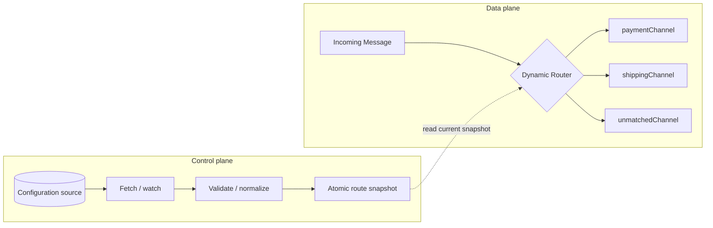
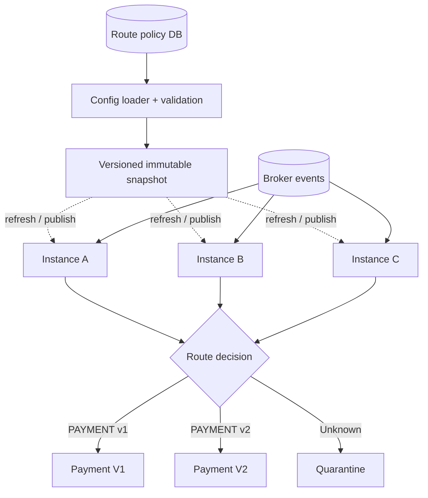

# Nguồn cấu hình route và vòng đời cache

Trong một luồng tích hợp, **Router** chọn nơi message sẽ đi tiếp. Nếu mọi quy tắc đều được viết cứng trong ứng dụng, mỗi lần thay đổi channel nhận, thêm nhóm khách hàng hoặc chuyển một loại sự kiện sang handler khác có thể đòi hỏi sửa code và triển khai lại. **Dynamic Router** giải quyết bài toán này bằng cách tách **quyết định định tuyến tại thời điểm nhận message** khỏi **nguồn cung cấp quy tắc có thể thay đổi khi ứng dụng đang chạy**.

Tuy nhiên, đọc database hoặc gọi Config Service trên **mỗi message** thường khiến Router phụ thuộc mạng, tăng độ trễ và tạo thêm điểm lỗi. Vì thế, một thiết kế thực tế thường gồm **nguồn cấu hình chuẩn (source of truth)**, **bộ kiểm tra cấu hình**, **cache/snapshot quy tắc đang dùng** và **cơ chế refresh có kiểm soát**. Bài học thuộc chương **Dynamic router** của module `SPRING_INTEGRATION_PATTERN`, tập trung vào cách áp dụng Enterprise Integration Patterns với Spring Integration để xây dựng luồng message ít phụ thuộc, dễ mở rộng, hỗ trợ Router, Filter, Transformer, Splitter, Aggregator, Gateway, retry, error channel, correlation, kiểm thử và giám sát từng nhánh.

Sau bài này, bạn có thể:

- Nhận diện các nguồn cấu hình route: code/property, database, Config Server, feature flag, registry và service quản trị.
- Phân biệt **control plane** cập nhật rule với **data plane** xử lý message; quyết định nên cache điều gì.
- Mô tả vòng đời cache từ khởi động, load, validate, publish snapshot, refresh, hết hạn, rollback đến shutdown.
- Chọn TTL, push invalidation, polling, versioning, last-known-good và chính sách **fail open/fail closed** theo rủi ro nghiệp vụ.
- Triển khai ví dụ Java với `@Router`, bản chụp bất biến và `AtomicReference` để thay đổi quy tắc mà không cần restart.
- Kiểm thử thay đổi route trong runtime, cấu hình sai, lỗi nguồn, nhiều instance và tác động tới retry/correlation.

## 1. Dynamic Router thực sự “động” ở phần nào?

**Content-Based Router** có thể đọc payload/headers rồi chọn channel theo điều kiện. **Dynamic Router** nhấn mạnh việc **quy tắc hoặc tập đích có thể được thay đổi trong lúc hệ thống chạy**, chứ không chỉ thay đổi vì payload của hai message khác nhau.

Ví dụ, cùng `OrderEvent(type=PAYMENT)`:

```text
10:00  Config v12: PAYMENT -> paymentV1Channel
10:05  Config v13: PAYMENT -> paymentV2Channel

Message đến lúc 10:01 -> paymentV1Channel
Message đến lúc 10:06 -> paymentV2Channel
```

Trong thực tế, kết quả còn phụ thuộc vào **thời điểm mỗi instance nhận được cấu hình mới**. Không có đảm bảo mọi process chuyển sang version mới tại đúng một mili giây nếu không thiết kế cơ chế phối hợp triển khai.



Hai đường đi nên có trách nhiệm độc lập:

1. **Control plane** đọc cấu hình, xác minh quyền và tính hợp lệ, chọn version được kích hoạt, thay snapshot và phát metric/audit.
2. **Data plane** đọc **snapshot hiện hành** rồi chọn channel nhanh, không cần gọi network mỗi message nếu nghiệp vụ không yêu cầu tra cứu thời gian thực.

**Dynamic không đồng nghĩa tùy ý.** Một rule chỉ được phép chọn **channel đã được công bố và cho phép**. Nếu để client truyền thẳng tên bean hoặc địa chỉ URL làm route, ta biến routing thành bề mặt tấn công và làm mất khả năng dự đoán topology.

## 2. Nguồn cấu hình route: nên lấy từ đâu?

| Nguồn | Ưu điểm | Hạn chế/rủi ro | Tình huống phù hợp |
| --- | --- | --- | --- |
| **Properties/YAML đóng gói với ứng dụng** | Đơn giản, dễ review qua Git, nhất quán theo release. | Thường phải triển khai hoặc reload để thay đổi. | Hệ thống ít đổi route, yêu cầu kiểm soát release chặt. |
| **Spring Config Server hoặc hệ quản lý cấu hình** | Quản lý tập trung, có version/profile và cơ chế cập nhật. | Phải thiết kế refresh, quyền truy cập và xử lý khi nguồn unavailable. | Nhiều instance cần thống nhất policy vận hành. |
| **Database cấu hình route** | Hỗ trợ quản trị, audit, rollback; truy vấn theo tenant/loại message. | Cần schema, transaction và cache để tránh truy vấn trên mỗi message. | Bảng ánh xạ thay đổi thường xuyên theo nghiệp vụ. |
| **Feature flag/policy service** | Bật/tắt nhánh, rollout theo nhóm và canary. | Quy tắc phức tạp, khác version theo instance, có thể lẫn kiểm thử tính năng với routing. | Chuyển traffic có kiểm soát giữa phiên bản xử lý. |
| **Service registry/discovery** | Tìm endpoint còn sống và metadata kết nối. | Danh sách instance còn sống **không đủ** để quyết định nghiệp vụ nào được đi đâu. | Chọn instance sau khi business route đã được xác định. |
| **Admin API/control bus nội bộ** | Thay đổi nhanh, dễ tích hợp thao tác vận hành. | Phải xác thực, phân quyền, lưu audit và bảo vệ trước thay đổi sai. | Điều hành động, sự cố, kích hoạt quy tắc đã được duyệt. |

Đừng đánh đồng **nguồn route policy** với **service discovery**. Ví dụ chính sách `PAYMENT -> paymentHandler` là quyết định nghiệp vụ/kiến trúc; discovery chỉ giúp tìm instance của `paymentHandler` khi gửi qua mạng. Tên channel trong Spring Integration thường tồn tại trong application context, không tự được tạo chỉ vì database trả về một chuỗi mới.

### Chọn nguồn sự thật (source of truth)

Nếu route được quản lý ở nhiều nơi, phải có thứ tự ưu tiên. Ví dụ `DB` là nguồn chuẩn, `Git` là nơi review/change approval, còn cache của từng JVM chỉ là **bản sao đang hoạt động**. Nếu cho cả DB, file local và admin API cập nhật độc lập mà không có quy tắc hợp nhất, hai instance dễ quyết định route khác nhau một cách khó giải thích.

Một bản cấu hình tối thiểu nên có các thuộc tính:

```json
{
  "version": 42,
  "environment": "production",
  "effectiveAt": "2026-11-21T09:00:00Z",
  "routes": {
    "PAYMENT": "paymentOrders",
    "SHIPMENT": "shippingOrders"
  },
  "fallback": "unmatchedOrders"
}
```

Đây là **schema minh họa do ứng dụng định nghĩa**, không phải định dạng JSON mặc định của Spring Integration. `version` dùng để kiểm soát thứ tự áp dụng; `environment` ngăn nhầm môi trường; `effectiveAt` giúp phối hợp kích hoạt theo thời gian nếu cần; `fallback` là nơi tiếp nhận khi không thể phân giải route. Dữ liệu quản trị cần được xác thực và kiểm tra channel allowlist trước khi đưa vào data plane.

## 3. Cache điều gì và không cache điều gì?

Cache lý tưởng là một **snapshot của quy tắc đã được kiểm tra**, không phải một danh sách có thể bị sửa từng phần khi Router đang đọc.

| Có thể cache | Không nên lẫn vào cùng cache |
| --- | --- |
| Mapping `eventType -> channelName`. | Dữ liệu giao dịch cụ thể như `orderId`/trạng thái thanh toán. |
| Bộ quy tắc `tenant + eventType -> route`. | Token truy cập, secret hoặc thông tin xác thực do client cung cấp. |
| Version, thời điểm load và hạn sử dụng. | Correlation ID và thông tin tiến trình của message khác. |
| Danh sách route được cho phép đã validate. | Kết quả `send()`/ACK của các handler downstream. |

Giữ **snapshot bất biến** để một quyết định định tuyến dùng **một version nhất quán**. Ví dụ, nếu một thread sửa `HashMap` trong lúc các thread khác gọi Router, một message có thể nhìn thấy trạng thái chỉ mới cập nhật một phần, hoặc gặp vấn đề đồng thời. Thay cả một `Map.copyOf(...)` đã kiểm tra thông qua `AtomicReference` thường an toàn hơn việc sửa trực tiếp bản đồ chung.

### Cache không thay thế tính đúng của nghiệp vụ

Một bản ghi cấu hình mới cho phép chuyển `PAYMENT` sang `paymentOrdersV2` **không chứng minh** handler V2 đã sẵn sàng. Phải kiểm tra topology, contract payload, quyền truy cập, khả năng nhận message và chiến lược rollback **trước khi kích hoạt** version đó.

Nếu quy tắc thay đổi ảnh hưởng nghiệp vụ bắt buộc (chẳng hạn lựa chọn đối tác thanh toán), cần có audit quyết định và khả năng giải thích **message nào đã dùng version nào**. Log `eventId`, `routeVersion`, `selectedChannel`, `outcome` một cách có kiểm soát; không nhét ID từng giao dịch vào metric labels.

## 4. Vòng đời cache của Dynamic Router

Một vòng đời rõ ràng giúp tránh việc server vẫn chạy nhưng route theo policy quá cũ mà không ai biết.

```mermaid
stateDiagram-v2
    [*] --> ColdStart
    ColdStart --> Active: Load + validate + install
    ColdStart --> Unavailable: Initial load failed
    Active --> Refreshing: Timer / watch / admin change
    Refreshing --> Active: Valid newer snapshot installed
    Refreshing --> Stale: Source failed; keep last-known-good
    Refreshing --> Active: Invalid / old version rejected
    Stale --> Refreshing: Retry with backoff
    Stale --> Unavailable: Max staleness exceeded
    Unavailable --> Active: Valid snapshot installed
    Active --> [*]: Shutdown
    Unavailable --> [*]: Shutdown
```

Mô hình trên là **state machine thiết kế**, không phải các trạng thái được Spring tự sinh. Các ứng dụng có thể dùng tên và chiến lược khác nhau, nhưng cần xử lý đủ những chuyển tiếp quan trọng:

1. **Cold start:** chưa có config trong bộ nhớ. Quy định ứng dụng có được nhận traffic hay phải giữ readiness `NOT_READY` cho đến khi load một version hợp lệ.
2. **Initial load:** đọc nguồn, parse, kiểm tra schema, nguồn tin cậy, version, channel và rule conflicts. **Chỉ publish snapshot nếu tất cả điều kiện đạt**.
3. **Active:** Router đọc snapshot bất biến trong mỗi lần xử lý message; thao tác tìm route nên nhanh và không có network I/O trên hot path.
4. **Refresh triggered:** timer, watch event, message thay đổi từ control plane hoặc thao tác được cấp quyền yêu cầu kiểm tra bản mới.
5. **Refresh success:** thay **nguyên snapshot** một cách nguyên tử, lưu version và thời điểm install, phát sự kiện audit.
6. **Refresh failure:** không xóa bản tốt đang chạy; ghi nhận nguồn lỗi, cấu hình sai hoặc version cũ, dùng retry/backoff có giới hạn.
7. **Stale/expired:** kiểm tra mức tuổi tối đa được phép. Khi vượt ngưỡng, có thể fail closed, route vào quarantine hoặc dừng nhận traffic — tùy tính quan trọng của dữ liệu.
8. **Rollback:** quay về một **version được duyệt** bằng một thao tác quản trị có audit. Không nên ngầm chọn dữ liệu cũ vì timestamp nhỏ hơn mà không có chính sách version rõ ràng.
9. **Shutdown:** ngừng các refresh task, kiểm soát in-flight message và không giả định cache sẽ tồn tại sau restart.

## 5. TTL, refresh và invalidation: ba khái niệm khác nhau

**TTL (*time-to-live*)** là thời gian một bản dữ liệu được coi là còn dùng được; **refresh** là hành động lấy bản mới; **invalidation** là việc đánh dấu bản hiện tại cần được thay hoặc không còn đáng tin. Một cấu hình có TTL **không có nghĩa** nó sẽ tự refresh, và một tác vụ refresh thành công **không chứng minh** tất cả instance đã sử dụng version mới.

| Chính sách | Cơ chế | Ưu điểm | Rủi ro/chú ý |
| --- | --- | --- | --- |
| **Refresh định kỳ** | Poll mỗi N giây/phút. | Đơn giản, ít phụ thuộc callback. | Có độ trễ tối đa gần chu kỳ poll; cần jitter để tránh đồng loạt truy vấn. |
| **Push notification / watch** | Nguồn gửi tín hiệu khi version thay đổi. | Cập nhật nhanh, ít truy vấn nền. | Mất event cần cơ chế reconcile định kỳ; không nên tin sự kiện chưa xác thực. |
| **Lazy refresh** | Phát hiện hết hạn khi có message. | Ít hoạt động khi không có traffic. | Không nên chặn mọi message trên hot path vì remote call; dễ dồn tải khi cache hết hạn. |
| **Stale-while-revalidate** | Tạm dùng bản cũ trong giới hạn, refresh ngoài luồng. | Chịu lỗi nguồn tốt, giảm latency. | Rule có thể không còn phù hợp; phải xác định *maximum staleness*. |
| **Hard expiry / fail closed** | Không route bằng snapshot quá tuổi. | Giảm nguy cơ dùng rule nguy hiểm đã lỗi thời. | Giảm availability nếu control plane unavailable. |

### Ví dụ tính tuổi cấu hình

Giả sử hệ thống refresh mỗi **30 giây**, xem cấu hình là **đang hoạt động** trong 2 phút và cho phép tối đa **10 phút** kể từ lần cài đặt snapshot hợp lệ:

```text
T0       Load version 42 -> Active
T0+30s   Refresh lỗi -> giữ version 42, cảnh báo
T0+2m    Đánh dấu stale; tiếp tục theo chính sách
T0+10m   Hết max staleness -> fail closed/quarantine
T0+11m   Load version 43 hợp lệ -> Active trở lại
```

Các khoảng thời gian chỉ là **ví dụ lựa chọn**. Một luồng gửi email marketing có thể chấp nhận stale lâu hơn; route thanh toán hoặc chia tenant có thể cần fail closed sớm. Nên đo **tuổi bản cấu hình đang dùng** và **thời gian từ lần cập nhật thành công gần nhất**, không chỉ đếm số lần poll.

### Vấn đề cache stampede

Nếu 100 worker đồng thời thấy cache hết hạn và cùng truy cập DB, tải nguồn có thể tăng đột biến. Một **single-flight refresh** ở mỗi instance, backoff và jitter khi polling giúp giảm tình huống này. Với nhiều instance, có thể dùng watch và cơ chế phát version mới, nhưng mỗi process vẫn cần bảo đảm validate + cài đặt snapshot nguyên tử.

## 6. Atomic snapshot và kiểm soát version

Một yêu cầu then chốt là **không để Router nhìn thấy một nửa cấu hình cũ, một nửa cấu hình mới**.

```text
Không an toàn:
  sharedMap.put("PAYMENT", "paymentOrdersV2");
  ... thời gian trôi qua ...
  sharedMap.put("SHIPMENT", "shippingOrdersV2");

An toàn hơn:
  proposed = parse + validate + immutable snapshot v43
  activeSnapshot.compareAndSet(v42, v43)
```

`AtomicReference` phù hợp với bảng route vừa/nhỏ đọc rất thường xuyên và cập nhật ít. Khi data plane đọc một snapshot **một lần cho một message**, nó có cái nhìn nhất quán dù control plane đang thay bản mới.

### Quy tắc version nên được áp dụng

- **Chỉ chấp nhận version mới hơn** theo thứ tự đã định (số tăng dần, revision monotonic hoặc generation ID). `loadedAt` không phải bằng chứng version mới hơn.
- **Parse/validate ngoài bản đang hoạt động**, sau đó mới `install`. Nếu có bất kỳ mapping không được phép, từ chối **toàn bộ bản cập nhật**.
- **Không đột ngột xóa last-known-good** khi tải cấu hình thất bại.
- **Rollback có kiểm soát:** có thể phát hành lại nội dung cũ dưới **generation mới** hoặc dùng một quy trình hạ version có xác thực/audit, tránh cho consumer tự áp đặt rollback ngẫu nhiên.
- **Không thay đổi route giữa chừng cho cùng một nghiệp vụ nhiều bước** nếu yêu cầu tính nhất quán. Có thể đóng băng `routeVersion`/quyết định ở message hoặc lưu trạng thái workflow theo contract.

## 7. Ví dụ Java: Dynamic Router đọc snapshot bất biến

Ví dụ dùng **Java 17+**, Spring Integration và phương thức **`@Router`** của ứng dụng. Thay vì viết trực tiếp vào bản đồ route trong handler, một component quản lý **bản chụp đã kiểm tra** và cho phép control plane cài version mới. Đây là **một cách triển khai Dynamic Router bằng code ứng dụng**, không phải tuyên bố Spring Integration luôn cung cấp sẵn một cache rule như thế này.

### 7.1. Mô hình và bộ nhớ snapshot

```java
import java.time.Duration;
import java.time.Instant;
import java.util.Map;
import java.util.Set;
import java.util.concurrent.atomic.AtomicReference;

import org.springframework.integration.annotation.Router;
import org.springframework.messaging.Message;
import org.springframework.stereotype.Component;

record OrderEvent(String eventId, String orderId, String eventType) {}

record RouteSnapshot(long version,
                     Map<String, String> routes,
                     Instant installedAt) {
    RouteSnapshot {
        routes = Map.copyOf(routes); // Không cho sửa mapping sau khi publish.
    }
}

@Component
class DynamicOrderRouter {
    private static final String FALLBACK = "unmatchedOrders";
    private static final Set<String> ALLOWED_TARGETS =
            Set.of("paymentOrders", "shippingOrders");
    private static final Duration MAX_STALENESS = Duration.ofMinutes(10);

    private final AtomicReference<RouteSnapshot> active =
            new AtomicReference<>(new RouteSnapshot(0, Map.of(), Instant.EPOCH));

    @Router(inputChannel = "ordersInput")
    public String chooseChannel(Message<OrderEvent> message) {
        RouteSnapshot snapshot = active.get(); // Một bản chụp cho một quyết định.

        // Chưa load hoặc snapshot quá cũ: không định tuyến tới nhánh nhạy cảm.
        if (snapshot.version() == 0
                || Instant.now().isAfter(
                        snapshot.installedAt().plus(MAX_STALENESS))) {
            return FALLBACK;
        }

        String eventType = message.getPayload().eventType();
        if (eventType == null || eventType.isBlank()) {
            return FALLBACK;
        }
        return snapshot.routes().getOrDefault(eventType, FALLBACK);
    }

    public void install(long version, Map<String, String> proposedRoutes) {
        if (version <= 0 || proposedRoutes == null || proposedRoutes.isEmpty()) {
            throw new IllegalArgumentException("INVALID_ROUTE_CONFIG");
        }
        if (proposedRoutes.entrySet().stream().anyMatch(entry ->
                entry.getKey() == null || entry.getKey().isBlank()
                        || entry.getValue() == null
                        || !ALLOWED_TARGETS.contains(entry.getValue()))) {
            throw new IllegalArgumentException("DISALLOWED_ROUTE_MAPPING");
        }

        RouteSnapshot next =
                new RouteSnapshot(version, proposedRoutes, Instant.now());

        while (true) {
            RouteSnapshot previous = active.get();
            if (version <= previous.version()) {
                throw new IllegalArgumentException("OUTDATED_ROUTE_VERSION");
            }
            if (active.compareAndSet(previous, next)) {
                return; // Publish toàn bộ snapshot một lần.
            }
        }
    }

    public RouteSnapshot snapshot() {
        return active.get();
    }
}
```

Các quyết định thiết kế trong ví dụ:

1. Router **không gọi DB/HTTP** trên mỗi message. `chooseChannel()` chỉ đọc snapshot và tra cứu map.
2. `Map.copyOf(...)` làm mapping của snapshot **bất biến**; `AtomicReference` cung cấp điểm thay version nguyên tử cho mỗi process.
3. `install()` từ chối tên channel ngoài `ALLOWED_TARGETS`; không cho một cấu hình từ bên ngoài tự chọn bean như `adminChannel`.
4. Version phải **tăng**: update cũ đến muộn không ghi đè update mới.
5. Nếu chưa cài cấu hình hoặc quá **10 phút kể từ lần install hợp lệ**, Router gửi sang fallback. Đây là **chính sách fail closed minh họa**; không phải TTL có sẵn của Spring.
6. `FALLBACK` là channel đã định nghĩa và phải có consumer thực sự. Gửi vào fallback không tự đảm bảo message được lưu an toàn.

Để production, nên dùng `Clock` được inject thay cho `Instant.now()` trực tiếp để kiểm thử thời gian một cách quyết định; làm rõ ràng chính sách version, stale và review quyền. Một route snapshot được cài đặt cũng cần ghi **source version/ETag** và `lastRefreshAttempt` riêng nếu muốn phân biệt **đã kiểm tra nguồn** với **đã cài policy mới**.

### 7.2. Khai báo các channel đích

```java
import org.springframework.context.annotation.Bean;
import org.springframework.context.annotation.Configuration;
import org.springframework.integration.channel.DirectChannel;
import org.springframework.integration.channel.QueueChannel;
import org.springframework.integration.config.EnableIntegration;

@Configuration
@EnableIntegration
class DynamicRoutingChannels {

    @Bean
    DirectChannel ordersInput() {
        return new DirectChannel();
    }

    @Bean
    QueueChannel paymentOrders() {
        return new QueueChannel();
    }

    @Bean
    QueueChannel shippingOrders() {
        return new QueueChannel();
    }

    @Bean
    QueueChannel unmatchedOrders() {
        return new QueueChannel();
    }
}
```

Trong ví dụ này, `@Router` được Spring Integration đăng ký như endpoint tiêu thụ từ `ordersInput` và phương thức trả về **tên channel** cần gửi message tới. Ba `QueueChannel` là đích quan sát trong test; chúng không có khả năng tự xử lý đơn hàng hoặc lưu bền vững sau khi process chết. Không khởi tạo thêm một router DSL khác đọc cùng `ordersInput` nếu bạn đang muốn **một** quyết định route duy nhất.

### 7.3. Nguồn cập nhật và refresh coordinator

Control plane cần có một adapter lấy cấu hình từ nguồn chuẩn rồi chuyển cho `DynamicOrderRouter.install(...)`. Ví dụ về **hợp đồng**, không phụ thuộc DB hay Config Server cụ thể:

```java
import java.util.Map;

record RouteDefinition(long version, Map<String, String> routes) {}

interface RouteConfigSource {
    RouteDefinition fetchLatest();
}

// Được gọi bởi scheduler, watcher hoặc API quản trị đã xác thực.
void refresh(RouteConfigSource source, DynamicOrderRouter router) {
    RouteDefinition candidate = source.fetchLatest();
    router.install(candidate.version(), candidate.routes());
}
```

Đoạn `refresh` là **pseudocode Java ở mức orchestration**: cần đặt trong một class/service hợp lệ, bổ sung metrics, authentication, phân loại exception và logic không cài lại cùng version. `fetchLatest()` không phải API của Spring; đây là interface ứng dụng. Với refresh định kỳ, có thể dùng `@Scheduled` cùng `@EnableScheduling`, nhưng phải tránh refresh đồng thời và xử lý lỗi mà **không xóa snapshot hiện hành**.

**Không ném mọi exception ra rồi im lặng:** lỗi fetch, lỗi schema, version cũ và đích không cho phép phải có mã lý do/metric riêng. Có thể giữ last-known-good đến thời hạn `MAX_STALENESS`, rồi chuyển sang fallback theo policy đã chọn. Trạng thái readiness cũng nên phản ánh khi nguồn bắt buộc không thể tải lúc khởi động.

## 8. Kiểm thử route thay đổi mà không cần restart

Điều cần chứng minh không chỉ là hàm lookup trả `paymentOrders`, mà còn là **message đi sang channel khác sau khi cài một version mới**, một cấu hình sai bị từ chối và dữ liệu còn nguyên vẹn.

### Integration test với JUnit 5 và Spring Test

```java
import static org.junit.jupiter.api.Assertions.assertEquals;
import static org.junit.jupiter.api.Assertions.assertNotNull;
import static org.junit.jupiter.api.Assertions.assertNull;
import static org.junit.jupiter.api.Assertions.assertThrows;
import static org.junit.jupiter.api.Assertions.assertTrue;

import java.util.Map;

import org.junit.jupiter.api.Test;
import org.springframework.beans.factory.annotation.Autowired;
import org.springframework.beans.factory.annotation.Qualifier;
import org.springframework.integration.channel.QueueChannel;
import org.springframework.messaging.Message;
import org.springframework.messaging.MessageChannel;
import org.springframework.messaging.support.MessageBuilder;
import org.springframework.test.annotation.DirtiesContext;
import org.springframework.test.context.junit.jupiter.SpringJUnitConfig;

@SpringJUnitConfig({DynamicRoutingChannels.class, DynamicOrderRouter.class})
@DirtiesContext(classMode = DirtiesContext.ClassMode.AFTER_EACH_TEST_METHOD)
class DynamicRoutingFlowTest {

    @Autowired
    DynamicOrderRouter router;

    @Autowired @Qualifier("ordersInput")
    MessageChannel input;

    @Autowired @Qualifier("paymentOrders")
    QueueChannel payments;

    @Autowired @Qualifier("shippingOrders")
    QueueChannel shipping;

    @Autowired @Qualifier("unmatchedOrders")
    QueueChannel unmatched;

    @Test
    void switchesRouteAfterInstallingANewVersion() {
        router.install(1, Map.of("PAYMENT", "paymentOrders"));
        var event1 = new OrderEvent("evt-1", "ORD-1", "PAYMENT");
        assertTrue(input.send(MessageBuilder.withPayload(event1).build()));
        Message<?> first = payments.receive(1_000);
        assertNotNull(first);
        assertEquals(event1, first.getPayload());

        router.install(2, Map.of("PAYMENT", "shippingOrders"));
        var event2 = new OrderEvent("evt-2", "ORD-2", "PAYMENT");
        assertTrue(input.send(MessageBuilder.withPayload(event2).build()));
        Message<?> second = shipping.receive(1_000);
        assertNotNull(second);
        assertEquals(event2, second.getPayload());
        assertNull(payments.receive(0));
        assertNull(unmatched.receive(0));
    }

    @Test
    void rejectsDisallowedTargetsWithoutReplacingGoodSnapshot() {
        router.install(3, Map.of("PAYMENT", "paymentOrders"));
        assertThrows(IllegalArgumentException.class, () ->
                router.install(4, Map.of("PAYMENT", "internalAdminChannel")));
        assertEquals(3, router.snapshot().version());
    }
}
```

Ví dụ dùng `@SpringJUnitConfig` và `QueueChannel` làm đích quan sát trong **một JVM**, không thử kết nối DB/broker. `@DirtiesContext` yêu cầu dựng lại context sau mỗi test để **cache version và các queue không bị chia sẻ giữa các ca**; cách này đơn giản nhưng có thể làm test suite chậm hơn. Trong dự án lớn có thể dùng fixture reset có kiểm soát thay thế. Giá trị `version=3` trong test thứ hai chỉ minh họa tính tăng phiên bản, **không phụ thuộc** vào thứ tự thực thi của JUnit.

Khi đưa vào code thật, phải bảo đảm bean `DynamicOrderRouter` được đăng ký đúng một lần, các dependencies Spring Integration/Spring Test/JUnit 5 phù hợp và `@Router` endpoint được khởi tạo trong application context. Ví dụ có tính minh họa, bước STEP 4 **không chạy biên dịch hay test suite**.

### Các kiểm thử quan trọng khác

| Tình huống | Điều cần chứng minh |
| --- | --- |
| Khởi động chưa có snapshot | Router fail closed hoặc readiness chặn nhận traffic theo contract. |
| Nhận version mới hợp lệ | Không restart; message mới đi theo version được cài. |
| Nguồn cấu hình timeout | Snapshot tốt đang có không bị xóa; có metric/retry/backoff. |
| Mapping chứa channel không cho phép | Từ chối toàn bộ candidate; version đang hoạt động không đổi. |
| Version cũ đến sau version mới | Bị từ chối, không rollback ngoài ý muốn. |
| Cấu hình hết tuổi cho phép | Không tiếp tục đi route nhạy cảm theo snapshot quá cũ. |
| Nhiều thread route trong lúc refresh | Mỗi message dùng một snapshot nguyên vẹn; không thấy mapping cập nhật dở. |
| Nhiều instance refresh lệch nhau | Có log/version telemetry để xác định instance nào còn stale. |
| Gateway cần reply | Fallback trả kết quả hoặc timeout/lỗi đúng contract; không chờ vô hạn. |
| Broker redelivery sau đổi route | Idempotency và route-version policy ngăn tác động phụ lặp. |

## 9. Cache theo từng instance và consistency giữa nhiều replica

Khi chạy nhiều instance, mỗi JVM có một cache/snapshot riêng. Một config update không tự biến thành thay đổi nguyên tử trên toàn bộ cluster.

```text
Config source: v43

Instance A: v43  -> PAYMENT -> paymentOrdersV2
Instance B: v42  -> PAYMENT -> paymentOrdersV1
Instance C: v43  -> PAYMENT -> paymentOrdersV2
```

Nếu mọi instance cùng tiêu thụ event từ broker, cùng `eventType` có thể tới hai handler khác nhau trong giai đoạn chuyển đổi. Các chiến lược cần cân nhắc:

1. **Eventual consistency có giới hạn:** chấp nhận một cửa sổ chuyển version, theo dõi `route_version` của từng instance và đảm bảo cả handler cũ/mới tương thích.
2. **Quy trình two-phase rollout:** triển khai handler mới trước, kiểm tra readiness, rồi mới phát hành route config dùng handler mới; không xóa handler cũ quá sớm.
3. **Gắn quyết định/phiên bản vào message:** nếu một nghiệp vụ cần tính nhất quán xuyên nhiều bước hoặc qua replay, lưu route version/decision theo contract và kiểm tra trước khi xử lý lại.
4. **Canary rollout:** cho một tập traffic dùng version mới bằng **quy tắc ổn định** (ví dụ hash bền vững của business ID), không chọn ngẫu nhiên khác nhau ở mỗi lần retry nếu side effect quan trọng.
5. **Đồng bộ nghiêm ngặt:** với nghiệp vụ buộc toàn bộ cluster đổi cùng lúc, cần cơ chế phối hợp/điều phối chuyên biệt hoặc tạm dừng traffic; TTL/polling đơn thuần không bảo đảm atomic cutover trên nhiều JVM.

Nếu một message đến A lúc v42 và bị replay trên B lúc v43, hãy làm rõ nghiệp vụ muốn **giữ quyết định route ban đầu** hay **áp dụng rule mới**. Không giải quyết bằng cách chỉ tăng TTL, vì đây là **chính sách nhất quán nghiệp vụ**, không đơn thuần là tối ưu cache.

## 10. Failure policy: last-known-good hay fail closed?

Chọn cách hành xử khi nguồn cấu hình không có sẵn trước khi xảy ra sự cố.

| Phương án | Khi thích hợp | Hạn chế |
| --- | --- | --- |
| **Last-known-good** đến ngưỡng tuổi | Route không đổi quá nhanh, ưu tiên availability. | Có thể chạy policy đã được thu hồi trong một khoảng thời gian. |
| **Fail closed** | Route nhạy cảm với quyền, tiền, dữ liệu tenant hoặc tuân thủ. | Có thể tạm dừng xử lý nhiều message khi nguồn lỗi. |
| **Quarantine / unmatched** | Muốn bảo toàn message để xem lại thay vì route sai. | Đích cần consumer và store bền vững khi yêu cầu không mất dữ liệu. |
| **Fail open với rule mặc định** | Chỉ khi hợp đồng cho phép và chứng minh rủi ro thấp. | Có thể gửi dữ liệu tới nơi không mong muốn; thường không phù hợp nhánh nhạy cảm. |

**Last-known-good không có nghĩa “dùng mãi mãi”.** Quy định `maxStaleness`, mức cảnh báo, hành vi quá hạn, khi nào đánh dấu readiness xấu và có cần chặn nguồn vào hay không. Với Kafka/AMQP, nếu fail closed bằng cách ném lỗi, cần phối hợp retry/ack/DLQ để không tạo poison-message loop; nếu fail closed bằng unmatched channel, phải bảo đảm nhánh đó có xử lý bền vững theo yêu cầu.

### Cấu hình nguồn bị sai: không cài một nửa

Ví dụ bản v44 gồm ba route, trong đó hai route hợp lệ nhưng route thứ ba trỏ tới `internalAdminChannel` bị cấm. Không nên chấp nhận hai rule trước rồi lỗi ở rule cuối: tất cả message sẽ nhìn thấy một version khó định nghĩa. Hãy validate **toàn bộ candidate** và chỉ sau khi hợp lệ mới `install` một snapshot mới.

## 11. Bảo mật control plane và hạn chế route injection

Nguồn cấu hình route có khả năng thay đổi **đường đi của dữ liệu**, nên phải được xem như một bề mặt quản trị nhạy cảm.

- **Authentication và authorization:** chỉ tài khoản/service đã được cấp quyền mới được sửa mapping, kích hoạt version và rollback. Tách quyền xem với quyền chỉnh sửa/phê duyệt.
- **Allowlist target:** giá trị config không được phép là bất kỳ tên bean channel, URL hoặc queue tùy ý. Mapping phải trỏ tới đích đã được triển khai và review.
- **Schema validation:** giới hạn số lượng rule, kiểu khóa, độ dài, định dạng, conflict, trùng lặp, môi trường và version. Không đánh giá expression/script tùy ý từ nguồn chưa tin cậy.
- **Audit thay đổi:** ai phê duyệt, revision/hash nào, trước và sau thay đổi, rollout window, kết quả validate/install, rollback reason.
- **Bảo vệ secrets:** không để mật khẩu và token trong route mapping hoặc logs; config client phải dùng TLS và quyền tối thiểu.
- **Bảo vệ data plane:** header `tenantId`, `routeKey` hoặc `sourceSystem` do client tự gửi không được coi là đã xác thực. Router chỉ chọn đường đi, handler vẫn phải kiểm tra quyền nghiệp vụ.

Một cơ chế Control Bus hoặc admin endpoint có thể hỗ trợ thay đổi lúc runtime, nhưng chỉ nên dùng cùng authentication, authorization, validation và audit tương đương các hệ thống quản trị khác. **Không mở một control endpoint ra Internet chỉ vì việc thay route cần nhanh.**

## 12. Tác động tới Gateway, Filter, Splitter/Aggregator và idempotency

Dynamic Router nằm trong một hệ thống EIP rộng hơn. Một rule thay đổi có thể làm lộ ra lỗi mà route tĩnh trước đây không gặp.

### Gateway request–reply

Nếu `Gateway.submitOrder()` chờ kết quả nhưng cấu hình mới chuyển message sang một nhánh **không tạo reply**, bên gọi có thể timeout. Cần kiểm tra **contract phản hồi** của mọi target trước khi đưa vào allowlist, và quy định fallback trả một `UnsupportedRoute` hoặc lỗi/no-reply phù hợp khi Gateway yêu cầu kết quả.

### Filter và nhánh bị loại

Sau khi route tới handler mới, Filter có thể loại message khác với nhánh cũ. **Filter trả false** không đồng nghĩa exception và không tự đưa dữ liệu vào error channel. Nếu nghiệp vụ không cho phép mất message, cần discard/quarantine, trả kết quả nghiệp vụ hoặc ghi audit tường minh.

### Splitter và Aggregator

Nếu một batch được split thành các message con rồi mỗi con tra **snapshot route hiện tại**, chúng có thể dùng **hai version route khác nhau** nếu refresh xảy ra giữa các phần tử. Điều đó không nhất thiết sai, nhưng nếu Aggregate yêu cầu nhất quán, cần quyết định:

- **Chốt routeVersion cho cả batch** ở entry hoặc tại thời điểm Splitter, rồi các nhánh dùng cùng version/policy thích hợp.
- Giữ **correlationId/sequenceNumber/sequenceSize** cho các phần tử được gửi tới những nhánh khác nhau.
- Có chính sách **timeout/release** và kết quả `UnsupportedRoute` nếu một phần tử không thể xử lý; không để Aggregator chờ vô hạn vì thiếu reply.

### Retry và idempotency

Nếu một command được route tới `paymentV1` rồi network timeout, retry sau khi config đã đổi sang `paymentV2` có thể tạo **hai side effect** nếu hệ thống không có idempotency. Dùng `eventId`/`commandId` bền vững và định nghĩa rõ **retry giữ route ban đầu hay được phép chọn route mới**. `MessageHeaders.id` hoặc timestamp của lần gửi không đủ thay thế khóa nghiệp vụ khi replay qua broker.

### Error channel

Lỗi tải config thuộc **control plane**, còn lỗi xử lý message thuộc **data plane**. Không nên gộp cả hai thành một `ErrorMessage` rồi retry message dữ liệu để hy vọng config source tự hồi phục. Với Spring Integration, exception ở synchronous channel có thể lan về caller; endpoint bất đồng bộ/poller có error handler và error channel theo cấu hình. Thiết kế hai đường theo dõi để biết lỗi do **không chọn được route** hay do **handler đích đã được chọn nhưng thất bại**.

## 13. Metrics, tracing và vận hành rollout

Để biết cache còn phù hợp và route mới đã được dùng thật chưa, cần quan sát **cả control plane lẫn data plane**.

| Tín hiệu minh họa | Cần trả lời |
| --- | --- |
| `route_config_active_version` | Instance đang dùng version nào? |
| `route_config_age_seconds` | Snapshot đã cài được bao lâu, có gần quá hạn không? |
| `route_refresh_attempt_total{outcome}` | Refresh thành công, timeout, invalid hay outdated bao nhiêu lần? |
| `route_refresh_duration_seconds` | Nguồn/validation mất bao lâu? |
| `router_selected_total{target}` | Message thực sự được chọn đi từng nhánh bao nhiêu? |
| `router_unmatched_total{reason}` | Bao nhiêu message không route được và vì sao? |
| `router_delivery_failed_total{target}` | Bao nhiêu lần gửi sang target thất bại? |
| `route_version_skew` | Các instance có lệch version không? |

Các tên metric này là **quy ước minh họa**; Spring Integration không tự hứa cung cấp đúng các tên ấy. Nếu metric dùng `version` làm label, hãy kiểm soát số lượng version tồn tại trong thời gian dài. Không dùng `eventId`, `orderId`, raw route key bất kỳ hoặc `tenantId` không giới hạn làm nhãn vì high cardinality và rò rỉ dữ liệu.

Log/trace có thể ghi:

```text
eventId=evt-88 routeKey=PAYMENT routeVersion=43
selectedChannel=paymentOrders routeOutcome=ROUTED
instance=orders-worker-2 traceId=trace-88
```

Đây chỉ là **định dạng ứng dụng**, không phải log có sẵn. Khi đi qua `ExecutorChannel`, `PublishSubscribeChannel` async hoặc reactive bridge, hãy xác minh việc truyền tracing context; không mặc định MDC/`ThreadLocal` tự lan qua mọi thread.

### Runbook rollout ngắn

1. Review candidate config, validate schema, channel allowlist, compatibility của payload và reply contract.
2. Triển khai handler mới trước và chứng minh readiness của đích.
3. Publish candidate với version tăng, quan sát lỗi load và số instance đã cài.
4. Chuyển traffic theo kế hoạch (đồng loạt hoặc canary có khóa ổn định), theo dõi unmatched/error/latency/side effects.
5. Khi phát hiện lỗi, kích hoạt rollback đã phê duyệt, giữ audit; không sửa trực tiếp mutable cache trên một instance rồi quên các instance khác.

## 14. Bài tập tình huống: chuyển traffic thanh toán sang handler mới

**Bối cảnh:** Hệ thống đang route `PAYMENT` sang `paymentOrdersV1`. Nhóm phát triển muốn chuyển dần sang `paymentOrdersV2`, nhưng có ba instance tiêu thụ từ broker và trong giai đoạn chuyển đổi sẽ có các message retry. `SHIPMENT` vẫn đi nhánh giao vận. Nguồn cấu hình là database; ứng dụng đang chạy phải đổi route mà không restart.



**Nhiệm vụ:**

1. Xây dựng schema config có `version`, `PAYMENT`, `SHIPMENT`, allowlist đích và `fallback`. Quy định rollback là **revision mới** chứa lại mapping cũ nếu dùng version chỉ tăng.
2. Thiết kế cache per-instance đọc trên hot path, refresh qua polling 30 giây và sự kiện notification; push chỉ là tín hiệu, vẫn có polling reconcile để phục hồi sự kiện mất.
3. Xác định `maxStaleness` và chính sách **khi DB không truy cập được**. Cần giải thích vì sao `PAYMENT` nhạy cảm hơn một loại event chỉ gửi email.
4. Viết test update v1 → v2 khi process đang chạy, invalid config bị từ chối, version cũ không overwrite mới và nhiều message đồng thời khi refresh.
5. Định nghĩa chiến lược **canary theo `orderId`/`commandId` ổn định** và cách giữ quyết định khi retry; không tự tạo target mới ở lần thử thứ hai khiến hai handler đều tạo giao dịch.
6. Theo dõi route version của từng instance, target được chọn, số unmatched, lỗi downstream và khả năng rollback thực tế.
7. Đề xuất phương án xử lý khi A đã dùng v43 nhưng B còn v42; xác định khi nào sự không đồng nhất ngắn hạn có thể chấp nhận và khi nào phải dừng nhận traffic.

### Câu hỏi tự đánh giá

**Câu 1:** Cache hết TTL có nghĩa tất cả instance đã tự lấy config mới không? **Không.** TTL là quy tắc tuổi dữ liệu; refresh/invalidation phải được triển khai riêng và có thể thất bại.

**Câu 2:** Nếu DB trả candidate có một target không thuộc allowlist, có nên cài các mapping còn lại không? **Không.** Validate toàn bộ và publish snapshot nguyên tử để không tạo version nửa vời.

**Câu 3:** Một `send()` trả `true` sau khi route tới Payment V2 có chứng minh thanh toán thành công không? **Không.** Kết quả nghiệp vụ phải dựa vào xác nhận downstream, idempotency và hợp đồng phản hồi/ACK.

**Câu 4:** Retry một sự kiện thanh toán ngay sau khi đổi route có được tùy ý dùng target mới không? **Không nên mặc định.** Phải quy định consistency và idempotency để tránh tạo side effect trùng.

**Câu 5:** Có thể dùng `HashMap` chung và sửa từng mapping đang chạy không? **Không nên.** Một snapshot bất biến được cài nguyên tử giúp data plane đọc một version đầy đủ.

## Tổng kết

- **Dynamic Router** có thể thay đổi rule/đích mà không cần restart, nhưng cần phân biệt **nguồn cấu hình chuẩn** với **snapshot cache đang hoạt động** trong từng instance.
- Tách **control plane** (fetch, validate, version, refresh, audit) khỏi **data plane** (đọc snapshot nhanh, chọn channel, xử lý message) để tránh network I/O trên hot path.
- **Vòng đời cache** gồm cold start, active, refresh, stale, expired, rollback và shutdown; TTL không tự cung cấp refresh, còn last-known-good cần giới hạn tuổi và policy rõ ràng.
- Dùng **snapshot bất biến, AtomicReference/CAS, version tăng và allowlist channel** để tránh update dở hoặc route injection; mỗi quyết định nên nhìn thấy một bản cấu hình nhất quán.
- Khi có **nhiều replica, Gateway, Filter, Splitter/Aggregator và retry**, phải xác định route version, correlation, reply/error policy, idempotency và cách xử lý stale/unknown route.
- Kiểm thử **runtime update, version cũ, cấu hình sai, nguồn lỗi, expiry, concurrent refresh, cross-instance skew** và theo dõi metrics/logs cho cả cấu hình lẫn kết quả định tuyến.
