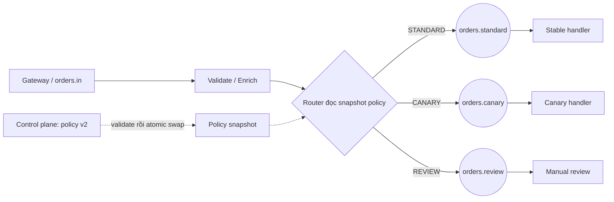
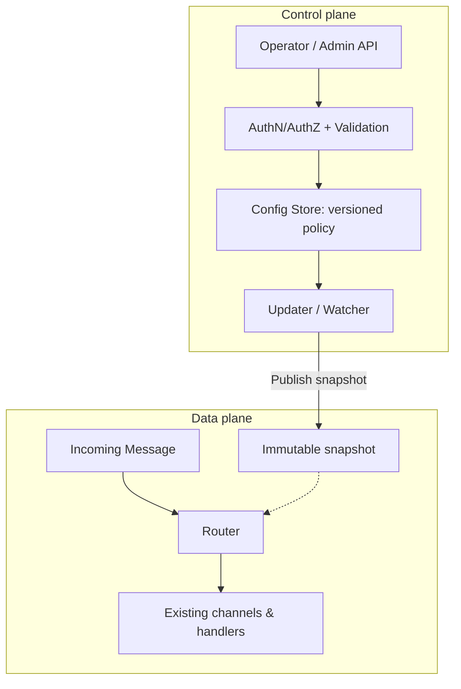
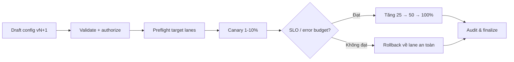

# Cập nhật route mà không dừng hệ thống

> **Chương:** Dynamic router  
> **Module:** `SPRING_INTEGRATION_PATTERN` — học triển khai Enterprise Integration Patterns với Spring Integration để xây dựng luồng thông điệp ít phụ thuộc, dễ mở rộng. Người học thực hành Router, Filter, Transformer, Splitter, Aggregator, Gateway, retry, error channel, correlation, kiểm thử và quan sát từng nhánh. Bài này tập trung vào **thay đổi quy tắc và tập đích định tuyến khi ứng dụng đang chạy**, không buộc dừng toàn bộ hệ thống để sửa từng điều kiện.

## 1. Mục tiêu học tập

Sau bài học, bạn có thể:

1. Giải thích động cơ sử dụng **Dynamic Router** của Enterprise Integration Patterns (EIP), phân biệt với Router có quy tắc cố định và chỉ thay đổi file cấu hình khi khởi động lại.
2. Tách **quyết định nghiệp vụ**, **đăng ký recipient** và **định nghĩa channel/endpoint** để biết chính xác phần nào có thể cập nhật lúc runtime.
3. Thiết kế thay đổi route theo **snapshot cấu hình bất biến, version, cập nhật nguyên tử, xác thực quyền, kiểm tra đích** và rollback.
4. Xây dựng một ví dụ Spring Integration Java DSL chọn route từ một policy có thể cập nhật mà **không phải dựng lại application context**.
5. Giải thích điều gì xảy ra với **message đang xử lý**, các instance khác nhau, retry và correlation trong lúc thay đổi chính sách.
6. Lập kế hoạch kiểm thử và triển khai **canary/feature flag**, giám sát lỗi theo nhánh và giới hạn rủi ro khi chuyển traffic.

## 2. Vấn đề thực tế: route phải thay đổi trong lúc hệ thống phục vụ

Một ứng dụng nhận event đơn hàng `OrderPlaced`. Hiện tại mọi đơn phù hợp đi tới handler xử lý chuẩn `orders.standard`. Nhóm vận hành muốn thử một thuật toán xử lý mới ở `orders.canary` với 10% đơn của một số tenant. Nếu tỷ lệ lỗi thấp, tăng dần 10% → 25% → 100%; nếu phát hiện lỗi, giảm ngay về 0%.

Những thay đổi như trên **không nhất thiết đòi dừng ứng dụng**. Tuy nhiên, đơn giản thay một tham số trong bộ nhớ chưa bảo đảm cập nhật an toàn: một message có thể ở giữa flow, hai instance có thể dùng hai version khác nhau, hoặc channel mới chưa có handler sẵn sàng.



Ở ví dụ này **cả ba channel và handler đã tồn tại**. Ta chỉ đổi cách Router chọn giữa những đích hợp lệ. Đây là dạng cập nhật dễ triển khai và dễ rollback hơn việc tạo, hủy và tái nối channel/endpoint bất kỳ giữa lúc có traffic.

> **Nguyên tắc:** “Không dừng hệ thống” nghĩa là vẫn có thể xử lý request trong khi cấu hình thay đổi, **không** có nghĩa mọi request lập tức dùng một version duy nhất ở tất cả instance, hoặc thay đổi nào cũng an toàn mà không cần kiểm tra.

## 3. Dynamic Router trong EIP có ý nghĩa gì?

Trong EIP, **Dynamic Router** cho phép hệ thống **điều chỉnh quy tắc định tuyến khi đang vận hành**. Một biến thể điển hình cho phép các recipient **đăng ký hoặc hủy đăng ký** điều kiện nhận message; Router dùng tập subscription hiện có để quyết định nơi gửi.

Phân biệt ba cơ chế dễ bị gọi chung là “dynamic”:

| Cơ chế | Điều thay đổi ở runtime | Ví dụ | Độ khó vận hành |
| --- | --- | --- | --- |
| **Runtime-updatable routing policy** | Điều kiện hoặc tỷ lệ traffic dẫn đến các channel **đã có** | Bật canary 10% | Thấp–trung bình |
| **Dynamic recipient subscriptions** | Tập recipient/điều kiện đăng ký nhận được thêm, sửa, xóa | Một đối tác subscribe event theo tenant | Trung bình–cao |
| **Dynamic topology** | Chính channel, endpoint, adapter hoặc subscription kỹ thuật được tạo/hủy | Khởi tạo adapter mới cho đối tác | Cao; cần quản lý lifecycle và tài nguyên |

Ví dụ Java DSL ở các mục sau minh họa **policy cập nhật runtime**: một thành phần hỗ trợ xây dựng Dynamic Router nhưng **không tự nhận là hiện thực đầy đủ cơ chế subscriber tự đăng ký của mẫu EIP**. Nếu cần recipient subscribe/unsubscribe, còn phải thiết kế registry, giao thức điều khiển và lifecycle rõ ràng.

### 3.1. Dynamic Router khác Content-Based Router thế nào?

- **Content-Based Router** tập trung vào câu hỏi “Nội dung message hiện tại phải đi đâu?”. Các điều kiện có thể được khai báo tĩnh.
- **Dynamic Router** bổ sung câu hỏi “**Ai và bằng cách nào có thể thay đổi điều kiện/tập recipient khi hệ thống đang chạy?**”.
- Một Content-Based Router hoàn toàn có thể đọc một **policy thay đổi ở runtime**, nhưng đó vẫn là quyết định dựa trên nội dung. Sự khác biệt nằm ở **cách quản trị và cập nhật quy tắc**, không phải một cấu trúc payload bí mật nào đó.

### 3.2. Dynamic Router khác Recipient List và Routing Slip thế nào?

| Mẫu | Bản chất | Câu hỏi cần trả lời |
| --- | --- | --- |
| **Dynamic Router** | Tập quy tắc/đích có thể được cập nhật khi chạy | Quy tắc nào hiện đang có hiệu lực? |
| **Recipient List** | Quyết định tập đích 0..N cho một message | Message này phải được gửi tới những recipient nào? |
| **Routing Slip** | Xác định **chuỗi chặng có thứ tự** cần đi qua | Chặng kế tiếp trong itinerary là gì? |
| **Publish-Subscribe Channel** | Fan-out đến các subscriber của một channel | Những subscriber hiện tại của channel sẽ nhận gì? |

Một Dynamic Router có thể trả **một** channel hoặc **nhiều** channel tùy contract. Nếu bài toán là gửi một message đến tập subscriber biến động, có thể phối hợp tư duy Dynamic Router với Recipient List. Nếu là một workflow có bước A → B → C, thay đổi route runtime không làm nó tự nhiên trở thành Routing Slip.

## 4. Phân tách data plane và control plane

**Data plane** xử lý message thật: validate, enrich, route, dispatch, handler, gateway, retry và error channel. **Control plane** cho phép quản trị cấu hình định tuyến: tạo bản thay đổi, kiểm tra, phê duyệt, phát hành, theo dõi và rollback.



Không nên để request nghiệp vụ trực tiếp gửi header `targetChannel=internal.admin` để chọn bất kỳ bean nào trong ứng dụng. Tương tự, không nên cho mọi consumer tự ý chỉnh router mà không có **quyền, giới hạn và audit**. Một yêu cầu thay đổi route là **lệnh quản trị**, khác với message nghiệp vụ bình thường.

### 4.1. Những trường thiết yếu trong một thay đổi cấu hình

| Trường | Vai trò | Ví dụ |
| --- | --- | --- |
| `policyVersion` | Version tăng đơn điệu, chống ghi đè phiên bản cũ | `42` |
| `targetLane` / routing key | Đích logic được phép | `CANARY` |
| `eligibleTenants` | Tập tenant có thể tham gia | `tenant-a`, `tenant-b` |
| `canaryPercent` | Tỷ lệ traffic được chọn | `10` |
| `effectiveAt` | Thời điểm triển khai nếu có điều phối | Theo thời gian UTC |
| `changedBy`, `changeId`, `reason` | Audit và quyền phê duyệt | `routing-change-42` |
| `expectedPreviousVersion` | Điều kiện compare-and-set | `41` |

**Version của policy không phải `MessageHeaders.id`**. Policy version định danh bản quy tắc; message ID định danh envelope. Hai trường có mục đích khác nhau.

## 5. Mô hình cập nhật an toàn: immutable snapshot + atomic swap

Thay vì để nhiều thread cập nhật trực tiếp một `HashMap` hoặc một tập rule có thể sửa tại chỗ, ta đóng gói **toàn bộ cấu hình** vào một đối tượng bất biến và thay tham chiếu hiện hành theo thao tác nguyên tử.

```text
T0: incoming message A -> đọc snapshot v1 -> STANDARD
T1: admin kiểm tra policy v2 và publish
T2: AtomicReference đổi v1 -> v2
T3: incoming message B -> đọc snapshot v2 -> CANARY

Message A tiếp tục theo quyết định v1.
Message B dùng quyết định v2.
```

Mỗi message **đọc policy một lần tại điểm quyết định**, kèm version vào metadata để giúp theo dõi. Nếu còn bước downstream phải biết “quyết định này được lập theo bản nào?”, giữ `RouteDecision` trong message thay vì bắt downstream tự đọc chính sách hiện tại thêm lần nữa.

### 5.1. Policy model thuần Java

Ví dụ dùng Java 17+ và các loại đích cố định `STANDARD`, `CANARY`, `REVIEW`:

```java
import java.util.Objects;
import java.util.Set;

enum RouteLane { STANDARD, CANARY, REVIEW }

record OrderPlaced(String orderId, String tenantId, boolean requiresReview) {
    OrderPlaced {
        if (orderId == null || orderId.isBlank()
            || tenantId == null || tenantId.isBlank()) {
            throw new IllegalArgumentException("orderId and tenantId required");
        }
    }
}

record RouteConfig(long version, int canaryPercent,
                   Set<String> eligibleTenants) {
    RouteConfig {
        if (version <= 0) {
            throw new IllegalArgumentException("Version must be positive");
        }
        if (canaryPercent < 0 || canaryPercent > 100) {
            throw new IllegalArgumentException("Percent must be 0..100");
        }
        eligibleTenants = Set.copyOf(
            Objects.requireNonNull(eligibleTenants, "eligibleTenants"));
    }
}

record RouteDecision(RouteLane lane, long policyVersion,
                     String reasonCode) {}
```

`RouteConfig` là immutable snapshot ở mức các trường dùng trong ví dụ: version, tỷ lệ và `Set` không sửa được chứa `String`. Nếu policy thật chứa `Map<String, MutableRule>` thì `Map.copyOf` **chỉ copy cấu trúc bên ngoài**; cần biến cả đối tượng rule bên trong thành bất biến.

### 5.2. Store ra quyết định và cập nhật bằng CAS

```java
import java.util.Set;
import java.util.concurrent.atomic.AtomicReference;

final class RoutePolicyStore {
    private final AtomicReference<RouteConfig> current =
        new AtomicReference<>(
            new RouteConfig(1L, 0, Set.of("tenant-a")));

    RouteDecision decide(OrderPlaced order) {
        // Đọc đúng một snapshot cho toàn bộ quyết định.
        RouteConfig config = current.get();

        // Quy tắc bảo vệ nghiệp vụ luôn có ưu tiên cao nhất.
        if (order.requiresReview()) {
            return new RouteDecision(
                RouteLane.REVIEW, config.version(), "REQUIRES_REVIEW");
        }

        boolean eligible = config.eligibleTenants()
            .contains(order.tenantId());

        // Phân bucket ổn định với cùng orderId trong chính sách mẫu.
        int bucket = Math.floorMod(order.orderId().hashCode(), 100);
        boolean canary = eligible && bucket < config.canaryPercent();

        return new RouteDecision(
            canary ? RouteLane.CANARY : RouteLane.STANDARD,
            config.version(),
            canary ? "CANARY_BUCKET" : "STABLE_ROUTE");
    }

    // Nếu caller biết version cũ, cập nhật có điều kiện và nguyên tử.
    boolean replace(long expectedVersion, RouteConfig next) {
        RouteConfig previous = current.get();
        if (previous.version() != expectedVersion
            || next.version() <= expectedVersion) {
            return false;
        }
        return current.compareAndSet(previous, next);
    }

    RouteConfig snapshot() {
        return current.get();
    }
}
```

**Đọc kỹ ý nghĩa mã:**

1. `AtomicReference` bảo đảm một thread thấy **toàn bộ snapshot cũ hoặc toàn bộ snapshot mới**, không thấy cấu hình sửa dở. Nó không giải quyết đồng bộ **giữa nhiều JVM**.
2. `replace(...)` trả `false` nếu version không khớp hoặc có bản cập nhật khác thắng cuộc đua CAS. Caller phải đọc lại version, đánh giá xung đột rồi quyết định gửi thay đổi mới; **không tự retry và ghi đè bản mới nhất**.
3. `requiresReview=true` không bị canary override dù tỷ lệ là 100%. Đây là bất biến nghiệp vụ cần kiểm thử.
4. Hash bucket theo `orderId` cho một phân phối **quyết định lặp lại ổn định** với ID giống nhau. Đây là thuật toán demo, **không cam kết đúng chính xác 10% traffic** ở tập dữ liệu nhỏ, không đảm bảo phân phối đều và không phải hash cho kiểm soát bảo mật.
5. Nếu cùng một `orderId` được route lại sau khi policy đổi từ v1 sang v2, **kết quả có thể thay đổi**. Với command đã có side effect, cần pin decision/phiên bản khi vào workflow hoặc idempotency phù hợp.

### 5.3. Một cập nhật không cần restart

```java
RoutePolicyStore store = new RoutePolicyStore();
OrderPlaced order = new OrderPlaced("ORD-100", "tenant-a", false);

RouteDecision before = store.decide(order);
// v1: canaryPercent = 0, lane = STANDARD

boolean updated = store.replace(1L,
    new RouteConfig(2L, 100, Set.of("tenant-a")));

RouteDecision after = store.decide(order);
// v2: canaryPercent = 100, lane = CANARY

// updated == true chỉ báo snapshot đổi trong JVM này.
```

Ứng dụng và Router không phải restart vì `decide(...)` dùng `current.get()` mỗi lần cần ra quyết định. Nhưng **việc đổi sang canary chỉ an toàn nếu `orders.canary` có consumer hoạt động**, dữ liệu và header phù hợp, lỗi/retry của nhánh đó đã được kiểm tra.

## 6. Đưa policy cập nhật runtime vào Spring Integration Java DSL

Để quan sát việc một message được quyết định dưới **cùng một policy version**, ví dụ lưu `RouteDecision` vào header ở bước enrichment rồi cho Router đọc header đó. Đây là điểm quan trọng: **đừng gọi `decide(...)` hai lần ở hai endpoint** vì chính sách có thể đổi giữa hai lời gọi.

### 6.1. Cấu hình flow

Ví dụ dưới đây dùng `DirectChannel` cho input và `QueueChannel` ở đích để tiện kiểm thử. Các kênh đích được định nghĩa **từ trước**; code không tự đăng ký endpoint mới trong lúc chạy.

```java
import java.util.Set;
import org.springframework.context.annotation.Bean;
import org.springframework.context.annotation.Configuration;
import org.springframework.integration.channel.DirectChannel;
import org.springframework.integration.channel.QueueChannel;
import org.springframework.integration.config.EnableIntegration;
import org.springframework.integration.dsl.IntegrationFlow;

@Configuration
@EnableIntegration
class DynamicRoutingConfiguration {

    @Bean
    RoutePolicyStore routePolicyStore() {
        return new RoutePolicyStore();
    }

    @Bean("orders.in")
    DirectChannel input() { return new DirectChannel(); }

    @Bean("orders.standard")
    QueueChannel standard() { return new QueueChannel(); }

    @Bean("orders.canary")
    QueueChannel canary() { return new QueueChannel(); }

    @Bean("orders.review")
    QueueChannel review() { return new QueueChannel(); }

    @Bean("orders.unmapped")
    QueueChannel unmapped() { return new QueueChannel(); }

    @Bean
    IntegrationFlow routeOrders(RoutePolicyStore policies) {
        return IntegrationFlow.from("orders.in")
            .enrichHeaders(h -> h.headerFunction(
                "routeDecision",
                message -> policies.decide(
                    (OrderPlaced) message.getPayload())))

            // SpEL gọi accessor trên RouteDecision record đã lưu.
            .route("headers['routeDecision'].lane().name()", r -> r
                .channelMapping("STANDARD", "orders.standard")
                .channelMapping("CANARY", "orders.canary")
                .channelMapping("REVIEW", "orders.review")
                .defaultOutputChannel("orders.unmapped"))
            .get();
    }
}
```

`routeDecision` là **header ứng dụng tự định nghĩa**, không phải một header bắt buộc của Spring Integration. Nó chứa `RouteLane`, `policyVersion` và `reasonCode` để downstream/telemetry giải thích lựa chọn. Việc dùng một record immutable cũng tránh chỉnh sửa quyết định sau khi phát message.

Trong hệ thống thật, nên có validation/Transformer/Enricher phù hợp **trước** bước chọn route nếu metadata chưa đáng tin. Tránh để client tự chèn `routeDecision` rồi giả mạo quyền chọn lane; hãy **loại bỏ header không đáng tin ở ingress và tính lại từ policy nội bộ**.

### 6.2. Phân biệt ba mốc quan sát

```text
Event OrderPlaced
   -> Header Enricher: RouteDecision(CANARY, version=2)
   -> Router: channel orders.canary
   -> QueueChannel: message được enqueue
   -> Consumer/poller: xử lý nghiệp vụ
```

- **Policy decision:** chọn `CANARY` theo version 2.
- **Channel acceptance:** message đã được enqueue theo semantics của channel.
- **Business completion:** handler đích đã thực sự tạo hoặc cập nhật kết quả mong muốn.

Ba mốc **khác nhau**. `send() == true` ở ranh giới queue không có nghĩa handler canary đã hoàn tất. Trong ví dụ, các output channel là queue thử nghiệm và chưa có consumer production.

### 6.3. Cập nhật policy từ control plane

Một quản trị viên có quyền có thể yêu cầu:

```json
{
  "expectedPreviousVersion": 1,
  "nextPolicy": {
    "version": 2,
    "canaryPercent": 10,
    "eligibleTenants": ["tenant-a"]
  },
  "reason": "Canary rollout after validation"
}
```

Đây là **ví dụ request quản trị**, không phải REST API mà Java DSL ở trên đã tạo sẵn. Một control plane hoàn chỉnh cần authN/authZ, kiểm tra schema, phân quyền tenant, audit, đánh giá rủi ro, phê duyệt và các bước triển khai an toàn **trước khi gọi `replace(...)`**.

## 7. Cập nhật không dừng hệ thống vẫn cần quản trị vòng đời đích

Đổi traffic về `orders.canary` chỉ an toàn nếu channel và consumer canary **đã tồn tại, khỏe và tương thích contract**. Nếu muốn thêm một loại recipient hoàn toàn mới, cần xét thêm:

| Đối tượng | Trước khi publish route mới | Khi thu hồi route |
| --- | --- | --- |
| **Channel** | Đã đăng ký và tra cứu được; thuộc allowlist | Không xóa ngay nếu còn message đang đợi |
| **Handler / endpoint** | Đã được deploy, health check và có năng lực xử lý | Đợi in-flight/queue drain hoặc có kế hoạch chuyển giao |
| **Outbound adapter** | Đã cấu hình credential, timeout, schema | Thu hồi khóa và giải phóng resource an toàn |
| **Queue/broker subscription** | Có retention, consumer và backpressure phù hợp | Xử lý message còn tồn, dead-letter/replay theo policy |
| **Metrics/error flow** | Có tín hiệu theo lane, alert và rollback | Lưu audit đủ lâu để điều tra |

**Đừng nhầm thay policy với thay topology.** Gọi `replace(...)` không tự tạo Java bean, không đăng ký consumer mới, không chuyển message còn nằm trong queue cũ và không bảo đảm routing tự hoạt động qua mọi JVM.

### 7.1. Khi cần recipient đăng ký/hủy đăng ký thực sự

Một kiến trúc Dynamic Router theo EIP có thể dùng **Subscription Registry**:

```text
Recipient A -- register(criteria A, channel A) --> Subscription Registry
Recipient B -- register(criteria B, channel B) --> Subscription Registry
Recipient A -- unregister(subscriptionId) ------> Subscription Registry

Incoming message -> Router đọc registry snapshot
                 -> đánh giá criteria có thứ tự/quy tắc ưu tiên
                 -> dispatch tới recipient đủ điều kiện
```

Đăng ký nên có `subscriptionId`, chủ sở hữu, tenant, channel logic, criteria được cho phép, version, TTL/lease nếu phù hợp. Hủy đăng ký cần xác định nó **chỉ ngăn message mới được chọn** hay còn hủy việc đang chờ — hai tác động khác nhau. Consumer đã xử lý một message không thể bị “thu hồi” side effect bằng cách xóa subscription.

Khi registry thay đổi, nên tạo **snapshot nguyên tử** để mỗi quyết định nhìn một tập subscription nhất quán. Nếu thay đổi giữa nhiều máy, cần một cơ chế phân phối cấu hình và chiến lược xử lý lệch phiên bản.

## 8. Thứ tự phát hành policy: validate → publish → observe → rollback

Một thay đổi route an toàn nên trải qua quy trình rõ ràng:



**Các bước thực hiện khuyến nghị:**

1. **Draft:** cấu hình có version mới, người đề xuất và lý do.
2. **Validate:** kiểu dữ liệu, phạm vi tỷ lệ 0..100, tenant allowlist, quy tắc ưu tiên không bị thay đổi trái ý muốn.
3. **Preflight:** kiểm tra channel, handler, schema, capacity, error channel, metrics, quyền truy cập và trạng thái đích.
4. **Publish:** cập nhật snapshot atomically ở những instance được điều phối, ghi audit thời điểm/version.
5. **Observe:** theo dõi throughput, lỗi, latency, backlog, business outcome riêng từng lane.
6. **Promote/Rollback:** quyết định theo SLO/giới hạn rủi ro, không chỉ theo phần trăm send thành công.

Không nhất thiết mọi thay đổi đều dùng canary: **sửa route lỗi nghiêm trọng** có thể đòi rollback ngay. Nhưng vẫn cần một cơ chế đánh dấu version, quyền phát hành và cách xác nhận rằng các instance đã áp dụng bản cấu hình.

### 8.1. Rollback không xóa các side effect đã xảy ra

Nếu 10% message đã vào nhánh canary và handler đã thực hiện nghiệp vụ, đổi canary về 0% **chỉ tác động quyết định tương lai**. Những message đang in-flight, đang nằm trong queue hoặc đã commit ở canary **không tự chuyển về standard**. Cần chiến lược drain, replay, compensation hoặc reconciliation theo từng nghiệp vụ.

## 9. Khi nhiều instance chạy song song

`AtomicReference` ở mục 5 chỉ bảo đảm tính nguyên tử **trong một JVM**. Nếu có ba instance A, B, C, từng instance có thể thấy version khác nhau trong một khoảng thời gian:

```text
T0  A:v1  B:v1  C:v1
T1  A:v2  B:v1  C:v1
T2  A:v2  B:v2  C:v1
T3  A:v2  B:v2  C:v2
```

Trong quá trình hội tụ, cùng một input có thể chọn lane khác nếu được giao tới instance có policy khác. Muốn vận hành an toàn cần quyết định **mức độ nhất quán** phù hợp:

- **Eventual convergence:** các máy áp bản mới dần dần. Phù hợp một số rollout nhưng phải giám sát version drift.
- **Coordinated activation:** phân phối policy trước, chỉ kích hoạt sau khi các instance đủ điều kiện đã xác nhận. Phức tạp hơn, vẫn cần xử lý node mất kết nối.
- **Centralized policy decision:** mọi message hỏi một decision service chung. Dễ tập trung quản trị nhưng tăng phụ thuộc mạng, latency và khả năng nghẽn.

Không có một cơ chế nào miễn phí: chọn chiến lược theo mức độ quan trọng của route (chẳng hạn route phân vùng dữ liệu có yêu cầu mạnh hơn canary UI analytics).

### 9.1. Version drift và chống cấu hình đến không đúng thứ tự

Khi nhận sự kiện cấu hình, instance phải:

1. Kiểm tra **version mới hợp lệ** và tính toàn vẹn/chữ ký nếu có.
2. Chỉ áp version mới hơn bản hiện có theo chính sách (chú ý rollback phải được phát hành thành **version mới** mang nội dung cũ).
3. Ghi metric `activeRoutingVersion` hoặc đưa version vào log/health output có kiểm soát.
4. Từ chối hoặc cảnh báo nếu nhận bản cũ/out-of-order, bản sửa bị hỏng hoặc đích không tồn tại.
5. Quy định khi không liên lạc được config store: giữ last-known-good, dừng nhận loại message nguy hiểm, hay chuyển nhánh an toàn tùy nghiệp vụ.

Một “rollback từ v2 về logic v1” có thể được phát hành như **v3**. Điều này giúp giữ version tăng đơn điệu và tránh máy vẫn ở v2 coi v1 là một bản cấu hình cũ không thể áp dụng.

## 10. Cần định nghĩa chính sách cho message đang xử lý

### 10.1. In-flight messages

Message A có thể đã được chọn `STANDARD` theo v1 trước khi policy đổi sang v2. Nếu chặng sau đọc lại cấu hình v2 rồi tự chuyển sang `CANARY`, hành trình của A trở nên khó giải thích và có thể tạo side effect lặp.

Trong ví dụ ta gắn một `RouteDecision` immutable vào header **tại một điểm ra quyết định**. Handler sau nên dùng thông tin đó để audit hoặc thực thi hợp đồng đã chọn, không tùy ý đánh giá lại nếu không có checkpoint được thiết kế.

### 10.2. Retry và redelivery

Nếu consumer timeout, broker có thể giao lại command. Đọc policy mới ở lần thử lại có thể thay đổi lane. Có hai lựa chọn, phải được quyết định rõ:

| Cách xử lý | Lợi ích | Rủi ro |
| --- | --- | --- |
| **Pin quyết định lúc ingest** | Retry cùng lane, dễ audit và idempotency | Lane cũ phải còn khả dụng, kể cả sau rollback |
| **Re-evaluate tại một checkpoint** | Dùng policy mới để chọn đích | Có thể đổi owner của side effect hoặc gửi trùng nếu bước trước đã commit |

Đối với command như `ChargePayment` hoặc `CreateShipment`, nên ưu tiên một **owner ổn định** và idempotency key phù hợp. Với event không tạo side effect trực tiếp, có thể chấp nhận một số hình thức re-evaluate nếu hợp đồng cho phép; vẫn cần kiểm thử duplicate và ordering.

### 10.3. Correlation không ngăn gửi trùng

`correlationId` liên kết các message trong một quy trình. Để tránh thực hiện lại, consumer cần **idempotency** theo khóa như `(orderId, operation)` hoặc `commandId`. Một event có thể có nhiều recipients; key có thể cần thêm `consumerName`. `MessageHeaders.id` không phải định danh nghiệp vụ ổn định qua rebuild hoặc adapter.

## 11. Kiểm thử policy hot-update không cần Spring context

Trước khi thử cả integration flow, hãy chứng minh những bất biến cốt lõi bằng JUnit 5:

```java
import static org.junit.jupiter.api.Assertions.*;

import java.util.Set;
import org.junit.jupiter.api.Test;

class RoutePolicyStoreTest {

    @Test
    void updatesRouteWithoutReplacingTheStore() {
        RoutePolicyStore store = new RoutePolicyStore();
        OrderPlaced order = new OrderPlaced("ORD-100", "tenant-a", false);

        RouteDecision initial = store.decide(order);
        assertEquals(RouteLane.STANDARD, initial.lane());
        assertEquals(1L, initial.policyVersion());

        assertTrue(store.replace(1L,
            new RouteConfig(2L, 100, Set.of("tenant-a"))));

        RouteDecision updated = store.decide(order);
        assertEquals(RouteLane.CANARY, updated.lane());
        assertEquals(2L, updated.policyVersion());
    }

    @Test
    void reviewRuleIsNotBypassedByCanaryRollout() {
        RoutePolicyStore store = new RoutePolicyStore();
        assertTrue(store.replace(1L,
            new RouteConfig(2L, 100, Set.of("tenant-a"))));

        RouteDecision decision = store.decide(
            new OrderPlaced("ORD-101", "tenant-a", true));

        assertEquals(RouteLane.REVIEW, decision.lane());
        assertEquals("REQUIRES_REVIEW", decision.reasonCode());
    }

    @Test
    void onlyAllowedTenantParticipates() {
        RoutePolicyStore store = new RoutePolicyStore();
        assertTrue(store.replace(1L,
            new RouteConfig(2L, 100, Set.of("tenant-a"))));

        assertEquals(RouteLane.STANDARD,
            store.decide(new OrderPlaced(
                "ORD-102", "tenant-b", false)).lane());
    }

    @Test
    void concurrentOrStaleUpdateIsNotSilentlyAccepted() {
        RoutePolicyStore store = new RoutePolicyStore();
        assertTrue(store.replace(1L,
            new RouteConfig(2L, 10, Set.of("tenant-a"))));

        assertFalse(store.replace(1L,
            new RouteConfig(3L, 100, Set.of("tenant-a"))));
        assertEquals(2L, store.snapshot().version());
    }

    @Test
    void rejectsInvalidPolicyBeforeItCanBePublished() {
        assertThrows(IllegalArgumentException.class, () ->
            new RouteConfig(2L, 101, Set.of("tenant-a")));
    }
}
```

Các test này chứng minh store thay policy atomically **trong một JVM**; chúng không chứng minh rằng control plane đã phân phối version đến tất cả instance hay consumer canary thực sự hoạt động.

## 12. Integration test: Router đổi channel nhưng context vẫn chạy

Với `DynamicRoutingConfiguration`, có thể dùng Spring Test gửi message tới `orders.in`, đọc từng `QueueChannel`, cập nhật store, rồi gửi tiếp **không khởi động lại context**.

```java
import static org.junit.jupiter.api.Assertions.*;

import java.util.Set;
import org.junit.jupiter.api.Test;
import org.springframework.beans.factory.annotation.Autowired;
import org.springframework.beans.factory.annotation.Qualifier;
import org.springframework.messaging.Message;
import org.springframework.messaging.MessageChannel;
import org.springframework.messaging.PollableChannel;
import org.springframework.messaging.support.MessageBuilder;
import org.springframework.test.context.junit.jupiter.SpringJUnitConfig;

@SpringJUnitConfig(DynamicRoutingConfiguration.class)
class DynamicRouterIntegrationTest {

    @Autowired @Qualifier("orders.in") MessageChannel input;
    @Autowired @Qualifier("orders.standard") PollableChannel standard;
    @Autowired @Qualifier("orders.canary") PollableChannel canary;
    @Autowired @Qualifier("orders.review") PollableChannel review;
    @Autowired @Qualifier("orders.unmapped") PollableChannel unmapped;
    @Autowired RoutePolicyStore policy;

    @Test
    void nextMessageUsesNewPolicyWithoutApplicationRestart() {
        OrderPlaced first = new OrderPlaced("ORD-200", "tenant-a", false);
        assertTrue(input.send(MessageBuilder.withPayload(first).build()));

        Message<?> before = standard.receive(1000);
        assertNotNull(before);
        assertEquals(1L, ((RouteDecision) before.getHeaders()
            .get("routeDecision")).policyVersion());
        assertNull(canary.receive(0));

        assertTrue(policy.replace(1L,
            new RouteConfig(2L, 100, Set.of("tenant-a"))));

        OrderPlaced second = new OrderPlaced("ORD-201", "tenant-a", false);
        assertTrue(input.send(MessageBuilder.withPayload(second).build()));

        Message<?> after = canary.receive(1000);
        assertNotNull(after);
        RouteDecision decision = (RouteDecision) after.getHeaders()
            .get("routeDecision");
        assertEquals(RouteLane.CANARY, decision.lane());
        assertEquals(2L, decision.policyVersion());
        assertNull(standard.receive(0));
        assertNull(review.receive(0));
        assertNull(unmapped.receive(0));
    }
}
```

Ví dụ cố tình kiểm thử một lần chuyển v1 → v2 trong một context. Khi mở rộng sang nhiều test cùng dùng Spring Test context cache, cần **reset/cô lập state** (chẳng hạn tạo context riêng hoặc `@DirtiesContext`) để test không phụ thuộc thứ tự chạy. Với `ExecutorChannel` hoặc broker, đợi theo điều kiện có timeout, không assert message xuất hiện ngay sau lời gọi send một cách máy móc.

### 12.1. Ma trận kiểm thử cần có ở production

| Kịch bản | Kỳ vọng |
| --- | --- |
| 0% canary | Tất cả đơn hợp lệ không cần review đi standard |
| 100% canary, tenant allowlist | Đơn eligible đi canary, tenant ngoài allowlist vẫn standard |
| 10% canary | Phân bucket ổn định theo ID; không mặc định chính xác 10/100 message |
| `requiresReview=true` | Vẫn đi review dù canary=100% |
| Update stale version | Không ghi đè policy mới hơn |
| Config invalid / đích không tồn tại | Không publish; giữ last-known-good |
| Hai updater đồng thời | Chỉ bản thắng CAS có hiệu lực, bản kia nhận conflict |
| Hai instance nhận version khác nhau | Có phát hiện drift và hành vi theo consistency policy |
| Message đang in-flight khi update | Quyết định đã pin không bị viết lại ngoài ý muốn |
| Retry/redelivery sau khi đổi policy | Không tạo side effect trùng hoặc đổi owner trái contract |
| Canary handler lỗi | Error/retry tại nhánh; không âm thầm chuyển sang standard |
| Rollback | Traffic mới quay về stable; queue/in-flight cũ được xử lý theo kế hoạch |
| Control plane bị mất kết nối | Xử lý theo chính sách last-known-good/fail-safe đã định |
| Sai quyền/tenant | Không có người gửi nào tự đăng ký route trái quyền |

## 13. Observability: kiểm tra hiệu quả của một lần đổi route

Để kết luận bản policy mới hoạt động tốt, cần **gắn từng quyết định với version** và đánh giá **kết quả của handler**, không chỉ số lượng message được route.

| Điểm quan sát | Tín hiệu nên thu thập | Mục đích |
| --- | --- | --- |
| Control plane | Change ID, actor, previous/new version, validation, publish result | Audit thay đổi |
| Router | `routeLane`, `policyVersion`, `reasonCode`, số message | Kiểm tra phân phối thực tế |
| Channel | Send errors, queue depth, enqueue/dequeue latency | Nhận biết nghẽn hoặc thiếu consumer |
| Stable/canary handler | Success rate, p95/p99 latency, retry count | So sánh chất lượng theo lane |
| Error channel / dead-letter | Exception type, message age, unresolved count | Phát hiện lỗi sau dispatch |
| Business outcome | Đã tạo đơn/đã giao hàng thực sự | Không nhầm acceptance với thành công cuối |
| Config watcher | Active version theo instance, lag, update failures | Phát hiện cấu hình chưa hội tụ |

Có thể dùng `ChannelInterceptor`, Wire Tap, logs/metrics/tracing trong Spring Integration, nhưng cần **tránh metric tag cardinality cao**: `lane`, `policyVersion` hoặc `errorClass` thường có tập giá trị nhỏ hơn; `orderId`/`messageId`/`correlationId` nên ở log/trace có kiểm soát. Không log nguyên payload chứa thông tin nhạy cảm chỉ để giải thích một quyết định canary.

### 13.1. Cảnh báo rollback dựa trên gì?

Đặt giới hạn theo ngữ cảnh nghiệp vụ: lỗi kỹ thuật, thất bại nghiệp vụ, timeout, queue age, p99 latency hoặc tỷ lệ retry tăng. Đánh giá traffic có đủ mẫu trước khi kết luận. Không chỉ dựa vào việc Router gửi thành công vì message có thể mới **được enqueue** chứ chưa qua handler.

## 14. Rủi ro và anti-pattern

| Anti-pattern | Hậu quả | Cách cải thiện |
| --- | --- | --- |
| Thay trực tiếp `HashMap` rule đang được nhiều thread đọc | Có thể thấy trạng thái dở dang/race | Immutable snapshot + atomic swap |
| Đổi route tới channel chưa có consumer | Dispatch lỗi, queue phình to hoặc mất xử lý theo cấu hình | Deploy/warm target trước, kiểm tra health/capacity |
| Tin header `targetChannel` do client gửi | Có thể chọn endpoint không được phép | Allowlist và policy thuộc control plane |
| Đọc policy hai lần giữa enrichment và Router | Version/route có thể không khớp | Tính `RouteDecision` một lần và gắn vào message |
| Chỉ đổi biến tại một instance rồi báo “đã rollout xong” | Các instance còn dùng version cũ | Config distribution + version telemetry |
| Dùng hash bucket để bảo đảm đúng tuyệt đối 10% | Mẫu nhỏ/phân phối skew làm tỷ lệ khác | Đánh giá thống kê và dùng bucketing thích hợp |
| Rollback và tưởng in-flight messages bị hủy | Side effect cũ vẫn đang thực hiện | Drain/reconcile/compensate theo contract |
| Retry toàn workflow sau lỗi canary | Gửi lại các bước đã commit | Retry theo nhánh, idempotency, state tracking |
| Cho subscription mới không có auth/expiry | Đường nhận trái quyền hoặc bị quên | Quản lý tenant/owner/TTL, audit và revoke |
| Coi `send=true` là canary handler thành công | Đưa ra quyết định rollout sai | Đo business completion, latency và error thật |

## 15. Checklist trước khi phát hành thay đổi route

- [ ] Có bản mô tả quy tắc hiện hành và bản mới, được version hóa.
- [ ] Chỉ những actor có quyền mới được yêu cầu cập nhật rule/subscription.
- [ ] Mọi target channel/endpoint nằm trong allowlist, đã tồn tại và đủ capacity.
- [ ] Cấu hình mới được validate đầy đủ trước khi publish; không cho rule nửa cũ nửa mới.
- [ ] Có chống concurrent update bằng expected version/CAS hoặc cơ chế tương đương.
- [ ] Message ra quyết định dựa trên một snapshot duy nhất và có thể truy vết policy version.
- [ ] Có chiến lược phát config đa instance, phát hiện drift và lỗi kết nối.
- [ ] Có quy tắc rõ cho message in-flight, retry, rollback, queue drain và replay.
- [ ] Không đổi logical owner của command có side effect mà thiếu idempotency/reconciliation.
- [ ] Có canary, SLO, error budget và tiêu chí rollback phù hợp nếu cần rollout theo giai đoạn.
- [ ] Có unit test policy, integration test Router và test lỗi/bất đồng bộ/downstream.
- [ ] Có logs, metrics, tracing và audit thay đổi mà không lộ PII/bí mật.

## 16. Bài tập thực hành

Một nền tảng thanh toán xử lý `PaymentAuthorized` và gửi event tới các nhánh phân tích. Nhóm vận hành muốn chuyển **20% sự kiện analytics của tenant A** từ `analytics.v1` sang `analytics.v2`, sau đó tăng lên 100%, nhưng **tuyệt đối không được** thay đổi nhánh ghi sổ cái (`ledger`) hoặc nhánh kiểm tra chống gian lận (`fraudReview`).

**Yêu cầu:**

1. Thiết kế data plane và control plane tách biệt; liệt kê channel nào đã có sẵn trước khi đổi policy.
2. Viết `RouteConfig(version, canaryPercent, eligibleTenants)` và điều kiện bất biến để `ledger` luôn được xử lý đúng contract.
3. Nếu analytics v1/v2 là hai recipient nhận **event** riêng với ledger, cân nhắc kết hợp Recipient List/Publish-Subscribe để không biến nhánh analytics thành owner của lệnh ghi sổ.
4. Viết test 0%, 100%, tenant ngoài allowlist, version stale, cấu hình invalid, cùng một event ID được redeliver.
5. Mô tả cách phát policy v2 tới ba instance, phát hiện một instance vẫn chạy v1 và quyết định fail-safe của hệ thống.
6. Giả sử analytics v2 thất bại sau khi ledger đã commit: vì sao rollback route không được phép **ghi sổ lần thứ hai**? Thiết kế idempotency/retry theo recipient.
7. Đề xuất chỉ số so sánh canary và tiêu chí rollback; phân biệt channel send count với business success.

**Gợi ý:** đừng gộp mọi side effect vào một Router có thể thay đổi tự do. Giữ phân phối event và đường ghi sổ có ownership độc lập; policy động chỉ điều khiển lựa chọn analytics v1/v2 trong phạm vi được phép. Mọi lệnh cập nhật cần version, quyền phê duyệt, audit và khả năng quay về last-known-good.

## 17. Tổng kết

**Cập nhật route mà không dừng hệ thống** là bài toán phối hợp giữa **routing policy, topology đã sẵn sàng, quản trị cấu hình, an toàn đồng thời và khả năng quan sát**. Trong EIP, Dynamic Router cho phép điều kiện/tập recipient thay đổi lúc chạy; trong Spring Integration, một cách triển khai thực dụng cho các đích đã có là đặt quyết định phía sau **immutable policy snapshot** được cập nhật atomically. Thay một biến trong một JVM **chưa** đồng nghĩa với triển khai nhất quán ở toàn bộ hệ thống.

Để vận hành bền vững, hãy **validate trước khi publish, pin quyết định trên mỗi message, kiểm soát quyền cập nhật, theo dõi version đa instance, canary/rollback có chủ đích** và tách delivery khỏi business completion. Kết hợp Filter, Transformer/Enricher, Router, Recipient List, Gateway, Splitter/Aggregator, retry, error channel, correlation và idempotency để thay đổi route **mà không đổi nhầm owner của side effect hoặc làm mất tính toàn vẹn của luồng**.

**Tài liệu tham khảo:** Gregor Hohpe & Bobby Woolf, *Enterprise Integration Patterns* (Dynamic Router, Content-Based Router, Recipient List, Control Bus); tài liệu Spring Integration về Routers, Java DSL, Message Channels, Header Enricher, Control Bus, Error Handling và Testing; Java SE API về `AtomicReference`.
