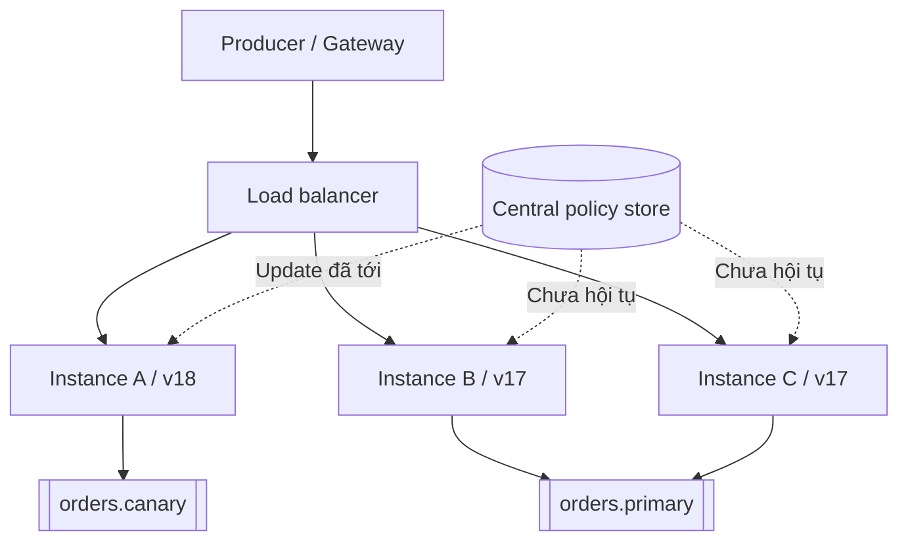
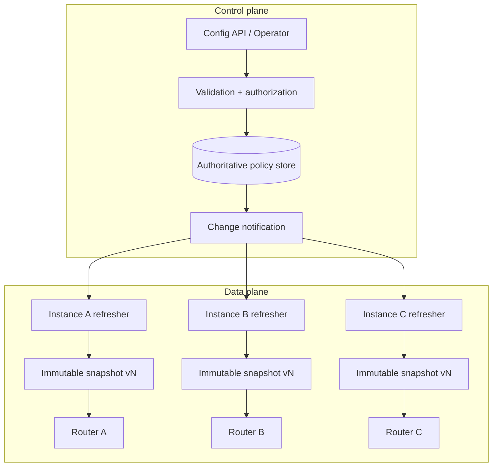
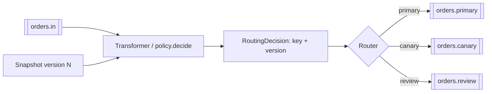
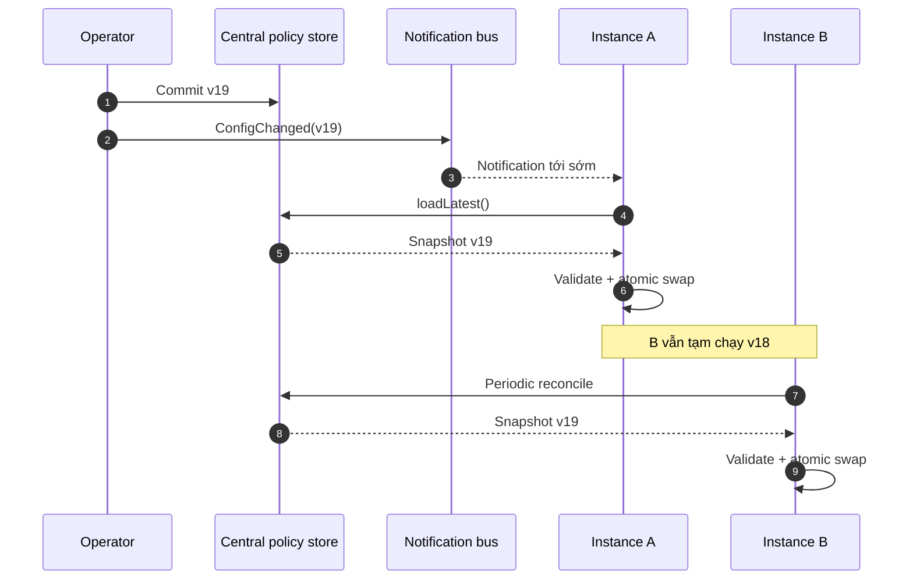
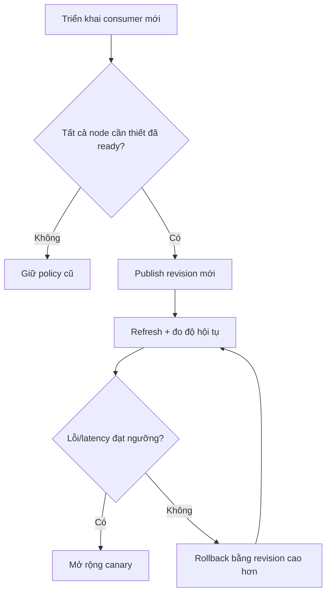
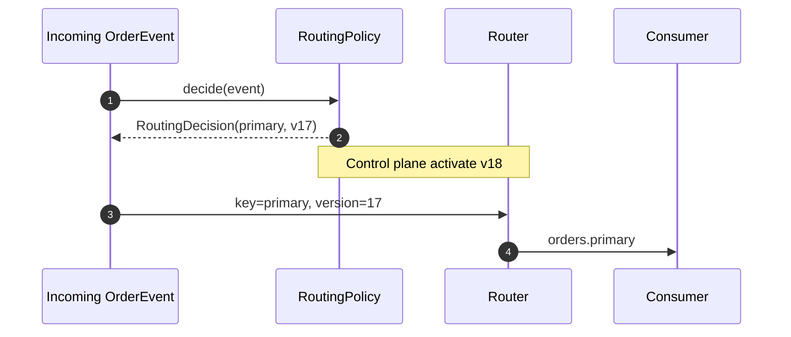

# Đồng bộ cấu hình giữa nhiều instance

Một **Dynamic Router** có thể chuyển đơn hàng giữa tuyến xử lý chính và tuyến canary bằng cách cập nhật quy tắc định tuyến ngay khi ứng dụng đang chạy. Nhưng khi service được triển khai trên **nhiều JVM, container hoặc pod**, việc sửa policy trong bộ nhớ của một instance **không tự cập nhật những instance còn lại**. Trong vài giây hoặc lâu hơn, cùng một đơn hàng có thể đi hai nhánh khác nhau chỉ vì load balancer đưa nó đến hai pod khác nhau.

Bài **Đồng bộ cấu hình giữa nhiều instance**, thuộc chương **Dynamic router** trong module `SPRING_INTEGRATION_PATTERN`, giải quyết bài toán đó. Chúng ta sẽ xây dựng cách quản lý **nguồn cấu hình chung, revision/version, cập nhật snapshot nguyên tử, cơ chế push/poll và reconciliation, triển khai canary/rollback, xử lý retry, kiểm thử và observability**. Những lựa chọn này giúp các **Enterprise Integration Patterns (EIP)** như Router, Filter, Transformer, Gateway, Splitter, Aggregator, retry, error channel và correlation vận hành nhất quán trong một hệ thống có nhiều instance.

> **Ý chính:** Dynamic Router không tự cung cấp **đồng bộ phân tán**. Muốn nhiều instance áp dụng chính sách giống nhau, cần **nguồn cấu hình đáng tin cậy, cơ chế cập nhật/reconcile và một hợp đồng rõ về độ nhất quán**. `AtomicReference` chỉ giúp thay policy nguyên tử trong **một JVM**; nó không đồng bộ tức thời mọi pod.

## 1. Vấn đề: mỗi instance đang dùng một revision

Giả sử `Order Service` có ba instance A, B, C. Ngày đầu, tất cả đơn `region=SG` đi tới `orders.primary`. Khi thử nghiệm giải pháp mới, người vận hành xuất bản policy `v18` đổi thị trường SG sang `orders.canary`. Nhưng A nhận bản mới trước; B/C vẫn dùng `v17`.

| Instance | Active policy | `region=SG` | Đích |
| --- | --- | --- | --- |
| A | `v18` | canary | `orders.canary` |
| B | `v17` | primary | `orders.primary` |
| C | `v17` | primary | `orders.primary` |



Tình trạng này có thể **chấp nhận được** nếu cả hai consumer tương thích và rollout cho phép eventual consistency. Nhưng có thể **nguy hiểm** nếu các tuyến thuộc vùng dữ liệu riêng, có thẩm quyền khác nhau hoặc một nhánh chưa được triển khai đủ trên mọi pod.

### 1.1. Ba dạng khác biệt cần phân biệt

1. **Lệch phiên bản policy:** cùng code nhưng A dùng policy 18, B dùng 17.
2. **Lệch topology/code:** A biết channel `orders.canary` còn B chưa có consumer tương ứng.
3. **Lệch trạng thái nghiệp vụ:** cùng event đã xử lý ở một nhánh, nhưng retry qua pod khác có thể chạy nhánh thứ hai và tạo side effect trùng.

Đồng bộ policy giải quyết chủ yếu vấn đề thứ nhất; muốn an toàn còn phải phối hợp **rollout topology và idempotency**.

## 2. Dynamic Router và những thứ có thể thay đổi

**Message Router** quyết định một message đi tới channel nào dựa trên payload, header hoặc một quy tắc. **Dynamic Router** theo EIP cho phép **quy tắc quyết định thay đổi lúc runtime**. Có hai nhóm thay đổi không nên đánh đồng:

| Loại thay đổi | Ví dụ | Rủi ro |
| --- | --- | --- |
| **Đổi bảng policy, giữ topology** | `SG → primary` chuyển thành `SG → canary`, cả hai channel đều tồn tại. | Cần version, đồng bộ giữa các instance. |
| **Đổi topology** | Thêm channel, handler, queue/broker binding, schema hoặc API. | Cần triển khai code/consumer và kiểm tra tương thích trước. |

Bài này ưu tiên **policy động trên tập channel đã được quản lý**, thay vì để cấu hình tự tạo bean hay tên kênh không giới hạn.

### 2.1. So với Router khác

| Pattern | Quyết định chính | Liên quan đến đồng bộ config |
| --- | --- | --- |
| **Payload Type Router** | Chọn theo class Java của payload. | Mapping có thể được quản lý bằng config, nhưng không tự đồng bộ liên JVM. |
| **Header-Based Router** | Chọn theo giá trị header. | Header là input; quy tắc mapping mới là chính sách cần đồng bộ. |
| **Content-Based Router** | Chọn theo dữ liệu trong payload/SpEL. | Có thể đọc một bảng policy động để tính route key. |
| **Recipient List** | Chọn nhiều destination. | Tập recipient hoặc điều kiện cũng có thể được version hóa. |
| **Dynamic Router** | Cho phép thay đổi logic/bảng route lúc chạy. | Phải xác định nguồn chân lý, cách cập nhật và consistency. |

**Lưu ý:** Spring Integration có Router endpoint, expression, Java DSL và những cách thay đổi mapping/runtime tùy API và phiên bản. **Cập nhật một router bean cục bộ bằng Control Bus hoặc method call không làm các JVM còn lại tự đổi policy.** Đó là trách nhiệm của kiến trúc phân phối cấu hình.

## 3. Control plane và data plane

Nên tách rõ:

- **Control plane:** nơi tạo, kiểm tra, phê duyệt, lưu lịch sử và phát phiên bản policy mới.
- **Data plane:** các instance trực tiếp nhận message, đọc một policy snapshot và chọn channel.



**Control plane phải có một nguồn cấu hình có thẩm quyền.** Bus notification không nên là nơi duy nhất chứa toàn bộ trạng thái mới nhất; một instance bị mất event vẫn phải có thể hỏi store để lấy revision hiện hành.

### 3.1. Những bất biến nên giữ

1. **Revision đơn điệu:** mỗi bản được xuất bản có số version lớn hơn bản trước; không lấy đồng hồ từng pod để xác định thứ tự.
2. **Snapshot bất biến:** một revision đại diện cho toàn bộ bảng route, không phải nhiều phép cập nhật rời rạc.
3. **Atomic activation trong instance:** một message đọc **toàn bộ v17 hoặc v18**, không đọc nửa bảng này nửa bảng kia.
4. **Validation trước activation:** routing key nằm trong allowlist, mọi kênh mục tiêu đã được hỗ trợ.
5. **Reconciliation sau khi lỡ notification:** mỗi pod định kỳ so policy hiện hành với nguồn chân lý.
6. **Có giới hạn độ cũ:** chính sách quá cũ phải được phát hiện và xử lý theo mức độ rủi ro.
7. **Có bằng chứng hội tụ:** biết instance nào đang dùng revision nào.

## 4. Chọn mô hình nhất quán

| Cách cập nhật | Cơ chế | Phù hợp khi | Hạn chế |
| --- | --- | --- | --- |
| **Polling** | Pod định kỳ tải bản mới. | Cần đơn giản, dễ tự phục hồi. | Có khoảng thời gian lệch version, tải store. |
| **Push + polling** | Phát notification, pod tải snapshot; polling sửa sai sau event mất. | Muốn hội tụ nhanh và bền khi bus trễ. | Vẫn có cửa sổ không đồng nhất. |
| **Truy vấn store trên mỗi message** | Router hỏi policy trung tâm từng quyết định. | Một số policy cần đọc giá trị rất mới. | Network latency/lỗi làm chậm data plane; không tự bảo đảm cluster atomic. |
| **Rollout activation barrier** | Chuẩn bị ở mọi pod rồi kích hoạt theo protocol. | Cần giảm cửa sổ lệch hoặc cutover có phối hợp. | Phức tạp khi pod chết, network partition, in-flight message. |
| **Pin version theo message/batch** | Route decision/version được chốt một lần. | Replay hoặc batch phải nhất quán. | Cần lưu decision và lịch sử policy khi đi qua process. |

### 4.1. Eventual consistency có thể đủ

Thay đường xử lý Analytics sang canary, nơi cả hai consumer tương thích và event có idempotency. Khi đó vài giây hội tụ giữa các instance có thể được chấp nhận. **Push notification + periodic reconcile** thường đạt cân bằng tốt giữa độ đơn giản và thời gian cập nhật.

### 4.2. Trường hợp phải mạnh hơn

Với **quyền truy cập, tách tenant, vùng lưu trú dữ liệu hoặc chuyển tiền**, việc một pod dùng chính sách cũ có thể vi phạm yêu cầu. Khi đó cần thêm:

- **Kiểm soát quyền ở service đích**, không dựa hoàn toàn vào Router.
- **Readiness/fail closed** khi policy quá cũ hoặc chưa tải được.
- **Phối hợp activation/epoch**, drain hoặc chặn ingress nếu cần cutover chặt.
- **Định danh revision** trong message/trace và xác minh ở các bước nhạy cảm.

**Polling mỗi giây không phải strong consistency.** Nó chỉ làm thời gian hội tụ thường nhỏ hơn khi mọi thành phần hoạt động bình thường.

## 5. Vì sao không chỉnh sửa một Map dùng chung tại chỗ?

Ví dụ không an toàn:

```java
// KHÔNG dùng làm cách cập nhật một policy nhiều trường:
Map<String, String> routes = new HashMap<>();

void refresh() {
    routes.clear();
    routes.put("VN", "primary");
    routes.put("SG", "canary");
}
```

Trong lúc `clear()` rồi `put(...)`, một thread xử lý message có thể thấy **bảng rỗng hoặc bảng mới chỉ được ghi một phần**. Dùng `ConcurrentHashMap` giúp an toàn cho thao tác đơn lẻ nhưng **không biến hàng loạt thay đổi thành một snapshot nguyên tử**.

Giải pháp: xây **immutable snapshot mới**, validate nó, rồi thay **một tham chiếu** bằng CAS/`AtomicReference`.

## 6. Ví dụ Java: routing snapshot có version

Ta xử lý `OrderEvent(orderId, region)`, định tuyến theo vùng:

| Routing key | Channel Spring Integration |
| --- | --- |
| `primary` | `orders.primary` |
| `canary` | `orders.canary` |
| `review` | `orders.review` |

Tập route key **hữu hạn và được kiểm soát**; payload không được chọn tên channel tùy ý. Các ví dụ dùng Java hỗ trợ `record`, Spring Integration Java DSL và JUnit 5.

### 6.1. Event và kết quả quyết định

```java
// OrderEvent.java
public record OrderEvent(String orderId, String region) {}

// RoutingDecision.java
public record RoutingDecision(
    OrderEvent event,
    String routeKey,
    long policyVersion
) {}
```

`RoutingDecision` mang cả **route key** và **version đã dùng để tính ra key**. Điều này tránh trường hợp tính route một lần rồi đọc lại policy mới ở bước dispatch.

### 6.2. Snapshot bất biến và allowlist

```java
// RoutingSnapshot.java
import java.util.Map;
import java.util.Set;

public record RoutingSnapshot(
    long version,
    Map<String, String> routeByRegion,
    String defaultRoute
) {
    private static final Set<String> ALLOWED =
        Set.of("primary", "canary", "review");

    public RoutingSnapshot {
        if (version < 0) {
            throw new IllegalArgumentException("negative policy version");
        }
        if (routeByRegion == null || defaultRoute == null) {
            throw new IllegalArgumentException("missing policy fields");
        }
        if (!ALLOWED.contains(defaultRoute)) {
            throw new IllegalArgumentException("invalid default route");
        }
        routeByRegion = Map.copyOf(routeByRegion);
        for (var entry : routeByRegion.entrySet()) {
            if (entry.getKey().isBlank()
                    || !ALLOWED.contains(entry.getValue())) {
                throw new IllegalArgumentException("invalid mapping");
            }
        }
    }
}
```

`Map.copyOf(...)` tạo bản map không cho sửa qua API. Hàm khởi tạo kiểm soát tập destination đã cho phép; hệ thống thật nên kiểm tra thêm schema region, tenant, topology readiness và các quy tắc nghiệp vụ.

### 6.3. AtomicReference và thứ tự version

```java
// RoutingPolicy.java
import java.util.Locale;
import java.util.concurrent.atomic.AtomicReference;

public final class RoutingPolicy {

    private final AtomicReference<RoutingSnapshot> active;

    public RoutingPolicy(RoutingSnapshot initial) {
        this.active = new AtomicReference<>(initial);
    }

    public RoutingDecision decide(OrderEvent event) {
        if (event == null || event.orderId() == null
                || event.orderId().isBlank()
                || event.region() == null || event.region().isBlank()) {
            throw new IllegalArgumentException("invalid OrderEvent");
        }

        RoutingSnapshot snapshot = active.get(); // Đọc đúng một lần.
        String region = event.region().trim().toUpperCase(Locale.ROOT);
        String key = snapshot.routeByRegion()
            .getOrDefault(region, snapshot.defaultRoute());
        return new RoutingDecision(event, key, snapshot.version());
    }

    public boolean installIfNewer(RoutingSnapshot candidate) {
        if (candidate == null) {
            throw new IllegalArgumentException("missing candidate");
        }
        while (true) {
            RoutingSnapshot old = active.get();
            if (candidate.version() <= old.version()) {
                return false; // Lặp hoặc cập nhật đến muộn.
            }
            if (active.compareAndSet(old, candidate)) {
                return true;
            }
        }
    }

    public RoutingSnapshot current() {
        return active.get();
    }
}
```

Lợi ích:

- **Một quyết định, một snapshot:** message đang xử lý không đọc một nửa bảng cũ và nửa bảng mới.
- **Monotonic revision:** `v17` đến sau `v18` sẽ bị bỏ qua.
- **CAS trong một JVM:** hai thread refresh cạnh tranh không thể lắp bản cũ lên trên bản mới.
- **Dữ liệu có version:** `RoutingDecision` có thể dùng khi log, test và phục hồi.

**Giới hạn quan trọng:** `AtomicReference` không đồng bộ các pod, không lưu policy qua restart và không đảm bảo transaction nghiệp vụ. Mỗi pod cần tải cùng snapshot từ nguồn chung.

## 7. Kết nối snapshot với Spring Integration Java DSL

Thiết kế: **Transformer tính `RoutingDecision` trước, Router chỉ route theo `routeKey` đã chốt**. Như vậy, policy đổi giữa Transformer và Router cũng không làm message bị quyết định lại.

```java
// DynamicRoutingFlowConfiguration.java
import java.util.Map;
import org.springframework.context.annotation.Bean;
import org.springframework.context.annotation.Configuration;
import org.springframework.integration.channel.QueueChannel;
import org.springframework.integration.config.EnableIntegration;
import org.springframework.integration.dsl.IntegrationFlow;

@Configuration
@EnableIntegration
public class DynamicRoutingFlowConfiguration {

    @Bean
    RoutingPolicy routingPolicy() {
        return new RoutingPolicy(new RoutingSnapshot(
            1L,
            Map.of("VN", "primary", "SG", "primary"),
            "review"));
    }

    @Bean("orders.primary")
    QueueChannel primaryOrders() {
        return new QueueChannel(32);
    }

    @Bean("orders.canary")
    QueueChannel canaryOrders() {
        return new QueueChannel(32);
    }

    @Bean("orders.review")
    QueueChannel reviewOrders() {
        return new QueueChannel(32);
    }

    @Bean
    IntegrationFlow dynamicOrderRouting(RoutingPolicy policy) {
        return IntegrationFlow.from("orders.in")
            .transform(OrderEvent.class, policy::decide)
            .route(RoutingDecision.class,
                RoutingDecision::routeKey,
                spec -> spec
                    .channelMapping("primary", "orders.primary")
                    .channelMapping("canary", "orders.canary")
                    .channelMapping("review", "orders.review")
                    .channelKeyFallback(false)
                    .defaultOutputChannel("orders.review"))
            .get();
    }
}
```

**Đọc luồng:**

1. Producer gửi `OrderEvent` vào `orders.in`.
2. `policy.decide(...)` đọc snapshot hiện hành và tạo `RoutingDecision(event, key, version)`.
3. Router đọc key đã chốt, chuyển đến channel có mapping.
4. `channelKeyFallback(false)` giúp ngăn key ngoài mapping bị dùng trực tiếp làm tên channel.
5. `orders.review` là tuyến phòng vệ; một candidate hợp lệ phải trả key thuộc allowlist.



Các `QueueChannel` trên chỉ dùng để quan sát/test. Chúng không tự tạo consumer, lưu bền, trả lời Gateway hay gọi ERP. Để chạy production, cần nối handler/adapter thực tế, định nghĩa backpressure, timeout, error flow và idempotency theo từng nhánh.

### 7.1. Đổi policy mà không tạo channel động

Ban đầu:

```text
version 1: VN → primary, SG → primary, default → review
```

Sau update:

```text
version 2: VN → primary, SG → canary, default → review
```

`IntegrationFlow` và các channel **giữ nguyên**. `RoutingPolicy` đổi bảng chọn key; Router tiếp tục ánh xạ `primary/canary/review` đến các kênh đã có. Đây là hình thức **dynamic policy trên topology ổn định**, thường ít rủi ro hơn thêm/xóa channel trực tiếp khi runtime.

## 8. Lấy policy mới từ nguồn cấu hình trung tâm

Một instance có thể cập nhật bằng **polling**, **push notification** hoặc kết hợp cả hai. Ví dụ interface cho nguồn chung:

```java
// RoutingConfigStore.java
public interface RoutingConfigStore {
    RoutingSnapshot loadLatest();
}
```

### 8.1. Polling và tự đồng bộ sau restart

```java
// RoutingPolicyRefresher.java
import org.springframework.scheduling.annotation.Scheduled;

public final class RoutingPolicyRefresher {

    private final RoutingConfigStore store;
    private final RoutingPolicy policy;

    public RoutingPolicyRefresher(
            RoutingConfigStore store, RoutingPolicy policy) {
        this.store = store;
        this.policy = policy;
    }

    @Scheduled(fixedDelayString = "5000")
    public void refresh() {
        RoutingSnapshot candidate = store.loadLatest();
        policy.installIfNewer(candidate);
    }
}
```

Để chạy được, phải **đăng ký `RoutingPolicyRefresher` thành Spring bean**, bật `@EnableScheduling` và cung cấp implementation `RoutingConfigStore`. Bài chỉ minh họa polling đơn giản; project thật cần metrics, cảnh báo và chính sách khi `loadLatest()` thất bại, chứ không để node âm thầm dùng bản cũ vô hạn.

### 8.2. Push + periodic reconciliation

Một cách thiết kế thường hiệu quả:

1. Control plane **commit revision 19** vào store.
2. Phát `RoutingConfigChanged(version=19)` tới các instance bằng bus.
3. Instance nhận notification sẽ **fetch snapshot từ store**, validate và `installIfNewer(...)`.
4. Instance không nhận notification vẫn **poll định kỳ**, phát hiện version cao hơn và tự hội tụ.



Không coi **message notification** là nguồn chân lý duy nhất: push có thể lặp, mất hoặc đến sai thứ tự. Chính sách **đọc lại bản đã commit từ store** giúp pod tự sửa sai và nhận đúng trạng thái sau restart.

### 8.3. Stale policy và readiness

Khi config service mất kết nối:

- Nếu policy phục vụ analytics không nhạy cảm, có thể dùng **last-known-good** trong một thời hạn được phê duyệt.
- Nếu policy quyết định vùng dữ liệu hoặc thẩm quyền, một instance quá hạn có thể phải **unready/fail closed**.
- Nếu không có bản hợp lệ lúc startup, đừng mặc định nhận traffic bằng policy hard-coded cũ.
- Cần đo **thời điểm tải thành công cuối**, `activeVersion`, `desiredVersion`, số lần thất bại và **config age**.

Không có một stale threshold đúng cho mọi hệ thống; đây là hợp đồng nghiệp vụ/vận hành, không phải mặc định của Spring Integration.

## 9. Revision đơn điệu và rollback

Notification có thể đến theo thứ tự `v21` rồi `v20`. Nếu áp dụng “bản cuối cùng nhận được”, một pod có thể **tự lùi về policy cũ** dù bản mới đã được commit.

| Active | Candidate | Kết quả |
| --- | --- | --- |
| `v17` | `v18` hợp lệ | Cài `v18`. |
| `v18` | `v18` lặp | Bỏ qua. |
| `v18` | `v17` đến muộn | Bỏ qua. |
| `v18` | `v19` sai schema | Từ chối, giữ v18 và báo lỗi. |
| `v19` | Muốn quay về nội dung v17 | **Publish v20 chứa nội dung cũ**, không hạ revision. |

### 9.1. Tại sao không dùng timestamp ở từng instance?

Đồng hồ giữa nhiều máy có thể lệch. Hai người quản trị cùng cập nhật có thể tạo cạnh tranh. Nên dùng **revision được cấp từ transaction/config service có thứ tự đáng tin cậy** và có cơ chế xử lý conflict. Một snapshot đã publish nên bất biến theo revision.

### 9.2. Cùng version nhưng khác nội dung

Nếu pod A và B cùng báo `v19` nhưng hash nội dung khác nhau, đó là lỗi nghiêm trọng của store/cache hoặc việc tái sử dụng revision. Có thể ghi **checksum của canonical snapshot** để phát hiện divergence. Hash cho biết nội dung **khác nhau**, không thay thế version để cho biết bản nào **mới hơn**.

## 10. Rollout canary an toàn giữa nhiều pod

Đổi `SG → canary` là một chuyện; đảm bảo **mọi instance và consumer có khả năng xử lý canary** là chuyện khác. Nếu pod A đã được triển khai handler mới nhưng pod B vẫn chưa biết `orders.canary`, publish policy sớm có thể tạo lỗi dispatch.

Quy trình nên là:

1. **Prepare:** triển khai channel, handler, adapter và schema mới; nhưng chưa chuyển traffic.
2. **Verify:** health/readiness, contract test và kiểm tra consumer ở các pod.
3. **Publish:** xuất bản revision mới chỉ đổi `SG` sang `canary`.
4. **Observe:** xem `desiredVersion` và `activeVersion` từng instance, lỗi và latency từng nhánh.
5. **Gradual rollout:** nếu nghiệp vụ cần, bật cho một phần tenant/region theo rule ổn định.
6. **Rollback:** tạo revision **cao hơn** chuyển traffic về `primary`.
7. **Drain:** chỉ gỡ topology cũ khi không còn message in-flight/replay cần xử lý theo đường cũ.



**Đây là rollout hai giai đoạn về vận hành, không tự trở thành atomic transaction toàn cụm.** Với ranh giới pháp lý/bảo mật, cần cơ chế điều phối chặt hơn (activation barrier, fencing, ingress gating, cutover theo epoch) và chính sách khi pod bị cô lập mạng.

### 10.1. Canary phải ổn định khi retry

Nếu một lệnh cùng `orderId` có thể được retry, không nên dùng một lần bốc random hoàn toàn mới ở mỗi request nếu yêu cầu tất cả lần xử lý đi cùng nhánh. Có thể dùng **hash ổn định theo business key** hoặc pin quyết định ban đầu. Đừng quên idempotency của consumer, vì một event được gửi lại vẫn có thể tạo side effect trùng.

## 11. In-flight message và thay policy khi đang xử lý

Giả sử message đã được tính route theo v17, nhưng v18 được activate trước khi Router dispatch:



Trong kiến trúc ví dụ, **RoutingDecision giữ key/version đã tính**. Message đang xử lý không bị đổi nhánh giữa Transformer và Router.

**Nhưng sau restart hoặc broker redelivery**, nếu ứng dụng tính lại `decide(...)`, cùng event có thể dùng v18 và đi canary. Cần chọn một chính sách replay:

| Chính sách | Cách làm | Lưu ý |
| --- | --- | --- |
| **Re-evaluate** | Tính lại theo policy mới nhất. | Có thể đổi route; phải kiểm soát side effect. |
| **Pin original route** | Lưu key/version của quyết định đầu, dùng lại khi replay. | Phải lưu bền decision và giữ hợp đồng với consumer cũ. |
| **Controlled migration** | Chuyển pending events sang policy mới theo quy trình riêng. | Cần reconciliation, idempotency và audit. |

`policyVersion` không phải **idempotency key**: nó chỉ nói quyết định được đưa ra dưới revision nào. Dùng `eventId`/`orderId` theo nghiệp vụ và xử lý chống trùng ở downstream.

## 12. Kiểm thử Java: atomic update và stale event

### 12.1. Test một RoutingPolicy

```java
import static org.junit.jupiter.api.Assertions.*;

import java.util.Map;
import org.junit.jupiter.api.Test;

class RoutingPolicyTest {

    @Test
    void newMessagesUseNewSnapshotAndOldRevisionIsIgnored() {
        RoutingPolicy policy = new RoutingPolicy(new RoutingSnapshot(
            17L, Map.of("SG", "primary"), "review"));

        OrderEvent event = new OrderEvent("ORD-1", "SG");
        RoutingDecision before = policy.decide(event);
        assertEquals("primary", before.routeKey());
        assertEquals(17L, before.policyVersion());

        assertTrue(policy.installIfNewer(new RoutingSnapshot(
            18L, Map.of("SG", "canary"), "review")));

        RoutingDecision after = policy.decide(event);
        assertEquals("canary", after.routeKey());
        assertEquals(18L, after.policyVersion());

        assertEquals("primary", before.routeKey());
        assertFalse(policy.installIfNewer(new RoutingSnapshot(
            17L, Map.of("SG", "primary"), "review")));
        assertEquals(18L, policy.current().version());
    }

    @Test
    void rejectsUnapprovedRouteBeforeActivation() {
        assertThrows(IllegalArgumentException.class, () ->
            new RoutingSnapshot(19L,
                Map.of("SG", "admin.internal"), "review"));
    }
}
```

Test này chứng minh snapshot local có version guard. Nó **không chứng minh ba JVM cùng hội tụ**.

### 12.2. Integration test cho flow và channel mapping

```java
import static org.junit.jupiter.api.Assertions.*;

import java.util.Map;
import org.junit.jupiter.api.Test;
import org.springframework.beans.factory.annotation.Autowired;
import org.springframework.context.ApplicationContext;
import org.springframework.integration.channel.QueueChannel;
import org.springframework.messaging.MessageChannel;
import org.springframework.messaging.support.MessageBuilder;
import org.springframework.test.context.junit.jupiter.SpringJUnitConfig;

@SpringJUnitConfig(DynamicRoutingFlowConfiguration.class)
class DynamicRoutingFlowTest {

    @Autowired ApplicationContext context;
    @Autowired RoutingPolicy policy;

    private void send(OrderEvent event) {
        MessageChannel ingress =
            context.getBean("orders.in", MessageChannel.class);
        assertTrue(ingress.send(
            MessageBuilder.withPayload(event).build()));
    }

    private QueueChannel output(String channelName) {
        return context.getBean(channelName, QueueChannel.class);
    }

    @Test
    void updatesDestinationWithoutChangingIntegrationFlow() {
        OrderEvent order = new OrderEvent("ORD-2", "SG");
        send(order);
        RoutingDecision first = (RoutingDecision)
            output("orders.primary").receive(0).getPayload();
        assertEquals("primary", first.routeKey());
        assertEquals(1L, first.policyVersion());

        assertTrue(policy.installIfNewer(new RoutingSnapshot(
            2L, Map.of("VN", "primary", "SG", "canary"), "review")));
        send(order);

        RoutingDecision second = (RoutingDecision)
            output("orders.canary").receive(0).getPayload();
        assertEquals("canary", second.routeKey());
        assertEquals(2L, second.policyVersion());

        assertNull(output("orders.primary").receive(0));
        assertNull(output("orders.canary").receive(0));
        assertNull(output("orders.review").receive(0));
    }
}
```

Test dùng channel nội bộ và `QueueChannel`, nên `receive(0)` phù hợp trong flow đồng bộ minh họa. Khi chuyển sang executor/broker bất đồng bộ, cần chờ theo điều kiện với timeout, không assert quá sớm; khi mở rộng nhiều test phải cô lập queue và fixture.

### 12.3. Kiểm thử thực sự nhiều instance

| Kịch bản | Điều phải chứng minh |
| --- | --- |
| A/B/C khởi động với cùng store | Tải và activate cùng revision hợp lệ. |
| Chỉ A nhận push | B/C tự hội tụ qua polling/reconcile. |
| Notification đến v22 rồi v21 | Không lùi version. |
| Một pod mất mạng | Tuân thủ stale threshold và readiness/fail-safe. |
| Candidate sai schema | Không activate; giữ last-known-good và alert. |
| Pod restart sau publish | Không khởi động lâu bằng bản default cũ. |
| Rollback | Bản rollback có revision tăng và được áp dụng bình thường. |
| Một pod thiếu consumer mới | Không nhận traffic đòi route chưa được deploy. |
| Concurrent refresh + routing | Mỗi decision tương ứng một snapshot nguyên vẹn. |
| Replay cùng event sau cutover | Pin/re-evaluate theo hợp đồng, không gây duplicate side effect. |

**Nhiều thread trong một JVM không thay thế bài test nhiều process**. Với nhiều instance thật, phải thử thêm network partition, identity, cache, startup/restart và concurrency trên hạ tầng cấu hình chung.

## 13. Gateway, Filter, Transformer, Splitter/Aggregator và error flow

### 13.1. Filter và Transformer trước dynamic policy

Input cần được **deserialize, validate và chuẩn hóa** trước khi route. `region="vn"` và `region=" VN "` nên có cách chuẩn hóa rõ; đừng để mọi instance tự đưa ra quy tắc khác nhau.

Nếu dữ liệu sai, một **Filter/validation** có thể từ chối, khác với lỗi không tải được snapshot. Router không nên dùng policy stale để “sửa” payload sai schema.

### 13.2. Gateway request–reply

`@MessagingGateway` cho phép caller dùng facade Java. Khi policy đổi từ `primary` sang `canary`, **cả hai nhánh cần cùng hợp đồng reply** nếu caller mong `OrderReceipt`. Một canary chưa có handler trả reply có thể gây timeout dù route decision hợp lệ.

Đừng xem reply timeout như công cụ hủy hoàn toàn một downstream handler đồng bộ. Khi caller retry sau timeout, kết quả ban đầu có thể đã được commit; cần idempotency và trạng thái xử lý.

### 13.3. Splitter/Aggregator và version cho cả batch

Một batch có thể được **Splitter** tách thành nhiều message, nhưng policy cập nhật giữa các message con. Nếu nghiệp vụ cần xử lý toàn batch theo một chính sách, hãy **chốt revision trước khi Splitter** rồi chuyển metadata phù hợp cho tất cả phần.

**Aggregator** cần correlation ID, completion/release, group timeout/expiry, late arrivals và deduplication. Thêm header `policyVersion` **không tự làm Aggregator hiểu cách lấy policy lịch sử**; vẫn phải thiết kế group state/lookup.

### 13.4. Control plane error khác data plane error

| Lỗi | Xử lý ở đâu |
| --- | --- |
| Config store không truy cập được | Refresher/control plane metrics, stale policy/fail-safe. |
| Candidate policy invalid | Validation trước activate; báo người vận hành. |
| Message thiếu region | Input validation/Filter. |
| Channel đích không có consumer hoặc đã đầy | Data plane dispatch, backpressure, retry/error flow theo cấu hình. |
| Outbound ERP timeout | Client/adapter timeout, trạng thái không chắc chắn và idempotency. |
| Message redelivery sau revision mới | Replay policy, correlation và chống side effect trùng. |

**Error channel không tự nhận mọi lỗi trong mọi mô hình**. Lỗi handler đồng bộ có thể trả về caller; lỗi trong endpoint async/poller/adapter có thể thành `ErrorMessage` khi cấu hình phù hợp. Lỗi tải config không nên bị che giấu như thể là một Message Filter rejection.

## 14. Observability cho việc hội tụ chính sách

Nếu chỉ quan sát `orders.primary` và `orders.canary`, ta có thể tưởng tỷ lệ traffic sai vì canary rule, trong khi thực tế một số instance chưa nhận revision mới.

| Tín hiệu | Mục đích |
| --- | --- |
| `routing_policy_active_version` theo instance | Biết pod nào đang chạy revision nào. |
| `routing_policy_desired_version` | Biết control plane muốn áp dụng version nào. |
| `routing_policy_last_success_time` | Thời điểm fetch/activate thành công gần nhất. |
| `routing_policy_stale_age_seconds` | Nhận diện stale snapshot vượt giới hạn. |
| `routing_policy_update_failures_total` | Phân biệt lỗi fetch, validate và thiếu topology. |
| `routing_policy_stale_notifications_total` | Đếm thông báo lặp/đến muộn bị loại. |
| `routing_decisions_total` theo route/revision hữu hạn | Xem chuyển dịch traffic qua rollout. |
| `channel_send_failures_total` | Nhận diện lỗi wiring/overload theo nhánh. |
| Latency/error rate mỗi consumer | Đánh giá canary đã thực sự tốt hay chưa. |

Ví dụ log có cấu trúc:

```text
event=routing_decision
instance=orders-pod-b
flow=orderIntake
policy_version=18
route_key=canary
outcome=routed
trace_id=<opaque-trace-id>
```

Đây là **format do ứng dụng tự thiết kế**, không phải output mặc định của Spring Integration. Không in toàn bộ payload, token, email hay bí mật từ policy vào logs. Chỉ dùng nhãn metrics có số giá trị hữu hạn; correlation ID riêng từng event phù hợp hơn với logs/traces có phân quyền, **không làm metric label**.

### 14.1. Cảnh báo divergence thay vì chỉ báo lỗi fetch

```text
desiredVersion = 20
active(A) = 20
active(B) = 20
active(C) = 18
```

Chỉ số quan trọng không chỉ là C đang lệch, mà còn là **C có đang nhận traffic không**, policy đã quá hạn cho phép chưa và C có nên chuyển `readiness=unready` hoặc fail closed hay không.

## 15. Bảo mật khi điều khiển dynamic routing

Policy có thể khiến thông điệp đi sang một đối tác, tenant hoặc vùng dữ liệu khác. Vì vậy **quyền sửa bảng routing** là quyền nhạy cảm:

1. Xác thực và phân quyền người/systems cập nhật config.
2. Audit thay đổi, người phê duyệt, diff, revision và thời điểm publish.
3. Kiểm tra schema/allowlist route key và đích được quyền dùng.
4. Không xây tên channel từ chuỗi client cung cấp chưa kiểm soát.
5. Không cho payload/header từ HTTP tự quyết định `admin.internal` hoặc channel đặc quyền.
6. Bảo đảm nguồn config và notification bus được xác thực; chống replay bản cũ.
7. Không chứa credential, token hay PII không cần thiết trong snapshot.
8. Service đích vẫn enforce authorization, không tin chỉ vì Router đã chuyển tới.
9. Có quy trình rollback có quyền hạn và cảnh báo khi checksum cùng revision không khớp.

**Tách dữ liệu đầu vào của quyết định và quyền được phép thay quyết định**. Message có thể chứa `region=SG`, nhưng nó không được tự thay bảng policy để route những message khác.

## 16. Những sai lầm phổ biến

### Sai lầm 1 — “Đổi một bean là mọi pod tự đổi”

**Sai.** Mỗi Spring context/JVM có bean và state riêng. Cần nguồn chung và cơ chế cập nhật/reconcile.

### Sai lầm 2 — “Dùng message bus để broadcast config là đủ”

**Chưa đủ.** Event có thể mất/lặp/đến trễ. Cần revision guard và định kỳ đọc authoritative store.

### Sai lầm 3 — “ConcurrentHashMap làm cả bảng update nguyên tử”

**Sai.** Nhiều thao tác trên map vẫn có thể bị thấy giữa chừng. Dùng immutable snapshot và atomic swap.

### Sai lầm 4 — “Rollback là gửi lại revision cũ”

**Không nên.** Version guard sẽ bỏ qua revision thấp. Publish **revision cao hơn chứa nội dung chính sách cũ**.

### Sai lầm 5 — “Publish thành công tức là mọi pod đã activate”

**Sai.** Theo dõi desired/active version và readiness từng instance.

### Sai lầm 6 — “Bất kỳ route key trong config đều là tên channel được phép”

**Nguy hiểm.** Giữ mapping, allowlist và quyền hạn; đừng tạo channel từ dữ liệu ngoài.

### Sai lầm 7 — “Dùng version mới không ảnh hưởng message retry”

**Chưa chắc.** Message xử lý lại sau restart có thể được route theo policy mới. Chọn pinning/re-evaluation rõ ràng.

### Sai lầm 8 — “Cùng version nghĩa là mọi nghiệp vụ đã đồng nhất”

**Sai.** In-flight message, broker backlog, schema của consumer và transaction side effects vẫn là những trạng thái khác phải kiểm soát.

## 17. Bài tập thực hành

**Bài 1 — Hai instance lệch revision.** Tạo hai `RoutingPolicy` độc lập cùng v1, chỉ cập nhật A lên v2. Gửi cùng `OrderEvent` tới cả hai và giải thích nguyên nhân hai kết quả khác nhau.

**Bài 2 — Notification đến sai thứ tự.** Cho A nhận v12, sau đó v11 và lại v12. Kiểm chứng `installIfNewer` không lùi version hoặc kích hoạt lặp.

**Bài 3 — Atomic snapshot.** Trong lúc một thread refresh policy, nhiều thread gọi `decide(...)`. Ghi `(routeKey, policyVersion)`; không quyết định nào được chứa route của v18 nhưng version v17.

**Bài 4 — Mất bus notification.** Giả lập C không nhận push v20; xây polling/reconcile để C tự hội tụ và đo độ trễ.

**Bài 5 — Canary rollback.** Thiết kế chuỗi prepare → verify → activate → monitor → rollback với phiên bản tăng; xử lý một pod thiếu consumer mới.

**Bài 6 — Retry sau cutover.** Một đơn lần đầu đi primary ở v3 nhưng retry ở v4 muốn đi canary. So sánh pin original route và re-evaluate, chỉ rõ idempotency cần có.

**Bài 7 — Splitter/Aggregator.** Một batch tách thành năm message; giữa lúc xử lý policy đổi. Định nghĩa correlation và cách chốt version cho cả batch nếu cần cùng chính sách.

**Bài 8 — Config store mất mạng.** Xác định stale threshold, readiness/fail closed, cảnh báo và cách khôi phục khi store trở lại.

## 18. Checklist trước khi đưa Dynamic Router nhiều instance vào production

| Câu hỏi | Yêu cầu |
| --- | --- |
| Policy có nguồn chân lý rõ không? | Một store có lịch sử, quyền sửa và audit. |
| Revision tăng đơn điệu không? | Không dùng timestamp của từng pod; stale update không ghi đè. |
| Snapshot có bất biến và cập nhật atomic không? | Validate trước, copy map, CAS/AtomicReference trong JVM. |
| Route key/channel có allowlist không? | Có; không để input bên ngoài chọn kênh tùy ý. |
| Push có reconcile không? | Có polling/refresh sau restart để sửa event mất. |
| Có giới hạn policy stale không? | Có ngưỡng và readiness/fail-safe tương ứng mức rủi ro. |
| Control plane có gây phụ thuộc vào mỗi message không? | Data plane dùng snapshot local khi hợp đồng cho phép. |
| Pod mới có tải policy trước khi ready không? | Có startup handshake hoặc chính sách an toàn. |
| Channel/consumer mới đã deploy trước activation chưa? | Có prepare/verify/cutover/drain. |
| Rollback có version tăng không? | Có, không phá monotonic ordering. |
| In-flight/replay có thể đổi route không? | Đã chọn pin/re-evaluate và bảo vệ idempotency. |
| Gateway các nhánh có reply/error contract chung không? | Có, kể cả timeout. |
| Splitter/Aggregator có correlation và policy version đúng không? | Có completion, expiry, late/dedup handling. |
| Config error có được phân biệt với handler error không? | Có metrics và error flow thích hợp ở từng boundary. |
| Có observability giữa các pod không? | Desired vs active, config age, decision distribution, consumer errors. |
| Có bảo mật và audit configuration update không? | Có auth, allowlist, logging an toàn, rollback được phê duyệt. |
| Có test nhiều process/network partition không? | Có, không chỉ một JVM với nhiều thread. |

## Kết luận

**Đồng bộ cấu hình giữa nhiều instance** là phần quyết định để **Dynamic Router** hoạt động đúng trong hệ thống phân tán. Một bảng route trong memory giúp cập nhật nhanh **trong một instance**, nhưng không làm mọi JVM nhận cùng revision. Cần **authoritative store, version đơn điệu, push/poll reconciliation, validate rồi atomic swap và đo desired–active version**; khi nghiệp vụ không cho phép lệch cấu hình, phải bổ sung cơ chế activation/readiness/fail-safe mạnh hơn.

Trong Spring Integration, một cách triển khai an toàn là **giữ topology Message Channel ổn định và cho policy động chọn giữa các routing key đã được kiểm soát**, kèm `policyVersion` cho từng quyết định. Với rollout/rollback, retry, Gateway, Splitter, Aggregator và xử lý lỗi, còn phải giải quyết **in-flight message, correlation, idempotency, timeout và observability**. Khi những ranh giới này rõ ràng, hệ thống không chỉ “đổi route được lúc runtime”, mà còn **biết instance nào dùng quy tắc nào và phục hồi ra sao nếu quá trình đồng bộ gặp sự cố**.
