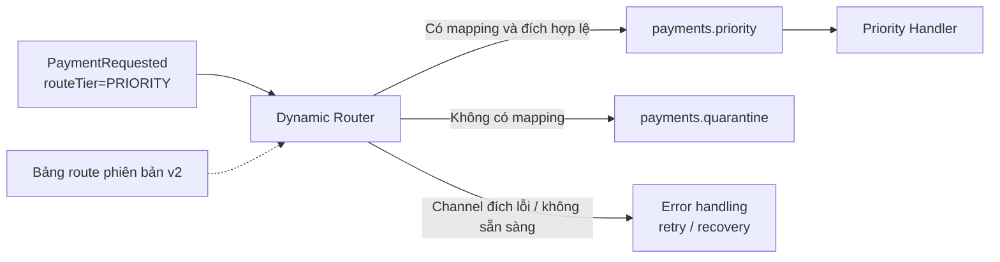
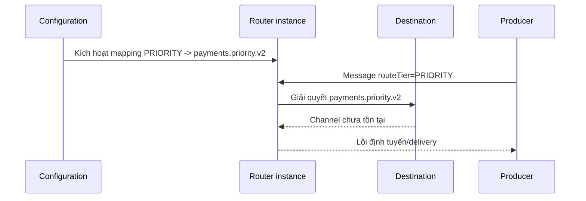
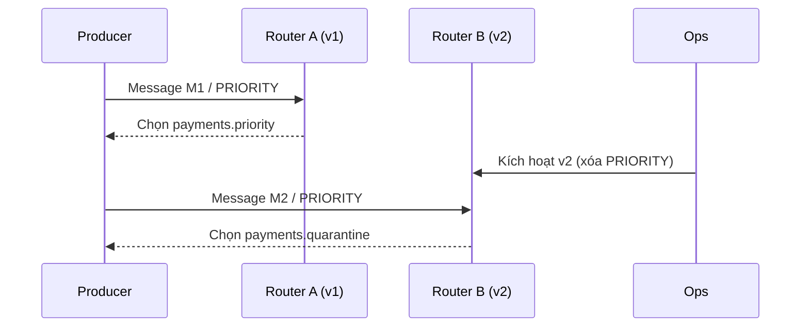

# Route không tồn tại sau khi cấu hình đổi

## 1. Bối cảnh: Dynamic Router và một cấu hình vừa thay đổi

Một hệ thống thanh toán có các luồng `STANDARD` (xử lý thông thường) và `PRIORITY` (xử lý ưu tiên). Tại thời điểm triển khai phiên bản đầu, cấu hình định tuyến như sau:

```text
STANDARD -> payments.standard
PRIORITY -> payments.priority
```

Khi vận hành, đội ngũ điều hành tắt nhánh ưu tiên để bảo trì, hoặc đổi tên đích từ `payments.priority` thành `payments.priority.v2`. Những message đến trong thời gian chuyển đổi có thể vẫn chứa khóa `PRIORITY`, nhưng **route không còn trong bảng cấu hình**, hoặc **tên đích mới chưa có channel/consumer tương ứng**. Nếu Router không có chính sách rõ ràng, message có thể bị lỗi dispatch, đẩy nhầm nhánh hoặc mất dấu vết.

**Dynamic Router** là mẫu *Enterprise Integration Patterns* (EIP) mà quyết định định tuyến phụ thuộc vào thông tin/quy tắc có thể thay đổi trong khi hệ thống đang chạy. Trong Spring Integration, ta có thể hiện thực tính động bằng một Router chọn đích từ **routing policy hiện hành** và cơ chế cập nhật cấu hình có kiểm soát. Điều này không có nghĩa Spring Integration tự động tạo bean `MessageChannel` mỗi khi tên đích xuất hiện trong cấu hình.

Trong chương **Dynamic router** của module **SPRING_INTEGRATION_PATTERN**, chúng ta học triển khai Enterprise Integration Patterns với Spring Integration để xây dựng luồng thông điệp ít phụ thuộc, dễ mở rộng. Trường hợp route biến mất sau khi đổi cấu hình là điểm giao giữa Router, Filter, Transformer, Gateway, retry, error channel, correlation và vận hành thực tế; bài học cũng tập trung vào kiểm thử và quan sát các nhánh xử lý.



**Câu hỏi của bài:** Khi một route mất đi **sau lúc cấu hình thay đổi**, Router nên phân biệt lỗi như thế nào, giữ an toàn cho message đang bay, và chuyển cấu hình mới vào hoạt động mà không gây thất lạc công việc?

## 2. Phân biệt ba khái niệm: routing key, mapping và destination

Một message gồm payload và headers. Router dùng một phần thông tin để tính **routing key**; cấu hình ánh xạ key đó sang **destination**; destination được framework giải quyết thành **channel thực tế** để gửi message.

```text
Payload:
  PaymentRequested(paymentId="PAY-105", amountVnd=650000, routeTier="PRIORITY")

Routing key:
  PRIORITY

Route table:
  PRIORITY -> payments.priority

Destination:
  Bean MessageChannel tên "payments.priority"

Consumer:
  Service Activator lắng nghe "payments.priority"
```

| Khái niệm | Chức năng | Ví dụ |
| --- | --- | --- |
| **Routing key** | Phân loại yêu cầu | `PRIORITY` |
| **Route mapping** | Nối key với tên đích | `PRIORITY -> payments.priority` |
| **Destination channel** | Nơi message được gửi trong Spring Integration | `MessageChannel` bean `payments.priority` |
| **Subscriber/consumer** | Endpoint nhận message từ channel | `PriorityPaymentHandler` |
| **Policy version** | Phiên bản quy tắc đang được áp dụng | `routing-v2` |

Một routing key **không nhất thiết** trùng tên channel. Phân biệt chúng giúp thay đổi topology mà không bắt nguồn gửi message phải biết cấu trúc bean nội bộ.

### 2.1. Các trường hợp thường bị gọi chung là “route không tồn tại”

| Tình trạng | Nguyên nhân | Dấu hiệu |
| --- | --- | --- |
| **Không có mapping** | `PRIORITY` bị loại khỏi route table | Router không tìm được tên đích cho key |
| **Mapping trỏ sai tên** | `payments.priority.v2` chưa có bean | Không giải quyết được destination channel |
| **Channel có nhưng không subscriber** | Endpoint chưa được đăng ký, ngừng hoặc cấu hình sai | Ví dụ `DirectChannel` không tìm được handler nhận |
| **Channel có subscriber nhưng downstream lỗi** | Handler ném exception, database/API không sẵn sàng | Dispatch tới đích rồi thất bại khi xử lý |
| **Đích ngoại vi chưa sẵn sàng** | Outbound adapter/broker lỗi, thiếu quyền hoặc topic | Lỗi transport/recovery, không đơn thuần là thiếu mapping |

**Không được gộp tất cả các trường hợp vào một nhánh “unknown route”.** Khi mapping không có, fallback có thể đúng. Khi mapping có nhưng đích xử lý đang lỗi, cần ghi nhận **lỗi delivery/handler**, không giả định rằng dùng default channel sẽ tự động bắt hoặc giải quyết lỗi ấy.

## 3. Cấu hình đổi tạo ra rủi ro như thế nào?

Một thao tác có vẻ nhỏ, chẳng hạn thay:

```text
v1: PRIORITY -> payments.priority
v2: PRIORITY -> payments.priority.v2
```

có thể gây lỗi nếu **rule** được kích hoạt trước khi channel `payments.priority.v2` và consumer mới được tạo. Tương tự, nếu cấu hình xóa mapping `PRIORITY` mà các producer vẫn gửi key này, Router cần đường xử lý mới.

### 3.1. Cửa sổ không nhất quán khi cập nhật



Trong môi trường nhiều instance, một node có thể đã đọc cấu hình `v2`, node khác vẫn ở `v1`. Một message phát lại cũng có thể được định tuyến theo **policy khác** với lần xử lý đầu. Việc đổi route vì vậy không chỉ là thay một biến: nó cần quy trình triển khai, phiên bản và khả năng quan sát.

### 3.2. Những câu hỏi cần trả lời trước khi xóa route

1. Khóa `PRIORITY` còn được producer gửi nữa không?
2. Những message đã gửi tới đích cũ có hoàn tất chưa?
3. Đích mới có tồn tại trên **mọi instance** cần sử dụng không?
4. Destination có consumer hoạt động, quyền kết nối và đủ năng lực xử lý không?
5. Nếu route bị tắt có chủ đích, message được **cách ly**, **tạm chờ**, hay **từ chối**?
6. Message retry/replay dùng policy hiện hành hay policy gắn với lần xử lý trước?

Không nên gỡ channel cũ ngay sau khi lưu một cấu hình mới mà chưa biết trạng thái của message đang được xử lý.

## 4. Chọn chính sách khi không có route

Một Router nên có **chính sách không khớp route** được công bố rõ ràng. Không phải hệ thống nào cũng có cùng đáp án.

| Chính sách | Khi phù hợp | Điều phải bảo đảm |
| --- | --- | --- |
| **Fallback / quarantine** | Route chưa hỗ trợ, cần điều tra và phát lại | Có consumer, nơi lưu và cảnh báo |
| **Từ chối có chủ đích** | API đồng bộ phải báo lỗi cho caller | Mã lỗi rõ, không nhầm với lỗi nghiệp vụ |
| **Tạm giữ xử lý** | Bảo trì ngắn, sự kiện cần được tiếp tục sau khi route sẵn sàng | Queue/store bền vững và thời hạn giữ |
| **Định tuyến sang nhánh thay thế** | Có quy tắc nghiệp vụ chính thức thay thế route cũ | Được phê duyệt, có kiểm thử về tính tương đương |
| **Bỏ qua** | Chỉ với event thực sự không cần xử lý | Có metric/audit; không dùng cho thanh toán quan trọng |

Trong ví dụ này, khi `PRIORITY` không còn mapping, ta chọn **`payments.quarantine`** để tránh âm thầm đưa thanh toán ưu tiên sang nhánh thường. Nếu một hệ thống có quy tắc cho phép tự giảm mức ưu tiên, điều đó phải là **quyết định nghiệp vụ có chủ đích**, không phải “sửa lỗi routing” bằng cách thay bừa tên channel.

### 4.1. Không lấy `nullChannel` làm nơi chứa lỗi

`nullChannel` trong Spring Integration là kênh bỏ message có chủ đích, **không phải dead-letter queue**. Gửi giao dịch chưa biết route vào `nullChannel` có thể tạo thất lạc khó phát hiện.

Một nhánh quarantine thực tế cần ghi đủ `paymentId` hoặc tham chiếu an toàn tới payload, `eventId`, `routeKey`, `policyVersion`, nguyên nhân, timestamp và trạng thái replay vào storage bền vững. Chỉ tạo một `DirectChannel` tên `payments.quarantine` **chưa** tạo ra khả năng lưu trữ hay khôi phục.

### 4.2. Không cho routing key tự trở thành channel name

Một số mapping router của Spring Integration hỗ trợ cơ chế **channel-key fallback**: nếu key không nằm trong bảng mapping, framework có thể thử coi key như tên channel. Trong hệ thống thay đổi cấu hình thường xuyên, cơ chế này có thể vô tình bỏ qua quy tắc kiểm soát hoặc khiến dữ liệu ngoài chọn channel nội bộ.

Với `HeaderValueRouter` hoặc Router DSL có mapping, khi muốn routing nghiêm ngặt theo allowlist, cần cân nhắc **`channelKeyFallback(false)`** hoặc cấu hình tương đương cùng một default destination được kiểm soát. Khi sử dụng Router trả trực tiếp tên channel như ví dụ dưới đây, phải **tự kiểm tra whitelist và tính hợp lệ của đích**.

## 5. Cách hiện thực an toàn: route table bất biến và chuyển phiên bản nguyên tử

Để không có thread đọc được một bản cấu hình đang được cập nhật dở, có thể dùng:

1. Một **snapshot bất biến** chứa `version` và ánh xạ `routingKey -> destination`.
2. Một `AtomicReference` chỉ tới snapshot đang hoạt động.
3. Bước **validate trước khi publish** snapshot mới.
4. Cơ chế giữ bản cũ nếu bản mới không hợp lệ.

Ở đây, “dynamic” có nghĩa **rule thay đổi khi ứng dụng đang chạy**, còn danh sách channel có thể đã được khai báo trước. Việc tạo hoặc hủy endpoint/channel thực sự là công việc riêng cần quản lý lifecycle.

### 5.1. Mô hình message và snapshot

```java
import java.util.Map;

record PaymentRequested(
        String paymentId,
        long amountVnd,
        String routeTier) {}

record RouteTable(String version, Map<String, String> destinations) {
    RouteTable {
        if (version == null || version.isBlank()) {
            throw new IllegalArgumentException("Route version is required");
        }
        // Không cho thread bên ngoài sửa map sau khi kích hoạt.
        destinations = Map.copyOf(destinations);
    }
}
```

`Map.copyOf` tạo bản đồ bất biến và không chấp nhận key/value `null`. Một `record` có trường `Map` không tự bảo đảm tính bất biến nếu chỉ giữ tham chiếu đến một map mutable, vì thế bước sao chép này là cần thiết.

### 5.2. Registry chứa cấu hình đang hoạt động

```java
import java.util.Map;
import java.util.Set;
import java.util.concurrent.atomic.AtomicReference;

import org.springframework.context.ApplicationContext;
import org.springframework.messaging.MessageChannel;
import org.springframework.stereotype.Component;

@Component
final class LiveRouteRegistry {
    private static final String QUARANTINE = "payments.quarantine";

    // Những đích đã được triển khai, cho phép định tuyến.
    private static final Set<String> ALLOWED_DESTINATIONS =
            Set.of("payments.standard", "payments.priority");
    private static final Set<String> ALLOWED_KEYS =
            Set.of("STANDARD", "PRIORITY");

    private final ApplicationContext applicationContext;
    private final AtomicReference<RouteTable> active =
            new AtomicReference<>(new RouteTable(
                    "routing-v1",
                    Map.of(
                            "STANDARD", "payments.standard",
                            "PRIORITY", "payments.priority")));

    LiveRouteRegistry(ApplicationContext applicationContext) {
        this.applicationContext = applicationContext;
    }

    RouteTable current() {
        return active.get();
    }

    RouteDecision decide(PaymentRequested payment) {
        if (payment.paymentId() == null
                || payment.paymentId().isBlank()
                || payment.amountVnd() <= 0
                || payment.routeTier() == null
                || payment.routeTier().isBlank()) {
            throw new IllegalArgumentException("Invalid payment");
        }

        // Một message luôn được đánh giá bằng đúng một snapshot.
        RouteTable snapshot = active.get();
        String destination = snapshot.destinations()
                .getOrDefault(payment.routeTier(), QUARANTINE);
        return new RouteDecision(
                snapshot.version(), destination);
    }

    // Được gọi bởi một control-plane đã xác thực/ủy quyền.
    synchronized void activate(RouteTable candidate) {
        for (var route : candidate.destinations().entrySet()) {
            String key = route.getKey();
            String channelName = route.getValue();

            if (!ALLOWED_KEYS.contains(key)
                    || !ALLOWED_DESTINATIONS.contains(channelName)) {
                throw new IllegalArgumentException(
                        "Route is not allowed: " + key);
            }

            // Chỉ xác minh bean có tồn tại và đúng kiểu;
            // readiness của consumer còn phải được kiểm tra riêng.
            MessageChannel channel =
                    applicationContext.getBean(channelName, MessageChannel.class);
            if (channel == null) {
                throw new IllegalStateException(
                        "Missing destination: " + channelName);
            }
        }

        // Chỉ công bố sau khi tất cả kiểm tra ở trên PASS.
        active.set(candidate);
    }
}

record RouteDecision(String version, String channelName) {}
```

**Ý nghĩa của thiết kế:**

- `current()` cho phép quan sát phiên bản đang chạy.
- `decide(...)` đọc **một snapshot** để quyết định, tránh trộn nửa map `v1` với nửa map `v2`.
- `activate(...)` từ chối key hoặc destination không nằm trong allowlist và kiểm tra bean channel trước khi kích hoạt.
- Nếu ném exception trong pha validation, `active` **vẫn là snapshot cũ**: fail closed, giữ cấu hình last-known-good.
- Khi muốn hỗ trợ `payments.priority.v2`, cần **triển khai channel/consumer mới**, cập nhật allowlist theo quy trình kiểm soát thay đổi, rồi mới kích hoạt map tới đích đó.
- Ví dụ chưa áp dụng quy tắc **chống activation phiên bản cũ**. Với hệ thống nhiều người điều hành/nhiều node, control-plane cần kiểm tra thứ tự version hoặc expected-current-version, cùng audit và quy trình rollback rõ ràng.

`ApplicationContext.getBean(...)` chỉ chứng minh bean có thể tra cứu trong context tại thời điểm kiểm tra. Nó **không chứng minh** `DirectChannel` đang có subscriber, broker đích đang khỏe hay endpoint không thể bị dừng ngay sau đó. Vì vậy vẫn cần readiness check và integration test trước khi coi bản cấu hình là an toàn.

### 5.3. Router đọc snapshot và trả về channel name

```java
import org.springframework.integration.annotation.Router;
import org.springframework.stereotype.Component;

@Component
class PaymentDynamicRouter {
    private final LiveRouteRegistry registry;

    PaymentDynamicRouter(LiveRouteRegistry registry) {
        this.registry = registry;
    }

    @Router(inputChannel = "payments.in")
    public String route(PaymentRequested payment) {
        RouteDecision decision = registry.decide(payment);
        // Nên log/tracing với paymentId, decision.version(),
        // decision.channelName(), tránh ghi thông tin nhạy cảm.
        return decision.channelName();
    }
}
```

Phương thức `@Router` ở đây trả về **tên channel đã được kiểm soát**. Vì nó chọn trực tiếp destination name, code registry đã hạn chế kết quả vào tập channel cho phép và `payments.quarantine`. Không được thay logic trên bằng `return payment.routeTier();` để một giá trị do caller cung cấp tự trở thành tên bean trong ứng dụng.

Việc gọi `registry.decide` **không gọi database hoặc HTTP cho từng message**. Control-plane tải và xác thực route table khi đổi cấu hình; data-plane chỉ đọc snapshot đã công bố để giảm độ trễ và rủi ro phụ thuộc bên ngoài.

### 5.4. Khai báo channel và subscriber thực tế

```java
import org.springframework.context.annotation.Bean;
import org.springframework.context.annotation.Configuration;
import org.springframework.integration.channel.DirectChannel;
import org.springframework.integration.config.EnableIntegration;
import org.springframework.messaging.MessageChannel;

@Configuration
@EnableIntegration
class PaymentChannels {
    @Bean("payments.in")
    MessageChannel input() {
        return new DirectChannel();
    }

    @Bean("payments.standard")
    MessageChannel standard() {
        return new DirectChannel();
    }

    @Bean("payments.priority")
    MessageChannel priority() {
        return new DirectChannel();
    }

    @Bean("payments.quarantine")
    MessageChannel quarantine() {
        return new DirectChannel();
    }
}
```

Consumer ở từng nhánh:

```java
import org.springframework.integration.annotation.ServiceActivator;
import org.springframework.stereotype.Component;

interface PaymentActions {
    void processStandard(PaymentRequested payment);
    void processPriority(PaymentRequested payment);
    void storeForInvestigation(PaymentRequested payment);
}

@Component
class PaymentConsumers {
    private final PaymentActions actions;

    PaymentConsumers(PaymentActions actions) {
        this.actions = actions;
    }

    @ServiceActivator(inputChannel = "payments.standard")
    public void standard(PaymentRequested payment) {
        actions.processStandard(payment);
    }

    @ServiceActivator(inputChannel = "payments.priority")
    public void priority(PaymentRequested payment) {
        actions.processPriority(payment);
    }

    @ServiceActivator(inputChannel = "payments.quarantine")
    public void quarantine(PaymentRequested payment) {
        actions.storeForInvestigation(payment);
    }
}
```

Ứng dụng cần cung cấp một bean hiện thực `PaymentActions`. Ví dụ dùng `DirectChannel` để minh họa routing đồng bộ và không tự tạo storage. Tên phương thức `storeForInvestigation` thể hiện **hợp đồng cần triển khai**: muốn quarantine bền vững, nó phải thực sự lưu message hoặc tham chiếu tới message vào database/broker.

### 5.5. Thay cấu hình khi đang chạy

Giả sử đội vận hành quyết định ngừng xử lý đơn ưu tiên và **tạm cách ly** những message có key `PRIORITY`. Sau khi xác minh policy, control-plane gọi:

```java
registry.activate(new RouteTable(
        "routing-v2",
        Map.of("STANDARD", "payments.standard")));
```

Các message `PRIORITY` được Router đánh giá **sau khi** `routing-v2` kích hoạt sẽ nhận `RouteDecision("routing-v2", "payments.quarantine")`. Những message đã quyết định đích dựa trên snapshot trước đó vẫn có thể đang đi tới `payments.priority`; chúng **không tự bị rút lại** chỉ vì active map đổi.

Khi ưu tiên hoạt động trở lại, có thể khôi phục mapping bằng một phiên bản mới như `routing-v3`, sau khi kiểm tra recipient đã sẵn sàng. Tránh ghi đè lại tên version cũ nếu cần điều tra một message đã áp dụng policy nào.

## 6. Hành vi theo thời gian: message đang bay và thay đổi trên nhiều instance

Atomic snapshot bảo đảm một lần **đọc quyết định** nhìn thấy một bản cấu hình nhất quán trong một JVM, nhưng không đủ cho một lần triển khai hệ thống phân tán.



**Không có gì mâu thuẫn** khi M1 và M2 đi hai nhánh khác nhau nếu chúng được quyết định ở hai phiên bản policy khác nhau. Vấn đề xuất hiện khi hệ thống **không biết message nào đã đi theo version nào**, hoặc khi tháo destination cũ trong lúc còn message đang xử lý.

Các biện pháp hữu ích:

1. **Version policy:** gắn version vào quyết định và log/audit; nếu cần replay có tính tái lập, persist version cùng event.
2. **Expand → activate → drain → remove:** triển khai đích mới trước; cập nhật mapping; đợi message cũ hoàn tất; cuối cùng mới gỡ đích cũ.
3. **Readiness trước activation:** xác minh bean channel, consumer, kết nối và quyền với broker bên ngoài.
4. **Rollout có giám sát:** giới hạn phạm vi node hoặc tenant được chuyển; đo tỷ lệ lỗi trước khi mở rộng.
5. **Rollback:** giữ last-known-good snapshot và cách khôi phục mapping rõ ràng.
6. **Idempotency:** cùng event có thể được giao lại qua nhánh cũ hoặc mới; side effect phải an toàn trước duplicate.

### 6.1. Có nên gắn policy version vào header?

Đối với tracing và recovery, có thể dùng một header ứng dụng như `routePolicyVersion`. Nhưng nếu Header Enricher ghi version bằng một lần đọc snapshot, còn Router tính đích bằng lần đọc snapshot **khác**, việc đổi cấu hình giữa hai thời điểm có thể khiến header version **không khớp route thực sự**.

Muốn ghi nhận chính xác, hãy tạo **một `RouteDecision` duy nhất** (gồm version và channel) rồi dùng nhất quán cho cả routing lẫn audit; hoặc persist kết quả tại một bước quyết định được thiết kế rõ. Code trên đưa cả version và destination ra từ cùng một `active.get()`, giúp không lẫn hai snapshot trong một lần tính.

### 6.2. Vì sao route mapping là dữ liệu có version?

Route table không chỉ chứa hạ tầng; nó có thể làm thay đổi hành vi nghiệp vụ và mức độ kiểm soát rủi ro. Một bản ghi activation nên có:

| Trường | Ví dụ |
| --- | --- |
| `version` | `routing-v2` |
| `requestedBy` | Vai trò vận hành có thẩm quyền |
| `effectiveAt` | Thời điểm kích hoạt |
| `diff` | Xóa mapping `PRIORITY` |
| `validationResult` | Channel mapping PASS; readiness PASS |
| `rollbackVersion` | `routing-v1` |

Trong môi trường cần kiểm soát thay đổi, nên có phê duyệt và nhật ký audit cho activation. Không cho đầu vào chưa xác thực gửi trực tiếp tên channel tùy ý hay đổi cấu hình routing.

## 7. Sửa lỗi đúng loại: fallback, exception và recovery

Một quyết định điều phối tốt phải phân biệt **lỗi do chính sách** với **lỗi khi thực thi**.

### 7.1. Unknown key hoặc mapping đã bị xóa

Ví dụ `routeTier="PRIORITY"` nhưng `routing-v2` chỉ còn key `STANDARD`.

- Router biết key không có mapping; có thể trả `payments.quarantine`.
- Handler quarantine lưu trạng thái `UNROUTED` cùng policy version.
- Không retry vô hạn cùng message dưới cùng policy vì kết quả không đổi.
- Nếu thay policy cho phép route trở lại, recovery có thể tái đánh giá message có kiểm soát.

### 7.2. Mapping có nhưng channel không tồn tại

Ví dụ `PRIORITY -> payments.priority.v2` nhưng không có bean `MessageChannel` ấy.

- **Ngăn activation** ở control-plane; không publish bản cấu hình chưa qua validation.
- Nếu vẫn gặp lỗi lúc chạy (do thay topology hoặc lỗi môi trường), quan sát exception tại điểm dispatch.
- Không dùng default-output như một lời hứa bắt mọi lỗi sau khi đã có mapping.
- Kiểm tra deployment/bean registration trước khi retry; lặp lại quá sớm có thể chỉ tăng lỗi.

### 7.3. Channel có nhưng không có subscriber

Một `DirectChannel` được đăng ký nhưng endpoint subscriber không hoạt động có thể phát lỗi **dispatcher không có người nhận** khi gửi message. Đây không phải vấn đề routing key, vì Router đã tìm được channel hợp lệ.

Trong `PublishSubscribeChannel` hoặc một adapter tới hệ thống ngoài, triệu chứng thiếu subscriber/readiness có thể khác. Cần kiểm tra loại channel và semantics của nó, không chỉ sự tồn tại của bean.

### 7.4. Handler thất bại sau khi route

Nếu message đã vào `payments.priority` rồi service thanh toán timeout, route đã được chọn thành công. Đây là lỗi xử lý nghiệp vụ hoặc tích hợp downstream:

- Lỗi tạm thời có thể retry có giới hạn và backoff.
- Dữ liệu sai schema hoặc thiếu thông tin không nên retry vô hạn.
- Nếu API thanh toán có side effect, cần idempotency key và đối soát.
- Lưu message/nhận dạng event để phục hồi độc lập thay vì phát lại mù toàn bộ luồng.

### 7.5. Error channel không phải cơ chế chữa mọi route

Với `DirectChannel`, lỗi đồng bộ có thể truyền ngược về thread gửi; với executor, poller hoặc broker, lỗi có thể phát sinh trên thread khác và cần error handler/ `errorChannel` phù hợp. `ErrorMessage` có ích để quan sát và xử lý lỗi trong cấu hình hỗ trợ nó, nhưng **không tự tạo dead-letter storage hay retry**.

Quy tắc vận hành:

```text
UNKNOWN_ROUTE       -> quarantine / reject theo hợp đồng
MISSING_CHANNEL     -> rollback config / deploy đúng destination
NO_SUBSCRIBER       -> sửa topology / readiness
DOWNSTREAM_TIMEOUT  -> retry có giới hạn, idempotency
INVALID_PAYMENT     -> từ chối dữ liệu, không đổi route để che lỗi
```

## 8. Những lựa chọn thiết kế: fixed mapping, dynamic lookup, external rule service

| Cách làm | Ưu điểm | Hạn chế |
| --- | --- | --- |
| Mapping tĩnh ở DSL | Dễ đọc, cấu hình rõ | Muốn đổi nhiều trường hợp có thể phải cập nhật ứng dụng |
| Router đọc snapshot bất biến trong RAM | Đổi rule nhanh, không gọi I/O cho mỗi message | Cần control-plane, version và đồng bộ đa instance |
| Router tra cấu hình từ DB mỗi message | Luôn lấy dữ liệu gần hiện hành | Độ trễ và rủi ro DB lỗi trên đường dữ liệu |
| Rule service bên ngoài | Quản lý chính sách tập trung | Thêm dependency mạng, timeout và giới hạn tải |
| Registry + broker subscriptions độc lập | Cô lập tải/khả năng phục hồi theo nhánh | Phức tạp triển khai và quản trị |

Một thiết kế thực tế thường phân tách **control-plane** (cập nhật, xác thực và phát hành rule) khỏi **data-plane** (đánh giá rule và gửi message). Đừng cập nhật từng phần một `HashMap` mutable đang được Router đọc đồng thời; trạng thái trung gian có thể sinh routing sai.

### 8.1. Dynamic Router khác Routing Slip như thế nào?

| Pattern | Điều quyết định | Ví dụ |
| --- | --- | --- |
| Dynamic Router | **Đi đâu tiếp theo** theo rule hiện hành có thể thay đổi | `PRIORITY` hôm nay sang A, ngày mai sang B |
| Content-Based Router | Chọn đích dựa trên nội dung message và quy tắc | `amount > threshold` sang review |
| Header Value Router | Chọn đích từ giá trị một header | `appRoute=REVIEW` sang review |
| Recipient List | Chọn **tập** nhiều recipient | Gửi event sang audit và notification |
| Routing Slip | Theo **chuỗi chặng** mang cùng message, có progress | Validate → Price → Audit |

Spring Integration không cần một lớp Java có tên `DynamicRouter` để tạo định tuyến động: có thể dùng `@Router`, Java DSL hay Router chuyên dụng kết hợp một nguồn chính sách thay đổi được. **Dynamic** nói về tính thay đổi của quyết định, không phải khả năng tự tạo mọi channel/endpoint trong khi chạy.

### 8.2. Có nên tự thay đổi channel bean động?

Việc đăng ký/gỡ bỏ endpoint lúc chạy là một chức năng lifecycle riêng, chẳng hạn thông qua cơ chế quản lý integration flow động mà phiên bản Spring Integration sử dụng. Nó đòi hỏi quản lý registration, startup, shutdown, subscriber và transaction đang chạy. Chỉ sửa một `Map<String,String>` **không** làm xuất hiện một `MessageChannel` mới.

Nếu cần tạo đích mới khi chạy, nên có bước deploy/đăng ký endpoint, kiểm tra readiness, sau đó mới cập nhật routing mapping. Khi xóa route, hãy drain backlog và ngừng nhận mới trước khi gỡ endpoint.

## 9. Kiểm thử: lỗi sau khi đổi cấu hình có được kiểm soát?

### 9.1. Unit test chuyển snapshot và route không tồn tại

`LiveRouteRegistry` có thể được kiểm thử bằng một `ApplicationContext` giả lập. Ví dụ dùng JUnit 5 và Mockito:

```java
import java.util.Map;
import org.junit.jupiter.api.Test;
import org.springframework.context.ApplicationContext;
import org.springframework.messaging.MessageChannel;

import static org.junit.jupiter.api.Assertions.*;
import static org.mockito.Mockito.*;

class LiveRouteRegistryTest {

    @Test
    void removingRouteSendsNewDecisionsToQuarantine() {
        ApplicationContext context = mock(ApplicationContext.class);
        MessageChannel standard = mock(MessageChannel.class);
        when(context.getBean("payments.standard", MessageChannel.class))
                .thenReturn(standard);
        var registry = new LiveRouteRegistry(context);
        var payment = new PaymentRequested("PAY-105", 650_000L, "PRIORITY");

        assertEquals("payments.priority",
                registry.decide(payment).channelName());

        registry.activate(new RouteTable(
                "routing-v2", Map.of("STANDARD", "payments.standard")));

        RouteDecision decision = registry.decide(payment);
        assertEquals("routing-v2", decision.version());
        assertEquals("payments.quarantine", decision.channelName());
    }

    @Test
    void failedActivationKeepsLastKnownGoodVersion() {
        ApplicationContext context = mock(ApplicationContext.class);
        var registry = new LiveRouteRegistry(context);

        // Cho phép tên channel nhưng bean không tồn tại trong mock.
        assertThrows(IllegalStateException.class, () ->
                registry.activate(new RouteTable(
                        "routing-v2",
                        Map.of("PRIORITY", "payments.priority"))));

        assertEquals("routing-v1", registry.current().version());
        assertEquals("payments.priority",
                registry.decide(new PaymentRequested(
                        "PAY-105", 650_000L, "PRIORITY")).channelName());
    }

    @Test
    void rejectsDestinationNotInAllowlist() {
        var registry = new LiveRouteRegistry(mock(ApplicationContext.class));
        assertThrows(IllegalArgumentException.class, () ->
                registry.activate(new RouteTable(
                        "routing-v2", Map.of(
                                "PRIORITY", "some.internal.admin.channel"))));
        assertEquals("routing-v1", registry.current().version());
    }
}
```

Các test này minh họa **đọc một snapshot, chuyển version nguyên tử, fallback khi mapping bị xóa và rollback khi validation thất bại**. Chúng không thay thế test hệ thống thật với `MessageChannel` và subscriber.

### 9.2. Integration test các channel

Với Spring Test context chứa `PaymentChannels`, `LiveRouteRegistry`, `PaymentDynamicRouter`, `PaymentConsumers` và mock `PaymentActions`, gửi message vào `payments.in` rồi verify nhánh được gọi theo policy đang hoạt động.

| Ca kiểm thử | Kết quả mong đợi |
| --- | --- |
| `routing-v1`, `PRIORITY` | Chỉ `processPriority` được gọi |
| `routing-v1`, `STANDARD` | Chỉ `processStandard` được gọi |
| Kích hoạt `routing-v2` đã xóa `PRIORITY` | `storeForInvestigation` được gọi cho message mới |
| Kích hoạt mapping đến tên channel lạ | Reject activation; bản đang chạy không đổi |
| Channel có nhưng không subscriber | Quan sát lỗi delivery/dispatcher |
| Channel đã tồn tại nhưng handler lỗi | Lỗi được báo theo cơ chế sync/async |
| Message thiếu `paymentId` | Validation báo lỗi; không gửi nhánh thanh toán |
| Hai node dùng version khác nhau | Phát hiện/ghi nhận version quyết định trong audit |
| Retry cùng `eventId` | Side effect được bảo vệ bằng idempotency |
| Tháo đích cũ quá sớm | Test rollout phát hiện message đang bay bị ảnh hưởng |

Nếu đổi sang `ExecutorChannel` hoặc broker, test phải chờ kết quả có timeout và quan sát error handler/ACK thực tế. `MessageChannel.send(...)` thành công **không** chứng minh consumer đã hoàn tất nghiệp vụ.

### 9.3. Test race giữa route và activation

Một test concurrency nên chạy nhiều quyết định đồng thời với một vòng kích hoạt cấu hình `v1 → v2 → v1`; mỗi quyết định phải trả một cặp `(version, destination)` **hợp lệ của cùng snapshot**. Không được nhìn thấy những trạng thái bất khả thi như `routing-v1` với mapping chỉ có ở `routing-v2`.

Ngoài ra, dùng `CountDownLatch`/executor test có timeout để mô phỏng message đã chọn đích cũ nhưng chưa dispatch khi cấu hình được chuyển. Kiểm thử rằng **đích cũ còn sống trong giai đoạn drain**, không kết luận atomic snapshot giải quyết toàn bộ race phân tán.

## 10. Quan sát sau thay đổi cấu hình

Những metric cần có khi kích hoạt rule mới:

| Nhóm | Chỉ số |
| --- | --- |
| **Routing** | Số message theo routing key và destination; tỷ lệ đi quarantine |
| **Configuration** | Policy version mỗi instance; số lần activation thành công/bị từ chối |
| **Destination** | Thiếu channel, không có subscriber, lỗi delivery |
| **Consumer** | Success/error/latency theo nhánh; backlog nếu có queue |
| **Recovery** | Số message đang cách ly, tuổi message, retry và replay |
| **Rollout** | Tỷ lệ node còn `v1` và đã lên `v2`; sai khác ngoài dự kiến |

Log nên có `eventId`, `paymentId` hoặc tham chiếu an toàn, `traceId`, `routeKey`, `routePolicyVersion`, `destination` và `failureReason`. Tránh ghi payload chứa thông tin tài chính nhạy cảm. Không dùng `eventId`/`paymentId` làm label metric vì cardinality cao; nên dùng các route keys và tên đích hữu hạn.

Nếu số message rơi vào quarantine tăng ngay sau activation, điều đó thường phản ánh **thay đổi policy hoặc nguồn gửi chưa tương thích**, không nhất thiết là lỗi API thanh toán. Cần xem dashboard và audit diff của cấu hình mới trước khi cho message tự động được xử lý lại.

## 11. Những lỗi thiết kế thường gặp

1. **Coi xóa mapping là xóa channel.** Hai thao tác thuộc hai tầng khác nhau.
2. **Kích hoạt map trước khi triển khai đích mới.** Message đi tới tên bean chưa tồn tại.
3. **Để unknown key tự được hiểu là channel name.** Có thể bypass allowlist hoặc định tuyến sai.
4. **Không tách unknown mapping với handler failure.** Default channel không bắt mọi lỗi downstream.
5. **Sửa map mutable trực tiếp khi Router đang đọc.** Message có thể thấy cấu hình không nhất quán.
6. **Kiểm tra bean tồn tại rồi mặc định sẵn sàng.** Channel có thể không có subscriber hoặc broker không truy cập được.
7. **Gỡ consumer cũ ngay khi chuyển version.** Message đã quyết định route ở bản cũ vẫn có thể đang bay.
8. **Không version/audit rule.** Khó giải thích vì sao hai message giống nhau đi hai nhánh.
9. **Replay mà không có idempotency.** Một giao dịch thành công trước đó có thể bị thực hiện lại.
10. **Dùng `nullChannel` thay cho quarantine.** Message quan trọng bị bỏ mà không có khả năng khôi phục.
11. **Không có quy trình rollback.** Bản config lỗi có thể gây hỏng routing trên toàn bộ node.
12. **Cho caller chọn tên channel/bean trực tiếp.** Mở đường vượt qua policy và các bước kiểm soát.

## 12. Bài tập thực hành

**Bài tập:** Xây Dynamic Router cho sự kiện `ShipmentRequested` với ba route keys `DOMESTIC`, `INTERNATIONAL`, `EXPRESS`. Sau đó mô phỏng đích `EXPRESS` bị dừng để bảo trì.

1. Xây bảng mapping `routing-v1` và một bản `routing-v2` không còn key `EXPRESS`.
2. Thiết kế một `RouteTable` bất biến và cơ chế kích hoạt nguyên tử, không cập nhật từng entry trên bản map đang dùng.
3. Cấu hình `@Router` lấy destination từ registry, chỉ trả tên channel trong allowlist hoặc `shipments.quarantine`.
4. Thử message `EXPRESS` trước và sau activation; chứng minh destination thay đổi theo policy version.
5. Thử kích hoạt một destination chưa có bean và một destination không được phép; kiểm tra **last-known-good vẫn hoạt động**.
6. Mô phỏng channel có bean nhưng không subscriber, phân biệt với lỗi không có mapping.
7. Tạo một message đã chọn đích cũ trước activation, rồi đổi config; đề xuất quy trình drain trước khi dừng consumer cũ.
8. Đưa ra nơi lưu quarantine bền vững và dữ liệu cần có để replay.
9. Gắn `eventId`, `traceId` và version với một quyết định; mô tả cách tránh trộn version khi thay đổi đồng thời.
10. Viết integration test/chaos test cho mất broker, lỗi handler, retry, idempotency và rollback.

**Tự kiểm tra:** Khi `routeKey` có giá trị nhưng mapping bị xóa, có nên chuyển message sang nhánh thường không? Khi mapping còn nhưng bean channel mất, fallback có tự cứu message không? `AtomicReference` giải quyết race nào và không giải quyết race nào? Vì sao một message replay cần biết policy version?

**Route không tồn tại sau khi cấu hình đổi** không chỉ là một lỗi tên channel: nó là bài toán nhất quán giữa chính sách định tuyến, topology đang chạy và những message đã được chấp nhận. Một Dynamic Router an toàn cần **validation trước activation, snapshot có version, fallback hoặc reject rõ ràng, rollout/drain, idempotency và quan sát theo từng nhánh**. Tách control-plane khỏi data-plane giúp thay đổi quy tắc nhanh mà vẫn kiểm soát được việc giao message và phục hồi khi cấu hình mới chưa sẵn sàng.
