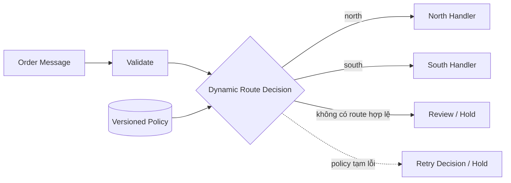
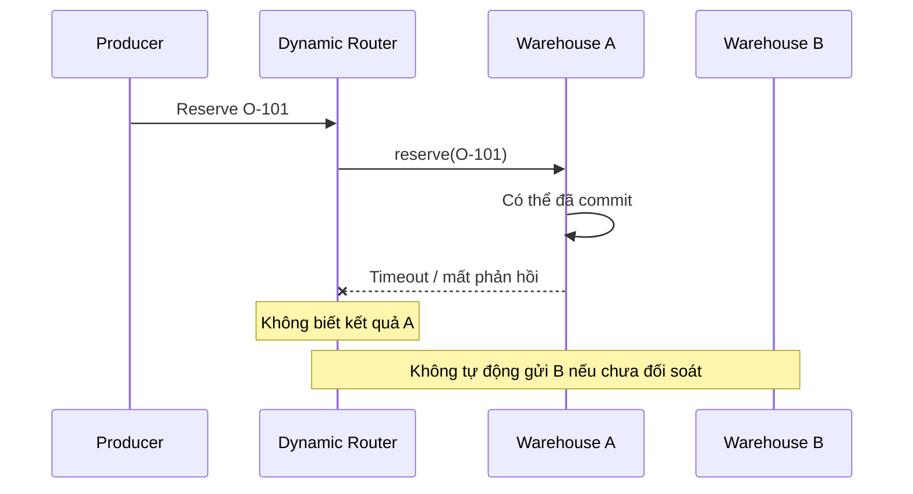
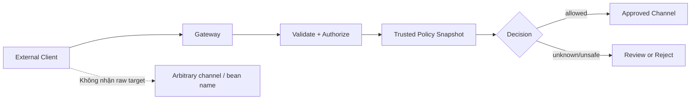
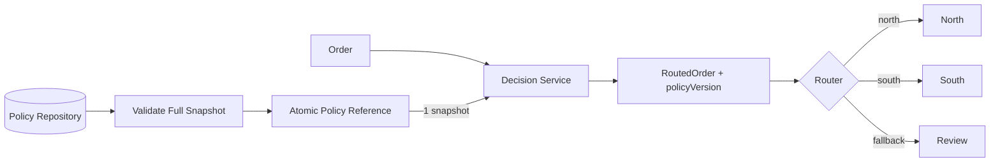
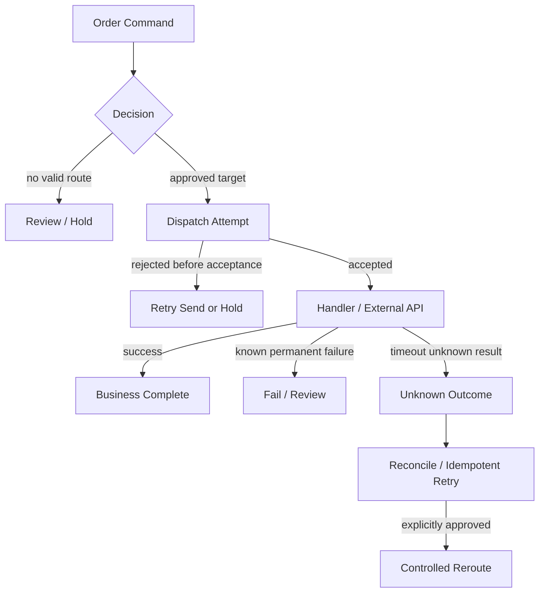
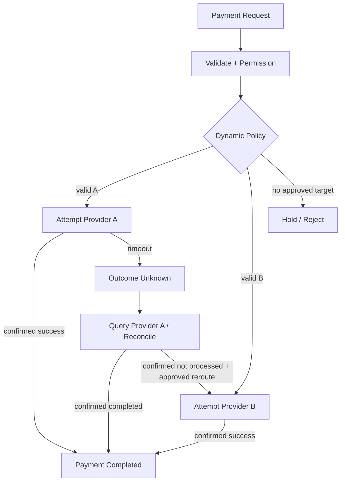

# Fallback khi dynamic route thất bại

Trong Enterprise Integration Patterns (EIP), **Dynamic Router** quyết định đường đi của message tại thời điểm xử lý, thay vì luôn đi theo một lộ trình được cố định hoàn toàn trong mã nguồn. Quyết định có thể phụ thuộc vào chính sách đang hiệu lực, cấu hình dịch vụ, loại message, trạng thái nghiệp vụ hoặc khả năng của các đích xử lý.

Ví dụ, một đơn hàng được gửi tới kho miền Bắc hoặc miền Nam theo vùng giao hàng. Khi bảng quy tắc chưa có vùng mới, hệ thống phải làm gì? Khi dịch vụ quản lý quy tắc tạm thời không phản hồi, có được chọn kho mặc định? Nếu đã gửi yêu cầu giữ hàng tới kho A nhưng bị timeout, có an toàn khi chuyển tiếp sang kho B?

Những câu hỏi trên là bài toán **fallback khi dynamic route thất bại**. Một nhánh dự phòng giúp hệ thống phục hồi chỉ khi nó có **hợp đồng nghiệp vụ rõ ràng**. Fallback tùy tiện có thể tạo đơn trùng, bỏ qua bước kiểm tra bắt buộc, rò rỉ dữ liệu sang sai tenant hoặc khiến ứng dụng báo “thành công” dù chưa biết đích ban đầu đã xử lý hay chưa.

Bài học thuộc chương **Dynamic router** của module **SPRING_INTEGRATION_PATTERN**. Trong bối cảnh triển khai Enterprise Integration Patterns bằng Spring Integration, ta sẽ kết hợp tư duy định tuyến với Gateway, Filter, Transformer, Splitter, Aggregator, retry, error channel, correlation, kiểm thử và observability để tạo ra các luồng thông điệp ít phụ thuộc, dễ mở rộng nhưng vẫn kiểm soát được rủi ro khi một tuyến không hoạt động.

**Sau bài này**, bạn có thể phân loại lỗi route, chọn giữa default route, retry, giữ chờ xử lý và reroute có kiểm soát; triển khai một ví dụ Java DSL; và kiểm thử rằng fallback không biến lỗi kỹ thuật thành side effect sai.

## 1. Dynamic Router khác gì với một tuyến dự phòng cố định?

Một Content-Based Router thường đánh giá message rồi trả về một hoặc nhiều channel theo các quy tắc định sẵn. Dynamic Router trong EIP nhấn mạnh việc **lộ trình/đích kế tiếp có thể được quyết định động trong lúc message đi qua hệ thống**. Chính sách định tuyến có thể thay đổi mà không cần thay đổi producer; trong một số thiết kế, các quyết định cho bước kế tiếp còn được đánh giá lặp lại theo trạng thái xử lý.

Spring Integration cung cấp nhiều cách hiện thực ý tưởng định tuyến động, ví dụ một router gọi phương thức lấy channel key từ policy service, router dùng cấu hình có thể cập nhật, hoặc một routing slip được tạo bởi thành phần tin cậy. **Ví dụ Java DSL trong bài này chọn cách đơn giản nhất:** dùng một policy service có snapshot thay đổi tại runtime để xác định một nhánh tiếp theo. Nó minh họa fallback trong *dynamic routing*, không tuyên bố rằng mọi đặc tính của pattern Dynamic Router nhiều bước đều được tự động kích hoạt.



**Fallback** là hành vi được định nghĩa khi tuyến chính không thể tiếp tục theo kỳ vọng. Nó có thể là:

- Chọn một **đích dự phòng tương đương**, nếu nghiệp vụ cho phép.
- Sử dụng một **policy snapshot còn hợp lệ** khi dịch vụ cung cấp policy tạm thời không truy cập được.
- Chuyển message tới **review/quarantine**, giữ lại để quyết định sau.
- **Retry** bước xác định route với backoff có giới hạn.
- **Từ chối có giải thích** khi yêu cầu không đáp ứng quy tắc, thay vì đoán một route.

Không phải fallback nào cũng tiếp tục nghiệp vụ. Đưa đơn vào `orders.review` và cập nhật trạng thái `ROUTING_PENDING` là một fallback có kiểm soát; nhưng **không đồng nghĩa đơn đã được giữ hàng**.

### Phải nêu rõ phạm vi của một lần định tuyến

Một “route thành công” ít nhất có ba mốc khác nhau:

| Mốc | Điều đã biết | Điều chưa thể khẳng định |
| --- | --- | --- |
| **Decision made** | Đã chọn route key/target | Target đã nhận message |
| **Dispatch accepted** | Channel/transport chấp nhận gửi theo ngữ nghĩa của nó | Handler downstream đã hoàn thành |
| **Business completed** | Side effect đã được xác nhận theo hợp đồng | Toàn bộ hệ thống khác cũng hoàn tất nếu có bước async tiếp theo |

Đừng ghi một event `route_fallback_success` chỉ vì message đã được enqueue vào queue dự phòng. Khi đường đi là bất đồng bộ, kết quả nghiệp vụ phải được theo dõi và xác nhận ở downstream.

## 2. Phân loại thất bại trước khi chọn fallback

Từ “router thất bại” bao phủ nhiều tình huống có bản chất khác nhau. Quy tắc quan trọng là **fallback phải dựa trên nơi thất bại và mức chắc chắn về side effect**.

| Trường hợp | Chuyện gì đã xảy ra? | Hướng xử lý phù hợp để cân nhắc |
| --- | --- | --- |
| **NO_MATCH** | Nội dung message không khớp bất kỳ quy tắc nào | Reject hoặc review; chỉ dùng default nếu thực sự có ý nghĩa nghiệp vụ |
| **INVALID_INPUT** | Message thiếu trường, sai schema hoặc không đủ quyền | Validation error; không “chữa” bằng cách gửi đến đích khác |
| **POLICY_UNAVAILABLE** | Dịch vụ cấp policy bị timeout/chưa tải xong | Snapshot đã được kiểm chứng, retry quyết định hoặc hold |
| **POLICY_INVALID** | Policy trả channel không tồn tại, version lỗi hoặc cấu hình mâu thuẫn | Fail closed; cảnh báo cấu hình và không gửi tới đích không rõ |
| **NO_SUBSCRIBER** | Channel đã chọn không có consumer thích hợp | Báo dispatch failure, khôi phục cấu hình hoặc giữ message |
| **SEND_REJECTED** | Dispatch tới target bị từ chối, queue đầy hoặc transport không chấp nhận | Retry theo chính sách, backpressure hoặc hold nếu chưa có side effect |
| **HANDLER_FAILED** | Handler nhận message rồi ném exception | Phân loại lỗi; retry/idempotency; không giả định đích khác là an toàn |
| **OUTCOME_UNKNOWN** | Gọi API bên ngoài timeout, không rõ đã xử lý hay chưa | Đối soát/idempotency trước khi reroute |
| **CAPACITY_REBALANCE** | Đích còn hoạt động nhưng tải cao | Có thể chọn target tương đương cho **message chưa dispatch** |
| **SECURITY_DENIED** | Tenant/role không có quyền vào đích | Từ chối; không đi đường dự phòng để bỏ qua kiểm soát |

**Điểm then chốt:** `NO_MATCH` xảy ra **trước khi có một target thực thi**; `OUTCOME_UNKNOWN` xảy ra **sau khi đã có khả năng tạo side effect**. Với trường hợp thứ hai, chuyển sang một target khác có thể tạo cùng tác vụ hai lần.

### Hai lỗi dễ bị đánh đồng

Giả sử `orderId=O-101` được route tới kho A. Có hai tình huống:

**Tình huống A:** Policy service chưa trả route, chưa có yêu cầu nào gửi tới kho. Lúc này chọn một tuyến `orders.review` hoặc một kho dự phòng được phép là một **quyết định trước side effect**.

**Tình huống B:** Đã gọi `reserve(O-101)` ở kho A; request timeout nhưng kho có thể đã giữ hàng. Gửi tiếp `reserve(O-101)` tới kho B **không phải chỉ là fallback đơn giản**. Nó là **reroute sau kết quả chưa xác định**, cần đối soát và quyền xử lý rõ ràng.



Trong hệ thống thanh toán, giữ kho hoặc ghi sổ kế toán, sự phân biệt này là bắt buộc. Nếu nghiệp vụ chỉ là render thumbnail idempotent trên các worker tương đương, việc chọn worker khác khi retry có thể chấp nhận được; yêu cầu phụ thuộc vào **ngữ nghĩa side effect**, không phụ thuộc tên pattern.

## 3. Thiết kế một fallback policy thay vì một channel mặc định vô điều kiện

Một chính sách fallback nên trả lời năm câu hỏi:

1. **Lý do kích hoạt:** no-match, policy timeout, target unavailable hay handler failed?
2. **Thời điểm:** chưa dispatch, đang dispatch hay side effect có thể đã xảy ra?
3. **Đích thay thế có tương đương không:** cùng quyền, cùng hợp đồng input/output, cùng dữ liệu và khả năng idempotent?
4. **Hệ thống biết kết quả thế nào:** response đồng bộ, async status, ack, audit hay đối soát?
5. **Chính sách dừng:** tối đa bao nhiêu retry, thời gian chờ, nơi quarantine và ai xử lý thủ công?

Có thể mô hình hóa bằng một bảng:

| Điều kiện | Chính sách | Kết quả hệ thống ghi nhận |
| --- | --- | --- |
| Đơn `region` không được hỗ trợ | Chuyển đến review | `ROUTING_PENDING` hoặc `REJECTED` |
| Config service timeout, cache còn hợp lệ | Dùng policy snapshot gần nhất **nếu được cho phép** | `DECIDED_WITH_CACHED_POLICY` |
| Config service timeout, không có snapshot hợp lệ | Retry lookup ngắn rồi hold | `POLICY_UNAVAILABLE` |
| Đích chính quá tải **trước dispatch** | Chuyển đích tương đương có trong allowlist | `REROUTED_FOR_CAPACITY` |
| Đích chính timeout **sau khi gửi** | Đối soát với đích chính | `OUTCOME_UNKNOWN` |
| Handler báo lỗi dữ liệu vĩnh viễn | Reject/quarantine | `INVALID_INPUT` hoặc `FAILED_PERMANENT` |
| Policy yêu cầu kiểm tra rủi ro nhưng bước đó không hoạt động | Giữ chờ hoặc từ chối | `REVIEW_REQUIRED`, **không bỏ qua** bước rủi ro |

Những trạng thái này là **mô hình nghiệp vụ gợi ý**, không phải enum hoặc event Spring Integration tự tạo sẵn.

### Fail closed thay vì "gửi đâu đó cho xong"

**Fail closed** nghĩa là khi thiếu thông tin để chọn route an toàn, hệ thống **không thực hiện side effect trái chính sách**. Nó không nhất thiết có nghĩa phải trả HTTP 500; có thể chấp nhận yêu cầu vào một hàng chờ được bảo vệ rồi báo `PENDING`.

Ví dụ, thanh toán phải đi qua bước chống gian lận. Khi dịch vụ đánh giá rủi ro lỗi, không được fallback sang lộ trình “bỏ kiểm tra rủi ro để giảm độ trễ”. Đó là **thay đổi yêu cầu bảo mật**, không phải phục hồi kỹ thuật.

### Default output channel khác error channel

Trong Spring Integration, một Router có thể được cấu hình **default output channel** cho trường hợp không khớp route hoặc không có mapping phù hợp theo cơ chế của router. Nó **không tự bắt mọi lỗi handler downstream**.

- **Default output channel:** nhánh bình thường được chọn khi không tìm thấy tuyến theo chính sách router.
- **Error channel:** nơi một thành phần bắt lỗi công bố `ErrorMessage` theo cấu hình.
- **Discard channel:** nơi Filter có thể đưa message bị loại, không nhất thiết là lỗi kỹ thuật.
- **Dead-letter/quarantine:** nơi giữ dữ liệu không thể xử lý tự động để điều tra hoặc phát lại.

Nếu một handler đã nhận message rồi ném exception, `defaultOutputChannel("orders.review")` **không** phải một cơ chế tự động gửi lỗi handler về `orders.review`.

## 4. Dynamic fallback cần có ranh giới tin cậy

Một Dynamic Router thường lấy quy tắc từ cấu hình hoặc dịch vụ ngoài. Không phải nguồn dữ liệu nào cũng được phép chỉ định đích nội bộ.

**Không cho client kiểm soát tên channel, bean, expression hoặc routing slip tùy ý.** Client chỉ cung cấp dữ liệu nghiệp vụ như `region`, `deliveryType`, `requestId`. Server dùng policy đáng tin cậy để ánh xạ chúng sang một tập đích đã duyệt.



Một policy an toàn cần giới hạn:

- **Target allowlist:** chỉ route tới các channel/adapter có trong cấu hình ứng dụng.
- **Quyền theo tenant/role:** không chọn đích chỉ vì một header `tenantId` do client tự khai.
- **Contract tương thích:** đích fallback phải hiểu đúng schema, idempotency key và meaning của command.
- **Phiên bản quy tắc:** biết snapshot nào quyết định đích.
- **Thời hạn hiệu lực:** policy cache quá cũ có thể gây định tuyến sai quyền hoặc sai topology.
- **Nguyên tắc khi thiếu policy:** quyết định từ chối/giữ chờ phải được định nghĩa trước.

Một giá trị `targetChannel` nhận từ client rồi đưa trực tiếp vào router không phải là dynamic routing an toàn. Nó trao quyền điều hướng nội bộ cho nguồn không tin cậy.

## 5. Policy snapshot có phiên bản để fallback có thể giải thích

Giả sử mapping vùng → kho nằm trong một nguồn cấu hình có thể cập nhật. Nếu đọc từng field khi xử lý, một message có thể lấy `policyVersion` mới nhưng mapping cũ.

Một cách quản lý trong một JVM là **đọc một snapshot bất biến cho mỗi quyết định**:



Lợi ích:

- Mỗi lần quyết định dựa trên **một phiên bản**.
- Không trộn mapping trong lúc config đang được cập nhật.
- Có thể ghi `policyVersion` vào decision record để audit.
- Lỗi load snapshot mới có thể **giữ nguyên bản cũ** nếu bản cũ vẫn nằm trong giới hạn hiệu lực và nghiệp vụ cho phép.

Nhưng `AtomicReference` chỉ giúp quản lý snapshot **trong một tiến trình**. Nó không tự giải quyết các vấn đề multi-instance, đồng bộ policy giữa các node, lịch sử snapshot hay độ bền sau restart.

### Khi nào không được dùng stale policy?

Nếu policy mới thu hồi quyền xử lý của kho A hoặc thay đổi quy tắc chống gian lận, một snapshot cũ có thể không còn an toàn dù còn trong cache. Cần phân biệt:

- **Stale-while-revalidate được phép:** ví dụ mapping của tác vụ vô trạng thái, các đích tương đương và đã được đánh giá rủi ro.
- **Fail closed khi không có policy mới:** ví dụ quy tắc quyền, compliance, thanh toán hoặc tenant isolation.
- **Staleness có giới hạn:** policy có `expiresAt`, revision và cơ chế giám sát cảnh báo.
- **Version pinning:** một quyết định đã chốt có thể cần dùng đúng version khi retry; nhưng nếu policy mới thu hồi quyền vì an toàn, phải có quy tắc xử lý ngoại lệ.

**Cache có dữ liệu không đồng nghĩa cache được phép dùng.** Mức độ tin cậy và thời hạn phải là một phần hợp đồng fallback.

## 6. Ví dụ Spring Integration: route động và nhánh review an toàn

Ta thiết kế một luồng đặt hàng:

- Region `NORTH` → channel `orders.north`.
- Region `SOUTH` → channel `orders.south`.
- Region không có mapping → channel `orders.review`.
- Không có policy đáng tin cậy → `orders.review` với reason `POLICY_UNAVAILABLE`.
- Chỉ **hai kho được phê duyệt** được thực hiện nghiệp vụ giữ hàng; review chỉ ghi trạng thái chờ và yêu cầu xử lý tiếp.

Ví dụ tập trung vào **fallback khi chưa có dispatch xuống kho**. Nó không cố tự xử lý timeout sau khi kho đã nhận lệnh.

### 6.1. Định nghĩa dữ liệu và quyết định route

```java
import java.util.Map;
import java.util.Objects;
import java.util.concurrent.atomic.AtomicReference;

enum RouteKey {
    NORTH,
    SOUTH,
    REVIEW
}

record OrderCommand(String orderId, String region) {}

record RouteDecision(
    RouteKey routeKey,
    String reasonCode,
    long policyVersion,
    boolean fallback
) {}

record RoutedOrder(OrderCommand order, RouteDecision decision) {}

record RoutingPolicy(
    long version,
    Map<String, RouteKey> routesByRegion
) {
    RoutingPolicy {
        routesByRegion = Map.copyOf(routesByRegion);
    }
}

final class RoutePolicyService {
    private final AtomicReference<RoutingPolicy> current =
        new AtomicReference<>(new RoutingPolicy(
            1L,
            Map.of(
                "NORTH", RouteKey.NORTH,
                "SOUTH", RouteKey.SOUTH
            )
        ));

    RoutedOrder decide(OrderCommand command) {
        if (command == null || command.orderId() == null
                || command.orderId().isBlank()
                || command.region() == null
                || command.region().isBlank()) {
            throw new IllegalArgumentException("Invalid order command");
        }

        // Đọc đúng một snapshot cho một quyết định.
        RoutingPolicy policy = current.get();

        if (policy == null) {
            return new RoutedOrder(command, new RouteDecision(
                RouteKey.REVIEW,
                "POLICY_UNAVAILABLE",
                -1L,
                true
            ));
        }

        String region = command.region()
            .trim().toUpperCase(java.util.Locale.ROOT);
        RouteKey key = policy.routesByRegion().get(region);

        if (key == null) {
            return new RoutedOrder(command, new RouteDecision(
                RouteKey.REVIEW,
                "NO_ROUTE_MATCH",
                policy.version(),
                true
            ));
        }

        if (key == RouteKey.REVIEW) {
            return new RoutedOrder(command, new RouteDecision(
                RouteKey.REVIEW,
                "REVIEW_BY_POLICY",
                policy.version(),
                false
            ));
        }

        return new RoutedOrder(command, new RouteDecision(
            key, "REGION_POLICY_MATCH", policy.version(), false
        ));
    }

    void replacePolicy(RoutingPolicy policy) {
        current.set(Objects.requireNonNull(policy));
    }

    // Chỉ dùng để mô phỏng policy unavailable trong bài test.
    void simulatePolicyUnavailable() {
        current.set(null);
    }
}
```

**Cách hiểu ví dụ:**

- `RoutingPolicy` chứa map bất biến nhờ `Map.copyOf`.
- `AtomicReference` cho một lần đọc policy nhất quán trong một JVM.
- Khi không có map hoặc policy, code trả về `RouteKey.REVIEW`; nó **không tự chọn một kho khác**.
- `reasonCode`, `policyVersion` và cờ `fallback` làm rõ tại sao message được gửi vào review.
- `simulatePolicyUnavailable` chỉ dành cho mô phỏng; hệ thống thật phải có health state, kiểm tra TTL/version và cơ chế xử lý khi policy provider lỗi.

Đây mới là **logic ra quyết định**. Nó không lưu quyết định bền vững và chưa đảm bảo một message replay từ đầu sẽ giữ target cũ khi policy thay đổi.

### 6.2. Gateway, Router và handler theo Java DSL

```java
import org.springframework.context.annotation.Bean;
import org.springframework.context.annotation.Configuration;
import org.springframework.integration.annotation.Gateway;
import org.springframework.integration.annotation.IntegrationComponentScan;
import org.springframework.integration.annotation.MessagingGateway;
import org.springframework.integration.channel.DirectChannel;
import org.springframework.integration.config.EnableIntegration;
import org.springframework.integration.dsl.IntegrationFlow;
import org.springframework.messaging.MessageChannel;

interface OrderDispatchService {
    void reserveInNorth(RoutedOrder command);
    void reserveInSouth(RoutedOrder command);
    void holdForReview(RoutedOrder command);
}

@MessagingGateway
interface OrderGateway {
    @Gateway(requestChannel = "orders.in")
    void submit(OrderCommand command);
}

@Configuration
@EnableIntegration
@IntegrationComponentScan
class DynamicRoutingConfiguration {

    @Bean
    RoutePolicyService routePolicyService() {
        return new RoutePolicyService();
    }

    @Bean("orders.in")
    MessageChannel incomingOrders() {
        return new DirectChannel();
    }

    @Bean("orders.decided")
    MessageChannel decidedOrders() {
        return new DirectChannel();
    }

    @Bean("orders.north")
    MessageChannel northOrders() {
        return new DirectChannel();
    }

    @Bean("orders.south")
    MessageChannel southOrders() {
        return new DirectChannel();
    }

    @Bean("orders.review")
    MessageChannel reviewOrders() {
        return new DirectChannel();
    }

    @Bean
    IntegrationFlow decideOrderRoute(RoutePolicyService policy) {
        return IntegrationFlow.from("orders.in")
            .transform(OrderCommand.class, policy::decide)
            .channel("orders.decided")
            .get();
    }

    @Bean
    IntegrationFlow dispatchDecidedOrder() {
        return IntegrationFlow.from("orders.decided")
            .route(RoutedOrder.class,
                routed -> routed.decision().routeKey().name(),
                mapping -> mapping
                    .channelMapping("NORTH", "orders.north")
                    .channelMapping("SOUTH", "orders.south")
                    .channelMapping("REVIEW", "orders.review")
                    .defaultOutputChannel("orders.review"))
            .get();
    }

    @Bean
    IntegrationFlow northOrdersFlow(OrderDispatchService dispatch) {
        return IntegrationFlow.from("orders.north")
            .handle(RoutedOrder.class, (routed, headers) -> {
                dispatch.reserveInNorth(routed);
                return null;
            })
            .get();
    }

    @Bean
    IntegrationFlow southOrdersFlow(OrderDispatchService dispatch) {
        return IntegrationFlow.from("orders.south")
            .handle(RoutedOrder.class, (routed, headers) -> {
                dispatch.reserveInSouth(routed);
                return null;
            })
            .get();
    }

    @Bean
    IntegrationFlow reviewOrdersFlow(OrderDispatchService dispatch) {
        return IntegrationFlow.from("orders.review")
            .handle(RoutedOrder.class, (routed, headers) -> {
                dispatch.holdForReview(routed);
                return null;
            })
            .get();
    }
}
```

Để sử dụng, ứng dụng cần dependency Spring Integration phù hợp, một bean triển khai `OrderDispatchService` và gateway được `@IntegrationComponentScan` quét hoặc đăng ký theo cách tương đương. Class `DynamicRoutingConfiguration` sử dụng các channel `DirectChannel` để dễ quan sát thứ tự gọi.

Ở bước **decision**, transformer tạo `RoutedOrder`. Router chỉ đọc `routeKey` đã tính và chọn một trong các channel hợp lệ. Việc định tuyến chịu ảnh hưởng **policy snapshot có thể cập nhật lúc chạy**, nhưng component gửi message không bao giờ tự lấy tên channel từ request body.

### 6.3. Giới hạn rất quan trọng của defaultOutputChannel

Cấu hình `defaultOutputChannel("orders.review")` ở trên chỉ là **safety net cho đường không được ánh xạ** theo chức năng của router. Trong logic hiện tại, `RouteKey.REVIEW` đã được mapping tường minh.

Nó **không tự động** xử lý các lỗi sau:

- `policy.decide` ném exception khi input không hợp lệ.
- Bean `orders.north` có subscriber nhưng handler ném exception.
- Hệ thống kho ngoài nhận request và trả timeout.
- Message đã vào một queue nhưng consumer xử lý thất bại sau đó.

Những tình huống này thuộc **đường lỗi của endpoint/transport**, không phải “route key không khớp”. Nếu muốn có retry hoặc chuyển xử lý lỗi, phải cấu hình advice/error handler/recovery flow tương ứng và xác minh chính xác điểm retry.

### 6.4. Kết quả các trường hợp trong ví dụ

| Input/trạng thái policy | Decision | Handler được gọi |
| --- | --- | --- |
| `O-101, NORTH`, policy v1 | `NORTH`, `REGION_POLICY_MATCH`, fallback=false | `reserveInNorth` |
| `O-102, SOUTH`, policy v1 | `SOUTH`, `REGION_POLICY_MATCH`, fallback=false | `reserveInSouth` |
| `O-103, UNKNOWN` | `REVIEW`, `NO_ROUTE_MATCH`, fallback=true | `holdForReview` |
| Policy unavailable | `REVIEW`, `POLICY_UNAVAILABLE`, fallback=true | `holdForReview` |
| `orderId` rỗng | Exception validation | Không được gọi handler |
| Kho Bắc ném exception | Đã chọn `NORTH`; handler lỗi | **Không** tự gọi `reserveInSouth` hoặc review qua default route |

Với các channel đang là `DirectChannel`, exception của handler downstream thường có thể lan ngược đến caller của gateway. Đối với queue/broker, thời điểm phát hiện lỗi và nơi error message được xử lý khác đi.

## 7. Khi route quyết định xong nhưng target thất bại

Một vấn đề không thể bỏ qua là **đích đã được chọn** rồi mới xảy ra sự cố. Không nên dùng chung một policy cho mọi tình huống.



### 7.1. Dispatch chưa được chấp nhận

Nếu một channel **chắc chắn từ chối** message trước khi consumer hoặc transport nhận, hệ thống có thể retry thao tác gửi, giữ message hoặc chọn đích tương đương trước side effect.

Tuy nhiên, “`send` trả về false” hay “broker publish không xác nhận” không phải lúc nào cũng đủ để kết luận bên ngoài chưa nhận. Cần dựa trên **semantics của channel/adapter đang dùng**. Một network timeout trong lúc publish có thể tạo trạng thái kết quả chưa rõ.

### 7.2. Handler báo thất bại rõ ràng

Nếu handler xác nhận một lỗi không thể phục hồi (ví dụ SKU không tồn tại), fallback sang kho khác thường không giải quyết đúng nguyên nhân; cần validation hoặc trạng thái nghiệp vụ rõ ràng.

Nếu đó là lỗi tạm thời (ví dụ database deadlock) và thao tác có thể retry an toàn, hãy dùng **retry có giới hạn**, có backoff và quan sát từng attempt. Lựa chọn reroute chỉ được cân nhắc nếu target mới có cùng hợp đồng và kết quả ở target cũ đã được đối soát.

### 7.3. Timeout không xác định kết quả

Ví dụ ở cổng thanh toán: request đến cổng A, cổng xử lý thành công nhưng response bị mất. Nếu router tự động gửi cùng giao dịch sang cổng B, khách có thể bị tính tiền hai lần.

Đối với trạng thái `OUTCOME_UNKNOWN`, hướng ưu tiên là:

1. Giữ lại business key, target ban đầu, idempotency key và attempt ID.
2. Hỏi lại trạng thái ở target ban đầu hoặc chờ callback/ack đáng tin cậy.
3. Nếu cần retry, dùng **cùng idempotency key** theo hợp đồng provider và chính sách backoff.
4. Chỉ khi có bằng chứng nghiệp vụ rằng có thể chuyển đích, mới tạo **một quyết định reroute có dấu vết**.
5. Khi không thể đối soát, chuyển sang trạng thái chờ xử lý thủ công thay vì công bố thành công giả.

## 8. Retry, circuit breaker và fallback là ba cơ chế khác nhau

**Retry** thử lại một thao tác đã thất bại; **circuit breaker** hạn chế gọi vào một target đang không khỏe; **fallback** chọn cách hành xử khác khi đường chính không dùng được. Có thể phối hợp cả ba, nhưng không nên xem chúng là cùng một cơ chế.

| Cơ chế | Vị trí áp dụng thường gặp | Rủi ro nếu sử dụng sai |
| --- | --- | --- |
| Retry tra policy | Trước quyết định đích | Chặn caller quá lâu; bùng nổ request khi config service lỗi |
| Retry dispatch | Khi message chưa được target chấp nhận chắc chắn | Giao trùng message nếu ack/response không rõ |
| Retry handler | Sau khi handler lỗi | Side effect lặp nếu thiếu idempotency |
| Circuit breaker | Trước khi gọi target chậm/lỗi | Cắt đứt cả traffic còn hợp lệ nếu policy quá nhạy |
| Default route | Khi không có mapping phù hợp | Che giấu dữ liệu sai hoặc chọn đích ngoài quy tắc |
| Review/quarantine | Khi không thể tiếp tục an toàn | Tồn đọng không có người xử lý nếu thiếu SLA/monitoring |
| Controlled reroute | Sau khi có bằng chứng đủ về target cũ | Rủi ro nếu đối soát sai hoặc mất tính nhất quán |

### Đặt ranh giới retry chính xác

Giả sử luồng có:

```text
Gateway -> Dynamic Decision -> Router -> Reserve Inventory
```

Nếu retry bao quanh **toàn bộ flow**, mỗi lần thử có thể **tính lại quyết định** khi policy thay đổi. Nếu retry đặt **sau khi đã lưu RoutedOrder**, các attempt có thể giữ cùng target và policy version.

Khi nghiệp vụ đòi **sticky route**, hãy chốt và lưu quyết định trước khi cho retry. Với xử lý bất đồng bộ, có thể lưu `RoutedOrder` trong durable queue hoặc bảng công việc. Transactional Outbox giúp nối việc ghi nghiệp vụ và bản ghi cần publish trong một transaction database phù hợp, nhưng **không loại bỏ nhu cầu idempotency ở consumer**.

### Circuit breaker không tự biết đích thay thế

Một circuit breaker mở có thể ngăn gửi request đến kho A. Điều này không chứng minh kho B có thể thay thế kho A cho một lệnh đã gửi trước đó. Phải dùng policy lựa chọn target dự phòng dựa trên **quyền, dữ liệu sở hữu, trạng thái công việc và tính tương đương của side effect**.

## 9. Error channel trong Spring Integration giúp gì?

Spring Integration có cơ chế gửi **`ErrorMessage`** đến error channel khi thành phần xử lý lỗi phù hợp bắt exception và công bố nó. Trong xử lý đồng bộ với `DirectChannel`, exception có thể lan ngược tới caller, chứ không tự đi vào một error channel tùy ý.

Ở các endpoint chạy trên executor, poller hoặc inbound adapter, lỗi có thể được xử lý trên thread khác. Khi đó cần biết:

- Thành phần nào bắt exception?
- Error handler nào được cấu hình?
- Có header `errorChannel` hay default `errorChannel` được sử dụng không?
- Message gốc và route decision có còn trong failed message không?
- Sau error flow, message được retry, đưa dead-letter hay cập nhật trạng thái?
- Retry bắt đầu **trước hay sau** bước tính route?

Một error flow có thể thu thập:

```text
errorType = SEND_REJECTED | POLICY_UNAVAILABLE | HANDLER_FAILED
businessKey = O-101
target = orders.north
policyVersion = 3
attempt = 2
stage = DECISION | DISPATCH | PROCESSING
outcome = RETRYING | REVIEW_REQUIRED | UNKNOWN
```

Các trường trên là **hợp đồng telemetry đề xuất**. `ErrorMessage` thường có payload là `Throwable`; nó không tự mang đầy đủ mọi business field nếu ứng dụng/exception không giữ thông tin. Cần truyền và ghi nhận metadata ở các bước phù hợp.

**Error channel không phải fallback channel.** Nếu chỉ muốn log và cảnh báo lỗi, error handler có thể làm việc đó; nếu muốn recovery thực sự, cần quy tắc retry/quarantine/reroute tường minh. Nuốt exception rồi báo message đã xử lý sẽ tạo mất dữ liệu hoặc báo thành công giả.

## 10. Dynamic Router kết hợp với các pattern khác thế nào?

### 10.1. Gateway và Filter

Gateway nhận command từ ứng dụng và phát message vào flow. Filter có thể loại input không hợp lệ **trước khi chọn route**. Khi đó một message bị Filter từ chối không phải là “router không tìm được route”; đừng dùng default channel để bỏ qua validation.

Nếu gateway trả lời HTTP ngay sau enqueue, nó nên phản hồi “đã tiếp nhận” thay vì hứa nghiệp vụ downstream đã xong, trừ khi hợp đồng thật sự chờ kết quả.

### 10.2. Transformer và contract của từng target

Một Transformer có thể chuẩn hóa `region` hoặc chuyển payload sang command của kho tương ứng. Target fallback phải có **cùng contract** hoặc cần một Transformer chuyển đổi rõ ràng, không thể giả định hai hệ thống chấp nhận cùng payload.

Nếu Router dựa trên header do client gửi, cần kiểm tra nguồn tin cậy; nên dùng payload đã được validate hoặc metadata do server tạo. Khi Transformer tạo message mới, phải giữ business key, correlation và route decision cần thiết theo hợp đồng.

### 10.3. Splitter và Aggregator

Một order có nhiều dòng hàng có thể được Splitter chia thành nhiều message. Mỗi dòng có thể được dynamic route tới một kho khác nhau; khi đó **mỗi phần** cần route decision, correlation ID và trạng thái độc lập.

Aggregator chỉ nên release kết quả khi điều kiện nhóm đã đạt. Một số phần vào review hoặc đang chờ policy có thể khiến nhóm bị thiếu kết quả. Cần xác định:

- Có chấp nhận partial result không?
- Có timeout và release strategy nào?
- Mỗi phần bị fail/retry có ảnh hưởng nhóm ra sao?
- Correlation key nào liên kết các phần?
- Nếu một phần reroute, làm sao tránh đếm kết quả hai lần?

Nếu chỉ thấy “router đã chọn kho cho 3 item”, chưa thể kết luận Aggregator nhận đủ ba kết quả giữ hàng thành công.

### 10.4. Routing Slip, Recipient List và Publish-Subscribe

| Pattern | Tác dụng | Điều khác với fallback dynamic route |
| --- | --- | --- |
| **Dynamic Router** | Quyết định đích/bước tiếp theo theo ngữ cảnh thay đổi | Cần chính sách khi không có route hoặc target thất bại |
| **Routing Slip** | Message mang lộ trình các bước tuần tự | Tiến độ và chính sách bước tiếp theo phải được kiểm soát |
| **Recipient List** | Chọn một tập recipient cho cùng một message | Một nhánh thất bại không tự động được thay bằng nhánh khác |
| **Publish-Subscribe** | Phát message tới các subscriber | Mỗi subscriber có lỗi/ack/retry riêng |
| **Aggregator** | Gom kết quả từ nhiều message | Cần release/correlation, không phải route fallback |

Không nên dùng Recipient List để “gửi cả kho A lẫn kho B cho chắc” đối với lệnh có side effect chỉ được thực hiện một lần. Đó là **fan-out nhiều đích**, không phải phương án phục hồi an toàn.

## 11. Quan sát và kiểm toán mỗi quyết định fallback

Một dynamic route bị lỗi mà không có reason code sẽ khó điều tra. Với mỗi quyết định, nên giữ:

| Trường | Mục đích |
| --- | --- |
| `businessKey`/`eventId` | Đối soát công việc và chống duplicate |
| `decisionId` | Xác định lần quyết định cụ thể |
| `originalTarget`/`selectedTarget` | Thấy có reroute không |
| `reasonCode` | Tại sao fallback được kích hoạt |
| `policyVersion` | Quy tắc nào được dùng |
| `policySource`/`snapshotAge` | Dùng live policy hay cached policy |
| `stage` | Thất bại khi quyết định, dispatch hay xử lý |
| `attemptNumber` | Retry thứ mấy |
| `correlationId`/`traceId` | Theo dõi qua các endpoint |
| `decisionTimestamp` | Thời điểm phát sinh |
| `downstreamOutcome` | Hoàn tất, lỗi, đang chờ hay chưa rõ |

Ví dụ event log có cấu trúc:

```json
{
  "event": "dynamic_route_decided",
  "businessKey": "O-103",
  "decisionId": "dec-9001",
  "policyVersion": 4,
  "originalTarget": null,
  "selectedTarget": "orders.review",
  "reasonCode": "NO_ROUTE_MATCH",
  "fallback": true,
  "stage": "DECISION",
  "outcome": "ROUTING_PENDING"
}
```

**Đừng log toàn bộ payload nhạy cảm.** ID và reason code thường đủ để tra cứu; tenant, thông tin thanh toán hoặc dữ liệu cá nhân cần được xử lý theo chính sách bảo mật.

Nên theo dõi các chỉ số:

- `routing_decisions_total` theo route key, policy version được quản lý và reason code.
- `routing_fallback_total` theo loại lỗi và target dự phòng.
- `routing_policy_age_seconds` hoặc mức độ lệch phiên bản giữa instance.
- `routing_review_backlog`: số công việc đang chờ xử lý.
- `routing_retry_total`, `routing_error_total` và độ trễ từng giai đoạn.
- Số quyết định **đổi target trên cùng business key** khi replay.

Đây là các **tên metric minh họa**, không phải metric Spring Integration tự cung cấp nguyên văn. Không đưa `orderId` hoặc `decisionId` vào tag metrics vì số lượng giá trị lớn; để ID trong log/trace/audit có kiểm soát.

### Cảnh báo không chỉ dựa trên exception

Nếu 30% message được default sang `orders.review` mà flow vẫn trả về HTTP 202, hệ thống có thể không có exception nhưng nghiệp vụ đang ùn tắc. Cần cảnh báo theo tỷ lệ fallback, độ tuổi policy, backlog và SLA của nhánh review.

## 12. Kiểm thử fallback như một hợp đồng nghiệp vụ

### 12.1. Ma trận kiểm thử

| Tình huống | Điều cần xác minh |
| --- | --- |
| Policy hợp lệ, region NORTH | Route `NORTH`, không fallback |
| Policy hợp lệ, region SOUTH | Route `SOUTH`, không fallback |
| Region UNKNOWN | `REVIEW` với `NO_ROUTE_MATCH`; không gọi kho |
| Không có policy snapshot | `REVIEW` với `POLICY_UNAVAILABLE` |
| Input thiếu orderId | Validation exception, không quyết định route |
| Policy đổi version | Message mới có version mới; decision cũ không tự thay đổi |
| Policy chứa target ngoài allowlist | Policy bị từ chối trước khi phát hành, hoặc fail closed |
| North handler ném exception | **Không** tự gọi South hoặc review qua default mapping |
| Đích chính timeout sau side effect | Trạng thái UNKNOWN, đối soát trước reroute |
| Cùng order bị retry | Idempotency bảo vệ side effect |
| Queue đầy | Dispatch failure/backpressure được ghi nhận; không báo business completed |
| Multi-instance policy version lệch | Có log/metric cảnh báo, hành vi được xác định |
| Error channel nhận lỗi từ poller | Failed message/route decision được giữ nếu cấu hình hỗ trợ |
| Review handler cũng thất bại | Có quy trình recovery; không mất message lặng lẽ |

### 12.2. Unit test JUnit 5 cho policy fallback

```java
import static org.junit.jupiter.api.Assertions.*;
import java.util.Map;
import org.junit.jupiter.api.Test;

class RoutePolicyServiceTest {

    @Test
    void unknownRegionFallsBackToReview() {
        RoutePolicyService policy = new RoutePolicyService();

        RoutedOrder result =
            policy.decide(new OrderCommand("O-103", "UNKNOWN"));

        assertEquals(RouteKey.REVIEW, result.decision().routeKey());
        assertEquals("NO_ROUTE_MATCH",
            result.decision().reasonCode());
        assertTrue(result.decision().fallback());
        assertEquals(1L, result.decision().policyVersion());
    }

    @Test
    void missingPolicyDoesNotGuessWarehouse() {
        RoutePolicyService policy = new RoutePolicyService();
        policy.simulatePolicyUnavailable();

        RoutedOrder result =
            policy.decide(new OrderCommand("O-104", "NORTH"));

        assertEquals(RouteKey.REVIEW, result.decision().routeKey());
        assertEquals("POLICY_UNAVAILABLE",
            result.decision().reasonCode());
        assertTrue(result.decision().fallback());
    }

    @Test
    void newSnapshotAffectsNewDecisionOnly() {
        RoutePolicyService policy = new RoutePolicyService();
        OrderCommand order = new OrderCommand("O-105", "NORTH");

        RoutedOrder first = policy.decide(order);
        policy.replacePolicy(new RoutingPolicy(
            2L,
            Map.of("NORTH", RouteKey.SOUTH,
                   "SOUTH", RouteKey.SOUTH)
        ));
        RoutedOrder later = policy.decide(order);

        assertEquals(RouteKey.NORTH, first.decision().routeKey());
        assertEquals(1L, first.decision().policyVersion());
        assertEquals(RouteKey.SOUTH, later.decision().routeKey());
        assertEquals(2L, later.decision().policyVersion());
    }

    @Test
    void invalidOrderIsRejectedBeforeRouting() {
        RoutePolicyService policy = new RoutePolicyService();

        assertThrows(IllegalArgumentException.class,
            () -> policy.decide(new OrderCommand(" ", "NORTH")));
    }
}
```

Những test này chỉ chứng minh decision service trong bộ nhớ. Chúng chưa chứng minh Spring Integration dispatch tới đúng channel, policy được lưu bền hoặc handler idempotent khi broker redeliver.

### 12.3. Integration test tại điểm nối Spring Integration

Sử dụng một `OrderDispatchService` mock/spy và gọi `OrderGateway`:

1. Gửi NORTH, xác minh chỉ `reserveInNorth` được gọi.
2. Gửi UNKNOWN, xác minh chỉ `holdForReview` được gọi và chứa reason `NO_ROUTE_MATCH`.
3. Cho policy unavailable, xác minh review nhận reason `POLICY_UNAVAILABLE`.
4. Cho `reserveInNorth` ném exception; xác minh exception theo đường đồng bộ, **không gọi `reserveInSouth` hoặc `holdForReview`** chỉ vì router có default channel.
5. Đổi policy giữa hai message, kiểm tra `policyVersion` và target phù hợp từng lần.
6. Với retry sau khi đã có `RoutedOrder`, phát lại **decision cũ** vào `orders.decided` rồi kiểm tra không tính lại policy.
7. Với executor/queue/broker, kiểm tra lỗi ở thread khác, error handler, redelivery/ack và trạng thái thực bằng điều kiện chờ có giới hạn thời gian.

Khi làm integration test có nguồn ngoài, nên dùng mô phỏng timeout **sau khi service đã ghi side effect** để thử trường hợp nguy hiểm nhất: không được tự gửi một command sang target B mà không đối soát.

## 13. Tình huống thực hành: fallback giữa hai cổng thanh toán

Một hệ thống thanh toán có hai provider A và B. Policy động có thể chọn A cho giao dịch nội địa; B chỉ được dùng khi loại thẻ và khu vực được cả hai provider hỗ trợ.

Điều kiện:

- Mỗi payment có `paymentId` ổn định.
- Routing policy thay đổi trong ngày theo năng lực provider.
- Provider A đôi khi timeout, dù vẫn có thể đã capture thành công.
- Provider B không hỗ trợ một số loại thẻ.
- Quy trình phải giữ được dấu vết mọi quyết định và không thu tiền trùng.

Hãy phân loại các trường hợp:



Tự trả lời:

1. Khi A chưa nhận request nhưng đã bị circuit breaker chặn, có thể chọn B ngay không? Cần kiểm tra điều kiện nào?
2. Khi A nhận request rồi timeout, vì sao không được mặc định thử B?
3. Nếu policy v3 chọn A, v4 chọn B, replay cùng payment dùng quyết định nào?
4. Record nào lưu `paymentId`, target, policy version, attempt và idempotency key?
5. Nếu không provider nào được phép xử lý, API nên trả trạng thái nào theo hợp đồng?
6. Khi provider A thực sự đã capture nhưng callback đến trễ, hệ thống đối soát và không xử lý trùng ra sao?
7. Nếu payment có các bước `authorize → capture → notify`, phần nào là Dynamic Router, phần nào là Routing Slip/workflow state?
8. Những metric nào phát hiện 20% payment đang nằm ở `PENDING_REVIEW` dù HTTP API không báo 5xx?

Một thiết kế tốt **không** chứng minh bằng cách “có đường fallback sang B”. Nó chứng minh được **khi nào B được phép thay A, khi nào kết quả A vẫn chưa rõ, và một payment sẽ không bị capture hai lần**.

## 14. Checklist triển khai production

Trước khi cho dynamic fallback chạy trong production, hãy xác nhận:

- [ ] **Phân loại lỗi:** no-match, policy unavailable, dispatch reject và downstream timeout được xử lý khác nhau.
- [ ] **Nguồn policy tin cậy:** không nhận tên channel/bean/raw routing slip từ client.
- [ ] **Target allowlist:** chỉ cho phép route đến các destination được triển khai và phê duyệt.
- [ ] **Snapshot nhất quán:** mỗi quyết định ghi được policy version; TTL và quy tắc dùng cache đã rõ.
- [ ] **Không bypass quyền:** fallback không bỏ qua validation, tenant isolation hoặc bước bảo mật bắt buộc.
- [ ] **Quyết định retry/reroute:** có câu trả lời khi policy đổi giữa hai attempt.
- [ ] **Idempotency:** các side effect chịu được redelivery/trùng command theo phạm vi cần thiết.
- [ ] **Trạng thái UNKNOWN:** có cơ chế đối soát thay vì tự coi là thất bại.
- [ ] **Review/quarantine có người sở hữu:** backlog, SLA, replay và quyền xử lý được quản lý.
- [ ] **Error channel đúng cơ chế:** biết component nào bắt lỗi và nơi ErrorMessage được gửi.
- [ ] **Observability:** có reason code, target, policy version, attempt, correlation và outcome.
- [ ] **Kiểm thử xấu:** policy down, target down, timeout sau commit, queue đầy và multi-instance đã được mô phỏng.
- [ ] **Giới hạn tài nguyên:** retry, backoff, circuit breaker và capacity được kiểm soát.
- [ ] **Không đánh tráo mốc thành công:** send accepted không tự đồng nghĩa business completed.

Danh sách trên không thay thế quy trình Content QA hoặc kiểm thử hệ thống thực; nó giúp tránh thiếu những điều kiện cần thiết khi một nhánh dự phòng được thêm vào flow.

## Ghi nhớ

**Fallback khi dynamic route thất bại** là một **quyết định nghiệp vụ và vận hành có kiểm soát**, không chỉ là cấu hình `defaultOutputChannel`. Trước hết cần xác định thất bại xảy ra khi **tính đích, gửi message hay xử lý tại đích**, và biết có khả năng side effect đã xảy ra chưa.

Trong Spring Integration, có thể kết hợp **policy snapshot bất biến có version**, Router ánh xạ các route key được phép, nhánh review fail-closed, retry có giới hạn, error channel, idempotency, correlation và log/audit. **Không tự động chuyển message sang một đích khác sau timeout có kết quả chưa xác định**. Khi phân biệt đúng default route, error handling, retry và reroute có phê duyệt, luồng Dynamic Router mới vừa linh hoạt vừa có thể giải thích, kiểm thử và vận hành an toàn.

