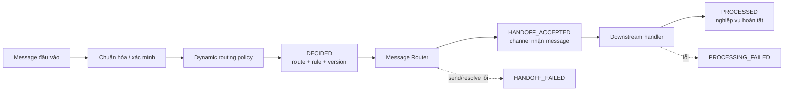
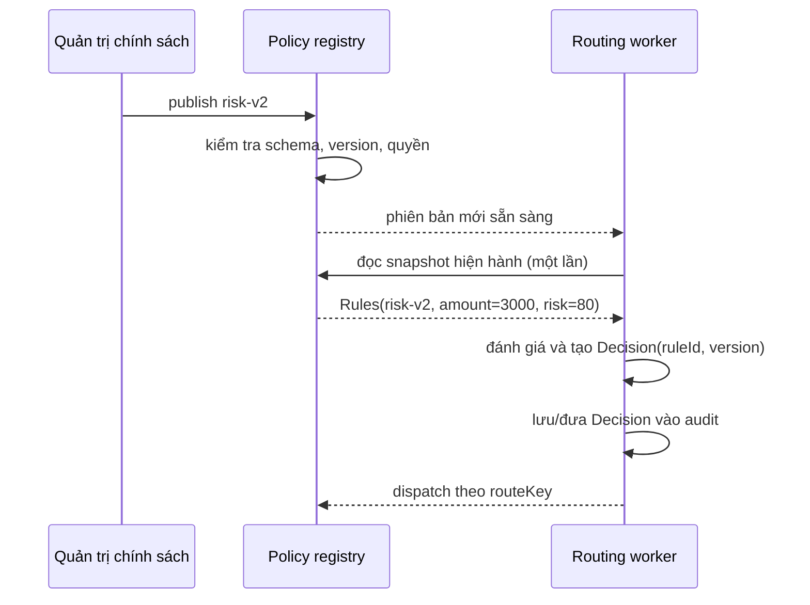
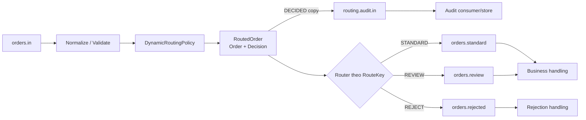
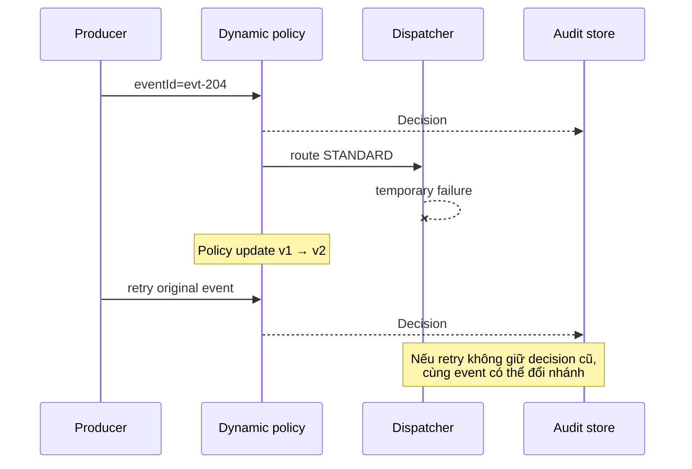
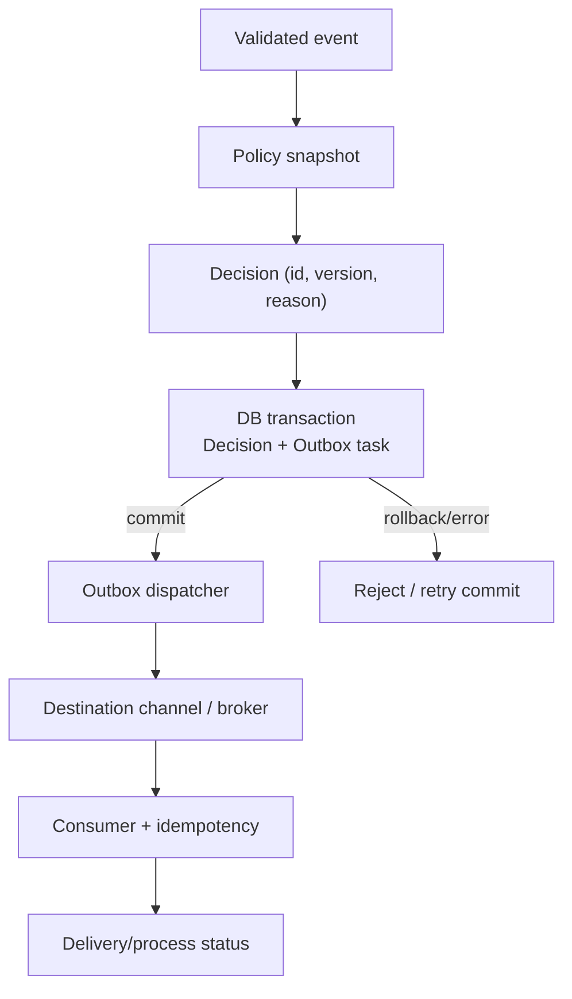

# Audit quyết định định tuyến

## 1. Vì sao Dynamic Router cần audit quyết định?

**Dynamic Router** là một biến thể của *Message Router* trong Enterprise Integration Patterns (EIP): đích xử lý được quyết định theo một **tập quy tắc có thể thay đổi khi ứng dụng đang chạy**, thay vì luôn bị cố định bởi một biểu thức hoặc bảng ánh xạ được đóng gói cùng bản phát hành.

Ví dụ một hệ thống nhận đơn hàng có ba đích:

- `orders.standard`: đơn hàng thông thường, đi theo quy trình tự động.
- `orders.review`: đơn hàng có rủi ro hoặc giá trị vượt ngưỡng, cần xem xét.
- `orders.rejected`: thông điệp không đáp ứng hợp đồng đầu vào.

Lúc 09:00, chính sách `risk-v1` quy định đơn từ 5.000 trở lên phải vào review. Lúc 10:00, bộ phận quản trị phát hành `risk-v2` và hạ ngưỡng xuống 3.000. Với cùng một đơn hàng có giá trị 4.000, việc đi theo nhánh `standard` trước 10:00 và `review` sau 10:00 **có thể đều đúng**, tùy phiên bản chính sách và dữ liệu đánh giá tại từng thời điểm.

Nếu log chỉ có dòng `"message routed to orders.review"`, sau nhiều ngày sẽ rất khó trả lời:

1. **Vì sao** message bị đưa vào nhánh đó?
2. **Quy tắc phiên bản nào** đã được áp dụng?
3. **Dữ liệu đầu vào đã được chuẩn hóa** ở thời điểm quyết định là gì?
4. **Ai hoặc quy trình nào** đã thay đổi chính sách?
5. Routing thành công có đồng nghĩa downstream đã xử lý thành công không?
6. Khi retry hoặc replay, cần dùng **quyết định cũ** hay đánh giá lại bằng chính sách mới?

Trong module **SPRING_INTEGRATION_PATTERN**, chương **Dynamic router** tập trung cách triển khai Enterprise Integration Patterns bằng Spring Integration để xây dựng luồng thông điệp ít phụ thuộc, dễ mở rộng. Audit quyết định định tuyến tạo nền tảng để phối hợp Router, Filter, Transformer, Splitter, Aggregator, Gateway, retry, error channel và correlation, đồng thời kiểm thử, theo dõi rõ từng nhánh xử lý.

**Mục tiêu bài học:** xây dựng được một bản ghi audit đủ để giải thích và tái dựng quyết định, phân biệt quyết định với kết quả bàn giao/xử lý, triển khai policy động với snapshot bất biến, và kiểm thử cả việc thay đổi policy lẫn độ tin cậy của audit.

## 2. Audit phải ghi điều gì — và không được khẳng định điều gì?

Một quyết định định tuyến đi qua các mốc khác nhau:



| Mốc | Điều có thể khẳng định | Điều **chưa** được khẳng định |
| --- | --- | --- |
| `DECIDED` | Policy đã chọn một routing key theo một snapshot quy tắc | Channel đã tồn tại, được gửi thành công, hoặc downstream đã xử lý |
| `DISPATCH_ATTEMPTED` | Ứng dụng đã cố gửi tới một đích | Đích đã nhận message |
| `HANDOFF_ACCEPTED` | Channel/transport đã xác nhận mức bàn giao theo semantics của nó | Business handler đã commit nếu channel bất đồng bộ hoặc remote |
| `HANDOFF_FAILED` | Không bàn giao được theo kết quả được quan sát | Không có side effect nào xảy ra nếu outcome remote còn bất định |
| `PROCESSED` | Consumer đã xác nhận hoàn tất nghiệp vụ theo hợp đồng | Mọi hệ thống phụ trợ khác cũng đã hoàn tất |
| `PROCESSING_FAILED` | Consumer báo thất bại hoặc hết khả năng phục hồi | Không tồn tại side effect trước khi exception xảy ra |

**Audit quyết định** tập trung vào mốc `DECIDED`. Một audit flow được nối sau bước tính policy nhưng trước Router **không được ghi** `status=DELIVERED` hoặc `status=COMPLETED`. Nếu cần audit kết quả gửi hoặc xử lý, phải thu thập thêm tín hiệu ở channel interceptor, adapter, consumer hoặc hệ thống xác nhận nghiệp vụ tương ứng.

Điều này đặc biệt quan trọng trong Spring Integration: `DirectChannel` thường chạy handler trên thread gửi, còn `QueueChannel`, `ExecutorChannel`, polling consumer và broker tạo các ranh giới thời gian khác nhau. Giá trị trả về của thao tác gửi không phải một xác nhận chung cho mọi side effect phía sau.

## 3. Dynamic Router khác Router tĩnh ở đâu?

Trong một **Content-Based Router** đơn giản, thuật toán và ngưỡng có thể viết trong cấu hình DSL:

```java
.route(OrderCommand.class,
    order -> order.amount().compareTo(
        new BigDecimal("5000")) >= 0
            ? "REVIEW" : "STANDARD",
    mapping -> mapping
        .channelMapping("REVIEW", "orders.review")
        .channelMapping("STANDARD", "orders.standard"))
```

Nếu thay ngưỡng trong code, thông thường phải phát hành lại ứng dụng. Với **Dynamic Router**, chính sách được đọc từ một nguồn có thể cập nhật, chẳng hạn một policy service, cấu hình phiên bản hóa, feature flag đã được kiểm soát hoặc bảng routing được cập nhật qua giao diện quản trị.

Trong Spring Integration có nhiều cách biểu đạt *dynamic routing*: một method/bean định tuyến có trạng thái cấu hình thay đổi, một mapping router được quản trị có kiểm soát, hoặc một tầng policy động đứng trước Router. Không cần giả định mọi giải pháp đều dùng chung một class hoặc một lệnh quản trị. **Mô hình audit dưới đây chủ ý tách tính toán quyết định khỏi channel mapping**, nhờ đó có thể áp dụng cho nhiều cách hiện thực.

Phải phân biệt hai loại thay đổi:

| Loại thay đổi | Ví dụ | Cách audit |
| --- | --- | --- |
| **Business policy** | `reviewAmountFrom: 5000 → 3000` | Ghi phiên bản policy, rule ID và input/context được sử dụng |
| **Topology mapping** | `REVIEW: orders.review → orders.manualApproval` | Ghi phiên bản mapping hoặc route catalog, cùng đích thực tế đã giải quyết |
| **Runtime availability** | Consumer tạm ngừng, queue đầy | Audit lỗi dispatch/processing riêng, không giả mạo policy decision |
| **Security / tenant entitlement** | Tenant A không được gửi sang channel của tenant B | Ghi kết quả kiểm tra quyền, không lộ dữ liệu nhạy cảm vào audit |

Nếu chỉ audit `routeKey=REVIEW` mà không biết `REVIEW` đã được ánh xạ đến đích nào ở phiên bản topology đó, điều tra sự cố sau khi đổi channel có thể vẫn thiếu bằng chứng.

## 4. Hợp đồng bản ghi quyết định

Một bản ghi audit nên có các trường đủ để trả lời **ai, cái gì, khi nào, theo quy tắc nào, vì sao, chọn đâu**.

| Trường | Ví dụ | Mục đích |
| --- | --- | --- |
| `decisionId` | `dec-204-1` | Định danh một lần quyết định, ổn định khi phát lại cùng bản ghi |
| `eventId` | `evt-order-204` | Định danh business event xuyên các lần giao hàng |
| `requestId` | `req-204` | Truy vết ingress và các dịch vụ liên quan |
| `tenantId` | `tenant-a` | Ranh giới quyền truy cập đã được xác thực |
| `policyVersion` | `risk-v2` | Phiên bản luật tại thời điểm đánh giá |
| `mappingVersion` | `route-map-v4` | Phiên bản ánh xạ route key sang channel (nếu thay đổi động) |
| `routeKey` | `REVIEW` | Kết quả có nghĩa nghiệp vụ |
| `resolvedChannel` | `orders.review` | Destination được định tuyến trong topology tương ứng |
| `ruleId` | `LARGE_AMOUNT` | Luật quyết định nhánh |
| `decisionAt` | Thời điểm UTC | Mốc ra quyết định |
| `decisionStatus` | `DECIDED` | Không nhầm với kết quả consumer |
| `inputFacts` | `amountBand=3000-4999, riskBand=LOW` | Các dữ kiện được phép lưu để giải thích quyết định |
| `sourceEventVersion` | `order-event-v3` | Schema dữ liệu được dùng khi đánh giá |
| `attemptId` | `delivery-attempt-2` | Tách nỗ lực giao message khỏi quyết định ban đầu |

Đây là **schema đề xuất ở tầng ứng dụng**, không phải trường do Spring Integration tự sinh. Một hệ thống có thể cần nhiều hoặc ít trường hơn theo yêu cầu compliance, quyền riêng tư và khả năng tái hiện.

### Cần phân biệt ba định danh

- `eventId`: bất biến cho cùng business event khi retry hoặc broker redeliver.
- `decisionId`: đại diện cho một **quyết định đã tính và được lưu**. Nếu chủ động đánh giá lại với policy mới, tạo một quyết định mới có liên kết với quyết định cũ.
- `attemptId`: phân biệt mỗi lần cố bàn giao/thi hành cùng quyết định.

Không dùng `MessageHeaders.ID` làm business event ID mặc định. ID message của framework có thể thay khi một message mới được tạo qua Transformer, adapter hoặc khi replay. Tương tự, `correlationId` của Splitter/Aggregator không luôn đồng nghĩa với `requestId` nghiệp vụ.

### Có nên lưu toàn bộ payload vào audit?

Thường **không nên**. Audit log có thể bị xem bởi nhiều người hoặc được giữ lâu hơn dữ liệu nguồn. Chỉ lưu **những fact thật sự ảnh hưởng tới quyết định**, dưới dạng phân loại hoặc tham chiếu an toàn nếu phù hợp. Không ghi token, mật khẩu, dữ liệu thẻ thanh toán, thông tin cá nhân không cần thiết, hoặc toàn bộ header do client gửi.

Nếu cần tái lập chính xác quyết định, hãy định nghĩa nơi lưu **snapshot đầu vào được chuẩn hóa** có quyền truy cập và retention riêng; bản ghi audit chứa tham chiếu/hash/phiên bản dữ liệu theo chính sách bảo mật của tổ chức.

## 5. Các quy tắc phải có thứ tự ưu tiên và lý do tường minh

Ví dụ một policy đơn hàng:

1. Message thiếu mã, thiếu amount, amount âm hoặc risk score ngoài miền hợp lệ → `REJECT`, `INVALID_INPUT`.
2. Risk score đạt ngưỡng `reviewRiskFrom` của policy → `REVIEW`, `HIGH_RISK`.
3. Amount đạt ngưỡng `reviewAmountFrom` → `REVIEW`, `LARGE_AMOUNT`.
4. Các trường hợp còn lại → `STANDARD`, `NORMAL_ORDER`.

| Dữ kiện | Policy `risk-v1` | Policy `risk-v2` | Lý do thay đổi |
| --- | --- | --- | --- |
| Amount 4.000, risk 10 | `STANDARD / NORMAL_ORDER` | `REVIEW / LARGE_AMOUNT` | Ngưỡng tiền từ 5.000 xuống 3.000 |
| Amount 2.000, risk 90 | `REVIEW / HIGH_RISK` | `REVIEW / HIGH_RISK` | Luật risk vẫn ưu tiên |
| Amount âm | `REJECT / INVALID_INPUT` | `REJECT / INVALID_INPUT` | Kiểm tra hợp lệ đứng trước routing |
| Amount 2.000, risk 20 | `STANDARD / NORMAL_ORDER` | `STANDARD / NORMAL_ORDER` | Không chạm ngưỡng |

Điều quan trọng không phải chỉ có `REVIEW`, mà còn biết **phiên bản nào** và **luật nào** dẫn tới `REVIEW`. Nếu hai luật cùng đúng, thứ tự ưu tiên phải được chốt bởi nghiệp vụ và kiểm thử.

### Snapshot bất biến để tránh “nửa cũ, nửa mới”

Một cách sai:

```java
// Không nên: hai biến được thay riêng khi cập nhật rule.
volatile BigDecimal reviewAmountFrom;
volatile int reviewRiskFrom;
```

Nếu một thread đang ra quyết định đúng lúc hai biến bị thay lần lượt, nó có thể dùng amount threshold mới nhưng risk threshold cũ, tạo ra một **tổ hợp chưa từng được phê duyệt**.

Cách rõ ràng hơn là đặt toàn bộ rule cùng version trong một object **bất biến**, rồi thay tham chiếu một lần bằng `AtomicReference` hoặc cơ chế publish snapshot tương đương.



Một message đang được xử lý có thể dùng snapshot cũ, message kế tiếp dùng snapshot mới. Điều đó chấp nhận được **nếu ứng dụng ghi đúng snapshot đã dùng và có chính sách rollout nhất quán**. Nếu tổ chức yêu cầu một thời điểm chuyển phiên bản tuyệt đối trên nhiều instance, cần giao thức phân phối/cutover mạnh hơn một tham chiếu trong một JVM.

## 6. Kiến trúc tham khảo: policy → decision → audit → router

Một flow dễ đọc nên giữ các trách nhiệm riêng:



Trong mô hình này:

- **Policy** nhận dữ liệu đã chuẩn hóa và một snapshot quy tắc; trả về kết quả có kiểu.
- **Transformer** đưa decision vào payload/envelope; không trực tiếp gửi sang channel.
- **Audit tap** nhận một bản sao thông tin quyết định.
- **Router** chỉ ánh xạ `RouteKey` sang đích cấu hình, không nhúng luật phức tạp.
- **Consumer** chịu trách nhiệm kết quả nghiệp vụ; muốn audit `PROCESSED` cần bằng chứng ở consumer.

Sử dụng `wireTap` hoặc channel riêng là một cách **quan sát quyết định** trong cùng ứng dụng. Nhưng **wire tap không tự đảm bảo ghi audit bền vững**: ứng dụng có thể crash, channel đầy hoặc audit consumer thất bại. Nếu audit là điều kiện bắt buộc để xử lý giao dịch, phải thiết kế độ bền ở boundary khác, ví dụ transactional outbox hoặc audit store có transaction phù hợp.

## 7. Ví dụ Java: policy động có version và reason

Đây là ví dụ minh họa một chính sách có thể cập nhật **nguyên snapshot** lúc runtime. Rule chứa ngưỡng tiền, ngưỡng điểm rủi ro và version. Domain logic không biết tên channel hay Spring Integration.

```java
import java.math.BigDecimal;
import java.time.Instant;
import java.util.Objects;
import java.util.concurrent.atomic.AtomicReference;

// Các DTO/record minh họa có thể đặt cùng package.
record OrderCommand(
        String eventId,
        String orderId,
        BigDecimal amount,
        int riskScore) {}

enum RouteKey {
    REJECT, REVIEW, STANDARD
}

record RoutingRules(
        String version,
        BigDecimal reviewAmountFrom,
        int reviewRiskFrom) {

    RoutingRules {
        if (version == null || version.isBlank()) {
            throw new IllegalArgumentException("Rule version is required");
        }
        Objects.requireNonNull(reviewAmountFrom);
        if (reviewAmountFrom.signum() <= 0) {
            throw new IllegalArgumentException(
                "Review amount must be positive");
        }
        if (reviewRiskFrom < 0 || reviewRiskFrom > 100) {
            throw new IllegalArgumentException(
                "Review risk threshold must be in [0, 100]");
        }
    }
}

record RoutingDecision(
        RouteKey route,
        String ruleId,
        String policyVersion,
        Instant decidedAt) {}

record RoutedOrder(
        OrderCommand original,
        RoutingDecision decision) {}

final class DynamicRoutingPolicy {

    private final AtomicReference<RoutingRules> active =
        new AtomicReference<>(
            new RoutingRules(
                "risk-v1", new BigDecimal("5000"), 80));

    // Chỉ expose phương thức này qua kênh quản trị được phân quyền.
    void publish(RoutingRules next) {
        Objects.requireNonNull(next);
        active.set(next);
    }

    RoutingRules currentSnapshot() {
        return active.get();
    }

    RoutedOrder decide(OrderCommand command) {
        // Quan trọng: chỉ đọc một snapshot cho cả lần đánh giá.
        RoutingRules rules = active.get();
        RouteKey route;
        String reason;

        if (command == null
                || command.eventId() == null
                || command.eventId().isBlank()
                || command.orderId() == null
                || command.orderId().isBlank()
                || command.amount() == null
                || command.amount().signum() < 0
                || command.riskScore() < 0
                || command.riskScore() > 100) {
            route = RouteKey.REJECT;
            reason = "INVALID_INPUT";
        } else if (command.riskScore() >= rules.reviewRiskFrom()) {
            route = RouteKey.REVIEW;
            reason = "HIGH_RISK";
        } else if (command.amount().compareTo(
                rules.reviewAmountFrom()) >= 0) {
            route = RouteKey.REVIEW;
            reason = "LARGE_AMOUNT";
        } else {
            route = RouteKey.STANDARD;
            reason = "NORMAL_ORDER";
        }

        return new RoutedOrder(
            command,
            new RoutingDecision(
                route, reason, rules.version(), Instant.now()));
    }
}
```

**Ý nghĩa chính:**

1. `RoutingRules` bất biến, gom các ngưỡng và version thành **một đơn vị**.
2. `AtomicReference.set(next)` giúp lần đọc `active.get()` thấy toàn bộ snapshot cũ hoặc mới, không thấy trạng thái “nửa cập nhật”.
3. `decide()` chỉ đọc rule một lần, nên ngay cả khi admin update giữa chừng, kết quả vẫn gắn với **version chính xác được sử dụng**.
4. `RoutingDecision` lưu `RouteKey` và mã luật thay vì chỉ trả tên channel.
5. `Instant.now()` chỉ minh họa timestamp; khi cần test thời gian và replay chặt chẽ, nên inject `Clock` và lưu decision tại hệ thống bền vững.

**Giới hạn của ví dụ:** `publish()` chưa có phân quyền, kiểm tra chuyển version, lưu lịch sử, xác nhận rollout hay đồng bộ giữa các instance. Production cần đặt nó sau một cơ chế quản trị đáng tin cậy, có validator, approval, audit thay đổi chính sách và xử lý cập nhật cạnh tranh. Không expose phương thức cập nhật qua HTTP endpoint công khai.

### Một sự kiện được tính lại có thể tạo một quyết định khác

Nếu gọi `decide()` hai lần cho cùng `eventId` sau khi policy đã đổi, route có thể khác. Điều này **không phải bug của AtomicReference**; đó là bản chất policy động. Hệ thống phải chọn rõ:

- **Retry việc giao message theo quyết định cũ:** phát lại bản `RoutedOrder` đã được lưu, không gọi `decide()` lần nữa.
- **Re-evaluate có chủ đích:** tạo quyết định mới với `decisionId`/revision mới, ghi liên kết với bản cũ và nguyên nhân (ví dụ `MANUAL_REEVALUATION`).

Đừng dùng một lần replay kỹ thuật để âm thầm đổi chính sách nghiệp vụ đã áp dụng cho một đơn hàng.

## 8. Ví dụ Spring Integration Java DSL và audit decision

Cấu hình sau dùng `IntegrationFlow` gồm Transformer phân loại, `wireTap` copy message đã có decision sang audit queue, rồi Router chọn một output channel.

```java
import org.springframework.context.annotation.Bean;
import org.springframework.context.annotation.Configuration;
import org.springframework.integration.channel.DirectChannel;
import org.springframework.integration.channel.QueueChannel;
import org.springframework.integration.config.EnableIntegration;
import org.springframework.integration.dsl.IntegrationFlow;

@Configuration
@EnableIntegration
public class AuditableDynamicRouterConfig {

    @Bean
    DynamicRoutingPolicy routingPolicy() {
        return new DynamicRoutingPolicy();
    }

    @Bean("orders.in")
    DirectChannel input() {
        return new DirectChannel();
    }

    @Bean("routing.audit.in")
    QueueChannel decisionAuditQueue() {
        return new QueueChannel(100);
    }

    @Bean("orders.standard")
    QueueChannel standardOutput() {
        return new QueueChannel();
    }

    @Bean("orders.review")
    QueueChannel reviewOutput() {
        return new QueueChannel();
    }

    @Bean("orders.rejected")
    QueueChannel rejectedOutput() {
        return new QueueChannel();
    }

    @Bean
    IntegrationFlow dynamicOrderRouting(DynamicRoutingPolicy policy) {
        return IntegrationFlow.from("orders.in")
            .transform(OrderCommand.class, policy::decide)
            .wireTap("routing.audit.in")
            .route(RoutedOrder.class,
                routed -> routed.decision().route().name(),
                spec -> spec
                    .channelMapping("STANDARD", "orders.standard")
                    .channelMapping("REVIEW", "orders.review")
                    .channelMapping("REJECT", "orders.rejected"))
            .get();
    }
}
```

**Cần đọc chính xác các trạng thái:**

- `routing.audit.in` nhận bản sao của `RoutedOrder` **sau khi policy đã ra quyết định nhưng trước khi Router bàn giao**. Message tại đây là chứng cứ về `DECIDED`.
- Ba channel kết quả dạng `QueueChannel` chỉ để demo/test. Việc nhận được một message trong queue không chứng minh handler cuối đã commit nghiệp vụ.
- Trong ví dụ, **bảng mapping channel cố định** còn **rule phân loại động**. Nếu topology mapping cũng động, cần ghi thêm `mappingVersion` và đích được resolve tại thời điểm dispatch.
- `wireTap` là cơ chế sao chép/quan sát trong flow, không phải transactional audit store. `QueueChannel(100)` có giới hạn bộ nhớ và không bền vững qua crash.
- Nếu audit queue nhận không được message hoặc consumer audit thất bại, mô hình này **chưa cung cấp chính sách bảo đảm audit**. Không coi nó là giải pháp compliance đầy đủ.

### Tại sao audit trước Router có giá trị?

Khi Router bị lỗi resolve channel, bản ghi decision vẫn có thể chỉ ra **policy định đưa message đến đâu**, giúp phân biệt lỗi luật nghiệp vụ với lỗi mapping hoặc infrastructure. Tuy nhiên chỉ khi bản ghi thực sự được ghi vào nơi lưu bền vững mới có thể dựa vào nó sau khi process chết. Nếu cần xác nhận `HANDOFF_ACCEPTED`, phải ghi nhận thêm kết quả ở boundary dispatch.

### Nếu cần ghi audit thật sự bền vững?

Một hướng có thể dùng:

1. Ingress chấp nhận event đã có business ID ổn định.
2. Policy quyết định với snapshot/version xác định.
3. Ứng dụng ghi **decision record + outbox task** trong cùng transaction có thể kiểm soát (khi có database chung).
4. Dispatcher đọc outbox, route tới destination đã chọn, retry theo task.
5. Consumer xác nhận kết quả xử lý và ghi **delivery/process events** riêng theo hợp đồng.
6. Replay cùng task dùng lại decision được lưu; không tự động tính bằng policy mới.

Flow demo ở trên thích hợp để học/kiểm thử cách audit decision trong Java DSL. Với yêu cầu lưu audit bắt buộc, kiến trúc outbox hoặc cơ chế giao tin bền vững được kiểm chứng phù hợp hơn.

## 9. Mẫu audit record có thể sử dụng

Một JSON ví dụ:

```json
{
  "decisionId": "dec-204-1",
  "eventId": "evt-order-204",
  "requestId": "req-204",
  "tenantId": "tenant-a",
  "policyVersion": "risk-v2",
  "mappingVersion": "route-map-v4",
  "routeKey": "REVIEW",
  "resolvedChannel": "orders.review",
  "ruleId": "LARGE_AMOUNT",
  "decidedAt": "2026-11-21T09:00:00Z",
  "decisionStatus": "DECIDED",
  "inputFacts": {
    "amountBand": "3000-4999",
    "riskBand": "LOW"
  }
}
```

*Các giá trị chỉ minh họa. Schema mẫu đầy đủ hơn record trong code demo mục 7 vì bổ sung metadata ở ingress/topology và tầng lưu audit.*

Một nguyên tắc quan trọng về tính nhất quán: nếu ứng dụng dùng `policyVersion=risk-v2` nhưng thực tế lấy ngưỡng từ `risk-v1`, audit đã mất giá trị. Vì vậy **version và dữ kiện đánh giá phải xuất phát từ cùng snapshot bất biến**; không lấy version ở một bean và ngưỡng ở bean khác.

Tương tự, `resolvedChannel` phải lấy từ mapping thực tế đã áp dụng, không tự suy đoán từ tên `routeKey`. Với mapping có thể thay đổi động, cần snapshot cả mapping hoặc có sự kiện điều phối chứa destination cuối.

## 10. Kiểm thử policy khi quy tắc thay đổi lúc chạy

Bài toán kiểm thử quan trọng nhất là cùng input được đánh giá theo **hai phiên bản khác nhau**, và kết quả cho biết rõ version và reason.

Ví dụ JUnit 5 + AssertJ cho `DynamicRoutingPolicy`:

```java
import static org.assertj.core.api.Assertions.assertThat;

import java.math.BigDecimal;

import org.junit.jupiter.api.Test;

class DynamicRoutingPolicyTest {

    @Test
    void decisionCapturesRuleVersionAtEvaluationTime() {
        DynamicRoutingPolicy policy = new DynamicRoutingPolicy();
        OrderCommand order = new OrderCommand(
            "evt-204", "order-204", new BigDecimal("4000"), 10);

        RoutedOrder before = policy.decide(order);

        assertThat(before.decision().route())
            .isEqualTo(RouteKey.STANDARD);
        assertThat(before.decision().ruleId())
            .isEqualTo("NORMAL_ORDER");
        assertThat(before.decision().policyVersion())
            .isEqualTo("risk-v1");

        policy.publish(new RoutingRules(
            "risk-v2", new BigDecimal("3000"), 80));

        RoutedOrder after = policy.decide(order);

        assertThat(after.decision().route())
            .isEqualTo(RouteKey.REVIEW);
        assertThat(after.decision().ruleId())
            .isEqualTo("LARGE_AMOUNT");
        assertThat(after.decision().policyVersion())
            .isEqualTo("risk-v2");

        // Snapshot của quyết định trước không bị sửa hồi tố.
        assertThat(before.decision().policyVersion())
            .isEqualTo("risk-v1");
        assertThat(before.decision().route())
            .isEqualTo(RouteKey.STANDARD);
    }

    @Test
    void invalidOrderIsRejectedBeforeAmountOrRiskRules() {
        DynamicRoutingPolicy policy = new DynamicRoutingPolicy();
        OrderCommand invalid = new OrderCommand(
            "evt-invalid", "", new BigDecimal("-1"), 99);

        RoutingDecision decision = policy.decide(invalid).decision();

        assertThat(decision.route()).isEqualTo(RouteKey.REJECT);
        assertThat(decision.ruleId()).isEqualTo("INVALID_INPUT");
        assertThat(decision.policyVersion()).isEqualTo("risk-v1");
    }

    @Test
    void highRiskRuleHasPriorityOverLargeAmount() {
        DynamicRoutingPolicy policy = new DynamicRoutingPolicy();
        OrderCommand risky = new OrderCommand(
            "evt-risky", "order-risky", new BigDecimal("9000"), 90);

        RoutingDecision decision = policy.decide(risky).decision();

        assertThat(decision.route()).isEqualTo(RouteKey.REVIEW);
        assertThat(decision.ruleId()).isEqualTo("HIGH_RISK");
    }
}
```

Những test này không cần Spring context, broker hay database, vì domain policy không phụ thuộc vào infrastructure. Đây là lợi ích lớn của việc **không nhúng toàn bộ logic vào SpEL expression trong Router**.

### Kiểm thử cập nhật đồng thời

Với lưu lượng nhiều thread, hãy kiểm tra rằng kết quả dùng **một** phiên bản hoàn chỉnh, không phải tổ hợp ngưỡng cũ/mới:

- Thread A liên tục đánh giá đơn hàng biên.
- Thread B phát hành luân phiên các snapshot có mã phiên bản khác nhau.
- Mỗi kết quả phải thuộc **một bộ luật đã publish**.
- Không có trường hợp lưu version `v2` nhưng kết quả chỉ có thể sinh từ ngưỡng `v1`.

Test concurrency có thể dùng `CountDownLatch`/`ExecutorService`, không phụ thuộc vào `Thread.sleep()` để đoán thứ tự thread. Quy tắc lớn hơn một snapshot trong một JVM cần kiểm tra cả việc đồng bộ phiên bản giữa nhiều instance.

## 11. Kiểm thử flow: mỗi quyết định có một bản audit

Unit test policy chưa chứng minh Router map đúng `REVIEW → orders.review`, hoặc audit queue đã nhận bản sao. Vì thế cần integration test wiring.

```java
import static org.assertj.core.api.Assertions.assertThat;

import java.math.BigDecimal;

import org.junit.jupiter.api.Test;
import org.springframework.beans.factory.annotation.Autowired;
import org.springframework.beans.factory.annotation.Qualifier;
import org.springframework.integration.channel.QueueChannel;
import org.springframework.messaging.Message;
import org.springframework.messaging.MessageChannel;
import org.springframework.messaging.support.MessageBuilder;
import org.springframework.test.context.junit.jupiter.SpringJUnitConfig;

@SpringJUnitConfig(AuditableDynamicRouterConfig.class)
class AuditableDynamicRouterFlowTest {

    @Autowired
    @Qualifier("orders.in")
    MessageChannel input;

    @Autowired
    @Qualifier("routing.audit.in")
    QueueChannel audit;

    @Autowired
    @Qualifier("orders.standard")
    QueueChannel standard;

    @Autowired
    @Qualifier("orders.review")
    QueueChannel review;

    @Autowired
    DynamicRoutingPolicy policy;

    @Test
    void routeAndAuditUseSameDecisionSnapshot() {
        OrderCommand order = new OrderCommand(
            "evt-204", "order-204", new BigDecimal("4000"), 10);

        assertThat(input.send(
            MessageBuilder.withPayload(order).build())).isTrue();

        Message<?> firstAudit = audit.receive(1_000);
        Message<?> firstRouted = standard.receive(1_000);

        assertThat(firstAudit).isNotNull();
        assertThat(firstRouted).isNotNull();

        RoutedOrder first =
            (RoutedOrder) firstAudit.getPayload();
        assertThat(first.decision().route())
            .isEqualTo(RouteKey.STANDARD);
        assertThat(first.decision().policyVersion())
            .isEqualTo("risk-v1");
        assertThat(firstRouted.getPayload()).isEqualTo(first);

        policy.publish(new RoutingRules(
            "risk-v2", new BigDecimal("3000"), 80));

        assertThat(input.send(
            MessageBuilder.withPayload(order).build())).isTrue();

        Message<?> secondAudit = audit.receive(1_000);
        Message<?> secondRouted = review.receive(1_000);

        assertThat(secondAudit).isNotNull();
        assertThat(secondRouted).isNotNull();

        RoutedOrder second =
            (RoutedOrder) secondAudit.getPayload();
        assertThat(second.decision().route())
            .isEqualTo(RouteKey.REVIEW);
        assertThat(second.decision().ruleId())
            .isEqualTo("LARGE_AMOUNT");
        assertThat(second.decision().policyVersion())
            .isEqualTo("risk-v2");
        assertThat(secondRouted.getPayload()).isEqualTo(second);

        assertThat(audit.receive(0)).isNull();
        assertThat(standard.receive(0)).isNull();
        assertThat(review.receive(0)).isNull();
    }
}
```

**Cách hiểu kết quả:** test cho thấy **hai lần đánh giá cùng input** tạo hai quyết định khác nhau sau khi cập nhật policy, và bản copy audit có cùng payload decision với message được route. Test **không** chứng minh nghiệp vụ downstream đã hoàn thành hoặc audit đã được ghi bền vững.

Vì test thay đổi policy bean trong context, không nên viết các test độc lập khác ngầm giả định cấu hình vẫn là v1 trong cùng context mà không reset fixture. Thực tế có thể tạo context mới, reset rules hoặc thiết kế test fixture riêng theo từng trường hợp.

### Bổ sung test negative

| Trường hợp | Kỳ vọng |
| --- | --- |
| Input không hợp lệ | `REJECT / INVALID_INPUT`, audit có version, chỉ đi channel reject |
| Policy update sai schema | Không publish; snapshot đang hoạt động vẫn nguyên |
| Policy version mới nhưng thiếu mapping | Cảnh báo cấu hình/dispatch; không đánh dấu `PROCESSED` |
| Audit queue đầy | Có chính sách rõ: chặn, fail hoặc lưu bền vững; không im lặng bỏ audit bắt buộc |
| Router dispatch lỗi | Quyết định đã ghi vẫn ở trạng thái `DECIDED`; có failure event riêng |
| Broker redelivery cùng event | Dedupe theo event/decision; không nhân đôi side effect |
| Replay sau đổi policy | Mặc định dùng decision đã lưu; re-evaluate cần thao tác và audit mới |
| Nhiều instance dùng lệch version | Có thể phát hiện bằng metric/log; rollout cần cơ chế thống nhất |
| Header tenant do client giả mạo | Policy không được định tuyến sang tài nguyên tenant khác |

## 12. Retry, replay và idempotency

Dynamic Router có một rủi ro đặc thù: **một retry có thể ra route khác vì policy đã đổi**.



Có hai mục tiêu khác nhau:

**Mục tiêu A — thử gửi lại quyết định cũ.** Khi lỗi chỉ nằm ở việc bàn giao hoặc consumer, message phải được retry đến **đích đã chọn**, với `policyVersion`, `ruleId` và `decisionId` như trước. Không gọi lại policy nếu điều đó làm đổi hành trình.

**Mục tiêu B — đánh giá lại theo policy mới.** Đây là **một hành động nghiệp vụ mới**, cần ghi rõ ai yêu cầu, vì sao, version trước/sau, rule trước/sau và quan hệ giữa hai decision. Nếu kết quả cũ đã tạo side effect, phải xác định xử lý bù trừ hoặc ngăn double-processing.

### Idempotency key

Trong kiến trúc giao tin nhiều nhánh, nên phân biệt:

- `eventId`: định danh sự kiện nguồn, dùng ngăn xử lý lặp cùng event.
- `decisionId`: định danh bản đánh giá đã được lưu.
- `deliveryId` hoặc cặp `(decisionId, destination)`: theo dõi lần giao theo đích.
- `attemptNo`: số lần thử giao lại, **không phải** quyết định mới.

Với outbox/delivery store, khóa uniqueness ở mức dữ liệu và transaction giúp hai worker đồng thời không ghi hai lần cùng một business event. Một check `if (!exists) insert` không có transaction/constraint có thể bị race.

### Nếu đã gửi đến kênh cũ nhưng lại route sang kênh mới?

Không có bảo đảm framework tự hoàn tác tác dụng phụ đã hoàn thành. Nếu policy thay đổi trong khi message đang xử lý, cần hợp đồng về **pinning** decision và workflow state. Với nghiệp vụ thanh toán/tồn kho, chuyển route giữa lúc xử lý có thể cần saga hoặc quy trình manual remediation.

## 13. Audit bắt buộc: độ tin cậy và thứ tự ghi

Có ba mức độ thường gặp:

| Thiết kế | Ưu điểm | Giới hạn |
| --- | --- | --- |
| **Structured log / metrics** | Ít thay đổi, có thể quan sát nhanh | Log có thể mất hoặc trễ; không đủ làm nguồn audit bắt buộc |
| **Wire Tap → Queue/consumer** | Tách nhánh audit khỏi bước tính route, dễ test | Bản copy có thể còn trong bộ nhớ; consumer lỗi/crash có thể làm mất audit |
| **Decision store + transactional outbox** | Có thể ghi decision và ý định dispatch với transaction phù hợp, quản lý retry/replay | Cần schema, transaction, khóa trùng, dispatcher và vận hành |

Nếu compliance yêu cầu **không thể xử lý message khi chưa ghi audit quyết định**, thiết kế phải đưa việc persist decision vào điều kiện chấp nhận xử lý. Một wire tap “best effort” không đáp ứng được cam kết đó.

Một lựa chọn kiến trúc:



**Giới hạn:** transactional outbox không tự tạo exactly-once end-to-end. Dispatcher có thể publish hai lần sau crash; consumer phải dùng idempotency, và acknowledgment/commit vẫn cần thiết kế theo transport thực tế.

### Audit chính sách khi admin cập nhật cũng quan trọng

Audit một message chỉ ghi `policyVersion` sẽ chưa trả lời **ai thay đổi policy**. Nên có một audit stream riêng cho thao tác quản trị:

```text
event=ROUTING_POLICY_PUBLISHED
policyId=order-risk
oldVersion=risk-v1
newVersion=risk-v2
approvedBy=admin-role-...  (mã vai trò/tham chiếu, không phải secret)
changeRequestId=chg-1024
effectiveAt=...
result=ACCEPTED
```

Chỉ người được ủy quyền mới được publish; kiểm tra rule/schema/allowlist và có rollback có kiểm soát. Bản ghi audit quản trị cần có quyền truy cập và chính sách retention riêng.

## 14. Nhiều instance và thay đổi policy trong runtime

`AtomicReference` ở mục 7 chỉ bảo đảm một snapshot nhất quán **trong một instance JVM**. Khi có ba instance phía sau load balancer, mỗi instance có thể nhận cấu hình ở thời điểm khác nhau:

```text
Instance A: risk-v2 (reviewAmountFrom=3000)
Instance B: risk-v1 (reviewAmountFrom=5000)
Instance C: risk-v2 (reviewAmountFrom=3000)
```

Hai message giống nhau đi qua A và B có thể được route khác nhau. Có thể chấp nhận giai đoạn rollout, nhưng cần **khả năng chứng minh** instance nào, rule version nào đã được dùng.

Các lựa chọn cần cân nhắc:

1. Phát hành snapshot có version, checksum, thời gian hiệu lực và quyền publish.
2. Mỗi worker chỉ nhận một snapshot đã validate hoàn chỉnh.
3. Ghi `policyVersion`, `instanceId`, `decisionAt` trong audit.
4. Đo độ lệch phiên bản giữa các instance và cảnh báo nếu vượt khoảng cho phép.
5. Nếu bắt buộc đồng nhất trên toàn hệ thống, dùng cơ chế coordinated cutover, central evaluation service hoặc gắn version vào message trước khi dispatch.
6. Khi rollback policy, ghi một **sự kiện phát hành mới** (hoặc một phiên bản khôi phục rõ ràng) thay vì lặng lẽ ghi đè lịch sử.

### Quyết định theo thời gian

Các rule phụ thuộc giờ làm việc, ngày lễ, hạn mức theo ngày hoặc timezone cần được đánh giá với **thời điểm và ngữ cảnh xác định**. Không để hai hàm trong cùng policy tự gọi đồng hồ ở các thời điểm khác nhau nếu điều đó làm quyết định mâu thuẫn.

Dùng một `evaluationTime` trong context, ghi thời điểm và timezone/nguồn thời gian liên quan. Nếu quy tắc dùng dữ liệu thay đổi nhanh, nên lưu ID/version hoặc snapshot fact đã được policy sử dụng.

## 15. Bảo mật audit và đường định tuyến động

Dynamic Router dễ trở thành điểm rủi ro khi một header từ client có thể ảnh hưởng tới channel đích. Ví dụ:

```text
// Cần tránh:
routeChannel = "orders." + headers['targetChannelFromClient']
```

Nếu không có kiểm soát, client có thể gây định tuyến sang kênh không đúng quyền hoặc tiếp cận dữ liệu tenant khác.

Nguyên tắc phòng vệ:

- Tạo `tenantId` và quyền nghiệp vụ tại ingress đã xác thực, không tin giá trị client gửi.
- Ánh xạ kết quả domain `RouteKey` sang **allowlist** channel do server kiểm soát.
- Validate policy trước khi publish; tránh thực thi SpEL hay mã tùy ý do người không được ủy quyền nhập.
- Ghi audit cả trường hợp **policy từ chối route** và trường hợp lỗi channel mapping, không chỉ trường hợp thành công.
- Giới hạn quyền đọc/sửa/xóa audit, retention, mã hóa dữ liệu nhạy cảm và khả năng phát hiện sửa đổi.
- Không dùng raw `orderId`, email, user ID hoặc decision ID có cardinality vô hạn làm metric label.
- Không log toàn bộ payload/header hoặc nội dung exception có thể chứa token.
- Định nghĩa quy trình xóa/ẩn dữ liệu phù hợp yêu cầu riêng tư, đồng thời không giả định nhật ký bất biến được miễn trừ mọi nghĩa vụ bảo vệ dữ liệu.

**Bản ghi audit cần có giá trị chứng cứ**, nhưng không nên trở thành một bản sao dữ liệu nhạy cảm được lưu vô thời hạn.

## 16. Quan sát và khoanh vùng lỗi

Nên theo dõi đồng thời **quyết định** và **kết quả xử lý**.

| Nhóm chỉ số | Metric gợi ý | Giải thích |
| --- | --- | --- |
| Decision | `routing.decision.total{route,ruleId,policyVersion}` | Có bao nhiêu quyết định theo nhánh và rule |
| Policy | `routing.policy.active{version}` | Phiên bản hiện hành tại mỗi instance (thiết kế nhãn phù hợp) |
| Error | `routing.decision.error.total{reason}` | Lỗi khi đánh giá hoặc thiếu dữ liệu |
| Mapping | `routing.mapping.failed.total{route}` | Có route key nhưng không phân giải được destination |
| Dispatch | `routing.handoff.failed.total{destination}` | Thất bại khi bàn giao |
| Consumer | `routing.processing.failed.total{destination}` | Handler/adapter xử lý thất bại |
| Audit | `routing.audit.backlog` | Số bản ghi audit chờ lưu |
| Drift | `routing.policy.instance.mismatch` | Các instance chưa cùng snapshot khi cần đồng bộ |

Đây là **tên metric đề xuất**, không khẳng định Spring Integration phát sẵn các tên đó. `ruleId` và `policyVersion` phải thuộc tập có kiểm soát; không dùng expression hoặc ID message tùy ý làm nhãn.

Bảng xử lý sự cố:

| Triệu chứng | Nguyên nhân có thể | Kiểm tra |
| --- | --- | --- |
| Cùng input được route khác giữa hai instance | Policy version khác nhau | Audit `policyVersion`, `instanceId`, thời điểm đánh giá |
| Route đúng nhưng consumer không nhận | Channel mapping sai hoặc dispatch lỗi | Mapping version, destination, error flow, channel subscriber |
| Audit ghi `COMPLETED` nhưng nghiệp vụ chưa xong | Audit gắn ở trước Router | Đổi trạng thái thành `DECIDED`; ghi completion từ consumer |
| Retry làm message đổi sang nhánh khác | Policy đã cập nhật và bị đánh giá lại | Tìm decision gốc; dùng snapshot/decision pinning |
| Audit có nhiều dòng giống nhau | Duplicate/retry hoặc tap được gọi lại | Phân biệt decision ID và attempt ID, kiểm tra idempotency |
| Audit bị mất khi restart | `QueueChannel`/tap in-memory | Dùng durable store/outbox nếu audit bắt buộc |
| Lý do route khó giải thích | Chỉ lưu tên channel | Ghi ruleId, policyVersion, fact đã chuẩn hóa |
| Client có thể chọn channel nội bộ | Header/route mapping không được kiểm soát | Xác thực input, allowlist channel, audit các lần bị từ chối |
| Rule đổi làm tăng lỗi ở một nhánh | Ngưỡng/config sai, mapping thiếu capacity | So sánh decision count theo version và downstream failures |

## 17. Liên hệ với các EIP khác

| Pattern | Liên hệ với audit Dynamic Router | Điểm cần lưu ý |
| --- | --- | --- |
| **Filter** | Loại message đầu vào không hợp lệ trước Router hoặc chọn trạng thái reject | Nếu Filter drop im lặng, audit không có quyết định; xác định chính sách reject |
| **Transformer** | Chuẩn hóa payload, tạo `RoutingDecision` có kiểu | Giữ header correlation; không ghi đè eventId khi transform |
| **Recipient List** | Một policy có thể quyết định nhiều recipient thay vì một route key | Audit **tập recipient đã chọn**, trạng thái giao từng đích |
| **Splitter** | Các message con có thể có những quyết định route riêng | Ghi parent/child correlation và sequence |
| **Aggregator** | Ghép kết quả từ những nhánh được chọn | Audit expected part count, release strategy, group timeout |
| **Gateway** | Gọi dịch vụ ngoài trước hoặc sau Router | Phân biệt request timeout, quyết định route và reply completion |
| **Retry/Error Channel** | Phục hồi lỗi policy, dispatch hoặc consumer | Retry không được âm thầm tạo quyết định mới nếu hợp đồng là giao lại |
| **Wire Tap** | Tách một luồng quan sát quyết định khỏi luồng chính | Không mặc định tap tạo audit bền vững hoặc nguyên tử |

### Khi Dynamic Router gửi đến nhiều đích

Nếu kết quả policy là danh sách recipient, audit cần lưu **tập được chọn** (có thể đã sắp thứ tự hoặc chuẩn hóa), lý do áp dụng cho từng recipient và version của chính sách. Nếu một recipient lỗi sau khi recipient khác xử lý, audit phải phản ánh **partial completion**, không đánh dấu toàn bộ nhóm thành công.

Nếu các nhánh này cần trả nhiều kết quả và ghép lại, chỉ gửi tới nhiều nơi là **fan-out**; còn Aggregator cần correlation key, release strategy, timeout và idempotency để hoàn thành **fan-in**.

## 18. Checklist kiểm tra một Dynamic Router có audit

- [ ] Có business `eventId` ổn định qua các lần retry.
- [ ] Từng quyết định được gắn policy ID/version và mã luật.
- [ ] Dữ kiện được đánh giá thuộc cùng một snapshot/nguồn đáng tin cậy.
- [ ] Rule có thứ tự ưu tiên rõ, các ngưỡng được test ở ranh giới.
- [ ] Routing key thuộc enum/allowlist, không phải channel tùy ý từ client.
- [ ] Mapping route key → channel có version nếu thay đổi động.
- [ ] Audit `DECIDED` không được hiểu là `HANDOFF_ACCEPTED` hoặc `PROCESSED`.
- [ ] Audit bắt buộc có cơ chế persist/transaction/retention phù hợp; không chỉ dựa vào wire tap.
- [ ] Delivery retry dùng lại decision cũ; re-evaluation có audit sự kiện mới.
- [ ] Có idempotency và trạng thái giao message khi downstream có side effect.
- [ ] Có audit riêng cho thao tác publish/rollback policy của admin.
- [ ] Multi-instance rollout có nhận diện version drift và phương án coordinated cutover khi cần.
- [ ] Có error handling cho lỗi evaluation, thiếu mapping, channel/consumer và timeout.
- [ ] Log/metrics không chứa secret hoặc nhãn cardinality vô hạn.
- [ ] Kiểm thử cả policy thuần, integration flow và failure/replay thực tế.

## 19. Bài thực hành

### Bài 1 — Thiết kế bảng quyết định có audit

Đơn hàng có `amount`, `riskScore` và `tenantId`. Tạo hai phiên bản policy: `risk-v1` review từ 5.000, `risk-v2` review từ 3.000. Viết bảng input, expected route, expected ruleId và version. Kiểm tra các ranh giới 2.999, 3.000, 4.999, 5.000 và risk score đúng bằng ngưỡng.

### Bài 2 — Tách policy khỏi channel

Viết `RoutingDecisionPolicy` trả enum thay vì tên `orders.review`. Trong Spring Integration Java DSL, dùng Transformer đưa decision vào message, rồi Router ánh xạ enum sang channel. Dùng `wireTap` chỉ để demo audit mức `DECIDED` và giải thích vì sao test wire tap không chứng minh lưu audit bền vững.

### Bài 3 — Kiểm thử thay đổi rules lúc chạy

Gửi một đơn giá trị 4.000 với `risk-v1`, xác nhận đi `orders.standard`. Publish `risk-v2` mà không restart application, gửi đơn tương đương và xác nhận đi `orders.review`. Cả hai bản ghi audit phải có policyVersion và ruleId tương ứng. Bổ sung test nhiều thread để đảm bảo kết quả không dùng ngưỡng từ hai snapshot khác nhau.

### Bài 4 — Retry sau khi đổi policy

Một message đã được định tuyến tới `STANDARD` nhưng broker/consumer báo lỗi sau khi policy chuyển sang v2. Đề xuất cách lưu decision/outbox để retry vẫn tới `STANDARD`. Nếu nghiệp vụ chủ động chuyển sang `REVIEW`, tạo decision revision mới và giải thích cách ngăn side effect trùng ở nhánh cũ.

### Bài 5 — Audit bắt buộc và lỗi audit store

Mô phỏng audit database không sẵn sàng. Thiết kế hai chính sách:

- **Fail closed:** không cho dispatch nếu quyết định chưa persist.
- **Best effort có giám sát:** cho phép dispatch nhưng đưa audit vào queue bền vững, retry và cảnh báo.

Giải thích mức bảo đảm mà mỗi chính sách thực sự cung cấp; so sánh với wire tap trong memory và transactional outbox.

### Bài 6 — Rollout nhiều instance và truy vết

Có ba instance A/B/C, trong đó B chưa nhận v2. Viết một truy vấn hoặc kế hoạch dashboard để phát hiện version drift; chọn cách rollout phù hợp khi hệ thống bắt buộc mọi instance áp dụng cùng ngưỡng. Xây audit record đủ trường để giải thích vì sao một message trên B đi khác A.

### Bài 7 — Kiểm tra bảo mật

Một client cố đặt header `destination=orders.privileged`. Hãy thiết kế flow bỏ qua giá trị không đáng tin, phân loại bằng policy đã xác minh tenant và ghi audit từ chối. Không ghi raw token hoặc thông tin bí mật vào audit.

Một bài làm đạt yêu cầu khi **giải thích được đường đi của quyết định theo rule/version**, đồng thời **chứng minh được sự khác biệt giữa quyết định, dispatch và xử lý nghiệp vụ** ngay cả trong trường hợp retry hoặc chính sách thay đổi.

## 20. Tổng kết

Audit của Dynamic Router không chỉ là log `message → channel`. Nó là bằng chứng có cấu trúc về **dữ kiện đã dùng, snapshot quy tắc, mã luật, phiên bản, kết quả route và thời điểm ra quyết định**. Khi rule thay đổi trong runtime, thiếu các thông tin này khiến một quyết định đúng tại thời điểm cũ có thể bị hiểu sai thành lỗi ở thời điểm hiện tại.

Thiết kế dễ kiểm thử là **Normalize → Versioned Policy → RoutingDecision → Audit → Router → Consumer**, đồng thời tách audit `DECIDED` khỏi kết quả dispatch và nghiệp vụ. Nếu audit là dữ liệu bắt buộc, wire tap đơn thuần chưa đủ; cần cơ chế lưu bền vững, transaction/outbox phù hợp, idempotency và quy tắc replay rõ ràng.

**Một quyết định có thể được tái dựng và giải thích luôn có giá trị hơn một log chỉ nói “đã route thành công”.**

## Tài liệu tham khảo

- [Spring Integration Reference — Message Routing](https://docs.spring.io/spring-integration/reference/router.html)
- [Spring Integration Reference — Router Implementations](https://docs.spring.io/spring-integration/reference/router/implementations.html)
- [Spring Integration Reference — Java DSL](https://docs.spring.io/spring-integration/reference/dsl.html)
- [Spring Integration Reference — Message Channels](https://docs.spring.io/spring-integration/reference/channel.html)
- [Spring Integration Reference — Wire Tap](https://docs.spring.io/spring-integration/reference/wire-tap.html)
- [Spring Integration Reference — Error Handling](https://docs.spring.io/spring-integration/reference/error-handling.html)
- [Spring Integration Reference — Message History](https://docs.spring.io/spring-integration/reference/message-history.html)
- [Enterprise Integration Patterns — Dynamic Router](https://www.enterpriseintegrationpatterns.com/patterns/messaging/DynamicRouter.html)
- [Enterprise Integration Patterns — Message Router](https://www.enterpriseintegrationpatterns.com/patterns/messaging/MessageRouter.html)

Các đoạn mã sử dụng Java records (Java 17 trở lên), Spring Integration Java DSL và JUnit 5. Khi áp dụng vào dự án, cần kiểm tra API/overload, semantics của channel, phiên bản framework, transaction và cơ chế lưu audit thực tế. Bài ở STEP 4 NEW tập trung cung cấp kiến thức và ví dụ; vòng kiểm tra học thuật/chạy hệ thống thực tế là bước riêng.
