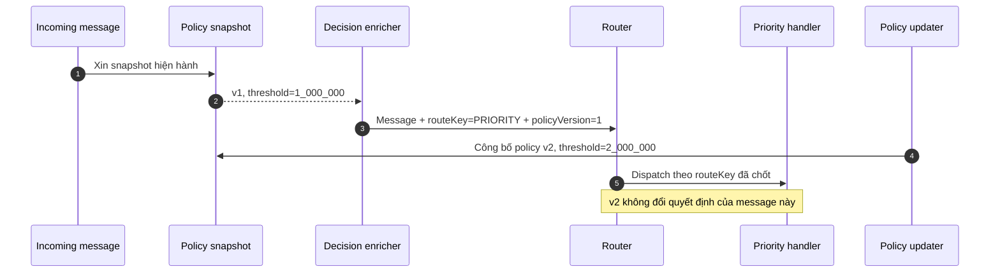
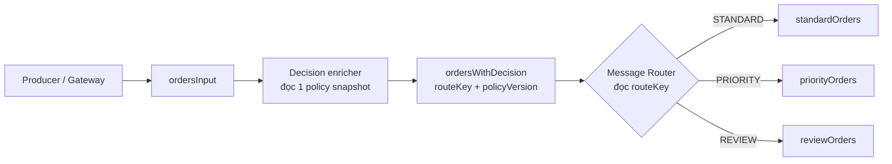
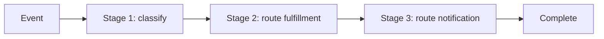
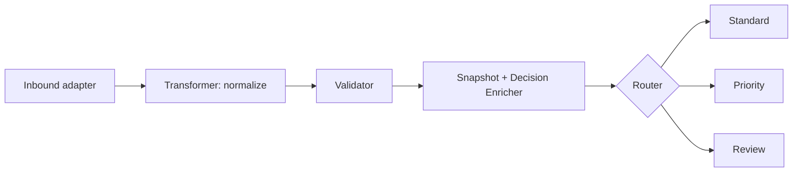
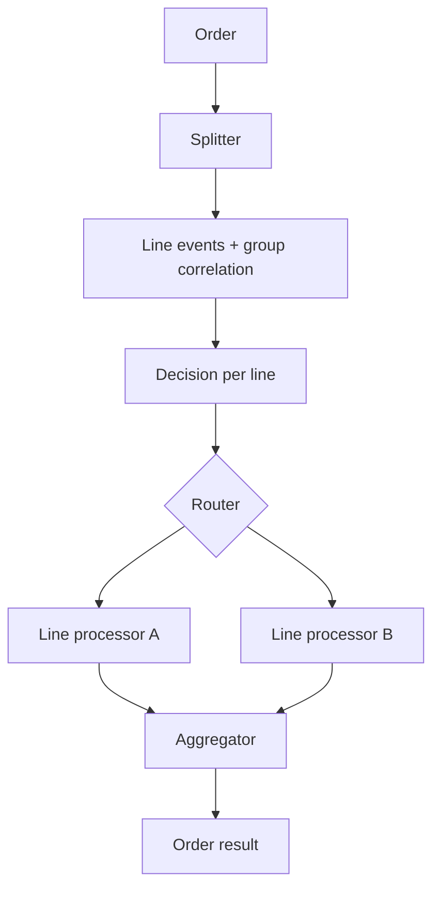

# Đảm bảo route deterministic trong một message với Dynamic Router

> **Chương:** Dynamic router  
> **Bài học:** Đảm bảo route deterministic trong một message  
> **Ngữ cảnh:** Enterprise Integration Patterns với Spring Integration, kết hợp Router, Filter, Transformer, Splitter, Aggregator, Gateway, retry, error channel và correlation để xây dựng các luồng thông điệp dễ mở rộng, dễ kiểm thử và có thể truy vết.

## 1. Vấn đề: một message không nên đổi tuyến chỉ vì policy vừa cập nhật

Một hệ thống nhận yêu cầu xử lý đơn hàng. Router quyết định:

- Đơn thông thường → `standardOrders`.
- Đơn giá trị cao → `priorityOrders`.
- Đơn có cờ rủi ro → `reviewOrders`.

Ngưỡng xác định “giá trị cao” được đội vận hành thay đổi khi ứng dụng đang chạy. Ban đầu ngưỡng là 1.000.000 đơn vị tiền nhỏ nhất, vài giây sau tăng thành 2.000.000.

Với cùng một `OrderRequest` có số tiền 1.500.000, quyết định sẽ khác nhau theo phiên bản policy:

| Thời điểm ra quyết định | Policy version | Ngưỡng ưu tiên | Kết quả |
| --- | --- | --- | --- |
| 10:00:00 | `v1` | 1.000.000 | `PRIORITY` |
| 10:00:05 | `v2` | 2.000.000 | `STANDARD` |

**Hai message khác nhau** được quyết định ở hai thời điểm có thể đi hai tuyến khác nhau. Điều này là đúng với Dynamic Router. Nhưng **cùng một message đã được quyết định theo v1** không nên vô tình đổi thành STANDARD khi được retry hoặc đi qua một đoạn xử lý khác chỉ vì cấu hình vừa đổi.



Bài học giải thích cách làm cho **quyết định định tuyến có tính xác định (deterministic) trong phạm vi một message**, kể cả khi hệ thống có cấu hình động, nhiều thread và cơ chế retry.

### Mục tiêu học tập

Sau bài này, bạn có thể:

1. Phân biệt **Dynamic Router** với tính **ngẫu nhiên/không ổn định**.
2. Định nghĩa tiêu chí deterministic theo payload, context và policy version.
3. Dùng **immutable policy snapshot** và **atomic publication** để tránh đọc cấu hình nửa cũ nửa mới.
4. Chốt một route decision vào message header trước khi dispatch.
5. Biết giới hạn của thiết kế khi retry từ đầu hoặc khi message đi qua broker.
6. Xây ví dụ Spring Integration Java DSL và kiểm thử đổi policy lúc runtime.
7. Theo dõi correlation, route version, lỗi, idempotency và các nhánh xử lý.

## 2. “Deterministic trong một message” nghĩa chính xác là gì?

Một quyết định định tuyến có tính xác định khi ta có thể diễn đạt:

```text
routeDecision =
    f(validatedPayload, trustedContext, policySnapshot)
```

Nếu **đầu vào và cùng snapshot chính sách không đổi**, hàm `f` phải cho **cùng một route**. Sau khi quyết định được chốt, các bước sau không âm thầm tính lại nó từ phiên bản chính sách mới.

Một số bất biến cần thực hiện:

- **Input nhất quán:** Router đọc một payload/context đã chuẩn hóa, không bị sửa đồng thời.
- **Policy nhất quán:** trong một lần quyết định, tất cả điều kiện đến từ **một snapshot**.
- **Decision ổn định:** sau khi chọn đích, message mang `routeKey`, `routePolicyVersion` và thông tin liên kết cần thiết.
- **Retry có chủ đích:** retry *bước xử lý* sử dụng quyết định đã chốt; nếu nghiệp vụ yêu cầu tính lại route, phải tạo **quyết định mới được ghi nhận rõ**.
- **Quan sát được:** có thể giải thích vì sao message đi tuyến đó và policy version nào đã được sử dụng.

Tính xác định ở đây **không** có nghĩa mọi message với cùng payload phải đi cùng route mãi mãi. Policy có thể được cập nhật hợp lệ; khác biệt giữa v1 và v2 là khác biệt **có chủ đích, có phiên bản, có thể giải thích**.

### Hai mức bảo đảm cần phân biệt

| Mức | Ý nghĩa | Cách bảo đảm |
| --- | --- | --- |
| **Deterministic tại thời điểm chọn** | Một lần đánh giá dùng input và policy nhất quán | Snapshot bất biến, tính route bằng hàm thuần |
| **Deterministic qua retry/replay** | Cùng quyết định đã chốt không bị thay bằng policy mới | Lưu route decision cùng message hoặc lưu bền vững ở boundary thích hợp |

Một chương trình có thể đạt mức thứ nhất nhưng **chưa đạt** mức thứ hai. Ví dụ: mỗi khi event quay lại `rawInput`, service lại đọc policy mới; mỗi lần đọc vẫn nhất quán, nhưng kết quả replay có thể khác.

## 3. Dynamic Router không phải Router “random”

Trong Enterprise Integration Patterns, Dynamic Router mô tả cơ chế định tuyến mà **quy tắc/đích có thể thay đổi khi hệ thống đang vận hành**, không cần khóa chặt mọi quyết định trong một biểu thức hard-code cố định.

Ví dụ các nguồn biến động hợp lệ:

- Policy ưu tiên được đội vận hành cập nhật.
- Danh sách destination được enable/disable có kiểm soát.
- Phiên bản tenant routing rule thay đổi.
- Bảng định tuyến cập nhật qua control message hoặc nguồn cấu hình quản lý.
- Một chiến lược chọn nhánh dựa trên metadata đã được làm giàu trước đó.

Không phải mọi tiêu chí động đều nên được dùng một cách không kiểm soát:

- `Math.random()` để chọn kênh mà không ghi seed/decision làm replay khó giải thích.
- `LocalDateTime.now()` được gọi lặp lại tại nhiều chỗ trong cùng quyết định có thể khiến cùng message chịu hai cửa sổ thời gian khác nhau.
- Kiểm tra health của backend ở từng handler rồi thay route ngầm làm truy vết thiếu nhất quán.
- Đọc nhiều map cấu hình mutable khác nhau trong lúc một thread quản trị đang cập nhật.

**Dynamic** mô tả khả năng cập nhật policy hoặc điều kiện lựa chọn; **deterministic** là hợp đồng rằng một quyết định cụ thể được đưa ra bằng tập dữ liệu ổn định và có thể tái hiện.

### So sánh với các pattern khác

| Pattern | Trách nhiệm | Điểm lưu ý về determinism |
| --- | --- | --- |
| Content-Based Router | Chọn kênh theo payload/header | Tính route thuần với input đã chuẩn hóa |
| Header-Based Router | Chọn kênh theo header | Không tin header do client có thể giả mạo |
| **Dynamic Router** | Chọn kênh theo policy/registry có thể đổi lúc chạy | Chốt phiên bản policy cho một quyết định |
| Routing Slip | Message mang lộ trình nhiều bước; có thể dùng strategy động | Quản lý state và phiên bản cho từng lần đánh giá |
| Recipient List Router | Một message có thể đến nhiều người nhận | Chốt danh sách recipients nếu cần fan-out xác định |
| Filter | Cho đi tiếp hay loại message | Không âm thầm đổi tiêu chí giữa các lần retry |

Dynamic Router có thể được xây bằng một Router Spring Integration thông thường kết hợp **service tính policy động**. Không bắt buộc phải có một annotation riêng tên “DynamicRouter” để áp dụng EIP này.

## 4. Vì sao route dễ trở nên không deterministic?

### 4.1. Đọc cấu hình nhiều lần trong một quyết định

Phản mẫu:

```java
boolean isPriority(OrderRequest order) {
    if (order.amountMinorUnits() >= liveConfig.getThreshold()) {
        return liveConfig.isPriorityEnabled();
    }
    return false;
}
```

Nếu `getThreshold()` và `isPriorityEnabled()` đọc hai phần cấu hình đang thay đổi độc lập, kết quả có thể kết hợp threshold mới với cờ enable cũ. Một cấu hình như vậy chưa chắc từng tồn tại dưới dạng một policy hợp lệ.

Khắc phục: đọc **một immutable policy snapshot** rồi tính tất cả điều kiện từ snapshot đó.

### 4.2. Thay đổi routing decision giữa các bước

```text
Message đến (policy v1)
  -> validate
  -> route theo v1: PRIORITY
  -> retry handler
  -> tự route lại theo v2: STANDARD
```

Nếu nghiệp vụ không thiết kế explicit re-routing, event có thể chạy qua hai nhóm xử lý có điều kiện và nghĩa vụ khác nhau.

Khắc phục: chốt `routeKey`/`policyVersion` một lần và đưa chúng cùng event sang boundary retry.

### 4.3. Payload mutable và cập nhật song song

Một service khác sửa `order.amount` trong lúc routing function đọc các field thì cùng một message có thể cho kết quả khác giữa các thread.

Khắc phục: dùng record/DTO immutable, defensive copy cho collection mutable và thực hiện validation trước khi tính route.

### 4.4. Dùng đồng hồ, random hoặc network call trực tiếp

Nếu rule phụ thuộc thời điểm, lấy `decisionInstant` một lần và ghi vào metadata. Nếu phụ thuộc dữ liệu dịch vụ ngoài, cần xác định snapshot/version hoặc lưu kết quả enrichment. Nếu thật sự muốn load balancing ngẫu nhiên, nên chốt và ghi lại destination đã được chọn; không diễn giải ngẫu nhiên thành deterministic.

## 5. Kiến trúc đề xuất: chốt quyết định trước Router

Trong Spring Integration, một cách rõ ràng là **tách bước tính route khỏi bước dispatch**.



Ba bước trách nhiệm độc lập:

1. **Nhận và chuẩn hóa input:** kiểm tra event và context đáng tin.
2. **Đóng băng route decision:** dùng một bản policy immutable, thêm route metadata.
3. **Dispatch:** Router chỉ đọc `routeKey` đã chốt và đưa đến channel đã được mapping.

Nhờ vậy, Router không cần biết policy đang được cập nhật vào thời điểm nào. Nó chỉ nhận một quyết định đã được materialize.

**Ranh giới quan trọng:** quyết định chỉ được chốt **một lần trên mỗi luồng xử lý cần sự ổn định**. Nếu message đã qua bước này được gửi lại vào raw input thay vì vào điểm sau decision enricher, nó có thể bị tính lại theo policy mới. Các phần retry/replay ở dưới trình bày cách xử lý.

## 6. Ví dụ Java: policy snapshot bất biến và AtomicReference

Ta xây ứng dụng phân loại `OrderRequest` thành ba route:

- `REVIEW`: order được đánh dấu cần kiểm tra.
- `PRIORITY`: order không bị flagged nhưng số tiền từ ngưỡng trở lên.
- `STANDARD`: các order còn lại hợp lệ.

Quy tắc threshold có thể được thay đổi runtime từ policy v1 sang v2.

### 6.1. Payload bất biến

```java
package example.integration;

public record OrderRequest(
    String eventId,
    String orderId,
    long amountMinorUnits,
    boolean flaggedForReview
) {}
```

`eventId` phân biệt từng sự kiện; `orderId` liên kết nghiệp vụ. `amountMinorUnits` là số tiền đã được chuẩn hóa sang đơn vị kế toán xác định. Với hệ thống thực có nhiều loại tiền, đưa currency và cách quy đổi vào hợp đồng dữ liệu; không so sánh tiền khác đơn vị một cách tùy tiện.

### 6.2. Policy có version

```java
package example.integration;

import java.util.concurrent.atomic.AtomicReference;

public final class DynamicRoutingPolicyRegistry {

    public record Policy(
        long version,
        long priorityThresholdMinorUnits
    ) {
        public Policy {
            if (version <= 0 || priorityThresholdMinorUnits <= 0) {
                throw new IllegalArgumentException(
                    "Version và threshold phải dương");
            }
        }
    }

    private final AtomicReference<Policy> active =
        new AtomicReference<>(new Policy(1L, 1_000_000L));

    public Policy snapshot() {
        // Atomic read trả đúng một immutable Policy.
        return active.get();
    }

    public void publish(Policy next) {
        active.updateAndGet(previous -> {
            if (next.version() <= previous.version()) {
                throw new IllegalArgumentException(
                    "Policy version phải tăng");
            }
            return next;
        });
    }
}
```

Điểm thiết kế:

- `Policy` là Java record với hai thành phần primitive, vì vậy chính record này bất biến.
- `AtomicReference` giúp publication thay **một reference hoàn chỉnh**. Reader không thấy một phần field từ phiên bản cũ và một phần field từ phiên bản mới.
- `snapshot()` chỉ đọc reference **một lần**.
- `publish(...)` yêu cầu version tăng; code gọi nó phải thuộc luồng quản trị đã được phân quyền và xác minh.
- Mẫu này bảo đảm tính nhất quán **trong một JVM**. Nó không tự đồng bộ phiên bản giữa nhiều pod/process.

Nếu policy chứa `Map` hoặc `List`, cần phòng thủ bằng `Map.copyOf(...)`/`List.copyOf(...)` trong constructor và tránh phần tử mutable, thay vì chỉ bọc reference vào `AtomicReference`.

### Vì sao không cập nhật nhiều field mutable tại chỗ?

Phản mẫu:

```java
// Chỉ để minh họa lỗi, không sử dụng:
class MutablePolicy {
    long version;
    long threshold;
}
```

Một thread ghi `threshold=2_000_000` rồi mới ghi `version=2`; thread khác có thể đọc threshold của v2 và version của v1. Việc publish một object policy hoàn chỉnh giải quyết sự lệch cặp giá trị này ở phạm vi JVM.

## 7. Enricher chỉ quyết định một lần và gắn version

Tạo một component nhận `Message<OrderRequest>`. Nó đọc policy snapshot, tính route key rồi **trả message mới với payload gốc và metadata quyết định**.

```java
package example.integration;

import org.springframework.messaging.Message;
import org.springframework.messaging.support.MessageBuilder;

public final class RouteDecisionEnricher {

    private final DynamicRoutingPolicyRegistry policies;

    public RouteDecisionEnricher(
            DynamicRoutingPolicyRegistry policies) {
        this.policies = policies;
    }

    public Message<OrderRequest> decide(Message<OrderRequest> input) {
        OrderRequest order = input.getPayload();

        if (order.eventId() == null || order.eventId().isBlank()
                || order.orderId() == null || order.orderId().isBlank()
                || order.amountMinorUnits() <= 0) {
            throw new IllegalArgumentException(
                "OrderRequest không hợp lệ");
        }

        // Chỉ một lần đọc policy cho quyết định hiện tại.
        DynamicRoutingPolicyRegistry.Policy policy =
            policies.snapshot();

        String routeKey;
        if (order.flaggedForReview()) {
            routeKey = "REVIEW";
        } else if (order.amountMinorUnits()
                >= policy.priorityThresholdMinorUnits()) {
            routeKey = "PRIORITY";
        } else {
            routeKey = "STANDARD";
        }

        return MessageBuilder.fromMessage(input)
            // Không tin các route headers tùy ý có thể đến từ client;
            // tại trusted ingress, ghi đè bằng quyết định đã xác minh.
            .setHeader("routeKey", routeKey)
            .setHeader("routePolicyVersion", policy.version())
            .setHeader("routeDecisionId", order.eventId())
            .setHeader("businessCorrelationId",
                "order:" + order.orderId())
            .build();
    }
}
```

**Vì sao cần ba header?**

| Header | Ví dụ | Vai trò |
| --- | --- | --- |
| `routeKey` | `PRIORITY` | Đích logic đã quyết định |
| `routePolicyVersion` | `1` | Phiên bản policy cho phép giải thích quyết định |
| `routeDecisionId` | `EVT-101` | Liên kết log của quyết định với event; không phải bí mật |
| `businessCorrelationId` | `order:ORD-2048` | Liên kết nhiều event của cùng đơn |

Trong bài học, `routeDecisionId` sử dụng `eventId` vì một event được chốt một quyết định. Hệ thống có nhiều lần quyết định hợp lệ cho cùng event (ví dụ manual reroute) phải dùng ID quyết định riêng, đồng thời lưu version/attempt và nguyên nhân điều chỉnh.

### Nhận xét về Header Enricher và Transformer

Tên class là `RouteDecisionEnricher` vì chức năng nghiệp vụ là **bổ sung metadata**. Ở Java DSL dưới đây, ta dùng một transformer method trả `Message<?>` để tái tạo message với headers mới. Đó là một kỹ thuật triển khai, không có nghĩa payload nghiệp vụ cần đổi kiểu.

Một ứng dụng cũng có thể dùng `enrichHeaders(...)` để tính những header tương tự, miễn là **policy chỉ được lấy một lần cho tất cả header của một quyết định**. Nếu khai báo hai header expression độc lập và mỗi expression đọc live policy, vẫn có nguy cơ cặp `routeKey`/`routePolicyVersion` không nhất quán.

## 8. Tạo flow Spring Integration Java DSL

Cấu hình ba kênh đích dưới dạng `QueueChannel` để dễ quan sát trong kiểm thử. Đây là ví dụ event-driven **một chiều**, chưa có handler hoàn tất nghiệp vụ hoặc reply cho Gateway.

```java
package example.integration;

import org.springframework.context.annotation.Bean;
import org.springframework.context.annotation.Configuration;
import org.springframework.integration.channel.DirectChannel;
import org.springframework.integration.channel.QueueChannel;
import org.springframework.integration.config.EnableIntegration;
import org.springframework.integration.dsl.IntegrationFlow;
import org.springframework.messaging.MessageChannel;

@Configuration
@EnableIntegration
public class DynamicRoutingConfiguration {

    @Bean
    public MessageChannel ordersInput() {
        return new DirectChannel();
    }

    @Bean
    public MessageChannel ordersWithDecision() {
        return new DirectChannel();
    }

    @Bean
    public QueueChannel standardOrders() {
        return new QueueChannel();
    }

    @Bean
    public QueueChannel priorityOrders() {
        return new QueueChannel();
    }

    @Bean
    public QueueChannel reviewOrders() {
        return new QueueChannel();
    }

    @Bean
    public DynamicRoutingPolicyRegistry routingPolicies() {
        return new DynamicRoutingPolicyRegistry();
    }

    @Bean
    public RouteDecisionEnricher routeDecisionEnricher(
            DynamicRoutingPolicyRegistry policies) {
        return new RouteDecisionEnricher(policies);
    }

    @Bean
    public IntegrationFlow decideRouteFlow(
            RouteDecisionEnricher enricher) {
        return IntegrationFlow.from("ordersInput")
            .transform(enricher, "decide")
            .channel("ordersWithDecision")
            .get();
    }

    @Bean
    public IntegrationFlow dispatchOrdersFlow() {
        return IntegrationFlow.from("ordersWithDecision")
            .route("headers['routeKey']", spec -> spec
                .channelMapping("STANDARD", "standardOrders")
                .channelMapping("PRIORITY", "priorityOrders")
                .channelMapping("REVIEW", "reviewOrders")
                .channelKeyFallback(false)
                .defaultOutputChannel("reviewOrders")
                .resolutionRequired(true))
            .get();
    }
}
```

### Phân tích pipeline

1. `ordersInput` nhận message từ caller/adapter.
2. `RouteDecisionEnricher.decide(...)` tính decision theo **một snapshot**.
3. `ordersWithDecision` nhận message đã gắn `routeKey` và `routePolicyVersion`.
4. Router chỉ đọc `headers['routeKey']`, không gọi lại registry.
5. `channelMapping` đưa `STANDARD`, `PRIORITY`, `REVIEW` sang đúng channel.
6. `channelKeyFallback(false)` không cho phép một key lạ được dùng như tên bean channel ngoài danh sách được công bố.
7. `defaultOutputChannel("reviewOrders")` là nhánh phòng vệ nếu xuất hiện key chưa map; **cần xử lý riêng** chứ không coi message đó là đã thành công.

**Dynamic nằm ở `routingPolicies` và `RouteDecisionEnricher`, không nằm ở việc thay đổi Router bean mỗi lần.** Nhờ tách như vậy, policy có thể được publish trong runtime, còn Router luôn dispatch một decision đã chốt.

### Vì sao không chọn route trực tiếp từ live policy ở Router?

Có thể viết một `@Router` hoặc `.route(...)` trực tiếp gọi service policy. Cách đó hợp lệ cho bài toán đơn giản. Nhưng nếu cần giữ route ổn định qua retry và quan sát version, mô hình hai bước có ưu thế: message mang bằng chứng quyết định, còn endpoint dispatch không phải đọc lại policy.

### Đừng nhầm queue thử nghiệm với xử lý hoàn tất

`standardOrders`, `priorityOrders` và `reviewOrders` ở đây là `QueueChannel`. Gửi vào queue trong JVM **không** có nghĩa service đã hoàn thành hoặc event được lưu bền vững. Ứng dụng thật cần poller/consumer, error handling, idempotency và độ bền phù hợp với SLA.

## 9. Mô phỏng cập nhật policy trong lúc chạy

Giả sử policy lúc khởi động:

```text
Policy(version=1, priorityThresholdMinorUnits=1_000_000)
```

Một event mới có số tiền 1.500.000 sẽ được chốt:

```text
eventId: EV-101
amount: 1_500_000
routeKey: PRIORITY
routePolicyVersion: 1
```

Đội vận hành publish v2:

```java
routingPolicies.publish(
    new DynamicRoutingPolicyRegistry.Policy(
        2L, 2_000_000L));
```

Với một event **mới** mang cùng số tiền, quyết định sẽ là:

```text
eventId: EV-102
amount: 1_500_000
routeKey: STANDARD
routePolicyVersion: 2
```

Điều này không mâu thuẫn với determinism: v1 và v2 là hai đầu vào policy khác nhau. Yêu cầu của chúng ta là **EV-101 khi đã chốt PRIORITY vẫn đi PRIORITY**, không bị v2 sửa ngầm.

### Chính sách cập nhật cần được quản trị

Ví dụ `publish(...)` thể hiện atomic publication trong JVM, không phải API quản trị đầy đủ. Trong môi trường thật:

- Xác thực và phân quyền người thay đổi policy.
- Validate threshold, currency, tập route được hỗ trợ.
- Gán version tăng đơn điệu và lưu lịch sử thay đổi.
- Đảm bảo thay đổi có hiệu lực nhất quán theo phạm vi đã cam kết.
- Có rollback strategy; rollback nội dung policy cũng nên dùng **version mới** để tránh các ID version bị tái sử dụng với hai nghĩa khác nhau.
- Ghi audit ai thay đổi, khi nào và vì sao.

## 10. JUnit 5: quyết định cũ không bị policy mới thay đổi

Một kiểm thử tốt cần chứng minh cả hai điều:

1. Event đi qua input nhận decision theo policy hiện hành.
2. Event **đã có decision** đi lại qua Router không tự nhận một decision mới.

Các test dưới đây dùng cấu hình ở mục 8.

```java
package example.integration;

import static org.junit.jupiter.api.Assertions.*;

import org.junit.jupiter.api.Test;
import org.springframework.beans.factory.annotation.Autowired;
import org.springframework.beans.factory.annotation.Qualifier;
import org.springframework.integration.channel.QueueChannel;
import org.springframework.messaging.Message;
import org.springframework.messaging.MessageChannel;
import org.springframework.messaging.support.MessageBuilder;
import org.springframework.test.annotation.DirtiesContext;
import org.springframework.test.context.junit.jupiter.SpringJUnitConfig;

@SpringJUnitConfig(DynamicRoutingConfiguration.class)
@DirtiesContext(classMode =
    DirtiesContext.ClassMode.AFTER_EACH_TEST_METHOD)
class DynamicRoutingTest {

    @Autowired
    @Qualifier("ordersInput")
    private MessageChannel ordersInput;

    @Autowired
    @Qualifier("ordersWithDecision")
    private MessageChannel ordersWithDecision;

    @Autowired
    @Qualifier("priorityOrders")
    private QueueChannel priorityOrders;

    @Autowired
    @Qualifier("standardOrders")
    private QueueChannel standardOrders;

    @Autowired
    @Qualifier("reviewOrders")
    private QueueChannel reviewOrders;

    @Autowired
    private DynamicRoutingPolicyRegistry policies;

    @Test
    void preservesDecisionAfterPolicyChanges() {
        OrderRequest firstEvent =
            new OrderRequest("EV-101", "ORD-2048",
                1_500_000L, false);

        assertTrue(ordersInput.send(
            MessageBuilder.withPayload(firstEvent).build()));

        Message<?> firstDecision = priorityOrders.receive(1_000);
        assertNotNull(firstDecision);
        assertSame(firstEvent, firstDecision.getPayload());
        assertEquals("PRIORITY",
            firstDecision.getHeaders().get("routeKey"));
        assertEquals(1L,
            firstDecision.getHeaders().get("routePolicyVersion"));

        // Admin publish policy mới sau khi EV-101 đã được chốt.
        policies.publish(
            new DynamicRoutingPolicyRegistry.Policy(
                2L, 2_000_000L));

        // Mô phỏng replay từ boundary SAU bước chốt decision:
        // Router chỉ đọc routeKey trong message đã lưu.
        assertTrue(ordersWithDecision.send(firstDecision));

        Message<?> replay = priorityOrders.receive(1_000);
        assertNotNull(replay);
        assertEquals("PRIORITY",
            replay.getHeaders().get("routeKey"));
        assertEquals(1L,
            replay.getHeaders().get("routePolicyVersion"));

        // Một event mới với cùng amount chịu policy mới.
        OrderRequest secondEvent =
            new OrderRequest("EV-102", "ORD-2048",
                1_500_000L, false);

        assertTrue(ordersInput.send(
            MessageBuilder.withPayload(secondEvent).build()));

        Message<?> secondDecision = standardOrders.receive(1_000);
        assertNotNull(secondDecision);
        assertSame(secondEvent, secondDecision.getPayload());
        assertEquals("STANDARD",
            secondDecision.getHeaders().get("routeKey"));
        assertEquals(2L,
            secondDecision.getHeaders().get("routePolicyVersion"));
        assertNull(reviewOrders.receive(0));
    }

    @Test
    void flaggedOrdersGoToReviewEvenAtHighAmount() {
        OrderRequest event =
            new OrderRequest("EV-103", "ORD-3001",
                5_000_000L, true);

        assertTrue(ordersInput.send(
            MessageBuilder.withPayload(event).build()));

        Message<?> result = reviewOrders.receive(1_000);
        assertNotNull(result);
        assertEquals("REVIEW",
            result.getHeaders().get("routeKey"));
        assertEquals(1L,
            result.getHeaders().get("routePolicyVersion"));
        assertEquals("order:ORD-3001",
            result.getHeaders().get("businessCorrelationId"));
        assertNull(priorityOrders.receive(0));
    }

    @Test
    void rejectsInvalidAmountBeforeRouting() {
        OrderRequest invalid =
            new OrderRequest("EV-404", "ORD-BAD", -10L, false);

        assertThrows(RuntimeException.class, () ->
            ordersInput.send(
                MessageBuilder.withPayload(invalid).build()));

        assertNull(priorityOrders.receive(0));
        assertNull(standardOrders.receive(0));
        assertNull(reviewOrders.receive(0));
    }
}
```

### Tại sao test replay gửi tới `ordersWithDecision`?

Đây là một lựa chọn **có chủ đích**: message `EV-101` đã được chốt quyết định, nên ta thử lại phần **dispatch**, không thử lại phần **tính quyết định**. Nếu test gửi lại `EV-101` vào `ordersInput` sau khi policy đổi, `RouteDecisionEnricher` sẽ tính lại theo v2.

Điều đó không phải lỗi của `AtomicReference`; đó là một hợp đồng retry khác. Nếu hệ thống yêu cầu replay từ ingress đầu tiên vẫn giữ route cũ, phải tra lại **quyết định đã được lưu bền vững** theo `eventId` hoặc truyền lại metadata route đáng tin cậy, thay vì gọi policy mới.

### Một lưu ý khác về test

Test trên không chạy các handler nghiệp vụ ở cuối queue. Nó chứng minh routing decision và channel dispatch trong cùng Spring context. Khi triển khai real service, cần thêm integration test về transaction, error channel, retry, broker mapping và trạng thái hoàn tất.

## 11. Concurrency: policy thay lúc nhiều message đang được route

Giả sử có 100 worker đang xử lý message khi admin publish v2. Với thiết kế snapshot, một số message đọc v1, số khác đọc v2. Đây có thể là hành vi **đúng** nếu hợp đồng nói rằng mỗi message dùng policy hiện hành **tại thời điểm chốt decision**.

Bất biến cần có:

```text
Nếu routePolicyVersion == 1:
    amount=1_500_000, flagged=false -> PRIORITY

Nếu routePolicyVersion == 2:
    amount=1_500_000, flagged=false -> STANDARD

Không bao giờ có:
    routePolicyVersion=1 + routeKey=STANDARD
    do phối trộn threshold của v2 với version của v1.
```

Một test concurrency có thể:

1. Chuẩn bị nhiều event với cùng amount và flagged=false.
2. Dùng nhiều thread đồng thời gọi `RouteDecisionEnricher.decide(...)`.
3. Trong khi đó publish v2 một lần.
4. Với mỗi output, kiểm tra cặp `routePolicyVersion/routeKey` theo một trong hai policy hoàn chỉnh.
5. Không bắt buộc mọi message đều là v1 hoặc đều là v2, trừ khi SLA yêu cầu một ranh giới cập nhật toàn cục.

### Code kiểm tra bất biến theo cặp

```java
Object version = output.getHeaders().get("routePolicyVersion");
Object route = output.getHeaders().get("routeKey");

if (Long.valueOf(1L).equals(version)) {
    assertEquals("PRIORITY", route);
} else if (Long.valueOf(2L).equals(version)) {
    assertEquals("STANDARD", route);
} else {
    fail("Policy version ngoài danh sách cho phép");
}
```

Đây là một phần assertion được nhúng vào test concurrency, trong đó `output` là `Message<?>` được tạo từ amount 1.500.000. Nó không tự chạy độc lập.

### Nếu ứng dụng chạy nhiều instance

`AtomicReference` chỉ đảm bảo atomic publication **trong cùng JVM**. Hai pod có thể áp dụng v2 tại các thời điểm khác nhau. Muốn mọi message có cùng một policy toàn cục ở một mốc cụ thể, cần thêm:

- Nguồn policy có phiên bản và quy tắc đồng bộ rõ ràng.
- Cơ chế rollout/activation có kiểm soát hoặc pin version từ ingress.
- Khả năng truy xuất lại policy snapshot theo version.
- Test end-to-end qua nhiều node.

Ngay cả khi các node không cập nhật đồng thời, một message vẫn có thể deterministic nếu nó mang **version được chọn** và **route decision đã chốt** để các bước tiếp theo sử dụng nhất quán.

## 12. Retry, replay và idempotency: ba vấn đề không giống nhau

### Retry tại handler

Message đã tới `priorityOrders`, nhưng handler timeout khi gọi hệ thống ngoài. Nếu retry chỉ lặp lại handler với **cùng message đã có quyết định**, route vẫn là `PRIORITY` theo v1.

```text
EV-101 + routeKey=PRIORITY + version=1
   |
   v
priority handler -> timeout
   |
   v
retry priority handler
   |
   v
same routeKey=PRIORITY + same version=1
```

Retry cần giới hạn số lần, backoff và idempotency nếu handler có side effect. Tính ổn định route **không** tự ngăn gửi email trùng hoặc tạo giao dịch trùng.

### Replay từ raw input

```text
EV-101 chưa có route header
   |
   v
ordersInput -> policy v2 -> STANDARD
```

Nếu replay đi từ chỗ *trước khi chốt* mà không có bản ghi decision cũ, kết quả có thể thay đổi. Muốn replay giữ route gốc:

1. Lưu decision bền vững cùng `eventId` tại boundary phù hợp.
2. Khi retry/replay, tìm lại decision đã chốt (hoặc khôi phục từ event envelope).
3. Chỉ gọi Router với `routeKey`/`routePolicyVersion` đã xác minh.
4. Nếu muốn route lại, tạo **explicit reroute event** có lý do, policy version mới và audit trail.

### Idempotency

Hai lần gửi đến đúng một channel vẫn có thể xử lý **hai lần**. Idempotency phải kiểm soát tại tác vụ nghiệp vụ:

```text
idempotencyKey = (eventId, operationName)
```

Với nghiệp vụ thanh toán, khóa và chiến lược đối soát cần tuân theo hợp đồng của payment provider. `businessCorrelationId` giúp nối log, nhưng chưa chắc đủ duy nhất cho từng thao tác có side effect.

**Chốt lại:** deterministic route, at-least-once delivery, idempotency và exactly-once effect là những tính chất khác nhau. Không thể chỉ dùng một header route để bảo đảm tất cả.

## 13. Nếu một message có nhiều quyết định route qua nhiều bước

Một flow lớn có thể phải chọn route nhiều lần:



Trong trường hợp này, “một message deterministic” không bắt buộc mọi stage đều chọn cùng một channel. Điều cần giữ là **mỗi điểm quyết định có đầu vào và policy rõ ràng**, và quá trình retry tại điểm đó không thay đổi kết quả một cách ngẫu nhiên.

Có hai phương án:

**Phương án A — chốt cả kế hoạch:**

- Ingress lấy một policy snapshot.
- Tính `routePlan` gồm những điểm đến dự kiến.
- Các stage thực hiện theo plan đã chốt.
- Nếu nghiệp vụ yêu cầu điều chỉnh, ghi một plan version mới có lý do.

**Phương án B — chốt từng quyết định:**

- Mỗi stage đọc snapshot khi thực sự cần quyết định mới.
- Lưu `stageName`, `routeKey`, `policyVersion`, `decisionId`.
- Retry của **stage đã quyết định** dùng lại quyết định cũ.
- Stage mới có thể dùng policy khác, nhưng phải được phép theo contract.

| Tình huống | Phù hợp hơn |
| --- | --- |
| Quy trình phê duyệt phải nhất quán xuyên mọi bước | Pin policy version/plan từ đầu |
| Routing độc lập theo các sự kiện khác nhau | Snapshot tại từng decision stage |
| Backend hỏng và phải chuyển sang đích khác | Explicit reroute/failover decision có audit |
| Workflow nhiều ngày, thay đổi quy định giữa chừng | Policy versioning và state persistence rõ ràng |

### Liên hệ với Routing Slip

Routing Slip mang hành trình trong header; một `RoutingSlipRouteStrategy` có thể quyết định kênh tiếp theo sau mỗi reply. Nếu strategy đọc live policy **ở mọi lần được gọi**, cùng message có thể bị ảnh hưởng bởi cập nhật giữa các bước. Khi cần deterministic, hãy pin phiên bản policy hoặc lưu quyết định/plan tương ứng vào workflow state.

Không tự sửa `routingSlipIndex` để “khóa đường đi”. Để framework quản lý cơ chế Routing Slip; dùng hợp đồng state và policy version cho tính ổn định.

## 14. Đừng lẫn determinism với ưu tiên và cân bằng tải

Một số bộ định tuyến cố tình dùng health, latency hoặc weighted random để phân phối tải. Mục tiêu vận hành có thể hợp lý, nhưng phải quy định tính xác định ở mức nào.

Ví dụ:

- **Load balancing:** có thể chọn một instance ngẫu nhiên *một lần*, sau đó gắn `selectedInstance` vào message và lưu khi retry.
- **Consistent hashing:** chọn partition theo business key; vẫn cần version của ring/partition map khi topology đổi.
- **Health-based failover:** khi backend A lỗi, chính sách có thể quyết định chuyển sang B. Phải ghi **một quyết định mới** với reason=FAILOVER thay vì âm thầm ghi đè decision cũ.
- **A/B testing:** hash theo một key ổn định (đã chuẩn hóa), lưu experiment version và cohort để cùng user/message không tự nhảy nhóm.

Nếu dùng `Random` ở mỗi lần retry, một đơn có thể nhảy qua nhiều backend, gây khó đối soát. Với tác vụ có side effect, route thay đổi đôi khi đòi coordination và idempotency **xuyên backend**.

## 15. Security: route metadata không được quyết định bởi client tùy ý

Khi Router đọc `headers['routeKey']`, không được mặc định giá trị đó đến từ nguồn đáng tin. Một client có thể thử gửi:

```text
routeKey = privilegedOrders
routePolicyVersion = 9999
```

Nếu ứng dụng cho phép tự giải quyết channel từ routing key, giá trị giả mạo có thể đưa message vào nhánh nội bộ ngoài ý muốn.

Thiết kế trong ví dụ có các lớp phòng vệ:

1. `ordersInput` là ranh giới trusted ingress: `RouteDecisionEnricher` **ghi đè** route header bằng quyết định từ payload đã validate và policy nội bộ.
2. Router chỉ cho phép mapping tường minh `STANDARD`, `PRIORITY`, `REVIEW`.
3. `channelKeyFallback(false)` không cho phép routing key lạ tự biến thành tên bean channel.
4. Các handler downstream vẫn phải kiểm tra quyền và business constraints; route không thay thế authorization.
5. Khi replay trực tiếp ở `ordersWithDecision`, chỉ những nguồn nội bộ/adapter đã xác minh decision mới được phép gửi.

Đối với thông điệp từ Kafka hoặc một dịch vụ khác, cần xác minh provenance, tenant, message signature hoặc cơ chế tin cậy tương đương theo kiến trúc. Không coi header do client tự khai báo là một quyết định chính sách có thẩm quyền.

## 16. Error channel, Filter, Transformer và Gateway

### Filter và Transformer trước quyết định

Một Transformer có thể chuyển payload ngoài thành `OrderRequest` chuẩn; Filter hoặc validator loại dữ liệu sai trước khi chốt route. Điều quan trọng là **input cho một decision phải ổn định**.



Nếu một Filter âm thầm drop message mà Gateway chờ reply, caller có thể gặp timeout. Với nghiệp vụ bắt buộc đối soát, cần lỗi hoặc kết quả từ chối có hợp đồng rõ.

### Error channel khi route đã chốt

Nếu việc gửi tới `priorityOrders` thất bại do không có consumer, queue đầy hoặc handler ném exception, đó là **lỗi delivery/processing**, không phải quyết định route ban đầu không deterministic.

- Với `DirectChannel` đồng bộ, exception có thể quay về thread sender.
- Với `ExecutorChannel` hoặc adapter bất đồng bộ, error flow phải xử lý lỗi phát sinh ở worker/listener.
- Lỗi transient có thể retry tại nhánh đã chọn; lỗi cấu hình route nên fail fast hoặc đưa vào nhánh review/parking bền vững.
- Nếu cần re-route khi nhánh chính không khả dụng, phải có chính sách rõ về side effect, deadline và audit.

### Gateway request-reply

Cấu hình mẫu đang dùng `QueueChannel` để kiểm thử message được gửi đi, **chưa có reply**. Nếu bổ sung `@MessagingGateway` khai báo method trả kết quả, phải có consumer downstream tạo reply phù hợp và timeout được xác định. Một Router chỉ chọn channel; nó không tự tạo kết quả nghiệp vụ.

Khi retry một request-reply, việc giữ `routeDecisionId`, `routeKey` và `policyVersion` giúp tránh định tuyến khác nhau giữa các lần thử, nhưng reply matching vẫn phụ thuộc `replyChannel`/cơ chế Gateway của framework.

## 17. Correlation, Splitter và Aggregator

Trong luồng `Splitter → Dynamic Router → Aggregator`, mỗi message con có thể cần một tuyến xử lý khác nhau.



Các header phục vụ những mục đích khác nhau:

| Header | Nghĩa |
| --- | --- |
| `businessCorrelationId` | Liên kết mọi event thuộc cùng nghiệp vụ |
| `correlationId` | Thường là khóa nhóm do Splitter/Aggregator sử dụng |
| `sequenceNumber` / `sequenceSize` | Vị trí và số lượng message con |
| `routeKey` / `routePolicyVersion` | Quyết định tuyến của **message con hiện tại** |
| `eventId` | ID sự kiện để deduplication/audit |

Không ghi đè `correlationId` của framework bằng route policy version. Nếu một message con bị drop do không có route, Aggregator có thể không bao giờ có đủ phần tử. Nên trả một kết quả lỗi có cấu trúc từ nhánh review, hoặc thiết kế release/expire strategy phù hợp.

**Mức pin policy phải rõ:** có thể chốt một policy version cho **cả order** nếu mọi line cần tuân theo cùng rule; nếu mỗi line được quyết định độc lập, có thể mỗi line có policy version riêng nhưng phải được cho phép bởi contract và có thể đối soát.

## 18. Observability: tái hiện được một quyết định

Muốn xác minh determinism trong production, log “routed to PRIORITY” là chưa đủ. Cần biết **vì sao** route đó được chọn:

```text
eventId=EV-101
businessCorrelationId=order:ORD-2048
decisionId=EV-101
policyVersion=1
amountMinorUnits=1500000
flaggedForReview=false
routeKey=PRIORITY
stage=ROUTE_DECIDED
```

Không nhất thiết log toàn bộ payload; chỉ log dữ liệu được duyệt theo quy tắc bảo mật và cardinality. Nếu lượng sự kiện rất lớn, ưu tiên structured logging, tracing và audit records có thể tìm theo event ID hơn là đưa mọi ID vào metric label.

Cần theo dõi tối thiểu:

| Chỉ số | Điều cần quan sát |
| --- | --- |
| Count theo route | Phân bố STANDARD/PRIORITY/REVIEW có bất thường không |
| Count theo policy version | Phiên bản nào đang có hiệu lực ở các node |
| Decision-to-dispatch latency | Có queue/handler chậm sau khi đã chọn route không |
| Lỗi channel resolution | Route key có được map sang destination hợp lệ không |
| Lỗi downstream/retry | Có processing failure không phụ thuộc route decision |
| Count explicit reroute | Có message chuyển tuyến vì failover/chính sách mới không |
| Replay với route khác | Có vi phạm contract deterministic qua replay không |
| Correlation mismatch | Decision và kết quả có cùng event/business ID không |

### Phân biệt ba thời điểm

```text
ROUTE_DECIDED       : đã tính xong key, version
ROUTE_DISPATCHED    : đã gửi đến channel theo hợp đồng dispatch
PROCESSING_COMPLETED: handler đã hoàn tất nghiệp vụ
```

Đừng dùng `ROUTE_DISPATCHED` như bằng chứng thanh toán đã thành công. Với QueueChannel trong bộ nhớ, message chỉ mới vào queue.

## 19. Những sai lầm thường gặp

### 19.1. Policy là nhiều biến mutable thay vì một snapshot

Đọc threshold từ bản mới và version từ bản cũ khiến audit không thể tái hiện decision. Dùng immutable policy object và atomic reference.

### 19.2. Route được tính lại ở mọi retry

Nếu retry quay về điểm trước Decision Enricher, event có thể dùng policy mới. Hãy lưu quyết định cũ hoặc định nghĩa re-route là một nghiệp vụ tường minh.

### 19.3. Chỉ lưu policy version, không lưu routeKey

Sau này cấu hình có thể đổi, registry có thể không lưu lịch sử. Muốn replay chắc chắn, phải giữ **kết quả route thực tế** và các metadata cần kiểm chứng. Policy version giúp giải thích, không thay thế route decision.

### 19.4. Chỉ lưu routeKey, không lưu policy version

Message đi đúng channel nhưng không có cơ sở giải thích tại sao quyết định đó phù hợp với rule lịch sử. Lưu version/decision ID trong audit.

### 19.5. Giả định update giữa nhiều pod là tức thời

AtomicReference chỉ bảo đảm trong một process. Nếu yêu cầu nhất quán toàn cụm, cần thêm cơ chế version activation và policy distribution phù hợp.

### 19.6. Dùng một route header ngoài whitelist

Đưa raw header từ client trực tiếp vào channel name có thể dẫn đến route sai hoặc vấn đề bảo mật. Chỉ chấp nhận mapping tường minh và decision có nguồn đáng tin.

### 19.7. Nhầm deterministic với exactly-once

Cùng route không đồng nghĩa chỉ xử lý một lần. Bản tin có thể redeliver, handler có thể retry sau timeout. Idempotency và delivery guarantee là trách nhiệm khác.

### 19.8. Đổi tuyến âm thầm khi backend lỗi

Nếu chuyển từ PRIORITY sang STANDARD là hành vi failover hợp lệ, hãy tạo quyết định mới với reason, version, deadline và quy tắc nghiệp vụ. Không sửa header cũ không có dấu vết.

### 19.9. Route key chốt nhưng output channel bị thay nghĩa

Nếu `priorityOrders` hôm nay và ngày mai trỏ tới hai nghiệp vụ không tương thích, việc giữ nguyên routeKey chưa đủ. Hợp đồng channel, deployment và schema cũng phải version khi thay đổi mang tính phá vỡ.

## 20. Bài thực hành: Dynamic Router cho yêu cầu vận chuyển

**Bối cảnh:** ứng dụng nhận `ShipmentRequest(eventId, shipmentId, declaredValue, isHazardous)`. Quản trị viên có thể đổi ngưỡng ưu tiên giao hàng khi hệ thống đang chạy.

### Yêu cầu triển khai

1. Định nghĩa immutable `ShipmentRequest` và `ShipmentRoutingPolicy(version, priorityThreshold)`.
2. Lưu policy vào `AtomicReference` và có method publish version mới sau validation.
3. Viết Decision Enricher nhận một `Message<ShipmentRequest>`, đọc **một snapshot**, tạo `routeKey` và `routePolicyVersion`.
4. Ánh xạ `PRIORITY`, `STANDARD`, `REVIEW` tới ba channel tường minh; tắt channel-key fallback.
5. Gửi một shipment vào policy v1, rồi cập nhật ngưỡng sang v2.
6. Chứng minh message đã có decision v1 được replay từ downstream boundary vẫn giữ route cũ.
7. Gửi một event mới có cùng declared value; xác nhận nó có thể chọn route khác dưới v2.
8. Thêm test invalid input, flagged-for-review và route key lạ.
9. Tạo test concurrency khi publish policy trong lúc nhiều message được quyết định, xác minh mọi cặp route/version đều hợp lệ.
10. Nếu thông điệp phải được xử lý sau restart, đề xuất cách lưu route decision, event ID và idempotency key trên broker/outbox.

### Bảng test mong đợi

| Sự kiện | Policy snapshot | Route |
| --- | --- | --- |
| `SHIP-101`, value=1.500.000, no risk | v1, threshold=1.000.000 | PRIORITY |
| Replay **đã chốt** của `SHIP-101` | Vẫn decision v1 | PRIORITY |
| `SHIP-102`, value=1.500.000, no risk | v2, threshold=2.000.000 | STANDARD |
| `SHIP-103`, flagged | v1 hoặc v2 | REVIEW |
| `SHIP-104`, amount không hợp lệ | Không được route | Validation error |
| Key chưa được mapping | Theo policy đã công bố | Default/reject, không resolve tên bean tùy ý |

### Câu hỏi tự đánh giá

**Câu 1.** Nếu v1 và v2 cho hai route khác nhau với cùng amount thì Dynamic Router có bị xem là không deterministic không?

*Không. Hai decision dùng policy snapshot khác nhau. Cần bảo đảm mỗi decision có version rõ và không bị thay đổi ngầm khi message đã chốt.*

**Câu 2.** Vì sao chỉ dùng `AtomicReference` vẫn chưa đủ cho replay qua broker?

*Vì nó giữ snapshot nhất quán trong JVM tại thời điểm đọc, không lưu decision qua restart hoặc khi message quay lại từ raw ingress.*

**Câu 3.** Khi nào nên chốt route vào header?

*Trước ranh giới mà retry, async, broker hoặc các stage downstream phải giữ quyết định cũ.*

**Câu 4.** Giữ `routeKey=PRIORITY` có đảm bảo handler chỉ xử lý một lần không?

*Không. Idempotency và deduplication phải được thiết kế riêng.*

**Câu 5.** Trong Splitter/Aggregator, có thể dùng `routePolicyVersion` thay `correlationId` để gom nhóm không?

*Không. Policy version thể hiện quy tắc định tuyến; correlationId của Aggregator xác định các message con thuộc cùng nhóm.*

## 21. Checklist triển khai production

- **Hợp đồng:** định nghĩa “deterministic” cho một decision, một message và qua retry/replay.
- **Input:** dùng payload/context đã chuẩn hóa và đáng tin.
- **Snapshot:** policy bất biến, publish atomically; không phối trộn field nhiều phiên bản.
- **Version:** mỗi policy được phát hành có định danh duy nhất và lịch sử/audit phù hợp.
- **Decision:** lưu routeKey, policyVersion, decisionId và businessCorrelationId khi cần.
- **Trust boundary:** không nhận route header có thẩm quyền từ nguồn không được xác thực.
- **Channel mapping:** whitelist destination, tắt fallback theo tên nếu không có yêu cầu rõ.
- **Retry:** xác định boundary tái xử lý; replay quyết định cũ hay explicit reroute.
- **Idempotency:** chống side effect trùng ở handler theo event/operation key.
- **Concurrency:** kiểm tra cặp version/route khi policy thay trong lúc có traffic.
- **Multi-node:** tính đến update skew và policy activation giữa các JVM.
- **Bất đồng bộ:** correlation và context propagation khi qua ExecutorChannel/broker.
- **Aggregation:** giữ correlation/sequence headers của nhóm, không dùng version thay thế.
- **Error handling:** tách decision failure, channel resolution, dispatch và business failure.
- **Observability:** phân biệt route decided, dispatched, processed; có thể tái hiện lý do chọn tuyến.
- **Testing:** unit test rule, integration test Java DSL, test update, replay và concurrent refresh.

## 22. Kết luận

Dynamic Router cho phép thay đổi chính sách định tuyến khi hệ thống đang hoạt động. Để **đảm bảo route deterministic trong một message**, hãy đóng băng đầu vào quyết định: **payload/context đã xác minh + một immutable policy snapshot**, tính `routeKey` một lần, gắn `routePolicyVersion` rồi dispatch theo decision đó.

Khi cần retry hoặc replay mà vẫn giữ route ban đầu, **đừng tính lại từ live policy**: hãy giữ hoặc khôi phục route decision đã được lưu. Nếu cần chuyển tuyến thực sự vì failover hoặc thay đổi nghiệp vụ, tạo một quyết định mới có ID, version và lý do minh bạch.

Cách thiết kế này giúp Spring Integration kết hợp Dynamic Router với Filter, Transformer, Gateway, Splitter, Aggregator, retry, error channel và correlation mà vẫn có thể kiểm thử, đối soát và giải thích hành trình của từng message.
