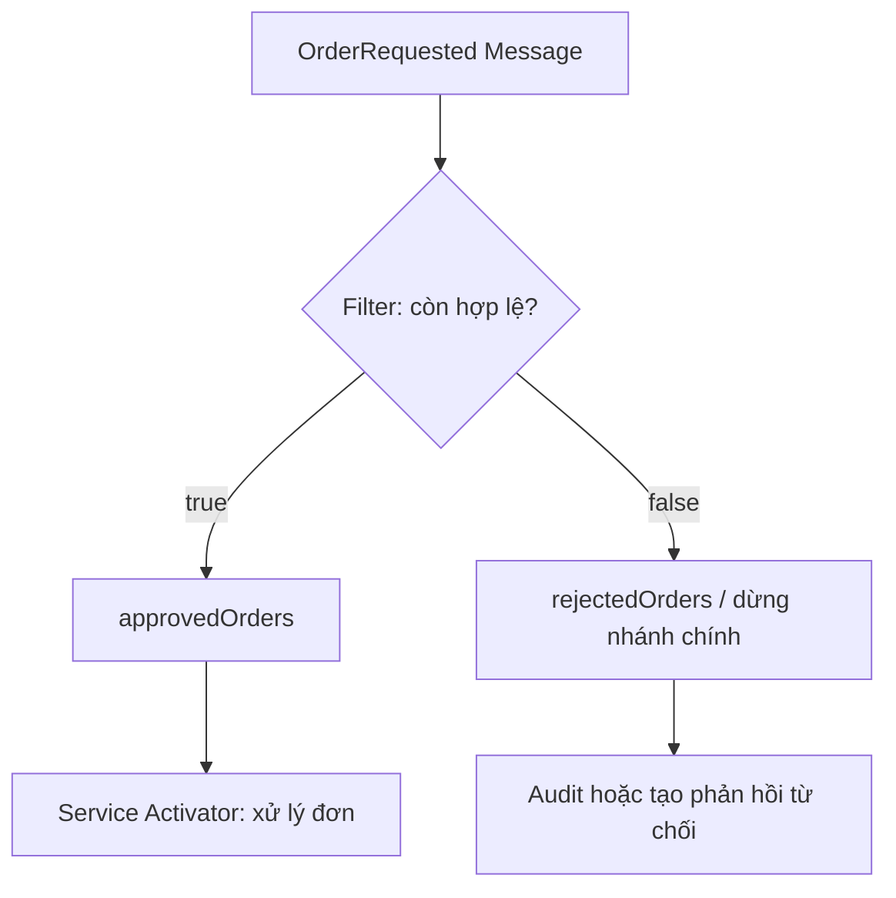
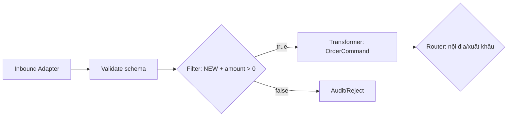
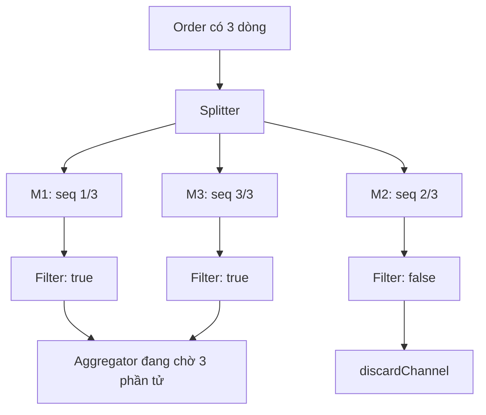

# Message Filter loại message không thỏa điều kiện

Trong một hệ thống tích hợp, không phải Message nào được gửi tới một luồng cũng đủ điều kiện đi tiếp. Đơn hàng có thể đã bị hủy, sự kiện có thể không thuộc phạm vi xử lý, hoặc payload có thể chứa dữ liệu không hợp lệ. Nếu để tất cả đi thẳng tới bước ghi database, gửi thông báo hoặc gọi dịch vụ ngoài, hệ thống sẽ thực hiện những công việc không cần thiết và đôi khi tạo tác dụng nghiệp vụ sai.

**Message Filter** là mẫu Enterprise Integration Patterns (EIP) sử dụng một điều kiện để **chấp nhận hoặc loại Message khỏi nhánh xử lý chính**. Trong Spring Integration, Filter đánh giá Message và chỉ chuyển tiếp những Message đáp ứng điều kiện. Message bị từ chối có thể được bỏ qua có chủ đích, đưa tới **discard channel** hoặc làm phát sinh ngoại lệ, tùy hợp đồng xử lý.

Bài thuộc chương **Filter** của module `SPRING_INTEGRATION_PATTERN`. Module tập trung triển khai Router, Filter, Transformer, Splitter, Aggregator, Gateway, retry, error channel và correlation trong các flow thông điệp ít phụ thuộc, dễ mở rộng, có kiểm thử và quan sát. Trọng tâm của bài này là **loại Message không thỏa điều kiện mà không làm mất khả năng giải thích, truy vết hoặc khôi phục khi cần**.

## 1. Filter nằm ở đâu trong luồng xử lý?

Ví dụ, một ứng dụng nhận yêu cầu đơn hàng qua Message Channel:



Giả sử chỉ xử lý đơn có trạng thái `NEW`, số tiền dương và mã đơn không rỗng:

| Message | Trạng thái | Số tiền | Kết quả |
| --- | --- | --- | --- |
| `ORD-101` | `NEW` | `250000` | **Accepted**: đi tiếp |
| `ORD-102` | `CANCELLED` | `250000` | **Rejected**: không tới handler nghiệp vụ |
| `ORD-103` | `NEW` | `0` | **Rejected**: không tới handler nghiệp vụ |
| Không có mã đơn | `NEW` | `50000` | **Rejected**: xử lý theo chính sách dữ liệu không hợp lệ |

Điểm cốt lõi: **Filter không chọn một route nghiệp vụ mới cho Message hợp lệ**. Nó chỉ cho Message được chấp nhận qua output chính. Hành vi dành cho Message bị từ chối được cấu hình riêng.

### Vì sao gọi là “loại Message”?

Trong ngữ cảnh Spring Integration, **loại** là *không chuyển Message tới output channel bình thường của Filter*. Không nên hiểu “loại” luôn là xóa khỏi mọi nơi:

- Không có discard flow và không ném lỗi: Message có thể kết thúc tại Filter.
- Có `discardChannel`: Message được chuyển tới một nhánh riêng để tiếp tục xử lý việc từ chối.
- Có chế độ ném exception khi từ chối: flow không hoàn thành bình thường; thành phần gọi cần xử lý lỗi.

Message đã được đọc khỏi một queue/broker đầu vào có được lưu hay phát lại hay không còn phụ thuộc transaction, acknowledgment và adapter — **Filter không tự đảm bảo khả năng phục hồi**.

## 2. Predicate: điều kiện quyết định Message đi tiếp

Một **predicate** là hàm trả về giá trị boolean:

```java
boolean accept(OrderRequested order) {
    return order != null
            && order.id() != null
            && !order.id().isBlank()
            && order.amount() != null
            && order.amount().signum() > 0
            && order.status() == OrderStatus.NEW;
}
```

Ở ví dụ này, `true` nghĩa là Message có thể đi tới bước xử lý đơn. `false` nghĩa là Message **không đáp ứng chính sách của nhánh chính**. Điều kiện cần được xây dựng sao cho dễ đọc, dễ kiểm thử và không tự phát sinh tác dụng phụ.

Đừng gộp ba loại kết quả sau làm một:

| Kết quả | Ý nghĩa | Ví dụ |
| --- | --- | --- |
| **Accepted (`true`)** | Được phép tiếp tục | Đơn `NEW`, amount dương |
| **Rejected (`false`)** | Không đạt một quy tắc đã biết | Đơn đã `CANCELLED` |
| **Failed (exception)** | Không thể đánh giá đúng điều kiện | Dịch vụ kiểm tra chính sách timeout |

Nếu predicate gọi một API phụ thuộc và bị timeout, việc bắt mọi exception rồi trả `false` có thể khiến sự cố hạ tầng bị ghi nhầm thành một quyết định từ chối nghiệp vụ. Ngược lại, không phải mọi `false` đều cần retry hoặc gửi vào `errorChannel`.

### Predicate nên kiểm tra điều gì?

Một số tiêu chí phù hợp:

- Thuộc tính payload: trạng thái, số lượng, giá trị, loại event.
- Metadata đáng tin cậy: header mô tả nguồn hoặc loại thông điệp đã được hệ thống nội bộ chuẩn hóa.
- Quy tắc nghiệp vụ ổn định: chỉ xử lý những trạng thái nằm trong tập hợp hỗ trợ.
- Quy tắc chặn sớm: từ chối dữ liệu không thể hợp lệ trước khi thực hiện side effect tốn kém.

Điều kiện càng phụ thuộc vào dữ liệu bên ngoài hoặc thời gian hiện tại, tính **lặp lại của quyết định** khi retry càng cần được xem xét. Hãy tách policy phức tạp thành thành phần riêng thay vì nhét toàn bộ logic vào một biểu thức khó theo dõi.

## 3. Ví dụ Spring Integration Java DSL: lọc đơn hợp lệ

Sau đây là cấu hình Java 17+ có thể đặt trong một ứng dụng Spring với Spring Integration. Một Message đi vào `incomingOrders`; Filter chuyển đơn hợp lệ sang `acceptedOrders`, đơn bị từ chối sang `rejectedOrders`. Hai output là `QueueChannel` để quan sát trong ví dụ và trong test.

### 3.1. Domain model và cấu hình flow

```java
package example.integration;

import java.math.BigDecimal;

import org.springframework.context.annotation.Bean;
import org.springframework.context.annotation.Configuration;
import org.springframework.integration.channel.DirectChannel;
import org.springframework.integration.channel.QueueChannel;
import org.springframework.integration.config.EnableIntegration;
import org.springframework.integration.dsl.IntegrationFlow;
import org.springframework.messaging.MessageChannel;
import org.springframework.messaging.PollableChannel;

@Configuration
@EnableIntegration
public class OrderFilterConfiguration {

    public enum OrderStatus {
        NEW, CONFIRMED, CANCELLED
    }

    public record OrderRequested(
            String id,
            BigDecimal amount,
            OrderStatus status) {
    }

    @Bean
    public MessageChannel incomingOrders() {
        return new DirectChannel();
    }

    @Bean
    public PollableChannel acceptedOrders() {
        return new QueueChannel(20);
    }

    @Bean
    public PollableChannel rejectedOrders() {
        return new QueueChannel(20);
    }

    @Bean
    public IntegrationFlow orderFilterFlow() {
        return IntegrationFlow.from("incomingOrders")
                .filter(OrderRequested.class,
                        order -> order.id() != null
                                && !order.id().isBlank()
                                && order.amount() != null
                                && order.amount().signum() > 0
                                && order.status() == OrderStatus.NEW,
                        spec -> spec.discardChannel("rejectedOrders"))
                .channel("acceptedOrders")
                .get();
    }
}
```

Luồng hoạt động như sau:

1. `incomingOrders` nhận `Message<OrderRequested>` từ producer hoặc adapter.
2. `filter(OrderRequested.class, predicate, spec)` đánh giá **payload** của Message bằng predicate.
3. Nếu `true`, Message được chuyển đến `acceptedOrders`.
4. Nếu `false`, Message không đi tới `acceptedOrders`; thay vào đó, Filter gửi Message bị từ chối tới `rejectedOrders`.
5. Việc tiếp tục xử lý ở một trong hai queue phụ thuộc vào consumer hoặc polling endpoint được cấu hình bên ngoài ví dụ.

`DirectChannel` thực thi đoạn gửi và lọc theo cách đồng bộ trên thread người gửi, còn `QueueChannel` là điểm giữ Message để nhận sau. Các queue này chỉ phục vụ demo/test, không tự có consumer và cũng không tự lưu bền vững qua restart.

### 3.2. Vì sao dùng `BigDecimal.signum()`?

Với số tiền kiểu `BigDecimal`, `signum() > 0` có nghĩa giá trị lớn hơn 0, không phụ thuộc cách biểu diễn thập phân. Predicate kiểm tra `amount != null` trước khi gọi `signum()`. Một `NullPointerException` do truy cập thiếu trường không nên bị xem là một “quyết định loại đơn” đã được thiết kế.

### 3.3. Message được giữ lại những gì?

Ở Filter thông thường, Message được chấp nhận **đi tiếp như thông điệp đầu vào**, thay vì bị Transformer đổi payload. Header nghiệp vụ như `eventId`, `businessOrderId` hoặc `correlationId` cần được duy trì để quan sát cả nhánh được chấp nhận và bị từ chối.

Filter tự thân không biến `OrderRequested` thành một lệnh nghiệp vụ khác. Nếu muốn thay đổi payload, hãy đặt một `Transformer` sau nhánh được chấp nhận.

## 4. Gửi thử Message hợp lệ và không hợp lệ

Ví dụ dưới đây dùng Spring Context để tạo cấu hình, gửi ba Message rồi đọc các queue đầu ra.

```java
package example.integration;

import java.math.BigDecimal;

import org.springframework.context.annotation.AnnotationConfigApplicationContext;
import org.springframework.messaging.Message;
import org.springframework.messaging.MessageChannel;
import org.springframework.messaging.PollableChannel;
import org.springframework.messaging.support.MessageBuilder;

import example.integration.OrderFilterConfiguration.OrderRequested;
import example.integration.OrderFilterConfiguration.OrderStatus;

public class OrderFilterDemo {

    public static void main(String[] args) {
        try (var context = new AnnotationConfigApplicationContext(
                OrderFilterConfiguration.class)) {

            MessageChannel input =
                    context.getBean("incomingOrders", MessageChannel.class);
            PollableChannel accepted =
                    context.getBean("acceptedOrders", PollableChannel.class);
            PollableChannel rejected =
                    context.getBean("rejectedOrders", PollableChannel.class);

            input.send(MessageBuilder.withPayload(new OrderRequested(
                            "ORD-101", new BigDecimal("250000"), OrderStatus.NEW))
                    .setHeader("eventId", "evt-101")
                    .build());

            input.send(MessageBuilder.withPayload(new OrderRequested(
                            "ORD-102", new BigDecimal("120000"), OrderStatus.CANCELLED))
                    .setHeader("eventId", "evt-102")
                    .build());

            input.send(MessageBuilder.withPayload(new OrderRequested(
                            "ORD-103", BigDecimal.ZERO, OrderStatus.NEW))
                    .setHeader("eventId", "evt-103")
                    .build());

            Message<?> ok = accepted.receive(0);
            Message<?> firstReject = rejected.receive(0);
            Message<?> secondReject = rejected.receive(0);

            System.out.println(ok == null ? "none" : ok.getPayload());
            System.out.println(firstReject == null ? "none" : firstReject.getPayload());
            System.out.println(secondReject == null ? "none" : secondReject.getPayload());
        }
    }
}
```

Với cấu hình đồng bộ, kết quả mong đợi là:

```text
acceptedOrders: ORD-101
rejectedOrders: ORD-102
rejectedOrders: ORD-103
```

Các dòng trên biểu diễn trường ID bên trong payload, **không phải chuỗi do `println(record)` in ra nguyên văn**. Khi in một Java record, kết quả bao gồm tất cả trường trong record.

Lưu ý rằng `send()` thành công chỉ phản ánh việc Message được channel/hạ tầng tương ứng tiếp nhận theo hợp đồng hiện tại. Việc Message được đưa vào một queue đầu ra **không đồng nghĩa** consumer nghiệp vụ đã hoàn thành.

## 5. Message bị loại sẽ đi đâu?

Ba cách xử lý từ chối phổ biến có ý nghĩa khác nhau. Không nên dùng chúng thay thế cho nhau mà không xác định hợp đồng nghiệp vụ.

### 5.1. Loại khỏi nhánh chính mà không có discard channel

Nếu Filter không có `discardChannel` và không bật chế độ ném lỗi, Message có predicate trả `false` sẽ **không được chuyển tiếp sang output channel chính**.

```text
incomingOrders -> Filter -> acceptedOrders
                      |
                      +-- predicate=false --> dừng nhánh
```

Đây có thể là hành vi hợp lệ với một stream chỉ quan tâm loại sự kiện nhất định. Ví dụ, bộ xử lý báo cáo chỉ nhận `PaymentCompleted`, nên sự kiện `PaymentPending` có thể bị bỏ qua có chủ đích.

Nhưng nếu sự kiện phải được kiểm toán, cần phục hồi sau lỗi, hoặc đang xuất phát từ một request yêu cầu phản hồi, **không có nhánh discard có thể gây mất thông tin nghiệp vụ hoặc làm Gateway timeout**.

### 5.2. Chuyển Message bị từ chối tới `discardChannel`

Cấu hình `discardChannel("rejectedOrders")` trong ví dụ giúp giữ một **đường xử lý được từ chối**. Nhánh này có thể:

- Ghi `eventId`, loại Message và lý do từ chối trong log có cấu trúc.
- Tạo một phản hồi như `ORDER_REJECTED` cho request-reply.
- Gửi tới một kho kiểm tra thủ công có khả năng lưu bền vững.
- Đếm số Message bị loại theo từng quy tắc để phát hiện upstream sai.

`discardChannel` nhận Message bị từ chối; nó **không tự tạo trường `reasonCode`** và không mặc nhiên lưu bền vững. Nếu cần lý do từ chối chi tiết, hãy định nghĩa cơ chế tính và truyền lý do nghiệp vụ rõ ràng, thay vì hy vọng một predicate boolean sẽ trả về đủ thông tin.

### 5.3. Ném `MessageRejectedException`

Spring Integration hỗ trợ cấu hình `throwExceptionOnRejection(true)` trên Filter khi một kết quả `false` phải được coi là lỗi cần báo cho phía gửi.

```java
// Đây là cấu hình minh họa cho chính sách thay thế, không đăng ký
// cùng lúc với flow discard trong mục 3 trên một input channel.
return IntegrationFlow.from("incomingOrders")
        .filter(OrderRequested.class,
                order -> order.status() == OrderStatus.NEW,
                spec -> spec.throwExceptionOnRejection(true))
        .channel("acceptedOrders")
        .get();
```

Với một flow đồng bộ, một Message bị từ chối có thể làm lời gọi gửi phát sinh exception (thường được framework bọc tùy điểm gọi). **Không nên bật ném lỗi nếu từ chối là trường hợp bình thường và có thể xử lý bằng nhánh discard.** Trường hợp predicate *tự ném exception* cũng khác với cơ chế chủ động ném lỗi khi predicate trả `false`.

### Bảng lựa chọn chính sách

| Chính sách | Nhánh chính | Hành vi với `false` | Khi phù hợp |
| --- | --- | --- | --- |
| Không discard, không ném | Không tiếp tục | Dừng tại Filter | Bỏ qua sự kiện không thuộc phạm vi |
| Có discard channel | Không tiếp tục | Gửi nhánh từ chối | Cần audit hoặc xử lý riêng |
| Ném exception khi từ chối | Không tiếp tục bình thường | Báo lỗi cho luồng xử lý | Hợp đồng coi yêu cầu bị từ chối là lỗi |
| Predicate tự ném lỗi | Không có kết quả boolean | Đi theo cơ chế error handling | Lỗi kỹ thuật, schema hoặc phụ thuộc |

**`discardChannel` không phải `errorChannel`.** Một kết quả `false` có thể là tình huống nghiệp vụ hợp lệ; `errorChannel` xử lý lỗi thực thi qua `ErrorMessage` khi flow/hạ tầng được cấu hình theo cơ chế tương ứng. Không mặc định mọi exception sẽ tự đến error channel, đặc biệt với luồng đồng bộ.

## 6. Phân biệt Filter, Router, Transformer và Validator

| Thành phần | Mục đích | Câu hỏi nó trả lời |
| --- | --- | --- |
| **Filter** | Cho đi tiếp hoặc từ chối | Message có thuộc tập được xử lý không? |
| **Router** | Chọn channel/recipient | Message phải đi tới nhánh nào? |
| **Transformer** | Đổi biểu diễn dữ liệu | Payload/Message phải có định dạng gì? |
| **Validator** | Kiểm tra ràng buộc dữ liệu | Dữ liệu hợp lệ theo schema/quy tắc bắt buộc không? |
| **Service Activator** | Thực thi hành vi nghiệp vụ | Cần làm gì với Message này? |

Một Validator có thể ném exception khi dữ liệu sai; Filter có thể chọn cách dừng nhánh hoặc route sang discard channel. Chúng có thể kết hợp: kiểm tra ràng buộc cấu trúc ở boundary trước, sau đó Filter quyết định sự kiện nào thuộc phạm vi xử lý.

Ví dụ:



Nếu Filter nằm **sau Transformer**, predicate phải hiểu kiểu dữ liệu sau biến đổi. Nếu Filter nằm **trước Router**, mọi nhánh của Router cùng được áp dụng điều kiện. Không nên chọn vị trí theo thói quen; hãy đặt ở nơi có **đủ dữ liệu đúng** và đã xác định hệ quả khi chặn Message.

## 7. Viết predicate an toàn và dễ kiểm thử

### 7.1. Tránh side effect

Predicate không nên tự:

- Ghi nhận thanh toán.
- Gửi email.
- Cập nhật tồn kho.
- Gọi API có tác dụng nghiệp vụ.

Lý do: predicate có thể được đánh giá lại do retry, replay hoặc thay đổi flow. Khi nó đồng thời thay đổi trạng thái, việc kiểm thử một quyết định boolean trở nên phức tạp và khó khôi phục sau lỗi.

Với quy tắc cần truy cập database, hãy xác định rõ **snapshot** hoặc cơ chế kiểm soát phiên bản, timeout và caching; không mặc định một kết quả sẽ giống nhau giữa hai lần đánh giá.

### 7.2. Kiểm tra giá trị null và biên

Không nên chỉ kiểm thử trường hợp hoàn hảo. Với ví dụ đơn hàng:

| Dữ liệu | Predicate mong đợi |
| --- | --- |
| `id="ORD-1", amount=1, status=NEW` | `true` |
| `id="ORD-1", amount=0, status=NEW` | `false` |
| `id="ORD-1", amount=-1, status=NEW` | `false` |
| `id="", amount=1, status=NEW` | `false` |
| `id=null, amount=1, status=NEW` | `false` |
| `id="ORD-1", amount=null, status=NEW` | `false` |
| `id="ORD-1", amount=1, status=CANCELLED` | `false` |

Nếu producer có thể gửi payload khác kiểu `OrderRequested`, cần xử lý hợp đồng kiểu dữ liệu ở boundary/adapter; không nên cho rằng `.filter(OrderRequested.class, ...)` có thể nhận và phân loại an toàn mọi loại object tùy ý.

### 7.3. Chính sách phụ thuộc thời gian

Ví dụ chỉ chấp nhận sự kiện trong vòng 15 phút tính từ `occurredAt`:

```java
import java.time.Clock;
import java.time.Duration;
import java.time.Instant;

public boolean withinWindow(Instant occurredAt, Clock clock) {
    if (occurredAt == null) {
        return false;
    }
    Instant now = clock.instant();
    return !occurredAt.isAfter(now)
            && !occurredAt.isBefore(now.minus(Duration.ofMinutes(15)));
}
```

Inject `Clock` vào policy để test có thể cố định thời gian. Một Message được chấp nhận lúc đầu nhưng bị từ chối sau khi retry vào thời điểm khác có thể gây ngạc nhiên; cần quy định rõ dùng **event time**, **processing time** hay quyết định đã được ghi nhận trước đó.

## 8. Filter với Gateway: đừng để request biến mất

Một Gateway kiểu request-reply thường gửi Message vào flow và đợi câu trả lời. Nếu Message bị lọc nhưng **không có reply và cũng không có lỗi được trả về**, Gateway có thể chờ đến `replyTimeout`.

Ba hợp đồng có thể chọn:

1. **Trả kết quả nghiệp vụ từ chối:** ví dụ `OrderDecision(REJECTED, "INVALID_AMOUNT")`.
2. **Ném lỗi có thể ánh xạ về API:** phù hợp khi request vi phạm hợp đồng và lỗi được định nghĩa rõ.
3. **One-way/fire-and-forget:** người gửi chỉ phát sự kiện và không đợi reply; từ chối có thể được xử lý ở discard flow.

Một `QueueChannel` làm discard trong ví dụ **không tự gửi reply cho Gateway**. Nếu Gateway có `replyChannel`, consumer của nhánh discard phải thực sự tạo reply trên đường phù hợp hoặc dùng cơ chế lỗi tương ứng.

### Gửi thành công không có nghĩa đã được Filter chấp nhận

Khi có `DirectChannel`, lời gọi `send()` thường chạy xuyên qua Filter đồng bộ. Khi dùng `QueueChannel`, `ExecutorChannel`, broker hoặc poller **trước Filter**, producer có thể nhận kết quả gửi thành công khi Message mới được xếp hàng; predicate chỉ được đánh giá sau đó.

Vì vậy, API nên phân biệt các trạng thái:

| Trạng thái | Ý nghĩa |
| --- | --- |
| `RECEIVED` | Hệ thống tiếp nhận Message |
| `FILTER_ACCEPTED` | Predicate trả `true` |
| `FILTER_REJECTED` | Predicate trả `false` |
| `PROCESSED` | Handler nghiệp vụ hoàn tất |
| `FAILED` | Có lỗi thực thi |

Không nên dùng `RECEIVED` hoặc `FILTER_ACCEPTED` để thay thế `PROCESSED`.

## 9. Filter trước/sau Router, Splitter và Aggregator

### 9.1. Filter trước Router

Nếu mọi nhánh đều không được xử lý đơn bị hủy, Filter đặt **trước Router** giúp chính sách thống nhất:

```text
input
  -> Filter(đơn NEW?)
    -> true  -> Router(LOCAL / EXPORT) -> consumer
    -> false -> rejectedOrders
```

Nếu nhánh `CANCELLED` phải có một quy trình nghiệp vụ riêng, **đừng dùng Filter để bỏ nó**. Hãy dùng Router phân loại `NEW`, `CANCELLED`, `COMPLETED` và gửi đến đúng các kênh.

### 9.2. Filter sau Splitter có thể làm thiếu kết quả

Giả sử Splitter tạo ba Message con, với `correlationId=G` và sequence metadata:



Nếu Aggregator mặc định chờ đủ ba Message con mà một phần tử bị Filter loại, nó có thể **không bao giờ hoàn tất nhóm** theo điều kiện release thông thường.

Những phương án cần cân nhắc:

- Lọc phần tử không cần thiết **trước Splitter**, để số lượng Message con được tạo phản ánh tập còn lại.
- Gửi **kết quả từ chối** như một phần tử hợp lệ của nhóm, thay vì làm mất hoàn toàn một kết quả.
- Thiết kế `releaseStrategy`, `groupTimeout` và chính sách partial result phù hợp.
- Giữ `correlationId`, `sequenceNumber`, `sequenceSize` khi cần, nhưng không tự sửa một giá trị header nội bộ nếu chưa hiểu tác động.

Filter không tự điều chỉnh `sequenceSize` của các Message còn lại. Việc thêm discard channel **không đủ để Aggregator biết đã nhận đủ kết quả**.

## 10. Retry, error channel và idempotency

### Reject hợp lệ thường không cần retry

Một đơn có `amount=0` sẽ không tự trở nên hợp lệ chỉ vì cùng Message được xử lý lại. Retry liên tục một predicate trả `false` làm tăng tải mà không có ích.

### Lỗi tạm thời có thể retry

Nếu Filter gọi một dịch vụ phụ thuộc để kiểm tra hạn mức và dịch vụ đó timeout, đây là một **lỗi đánh giá điều kiện**; retry có giới hạn/backoff có thể hợp lý. Đừng nhầm nó với việc predicate đã trả `false` rõ ràng.

| Sự kiện | Chính sách gợi ý |
| --- | --- |
| Predicate `false`, ngoài phạm vi | Dừng hoặc discard có log |
| Predicate `false`, vi phạm hợp đồng API | Reply từ chối hoặc exception |
| Predicate ném lỗi do timeout phụ thuộc | Retry có giới hạn hoặc error flow |
| Đầu vào không đọc được schema | Validation/error flow trước Filter |
| Queue discard đầy | Xử lý backpressure/error; không mặc định Message đã lưu |
| Message được redeliver | Kiểm soát idempotency ở bước nghiệp vụ có side effect |

**`errorChannel` không tự bắt mọi ngoại lệ trong mọi mô hình thread.** Với `DirectChannel`, lỗi có thể lan về người gửi; với consumer bất đồng bộ, `ErrorMessage` thường được gửi theo cấu hình của poller/executor/adapter tương ứng.

### Idempotency và mã sự kiện

Đừng dùng Message ID do framework tạo làm khóa chống xử lý trùng xuyên nhiều lần gửi. Khi cùng một sự kiện nghiệp vụ được phát lại, có thể có một `MessageHeaders.ID` mới. Nên có `eventId` ổn định hoặc một khóa nghiệp vụ có phiên bản phù hợp.

Ví dụ:

```text
eventId = evt-101
idempotency key for order processing = evt-101:PROCESS_ORDER
idempotency key for rejection audit   = evt-101:REJECT_AUDIT
```

Ngay cả discard flow cũng có thể được gọi lại khi producer retry. Nếu nhánh này gửi thông báo hoặc ghi giao dịch, nó cũng cần chính sách xử lý trùng.

## 11. Kiểm thử tích hợp: Message bị loại không lọt nhánh chính

Unit test predicate rất hữu ích, nhưng **chưa chứng minh channel nào nhận Message**. Nên kiểm thử với `IntegrationFlow` thật để xác nhận cả nhánh chấp nhận và nhánh từ chối.

### 11.1. JUnit 5 với Spring Context

```java
package example.integration;

import static org.junit.jupiter.api.Assertions.*;

import java.math.BigDecimal;

import org.junit.jupiter.api.Test;
import org.springframework.context.annotation.AnnotationConfigApplicationContext;
import org.springframework.messaging.Message;
import org.springframework.messaging.MessageChannel;
import org.springframework.messaging.PollableChannel;
import org.springframework.messaging.support.MessageBuilder;

import example.integration.OrderFilterConfiguration.OrderRequested;
import example.integration.OrderFilterConfiguration.OrderStatus;

class OrderFilterIntegrationTest {

    @Test
    void rejectedMessagesNeverReachAcceptedChannel() {
        try (var context = new AnnotationConfigApplicationContext(
                OrderFilterConfiguration.class)) {

            MessageChannel input =
                    context.getBean("incomingOrders", MessageChannel.class);
            PollableChannel accepted =
                    context.getBean("acceptedOrders", PollableChannel.class);
            PollableChannel rejected =
                    context.getBean("rejectedOrders", PollableChannel.class);

            OrderRequested valid = new OrderRequested(
                    "ORD-101", BigDecimal.TEN, OrderStatus.NEW);
            OrderRequested cancelled = new OrderRequested(
                    "ORD-102", BigDecimal.ONE, OrderStatus.CANCELLED);
            OrderRequested zeroAmount = new OrderRequested(
                    "ORD-103", BigDecimal.ZERO, OrderStatus.NEW);

            assertTrue(input.send(MessageBuilder.withPayload(valid)
                    .setHeader("eventId", "evt-valid").build()));
            assertTrue(input.send(MessageBuilder.withPayload(cancelled)
                    .setHeader("eventId", "evt-cancelled").build()));
            assertTrue(input.send(MessageBuilder.withPayload(zeroAmount)
                    .setHeader("eventId", "evt-zero").build()));

            Message<?> output = accepted.receive(0);
            Message<?> reject1 = rejected.receive(0);
            Message<?> reject2 = rejected.receive(0);

            assertNotNull(output);
            assertNotNull(reject1);
            assertNotNull(reject2);
            assertEquals(valid, output.getPayload());
            assertEquals(cancelled, reject1.getPayload());
            assertEquals(zeroAmount, reject2.getPayload());
            assertEquals("evt-valid", output.getHeaders().get("eventId"));
            assertEquals("evt-cancelled",
                    reject1.getHeaders().get("eventId"));

            assertNull(accepted.receive(0));
            assertNull(rejected.receive(0));
        }
    }
}
```

Test này chứng minh:

1. Message hợp lệ được giữ tại `acceptedOrders`.
2. Hai Message không đạt predicate đi tới `rejectedOrders`, không lọt sang nhánh chính.
3. Metadata `eventId` phục vụ truy vết vẫn tồn tại ở cả nhánh được chấp nhận và từ chối.
4. Mỗi Message chỉ xuất hiện một lần trong các queue ở ví dụ đồng bộ.

Do input là `DirectChannel` và output là các `QueueChannel` trong bộ nhớ không có consumer khác, `receive(0)` phù hợp với test này. Với executor, poller, broker hoặc consumer bất đồng bộ, phải dùng cơ chế chờ điều kiện với timeout hữu hạn.

### 11.2. Test riêng predicate với dữ liệu biên

Để tránh phải khởi tạo Spring Context cho hàng chục biến thể dữ liệu, có thể tách điều kiện ra một class `OrderAcceptancePolicy` với phương thức `boolean accepts(OrderRequested order)` rồi unit test riêng. Khi đó cấu hình Filter chỉ gọi policy đã được inject; integration test vẫn giữ để xác nhận việc nối channel.

Danh sách test có giá trị:

- `NEW`, số tiền dương, ID hợp lệ → chấp nhận.
- `CANCELLED`, `CONFIRMED` → từ chối theo chính sách hiện tại.
- Amount bằng 0, âm hoặc `null` → từ chối.
- ID `null`, rỗng hoặc chỉ chứa khoảng trắng → từ chối.
- Header nghiệp vụ phải được bảo toàn.
- Chưa có consumer của discard channel: kiểm tra nguy cơ queue đầy và timeout.
- Dữ liệu sai kiểu: phát hiện lỗi chuyển đổi kiểu theo hợp đồng, không diễn giải nhầm thành `false`.
- Có Gateway: Message bị từ chối không gây timeout ngoài ý muốn.
- Có Splitter/Aggregator: chặn một Message con không khiến nhóm chờ vô hạn mà không có chính sách.

## 12. Quan sát quyết định của Filter khi vận hành

Một Message không có mặt ở output channel chưa đủ để biết nguyên nhân: nó có thể bị Filter từ chối, chưa được consumer xử lý, gặp lỗi hoặc mắc kẹt ở queue.

Nên có những tín hiệu sau:

| Metric/log gợi ý | Ý nghĩa |
| --- | --- |
| `filter.evaluated.count` | Số Message đi đến Filter |
| `filter.accepted.count` | Số Message được phép tiếp tục |
| `filter.rejected.count` | Số Message có predicate `false` |
| `filter.failure.count` | Số lần đánh giá điều kiện bị lỗi |
| `filter.processing.duration` | Độ trễ đánh giá predicate |
| `filter.discard.queue.depth` | Backlog Message từ chối đang chờ xử lý |
| `gateway.reply.timeout` | Số request không có reply kịp thời |
| `aggregator.incomplete.groups` | Số nhóm không đủ phần tử sau khi một nhánh lọc Message |

Đây là **các tên metric đề xuất để instrument**, không phải tất cả đều là metric Spring Integration/Micrometer cung cấp sẵn. Các khóa `eventId` và `orderId` nên nằm ở log/tracing, tránh làm tag metric có cardinality cao.

Ví dụ log có cấu trúc:

```json
{
  "stage": "order-acceptance-filter",
  "decision": "REJECTED",
  "reasonCode": "NON_POSITIVE_AMOUNT",
  "eventId": "evt-103",
  "businessOrderId": "ORD-103",
  "correlationId": null
}
```

Một predicate boolean **không tự biết** `reasonCode`; nếu cần thông tin này, hãy có chính sách phân loại lý do riêng hoặc thiết kế kiểu kết quả kiểm tra giàu thông tin hơn. Chỉ ghi dữ liệu cần thiết; tránh log toàn bộ payload nhạy cảm.

## 13. Các lỗi triển khai thường gặp

| Biểu hiện | Nguyên nhân | Cách khắc phục |
| --- | --- | --- |
| Message hợp lệ bị loại | Điều kiện boolean sai hoặc dùng `&&`/`||` không đúng | Unit test bảng quyết định và dữ liệu biên |
| Đơn bị hủy vẫn chạy nghiệp vụ | Filter đặt sau handler có side effect | Đặt Filter trước bước nghiệp vụ không được phép chạy |
| Gateway chờ tới timeout | Filter loại Message nhưng không có reply/error | Thiết kế nhánh trả kết quả từ chối |
| Không biết Message đã bị loại vì sao | Không có discard/audit/metric | Thêm chính sách quan sát và lý do từ chối |
| Mọi lỗi API bị xem như reject | Predicate bắt exception rồi trả `false` | Phân biệt exception với kết quả boolean |
| `rejectedOrders` đầy | Không có consumer hoặc queue quá nhỏ | Thiết kế consumer, timeout, backpressure hoặc lưu bền vững |
| Thông điệp từ chối mất khi restart | Discard chỉ nằm trong bộ nhớ | Dùng kho/broker bền vững nếu yêu cầu phục hồi |
| Aggregator thiếu phần tử | Filter sau Splitter làm mất Message con | Xử lý kết quả từ chối/timeout/release strategy |
| Retry liên tục Message không hợp lệ | Coi `false` như lỗi tạm thời | Chỉ retry khi thực sự có exception hồi phục |
| Dữ liệu lọt vào nhánh lạ | Header chưa tin cậy dùng làm điều kiện/route | Xác thực nguồn và kiểm soát chính sách tại boundary |

## 14. Checklist thiết kế Message Filter

- **Viết rõ ý nghĩa `true` và `false`:** Message nào được phép đi tiếp, Message nào bị từ chối?
- **Đặt Filter đúng vị trí:** trước side effect không được thực hiện khi dữ liệu không hợp lệ.
- **Xử lý giá trị biên:** `null`, chuỗi trống, số âm, enum không hỗ trợ, sai kiểu payload.
- **Tách reject và failure:** `false` không mặc nhiên là exception; timeout phụ thuộc không nên bị che thành `false`.
- **Quy định số phận Message bị loại:** bỏ có chủ đích, discard/audit hoặc trả lỗi theo hợp đồng.
- **Thiết kế Gateway reply:** tránh để yêu cầu bị từ chối không có phản hồi.
- **Giữ metadata cần thiết:** `eventId`, khóa nghiệp vụ, correlation và trace context khi đi qua adapter.
- **Đừng làm biến mất phần tử của Aggregator:** kiểm tra vị trí Filter sau Splitter và release strategy.
- **Thử tải nhánh discard:** queue, consumer, retry và lưu bền vững khi cần.
- **Kiểm thử flow thật:** không chỉ unit test predicate; phải chứng minh Message không lọt sang output chính.
- **Giám sát quyết định:** metric accepted/rejected/error, log reason code và độ trễ.

**Message Filter giúp ngăn những Message không thỏa điều kiện đi sâu vào luồng xử lý.** Giá trị thực sự của nó không chỉ nằm ở phép kiểm tra boolean, mà còn ở việc xác định rõ điều gì xảy ra với Message bị loại, những bước nào tuyệt đối không được chạy và cách hệ thống phản hồi, kiểm thử, quan sát hoặc khôi phục khi cần.
