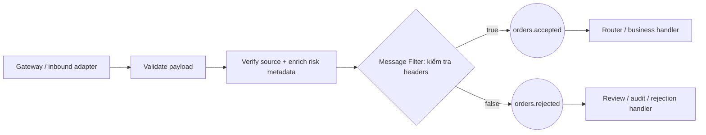
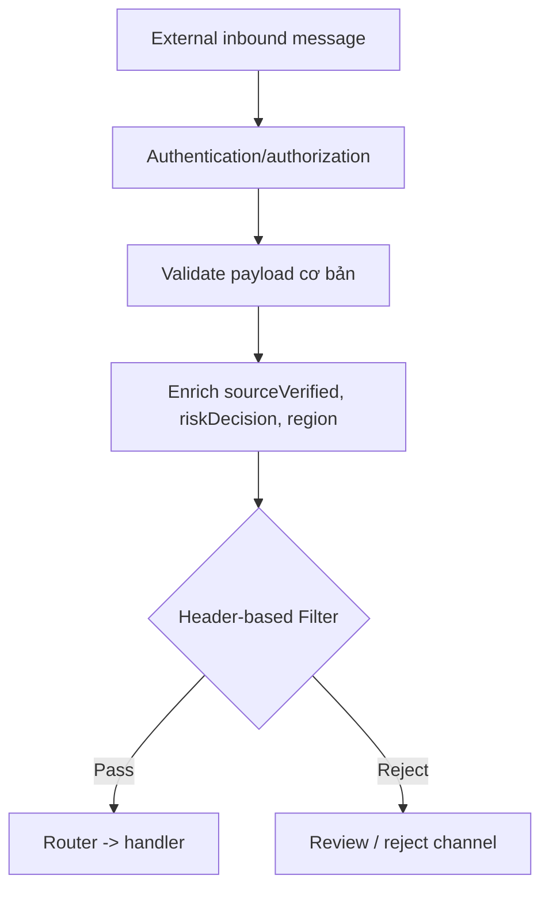
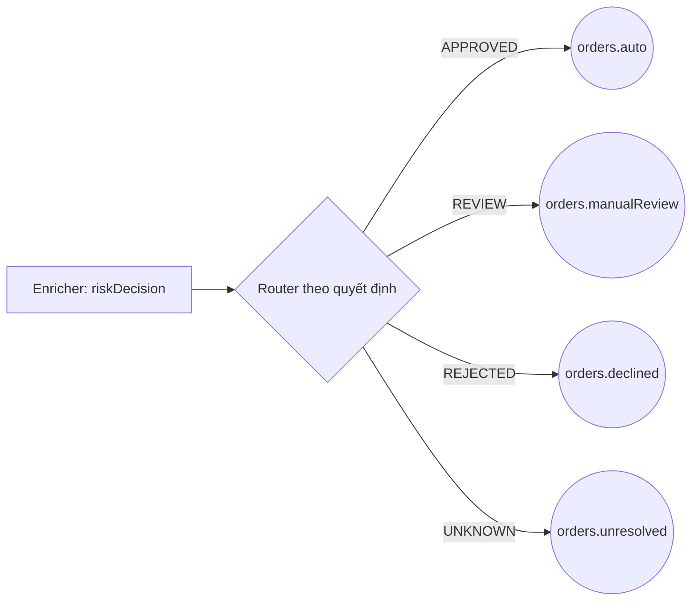
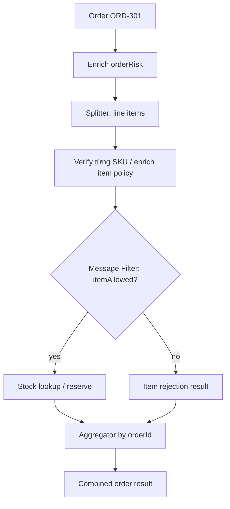

# Filter theo header

> **Chương:** Filter  
> **Module:** `SPRING_INTEGRATION_PATTERN` — học triển khai Enterprise Integration Patterns (EIP) bằng Spring Integration để tạo luồng thông điệp ít phụ thuộc, dễ mở rộng; thực hành Router, Filter, Transformer, Splitter, Aggregator, Gateway, retry, error channel và correlation, đồng thời kiểm thử, quan sát từng nhánh. Bài này đi sâu vào **Message Filter quyết định giữ hay loại message dựa trên headers**.

## 1. Mục tiêu học tập

Sau bài học, bạn có thể:

1. Giải thích **Filter theo header** giải quyết vấn đề gì, và phân biệt nó với **Header Filter** vốn dùng để loại bỏ *các trường header*.
2. Xác định header nào phản ánh metadata nghiệp vụ đáng tin cậy, header nào do client cung cấp hoặc do framework tạo và cần kiểm soát.
3. Cấu hình **Spring Integration Java DSL** để chỉ cho message có header phù hợp đi tiếp và đưa message bị từ chối sang `discardChannel`.
4. Thiết kế chính sách với header thiếu, `null`, sai kiểu, giá trị không hỗ trợ và header bị giả mạo; tránh chấp thuận ngầm khi thiếu dữ liệu.
5. Sắp xếp các bước **validate → enrich/verify headers → filter → router/handler** theo thứ tự phù hợp.
6. Kiểm thử các nhánh accepted/rejected, metadata được giữ lại, lỗi kỹ thuật, request–reply, correlation và các ranh giới bất đồng bộ.

## 2. Vấn đề: payload giống nhau nhưng ngữ cảnh khác nhau

Một ứng dụng nhận cùng loại payload `OrderRequest`, nhưng các message có thể đến từ web, đối tác được xác minh hoặc một hàng đợi nội bộ. Bộ xử lý tự động chỉ được nhận những đơn đã qua kiểm tra nguồn gửi và đánh giá rủi ro.

```text
Payload: OrderRequest(orderId="ORD-301", amount=1500000)

Message A headers:
  sourceVerified = true
  riskDecision = APPROVED
  region = VN
  -> Cho đi tiếp

Message B headers:
  sourceVerified = false
  riskDecision = APPROVED
  region = VN
  -> Từ chối

Message C headers:
  sourceVerified = true
  riskDecision = REVIEW
  region = VN
  -> Từ chối khỏi nhánh tự động, chuyển xem xét nếu chính sách yêu cầu
```

Nếu chỉ kiểm tra payload, ba message trên có thể bị xử lý giống nhau dù **nguồn tin cậy và trạng thái phê duyệt khác nhau**. Filter theo header cho phép đặt một **cổng điều kiện** trước những bước tiêu thụ message.



**Điểm quan trọng:** Filter chỉ xử lý một message **đạt hay không đạt điều kiện để đi tiếp**. Nó không bảo đảm một message được nhận diện đúng chỉ nhờ một header bất kỳ; **nguồn gốc và độ tin cậy của header** phải được xác thực trước đó.

## 3. Hai thuật ngữ rất dễ nhầm: Message Filter và Header Filter

Trong Spring Integration, cần phân biệt rõ:

| Thành phần | Đối tượng bị lọc | Kết quả khi không phù hợp | Ví dụ |
| --- | --- | --- | --- |
| **Message Filter** với điều kiện trên `headers` | **Toàn bộ message** | Không đưa message vào `outputChannel`; có thể gửi tới `discardChannel` hoặc báo lỗi tùy cấu hình | Chỉ chấp nhận `riskDecision=APPROVED` |
| **Header Filter** | **Một hoặc nhiều trường trong headers** | Message vẫn đi tiếp, nhưng một số header được loại bỏ | Loại `internalDebugToken` trước outbound adapter |
| **Transformer / Header Enricher** | Payload hoặc metadata được tạo/chỉnh sửa có chủ đích | Message kết quả chứa dữ liệu mới | Bổ sung `sourceVerified=true` từ tầng xác thực |
| **Content-Based Router** | Chọn kênh đích theo điều kiện | Gửi message tới nhánh được chọn | `riskDecision=REVIEW` → `orders.manualReview` |

**“Filter theo header” trong bài này là một Message Filter đọc header**, không phải chức năng `headerFilter` để xóa header. Đây là phân biệt thiết yếu khi đọc Java DSL:

```text
filter(headers['riskDecision'] == 'APPROVED')
    -> chọn chấp nhận hay từ chối message

headerFilter('internalDebugToken')
    -> vẫn chuyển message, chỉ loại header internalDebugToken
```

Đoạn trên là **mô tả khái niệm**, không phải mã Java hoàn chỉnh. Nếu một hệ thống cần vừa chặn message không được phép, vừa xóa header nhạy cảm trước khi gửi ra ngoài, đó là **hai trách nhiệm riêng** với thứ tự cấu hình phải được kiểm tra.

## 4. Message headers là gì và khi nào nên dựa vào chúng?

Một message trong Spring Messaging có **payload** và **headers**. Headers có thể chứa metadata kỹ thuật, thông tin truy vết hoặc thuộc tính nghiệp vụ do một bước trước đó đưa vào.

```java
import org.springframework.messaging.Message;
import org.springframework.messaging.support.MessageBuilder;

Message<String> message = MessageBuilder.withPayload("ORD-301")
    .setHeader("sourceVerified", true)
    .setHeader("riskDecision", "APPROVED")
    .setHeader("region", "VN")
    .setHeader("businessCorrelationId", "ORD-301")
    .build();

boolean verified = Boolean.TRUE.equals(
    message.getHeaders().get("sourceVerified"));

String riskDecision = (String) message.getHeaders()
    .get("riskDecision");
```

Ở ví dụ này, `sourceVerified`, `riskDecision`, `region` và `businessCorrelationId` là **headers do ứng dụng quy định**, không phải headers mà Spring Integration mặc định tự xác minh hoặc tự tạo. Một producer tùy ý có thể đặt `sourceVerified=true`; vì vậy việc tồn tại header này **không phải bằng chứng xác thực**.

### 4.1. Những nhóm header thường gặp

| Nhóm | Ví dụ | Cách dùng phù hợp |
| --- | --- | --- |
| Metadata framework | Message ID, timestamp, `replyChannel`, `errorChannel` | Điều phối và theo dõi theo semantics Spring Messaging/Integration |
| Nguồn gửi / tenant | `sourceSystem`, `tenantId`, `sourceVerified` | Chỉ tin khi được đặt hoặc xác thực bởi ingress đáng tin cậy |
| Policy / phân loại | `riskDecision`, `customerTier`, `schemaValidated` | Filter/Router dùng sau bước verify hoặc enrich |
| Định tuyến | `region`, `messageKind`, `routingZone` | Phải chuẩn hóa, kiểm tra allowlist và quyền |
| Truy vết / correlation | `businessCorrelationId`, trace context | Giữ theo contract qua các channel, broker và adapter |
| Điều khiển vận hành | `retryAttempt`, policy version, processing stage | Tránh coi metadata client tự khai là trạng thái đã xử lý |

`MessageHeaders` được thiết kế chống thay đổi cấu trúc trực tiếp, nhưng **đối tượng được đặt vào giá trị header** có thể vẫn mutable (`Map`, `List`, DTO có field sửa được). Không nên dùng một header trỏ đến `Map` mutable làm nguồn quyết định bảo mật khi nhiều thread/recipient có thể cập nhật nó.

### 4.2. Header điều khiển truy cập không thay thế authorization

Một điều kiện như `headers['tenantId'] == 'tenant-a'` chỉ là **so sánh chuỗi**. Nếu client được phép tự đặt `tenantId`, nó có thể giả mạo tenant. Với Filter liên quan đến phân quyền:

1. Xác thực chủ thể ở gateway/adapter.
2. Xác định quyền truy cập từ dữ liệu có thẩm quyền.
3. Tạo metadata nội bộ (`verifiedTenant`, `policyDecision`) sau khi đã kiểm tra.
4. Không giữ nguyên các header nhạy cảm do client gửi nếu chúng có thể bị tin nhầm.
5. Filter chỉ **áp dụng kết quả đã xác minh**, không đóng vai trò duy nhất của lớp bảo mật.

## 5. Bảng quy tắc: Filter chấp nhận message nào?

Giả định hợp đồng của một luồng xử lý đơn nội địa:

- Payload đã hợp lệ về cấu trúc (`orderId` không trống, `amount > 0`).
- Header `sourceVerified` phải là Boolean `true` do lớp ingress đáng tin cậy tạo.
- Header `riskDecision` phải bằng chính xác chuỗi `APPROVED` được Risk Service xác nhận.
- Header `region` phải là mã đã chuẩn hóa `VN`.
- Các message khác **không được vào nhánh xử lý tự động**; có thể gửi tới channel từ chối để quan sát/điều tra.

| `sourceVerified` | `riskDecision` | `region` | Kỳ vọng |
| --- | --- | --- | --- |
| `true` | `APPROVED` | `VN` | ACCEPT |
| `false` | `APPROVED` | `VN` | REJECT |
| `true` | `REVIEW` | `VN` | REJECT khỏi luồng tự động |
| `true` | `REJECTED` | `VN` | REJECT |
| `true` | `APPROVED` | `SG` | REJECT khỏi luồng nội địa |
| `true` | `APPROVED` | *thiếu* | REJECT |
| *thiếu* | `APPROVED` | `VN` | REJECT |
| `"true"` (String) | `APPROVED` | `VN` | REJECT theo hợp đồng kiểm tra kiểu nghiêm ngặt |

Để tránh **ép kiểu ngầm** giữa chuỗi và Boolean trong biểu thức, có thể thực hiện **kiểm tra kiểu tại ingress** và lưu metadata đã chuẩn hóa; khi cần ràng buộc kiểu chặt tại chính Filter, dùng predicate Java với `Boolean.TRUE.equals(...)` và kiểm tra kiểu giá trị rõ ràng.

### 5.1. Fail closed với metadata bắt buộc

Một header bị thiếu không có nghĩa message hợp lệ. Ví dụ `riskDecision == null` khác hoàn toàn với `APPROVED`. Nếu một dịch vụ đánh giá rủi ro không phản hồi, không nên dùng `APPROVED` làm giá trị mặc định chỉ để tăng throughput.

```text
APPROVED -> đi nhánh xử lý tự động
REVIEW   -> xử lý thủ công / nhánh review phù hợp
REJECTED -> từ chối nghiệp vụ
UNKNOWN  -> không đủ dữ liệu đáng tin, không tự động chấp thuận
TIMEOUT  -> lỗi kỹ thuật của bước tra cứu, không phải APPROVED
```

Việc `REVIEW`, `REJECTED`, `UNKNOWN` đều **không đi qua Message Filter của nhánh tự động** không có nghĩa chúng phải được xử lý giống nhau. Nếu cần giải quyết theo các đường khác nhau, hãy dùng **Router** sau bước enrichment (hoặc các flow riêng), thay vì đưa tất cả vào một `discardChannel` rồi mất nguyên nhân.

## 6. Ví dụ Spring Integration Java DSL: lọc theo header

Ví dụ dùng Java 17+ (`record`), Spring Integration Java DSL, `DirectChannel` cho input và hai `QueueChannel` cho output để tiện quan sát. Các bean queue chỉ được dùng như **điểm thu message trong bài học/test**; production có thể thay bằng những consumer/adapter phù hợp.

### 6.1. Payload và flow

```java
import java.math.BigDecimal;

record OrderRequest(String orderId, BigDecimal amount) {}
```

```java
import org.springframework.context.annotation.Bean;
import org.springframework.context.annotation.Configuration;
import org.springframework.integration.channel.DirectChannel;
import org.springframework.integration.channel.QueueChannel;
import org.springframework.integration.config.EnableIntegration;
import org.springframework.integration.dsl.IntegrationFlow;

@Configuration
@EnableIntegration
class HeaderMessageFilterConfiguration {

    @Bean("orders.in")
    DirectChannel input() {
        return new DirectChannel();
    }

    @Bean("orders.accepted")
    QueueChannel accepted() {
        return new QueueChannel();
    }

    @Bean("orders.rejected")
    QueueChannel rejected() {
        return new QueueChannel();
    }

    @Bean
    IntegrationFlow approvedDomesticOrders() {
        return IntegrationFlow.from("orders.in")
            // Đọc metadata được kiểm chứng ở các bước ingress/enrichment.
            // Giá trị thiếu không khớp quy tắc này.
            .filter(
                "headers['sourceVerified'] == true "
                    + "and headers['riskDecision'] == 'APPROVED' "
                    + "and headers['region'] == 'VN'",
                f -> f.discardChannel("orders.rejected"))
            .channel("orders.accepted")
            .get();
    }
}
```

Đây là **Expression-based Message Filter**: SpEL đọc `headers[...]`, trả một giá trị Boolean quyết định message có được chuyển đến `orders.accepted` hay không. Message không đạt điều kiện được gửi đến `orders.rejected` do `discardChannel` đã cấu hình.

**Lưu ý về kiểu:** SpEL có các quy tắc đánh giá và chuyển đổi kiểu phụ thuộc biểu thức. Flow trên minh họa cú pháp và giả định ingress **đã xác thực đúng kiểu** cho các headers. Nếu security/policy yêu cầu phải phân biệt nghiêm ngặt `Boolean.TRUE` với chuỗi `"true"`, đừng dựa vào một so sánh SpEL có khả năng chuyển kiểu; hãy kiểm tra kiểu một cách tường minh trong code Java và kiểm thử mọi biến thể.

### 6.2. Ví dụ gửi message trong phạm vi test/ứng dụng nội bộ

```java
import org.springframework.messaging.Message;
import org.springframework.messaging.support.MessageBuilder;

Message<OrderRequest> approved = MessageBuilder.withPayload(
        new OrderRequest("ORD-301", new BigDecimal("1500000")))
    .setHeader("sourceVerified", Boolean.TRUE)
    .setHeader("riskDecision", "APPROVED")
    .setHeader("region", "VN")
    .setHeader("businessCorrelationId", "ORD-301")
    .build();

inputChannel.send(approved);
```

Ở đây `inputChannel` là bean channel đã được inject/tra cứu. Test tự dựng các headers để kiểm chứng Filter; **code này không phải bước xác thực request ngoài Internet**. Trong hệ thống thật, chỉ thành phần đã kiểm chứng nguồn mới được gắn metadata `sourceVerified` theo quyền nội bộ.

### 6.3. Vì sao `discardChannel` hữu ích?

Nếu không chỉ định cách xử lý rejection, một Message Filter có thể bỏ message không đạt điều kiện theo semantics của endpoint và cấu hình; khi đó rất khó biết message biến mất vì lý do gì. Với `discardChannel`, ứng dụng có thể:

- Ghi **mã lý do từ chối** đã được tạo ở bước trước vào log có phân quyền.
- Chuyển sang luồng **review/diagnostics** thay vì coi message là lỗi giao thức.
- Đếm rejected messages và phát cảnh báo khi tỷ lệ tăng bất thường.
- Tạo phản hồi thích hợp cho bên gửi nếu contract request–reply yêu cầu.

Tuy nhiên `discardChannel` **không tự tạo reason code** và không tự biến một message bị loại thành exception. Nó chỉ chuyển message sang một channel khác; nếu cần phân biệt nhiều lý do, hãy chuẩn bị metadata đáng tin cậy hoặc dùng Router/handler phù hợp.

## 7. Predicate Java khi cần logic kiểm tra header chặt chẽ

Với tiêu chí nhiều trường, ràng buộc kiểu nghiêm ngặt hoặc quy tắc cần đơn vị kiểm thử độc lập, nên tách logic thành một hàm nhận `Message<?>`.

```java
import org.springframework.messaging.Message;

final class TrustedHeaderPolicy {
    private TrustedHeaderPolicy() {}

    static boolean approvedDomestic(Message<?> message) {
        if (message == null) {
            return false;
        }

        Object verified = message.getHeaders().get("sourceVerified");
        Object decision = message.getHeaders().get("riskDecision");
        Object region = message.getHeaders().get("region");

        return Boolean.TRUE.equals(verified)
            && "APPROVED".equals(decision)
            && "VN".equals(region);
    }
}
```

`Boolean.TRUE.equals(verified)` **không** coi `"true"` (String), `1` (Number) hoặc `null` là giá trị Boolean `true`. So sánh `"APPROVED".equals(decision)` không gây `NullPointerException` khi header vắng mặt. Đây là lựa chọn tốt nếu header phải tuân thủ contract kiểu dữ liệu chính xác.

Để tích hợp predicate với endpoint Spring Integration, có thể dùng một **bean selector/service được cấu hình cho Message Filter** hoặc một method được framework chọn theo API phù hợp phiên bản. Không nên nhầm một `.filter(OrderRequest.class, order -> ...)` kiểm tra **payload** với predicate `Message<?>` kiểm tra **headers**. API/overload cần được chọn dựa trên kiểu dữ liệu thực sự nhận được bởi selector.

### 7.1. Test predicate độc lập

```java
import static org.junit.jupiter.api.Assertions.*;

import org.junit.jupiter.api.Test;
import org.springframework.messaging.Message;
import org.springframework.messaging.support.MessageBuilder;

class TrustedHeaderPolicyTest {

    @Test
    void acceptsTrustedApprovedDomesticMessage() {
        Message<String> m = MessageBuilder.withPayload("ORD-301")
            .setHeader("sourceVerified", Boolean.TRUE)
            .setHeader("riskDecision", "APPROVED")
            .setHeader("region", "VN")
            .build();

        assertTrue(TrustedHeaderPolicy.approvedDomestic(m));
    }

    @Test
    void rejectsAStringPretendingToBeBooleanTrue() {
        Message<String> m = MessageBuilder.withPayload("ORD-302")
            .setHeader("sourceVerified", "true")
            .setHeader("riskDecision", "APPROVED")
            .setHeader("region", "VN")
            .build();

        assertFalse(TrustedHeaderPolicy.approvedDomestic(m));
    }

    @Test
    void rejectsMissingRiskDecision() {
        Message<String> m = MessageBuilder.withPayload("ORD-303")
            .setHeader("sourceVerified", true)
            .setHeader("region", "VN")
            .build();

        assertFalse(TrustedHeaderPolicy.approvedDomestic(m));
    }
}
```

Đây là **unit test policy**, chưa xác minh một `IntegrationFlow` sử dụng policy đó hoặc dispatch đến đúng channel. Vì thế luôn cần thêm integration test với cấu hình Filter thực.

## 8. Thứ tự: chuẩn hóa, làm giàu metadata và Filter

Một Message Filter theo header chỉ đáng tin khi header nó sử dụng đã được **xây dựng và xác thực trước đó**. Thứ tự hợp lý phụ thuộc vào loại validation:



### 8.1. Filter nào nên đặt trước Enricher?

Một Filter chỉ kiểm tra payload có mã đơn hợp lệ, số tiền dương có thể chạy **trước** API tra cứu rủi ro, tránh gọi dịch vụ tốn kém cho input lỗi. Nhưng Filter **dựa trên `riskDecision`** phải chạy **sau** bước enrich/verify `riskDecision`. Đặt sai thứ tự thường dẫn đến hai loại lỗi:

1. **False rejection:** message hợp lệ bị loại vì header chưa được thêm.
2. **False acceptance:** code dùng giá trị mặc định không an toàn và vô tình cho đi tiếp dù chưa có thông tin.

### 8.2. Metadata đến từ HTTP/broker không tự động tương đương header nội bộ

Thông điệp đi qua HTTP, AMQP, Kafka hay một giao thức khác có thể dùng bộ headers khác nhau và cần **header mapping**. Một trường của payload JSON như `riskDecision` không mặc nhiên xuất hiện trong `MessageHeaders`. Một tên header có trên HTTP request cũng không tự trở thành header Spring Integration tin cậy.

Ở ranh giới inbound, cần kiểm tra cấu hình mapper/adapter, kiểu dữ liệu sau deserialize, nguồn xác thực và quy tắc override. Test phải chứng minh header hiện diện đúng kiểu **tại thời điểm Filter chạy**.

## 9. Filter, Router và đường từ chối nhiều lý do

Giả sử hệ thống có ba quyết định rủi ro: `APPROVED`, `REVIEW`, `REJECTED`. Nếu chỉ cần quyết định “tự động xử lý hay không”, Filter theo header phù hợp. Nhưng nếu `REVIEW` phải sang đội thủ công, còn `REJECTED` phải gửi thông báo từ chối, **Router** có thể diễn đạt ý định tốt hơn.



| Câu hỏi | Pattern phù hợp |
| --- | --- |
| “Message có được vào nhánh auto không?” | **Message Filter** đọc header |
| “Message phải vào auto, review hay decline?” | **Router** theo header/payload |
| “Cần bỏ `apiCredential` khỏi headers trước khi gửi ra ngoài?” | **Header Filter** |
| “Thiếu tier/risk phải lấy từ dịch vụ khác?” | **Header Enricher** hoặc Content Enricher phù hợp |
| “Một event phải đến audit và analytics?” | **Recipient List** hoặc Publish-Subscribe |

Một Router có thể có nhánh mặc định cho trường hợp không map được; điều đó khác với `discardChannel` của Message Filter. **Không được xem nhánh rejected của Filter là error channel tự động cho mọi exception downstream.**

## 10. Header Filter loại bỏ header, nhưng message vẫn tiếp tục

Sau khi Filter chọn message được phép đi tiếp, đôi khi cần **loại các header nội bộ khỏi message trước outbound adapter**. Ví dụ `internalRiskTrace` có thể hữu ích khi quan sát luồng nội bộ nhưng không được gửi tới đối tác ngoài.

```text
Accepted message
    headers:
      sourceVerified=true
      riskDecision=APPROVED
      internalRiskTrace=<internal-only value>
    |
    v
Header Filter: remove internalRiskTrace
    |
    v
Outbound Gateway / Adapter
```

Header Filter là thao tác **biến đổi metadata**; nó không có ý nghĩa “reject message nếu header đó không đạt yêu cầu”. Ngoài ra, việc loại header trước outbound **không thay thế** cấu hình header mapper/serialization tại adapter. Một số header framework như `replyChannel`, `errorChannel`, correlation/sequence/trace có vai trò điều phối; không loại bỏ tùy tiện nếu downstream cần chúng.

**Cẩn thận với dữ liệu nhạy cảm:** Nếu một header chứa token, việc xóa muộn sau nhiều Wire Tap/logging có thể đã làm rò rỉ token ở những bước trước. Tốt nhất không đưa bí mật không cần thiết vào message chung ngay từ đầu; dùng cấu hình/credential ở adapter có thẩm quyền.

## 11. Lỗi kỹ thuật, rejection và request–reply

Cần tách ít nhất ba trường hợp:

| Trường hợp | Điều xảy ra | Hướng xử lý |
| --- | --- | --- |
| **Message không đạt predicate** | Filter đánh giá `false` | `discardChannel`, drop theo hợp đồng hoặc exception nếu cấu hình phù hợp |
| **Predicate tự ném exception** | Header sai kiểu bị cast, API dùng trong selector lỗi, SpEL lỗi | Error handling/exception theo ranh giới channel và cấu hình |
| **Downstream lỗi sau khi Filter đã chấp nhận** | Handler timeout, API ném exception | Retry/error flow của handler, không tự quay lại rejected channel |

### 11.1. `throwExceptionOnRejection` và `discardChannel`

Message Filter có khả năng cấu hình cách phản ứng khi message bị từ chối; các lựa chọn như gửi tới `discardChannel` hoặc phát exception khi rejection phục vụ **hợp đồng khác nhau**. Chỉ bật exception-on-rejection khi bên gọi và error flow đã được thiết kế chấp nhận semantics đó. Trong một nghiệp vụ bình thường, “không đủ điều kiện” không nhất thiết là sự cố hạ tầng.

Không nên cấu hình một luồng sao cho rejected message vừa bị xem là “đã xử lý thành công” vừa mong caller nhận reply hợp lệ, trừ khi có endpoint xử lý rejection thực sự sinh phản hồi theo hợp đồng.

### 11.2. Gateway có reply: đừng để message biến mất mà caller vẫn chờ

Nếu Gateway đồng bộ chờ một reply mà Filter âm thầm drop request, caller có thể đợi đến timeout hoặc gặp hành vi không như mong muốn. Cần chọn một trong các cách thiết kế rõ ràng:

- Gửi message từ chối đến một handler sinh `RejectedResponse` theo hợp đồng và định tuyến trả lời đúng `replyChannel`.
- Dùng exception có kiểm soát để caller xử lý theo API contract.
- Chỉ dùng drop im lặng cho luồng một chiều mà điều đó được chấp thuận, đồng thời có observability phù hợp.

**Filter không mặc nhiên tạo reply khi đánh giá false.** Việc `discardChannel` có message cũng không bảo đảm Gateway đã nhận phản hồi.

### 11.3. Async, error channel và giới hạn của `send()`

Với `DirectChannel`, một bước downstream có thể thực thi đồng bộ và exception có thể truyền về caller. Với `ExecutorChannel`, `QueueChannel` + poller hoặc broker, lỗi có thể xuất hiện muộn và được gửi thành `ErrorMessage` theo cấu hình error handling của luồng. `send() == true` **không phải** bằng chứng handler đã hoàn tất nghiệp vụ.

## 12. Kiểm thử tích hợp: accepted và rejected channel

Ví dụ sau chạy Spring Test trên flow ở mục 6. Vì `QueueChannel` là **điểm thu**, test có thể kiểm tra message xuất hiện đúng nhánh và không xuất hiện ở nhánh kia. Các header trong test là **fixtures** đại diện cho đầu ra của một bước ingress đáng tin cậy.

```java
import static org.junit.jupiter.api.Assertions.*;

import java.math.BigDecimal;

import org.junit.jupiter.api.Test;
import org.springframework.beans.factory.annotation.Autowired;
import org.springframework.beans.factory.annotation.Qualifier;
import org.springframework.messaging.Message;
import org.springframework.messaging.MessageChannel;
import org.springframework.messaging.PollableChannel;
import org.springframework.messaging.support.MessageBuilder;
import org.springframework.test.annotation.DirtiesContext;
import org.springframework.test.context.junit.jupiter.SpringJUnitConfig;

@SpringJUnitConfig(HeaderMessageFilterConfiguration.class)
@DirtiesContext(classMode = DirtiesContext.ClassMode.AFTER_EACH_TEST_METHOD)
class HeaderMessageFilterIntegrationTest {

    @Autowired @Qualifier("orders.in")
    MessageChannel input;

    @Autowired @Qualifier("orders.accepted")
    PollableChannel accepted;

    @Autowired @Qualifier("orders.rejected")
    PollableChannel rejected;

    @Test
    void forwardsTrustedApprovedDomesticOrder() {
        OrderRequest payload = new OrderRequest(
            "ORD-301", new BigDecimal("1500000"));

        Message<OrderRequest> m = MessageBuilder.withPayload(payload)
            .setHeader("sourceVerified", true)
            .setHeader("riskDecision", "APPROVED")
            .setHeader("region", "VN")
            .setHeader("businessCorrelationId", "ORD-301")
            .build();

        assertTrue(input.send(m));

        Message<?> output = accepted.receive(1000);
        assertNotNull(output);
        assertEquals(payload, output.getPayload());
        assertEquals("ORD-301", output.getHeaders()
            .get("businessCorrelationId"));

        assertNull(rejected.receive(0), "No rejected copy");
        assertNull(accepted.receive(0), "No duplicate accepted message");
    }

    @Test
    void sendsMissingApprovalToDiscardChannel() {
        OrderRequest payload = new OrderRequest(
            "ORD-302", new BigDecimal("250000"));

        Message<OrderRequest> m = MessageBuilder.withPayload(payload)
            .setHeader("sourceVerified", true)
            .setHeader("region", "VN")
            .build();

        assertTrue(input.send(m));

        Message<?> discarded = rejected.receive(1000);
        assertNotNull(discarded);
        assertEquals(payload, discarded.getPayload());
        assertNull(accepted.receive(0), "Missing metadata must fail closed");
        assertNull(rejected.receive(0), "No duplicate rejected message");
    }

    @Test
    void refusesUnverifiedSourceEvenWhenRiskIsApproved() {
        OrderRequest payload = new OrderRequest(
            "ORD-303", new BigDecimal("100000"));

        Message<OrderRequest> m = MessageBuilder.withPayload(payload)
            .setHeader("sourceVerified", false)
            .setHeader("riskDecision", "APPROVED")
            .setHeader("region", "VN")
            .build();

        assertTrue(input.send(m));
        assertNotNull(rejected.receive(1000));
        assertNull(accepted.receive(0));
    }
}
```

Đây là integration test **tại ranh giới message channels nội bộ**: nó xác minh Filter đánh giá headers và dispatch đúng. Nó không kiểm tra xác thực danh tính người gửi thực ở ingress, chưa kiểm tra API bên ngoài, cũng chưa chứng minh kết quả nghiệp vụ cuối cùng.

### 12.1. Chú ý tới test SpEL và kiểu dữ liệu

Vì cấu hình ở mục 6 dùng **biểu thức SpEL**, hãy thêm test với những biến thể mà adapter thực sự sinh ra:

- `sourceVerified` là Boolean `true`, Boolean `false`, chuỗi `"true"`, số `1`, `null` hoặc thiếu hẳn.
- `riskDecision` là `APPROVED`, `REVIEW`, `REJECTED`, chuỗi trống, `null` và giá trị không hỗ trợ.
- `region` là `VN`, `vn`, chuỗi có khoảng trắng, `SG`, `null` và thiếu.

Nếu chính sách yêu cầu strict typing, xác thực và chuẩn hóa trước Filter hoặc sử dụng selector Java `TrustedHeaderPolicy.approvedDomestic(...)`, rồi bảo đảm integration test phản ánh **chính implementation được cấu hình**. Test policy Java riêng **không tự bảo đảm** biểu thức SpEL ở production có cùng semantics.

## 13. Ma trận kiểm thử toàn diện hơn

| Nhóm | Dữ liệu/header | Kỳ vọng | Lỗi dễ bắt |
| --- | --- | --- | --- |
| Happy path | Verified=true, APPROVED, VN | Accepted=1, rejected=0 | Cấu hình `outputChannel` sai |
| Nguồn không tin | Verified=false, APPROVED, VN | Accepted=0, rejected=1 | Chỉ kiểm tra risk mà bỏ source |
| Risk cần review | Verified=true, REVIEW, VN | Rejected khỏi auto | Đưa review sang xử lý tự động |
| Risk từ chối | Verified=true, REJECTED, VN | Rejected | Sai so sánh chuỗi |
| Thiếu risk | Verified=true, risk missing, VN | Rejected | Default thành APPROVED |
| Thiếu verified | APPROVED, VN, verified missing | Rejected | Tin nguồn mặc định |
| Region khác | Verified=true, APPROVED, SG | Rejected khỏi luồng VN | Lọc sai vùng |
| Region null | Verified=true, APPROVED, region missing | Rejected | Null handling |
| Sai kiểu Boolean | `"true"` thay vì Boolean | Theo hợp đồng strict: rejected | Ép kiểu SpEL ngoài dự kiến |
| Header giả mạo | Client gắn `sourceVerified=true` | Phải bị ingress từ chối/strip; Filter chỉ dùng giá trị tin cậy | Lỗ hổng trust boundary |
| Correlation | Message accepted/rejected có business ID | ID được giữ nếu contract yêu cầu | Mất header khi build message mới |
| Predicate lỗi | Trường dữ liệu không chuyển được kiểu | Error path có kiểm soát, không phải accepted | Gộp exception với rejection |
| Gateway request–reply | Request rejected | Caller có response/error đúng contract | Gateway chờ vô hạn/timeout |
| Async boundary | Output qua executor/queue | Chờ có timeout và assert đúng nhánh | Flaky test do kết quả chưa đến |
| Downstream timeout | Header accepted nhưng handler lỗi | Retry/error tại handler | Nhầm Filter accepted thành business success |

Không cần nhân toàn bộ case thành hàng trăm test giống nhau. Hãy nhóm theo **quy tắc**, ưu tiên các trường hợp biên, lỗi kiểu dữ liệu, thiếu metadata và vi phạm trust boundary, rồi bổ sung property-based testing khi policy trở nên phức tạp.

### 13.1. Assert cả nhánh không được chọn

Một test chỉ nhìn `orders.accepted` có message **chưa đủ** nếu topology vô tình fan-out sang `orders.rejected` hoặc một flow khác. Với Filter loại trừ nhau, mỗi input phải dẫn tới **đúng một kết quả** theo hợp đồng ví dụ:

```text
ACCEPT:
  acceptedCount = 1
  rejectedCount = 0

REJECT:
  acceptedCount = 0
  rejectedCount = 1
```

Nếu thiết kế dùng drop im lặng thì REJECT có thể là `0/0`, nhưng cần một test và telemetry chứng minh đó là **chính sách có chủ đích**, không phải mất message do thiếu subscriber.

## 14. Correlation, Splitter/Aggregator và lọc theo header

Một đơn có nhiều dòng được Splitter tách thành nhiều message con. Nếu Filter dựa trên `riskDecision` chung của đơn, việc enrich trước Splitter có thể cho các phần cùng metadata. Nếu Filter dựa trên thuộc tính **từng SKU** (`warehouseAllowed`, `itemValidated`), metadata đó nên được tạo/kiểm tra **trên từng message con**.



Trong sơ đồ, nút F là **Message Filter đọc header** của từng item, không phải endpoint loại bỏ trường header. Nên gọi rõ `Header-based Message Filter` để tránh nhầm với **Header Filter** chuyên xóa metadata.

**Cẩn thận khi Filter loại một message con:** Aggregator có thể chờ đủ N phần và không bao giờ release nếu item bị drop mà không có **kết quả từ chối** hoặc release strategy phù hợp. Vì vậy một nhánh rejected có thể cần tạo message phản hồi tương ứng, giữ correlation/sequence và thông báo cho Aggregator.

`correlationId` phục vụ liên kết các phần; nó **không** là idempotency key mặc định. Khi retry/redelivery, sử dụng khóa nghiệp vụ ổn định để ngăn thực hiện trùng các side effect như giữ hàng hoặc tạo vận đơn.

## 15. Observability: vì sao message bị lọc?

Để vận hành một Filter theo header, đừng chỉ đếm input và output. Cần biết **tỷ lệ chấp nhận**, **lý do từ chối**, **nguồn metadata** và **kết quả sau khi message đã được chấp nhận**.

| Điểm đo | Tín hiệu hữu ích | Lưu ý |
| --- | --- | --- |
| Ingress | Số message, source category, tenant type | Không lấy header nguồn không xác thực làm nhãn tin cậy |
| Verify/enrich | `riskLookupStatus`, latency, error count | Timeout khác với kết quả `REJECTED` nghiệp vụ |
| Message Filter | Accepted/rejected count, rule version | Cần lý do từ chối được tính có kiểm soát |
| Discard channel | Reason code, correlation, queue depth | Tránh bỏ quên/không consumer rejected messages |
| Accepted channel | Dispatch success, backlog, time to handler | Đã send không đồng nghĩa nghiệp vụ hoàn thành |
| Downstream/error | Processing failure, retries, business outcome | Không ghi nhầm rejection thành exception |

Có thể dùng `ChannelInterceptor`, Wire Tap, metrics và distributed tracing để theo dõi các nhánh. Một **reason code** như `SOURCE_UNVERIFIED`, `RISK_NOT_APPROVED`, `REGION_NOT_ALLOWED` giúp điều tra tốt hơn một Boolean false. Tuy nhiên, Message Filter với biểu thức đơn giản **không tự sinh reason code**; cần tạo nó ở policy/handler phù hợp nếu cần audit chi tiết.

Không log nguyên payload hoặc headers chứa token, định danh nhạy cảm. Với metrics, tag `outcome`, `rule`, `riskDecision` có cardinality thấp hơn; `orderId`, `messageId`, `correlationId` có thể rất nhiều giá trị, nên đặt trong log/trace có phân quyền thay vì metric tags.

### 15.1. Channel-level observability khác business completion

Một `postSend(sent=true)` ở `orders.accepted` chỉ phản ánh hành vi gửi ở channel tương ứng. Nếu message tiếp tục qua queue/broker, nó có thể còn chờ, bị retry hoặc thất bại ở consumer. Để tuyên bố một đơn được xử lý thành công, phải quan sát **kết quả tại nghiệp vụ chịu trách nhiệm**, không chỉ kết luận từ Filter.

## 16. Những anti-pattern cần tránh

| Anti-pattern | Hậu quả | Cách cải thiện |
| --- | --- | --- |
| Nhầm Message Filter đọc header với Header Filter | Xóa metadata thay vì loại message hoặc ngược lại | Chọn đúng endpoint và định nghĩa output contract |
| Tin `sourceVerified` do client tự gửi | Bỏ qua kiểm tra nguồn/nguy cơ giả mạo | Verify ingress, strip/overwrite metadata từ nguồn tin cậy |
| Thiếu header được coi là chấp nhận | Flow đi qua khi không đủ dữ liệu | Fail closed, test null/missing/wrong-type |
| Lọc theo `riskDecision` trước khi enrichment | Sai do header chưa tồn tại | Validate cơ bản → Enrich → Filter cần header |
| Mọi rejected message bị drop không dấu vết | Khó audit và debug | Discard channel/metrics/reason code theo contract |
| Lạm dụng Filter cho ba nhánh auto/review/decline | Không thể giải thích destination của từng trạng thái | Dùng Router khi có nhiều outcome nghiệp vụ |
| Dùng SpEL mà không kiểm thử coercion | Trường header sai kiểu vẫn có thể khớp bất ngờ | Chuẩn hóa kiểu hoặc selector Java nghiêm ngặt |
| Strip correlation headers tùy tiện | Gateway/Aggregator/tracing không theo dõi được | Chỉ bỏ header nội bộ không còn cần thiết |
| Coi Filter accepted là business success | Đánh giá sai khi downstream timeout | Theo dõi kết quả consumer/adapter riêng |
| Retry từ đầu với message đã có side effect | Gửi trùng nghiệp vụ | Idempotency, retry tại bước có thể phục hồi |

## 17. Checklist trước khi triển khai

- [ ] Phân biệt rõ **lọc message theo header** và **loại bỏ một header khỏi message**.
- [ ] Xác định header dùng trong predicate: tên, kiểu, nguồn gốc và giá trị được phép.
- [ ] Metadata liên quan đến quyền, tenant và rủi ro được xác thực/enrich **trước Filter**.
- [ ] Input sai cấu trúc bị loại sớm, tránh gọi API enrichment tốn kém không cần thiết.
- [ ] Header thiếu/sai kiểu/không hỗ trợ phải có hành vi fail-safe được kiểm thử.
- [ ] Quy tắc filter có case accepted và rejected cùng test không chuyển nhầm nhánh.
- [ ] `discardChannel` hoặc exception-on-rejection được chọn theo contract, không vô tình làm Gateway chờ reply.
- [ ] Phân biệt rejection nghiệp vụ, exception từ predicate và downstream failure.
- [ ] Khi qua HTTP/broker/adapter, có test header mapping và kiểu dữ liệu thực tế.
- [ ] Giữ correlation/trace context theo contract khi Filter nằm trước Router/Splitter/Aggregator.
- [ ] Có retry/error/idempotency tại những bước phù hợp; không mặc định Filter bảo đảm delivery.
- [ ] Có metrics theo rule/rejection reason và logs bảo mật, không gây high-cardinality tags.

## 18. Bài tập vận dụng

Một hệ thống thanh toán nhận `PaymentRequest(amount, currency, merchantId)`; bước xác thực đã kiểm tra merchant, bước Risk Service tạo `riskDecision` và `riskCheckedAt`, hệ thống cấu hình `allowedCurrencies` theo tenant.

Yêu cầu:

1. Xác định **header nào tin cậy** và header nào không được chấp nhận từ client; nêu cách kiểm tra nguồn/kiểu dữ liệu.
2. Vẽ flow `Gateway → Validate payload → Enrich risk → Header-based Message Filter → Payment handler` kèm rejection/error channel riêng.
3. Định nghĩa điều kiện accepted: merchant đã xác thực, risk `APPROVED`, currency được phép và kết quả risk không quá cũ.
4. Viết bảng thử nghiệm `APPROVED`, `REVIEW`, `REJECTED`, missing/null, wrong type, hết TTL, currency không hợp lệ và header client giả mạo.
5. Nếu `riskDecision=REVIEW` phải vào xử lý thủ công còn `REJECTED` phải decline, chỉ ra lúc nào nên **thay Filter bằng Router**.
6. Viết unit test policy và Spring Integration integration test kiểm tra cả accepted/rejected, correlation, không gửi lặp.
7. Nếu downstream thanh toán timeout sau khi Filter accepted, hãy giải thích vì sao retry có thể ghi nợ trùng và cách dùng idempotency key.

**Gợi ý:** `riskCheckedAt` cần được tạo từ nguồn đáng tin cậy và đối chiếu thời gian an toàn; nếu quá hạn cần refresh/đưa review thay vì tự coi đã phê duyệt. Khi cần nhiều lý do từ chối, có thể dùng policy tạo quyết định có mã lý do rồi Router chọn nhánh, tránh ép mọi trạng thái vào cùng một Boolean.

## 19. Tổng kết

**Filter theo header** là một **Message Filter** quyết định **toàn bộ message có được đi tiếp hay không** dựa trên metadata. Nó hữu ích để chặn những message không đủ điều kiện trước Router/handler, nhưng giá trị header phải được **xác thực, chuẩn hóa và làm giàu đúng thứ tự**. Đặc biệt, `Header Filter` xóa trường header là một endpoint **khác mục đích**, không thay thế Message Filter.

Với Spring Integration, có thể dùng **SpEL trên `headers[...]`** hoặc selector Java có kiểm tra kiểu nghiêm ngặt; gửi message bị loại tới **discard channel** khi cần xử lý/quan sát rõ ràng. Kết hợp đúng Filter, Router, Transformer/Enricher, Gateway, Splitter/Aggregator, retry, error channel, correlation, idempotency và test các nhánh để luồng xử lý vừa **đúng chính sách, ít phụ thuộc, vừa dễ chẩn đoán**.

**Tài liệu tham khảo:** Gregor Hohpe & Bobby Woolf, *Enterprise Integration Patterns* (Message Filter, Content-Based Router, Pipes and Filters); tài liệu Spring Integration về Message Filter, Header Filter, Header Enricher, Java DSL, Message Channels, Error Handling và Testing; tài liệu Spring Messaging về `Message` và `MessageHeaders`.
