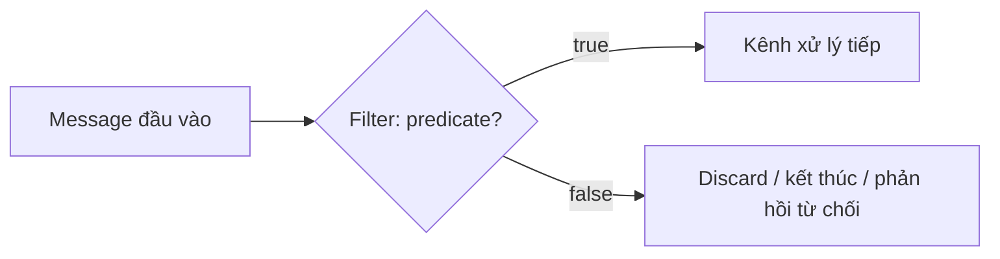
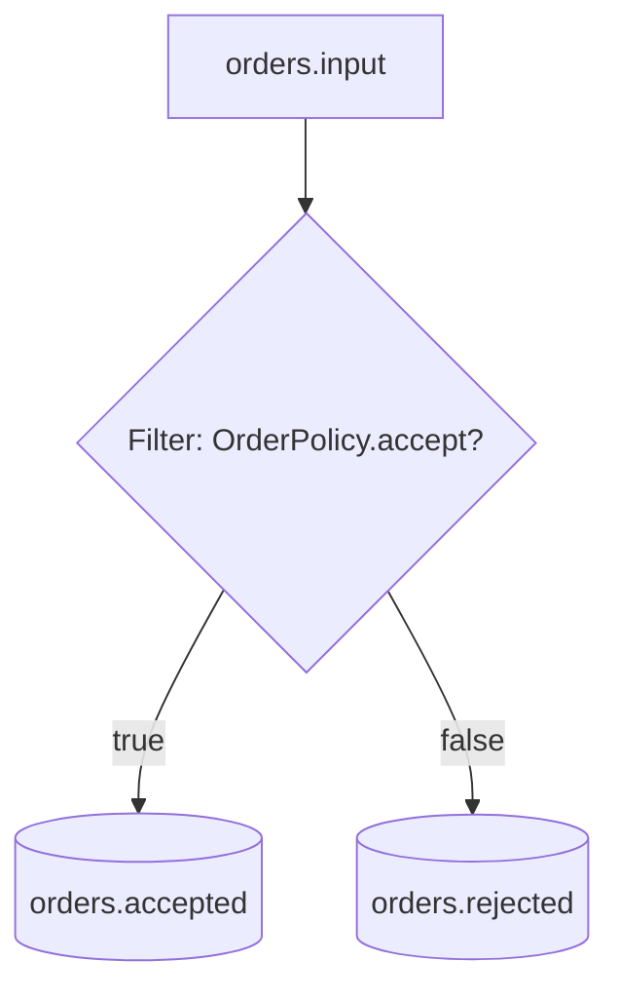
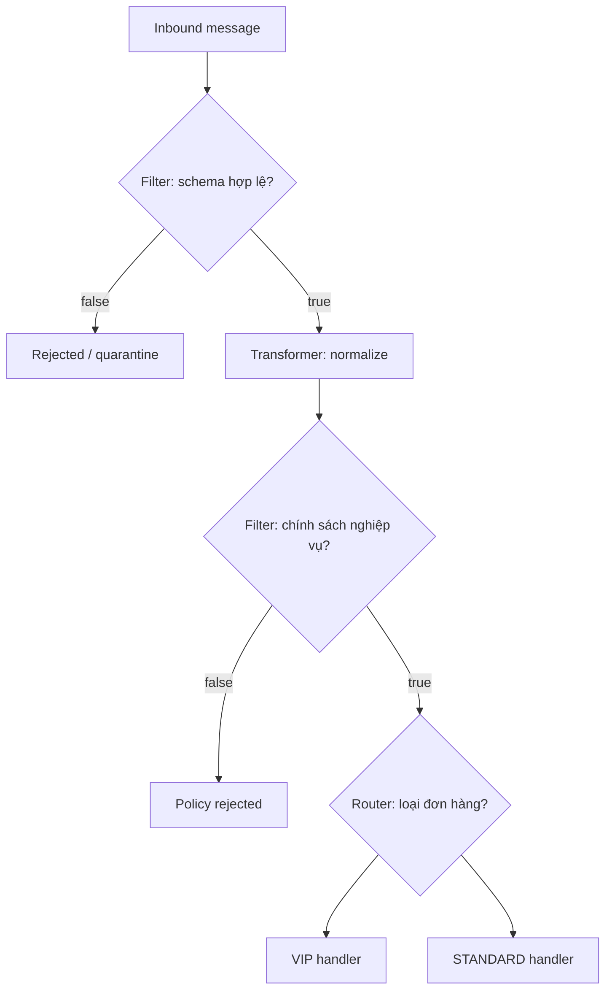
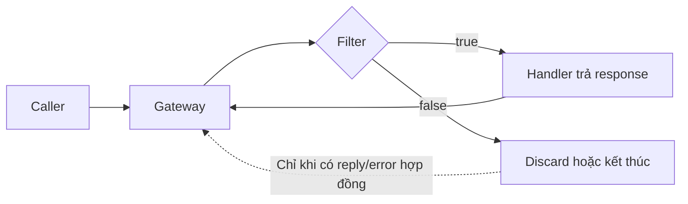

# Filter theo predicate trong Spring Integration

## Mục tiêu bài học

Một hệ thống tiếp nhận đơn hàng cần đưa những yêu cầu hợp lệ đến khâu xử lý và giữ các yêu cầu không đạt điều kiện lại để kiểm tra. Ví dụ: đơn phải có mã, số tiền dương, loại tiền được hỗ trợ và không thuộc danh sách cần chặn. Chúng ta có thể mô tả các điều kiện này bằng một **predicate**: hàm kiểm tra một message hoặc payload rồi trả về `true` hoặc `false`.

Trong **Spring Integration**, endpoint **Filter** áp dụng một predicate lên message để quyết định **cho message đi tiếp** hay **loại khỏi đường xử lý chính**. Đây là một Enterprise Integration Pattern khác với Transformer (biến đổi dữ liệu) và Router (chọn nơi gửi message).

Bài thuộc chương **Filter** trong module **SPRING_INTEGRATION_PATTERN**. Module hướng tới triển khai Enterprise Integration Patterns với Spring Integration để xây các luồng thông điệp ít phụ thuộc, dễ mở rộng, phối hợp Router, Filter, Transformer, Splitter, Aggregator, Gateway, retry, error channel, correlation và quan sát các nhánh xử lý.

Sau bài học, bạn có thể:

1. Giải thích hợp đồng `predicate(message) → boolean` và ý nghĩa của `true`, `false`.
2. Phân biệt **lọc bị từ chối theo quy tắc** với **lỗi trong quá trình đánh giá predicate**.
3. Viết Filter theo payload trong Spring Integration Java DSL và quản lý message bị loại qua `discardChannel`.
4. Hiểu tùy chọn `throwExceptionOnRejection`, sự khác biệt với `errorChannel` và tác động tới Gateway.
5. Kiểm thử luồng accept/reject bằng JUnit 5, AssertJ, `DirectChannel` và `QueueChannel`.
6. Thiết kế predicate dễ đọc, không có side effect, xử lý giá trị `null`/ranh giới và hoạt động ổn định khi retry.
7. Đánh giá tương tác giữa Filter, Router, Splitter/Aggregator, queue/broker, correlation và observability.

## 1. Predicate là gì?

Về bản chất, predicate là một hàm trả **boolean** để trả lời một câu hỏi kiểm tra.

```java
import java.util.function.Predicate;

Predicate<String> nonBlank =
    value -> value != null && !value.isBlank();

boolean a = nonBlank.test("ORD-42"); // true
boolean b = nonBlank.test("   ");    // false
```

Trong Java, `java.util.function.Predicate<T>` diễn tả phép kiểm tra kiểu `T`. Spring Integration cũng có các selector phù hợp với message/payload và biểu thức Spring Expression Language (SpEL); về mặt thiết kế, chúng đều nhằm đưa ra quyết định **cho qua hay không cho qua**.



Ví dụ:

```text
predicate = "đơn có mã, tiền > 0, currency được hỗ trợ,
             không bị chặn"

Order A: hợp lệ     -> true  -> xử lý tiếp
Order B: tiền = 0   -> false -> bị loại
Order C: bị chặn    -> false -> bị loại
```

**Điểm cần nhớ:** Filter thường **không sửa payload**. Nó quyết định liệu message có được chuyển tiếp hay không. Nếu cần vừa xác thực vừa thay cấu trúc, hãy tách bước kiểm tra và bước Transformer để các trách nhiệm có thể kiểm thử độc lập.

### Filter trong kiến trúc Pipes and Filters khác endpoint Filter

Tên pattern tổng quát *Pipes and Filters* xem mỗi bước xử lý là một “filter” theo nghĩa kiến trúc; một bước đó có thể là Transformer, Router hoặc Service Activator. Trong Spring Integration, **Message Filter** là endpoint cụ thể dùng để **chấp nhận/loại message** theo điều kiện. Không nên nhầm hai nghĩa này.

## 2. Ba kết quả: accept, reject và exception

Trước khi viết code, cần xác định **hợp đồng kết quả**.

| Kết quả | Predicate trả gì? | Ý nghĩa nghiệp vụ | Hành vi thường gặp |
| --- | --- | --- | --- |
| **Accept** | `true` | Message đủ điều kiện đi tiếp | Filter chuyển message tới bước kế |
| **Reject** | `false` | Message không đạt quy tắc đã định | Mặc định message không đi tiếp; có thể chuyển tới `discardChannel` |
| **Exception** | Không trả boolean, ném lỗi | Không đánh giá được điều kiện hoặc code/service lỗi | Lỗi được xử lý theo cơ chế exception/retry/error flow của endpoint |

Hai message đều không đến đích chính, nhưng **reject** và **exception** không phải một:

- `false` có thể là một quyết định nghiệp vụ bình thường: đơn không đủ điều kiện nhận ưu đãi.
- Exception có thể chỉ ra thiếu cấu hình, bug, dịch vụ kiểm tra bị timeout hoặc dữ liệu không có cấu trúc như mong đợi.
- `discardChannel` chỉ biểu đạt đường đi của message bị predicate **từ chối**, không tự đóng vai trò kênh chứa mọi exception.
- Nếu cố ý biến một reject thành exception qua `throwExceptionOnRejection`, đó là **chính sách khác** và phải được kiểm thử riêng.

### Không coi `send() == true` là bằng chứng message đã được accept

Một producer gửi message vào `DirectChannel` dẫn đến Filter có thể nhận kết quả `send()` thành công vì channel đã chuyển message tới handler, **ngay cả khi Filter quyết định loại nó**. Để chứng minh accept/reject, phải quan sát **channel đầu ra và discard** hoặc kết quả nghiệp vụ thực tế.

Đối với channel bất đồng bộ, một lần gửi thành công còn có thể chỉ là message đã được chấp nhận vào hàng đợi, chưa chắc Filter đã chạy.

## 3. Chọn điều kiện lọc có thể kiểm thử

Ví dụ hệ thống tiếp nhận đơn hàng:

```java
import java.math.BigDecimal;

public record OrderRequest(
    String orderId,
    BigDecimal amount,
    String currency,
    boolean blocked
) {}
```

Chính sách của **ví dụ học tập**:

1. `orderId` phải khác `null` và không blank.
2. `amount` phải tồn tại và **lớn hơn 0**.
3. `currency` chỉ nhận `VND` hoặc `USD` đã được chuẩn hóa.
4. `blocked` phải bằng `false`.

Các điều kiện này nhằm minh họa Boolean predicate; không đại diện cho quy trình xác minh thanh toán, danh sách cấm hoặc chống gian lận ngoài đời thật.

### Bảng quyết định

| `orderId` | `amount` | `currency` | `blocked` | Predicate |
| --- | ---: | --- | --- | --- |
| `ORD-1` | 150 | `VND` | false | **true** |
| `ORD-2` | 0 | `VND` | false | **false** |
| `ORD-3` | -20 | `USD` | false | **false** |
| `"  "` | 150 | `VND` | false | **false** |
| `ORD-4` | 150 | `EUR` | false | **false** |
| `ORD-5` | 150 | `VND` | true | **false** |
| `ORD-6` | null | `VND` | false | **false** |
| `ORD-7` | 150 | null | false | **false** |

Nếu sau này yêu cầu thêm kiểm tra tenant, giới hạn đơn hoặc risk score, hãy mở rộng **decision table** rồi bổ sung test cho các điều kiện chồng lấn. Không thay đổi predicate tùy tiện nếu chính sách reject ảnh hưởng đến doanh thu hoặc bảo mật.

### Lưu ý về dữ liệu đầu vào

- Kiểm tra `null` trước khi gọi phương thức của field: ví dụ `order.amount().signum()` sẽ lỗi nếu `amount` bằng `null`.
- `BigDecimal.signum() > 0` kiểm tra tính dương; không dùng so sánh số thực `double` cho dữ liệu tiền tệ.
- `Set.of("VND", "USD").contains(null)` có thể ném `NullPointerException`; kiểm tra `currency != null` trước.
- Nên chuẩn hóa `currency` tại ingress theo hợp đồng, thay vì âm thầm chấp nhận mọi biến thể như `" vnd "`.
- Một predicate trả `false` không giải thích **vì sao**. Nếu caller cần mã lỗi chính xác, cần một mô hình kết quả validation phong phú hơn.

## 4. Ví dụ Java DSL hoàn chỉnh: Filter và discard channel

Trong Spring Integration Java DSL, ta có thể dùng `filter(...)` để kết nối một predicate vào flow. Khi message không đạt điều kiện, sử dụng `discardChannel` để chuyển nó đến nhánh review thay vì làm biến mất khỏi luồng nghiệp vụ mà không có dấu vết.



Hai channel đích dùng `QueueChannel` để test chủ động lấy message. Trong hệ thống chạy thật, chúng cần consumer/poller hoặc adapter downstream.

### Cấu hình đầy đủ

```java
import java.math.BigDecimal;
import java.util.Set;

import org.springframework.context.annotation.Bean;
import org.springframework.context.annotation.Configuration;
import org.springframework.integration.channel.DirectChannel;
import org.springframework.integration.channel.QueueChannel;
import org.springframework.integration.config.EnableIntegration;
import org.springframework.integration.dsl.IntegrationFlow;
import org.springframework.messaging.MessageChannel;
import org.springframework.messaging.PollableChannel;

@Configuration
@EnableIntegration
public class OrderFilterConfig {

    public record OrderRequest(
        String orderId,
        BigDecimal amount,
        String currency,
        boolean blocked
    ) {}

    private static final Set<String> SUPPORTED =
        Set.of("VND", "USD");

    // Pure predicate: chỉ đọc đầu vào và trả boolean.
    static boolean accept(OrderRequest order) {
        return order.orderId() != null
            && !order.orderId().isBlank()
            && order.amount() != null
            && order.amount().signum() > 0
            && order.currency() != null
            && SUPPORTED.contains(order.currency())
            && !order.blocked();
    }

    @Bean("orders.input")
    MessageChannel orderInput() {
        return new DirectChannel();
    }

    @Bean("orders.accepted")
    PollableChannel accepted() {
        return new QueueChannel();
    }

    @Bean("orders.rejected")
    PollableChannel rejected() {
        return new QueueChannel();
    }

    @Bean
    IntegrationFlow orderFilterFlow() {
        return IntegrationFlow.from("orders.input")
            .filter(OrderRequest.class, OrderFilterConfig::accept,
                spec -> spec.discardChannel("orders.rejected"))
            .channel("orders.accepted")
            .get();
    }
}
```

Giải thích:

1. `IntegrationFlow.from("orders.input")` nhận message từ `DirectChannel`.
2. `filter(OrderRequest.class, OrderFilterConfig::accept, ...)` gọi predicate trên **payload** có kiểu `OrderRequest`.
3. Khi `accept(...)` trả `true`, **message gốc** đi tới `orders.accepted`.
4. Khi predicate trả `false`, Filter chuyển message tới `orders.rejected` và **không đi tiếp** tới `orders.accepted`.
5. Hai channel đầu ra là `PollableChannel` để các test gọi `receive()`; ví dụ chưa cấu hình handler chạy nền.

**Header propagation:** Filter cho qua hoặc discard message theo thiết kế, thay vì tạo payload mới. Vì vậy header như `traceId`, `tenantId` và `correlationId` có thể đi cùng message tới nhánh tương ứng. Nếu handler sau Filter tự dựng message mới hoặc chuyển qua adapter giao thức, cần kiểm tra chính sách giữ/map header tại bước ấy.

### Gửi message từ producer

```java
import java.math.BigDecimal;

import org.springframework.messaging.Message;
import org.springframework.messaging.support.MessageBuilder;

Message<OrderFilterConfig.OrderRequest> request =
    MessageBuilder.withPayload(
            new OrderFilterConfig.OrderRequest(
                "ORD-42", new BigDecimal("150"), "VND", false))
        .setHeader("traceId", "trace-42")
        .setHeader("tenantId", "tenant-a")
        .build();

// input là bean MessageChannel tên "orders.input".
input.send(request);
```

Message này đi vào `orders.accepted`. Nếu đổi `amount` thành `BigDecimal.ZERO` hoặc `blocked` thành `true`, message sẽ đi vào `orders.rejected` theo hợp đồng của ví dụ.

### Vì sao đây là Filter, không phải Router?

Cấu hình dùng một predicate **Boolean** để phân biệt message được đi tiếp với message bị loại. Dù có `discardChannel`, nó vẫn là Filter: channel reject là **đường xử lý message bị loại**, không phải phép chọn tùy ý trong nhiều tuyến nghiệp vụ.

Nếu yêu cầu là “VIP đi nhánh 1, STANDARD đi nhánh 2, FRAUD đi nhánh 3”, hãy dùng Router có route key rõ ràng. Filter có thể đứng **trước** Router để loại dữ liệu không hợp lệ.

## 5. Kiểm thử tích hợp: true, false và giữ header

Test cần kiểm tra cả **message được nhận tại đích đúng** và **không xuất hiện ở đích sai**. Kiểm thử chỉ gọi `OrderFilterConfig.accept` là cần thiết nhưng chưa đủ để xác minh DSL được nối đúng.

```java
import static org.assertj.core.api.Assertions.assertThat;

import java.math.BigDecimal;

import org.junit.jupiter.api.Test;
import org.springframework.beans.factory.annotation.Autowired;
import org.springframework.beans.factory.annotation.Qualifier;
import org.springframework.messaging.Message;
import org.springframework.messaging.MessageChannel;
import org.springframework.messaging.PollableChannel;
import org.springframework.messaging.support.MessageBuilder;
import org.springframework.test.context.junit.jupiter.SpringJUnitConfig;

@SpringJUnitConfig(OrderFilterConfig.class)
class OrderFilterFlowTest {

    @Autowired
    @Qualifier("orders.input")
    MessageChannel input;

    @Autowired
    @Qualifier("orders.accepted")
    PollableChannel accepted;

    @Autowired
    @Qualifier("orders.rejected")
    PollableChannel rejected;

    private void send(
        String orderId,
        String amount,
        String currency,
        boolean blocked
    ) {
        var request = new OrderFilterConfig.OrderRequest(
            orderId,
            amount == null ? null : new BigDecimal(amount),
            currency,
            blocked
        );

        Message<?> message = MessageBuilder.withPayload(request)
            .setHeader("traceId", "trace-test")
            .setHeader("tenantId", "tenant-a")
            .build();

        assertThat(input.send(message)).isTrue();
    }

    @Test
    void acceptedOrderPassesFilterAndKeepsHeaders() {
        send("ORD-42", "150", "VND", false);

        Message<?> result = accepted.receive(2_000);
        assertThat(result).isNotNull();

        var order =
            (OrderFilterConfig.OrderRequest) result.getPayload();

        assertThat(order.orderId()).isEqualTo("ORD-42");
        assertThat(result.getHeaders().get("traceId"))
            .isEqualTo("trace-test");
        assertThat(result.getHeaders().get("tenantId"))
            .isEqualTo("tenant-a");

        assertThat(rejected.receive(0)).isNull();
    }

    @Test
    void nonPositiveAmountIsDiscardedToReviewChannel() {
        send("ORD-ZERO", "0", "VND", false);

        Message<?> result = rejected.receive(2_000);
        assertThat(result).isNotNull();
        assertThat(result.getPayload())
            .isInstanceOf(OrderFilterConfig.OrderRequest.class);
        assertThat(result.getHeaders().get("traceId"))
            .isEqualTo("trace-test");

        assertThat(accepted.receive(0)).isNull();
    }

    @Test
    void blockedOrderDoesNotReachAcceptedChannel() {
        send("ORD-BLOCKED", "100", "USD", true);

        Message<?> result = rejected.receive(2_000);
        assertThat(result).isNotNull();
        assertThat(accepted.receive(0)).isNull();
    }

    @Test
    void missingAmountOrUnsupportedCurrencyIsRejected() {
        send("ORD-NO-AMOUNT", null, "VND", false);
        send("ORD-EUR", "100", "EUR", false);

        Message<?> first = rejected.receive(2_000);
        Message<?> second = rejected.receive(2_000);

        assertThat(first).isNotNull();
        assertThat(second).isNotNull();
        assertThat(rejected.receive(0)).isNull();
        assertThat(accepted.receive(0)).isNull();
    }
}
```

Ví dụ dùng JUnit 5, AssertJ, Spring Test và Spring Integration. Test giả định các queue chỉ thuộc context test này, **không có consumer nền**. Trong tình huống chạy test song song trên cùng context, cần cách ly/đặt lại trạng thái queue để không làm các assertion ảnh hưởng lẫn nhau.

Vì đầu vào là `DirectChannel` và filter xử lý đồng bộ trước khi enqueue kết quả, `receive(0)` có ý nghĩa trong thử nghiệm này. Khi dùng executor hoặc broker, **không thể kết luận nhánh kia vĩnh viễn không nhận message chỉ từ một lần `receive(0)` tức thời**; cần chờ/quan sát theo thời hạn.

### Kiểm thử trực tiếp predicate

Một test thuần không cần Spring context:

```java
import static org.assertj.core.api.Assertions.assertThat;

import java.math.BigDecimal;

import org.junit.jupiter.api.Test;

class OrderPolicyTest {

    @Test
    void onlyValidUnblockedOrdersAreAccepted() {
        var valid = new OrderFilterConfig.OrderRequest(
            "ORD-1", new BigDecimal("0.01"), "VND", false);

        var blocked = new OrderFilterConfig.OrderRequest(
            "ORD-2", new BigDecimal("100"), "VND", true);

        var missingCurrency = new OrderFilterConfig.OrderRequest(
            "ORD-3", new BigDecimal("100"), null, false);

        assertThat(OrderFilterConfig.accept(valid)).isTrue();
        assertThat(OrderFilterConfig.accept(blocked)).isFalse();
        assertThat(OrderFilterConfig.accept(missingCurrency)).isFalse();
    }
}
```

Unit test kiểm tra **điều kiện nghiệp vụ**; integration test kiểm tra **đường đi message**. Nên có cả hai khi Filter ảnh hưởng tới xử lý đơn hàng hoặc bảo mật.

## 6. Viết predicate rõ ràng, an toàn và không có side effect

Một predicate tốt là **hàm kiểm tra**, không phải handler làm nhiều việc.

```java
// Tốt: đọc dữ liệu, trả một kết quả xác định.
static boolean hasValidAmount(OrderFilterConfig.OrderRequest order) {
    return order.amount() != null
        && order.amount().signum() > 0;
}
```

Ngược lại, không nên nhét side effect vào predicate:

```java
// Thiết kế không nên áp dụng:
static boolean badPredicate(OrderFilterConfig.OrderRequest order) {
    paymentService.charge(order);   // Side effect trước khi quyết định.
    return order.amount().signum() > 0;
}
```

Đoạn `badPredicate` là **phản ví dụ**, phụ thuộc dịch vụ do ứng dụng định nghĩa và không nên sử dụng trong hệ thống thật.

Nếu Filter bị gọi lại do retry/redelivery, một side effect bên trong predicate có thể xảy ra nhiều lần, dù message cuối cùng bị reject. Hãy chuyển những thao tác ghi DB, gọi HTTP hoặc thanh toán sang handler nghiệp vụ **sau** bước Filter và áp dụng idempotency tại nơi side effect.

### Short-circuit trong Java

Hàm `accept` dùng toán tử `&&`. Java đánh giá từ trái sang phải và **dừng ngay khi một điều kiện sai**:

```java
order.amount() != null
    && order.amount().signum() > 0
```

Nhờ vậy, không gọi `signum()` trên giá trị `null`. Đổi thứ tự hai vế có thể gây `NullPointerException` và biến một reject bình thường thành exception.

### Ghép điều kiện với AND/OR/NOT

```java
import java.util.function.Predicate;

Predicate<OrderFilterConfig.OrderRequest> positiveAmount =
    o -> o.amount() != null && o.amount().signum() > 0;

Predicate<OrderFilterConfig.OrderRequest> notBlocked =
    o -> !o.blocked();

Predicate<OrderFilterConfig.OrderRequest> acceptPayment =
    positiveAmount.and(notBlocked);

// Ví dụ điều kiện OR cho phân loại riêng:
Predicate<OrderFilterConfig.OrderRequest> needsReview =
    notBlocked.negate()
        .or(o -> o.currency() == null);
```

`Predicate.and` và `Predicate.or` cũng có short-circuit. Dù phép ghép này ngắn gọn, khi chính sách có nhiều trường hợp, nên tách thành method mang tên nghiệp vụ thay vì một lambda dài khó đọc.

### Determinism qua retry

Một predicate dùng ngưỡng hoặc danh sách tenant đọc từ DB tại mỗi lần đánh giá có thể cho kết quả khác nhau khi retry cùng message. Nếu quyết định cần tái hiện được, hãy xác định rõ:

- Chính sách lấy theo thời điểm tiếp nhận hay thời điểm xử lý?
- Có cần lưu `policyVersion`/`validationVersion`?
- Cùng message retry có được thay đổi quyết định hay phải giữ nguyên?
- Kết quả reject đã từng được ghi nhận có được replay sau khi policy đổi không?

Với dữ liệu đầu vào giống nhau và chính sách không đổi, predicate nên cho cùng một kết quả. Có thể quản lý policy bằng snapshot bất biến nếu hệ thống thường xuyên thay đổi quy tắc runtime.

## 7. Filter theo payload hay theo toàn bộ Message?

Trong DSL, việc chọn `OrderRequest.class` minh họa **predicate chỉ xét payload**. Nhưng đôi khi điều kiện nằm ở header:

```text
payload = OrderRequest(...)
headers.tenantId = "tenant-a"
headers.source = "partner-api"
```

Khi đó bạn cần một **MessageSelector** xét cả envelope thay vì chỉ payload.

### Khác nhau về phạm vi dữ liệu

| Kiểu kiểm tra | Có thể đọc | Ví dụ |
| --- | --- | --- |
| Predicate theo payload | Các field của `OrderRequest` | `amount > 0`, `blocked == false` |
| Selector theo Message | `payload` và `headers` | `tenantId` thuộc allowlist hoặc `source` được xác thực |
| Filter dựa trên SpEL | Thuộc tính message trong expression context | `headers['tenantId']`, `payload.amount` (tùy model) |

Một selector minh họa độc lập:

```java
import org.springframework.integration.core.MessageSelector;

MessageSelector allowedTenant = message ->
    "tenant-a".equals(message.getHeaders().get("tenantId"));
```

`MessageSelector` nhận `Message<?>` để xét cả payload/headers. Khi nối selector vào DSL hoặc bean `MessageFilter`, chọn overload phù hợp với phiên bản thư viện đang dùng; tránh dùng nhầm overload predicate **chỉ nhận payload** rồi tưởng tham số lambda là toàn bộ message.

### Header từ client không phải sự thật đáng tin

Nếu header `tenantId` hoặc `role` quyết định chấp nhận message, không thể chỉ kiểm tra chuỗi do client cung cấp. Cần lấy thông tin định danh từ lớp ingress đã xác thực và so với dữ liệu được phép. Filter chỉ là **một tầng thực thi quy tắc**; nó không tự xác thực JWT, chữ ký hoặc phân quyền.

Nếu message đi qua HTTP/Kafka/AMQP/JMS adapter, kiểm tra header mapper và các kiểu dữ liệu được hỗ trợ. Một header có ở producer chưa chắc đến consumer với cùng kiểu hoặc cùng độ tin cậy.

## 8. Xử lý message bị loại: drop, discard channel hoặc exception

Một Filter không nhất thiết phải báo lỗi khi predicate trả `false`. Hãy chọn hành vi dựa trên hợp đồng.

### Phương án A — Kết thúc luồng khi false

```java
@Bean
IntegrationFlow quietFilter() {
    return IntegrationFlow.from("quiet.input")
        .filter(String.class, text -> !text.isBlank())
        .channel("quiet.accepted")
        .get();
}
```

Đây là **trích đoạn** giả định hai channel đã được khai báo. Khi `false` và không có discard channel, message bị loại khỏi đường tiếp theo theo cơ chế Filter mặc định.

Phù hợp khi message không quan trọng (ví dụ sự kiện trùng đã xử lý và có thống kê khác), nhưng cần cân nhắc quan sát để không âm thầm bỏ message nghiệp vụ quan trọng.

### Phương án B — Chuyển tới discard channel

```java
@Bean
IntegrationFlow reviewableFilter() {
    return IntegrationFlow.from("review.input")
        .filter(String.class, text -> !text.isBlank(),
            spec -> spec.discardChannel("review.rejected"))
        .channel("review.accepted")
        .get();
}
```

Đây cũng là **trích đoạn** cần khai báo channel. Message false được chuyển sang `review.rejected` để xử lý riêng. Trong bài này, `OrderFilterConfig` dùng chính phương án này.

**Cần nhớ:** `discardChannel` nhận **message bị loại**, thường vẫn mang payload/header ban đầu; nó không tự tạo `reasonCode` hay danh sách lỗi validation. Nếu muốn biết vì sao reject, bạn phải định nghĩa kết quả nghiệp vụ hoặc bước phân loại lý do riêng.

### Phương án C — Ném exception khi bị reject

```java
@Bean
IntegrationFlow strictFilter() {
    return IntegrationFlow.from("strict.input")
        .filter(String.class, text -> !text.isBlank(),
            spec -> spec.throwExceptionOnRejection(true))
        .channel("strict.accepted")
        .get();
}
```

Đây là ví dụ **thay thế** cho cấu hình discard, không ghép cả hai mà chưa quyết định rõ chính sách. Khi predicate trả `false`, Filter được cấu hình ném lỗi từ chối (`MessageRejectedException` trong Spring Integration).

Phù hợp khi hợp đồng coi một message không đạt điều kiện là lỗi phải báo cho caller hoặc error flow. Tuy nhiên, không nên biến mọi reject thông thường thành exception nếu hệ thống có throughput cao hoặc client cần mã lỗi nghiệp vụ chi tiết.

### Ba hành vi khác nhau

| Cấu hình | Khi false | Hệ quả đối với caller |
| --- | --- | --- |
| Không discard, không throw | Không chuyển tiếp | Với request-reply có thể không có reply |
| `discardChannel("...")` | Gửi tới channel xử lý reject | Chỉ có reply nếu nhánh reject chủ động tạo reply |
| `throwExceptionOnRejection(true)` | Phát sinh exception từ Filter | Caller/error flow xử lý tùy channel và endpoint |

**Không nhầm discard channel với error channel.** Reject là quyết định theo predicate; exception có thể xảy ra trong predicate, khi gửi message hoặc ở handler phía sau.

## 9. Trả lý do reject thay vì Boolean đơn giản

Một predicate thuần `true/false` phù hợp khi chỉ cần “cho qua/loại”. Khi hệ thống cần trả lỗi như `INVALID_AMOUNT` hay `UNSUPPORTED_CURRENCY`, nên định nghĩa hàm validation riêng trả **kết quả có lý do**, rồi dùng kết quả đó theo hợp đồng.

### Ví dụ kết quả validation

```java
import java.util.Objects;

record ValidationResult(boolean accepted, String reasonCode) {
    static ValidationResult pass() {
        return new ValidationResult(true, null);
    }

    static ValidationResult reject(String reason) {
        return new ValidationResult(false, Objects.requireNonNull(reason));
    }
}
```

Với một DTO đơn hàng, logic có thể viết:

```java
ValidationResult validate(OrderFilterConfig.OrderRequest order) {
    if (order.orderId() == null || order.orderId().isBlank()) {
        return ValidationResult.reject("MISSING_ORDER_ID");
    }
    if (order.amount() == null || order.amount().signum() <= 0) {
        return ValidationResult.reject("INVALID_AMOUNT");
    }
    if (order.currency() == null ||
        !java.util.Set.of("VND", "USD").contains(order.currency())) {
        return ValidationResult.reject("UNSUPPORTED_CURRENCY");
    }
    if (order.blocked()) {
        return ValidationResult.reject("ORDER_BLOCKED");
    }
    return ValidationResult.pass();
}
```

Đoạn trên là **mẫu hàm riêng**, không phải cú pháp dùng trực tiếp làm `filter` (vì Filter chờ boolean). Để tránh đánh giá validation hai lần, có thể đặt **Transformer/Service Activator tạo `ValidationResult` cùng dữ liệu gốc** trước bước tách nhánh, hoặc dùng một Router trả key `ACCEPTED`/`REJECTED` dựa trên outcome đã tính.

Nếu dùng discard channel rồi mới tính reason ở nhánh reject, phải đảm bảo validation vẫn dùng cùng policy version; nếu policy thay đổi giữa hai bước, reason có thể không còn khớp quyết định ban đầu.

### Khi nào dùng Router thay vì Filter?

- Chỉ cần chặn/cho qua theo một điều kiện → **Filter**.
- Cần phân loại nhiều loại lỗi với mỗi loại một tuyến riêng → **Router** hoặc validation result + Router.
- Cần chỉnh payload thành DTO chuẩn trước xử lý → **Transformer**.
- Cần hỏi hệ thống bên ngoài rồi ghi state → Service Activator/Handler được thiết kế rõ; cân nhắc caching và retry.

## 10. Filter đặt trước hoặc sau Transformer và Router

Một flow thường có nhiều bước:



Hai Filter có mục đích khác nhau:

1. Filter trước Transformer xác nhận có đủ dữ liệu tối thiểu để transform an toàn.
2. Transformer tạo payload chuẩn hóa.
3. Filter sau Transformer kiểm tra chính sách trên dữ liệu đã chuẩn hóa.
4. Router chọn một nhánh nghiệp vụ trong những message được accept.

**Thứ tự bước quan trọng:** nếu Transformer cần gọi `order.amount()` mà Filter chưa kiểm tra `amount != null`, lỗi có thể xảy ra trước khi Filter nghiệp vụ chạy. Nhưng cũng không nên đặt một predicate kiểm tra thông tin chưa được chuẩn hóa nếu điều đó làm reject nhầm message hợp lệ.

### Filter và Recipient List / Publish-Subscribe

Nếu một event được fan-out đến Audit, Notification và Metrics, có thể đặt Filter **trong từng nhánh** để quyết định subscriber xử lý loại event nào. Filter ở nhánh Notification không tự loại event khỏi Audit.

Ngược lại, Filter **trước** bước publish-subscribe có thể chặn toàn bộ event trước khi các subscriber nhận. Đây là quyết định về topology; phải thể hiện bằng sơ đồ và test.

## 11. Filter sau Splitter: cẩn thận với Aggregator

Một lỗi thường gặp khi kết hợp patterns:

```text
Batch có 3 dòng hàng
          |
          v
       Splitter
    +----+----+
    |    |    |
   #1   #2   #3
    |    |    |
   pass drop pass
    |         |
    +----+----+
         v
     Aggregator
```

Giả sử Splitter tạo ba message và đặt:

```text
correlationId = batch-42
sequenceNumber = 1, 2, 3
sequenceSize = 3
```

Filter loại phần #2. Nếu Aggregator có release strategy đợi đủ ba phần theo `sequenceSize`, nó chỉ nhận hai message nên có thể **chờ mãi**, hoặc tới timeout tùy cấu hình message group.

### Ba chiến lược giải quyết

| Chiến lược | Khi phù hợp | Lưu ý |
| --- | --- | --- |
| **Lọc trước khi split** | Có thể loại phần tử ngay trong collection mà không mất ý nghĩa batch | `sequenceSize` phải phản ánh số phần sau khi lọc |
| **Phát kết quả `SKIPPED` cho phần bị loại** | Cần biết toàn bộ phần đã xử lý/loại | Kết quả phải mang correlation/sequence thích hợp để Aggregator đếm đúng |
| **Custom release strategy + timeout** | Cho phép kết quả thiếu hoặc cần chính sách partial | Định nghĩa dữ liệu nhóm, expire và late arrival rõ ràng |

Không sửa `sequenceSize` riêng lẻ tại một nhánh để “làm cho đủ”: khi nhiều phần xử lý đồng thời, thông tin về số phần kỳ vọng phải nhất quán trong toàn nhóm.

**Kết quả reject trong batch không đồng nghĩa lỗi hạ tầng.** Nếu một dòng hàng không đủ điều kiện, bạn có thể tạo `PartResult(status=REJECTED)` để Aggregator đưa ra `BatchResult(PARTIAL)` thay vì khiến batch chờ vô hạn.

## 12. Filter với Gateway: reject có cần reply không?

Gateway thường đại diện request-reply. Caller mong đợi một response hoặc exception trong thời hạn đã thống nhất.



Ba tình huống:

- **Silent drop:** Filter loại message và không phát reply → Gateway có thể chờ tới `replyTimeout`.
- **Discard flow có reply:** nhánh reject biến thông điệp thành kết quả `REJECTED` → Gateway có thể nhận phản hồi nếu đường reply được cấu hình.
- **Throw on rejection:** Filter ném exception → caller hoặc cơ chế error handling xử lý theo loại channel và bối cảnh đồng bộ/bất đồng bộ.

Ví dụ DTO từ chối do ứng dụng định nghĩa:

```java
public record OrderResponse(
    String orderId,
    String status,
    String reasonCode
) {}
```

`OrderResponse("ORD-42", "REJECTED", "INVALID_AMOUNT")` là dữ liệu nghiệp vụ **do handler tạo**, không phải kết quả Filter tự động sinh.

Một Gateway có thể làm lộ lỗi kỹ thuật nếu bạn trả nguyên exception. Nên chuyển lỗi sang mã hợp đồng thích hợp ở boundary, không để thông tin nhạy cảm rò ra ngoài.

## 13. Filter, retry và error channel

### Predicate trả false: thường không cần retry

Nếu một đơn có amount bằng 0 và chính sách đòi amount dương, retry cùng payload và cùng policy chỉ khiến Filter trả `false` lần nữa. Retry vô hạn không cải thiện điều kiện.

Thay vào đó:

- Đưa message vào reject channel để review khi cần.
- Trả lý do từ chối để caller sửa request.
- Chỉ replay sau khi dữ liệu/policy đã thay đổi có chủ đích.
- Dùng `orderId`, `eventId` hoặc `requestId` làm khóa idempotency nếu replay.

### Predicate ném exception: có thể cần retry có kiểm soát

Nếu predicate gọi một dịch vụ bên ngoài đang timeout, exception có thể do lỗi tạm thời. Tuy nhiên, thiết kế tốt hơn thường là **không thực hiện I/O trong predicate**: lấy dữ kiện trước, dùng cache/snapshot hoặc một endpoint riêng có retry và timeout, rồi lọc bằng predicate thuần.

Điều này giúp phân biệt:

```text
Validation data unavailable -> lỗi kỹ thuật / retry / error flow
Validation data available, rule = false -> reject nghiệp vụ
```

### Error channel khác discard channel

| Kênh | Nhận gì? | Điều nên thiết kế |
| --- | --- | --- |
| `discardChannel` | Message có predicate trả false | Review/skip/rejected response |
| `errorChannel` | ErrorMessage từ các thành phần có cơ chế phát lỗi | Phân loại exception, retry, cảnh báo, dead-letter |
| `defaultOutputChannel` của Router | Message không xác định được route đích | Quarantine hoặc xử lý route không hỗ trợ |

Trong luồng đồng bộ dùng `DirectChannel`, exception có thể truyền ngược tới caller. Trong luồng poller/executor/broker, lỗi có thể được đưa tới error flow tùy cấu hình endpoint và adapter. Không giả định mọi exception tự động đến một channel tên `errorChannel` mà không kiểm tra cơ chế lỗi của điểm phát sinh.

### Tránh side effect và xử lý trùng

Với một message `OrderRequest`, Filter có thể được gọi lại khi consumer retry. Nếu chỉ trả boolean, việc đánh giá lại nhìn chung ít rủi ro hơn. Nếu predicate dùng I/O hoặc cập nhật state, tác động lặp có thể gây sai dữ liệu.

**Idempotency cần đặt tại những thao tác có side effect**, và nếu một reject được replay thì phải truy vết lý do, thời điểm, phiên bản chính sách.

## 14. Kênh đồng bộ, queue và đặc tính vận hành

Cùng một Filter có thể được dùng trong những luồng khác nhau:

| Topology | Khi Filter chạy | Điều cần chú ý |
| --- | --- | --- |
| `DirectChannel → Filter` | Thường đồng bộ trong caller thread | Exception có thể trở về producer; predicate chậm làm tăng latency |
| `QueueChannel → poller → Filter` | Khi consumer lấy message từ queue | Queue có thể backlog; reject xảy ra sau thời điểm producer enqueue |
| `ExecutorChannel → Filter` | Trên worker executor | Cần giữ context tracing qua thread; thứ tự hoàn thành có thể thay đổi |
| Broker adapter → Filter | Sau khi inbound adapter nhận/deliver message | Ack, redelivery và retry phụ thuộc broker/adapter |

**Filter không tự biến luồng thành bất đồng bộ.** Tính đồng bộ, ordering và backpressure do channel/consumer quyết định.

### Backpressure

Nếu predicate tốn CPU hoặc chờ I/O, message có thể dồn ở channel/queue trước Filter. Theo dõi:

- Độ trễ từ ingress đến khi Filter bắt đầu.
- Thời gian đánh giá predicate.
- Số message accepted, rejected và exception.
- Queue depth và độ tuổi message đang chờ.
- Tỷ lệ reject tăng bất thường sau thay đổi policy.

Một Filter “rất đơn giản” có thể trở thành bottleneck nếu predicate làm quá nhiều việc trên đường nóng hoặc bị gọi với payload khổng lồ.

### Ordering

Với nhiều worker, message đến trước có thể được đánh giá xong sau message đến muộn. Nếu cần xử lý theo thứ tự `orderId`/`tenantId`, phải bổ sung chiến lược ordering phù hợp, không chỉ phụ thuộc sự có mặt của Filter.

## 15. Quan sát kết quả và chẩn đoán

Một hệ thống nên biết **tại sao message bị loại** và tỷ lệ thay đổi ra sao. Tuy nhiên, Filter trả boolean không tự sinh mã lý do. Ứng dụng phải chọn nơi và cách ghi lý do.

### Metric minh họa

| Metric | Ý nghĩa |
| --- | --- |
| `filter_received_total{filter}` | Bao nhiêu message được đưa tới Filter |
| `filter_accepted_total{filter}` | Bao nhiêu message vượt qua |
| `filter_rejected_total{filter}` | Bao nhiêu message bị loại theo predicate |
| `filter_exception_total{filter,type}` | Bao nhiêu lần predicate/endpoint gặp lỗi |
| `filter_evaluation_duration{filter}` | Thời gian đánh giá |
| `filter_rejected_total{reason}` | Phân loại lý do nếu ứng dụng có ValidationResult |
| `filter_discard_queue_depth` | Số message chờ ở kênh discard |
| `filter_replay_total` | Số message đã replay sau sửa dữ liệu/policy |

Đây là **những tên metric ứng dụng có thể tự đặt**, không khẳng định Spring Integration mặc định xuất toàn bộ metric theo đúng tên trên. Có thể tích hợp Micrometer, Spring Integration observation/management và structured logging.

### Log hữu ích

```text
traceId=trace-42 orderId=ORD-42 filter=orderPolicy
decision=REJECTED reason=INVALID_AMOUNT policyVersion=v3

traceId=trace-43 orderId=ORD-43 filter=orderPolicy
decision=ACCEPTED policyVersion=v3
```

`reason` và `policyVersion` là metadata ứng dụng cần tạo nếu muốn ghi nhận; không do MessageFilter tự thêm vào mọi message. Hạn chế log payload/header nhạy cảm, token hoặc thông tin thanh toán. Nếu dùng `orderId` làm nhãn metric, cardinality có thể rất lớn; nên dành ID cá biệt cho log/trace hoặc kho truy vấn.

### Bảng xử lý sự cố

| Triệu chứng | Nguyên nhân cần kiểm tra | Hướng khắc phục |
| --- | --- | --- |
| Message không tới đích chính | Predicate trả false, Filter chưa chạy, channel đích không có consumer | Kiểm tra output/discard, queue và log quyết định |
| `send()` trả true nhưng không thấy result | Gửi thành công vào Filter/queue nhưng message bị reject hoặc chưa xử lý | Quan sát trạng thái sau Filter thay vì chỉ kết quả send |
| Một reject bị chuyển thành exception | Predicate gọi vào null, parse lỗi hoặc cấu hình `throwExceptionOnRejection` | Phân biệt dữ liệu sai và lỗi hệ thống |
| Header trace biến mất | Handler/Transformer sau Filter dựng message mới hoặc adapter không map header | Xác định header propagation tại boundary |
| Gateway timeout với request bị loại | Silent drop hoặc discard flow không reply | Trả response REJECTED/error contract |
| Aggregator chờ mãi | Filter loại một phần sau Splitter | Phát SKIPPED, lọc trước split hoặc custom release |
| Filter chạy chậm | Predicate gọi DB/network, regex phức tạp, dữ liệu quá lớn | Tách I/O, cache snapshot, tối ưu và đo duration |
| Replay cùng message cho kết quả khác | Policy thay đổi giữa các lần | Ghi policy version và chọn semantics retry rõ |
| Reject tăng mạnh sau deploy | Quy tắc mới quá chặt, normalize sai, thiếu trường | Đối chiếu decision table và test regression |
| Discard queue đầy | Không có consumer, thiếu capacity/storage | Thêm poller/handler, retention và cảnh báo |

## 16. Các bài tập thực hành

### Bài 1 — Predicate với dữ liệu biên

Từ `OrderFilterConfig`, viết unit test cho các giá trị: `amount=0`, `-1`, `0.01`, `null`; `currency="VND"`, `"USD"`, `"EUR"`, `null`; `orderId="  "`. Mỗi case phải có kết quả true/false đúng decision table.

### Bài 2 — Discard channel

Gửi năm đơn, trong đó ba đơn hợp lệ và hai đơn bị chặn. Kiểm tra `orders.accepted` nhận ba message và `orders.rejected` nhận hai. Đối chiếu header `traceId` và payload gốc trên từng nhánh.

### Bài 3 — Exception thay cho discard

Tạo một **flow test độc lập** dùng `throwExceptionOnRejection(true)` thay `discardChannel`. Gửi message không hợp lệ, assert exception phù hợp. So sánh với silent drop và discard flow khi ứng dụng dùng Gateway.

### Bài 4 — Header selector và bảo mật

Thêm điều kiện `tenantId` thuộc danh sách tenant được phép. Kiểm tra case thiếu header, sai kiểu hoặc header do client tự khai. Giải thích vì sao kiểm tra một chuỗi chưa thay thế xác thực/ủy quyền tại ingress.

### Bài 5 — Lý do từ chối chi tiết

Tạo `ValidationResult(accepted, reasonCode)` cho các điều kiện: thiếu mã đơn, số tiền không hợp lệ, currency không hỗ trợ, đơn bị chặn. Không đánh giá policy hai lần nếu có thể; xây đường trả reply `OrderResponse(REJECTED, reason)`.

### Bài 6 — Filter trước Router

Tạo flow: Validate Filter → Transformer chuẩn hóa → Router chia `VIP`/`STANDARD`. Kiểm tra đơn không hợp lệ không đi vào bất cứ nhánh nghiệp vụ nào; đơn hợp lệ vẫn được route đúng.

### Bài 7 — Filter sau Splitter

Chia một batch thành bốn dòng, Filter loại một dòng. Dùng Aggregator đợi đủ bốn kết quả và quan sát tình huống chờ thiếu phần. Thiết kế kết quả `SKIPPED` hoặc release strategy có timeout và kiểm thử correlation.

### Bài 8 — Quan sát và retry

Đếm accepted/rejected/exception, thời gian đánh giá và độ sâu queue discard. Cố tình thay policy từ v1 sang v2 rồi replay một message từng bị reject; ghi rõ ai cho phép replay và cách chống xử lý trùng.

## 17. Checklist trước khi triển khai

1. Predicate của Filter đang nhận **payload** hay toàn bộ **Message**? Có dùng đúng overload?
2. Rule đã được mô tả bằng decision table và kiểm thử các giá trị **null, biên, sai kiểu** chưa?
3. `true` nghĩa là được đi tiếp, `false` nghĩa là reject — mọi thành viên hiểu thống nhất?
4. Khi `false`, nghiệp vụ chọn **silent drop, discard channel hay exception**?
5. Nếu dùng Gateway, mọi đường request hợp lệ có reply/error hợp đồng không?
6. Predicate có **thuần, đơn giản, nhanh và không có side effect** không?
7. Nếu phụ thuộc policy runtime, đã quyết định semantics retry và policy version?
8. Dữ liệu/header từ bên ngoài đã được xác thực và chuẩn hóa ở ranh giới tin cậy?
9. Discard queue có consumer, capacity, retention và cảnh báo tồn đọng?
10. Khi Filter nằm sau Splitter, Aggregator đã xử lý phần bị loại đúng chưa?
11. Có test cả **accept, reject, exception, header propagation và nhánh sai**?
12. Có tách **lỗi đánh giá** khỏi **reject theo nghiệp vụ** trong log và metric?
13. Channel có thread/executor/queue/broker thì đã hiểu ordering, timeout và backpressure?
14. Nếu replay message bị reject, có khóa idempotency và quyền replay?
15. Predicate được đặt trước/sau Transformer và Router đúng thứ tự nghiệp vụ?

### Ghi nhớ

**Filter theo predicate là công cụ đơn giản nhưng có vai trò quan trọng để bảo vệ đường xử lý chính:** kiểm tra một điều kiện Boolean và chỉ cho message phù hợp đi tiếp. Trong Spring Integration, `filter(...)` có thể kiểm tra payload hoặc message; `discardChannel` giúp xử lý các message bị từ chối, còn `throwExceptionOnRejection` phục vụ hợp đồng coi reject là lỗi.

Điểm quyết định chất lượng không chỉ ở một câu lệnh `return true/false`, mà là **quy tắc rõ ràng, không side effect, trường hợp biên được kiểm thử, xử lý reject có chủ đích, correlation được giữ và có khả năng quan sát**. Khi ghép cùng Router, Splitter, Aggregator, Gateway và cơ chế retry/error channel, một Filter được thiết kế đúng sẽ giảm lỗi và tránh bỏ sót message quan trọng.

### Tài liệu tham khảo

- [Spring Integration Reference](https://docs.spring.io/spring-integration/reference/)
- [Spring Integration API — MessageFilter](https://docs.spring.io/spring-integration/api/org/springframework/integration/filter/MessageFilter.html)
- [Spring Integration API — MessageSelector](https://docs.spring.io/spring-integration/api/org/springframework/integration/core/MessageSelector.html)
