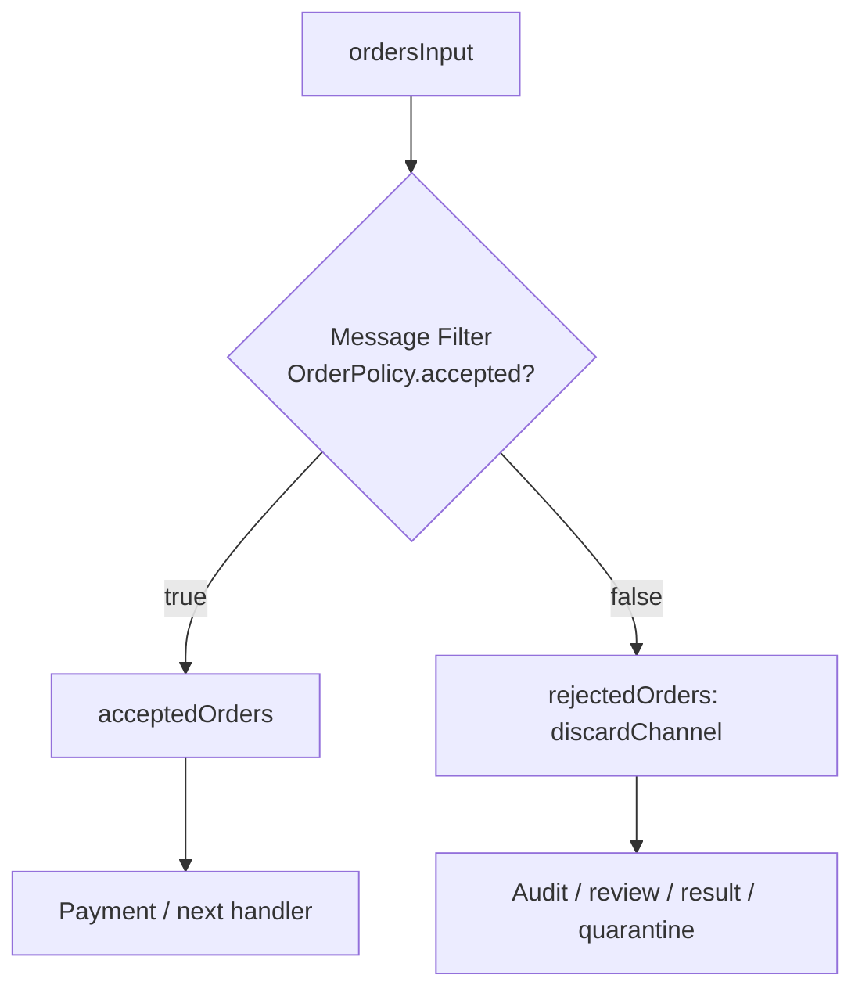
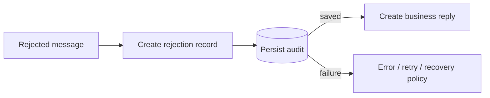
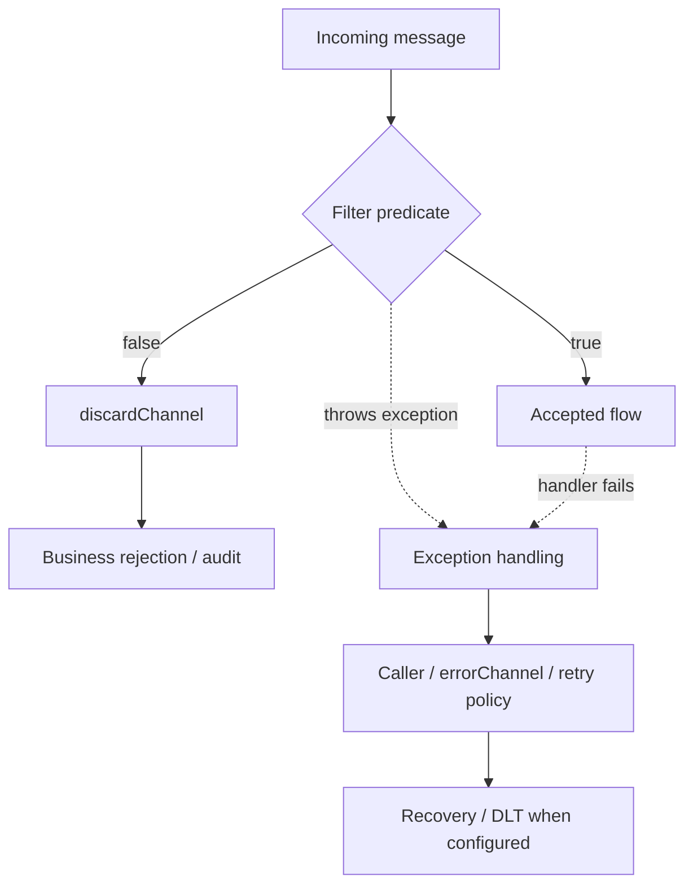
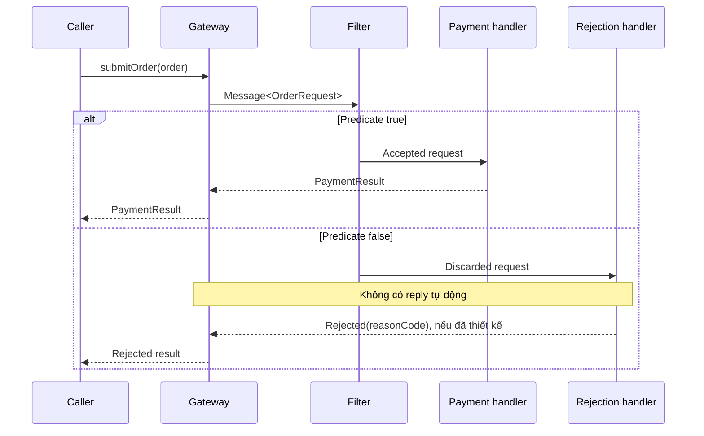
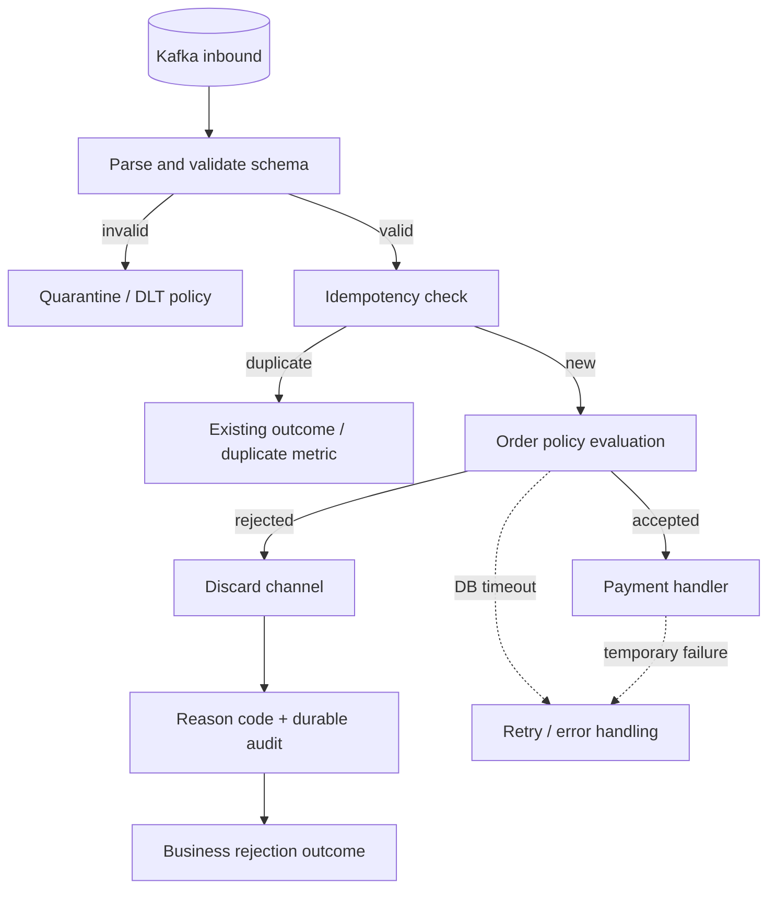

# Discard channel và xử lý message bị loại

Trong **Enterprise Integration Patterns (EIP)**, **Message Filter** chỉ cho những message thỏa điều kiện đi tiếp trong một luồng. Câu hỏi thường bị bỏ quên là: **message không thỏa điều kiện sẽ đi đâu?** Nếu một đơn hàng chưa đủ điều kiện thanh toán bị Filter loại, hệ thống nên bỏ qua, ghi audit, chuyển sang hàng chờ xét duyệt, phản hồi lý do cho caller hay phát sinh exception? Câu trả lời phụ thuộc vào **hợp đồng nghiệp vụ, cơ chế giao nhận và mức độ quan trọng của dữ liệu**, không chỉ một biểu thức `true`/`false`.

Với **Spring Integration**, `discardChannel` cho phép đưa **message bị Filter từ chối** sang một channel riêng thay vì tiếp tục trên output channel chính. Bài học này thuộc chương **Filter** trong module `SPRING_INTEGRATION_PATTERN`: thực hành Router, Filter, Transformer, Splitter, Aggregator, Gateway, retry, error channel và correlation để tạo các luồng message ít phụ thuộc, dễ mở rộng, dễ kiểm thử và quan sát.

**Sau bài học, bạn có thể:**

- Giải thích khác biệt giữa **accepted**, **rejected**, **discarded** và **failed**.
- Dùng `discardChannel` để đưa message bị loại vào một **nhánh xử lý có ý nghĩa**, thay vì làm mất dấu sự kiện.
- Phân biệt `discardChannel`, `nullChannel`, `throwExceptionOnRejection` và `errorChannel`; biết khi nào cần Router hoặc kết quả nghiệp vụ có kiểu.
- Giải thích cách giữ payload/headers, lưu lý do loại và tránh gửi đi nhiều lần do retry hoặc redelivery.
- Phát hiện tác động của rejection tới Gateway, Splitter/Aggregator, nguồn broker và hệ thống audit.
- Viết unit test và integration test xác nhận đúng **hai nhánh accepted/rejected**, cùng các đường lỗi.

## 1. Filter loại message nghĩa là gì?

Một Filter kiểm tra một **predicate** trên payload, headers hoặc toàn bộ `Message<?>`:

```text
Message<OrderRequest>
       |
       v
     Filter
       |
       +-- predicate = true  ---> acceptedChannel ---> tiếp tục xử lý
       |
       +-- predicate = false ---> discard policy
                                        |
                                        +--> discardChannel
                                        +--> bỏ qua có chủ đích
                                        +--> exception (nếu cấu hình)
```

Một predicate trả `false` là **kết quả đánh giá điều kiện**, không tự động là exception. Ví dụ:

- `state=READY`, `amountCents > 0` → **chấp nhận** để chuẩn bị thanh toán.
- `state=DRAFT` → **không đủ điều kiện cho nhánh thanh toán**, nhưng bản thân đơn hàng có thể vẫn là một đối tượng nghiệp vụ hợp lệ.
- `amountCents < 0` → có thể là **dữ liệu đầu vào sai hợp đồng** và cần trả lý do từ chối rõ ràng.
- Database timeout khi tra cứu trạng thái đơn → **lỗi kỹ thuật**, không nên bị đánh đồng với một đơn bị từ chối.

| Kết quả | Điều gì đã xảy ra? | Có phải lỗi kỹ thuật? | Cần làm gì tiếp? |
| --- | --- | --- | --- |
| **Accepted** | Predicate trả `true`. | Không. | Chuyển message qua output channel chính. |
| **Rejected** | Predicate trả `false`. | Không nhất thiết. | Áp dụng chính sách discard/reply/exception có chủ đích. |
| **Discarded** | Ứng dụng quyết định không xử lý message tiếp. | Không nhất thiết. | Chỉ hợp lý khi được phép bỏ qua và có cách quan sát phù hợp. |
| **Failed** | Predicate, handler, channel hoặc adapter phát sinh exception. | Thường có. | Error handling và retry theo loại lỗi, không đồng nhất với rejection. |
| **Duplicate** | Chính sách idempotency xác định sự kiện đã được xử lý. | Không nhất thiết. | Kết thúc an toàn và ghi nhận duplicate theo contract. |

**Nguyên tắc:** Không nên suy luận “bị Filter loại” tức là message đã được lưu, trả lời, ACK ở broker hay được chuyển sang dead-letter queue. Mỗi việc đó cần một **thành phần và chính sách riêng**.

## 2. `discardChannel` hoạt động như thế nào?

Trong Spring Integration, Message Filter có một output channel cho **message được chấp nhận** và có thể được cấu hình một **discard channel** để nhận **message bị từ chối**.



Khi predicate trả `false` và `discardChannel` đã được cấu hình, Filter chuyển **message bị loại** tới channel đó. Payload và headers gốc vẫn mang ý nghĩa của message đầu vào; Filter **không tự tạo** `RejectedOrder`, `reasonCode`, timestamp từ chối hay stack trace.

Ví dụ một message có payload `OrderRequest("evt-12", "ORD-12", "DRAFT", 90000)` và header `traceId=trace-12`. Nếu bị loại, discard branch nhận message tương ứng để xử lý tiếp. Muốn biết **vì sao** bị loại, ứng dụng phải tự gắn lý do hoặc dùng một bước phân loại có kết quả tường minh.

### `discardChannel` có phải một error channel không?

**Không.** Hai khái niệm khác nhau:

- **Discard channel**: nhận message khi điều kiện của Filter **không đạt** theo chính sách Filter.
- **Error channel**: tham gia xử lý lỗi thực thi, thường thông qua `ErrorMessage`, trong những endpoint/cơ chế đã cấu hình xử lý exception theo kiểu message.

Khi predicate trả `false`, **không có exception để tự động đóng gói**. Ngược lại, nếu predicate **ném exception** (ví dụ timeout khi gọi service bên ngoài), đó là lỗi thực thi chứ không phải một lần rejection `false` thông thường. Cách exception truyền về caller hay vào error handling phụ thuộc channel đồng bộ/bất đồng bộ và cấu hình endpoint.

### Discard branch nhận bản sao hay message gốc?

Trong mô hình Filter thông thường, nhánh discard nhận **message không được chấp nhận** với payload/headers tương ứng, không có bảo đảm tự **deep-copy** toàn bộ payload cho consumer. Hãy dùng payload bất biến nếu có thể và không sửa object chia sẻ mà một nhánh khác có thể còn tham chiếu. Khi cần ghi audit hoặc phát phản hồi, hãy **transform** message thành bản ghi từ chối có kiểu riêng.

## 3. Ví dụ Spring Integration Java DSL: chấp nhận hoặc chuyển sang discard channel

Ví dụ minh họa với **Java 17+**, Spring Integration và JUnit 5. Dùng `DirectChannel` ở đầu vào, hai `QueueChannel` làm điểm quan sát kết quả để không phải kết nối broker hoặc dịch vụ thanh toán thật.

### 3.1. Dữ liệu và điều kiện lọc

```java
record OrderRequest(
        String eventId,
        String orderId,
        String state,
        long amountCents
) {}

final class OrderPolicy {
    private OrderPolicy() {}

    static boolean accepted(OrderRequest order) {
        return reasonCode(order) == null;
    }

    static String reasonCode(OrderRequest order) {
        if (order.eventId() == null || order.eventId().isBlank()) {
            return "MISSING_EVENT_ID";
        }
        if (order.orderId() == null || order.orderId().isBlank()) {
            return "MISSING_ORDER_ID";
        }
        if (!"READY".equals(order.state())) {
            return "ORDER_NOT_READY";
        }
        if (order.amountCents() <= 0) {
            return "INVALID_AMOUNT";
        }
        return null; // Không có lý do từ chối.
    }
}
```

`reasonCode()` ở đây là **quy tắc thuần**, không gọi mạng và không thay đổi dữ liệu, nên việc đánh giá là ổn định cho cùng một `OrderRequest`. Đây là lựa chọn thuận tiện khi cần giải thích lý do rejection ở nhánh discard. Nếu chính sách phụ thuộc database, thời gian, tỷ giá hoặc một service rủi ro, việc **đánh giá lại** ở discard branch có thể ra kết quả khác; nên tính **một quyết định có kiểu** ở đầu flow và giữ kết quả đó qua các nhánh.

### 3.2. Cấu hình Message Filter

```java
import org.springframework.context.annotation.Bean;
import org.springframework.context.annotation.Configuration;
import org.springframework.integration.channel.DirectChannel;
import org.springframework.integration.channel.QueueChannel;
import org.springframework.integration.config.EnableIntegration;
import org.springframework.integration.dsl.IntegrationFlow;

@Configuration
@EnableIntegration
class OrderFilterConfiguration {

    @Bean
    DirectChannel ordersInput() {
        return new DirectChannel();
    }

    @Bean
    QueueChannel acceptedOrders() {
        return new QueueChannel();
    }

    @Bean
    QueueChannel rejectedOrders() {
        return new QueueChannel();
    }

    @Bean
    IntegrationFlow filterOrders() {
        return IntegrationFlow.from(ordersInput())
                .filter(OrderRequest.class,
                        OrderPolicy::accepted,
                        spec -> spec.discardChannel("rejectedOrders"))
                .channel("acceptedOrders")
                .get();
    }
}
```

**Luồng thực thi:**

1. Producer gửi `Message<OrderRequest>` tới `ordersInput`.
2. Filter gọi `OrderPolicy.accepted(order)`.
3. Nếu `true`, message đi qua output của Filter đến `acceptedOrders`.
4. Nếu `false`, Filter chuyển message đến `rejectedOrders` theo `discardChannel`.
5. `QueueChannel` ở cả hai nhánh chỉ là **điểm giữ message nội bộ phục vụ demo/test**. Để xử lý thực tế, phải có consumer/poller hoặc thay bằng channel và handler phù hợp.

Ở cấu hình này, **không bật `throwExceptionOnRejection`**. Rejection được xem là một sự kiện có thể xử lý qua nhánh riêng, không phải exception. Nếu code nghiệp vụ muốn caller nhận kết quả ngay, cần thiết kế **một consumer của nhánh discard có tạo reply**, thay vì chỉ dùng QueueChannel không có consumer.

### 3.3. Gửi hai message mẫu

```java
import org.springframework.messaging.MessageChannel;
import org.springframework.messaging.support.MessageBuilder;

class OrderProducer {
    void publish(MessageChannel ordersInput) {
        ordersInput.send(MessageBuilder.withPayload(
                        new OrderRequest("evt-1", "ORD-1", "READY", 100_000))
                .setHeader("traceId", "trace-1")
                .build());

        ordersInput.send(MessageBuilder.withPayload(
                        new OrderRequest("evt-2", "ORD-2", "DRAFT", 100_000))
                .setHeader("traceId", "trace-2")
                .build());
    }
}
```

Mong đợi `evt-1` tới `acceptedOrders`, `evt-2` tới `rejectedOrders`. Cả hai vẫn là `OrderRequest` chứ không tự đổi thành `PaymentResult`. Việc `send()` trả `true` trong ví dụ không chứng minh thanh toán đã hoàn thành hoặc record đã được một broker xác nhận.

## 4. Bốn lựa chọn chính sách khi Filter từ chối message

### 4.1. Bỏ qua theo mặc định: chỉ với dữ liệu được phép mất

Nếu một Filter không có discard channel và không được cấu hình ném lỗi khi từ chối, message không tiếp tục trên output channel. Hành vi này có thể hợp lý với dữ liệu như heartbeat không liên quan tới flow báo cáo, nhưng rất nguy hiểm nếu message là lệnh thanh toán, đối soát hay yêu cầu từ khách hàng.

**Chỉ chọn silent discard khi hợp đồng cho phép bỏ qua.** Nên có ít nhất metrics đếm số message bị từ chối, kiểm tra thay đổi đột ngột của tỷ lệ rejection và ghi rõ điều kiện lọc trong tài liệu vận hành.

### 4.2. Chuyển sang một `discardChannel` có consumer

Đây là lựa chọn khi muốn **giữ bằng chứng**, **cho phép sửa dữ liệu**, **đưa vào manual review** hoặc **phát một kết quả từ chối nghiệp vụ**:

```text
ordersInput -> Filter --- accepted ---> paymentFlow
                      \
                       + rejected ---> rejectedOrders
                                        |
                                        +-- reasonCode / audit
                                        +-- review or quarantine
                                        +-- reply (nếu yêu cầu)
```

Một channel tên `rejectedOrders` **chưa đủ**: nếu không có subscriber/poller, không có hệ thống nào tạo lý do từ chối hay thực hiện khắc phục. Phải định nghĩa rõ điều gì được xem là **hoàn thành việc xử lý message bị loại**.

### 4.3. Đưa vào `nullChannel`: tiêu hủy có chủ đích

Spring Integration có tên channel đặc biệt **`nullChannel`**, nhận message và bỏ qua. Nếu chính sách nghiệp vụ chấp nhận, có thể dùng:

```java
IntegrationFlow.from("ordersInput")
        .filter(OrderRequest.class,
                OrderPolicy::accepted,
                spec -> spec.discardChannel("nullChannel"))
        .channel("acceptedOrders")
        .get();
```

Đây là **phương án thay thế** flow ở mục 3, không phải một flow thứ hai cùng xử lý `ordersInput` trong demo. `nullChannel` **không phải** dead-letter queue, persistent store, nơi lưu audit hoặc một Spring `Message` có payload `null`. Sau khi gửi đến đó, không có cơ chế lấy lại message từ channel.

### 4.4. `throwExceptionOnRejection`: biến rejection thành lỗi

Nếu một điều kiện không đạt được xem là **vi phạm contract** mà caller/error policy cần biết, Filter có tùy chọn ném **`MessageRejectedException`** khi predicate trả `false`:

```java
IntegrationFlow.from("ordersInput")
        .filter(OrderRequest.class,
                OrderPolicy::accepted,
                spec -> spec.throwExceptionOnRejection(true))
        .channel("acceptedOrders")
        .get();
```

Đoạn này cũng là **một phương án cấu hình thay thế**, không ghép cùng ví dụ `discardChannel` mà không nghiên cứu precedence và hợp đồng lỗi. Khi có exception, cách nó lan tới caller hoặc qua `errorChannel` phụ thuộc loại channel, endpoint và cấu hình xử lý lỗi thực tế.

**Đừng retry mù quáng mọi `MessageRejectedException`.** Một số dữ liệu bị từ chối có tính quyết định như `amountCents=-100`; gửi lại cùng payload hàng trăm lần không làm dữ liệu đúng hơn. Nếu cần phản hồi lý do cụ thể ở API, một **result type** như `Rejected(reasonCode)` có thể phù hợp hơn exception kỹ thuật.

| Chính sách | Điều gì xảy ra với message bị từ chối? | Phù hợp với |
| --- | --- | --- |
| Không cấu hình xử lý rejection | Không đi output chính; có thể bị bỏ qua. | Message phụ không cần giữ theo hợp đồng. |
| `discardChannel("rejectedOrders")` | Chuyển message bị loại sang channel khác. | Audit, quarantine, review, phản hồi nghiệp vụ. |
| `discardChannel("nullChannel")` | Đích nhận rồi bỏ qua. | Loại bỏ có chủ đích, không cần truy hồi. |
| `throwExceptionOnRejection(true)` | Phát sinh exception khi từ chối. | Contract bắt buộc xem rejection là lỗi. |
| Decision/result + Router | Đưa kết quả có kiểu tới nhánh phù hợp. | Cần nhiều loại phản hồi, lý do và quan sát rõ. |

## 5. Tạo reason code: Filter boolean không tự giải thích lý do

Nếu một Filter chỉ trả về boolean, nó không cung cấp sẵn thông tin: `ORDER_NOT_READY`, `INVALID_AMOUNT` hay `MISSING_ORDER_ID`. Với hệ thống cần audit, cần quy định cách tạo **rejection record**.

### 5.1. Phương án đơn giản: phân loại lại ở reject handler

Với **predicate thuần** như `OrderPolicy` ở mục 3, consumer của `rejectedOrders` có thể gọi `OrderPolicy.reasonCode(order)` để tạo bản ghi. Ví dụ mô hình dữ liệu:

```java
import java.time.Instant;

record RejectedOrder(
        String eventId,
        String orderId,
        String reasonCode,
        Instant rejectedAt
) {}

RejectedOrder rejectionFrom(OrderRequest order) {
    String reason = OrderPolicy.reasonCode(order);
    if (reason == null) {
        throw new IllegalStateException("ORDER_NO_LONGER_REJECTED");
    }
    return new RejectedOrder(
            order.eventId(), order.orderId(), reason, Instant.now());
}
```

Đây là **một đoạn Java minh họa**, cần đặt vào service/class hợp lệ để sử dụng. `RejectedOrder` là **payload nghiệp vụ do ứng dụng định nghĩa**, không phải `ErrorMessage` của Spring. `rejectedAt` diễn tả thời điểm hệ thống ghi quyết định loại, không nhất thiết là thời điểm đơn được tạo.

Nếu điều kiện lọc phụ thuộc trạng thái thay đổi theo thời gian hoặc dịch vụ ngoài, cách đánh giá lại có thể dẫn đến **lý do không nhất quán** với thời điểm Filter đã ra quyết định. Khi đó, nên dùng một bước phân loại trả **kết quả quyết định có kiểu** chỉ một lần.

### 5.2. Phương án rõ ràng hơn: decision có kiểu rồi định tuyến

```java
sealed interface OrderDecision permits AcceptedOrder, RejectedOrderDecision {}

record AcceptedOrder(OrderRequest order) implements OrderDecision {}

record RejectedOrderDecision(
        OrderRequest order,
        String reasonCode
) implements OrderDecision {}

class OrderDecisionService {
    OrderDecision decide(OrderRequest order) {
        String reason = OrderPolicy.reasonCode(order);
        return reason == null
                ? new AcceptedOrder(order)
                : new RejectedOrderDecision(order, reason);
    }
}
```

Khi đã có `OrderDecision`, có thể dùng **Transformer + Router** để tách `AcceptedOrder` và `RejectedOrderDecision`. Đây không còn là Message Filter boolean thuần túy, nhưng bảo đảm mỗi quyết định có **lý do rõ ràng** và không phải đánh giá điều kiện nhiều lần. Chọn tùy hợp đồng: **Filter + discardChannel** đủ cho sàng lọc đơn giản; **typed decision + Router** thường tốt hơn khi cần nhiều mã từ chối và phản hồi API.

### 5.3. Schema audit tối thiểu

```json
{
  "eventId": "evt-2",
  "orderId": "ORD-2",
  "outcome": "REJECTED",
  "reasonCode": "ORDER_NOT_READY",
  "policyVersion": "order-filter-v3",
  "rejectedAt": "2026-11-21T04:00:00Z",
  "traceId": "trace-2"
}
```

Đây là **schema gợi ý do ứng dụng tự tạo**. Không phải format mà Spring Integration tự sinh khi Filter từ chối. `eventId` nên bền vững qua replay để hỗ trợ idempotency; `policyVersion` giúp giải thích khi điều kiện lọc đổi trong tương lai. Nếu một rejection cần được lưu chắc chắn, dùng kho lưu hoặc transport bền vững với cơ chế xác nhận/khôi phục thích hợp, không chỉ ghi `.log()`.

## 6. Thứ tự xử lý: audit, lưu trữ và phản hồi phải có hợp đồng

Giả sử một message bị Filter loại. Hệ thống muốn ghi audit rồi trả `Rejected` cho caller. Cần làm rõ **điều nào là điều kiện để trả lời**:



Trong một flow đồng bộ, có thể yêu cầu lưu audit thành công trước khi trả lời. Nhưng nếu client chỉ cần biết quy tắc bị từ chối, việc lưu audit có thể diễn ra bất đồng bộ **nếu hợp đồng cho phép mất/trì hoãn audit**. Không có một thứ tự duy nhất đúng cho mọi hệ thống.

**Các quyết định nên ghi rõ:**

1. **Nội dung tối thiểu:** giữ `eventId`, `reasonCode`, `filterName` và trace/correlation cần thiết, không ghi toàn bộ payload nhạy cảm một cách vô điều kiện.
2. **Độ bền:** chỉ log, lưu DB, đẩy broker, hay đưa vào hàng chờ rà soát có chính sách retention?
3. **Khi discard sink lỗi:** retry có giới hạn, không ACK nguồn, dùng outbox hoặc kho dự phòng? Điều này ảnh hưởng trực tiếp tới rủi ro mất dữ liệu.
4. **Khử trùng lặp:** nếu nguồn redeliver hoặc discard handler retry, một rejection có được lưu hai lần không? Dùng khóa nghiệp vụ bền vững khi cần.
5. **Trả lời caller:** reply là mã lỗi kỹ thuật, kết quả từ chối nghiệp vụ hay một xác nhận đã tiếp nhận để xử lý sau?
6. **Thời hạn lưu:** ai được phép xem/sửa và khi nào xóa dữ liệu bị từ chối để tuân thủ quy định nội bộ?

## 7. `discardChannel` không phải `errorChannel` hoặc dead-letter queue

Một hệ thống tích hợp thường có nhiều loại đường đi bất thường. Gộp mọi thứ thành một kênh `errors` có thể làm sai semantics retry và vận hành.



| Cơ chế | Đầu vào của nó | Ý nghĩa | Không nên giả định |
| --- | --- | --- | --- |
| `discardChannel` | Message bị Filter từ chối. | Nhánh xử lý rejection theo predicate. | Mặc nhiên chứa exception hoặc reason code. |
| `errorChannel` | Lỗi được framework/endpoint chuyển thành message khi cấu hình phù hợp. | Xử lý exception kỹ thuật. | Mọi lỗi đồng bộ đều tự vào đây. |
| `nullChannel` | Message được gửi tới để bỏ qua. | Tiêu hủy có chủ đích. | Có thể lấy lại hoặc replay message. |
| Dead-letter queue/topic | Message do cơ chế transport/recovery chuyển sang. | Lưu/tách dữ liệu không xử lý được theo chính sách. | Filter `false` tự đưa message vào DLT. |
| Business rejection result | Payload `Rejected(reasonCode)` do ứng dụng tạo. | Kết quả nghiệp vụ có thể trả/replay/audit. | Tự sinh khi dùng `discardChannel`. |

Một đơn `DRAFT` bị Filter loại là **business rejection của nhánh thanh toán**, không nhất thiết đáng retry. Một timeout tra cứu chính sách là lỗi kỹ thuật có thể retry. Một message JSON hỏng không parse được còn có thể bị chặn **trước khi tới Filter** bởi adapter/deserializer; cần thiết kế recovery ở đúng ranh giới.

### Khi discard consumer cũng thất bại

Nếu `discardChannel` dẫn tới một handler ghi DB và DB tạm thời lỗi, đây là **lỗi trong quá trình xử lý nhánh từ chối**, khác với điều kiện ban đầu trả `false`. Với flow đồng bộ, exception có thể lan về điểm gửi; với flow bất đồng bộ, cần error handler tương ứng. Một nhánh discard tưởng như “chỉ để ghi log” vẫn có thể thành nút thắt hoặc điểm làm mất message nếu không được thiết kế.

## 8. Gateway/request–reply: bị Filter loại không tự có response

Một Gateway có thể biến lời gọi Java/HTTP thành request message rồi chờ **một reply**. Nếu Filter từ chối và message chỉ đi vào một QueueChannel mà không có consumer phát kết quả, Gateway không tự biết phải trả `Rejected` như thế nào.



Nếu reject handler không tạo reply, caller có thể nhận **no-reply/timeout** theo cấu hình và cơ chế Gateway. Để API trả kết quả xác định, hãy thiết kế một trong các cách:

- **Kết quả có kiểu:** reject handler trả `RejectedOrderDecision` hoặc một DTO phản hồi; accepted handler trả kết quả phù hợp. Hai nhánh cùng tuân một reply contract.
- **Exception có chủ đích:** dùng `throwExceptionOnRejection` và map exception sang lỗi API phù hợp nếu rejection thực sự được coi là vi phạm hợp đồng.
- **Bất đồng bộ:** API chỉ trả `ACCEPTED_FOR_PROCESSING`, rồi phát event trạng thái sau; cần tách xác nhận tiếp nhận khỏi kết quả xử lý.

`replyChannel` là metadata hỗ trợ đường phản hồi; `discardChannel` **không phải** `replyChannel`. Đừng thay một header kỹ thuật bằng tên kênh reject một cách tùy tiện. Khi đổi payload, chuyển qua adapter hoặc thread khác, cần kiểm tra khả năng giữ/phục hồi metadata liên quan đến request–reply.

## 9. Splitter/Aggregator: loại message con có thể khiến nhóm không hoàn tất

Một Filter đặt sau Splitter cần được kiểm tra cẩn thận. Giả sử một đơn hàng chứa bốn item; Splitter tạo bốn message con có cùng correlation nhưng sequence khác nhau:

```text
               Splitter: order ORD-12
                    |
                    +-- item 1 ---> Filter true ---> result 1 --+
                    +-- item 2 ---> Filter true ---> result 2 --+
                    +-- item 3 ---> Filter false               +--> Aggregator
                    |             -> discardChannel            |
                    +-- item 4 ---> Filter true ---> result 4 --+

                 Aggregator chỉ nhận 3/4 kết quả thông thường.
```

Nếu Aggregator chờ đủ `sequenceSize=4`, nhóm có thể **không bao giờ release** nếu không có timeout hoặc release policy khác. Discard channel không tự sửa `sequenceSize` hay tự tạo một kết quả thay thế cho item bị loại.

**Ba chiến lược chính:**

1. **Lọc trước khi split** nếu có thể tính danh sách item được chấp nhận ngay trong payload gốc; sau đó sequence metadata phản ánh danh sách đã lọc.
2. **Chuyển rejected item thành một result có kiểu** (`ItemRejected`, `ItemSkipped`) và đưa về nhánh tổng hợp, giữ correlation/sequence thích hợp để Aggregator nhận kết quả cho mọi item.
3. **Thiết kế timeout/release strategy** cho nhóm chưa đủ; quy định có trả partial result, báo toàn bộ batch thất bại hay chuyển sang review.

Không dùng tên channel discard hoặc `reasonCode` làm `correlationId`. Hai lô hàng khác nhau có thể đều bị loại với `INVALID_AMOUNT`; correlation phải phản ánh **đúng nhóm cần gom**.

## 10. Hệ thống nguồn: Filter loại có được ACK hoặc commit không?

Một Filter xử lý **sau khi message đã vào ứng dụng**, trong khi Kafka/AMQP, file poller, database và HTTP có **giao thức xác nhận và quản lý tiến độ riêng**. Từ `predicate=false` không thể suy ra nguồn đã ACK hay sẽ redeliver.

| Nguồn | Quyết định cần có khi message bị loại |
| --- | --- |
| **Kafka** | Commit offset khi nào? Nếu cần lưu rejected event ở DLT/quarantine, đã lưu thành công trước khi cho consumer tiến tiếp chưa? |
| **AMQP/RabbitMQ** | ACK, reject, requeue hay dead-letter? Làm sao tránh redelivery vô hạn của message không bao giờ hợp lệ? |
| **JDBC polling** | Row bị loại có được đánh dấu `REJECTED`/`PROCESSED` không, hay lần poll sau lại lấy cùng row? |
| **File inbound adapter** | File bị đánh dấu đã thấy chưa? Có move sang thư mục rejected, ghi audit hoặc cơ chế quét lại khi restart? |
| **HTTP inbound gateway** | Response và status code khi Filter loại là gì? Có thể timeout nếu không có reply không? |

### Ví dụ quyết định bảo toàn rejection với broker

```text
Broker record
    |
    v
Consumer / adapter
    |
    v
Filter -> rejected
    |
    v
Durable rejection store / DLT publish
    |
    v
Source progress/ack theo contract đã thiết kế
```

Sơ đồ trên là **mục tiêu nghiệp vụ**, không phải một transaction nguyên tử có sẵn. Nếu ghi DLT thành công nhưng commit offset lỗi, consumer có thể nhận lại record; nhánh lưu rejection phải **idempotent**. Nếu commit trước khi lưu rejection rồi process chết, message có thể bị mất dấu. Cơ chế transaction/outbox, xác nhận và retry cần thiết kế theo adapter/broker thực tế.

Đối với poison message có lỗi dữ liệu vĩnh viễn, retry vô hạn làm nghẽn luồng. Nên phân biệt **non-retryable rejection** với **transient downstream failure**, thiết lập chính sách retry có giới hạn và recovery có thể quan sát.

## 11. Idempotency và khả năng replay của nhánh discard

Một sự kiện có thể được nhận nhiều lần vì producer retry, broker redelivery, process restart hoặc consumer chủ động replay. Nếu mỗi lần Filter từ chối lại ghi một bản ghi audit không có khóa, hệ thống sẽ xuất hiện nhiều rejection cho cùng một sự kiện.

**Định danh nên cân nhắc:**

- `eventId` hoặc `commandId` từ **hợp đồng dữ liệu bền vững**, không dùng Spring `MessageHeaders.id` như khóa duy nhất qua replay.
- `filterName` và `policyVersion` nếu cùng sự kiện cần được đánh giá lại theo nhiều chính sách khác nhau.
- `rejectionReason` là thuộc tính của quyết định, không nhất thiết là khóa deduplication.
- `correlationId` giúp liên kết flow/batch, **không thay thế** idempotency key.

Ví dụ khóa lưu rejection có thể là `(eventId, filterName, policyVersion)`, nhưng đây **chỉ là phương án minh họa**. Nếu nghiệp vụ cho phép lưu nhiều lần đánh giá cùng policy theo các mốc thời gian khác nhau, cần thêm `decisionAttemptId` hoặc một hợp đồng lưu lịch sử khác.

### Replay dưới policy mới

Giả sử `ORDER_NOT_READY` bị loại lúc 10:00; 10:05 đơn chuyển `READY`, 10:06 được replay. Có hai kịch bản:

1. **Re-evaluate:** áp dụng chính sách/trạng thái hiện tại. Sự kiện có thể được chấp nhận; phải làm rõ các side effect được phép phát sinh sau replay.
2. **Reproduce original decision:** dùng snapshot nghiệp vụ hoặc một rejection record đã lưu để tái hiện chính xác trạng thái/phiên bản lúc đầu.

Không có đáp án chung. Điều cần nhất quán là **ngữ nghĩa replay**, chứ không đơn thuần giữ y nguyên một boolean trả về trong mọi thời điểm.

## 12. Quan sát Filter: metric, trace và audit

Nếu chỉ đo số message đi đến payment handler, một đợt tăng rejection có thể trông giống **giảm lưu lượng đầu vào**. Nên instrument cả accepted path và discard path:

| Tín hiệu minh họa | Câu hỏi cần trả lời |
| --- | --- |
| `filter_received_total{filter}` | Bao nhiêu message đi tới Filter? |
| `filter_accepted_total{filter}` | Bao nhiêu message qua nhánh chính? |
| `filter_rejected_total{filter,reason}` | Bao nhiêu message bị từ chối và vì sao? |
| `discard_persisted_total{outcome}` | Nhánh từ chối đã lưu được bao nhiêu record? |
| `filter_exception_total{stage}` | Bao nhiêu lỗi khi đánh giá predicate/gửi message? |
| `discard_retry_total{reason}` | Nhánh discard đã phải thử lại bao nhiêu lần? |
| `filter_evaluation_duration` | Quy tắc sàng lọc có thành nút thắt không? |

Đây là **tên metric do ứng dụng có thể định nghĩa**, không phải cam kết Spring Integration tự sinh đúng các counter ấy. Cần chỉ rõ thời điểm tăng counter; retry có thể khiến tổng số **attempt** lớn hơn số **event duy nhất**. Dùng nhãn hữu hạn như `filter`, `reasonCode`, `outcome`; không dùng `orderId`, `eventId`, toàn bộ lỗi hoặc nội dung message làm nhãn vì high cardinality.

Log có cấu trúc có thể ghi:

```text
eventId=evt-2 filter=orderEligibility policyVersion=v3
decision=REJECTED reason=ORDER_NOT_READY
discardTarget=rejectedOrders traceId=trace-2
```

Không ghi số thẻ, địa chỉ, nội dung payload hoặc thông tin nhận dạng nhạy cảm chỉ để debug. Với channel async và executor, tracing context/MDC không tự bảo đảm được truyền qua mọi thread; cần cấu hình propagation tương ứng.

### Có thể kiểm tra một bất biến hữu ích

Ở một Filter được gọi **một lần cho mỗi attempt** và mỗi lần chỉ chọn một nhánh, có thể kỳ vọng:

```text
received_attempts ≈ accepted_attempts + rejected_attempts + failed_attempts
```

Phải định nghĩa cách đo chính xác: một message ném exception trước khi có quyết định có thể thuộc `failed`, không thuộc `rejected`; fan-out, retry, lỗi ghi metrics hoặc bất đồng bộ có thể làm lệch số liệu tức thời. Bất biến là **công cụ điều tra** chứ không phải một định luật tự có của framework.

## 13. Kiểm thử: xác nhận cả accepted path và discard path

Một unit test predicate `assertFalse(...)` chỉ chứng minh điều kiện lọc. Nó **không chứng minh** `discardChannel` được nối đúng, dữ liệu đi đến đích, headers được giữ hay nhánh reject có consumer.

### 13.1. Unit test quy tắc và reason code

```java
import static org.junit.jupiter.api.Assertions.assertEquals;
import static org.junit.jupiter.api.Assertions.assertFalse;
import static org.junit.jupiter.api.Assertions.assertTrue;

import org.junit.jupiter.api.Test;

class OrderPolicyTest {

    @Test
    void acceptsReadyOrderAndRejectsDraftOrder() {
        var ready = new OrderRequest("evt-1", "ORD-1", "READY", 100_000);
        var draft = new OrderRequest("evt-2", "ORD-2", "DRAFT", 100_000);

        assertTrue(OrderPolicy.accepted(ready));
        assertFalse(OrderPolicy.accepted(draft));
        assertEquals("ORDER_NOT_READY", OrderPolicy.reasonCode(draft));
    }

    @Test
    void rejectsMissingIdAndInvalidAmount() {
        assertEquals("MISSING_ORDER_ID", OrderPolicy.reasonCode(
                new OrderRequest("evt-3", "", "READY", 100)));
        assertEquals("INVALID_AMOUNT", OrderPolicy.reasonCode(
                new OrderRequest("evt-4", "ORD-4", "READY", -1)));
    }
}
```

### 13.2. Integration test kiểm tra đúng hai channel

Với cấu hình `OrderFilterConfiguration` ở mục 3, ta dùng Spring Test + JUnit 5. Để tránh queue tích lũy giữa các test, minh họa cách tách application context theo test method:

```java
import static org.junit.jupiter.api.Assertions.assertEquals;
import static org.junit.jupiter.api.Assertions.assertNotNull;
import static org.junit.jupiter.api.Assertions.assertNull;
import static org.junit.jupiter.api.Assertions.assertTrue;

import org.junit.jupiter.api.Test;
import org.springframework.beans.factory.annotation.Autowired;
import org.springframework.beans.factory.annotation.Qualifier;
import org.springframework.integration.channel.QueueChannel;
import org.springframework.messaging.Message;
import org.springframework.messaging.MessageChannel;
import org.springframework.messaging.support.MessageBuilder;
import org.springframework.test.annotation.DirtiesContext;
import org.springframework.test.context.junit.jupiter.SpringJUnitConfig;

@SpringJUnitConfig(OrderFilterConfiguration.class)
@DirtiesContext(classMode = DirtiesContext.ClassMode.AFTER_EACH_TEST_METHOD)
class FilterDiscardFlowTest {

    @Autowired @Qualifier("ordersInput")
    MessageChannel input;

    @Autowired @Qualifier("acceptedOrders")
    QueueChannel accepted;

    @Autowired @Qualifier("rejectedOrders")
    QueueChannel rejected;

    @Test
    void acceptedMessageGoesToMainChannelOnly() {
        var order = new OrderRequest("evt-1", "ORD-1", "READY", 100_000);
        assertTrue(input.send(MessageBuilder.withPayload(order)
                .setHeader("traceId", "trace-1")
                .build()));

        Message<?> result = accepted.receive(1_000);
        assertNotNull(result);
        assertEquals(order, result.getPayload());
        assertEquals("trace-1", result.getHeaders().get("traceId"));
        assertNull(rejected.receive(0));
    }

    @Test
    void rejectedMessageGoesToDiscardChannelOnly() {
        var order = new OrderRequest("evt-2", "ORD-2", "DRAFT", 100_000);
        assertTrue(input.send(MessageBuilder.withPayload(order)
                .setHeader("traceId", "trace-2")
                .build()));

        Message<?> result = rejected.receive(1_000);
        assertNotNull(result);
        assertEquals(order, result.getPayload());
        assertEquals("trace-2", result.getHeaders().get("traceId"));
        assertNull(accepted.receive(0));
    }
}
```

Trong demo, `ordersInput` là `DirectChannel` và các đích là `QueueChannel`; có thể quan sát kết quả ngay sau send theo flow đồng bộ. `@DirtiesContext` giúp mỗi test có state riêng nhưng làm tăng thời gian khởi tạo context; dự án lớn có thể dùng fixture reset phù hợp. Không dùng kết quả trên để kết luận broker ACK, transaction hoặc audit store đã hoạt động.

### 13.3. Ma trận kiểm thử bổ sung trước production

| Ca | Kết quả mong đợi |
| --- | --- |
| Message hợp lệ | Chỉ output chính nhận; payload và headers cần thiết vẫn đúng. |
| Message không hợp lệ | Chỉ discard path nhận; nhánh chính không xử lý. |
| Header `replyChannel` khi qua Gateway | Caller có reply/no-reply đúng hợp đồng đã định nghĩa. |
| Predicate ném exception | Được phân loại là failure, không coi là một rejection `false` thông thường. |
| `throwExceptionOnRejection(true)` | Exception và error policy hoạt động theo channel/endpoint cụ thể. |
| Discard sink lỗi | Không mất audit/event nếu hợp đồng yêu cầu lưu bền vững. |
| `discardChannel` không có consumer | Test phát hiện thông điệp không được xử lý hoặc backlog tăng. |
| Filter sau Splitter | Aggregator có đủ result hoặc timeout/release policy rõ ràng. |
| Broker redelivery | Lưu rejection idempotent, không tạo vòng retry vô hạn. |
| Payload từ nguồn không tin cậy | Không tin status/tenant/role chỉ vì nằm trong header; validate và phân quyền. |
| Restart/replay | Cấu hình ACK, checkpoint và lưu vết phù hợp với hệ thống nguồn. |
| Tải cao | Đường discard không làm nghẽn luồng chính ngoài ngân sách latency; metrics có giới hạn cardinality. |

## 14. Bài tập tình huống: sự kiện thanh toán bị loại

**Bối cảnh:** Một dịch vụ nhận `PaymentRequested` từ Kafka. Chỉ những yêu cầu đã qua kiểm tra hợp đồng, có đơn hàng `READY` và số tiền hợp lệ mới được đi tiếp. Những sự kiện còn lại cần được phân loại và xử lý khác nhau:

| Trường hợp | Phân loại | Cách xử lý gợi ý |
| --- | --- | --- |
| Thiếu `eventId` hoặc sai schema | Contract invalid | Quarantine/DLT theo quy trình ingest; không retry mãi. |
| Đơn `DRAFT` | Business rejection | Tạo `NOT_READY`, lưu kết quả, có thể thông báo caller. |
| `amountCents <= 0` | Business rejection/invalid input | Tạo `INVALID_AMOUNT`, trả lỗi nghiệp vụ, không chuyển sang payment handler. |
| Tra cứu trạng thái DB timeout | Technical failure | Retry có giới hạn, backoff, alert nếu vượt ngưỡng. |
| Sự kiện trùng `eventId` | Duplicate | Idempotent suppression/return existing outcome; không thanh toán lần hai. |
| Ghi rejection record thất bại | Discard branch failure | Recovery/retry có kiểm soát; định nghĩa thời điểm cho phép commit offset. |



**Yêu cầu thực hành:**

1. Xây dựng hợp đồng `PaymentRequested` có `eventId`, `orderId`, `amountCents`, `occurredAt`; quy định các trường nào có thể vắng mặt trước khi parse/validate.
2. Cấu hình Filter dùng `discardChannel` cho rejection xác định được, nhưng **không biến timeout của dependency thành `false`** chỉ để tránh exception.
3. Thiết kế `RejectedPayment(reasonCode, policyVersion, evaluatedAt)` và nhánh lưu audit có idempotency key bền vững.
4. Quyết định chính xác khi nào commit offset/ACK: trước hay sau khi kết quả accepted/rejected được ghi nhận bền vững, và rủi ro của mỗi lựa chọn.
5. Nếu có Gateway/API request–reply, định nghĩa cả response accepted, rejected và technical failure; không để caller chờ vô hạn chỉ vì Filter drop.
6. Nếu một batch được Splitter chia thành nhiều payment item, thiết kế `ItemRejected` có correlation/sequence cho Aggregator hoặc release policy rõ ràng.
7. Thử nghiệm redelivery, nhánh discard lỗi, predicate ném exception, message trùng, restart và tải cao; đo riêng accepted/rejected/failed.

### Câu hỏi tự đánh giá

**Câu 1:** Nếu Filter trả `false` nhưng không có `discardChannel`, message có tự vào dead-letter queue không? **Không.** Phải cấu hình recovery ở đúng endpoint/transport nếu muốn DLT.

**Câu 2:** `discardChannel` có tự thêm `reasonCode=ORDER_NOT_READY` không? **Không.** Filter chuyển message bị từ chối; ứng dụng phải dựng lý do theo chính sách.

**Câu 3:** Nếu đặt `discardChannel("nullChannel")`, có thể đọc message bị loại từ `nullChannel` sau đó không? **Không.** `nullChannel` chủ đích nhận rồi bỏ qua message.

**Câu 4:** Một đơn bị Filter từ chối có chắc là exception kỹ thuật không? **Không.** Predicate `false` khác với exception do predicate/adapter/handler phát sinh.

**Câu 5:** `send()` thành công tới `rejectedOrders` có đồng nghĩa Kafka offset đã commit và audit đã được lưu không? **Không.** Đó là các ranh giới và xác nhận độc lập.

## Tổng kết

- **`discardChannel`** là channel dành cho **message bị Message Filter từ chối**; nó không phải `errorChannel`, không tự tạo reason code, không tự lưu dữ liệu hay tự ACK nguồn.
- Nếu được phép bỏ qua có chủ đích, có thể không cấu hình nhánh reject hoặc gửi tới **`nullChannel`**; nếu rejection phải được báo như một lỗi, cân nhắc **`throwExceptionOnRejection`**. Mỗi cách có semantics riêng.
- Khi cần **lý do từ chối có thể audit**, tạo một `Rejected(reasonCode)` rõ ràng hoặc dùng **decision type + Router**; tránh đánh giá lại quy tắc không thuần rồi ghi lý do không nhất quán.
- Rejection có thể tác động đến **Gateway reply**, **Splitter/Aggregator correlation**, **broker ACK/commit**, retry và idempotency; không suy ra các kết quả này chỉ từ boolean của Filter.
- Kiểm thử **cả đường accepted và discard**, các exception, downstream failure, replay và restart; đo số rejected riêng với số failed và theo dõi hoạt động của reject sink.
- Đối với message quan trọng, **discard branch là một luồng nghiệp vụ cần được thiết kế, bảo vệ và giám sát**, không chỉ là nơi đặt một câu log rồi quên.
