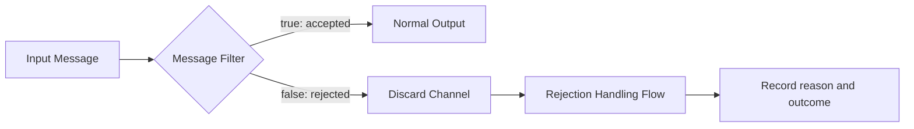
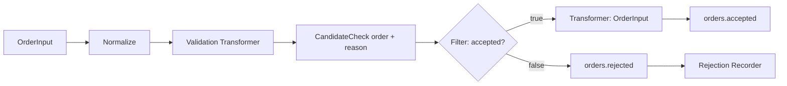
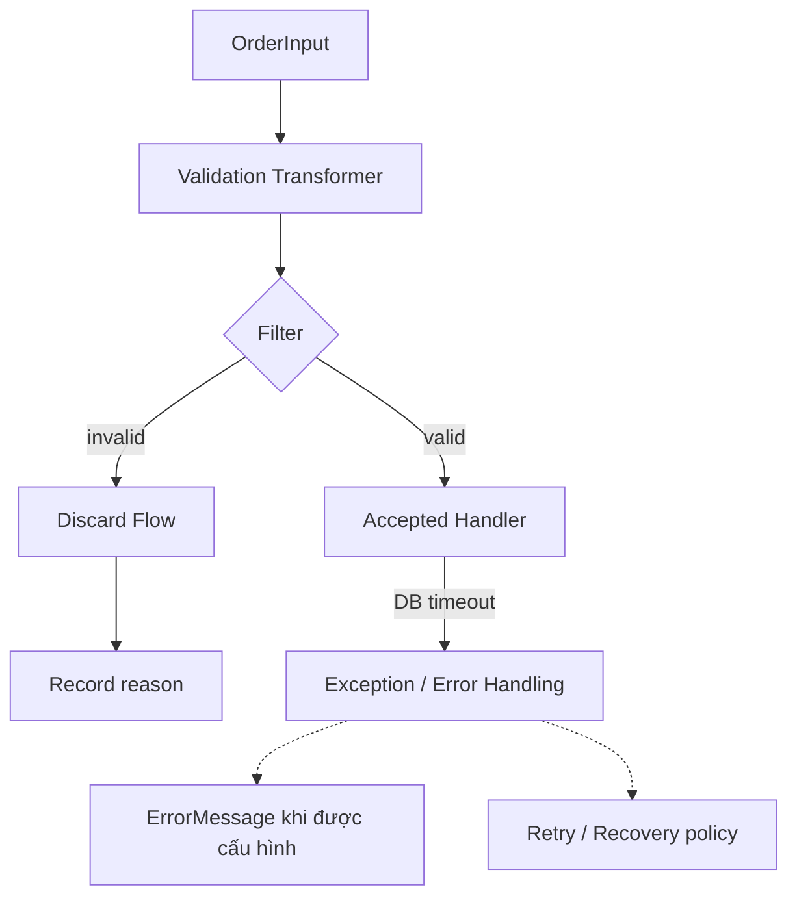
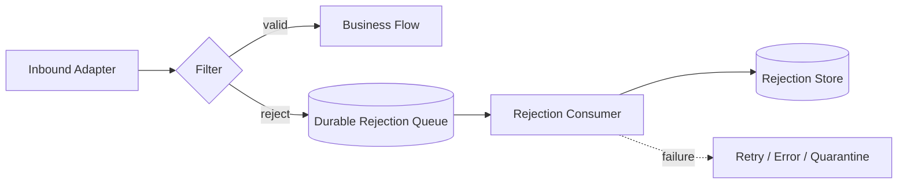
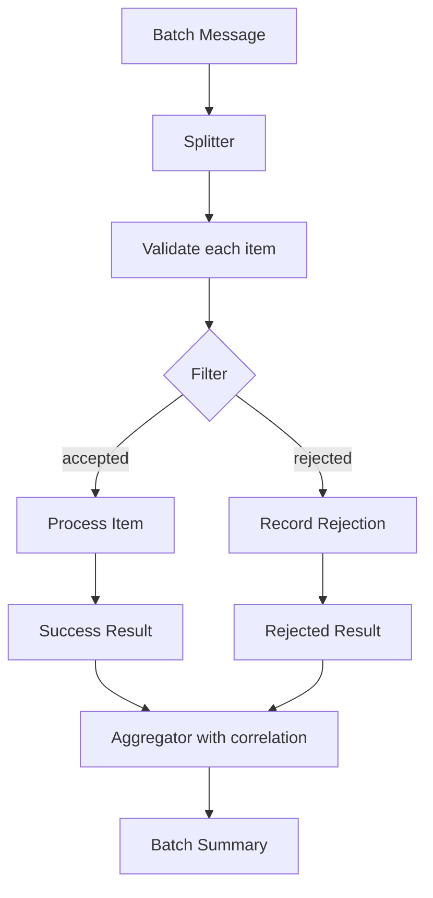
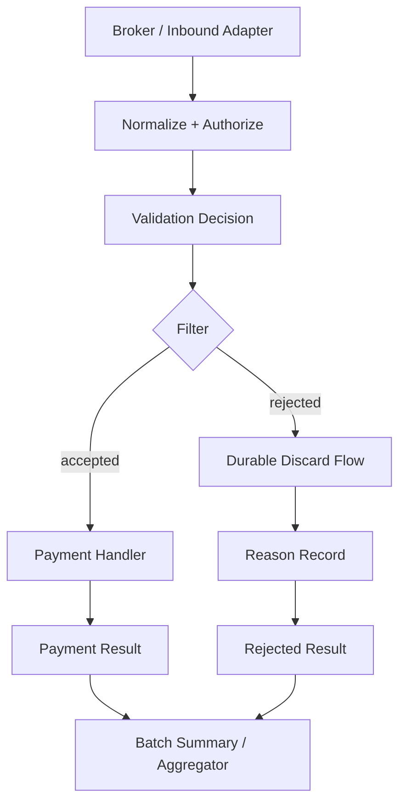

# Discard flow và ghi nhận lý do loại

Trong Enterprise Integration Patterns (EIP), **Message Filter** quyết định một message có được tiếp tục đi trong luồng xử lý hay không. Một message thỏa điều kiện được chuyển sang bước kế tiếp; một message không thỏa điều kiện có thể bị **loại** khỏi output thông thường.

Nếu chỉ viết một predicate trả về `true` hoặc `false`, việc lọc khá đơn giản. Nhưng trong ứng dụng thực tế, câu hỏi quan trọng thường là: **message bị loại đi đâu và vì sao bị loại?** Một đơn hàng có số tiền âm, một giao dịch trùng, hoặc một sự kiện không thuộc nhóm được hỗ trợ có thể cần cách xử lý khác nhau. Nếu chỉ âm thầm bỏ message, hệ thống sẽ mất dấu vết để giải thích cho caller, đối soát, kiểm thử và vận hành.

Spring Integration hỗ trợ **discard channel** cho Message Filter: thay vì tiếp tục trên nhánh được chấp nhận, message không đạt điều kiện có thể được gửi đến **một flow riêng**. Flow ấy có thể ghi lý do loại, tạo trạng thái nghiệp vụ, cảnh báo hay chuyển tới khu vực kiểm tra, tùy hợp đồng. Tuy nhiên, **discard channel không tự tạo mã lý do**, không phải error channel, và không bảo đảm lưu bền nếu các thành phần downstream không được thiết kế tương ứng.

Bài thuộc chương **Filter** của module **SPRING_INTEGRATION_PATTERN**. Mục tiêu là triển khai Enterprise Integration Patterns với Spring Integration thành các luồng thông điệp ít phụ thuộc, dễ mở rộng và có thể kiểm thử; kết hợp Filter với Transformer, Router, Gateway, Splitter, Aggregator, retry, error channel và correlation. Trọng tâm của bài là thiết kế **discard flow và cơ chế ghi nhận lý do loại có thể giải thích, đối soát và vận hành an toàn**.

Sau bài học, bạn sẽ phân biệt được reject với exception, biết cách bảo toàn reason code trong message, xây một ví dụ Java DSL có hai nhánh accepted/rejected, kiểm tra tính idempotent khi ghi nhận và thiết kế test cho cả đường hợp lệ lẫn đường bị loại.

## 1. Message Filter chấp nhận hoặc loại message như thế nào?

Một Filter có predicate:

\[
accept(m) \in \{true,\ false\}
\]

Nếu `accept(m)` là `true`, message tiếp tục qua output bình thường. Nếu là `false`, message **không được chuyển vào output bình thường**; tùy cấu hình, nó có thể bị bỏ, gửi sang discard channel hoặc gây exception.



Một ví dụ đơn giản:

```java
@Bean
IntegrationFlow positiveAmountOnly() {
    return IntegrationFlow.from("orders.input")
        .filter(OrderInput.class, order ->
            order.amount() != null
                && order.amount().signum() > 0,
            spec -> spec.discardChannel("orders.rejected"))
        .channel("orders.accepted")
        .get();
}
```

Đoạn trên minh họa API Filter của Spring Integration Java DSL. Với message có `amount > 0`, Filter cho qua. Với `amount` bằng `null`, bằng 0 hoặc âm, message được đưa sang `orders.rejected` nếu channel được cấu hình và có consumer thích hợp.

Nhưng **nhánh discard chưa biết tại sao** message bị loại ngoài việc predicate trả `false`. Đặc biệt nếu predicate sắp tới phải kiểm tra cả request ID, order ID, currency, trạng thái và quyền, một boolean không đủ để vận hành.

### Ba hành vi cần phân biệt

| Trường hợp | Ý nghĩa | Kết quả thường mong muốn |
| --- | --- | --- |
| Predicate `true` | Message đáp ứng quy tắc Filter | Tiếp tục vào output bình thường |
| Predicate `false` | Message bị từ chối theo quy tắc | Bỏ có chủ đích, gửi discard flow hoặc ném rejection exception theo hợp đồng |
| Predicate/handler ném exception | Không đánh giá/xử lý được message, có thể là lỗi kỹ thuật | Truyền exception hoặc dùng cơ chế error handling phù hợp |

**Predicate trả `false` không đồng nghĩa với một exception**. Spring Integration có thể được cấu hình `throwExceptionOnRejection(true)` nếu nghiệp vụ muốn báo lỗi theo đường exception; đó là lựa chọn khác với việc phát message tới discard flow. Không nên cấu hình cả hai theo suy đoán rồi giả định mọi message vừa được ghi discard vừa được ném exception: hãy xác nhận ngữ nghĩa trong phiên bản và cấu hình đang dùng.

## 2. Discard channel, error channel và dead-letter không phải một thứ

Đây là nhầm lẫn phổ biến nhất khi học Filter.

| Cơ chế | Thông tin thường được chuyển | Mục tiêu | Ví dụ |
| --- | --- | --- | --- |
| **Discard channel** | Message bị Filter loại, có thể kèm payload/headers đã được enrich ở upstream | Xử lý **không đạt điều kiện chấp nhận** | Currency không hỗ trợ, trạng thái không thuộc nhánh |
| **Error channel** | `ErrorMessage` chứa `Throwable` và các thông tin lỗi liên quan nếu được công bố | Xử lý **exception** do thành phần bắt lỗi phát ra | Timeout, lỗi transformer, lỗi handler |
| **Dead-letter/quarantine** | Message không xử lý được cùng metadata thất bại theo thiết kế transport/app | Lưu để điều tra, sửa hoặc replay | Message sai schema liên tục; hết số lần retry |
| **Normal output channel** | Message được Filter chấp nhận | Tiếp tục nghiệp vụ | Đơn đã đạt điều kiện kiểm tra |

Một message có thể bị **loại hợp lệ** mà không phải lỗi: ví dụ một stream chứa tất cả loại sự kiện, còn subscriber chỉ quan tâm `OrderPlaced`. Filter loại `OrderUpdated` là hành vi thiết kế bình thường; không nên xem là lỗi cấp production cho mỗi message.

Ngược lại, một đơn có số tiền âm tại API đặt hàng thường là **validation rejection** cần có mã lý do và phản hồi phù hợp. Lỗi database timeout lại cần retry hoặc báo lỗi tạm thời, không thể phân loại là “message không hợp lệ” chỉ vì xử lý thất bại.

**Discard flow không tự động biến message thành `ErrorMessage`.** Nếu muốn xem message bị loại như một lỗi, cần quyết định tường minh cách ghi nhận hoặc phát hành event lỗi theo hợp đồng, không lấy hai loại channel làm một.

## 3. Vì sao nên ghi lý do loại thành dữ liệu có cấu trúc?

Hãy giả sử một filter có điều kiện:

```java
order.orderId() != null
    && !order.orderId().isBlank()
    && order.amount() != null
    && order.amount().signum() > 0
    && supportedCurrencies.contains(order.currency())
```

Nếu kết quả là `false`, không rõ **điều kiện nào** gây từ chối. Một dòng log chung:

```text
Order rejected
```

không đủ để hỗ trợ người dùng hoặc điều tra. Thay vào đó, một **reason code** có tập giá trị hữu hạn giúp biểu diễn nguyên nhân:

| Reason code | Điều kiện | Hành vi đề xuất |
| --- | --- | --- |
| `MISSING_REQUEST_ID` | Không có định danh yêu cầu | Reject hoặc quarantine; không thể dedup ổn định bằng request ID |
| `MISSING_ORDER_ID` | Mã đơn trống/không hợp lệ | Reject và báo lỗi dữ liệu |
| `INVALID_AMOUNT` | Số tiền rỗng, bằng 0 hoặc âm | Reject; không retry nguyên payload |
| `UNSUPPORTED_CURRENCY` | Mã tiền tệ ngoài danh sách chấp nhận | Reject/review theo chính sách |
| `DUPLICATE_EVENT` | Event đã được xử lý trước đó | Có thể ghi duplicate/skip, không nhất thiết là lỗi |
| `NOT_APPLICABLE` | Subscriber không quan tâm loại message này | Filter loại bình thường, thường không cần audit từng message |
| `TENANT_NOT_ALLOWED` | Request không thuộc quyền đã xác thực | Từ chối và kiểm soát thông tin trả về |

Các mã trên là **quy ước nghiệp vụ minh họa**, không phải enum Spring Integration cung cấp mặc định.

Một bản ghi rejection thường cần:

- **Dữ liệu nhận diện:** `requestId` hoặc `eventId` ổn định, business key nếu có.
- **Nguyên nhân:** reason code được chuẩn hóa; chi tiết kỹ thuật được giới hạn.
- **Nguồn kiểm tra:** tên filter, policy/ruleset version.
- **Thời điểm:** khi kiểm tra và khi lưu kết quả.
- **Correlation:** ID liên kết với flow/gateway và các message liên quan.
- **Kết quả xử lý rejection:** `RECORDED`, `REVIEW_REQUIRED`, `FAILED_TO_RECORD`, hoặc trạng thái khác theo hợp đồng.

Không nên ghi toàn bộ payload nhạy cảm chỉ để biết lý do. Một reason code và vài metadata đã đủ cho đa số nhu cầu đo lường.

## 4. Thiết kế tốt hơn boolean: kiểm tra trước, Filter sau

Một cách dễ kiểm soát là **tách kiểm tra thành bước tạo kết quả có cấu trúc**, rồi để Filter chỉ quyết định cho qua hoặc discard.



Ưu điểm:

1. **Chỉ kiểm tra một lần** để xác định nguyên nhân, tránh predicate và logger dùng hai phiên bản logic khác nhau.
2. Cả nhánh accepted và rejected đọc được cùng một kết quả kiểm tra.
3. Nhánh discard giữ được reason code **ngay trên payload**, không phụ thuộc header được transport giữ hay không.
4. Có thể unit test quy tắc kiểm tra độc lập với Spring Integration.
5. Sau Filter, nhánh accepted có Transformer chuyển từ wrapper về payload nghiệp vụ ban đầu.

Cần hiểu đúng: **Message Filter không tự tạo `CandidateCheck`**. Bước Transformer ở trước Filter tạo wrapper đó. Message bị discard vẫn mang payload `CandidateCheck`; bước accepted mới transform sang `OrderInput`.

### Vì sao không tự tính reason ở discard handler?

Nếu discard handler gọi lại validator để tìm lý do, logic có thể đã thay đổi hoặc phải đọc trạng thái ngoài, nên kết quả lần hai có thể khác lần đầu. Trường hợp dễ xảy ra là policy version đổi giữa quyết định reject và lúc ghi log.

Khi reason quan trọng cho audit/replay, hãy **chốt reason cùng policy version tại thời điểm đánh giá**, rồi chuyển chính kết quả đó sang discard flow.

## 5. Ví dụ Java: model cho dữ liệu đầu vào và kết quả kiểm tra

Ta dùng đơn hàng có `requestId`, `orderId`, `amount` và `currency`. Ở cấp inbound, một số trường có thể rỗng để hệ thống ghi nhận lý do; **Spring message payload không được là `null`**, nhưng các field trong object payload có thể rỗng.

### 5.1. Kiểu dữ liệu và các reason code

```java
import java.math.BigDecimal;
import java.time.Instant;
import java.util.Locale;
import java.util.Set;

record OrderInput(
    String requestId,
    String orderId,
    BigDecimal amount,
    String currency
) {
    OrderInput normalized() {
        return new OrderInput(
            requestId == null ? null : requestId.trim(),
            orderId == null ? null : orderId.trim(),
            amount,
            currency == null ? null
                : currency.trim().toUpperCase(Locale.ROOT)
        );
    }
}

enum RejectionReason {
    MISSING_REQUEST_ID,
    MISSING_ORDER_ID,
    INVALID_AMOUNT,
    UNSUPPORTED_CURRENCY
}

record CandidateCheck(
    OrderInput order,
    RejectionReason reason,
    String ruleVersion,
    Instant checkedAt
) {
    boolean accepted() {
        return reason == null;
    }
}
```

Một `CandidateCheck` có `reason == null` nghĩa là **được chấp nhận theo phiên bản quy tắc đang sử dụng**. Ngược lại, `reason != null` nghĩa là bị loại theo một reason code cụ thể.

Nếu cần ghi **nhiều lý do cùng lúc**, có thể thay `RejectionReason reason` bằng `List<RejectionReason> reasons` bất biến. Ví dụ đầu tiên chỉ trả nguyên nhân ưu tiên để giảm độ phức tạp.

### 5.2. Validator xác định lý do một lần

```java
final class OrderValidationService {
    private static final Set<String> SUPPORTED =
        Set.of("VND", "USD");

    private static final String RULE_VERSION = "orders-validation-v2";

    CandidateCheck check(OrderInput raw) {
        if (raw == null) {
            throw new IllegalArgumentException(
                "Null message payload is not supported");
        }

        OrderInput order = raw.normalized();

        RejectionReason reason = null;
        if (order.requestId() == null
                || order.requestId().isBlank()) {
            reason = RejectionReason.MISSING_REQUEST_ID;
        } else if (order.orderId() == null
                || order.orderId().isBlank()) {
            reason = RejectionReason.MISSING_ORDER_ID;
        } else if (order.amount() == null
                || order.amount().compareTo(BigDecimal.ZERO) <= 0) {
            reason = RejectionReason.INVALID_AMOUNT;
        } else if (!SUPPORTED.contains(order.currency())) {
            reason = RejectionReason.UNSUPPORTED_CURRENCY;
        }

        return new CandidateCheck(
            order, reason, RULE_VERSION, Instant.now());
    }
}
```

**Điểm cần chú ý:**

- Chuỗi được chuẩn hóa trước khi đánh giá, ví dụ `" usd "` thành `"USD"`.
- Thứ tự kiểm tra xác định **reason ưu tiên**. Nếu thiếu cả order ID và amount, ví dụ chọn `MISSING_ORDER_ID`. Khi yêu cầu gửi nhiều lỗi cho UI, cần một model `reasons` khác.
- Validator trả dữ liệu có cấu trúc, **không gửi message** và không gọi database.
- Logic thuần giúp dễ unit test. Quy tắc phụ thuộc database/quyền hiện hành có thể cần service khác và transaction phù hợp; không giấu một side effect khó đoán bên trong predicate.
- `RULE_VERSION` cho biết tập điều kiện đã áp dụng. Khi policy thay đổi động, hãy dùng snapshot có version nhất quán cho cả một lần đánh giá.

**Không tự suy ra giá trị mặc định quan trọng** như currency khi client để trống nếu hợp đồng không quy định. Tự thêm currency sẽ che giấu lỗi dữ liệu thay vì ghi nhận lý do loại.

## 6. Spring Integration Java DSL: accepted flow và discard flow

Đây là ví dụ có thể dùng làm nền cho một Spring application. Các service nghiệp vụ và lưu rejection là interface; ứng dụng phải cung cấp bean triển khai.

### 6.1. Hợp đồng của hai consumer

```java
import java.time.Instant;

record RejectionRecord(
    String requestId,
    String orderId,
    RejectionReason reason,
    String ruleVersion,
    Instant checkedAt
) {}

interface OrderService {
    void accept(OrderInput order);
}

interface RejectionRecorder {
    void record(RejectionRecord rejection);
}
```

Trong production, `RejectionRecorder` có thể lưu database hoặc phát event vào một hệ thống audit/review. Hợp đồng `record` phải có chính sách **idempotency, bảo mật, lưu trữ và failure handling** tương ứng; interface không tự mang các bảo đảm ấy.

### 6.2. Gateway, channel và hai nhánh xử lý

```java
import org.springframework.context.annotation.Bean;
import org.springframework.context.annotation.Configuration;
import org.springframework.integration.annotation.Gateway;
import org.springframework.integration.annotation.IntegrationComponentScan;
import org.springframework.integration.annotation.MessagingGateway;
import org.springframework.integration.channel.DirectChannel;
import org.springframework.integration.config.EnableIntegration;
import org.springframework.integration.dsl.IntegrationFlow;
import org.springframework.messaging.MessageChannel;

@MessagingGateway
interface OrderGateway {
    @Gateway(requestChannel = "orders.in")
    void submit(OrderInput order);
}

@Configuration
@EnableIntegration
@IntegrationComponentScan
class OrderFilterConfiguration {

    @Bean
    OrderValidationService validationService() {
        return new OrderValidationService();
    }

    @Bean("orders.in")
    MessageChannel ordersIn() {
        return new DirectChannel();
    }

    @Bean("orders.accepted")
    MessageChannel ordersAccepted() {
        return new DirectChannel();
    }

    @Bean("orders.rejected")
    MessageChannel ordersRejected() {
        return new DirectChannel();
    }

    @Bean
    IntegrationFlow validateAndFilter(OrderValidationService validator) {
        return IntegrationFlow.from("orders.in")
            .transform(OrderInput.class, validator::check)
            .filter(CandidateCheck.class, CandidateCheck::accepted,
                spec -> spec.discardChannel("orders.rejected"))
            .transform(CandidateCheck.class, CandidateCheck::order)
            .channel("orders.accepted")
            .get();
    }

    @Bean
    IntegrationFlow handleAccepted(OrderService orderService) {
        return IntegrationFlow.from("orders.accepted")
            .handle(OrderInput.class, (order, headers) -> {
                orderService.accept(order);
                return null;
            })
            .get();
    }

    @Bean
    IntegrationFlow handleRejected(RejectionRecorder recorder) {
        return IntegrationFlow.from("orders.rejected")
            .handle(CandidateCheck.class, (candidate, headers) -> {
                RejectionRecord record = new RejectionRecord(
                    candidate.order().requestId(),
                    candidate.order().orderId(),
                    candidate.reason(),
                    candidate.ruleVersion(),
                    candidate.checkedAt());

                recorder.record(record);
                return null;
            })
            .get();
    }
}
```

Cấu hình giả định có dependency Spring Integration hỗ trợ Java DSL, bean `OrderService`, bean `RejectionRecorder` và interface Gateway được đăng ký bởi `@IntegrationComponentScan` hoặc cách tương đương.

**Dòng đi của một message hợp lệ:**

1. Gateway gửi `OrderInput` vào `orders.in`.
2. Transformer gọi `validator.check`, tạo `CandidateCheck` với `reason == null`.
3. Filter trả `true`.
4. Transformer lấy `CandidateCheck.order` để đưa `OrderInput` đã chuẩn hóa vào `orders.accepted`.
5. `OrderService.accept` xử lý đơn.

**Dòng đi của một message bị loại:**

1. Transformer tạo `CandidateCheck` với `reason != null`, ví dụ `INVALID_AMOUNT`.
2. Filter trả `false`.
3. Message mang `CandidateCheck` được gửi sang `orders.rejected`, không đi vào `orders.accepted`.
4. `RejectionRecorder.record` nhận reason code, rule version và thời điểm kiểm tra.
5. Nhánh reject kết thúc; không gọi `OrderService.accept` cho message ấy.

Không dùng `throwExceptionOnRejection(true)` trong flow này vì mục tiêu là **chuyển rejection vào discard flow để lưu lý do**.

### 6.3. Những bảo đảm và giới hạn của ví dụ

- Cả ba channel là `DirectChannel`. Nếu recorder đồng bộ ném exception, exception có thể ảnh hưởng lời gọi gateway, tùy cơ chế exception của flow.
- `OrderGateway.submit` là **void**. Nếu Filter discard thành công và handler reject kết thúc bình thường, caller **không tự nhận được một JSON validation error**. Muốn trả mã lỗi cho API, phải thiết kế lớp API, gateway reply contract hoặc dịch vụ nhận trạng thái tương ứng.
- Recorder nhận được `CandidateCheck` vì Filter loại message **sau khi Validator đã transform payload**.
- Đoạn mã không tự có database transaction, outbox hoặc message persistence. Một log thành công ở nhánh discard không chứng minh bản ghi sẽ sống sót sau crash nếu recorder chỉ ghi vào bộ nhớ.
- `RejectionReason` ở ví dụ được tính từ dữ liệu đầu vào; **exception** từ OrderService hoặc RejectionRecorder không mặc nhiên được chuyển thành message có `reason` trong discard flow.

## 7. Minh họa dữ liệu đi qua hai nhánh

Xét các đầu vào:

| Input | Sau normalize | Reason | Đích |
| --- | --- | --- | --- |
| `("req-1", " O-1 ", 120000, " vnd ")` | `("req-1", "O-1", 120000, "VND")` | `null` (accepted) | `orders.accepted` |
| `("req-2", "O-2", 0, "VND")` | Không đổi | `INVALID_AMOUNT` | `orders.rejected` |
| `("req-3", "   ", 100, "USD")` | Order ID trống | `MISSING_ORDER_ID` | `orders.rejected` |
| `("req-4", "O-4", 10, "EUR")` | Không đổi | `UNSUPPORTED_CURRENCY` | `orders.rejected` |
| `(null, "O-5", 10, "USD")` | Request ID thiếu | `MISSING_REQUEST_ID` | `orders.rejected` |

Ví dụ rejection record sau khi lọc:

```json
{
  "requestId": "req-2",
  "orderId": "O-2",
  "reason": "INVALID_AMOUNT",
  "ruleVersion": "orders-validation-v2",
  "checkedAt": "2026-11-21T04:00:00Z"
}
```

Mô hình JSON trên là **dạng biểu diễn minh họa** từ `RejectionRecord`, không phải payload mà Spring Integration tự phát sinh. Với một bản ghi có `requestId` rỗng, cần bổ sung **ingress ID do hệ thống tạo** nếu muốn tra cứu/dedup; không được giả vờ rằng luôn có request ID ổn định từ client.

Lưu ý thêm: giá trị `null` trong cột reason chỉ biểu thị **accepted trong model**, không có nghĩa Spring Messaging được gửi một message có payload `null`.

## 8. Muốn trả lời caller "vì sao bị loại" thì thiết kế thế nào?

Discard flow và phản hồi đồng bộ cho caller là hai nhu cầu riêng.

Ví dụ một REST endpoint cần trả:

```json
{
  "status": "REJECTED",
  "reasonCode": "INVALID_AMOUNT",
  "requestId": "req-2"
}
```

Nếu chỉ dùng Gateway `void submit(...)` và discard handler ghi database, REST controller không tự có response này. Có ba hướng phổ biến:

**A. Kiểm tra ở API trước khi gửi vào integration flow.** Dùng cùng validation service hoặc contract validation rõ ràng để trả HTTP 4xx khi dữ liệu không hợp lệ, sau đó chỉ gửi message đã được chấp nhận. Hệ thống vẫn có thể ghi rejection event nếu cần. Phải tránh hai bộ rule drift hoặc gắn version cụ thể.

**B. Thiết kế request-reply flow trả một kết quả nghiệp vụ.** Ví dụ `SubmissionResult(ACCEPTED/REJECTED, reasonCode, requestId)` được tạo tại các nhánh và trả về gateway qua reply channel được cấu hình. Khi lựa chọn này, cần test rõ lúc reject, ai phát reply và timeout xử lý thế nào. Một discard channel không có reply handler không thể tự trả kết quả cho gateway.

**C. Nhận xử lý bất đồng bộ rồi cho tra cứu trạng thái.** API trả `202 Accepted` cho việc **đã nhận yêu cầu**, đồng thời cung cấp `requestId` để truy vấn kết quả về sau. `202` không có nghĩa dữ liệu đã qua validation hay đơn đã hoàn thành. Rejection recorder phải lưu đủ trạng thái để client kiểm tra.

Với nghiệp vụ yêu cầu validation phải được phản hồi ngay, hướng A hoặc B có thể phù hợp. Với nguồn dữ liệu lớn qua broker, hướng C và discard flow lưu bền thường thực tế hơn. Không có một cấu hình Filter duy nhất thỏa mọi hợp đồng.

### Khi nào dùng rejection exception?

Nếu một yêu cầu đồng bộ cần caller nhận exception ngay, Spring Integration Filter có thể cấu hình:

```java
.filter(OrderInput.class, order -> valid(order),
    spec -> spec.throwExceptionOnRejection(true))
```

Đoạn này chỉ minh họa **cách cấu hình**: hàm `valid` là predicate ứng dụng phải tự định nghĩa. Khi bị reject, `MessageRejectedException` có thể được tạo theo cơ chế Filter, và exception có thể truyền tới caller đồng bộ.

Nhưng **reason code nghiệp vụ chi tiết không tự sinh ra** từ boolean predicate. Muốn gửi mã lỗi cho caller, cần exception/kết quả có cấu trúc hoặc mapping từ validation service. Và không nên giả định cấu hình throw exception đồng thời sẽ chạy đúng discard flow như ví dụ trước mà chưa kiểm tra phiên bản và tương tác tùy chọn.

## 9. Đừng dùng discard flow để giấu lỗi kỹ thuật

Giả sử `OrderService.accept` ném exception vì database không kết nối được. Message đã vượt qua Filter, nên đây **không phải** một rejection do quy tắc Filter. Nếu hệ thống tự ghi `INVALID_AMOUNT` để tránh exception, dữ liệu audit sẽ sai.



Phân biệt các loại sự kiện:

| Loại | Ví dụ | Có retry nguyên message không? |
| --- | --- | --- |
| Dữ liệu invalid cố định | Amount âm, thiếu ID | Thường không; client/source cần sửa |
| Không thuộc phạm vi subscriber | Event type khác | Không phải lỗi; có thể bỏ theo thiết kế |
| Dữ liệu bị duplicate | Event ID đã xử lý | Không tạo side effect trùng; có thể ghi trạng thái `SKIPPED` |
| Lỗi policy tạm thời | Config service timeout | Có thể retry có giới hạn hoặc hold |
| Lỗi hạ tầng | Database unavailable | Có thể retry có giới hạn, backoff |
| Kết quả bên ngoài chưa rõ | Timeout sau khi provider có thể đã xử lý | Đối soát/idempotency, không mặc định thử lại vô điều kiện |

**Error channel** trong Spring Integration là nơi một cơ chế bắt và công bố lỗi có thể gửi `ErrorMessage`. Exception đồng bộ đi qua `DirectChannel` thường truyền về caller. Chỉ khai báo một bean tên `errorChannel` không khiến mọi exception từ Filter hoặc handler tự động tới đó.

Khi một nhánh discard tự lỗi, ví dụ `RejectionRecorder` không lưu được, lỗi đó thuộc **quy trình ghi nhận rejection**. Nó cần error handling riêng; không thể coi message đã được ghi dấu chỉ vì Filter đã gửi tới channel.

## 10. Idempotency: một message bị loại có thể đến nhiều lần

Trong hệ thống dùng queue/broker, một message có thể được nhận lại vì mất ack, retry hoặc người vận hành replay. Discard flow cũng chịu rủi ro xử lý trùng, đặc biệt nếu ghi database, gửi email cảnh báo hoặc tạo ticket.

Ví dụ:

```text
Event req-2 (INVALID_AMOUNT)
    lần 1 -> recorder ghi REJECTED
    lần 2 -> recorder nhận lại cùng sự kiện
    lần 3 -> người vận hành replay từ broker
```

Nếu mỗi lần đều tạo ticket mới, một lỗi dữ liệu có thể gây hàng trăm ticket.

### Khóa chống trùng

Trong trường hợp có `requestId` ổn định, có thể chọn khóa:

```text
(tenantId, requestId, filterId, ruleVersion)
```

Đây chỉ là một phương án. Cần xét:

- Nếu cùng request được xử lý lại theo **rule version mới**, có tạo một rejection record mới không? Nếu muốn giữ lịch sử theo policy, version thuộc khóa; nếu chỉ muốn một trạng thái cuối, có thể chọn khóa khác và lưu attempt history.
- Nếu client thiếu hoặc làm giả `requestId`, có thể cần một ID do ingress/broker cấp từ nguồn tin cậy.
- Nếu nguồn cho phép trùng request ID hợp lệ ở các tenant khác nhau, cần scoping theo tenant.
- Ghi dấu dedup và record nên nằm trong transaction hoặc atomic upsert phù hợp.
- Nếu ghi rejection phát sinh side effect ngoài như email, cần idempotency hoặc đối soát cả bên ngoài.

**Idempotency của rejection không đồng nghĩa idempotency của nghiệp vụ accepted.** Mỗi consumer có thể có khóa, phạm vi và chính sách khác nhau.

### Phân biệt loại bỏ có chủ đích và mất dữ liệu

Không phải mọi rejection đều cần lưu từng message. Một Filter ở stream analytics có thể cố ý bỏ hàng triệu event không liên quan; ghi từng discard record có thể quá tốn kém. Trong trường hợp đó, **count theo reason** cùng sampling/log có giới hạn có thể đủ.

Ngược lại, một lệnh thanh toán bị từ chối hoặc một đơn nhập kho thất bại theo quy tắc có thể bắt buộc phải ghi dấu đầy đủ. Tần suất ghi và mức bảo đảm phải xuất phát từ yêu cầu nghiệp vụ, bảo mật và vận hành.

## 11. Độ tin cậy của nhánh discard khi xử lý bất đồng bộ

Nếu dùng `DirectChannel`, đoạn `handleRejected` chạy đồng bộ khi message được Filter gửi tới discard channel. Nhưng nhiều hệ thống muốn **không chặn input** chỉ để ghi audit hoặc phân loại message sai.



Sơ đồ này biểu diễn **kiến trúc cần thiết kế**, không phải một `QueueChannel` trong bộ nhớ tự có persistence. Để đảm bảo recovery sau restart, có thể dùng broker/message store bền vững theo cấu hình được hỗ trợ, cùng cơ chế ack/redelivery và retry rõ ràng.

Những câu hỏi quan trọng:

1. Nếu queue discard đầy, Filter có chặn input, ném lỗi hay bỏ rejection record?
2. Nếu producer nhận ack trước khi rejection được lưu, điều gì xảy ra khi tiến trình chết?
3. Nếu recorder lỗi, message có được phát lại, đưa dead-letter hay mất?
4. Nếu cùng rejection bị redelivery, recorder có idempotent không?
5. Có cần giữ thứ tự rejection theo business key không?
6. Có cách nào phát hiện backlog và thời gian chờ vượt SLA?

**Không nên dùng một channel async trong bộ nhớ rồi tuyên bố rejection được lưu bền.** Điều đó chỉ tách thread, chưa tự bảo đảm kết quả xử lý sau crash.

### Cân bằng hiệu năng và tính nhất quán

Một hệ thống nội bộ có thể chấp nhận discard metric best-effort cho event không liên quan, nhưng không chấp nhận mất rejection reason của một lệnh thanh toán. Nếu rejection record là bắt buộc, hãy thiết kế tại điểm phát sinh quyết định sao cho **ghi quyết định và cập nhật trạng thái nguồn** có quan hệ transaction/ack phù hợp.

Với dữ liệu từ broker, đừng ack sớm rồi giả định rejection recorder luôn hoạt động. Với REST đồng bộ, đừng trả “đã lưu lỗi” nếu recorder chưa xác nhận theo hợp đồng.

## 12. Correlation, headers và khả năng quan sát

Một payload `CandidateCheck` có reason code nhưng vẫn có thể cần metadata liên kết với luồng gốc:

| Trường | Vì sao cần? |
| --- | --- |
| `requestId`/`eventId` | Đối soát và chống duplicate |
| `businessKey`, ví dụ `orderId` | Tìm theo đối tượng nghiệp vụ |
| `filterId` | Xác định bước lọc nào đã quyết định |
| `reasonCode` | Hiểu quy tắc bị vi phạm |
| `ruleVersion` | Biết phiên bản quy tắc tại thời điểm check |
| `checkedAt` | Thời điểm ra quyết định |
| `correlationId` | Liên kết các bước xử lý, reply hoặc message nhóm |
| `attemptNumber` | Phân biệt retry/replay |
| `outcome` | `RECORDED`, `PENDING_REVIEW`, `FAILED_TO_RECORD` |
| `sourceType` | Loại nguồn inbound theo tập giá trị hữu hạn |

Spring Message có metadata riêng như ID và timestamp; **không nên dùng message ID framework như một business ID chắc chắn giữ nguyên qua mọi Transformer hoặc broker**. Nếu muốn correlation đi qua các adapter, cần định nghĩa header/payload mapping ở từng ranh giới.

### Structured logging

Một log rejection hợp lý:

```json
{
  "event": "message_rejected",
  "filterId": "order-validation",
  "requestId": "req-2",
  "orderId": "O-2",
  "reasonCode": "INVALID_AMOUNT",
  "ruleVersion": "orders-validation-v2",
  "outcome": "RECORDED"
}
```

Đừng ghi `outcome = RECORDED` trước khi recorder thật sự xác nhận lưu theo hợp đồng. Có thể tách event `rejection_decided` và `rejection_recorded` nếu cần phân biệt các mốc.

### Metrics và cảnh báo

Metrics nên giữ nhãn có số lượng giá trị thấp, ví dụ:

```text
filter_messages_total{filter="order-validation",result="accepted"}
filter_messages_total{filter="order-validation",result="rejected",reason="INVALID_AMOUNT"}
rejection_record_failures_total{filter="order-validation"}
rejection_backlog{flow="orders.rejected"}
```

Đây là **tên metric minh họa**, không phải metric Spring Integration tự phát sinh đầy đủ như trên. Tránh gắn `requestId`, `orderId`, `eventId` làm metric label vì cardinality cao; những ID này phù hợp với log/trace/audit đã được bảo vệ.

Nên cảnh báo khi tỷ lệ rejection bất thường, một reason đột ngột tăng, nhánh discard tồn đọng lâu hoặc recorder lỗi. Cũng phải tránh cảnh báo mỗi message `NOT_APPLICABLE` trong hệ thống vốn lọc rất nhiều event không liên quan.

## 13. Bảo mật và quyền riêng tư trong discard flow

Nhánh discard thường xử lý dữ liệu **xấu hoặc không hợp lệ**, nên dễ chứa thông tin lạ, độc hại hoặc không mong muốn. Không vì đã reject mà có thể đưa toàn bộ payload vào log công khai.

Các nguyên tắc:

- **Log tối thiểu:** reason code và ID đã kiểm soát, tránh thông tin thẻ, token, mật khẩu hoặc dữ liệu cá nhân đầy đủ.
- **Giới hạn kích thước:** tránh lưu một payload lỗi quá lớn hoặc một chuỗi không giới hạn do client cố ý gửi.
- **Sanitize log fields:** không xây log message bằng cách nối thẳng dữ liệu client; dùng structured logging và chính sách masking.
- **Không dựa vào header quyền hạn do client tạo:** tenant ID, user ID và correlation nội bộ cần nguồn đáng tin cậy.
- **Quyền xem rejection records:** người xử lý vận hành chỉ được xem dữ liệu cần thiết trong phạm vi tenant/đơn vị được phân quyền.
- **Retention và xóa dữ liệu:** lưu đủ cho đối soát nhưng không giữ vô thời hạn chỉ vì message bị loại.
- **Không cho replay trực tiếp vào nhánh accepted:** yêu cầu sửa/duyệt và kiểm tra lại theo policy hiện hành khi nghiệp vụ cần.

Một trường hợp nguy hiểm là message bị loại do thiếu quyền nhưng discard flow lại phát nguyên payload tới một dịch vụ không có quyền xem nó. Phải đánh giá discard flow như một **đường xử lý dữ liệu thật**, không chỉ như nơi ghi log.

## 14. Khi kết hợp Filter với Router, Splitter, Aggregator và Gateway

### 14.1. Filter trước Router

Nếu Filter loại input không hợp lệ trước Router, message đó không có route decision thông thường. Metric router không thể dùng làm mẫu số cho tất cả input. Nếu Router có nhánh fallback, không nên sử dụng nó để “cứu” một message đã bị reject do không có quyền hoặc sai điều kiện bắt buộc.

### 14.2. Filter sau Transformer

Một Transformer có thể chuẩn hóa biểu diễn trước khi Filter, ví dụ trim `currency`. Cần đảm bảo discard flow biết message mà predicate **thực sự đã đánh giá**, không phải một bản payload cũ hoặc được tạo lại với policy khác.

Nếu output của Transformer có kiểu `CandidateCheck`, discard flow nhận được reason ngay trên payload. Nếu Transformer làm mất business key hoặc correlation, việc đối soát rejection sẽ khó hơn; phải kiểm tra contract headers và payload qua các bước.

### 14.3. Filter sau Splitter

Một batch gồm 20 dòng hàng có thể được Splitter thành 20 message. Nếu Filter loại 3 dòng:

- Mỗi dòng bị loại cần **item ID** và **batch correlation ID** để giải thích.
- Có thể ghi 3 rejection record riêng.
- Hệ thống phải quyết định batch được xem **thành công một phần**, thất bại toàn bộ hay chờ sửa dữ liệu.
- Nếu downstream Aggregator mong đủ 20 result, việc loại 3 message **có thể làm nhóm không bao giờ đạt điều kiện release** nếu không tính rejection là một kết quả riêng.

### 14.4. Aggregator cần biết rejection là kết quả hay mất message

Khi Aggregator ghép kết quả của các phần, cách tốt là tạo **result có trạng thái** cho cả accepted và rejected item nếu nghiệp vụ cần báo cáo đầy đủ.



Sơ đồ là **thiết kế kết quả nghiệp vụ**: Filter không tự phát một `RejectedResult` vào Aggregator. Nhánh discard phải được thiết kế **tạo một result message thực sự**, cùng correlation/group metadata cần thiết. Aggregator cần release strategy, timeout, chính sách duplicate và partial result.

### 14.5. Gateway và trạng thái phản hồi

Một Gateway `void` có thể nhận message rồi kết thúc mà không trả chi tiết rejection. Nếu ứng dụng yêu cầu reply, cần thiết kế **cả accepted và rejected paths** trả kết quả theo hợp đồng. Không nên đợi reply vô hạn từ Filter đã discard message mà không có endpoint nào phát reply.

## 15. Kiểm thử reason code và nhánh discard

Một bài test tốt không chỉ kiểm tra `OrderValidationService.check` trả reason đúng; còn phải chứng minh **message reject không chạm handler accepted**, và discard recorder nhận chính reason của lần đánh giá đầu.

### 15.1. Ma trận kiểm thử

| Tình huống | Reason kỳ vọng | Tác động trên flow |
| --- | --- | --- |
| Input hợp lệ, currency có khoảng trắng | `null` | Accepted handler nhận dữ liệu đã chuẩn hóa |
| Request ID rỗng | `MISSING_REQUEST_ID` | Discard recorder được gọi; không accept |
| Order ID rỗng | `MISSING_ORDER_ID` | Discard recorder được gọi |
| Amount = 0 | `INVALID_AMOUNT` | Không gọi `OrderService.accept` |
| Amount âm | `INVALID_AMOUNT` | Không retry như lỗi hạ tầng |
| Currency không hỗ trợ | `UNSUPPORTED_CURRENCY` | Ghi reason, ruleVersion |
| Thiếu nhiều trường | Reason ưu tiên xác định | Kết quả nhất quán với thứ tự kiểm tra |
| Replay cùng requestId | Reason có thể vẫn đúng | Recorder idempotent theo hợp đồng |
| Recorder ném exception | Rejection đã được quyết định | Lỗi ghi nhận được phát hiện; không báo `RECORDED` giả |
| Accepted handler DB lỗi | Không có rejection mới từ Filter | Đi đường exception/error handler |
| Một batch item bị loại | Lý do + item ID/correlation | Aggregator nhận rejection result nếu được thiết kế |
| Nhánh discard async chậm | Không kết luận đã lưu chỉ từ enqueue | Backlog/retry được quan sát |

### 15.2. Unit test Validator bằng JUnit 5

```java
import static org.junit.jupiter.api.Assertions.*;
import java.math.BigDecimal;
import org.junit.jupiter.api.Test;

class OrderValidationServiceTest {
    private final OrderValidationService validator =
        new OrderValidationService();

    @Test
    void validInputIsNormalizedAndAccepted() {
        CandidateCheck result = validator.check(
            new OrderInput(" req-1 ", " O-1 ",
                new BigDecimal("100"), " vnd "));

        assertTrue(result.accepted());
        assertNull(result.reason());
        assertEquals("req-1", result.order().requestId());
        assertEquals("O-1", result.order().orderId());
        assertEquals("VND", result.order().currency());
    }

    @Test
    void invalidAmountHasExplainableReason() {
        CandidateCheck result = validator.check(
            new OrderInput("req-2", "O-2", BigDecimal.ZERO, "USD"));

        assertFalse(result.accepted());
        assertEquals(RejectionReason.INVALID_AMOUNT,
            result.reason());
        assertEquals("orders-validation-v2",
            result.ruleVersion());
        assertNotNull(result.checkedAt());
    }

    @Test
    void missingRequestIdTakesPriority() {
        CandidateCheck result = validator.check(
            new OrderInput(null, null, null, null));

        assertEquals(RejectionReason.MISSING_REQUEST_ID,
            result.reason());
    }
}
```

Các test này kiểm tra logic thuần Java. Chúng chưa chứng minh Spring Integration routing đến đúng channel, recorder chạy một lần hay exception được xử lý đúng.

### 15.3. Integration test với mock service và recorder

Với cấu hình `DirectChannel` ở mục 6, thay `OrderService` và `RejectionRecorder` bằng mock/spy rồi thử:

1. **Accepted case:** gọi gateway với `req-1` hợp lệ; kiểm tra `OrderService.accept` được gọi một lần bằng dữ liệu đã chuẩn hóa, recorder không được gọi.
2. **Discard case:** gọi gateway với `req-2` và amount âm; kiểm tra `RejectionRecorder.record` nhận `INVALID_AMOUNT`, `ruleVersion` và `requestId` đúng; OrderService không được gọi.
3. **Boundary case:** amount bằng 0 hoặc currency không hỗ trợ; message không lọt vào accepted flow.
4. **Recorder failure:** cấu hình mock recorder ném exception; kiểm tra lỗi không bị nuốt và không có xác nhận lưu thành công giả.
5. **Accepted handler failure:** cho OrderService ném exception; kiểm tra **không** có thêm rejection record như thể Filter đã loại.
6. **Duplicate/redelivery:** phát lại cùng sự kiện; nếu recorder dùng database/upsert thì kiểm tra chỉ có một trạng thái cuối hoặc lịch sử attempt đúng theo contract.
7. **Async branch:** nếu đổi discard channel sang executor/queue, đợi điều kiện trong thời hạn giới hạn và kiểm tra kết quả ghi thật, không assert ngay sau `send`.

Có thể dùng `ArgumentCaptor<RejectionRecord>` của Mockito để lấy bản ghi:

```java
// Phác thảo assertions bên trong Spring integration test
// với gateway/recorder/orderService được inject từ test fixture.
gateway.submit(new OrderInput(
    "req-2", "O-2", java.math.BigDecimal.ZERO, "VND"));

org.mockito.ArgumentCaptor<RejectionRecord> captured =
    org.mockito.ArgumentCaptor.forClass(RejectionRecord.class);

org.mockito.Mockito.verify(recorder).record(captured.capture());
org.junit.jupiter.api.Assertions.assertEquals(
    RejectionReason.INVALID_AMOUNT,
    captured.getValue().reason());
org.mockito.Mockito.verifyNoInteractions(orderService);
```

Đây là **phác thảo phần test**, không phải một class JUnit đầy đủ độc lập. Cần Spring Test/Mockito và test fixture tạo bean phù hợp. Điểm quan trọng không phải thư viện mock nào được dùng, mà là quan sát đúng **hai nhánh** và **lý do được chốt ở lần đánh giá**.

## 16. Những sai lầm thường gặp

**“Filter false nghĩa là có exception.”** Không mặc định. Message có thể bị bỏ hoặc gửi discard channel; exception chỉ xảy ra theo cấu hình/logic thực tế.

**“Discard flow sẽ tự biết reason.”** Không. Boolean predicate không tự tạo reason code; cần cấu trúc kết quả kiểm tra hoặc metadata được tạo trước khi Filter quyết định.

**“Có discardChannel nghĩa là đã lưu bền.”** Một message có thể đi vào `DirectChannel` hoặc queue bộ nhớ rồi mất vì recorder/consumer không hoạt động. Durability là yêu cầu riêng.

**“Error channel và discard channel giống nhau.”** Chúng nhận loại tín hiệu khác nhau; xử lý lỗi hạ tầng không nên bị ghi sai thành lý do reject nghiệp vụ.

**“Có bản ghi log tức là API đã trả lỗi.”** Logger không tạo reply cho Gateway. Contract phản hồi đồng bộ/bất đồng bộ phải được thiết kế riêng.

**“Cứ chạy lại validator ở discard flow.”** Nếu policy thay đổi, lý do ghi có thể khác lý do Filter quyết định. Nên chuyển kết quả có cấu trúc qua nhánh discard.

**“Record mọi payload rejected.”** Dữ liệu sai có thể chứa thông tin nhạy cảm hoặc payload độc hại. Cần bảo mật, masking, giới hạn kích thước và retention.

**“Một message bị loại là lỗi production.”** Có loại bỏ theo thiết kế như `NOT_APPLICABLE`, không nên cảnh báo từng lần.

**“Retry nguyên message invalid sẽ sửa được lỗi.”** Nếu quy tắc và payload không đổi, lỗi không tự biến mất. Chỉ retry khi lý do có khả năng phục hồi và phù hợp với policy.

**“Filter loại vài item nhưng Aggregator vẫn tự nhận đủ nhóm.”** Discarded message không tự trở thành result. Nhánh discard phải tạo kết quả nếu Aggregator cần biết số phần thất bại.

**“Thêm reason vào metric tags bằng requestId.”** ID có cardinality cao, nên đặt ở log/audit; metrics chỉ dùng tập nhãn giới hạn.

**“Đã kiểm tra trước Filter nên handler không cần bảo vệ side effect.”** Một producer khác có thể gửi trực tiếp vào channel accepted; domain invariant và quyền truy cập cần được cưỡng chế ở ranh giới thực hiện nghiệp vụ.

## 17. Bài tập: lọc dữ liệu thanh toán và báo cáo lý do

Một hệ thống nhận `PaymentRequested(paymentId, amount, currency, tenantId)` qua broker. Trước khi xử lý thanh toán, Filter cần loại:

- Payment thiếu mã định danh.
- Amount không dương.
- Currency không được hỗ trợ.
- Tenant không được phép sử dụng phương thức thanh toán đã chọn.
- Event trùng đã hoàn tất trước đó.

Yêu cầu nghiệp vụ:

1. Không có payment không hợp lệ nào được gửi tới handler thu tiền.
2. Mỗi rejection cần **reason code rõ ràng** và phiên bản policy.
3. Rejection record phải truy vấn được qua `paymentId` nếu có; thiếu ID thì có ingress ID.
4. Broker có thể redeliver message, nhưng không được tạo nhiều khoản thu hoặc nhiều ticket không cần thiết.
5. Nếu tenant bị từ chối vì quyền, discard flow không được lộ dữ liệu tenant khác.
6. Lỗi gọi API thanh toán phải đi qua đường lỗi riêng, **không ghi thành một validation rejection**.
7. Batch gồm nhiều payment phải thống kê được số accepted, rejected và timeout.

Hãy thiết kế:



Tự trả lời:

1. Mã lý do được tính ở bước nào để nhánh discard không phải chạy lại policy?
2. Trong trường hợp thiếu `paymentId`, dùng khóa nào để đối soát và dedup?
3. Nếu quyền truy cập tenant thay đổi sau khi rejection đã được ghi, có được tự động replay message không?
4. Nếu recorder database lỗi, broker có ack message ngay không? Chính sách nào bảo đảm không mất rejection?
5. Nếu payment API timeout sau khi đã xử lý, vì sao không được ghi `INVALID_AMOUNT`?
6. Nếu muốn HTTP client nhận ngay danh sách các validation errors, cần thay đổi hợp đồng Gateway ra sao?
7. Nếu Filter loại 3 trong 20 payment, Aggregator làm cách nào nhận được cả 3 rejection results?
8. Những metrics, log và cảnh báo nào phân biệt tỷ lệ rejection cao với sự cố hạ tầng?

**Tiêu chí hoàn thành:** kiến trúc có hai đường accepted/discard tường minh, reason code được chốt tại lần kiểm tra, có idempotency và correlation phù hợp, có chính sách phản hồi và lưu bền, đồng thời tách biệt rejection nghiệp vụ khỏi exception kỹ thuật.

## Ghi nhớ

**Discard flow** là nhánh xử lý những message **không được Message Filter chấp nhận**. Trong Spring Integration, `discardChannel` giúp chuyển message bị loại sang một flow riêng, nhưng **không tự sinh lý do loại** và **không phải error channel**. Nếu cần giải thích, hãy dùng một bước kiểm tra tạo **kết quả có cấu trúc** (reason code, rule version, timestamp), sau đó Filter chỉ quyết định accepted/rejected.

Một thiết kế production cần xác định liệu rejection chỉ là sự kiện quan sát hay là kết quả nghiệp vụ bắt buộc, có yêu cầu ghi bền hay không, caller nhận phản hồi thế nào và message bị replay ra sao. Khi kết hợp reason code, idempotency, correlation, privacy, error handling, metrics và integration tests, Filter có thể loại dữ liệu không phù hợp mà vẫn giữ được khả năng giải thích và truy vết toàn bộ luồng.

