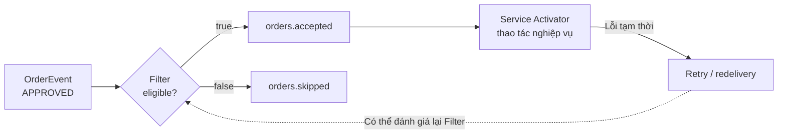
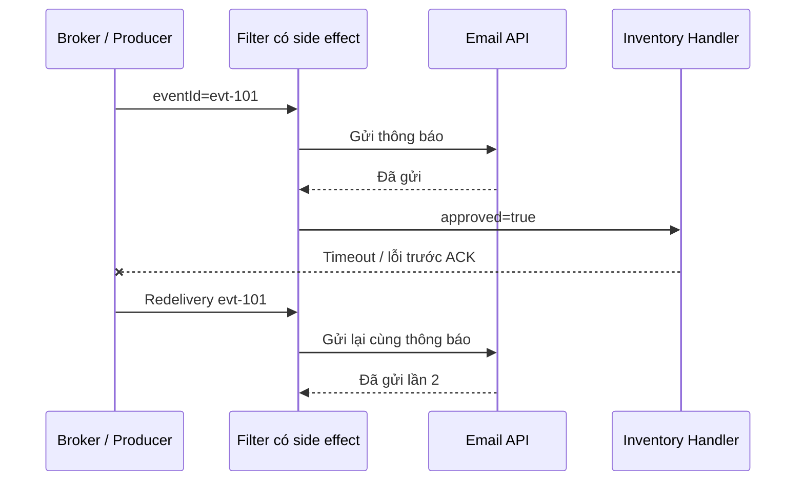
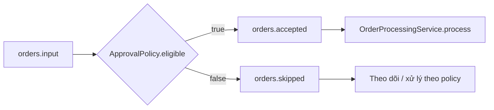
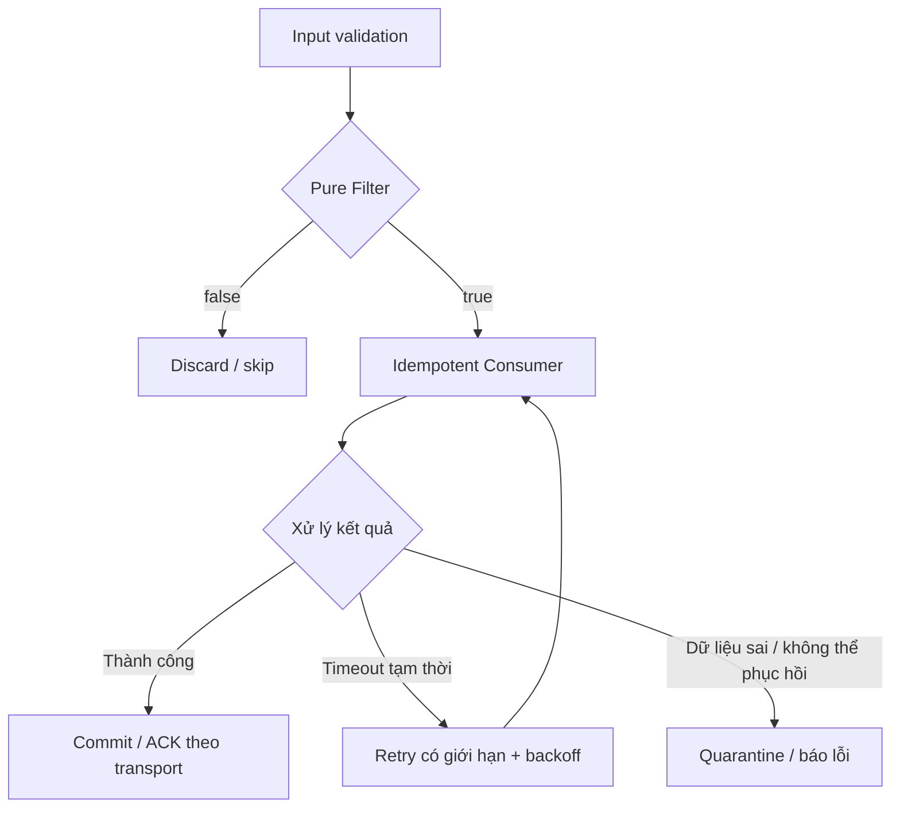
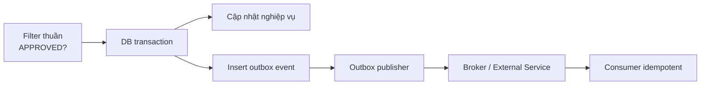

# Filter có tác dụng phụ và vấn đề retry

## 1. Một Filter đơn giản có thể tạo lỗi nghiệp vụ khó phát hiện

Trong luồng tiếp nhận đơn hàng, ứng dụng chỉ muốn cho các sự kiện có trạng thái `APPROVED` đi tiếp tới khâu chuẩn bị hàng. Một nhà phát triển viết điều kiện kiểm tra trạng thái, nhưng đồng thời tăng bộ đếm trong database và gọi dịch vụ gửi thông báo. Khi handler phía sau bị timeout, hệ thống thử gửi lại message. Lần thử lại khiến **Filter chạy lại**, vì vậy bản ghi bị tăng thêm hoặc thông báo được gửi thêm lần nữa mặc dù sự kiện nghiệp vụ không hề phát sinh mới.

**Message Filter** là một Enterprise Integration Pattern (EIP) đưa ra quyết định **cho message đi tiếp hoặc từ chối message**, dựa trên một predicate (điều kiện trả `true` hoặc `false`). Trong Spring Integration, Filter là một endpoint của luồng; nó không tự bảo đảm exactly-once và không có nghĩa là nơi phù hợp để thực hiện side effect.

Bài thuộc chương **Filter** trong module **SPRING_INTEGRATION_PATTERN**, nơi người học thực hành Enterprise Integration Patterns với Spring Integration để xây dựng luồng thông điệp ít phụ thuộc và dễ mở rộng. Bên cạnh Filter còn có Router, Transformer, Splitter, Aggregator, Gateway, retry, error channel và correlation. Một Filter đúng trách nhiệm là nền tảng để kiểm thử và quan sát các nhánh mà không gây tác dụng phụ khi message được gửi lại.



**Ý chính:** Retry là một cơ chế thực thi lại. Nếu predicate của Filter đã thay đổi trạng thái bên ngoài hệ thống, chính lần đánh giá lại ấy có thể tạo hành vi lặp, kể cả khi message bị Filter từ chối.

## 2. Tác dụng phụ (side effect) là gì?

Một biểu thức được xem là có **tác dụng phụ** khi việc đánh giá nó thay đổi trạng thái có thể quan sát ở ngoài kết quả trả về. Với Filter, những thao tác sau là ví dụ:

| Việc làm bên trong predicate | Có tác dụng phụ? | Nguy cơ khi retry |
| --- | --- | --- |
| Đọc `event.state()` rồi so sánh chuỗi | Không, nếu dữ liệu bất biến | Ít rủi ro; kết quả ổn định với cùng đầu vào |
| Tính tổng, kiểm tra ngưỡng từ payload | Thường không | An toàn nếu không có trạng thái thay đổi ngoài |
| Tăng `processedCount` trong database | Có | Một event được đếm nhiều lần |
| Gửi email hoặc HTTP POST | Có | Gửi trùng, có thể gây nhiều giao dịch |
| Trừ tồn kho, trừ tiền, ghi hóa đơn | Có | Sai số lượng, hậu quả nghiệp vụ nghiêm trọng |
| Đánh dấu `eventId` là “đã xử lý” | Có | Có thể khiến lần retry tiếp theo bị bỏ nhầm |
| Ghi log hoặc tăng metric | Có thể quan sát được | Số lần đánh giá khác số event duy nhất; cần đặt tên metric đúng |
| Đọc cấu hình từ service bên ngoài | Bản thân là I/O, không nhất thiết ghi trạng thái | Lỗi mạng; policy thay đổi giữa hai lần đánh giá |

Các phép đo/tracing không bị cấm tuyệt đối trong endpoint, nhưng không nên dùng số lần gọi predicate như **số lượng sự kiện nghiệp vụ duy nhất**. Với logic có side effect nghiệp vụ, nguyên tắc mặc định là **tách nó khỏi Filter**.

### 2.1. Ba lớp kết quả cần phân biệt

Một message đi qua Filter có thể dẫn đến:

1. **Accepted:** predicate trả `true`; message đi tới output channel.
2. **Rejected:** predicate trả `false`; message được bỏ hoặc chuyển sang discard channel theo cấu hình.
3. **Failed:** predicate ném exception hoặc xảy ra lỗi dispatch; đây là lỗi xử lý, không phải một quyết định từ chối hợp lệ.

Một event `PENDING` bị loại vì chưa được phê duyệt có thể là **quyết định nghiệp vụ bình thường**. Ngược lại, database không kết nối được khi predicate cố ghi trạng thái là **lỗi hạ tầng**. Gộp chúng thành “Filter trả false” sẽ khiến hệ thống không biết trường hợp nào cần retry.

### 2.2. Filter không giống Router và Service Activator

| Pattern | Trách nhiệm chính | Khi nào sử dụng? |
| --- | --- | --- |
| **Filter** | Cho qua/từ chối một message | Chỉ nhận đơn đã duyệt |
| **Content-Based Router** | Chọn giữa các channel đích | Đơn nhanh đi nhánh ưu tiên |
| **Transformer** | Chuyển kiểu/hình dạng payload | JSON thành `OrderEvent` |
| **Service Activator** | Gọi hành vi của ứng dụng | Đặt giữ hàng, ghi database |
| **Recipient List / Publish-Subscribe** | Phân phối một message tới nhiều recipient | Audit và notification cùng nhận sự kiện |

Nếu yêu cầu là “vừa kiểm tra vừa lưu trạng thái”, hãy xác định đó có phải **một thao tác nghiệp vụ cần transaction/idempotency** hay không; đừng giấu nó trong một predicate được xem như hàm quyết định đơn thuần.

## 3. Vì sao side effect trong predicate trở nên nguy hiểm khi retry?

Xét code minh họa **sai về thiết kế**:

```java
// Ví dụ PHẢN MẪU: không dùng cho side effect nghiệp vụ.
boolean eligibleWithSideEffect(OrderEvent event) {
    auditRepository.incrementSeenCount(event.eventId());
    notificationClient.sendEligibilityNotice(event.orderId());
    return "APPROVED".equals(event.state());
}
```

Code này chạy hai side effect **trước khi** trả `true` hoặc `false`. Vì thế:

- Event `PENDING` cũng phát email và tăng bộ đếm rồi mới bị từ chối.
- Event `APPROVED` gửi email lần đầu; nếu flow retry từ trước Filter, nó gửi tiếp một email nữa.
- Nếu `sendEligibilityNotice` đã thành công nhưng trả về timeout, lần retry có thể gửi trùng dù lần đầu không báo thành công.
- Nếu producer hoặc broker redeliver cùng event vì ACK thất bại, Filter được đánh giá lại theo một lần delivery mới.

Một kịch bản:



**Phạm vi retry quyết định điều gì chạy lại.** Nếu chỉ một handler downstream được retry bên trong endpoint của chính nó, predicate upstream có thể **không** chạy lại. Nếu toàn bộ flow, poller transaction hoặc broker consumer được gọi lại, Filter thường sẽ được đánh giá lại. Không nên mặc định rằng “bật retry” luôn có một phạm vi duy nhất.

### 3.1. Những nguồn thực thi lặp phổ biến

| Nguồn lặp | Điều có thể xảy ra | Cần kiểm tra |
| --- | --- | --- |
| Retry advice bọc Filter hoặc đoạn flow | Predicate được gọi lại sau exception | Phạm vi advice thực tế |
| Poller/adapter đọc lại message | Cùng message quay về đầu flow | ACK, transaction và error strategy |
| Broker cung cấp at-least-once delivery | Cùng event có nhiều lần giao | Consumer idempotency |
| Producer gửi lại sau timeout | Hai message envelope có cùng event nghiệp vụ | Stable `eventId` |
| Replay từ quarantine/DLQ | Message cũ đi qua logic hiện tại | Phiên bản policy và idempotency |
| Người vận hành reprocess hàng loạt | Hàng nghìn sự kiện được đánh giá lại | Ranh giới side effect và kế hoạch đối soát |

Retry/redelivery giúp hệ thống **khôi phục**, không tự loại bỏ duplicate. Đặc biệt, thông tin đã gọi bên ngoài thành công hay chưa có thể không xác định sau timeout.

## 4. Hợp đồng tốt cho Filter: predicate thuần, xác định và dễ kiểm thử

Một predicate tốt thường thỏa mãn:

1. **Không ghi trạng thái nghiệp vụ**, không phát HTTP POST/email và không trừ tiền trong lúc đánh giá.
2. **Cùng message + cùng rule version → cùng quyết định** khi không có dữ liệu ngoài thay đổi.
3. **Nhẹ, nhanh**, tránh gọi I/O từ xa trên đường nhận message.
4. **Phân biệt reject có chủ đích và exception**.
5. **Độc lập với topology**, trả boolean thay vì tự gửi message tới nhiều channel.

Ví dụ dữ liệu bất biến:

```java
record OrderEvent(
        String eventId,
        String orderId,
        long amountVnd,
        String state) {

    OrderEvent {
        if (eventId == null || eventId.isBlank()
                || orderId == null || orderId.isBlank()
                || state == null || state.isBlank()
                || amountVnd <= 0) {
            throw new IllegalArgumentException(
                    "Invalid OrderEvent");
        }
    }
}
```

Chính sách Filter:

```java
import org.springframework.stereotype.Component;

@Component
final class ApprovalPolicy {

    boolean eligible(OrderEvent event) {
        return "APPROVED".equals(event.state());
    }
}
```

`ApprovalPolicy.eligible` **không gọi database, không ghi log nghiệp vụ và không tự tăng số lần xử lý**. Nó chỉ kiểm tra trạng thái được truyền vào. Để xử lý một loại trạng thái mới, ta cập nhật policy và test mà không cần sửa mã gửi email hoặc thao tác kho.

**Chú ý về validation:** constructor của `OrderEvent` dùng để đảm bảo dữ liệu bắt buộc hợp lệ. Trường `state="PENDING"` là một giá trị có thể hợp lệ về schema nhưng **chưa đủ điều kiện** đi tiếp. Tránh biểu diễn message sai schema và message chưa đủ điều kiện bằng cùng một `false` nếu hệ thống cần phân biệt lỗi dữ liệu với quyết định nghiệp vụ.

### 4.1. Khi policy phải dựa vào dữ liệu bên ngoài

Ví dụ trạng thái duyệt nằm trong database thay vì payload. Có hai cách:

- Dùng **Enricher hoặc Service Activator** lấy trạng thái và tạo message/envelope đã chuẩn hóa trước Filter, rồi Filter chỉ đọc dữ liệu đó.
- Thiết kế một bước **business decision** riêng với retry/timeout rõ ràng; nếu bước này có side effect, cần idempotency và transaction.

Đừng che lỗi “không đọc được trạng thái” thành `false` nếu nghiệp vụ yêu cầu thông điệp được xử lý lại sau khi database hồi phục. Với cache/config có thể thay đổi, lưu hoặc ghi nhận **policy version** nếu cần giải thích vì sao cùng event được chấp nhận ở lần này nhưng bị loại ở lần trước.

## 5. Cấu hình Spring Integration Java DSL với Filter thuần

Ví dụ này cố ý tách ba trách nhiệm: **đầu vào → Filter quyết định → consumer thực hiện side effect**. Một nhánh `orders.skipped` nhận message không đáp ứng điều kiện để hỗ trợ quan sát trong môi trường học tập.



Các import và bean cấu hình:

```java
import org.springframework.context.annotation.Bean;
import org.springframework.context.annotation.Configuration;
import org.springframework.integration.channel.DirectChannel;
import org.springframework.integration.channel.QueueChannel;
import org.springframework.integration.config.EnableIntegration;
import org.springframework.integration.dsl.IntegrationFlow;
import org.springframework.messaging.MessageChannel;
import org.springframework.messaging.PollableChannel;

interface OrderProcessingService {
    void process(OrderEvent event);
}

@Configuration
@EnableIntegration
class OrderFilterFlows {

    @Bean("orders.input")
    MessageChannel input() {
        return new DirectChannel();
    }

    @Bean("orders.accepted")
    MessageChannel accepted() {
        return new DirectChannel();
    }

    @Bean("orders.skipped")
    PollableChannel skipped() {
        // Chỉ để minh họa/test; QueueChannel mặc định không bền vững.
        return new QueueChannel();
    }

    @Bean
    IntegrationFlow filterOrders(ApprovalPolicy policy) {
        return IntegrationFlow.from("orders.input")
                .filter(OrderEvent.class,
                        policy::eligible,
                        spec -> spec.discardChannel("orders.skipped"))
                .channel("orders.accepted")
                .get();
    }

    @Bean
    IntegrationFlow processAcceptedOrders(OrderProcessingService service) {
        return IntegrationFlow.from("orders.accepted")
                .handle(OrderEvent.class, (order, headers) -> {
                    service.process(order);
                    return null; // One-way endpoint.
                })
                .get();
    }
}
```

Ý nghĩa của cấu hình:

1. `orders.input` là channel đầu vào; `DirectChannel` thường thực thi đồng bộ.
2. `filter(OrderEvent.class, policy::eligible, ...)` đánh giá payload kiểu `OrderEvent`.
3. Predicate trả `true`: message đi tiếp qua `orders.accepted` đến consumer.
4. Predicate trả `false`: message đi tới `orders.skipped` theo `discardChannel`, **không** đi tới consumer.
5. `service.process(order)` là nơi có thể thực hiện side effect, vì nó có thể được thiết kế transaction, retry và idempotency.

`QueueChannel` trong ví dụ là **hàng đợi bộ nhớ**, hữu ích để test message bị loại nhưng không phải dead-letter queue bền vững. Nếu đơn bị loại cần lưu để điều tra hoặc xử lý sau restart, hãy gắn storage/broker phù hợp và một consumer chịu trách nhiệm kiểm soát retention, replay.

### 5.1. Producer phát một message có event ID ổn định

```java
import org.springframework.beans.factory.annotation.Qualifier;
import org.springframework.messaging.MessageChannel;
import org.springframework.messaging.support.MessageBuilder;
import org.springframework.stereotype.Component;

@Component
class OrderEventProducer {
    private final MessageChannel input;

    OrderEventProducer(
            @Qualifier("orders.input") MessageChannel input) {
        this.input = input;
    }

    boolean publish(OrderEvent order) {
        return input.send(MessageBuilder.withPayload(order)
                .setHeader("traceId", "trace-" + order.eventId())
                .setHeader("tenantId", "store-hcm")
                .build());
    }
}
```

`eventId` nằm trong payload để làm khóa nhận biết một **sự kiện nghiệp vụ**, không dựa vào `MessageHeaders.ID` (có thể đổi khi envelope được tạo lại). Header `traceId` dùng cho quan sát. Trong hệ thống thật, `tenantId` phải lấy từ nguồn đã được xác thực, không hard-code như dữ liệu học tập.

## 6. `false`, discard channel và exception: đừng nhầm với retry

Spring Integration Filter có nhiều lựa chọn xử lý khi predicate trả `false`. Chọn lựa này ảnh hưởng trực tiếp tới semantics của caller.

| Kết quả của predicate | Cấu hình | Hành vi ở cấp Filter |
| --- | --- | --- |
| `true` | Thông thường | Chuyển message sang output channel |
| `false` | Không có discard channel và không ném lỗi | Message bị loại theo chính sách |
| `false` | `discardChannel("orders.skipped")` | Gửi message đến discard channel |
| `false` | `throwExceptionOnRejection(true)` | Ném `MessageRejectedException` |
| Predicate ném exception | Bất kỳ | Là lỗi thực thi Filter; đi theo exception/error handling |

Đây là **các lựa chọn thiết kế**, không nhất thiết cấu hình đồng thời. Khi yêu cầu client phải biết input không hợp lệ, có thể tách validation thành một bước kiểm tra báo lỗi. Khi event chỉ chưa thuộc diện xử lý, discard có chủ đích và metric có thể phù hợp hơn.

### 6.1. Ví dụ ném lỗi khi Filter từ chối

Trong một flow **thay thế** cho ví dụ mục 5:

```java
@Bean
IntegrationFlow rejectUnapproved(ApprovalPolicy policy) {
    return IntegrationFlow.from("orders.strict-input")
            .filter(OrderEvent.class,
                    policy::eligible,
                    spec -> spec.throwExceptionOnRejection(true))
            .channel("orders.accepted")
            .get();
}
```

Ví dụ trên yêu cầu channel `orders.strict-input` đã được khai báo. Nó minh họa chính sách khác, **không** nên gắn cả hai flow vào cùng một channel đầu vào nếu không chủ động thiết kế điều phối. `throwExceptionOnRejection(true)` biểu đạt rejection bằng exception: khi retry advice được áp dụng cho toàn bộ exception mà không phân loại, message có thể bị thử lại **vô ích** vì trạng thái `PENDING` không tự đổi.

### 6.2. Khi nào `discardChannel` cũng có thể tạo tác dụng phụ?

Discard channel có thể nối tới service lưu message, phát cảnh báo hoặc gọi API. Đó vẫn là **side effect**, chỉ được tách khỏi **predicate**:

```text
Filter returns false
  -> orders.skipped
  -> Discard Handler
  -> Lưu/quarantine hoặc gửi notification
```

Vì discard handler cũng có thể được gọi lại do retry/redelivery, nó **vẫn cần idempotency** nếu side effect phải thực hiện một lần cho mỗi event. Tách responsibilities giúp kiểm soát rõ hơn, **không** tự động tạo exactly-once.

## 7. Đặt retry ở đúng ranh giới

Một thiết kế tốt quyết định **chính xác thành phần nào được chạy lại**.



### 7.1. Các lớp retry hay gặp trong Spring Integration

| Vị trí | Có thể bị gọi lại | Lưu ý |
| --- | --- | --- |
| **Retry advice trên endpoint Filter** | Predicate và xử lý của endpoint đó | Tránh side effect trong predicate |
| **Retry advice trên Service Activator** | Hành vi của Service Activator | Cô lập retry vào tác vụ dễ phục hồi |
| **Poller transaction/adapter** | Một lần xử lý message từ nguồn, có thể gồm toàn flow | Lỗi/rollback có thể khiến Filter chạy lại |
| **Broker consumer redelivery** | Flow bắt đầu từ consumer adapter | Cần chống xử lý trùng toàn pipeline |
| **Phát lại từ DLQ/quarantine** | Các bước mà replay entrypoint chọn | Phải biết policy version và trạng thái đã xử lý |

Trên một luồng đồng bộ `DirectChannel`, exception có thể truyền ngược về thread gửi; khi có executor, poller hoặc broker, lỗi có thể xảy ra trên thread khác. `errorChannel` hay `ErrorMessage` giúp điều phối lỗi trong những cấu hình hỗ trợ, **không** bảo đảm mọi exception tự đến một nơi bền vững. Đường retry và recovery cần được kiểm thử với chính transport của ứng dụng.

### 7.2. Retry không thể biến điều kiện sai thành đúng

Nếu `eligible` là hàm thuần và `event.state()="PENDING"`, thì thử lại cùng message với cùng policy vẫn trả `false`. Việc cấu hình retry cho mọi `MessageRejectedException` chỉ tiêu tốn tài nguyên. Nếu cần chờ event chuyển sang trạng thái `APPROVED`, hãy:

- Đợi một **sự kiện trạng thái mới** có `eventId` và version phù hợp; hoặc
- Dùng cơ chế **deferred processing** với lịch trình/poller có điều kiện rõ, có timeout và storage bền vững; không phải retry ngay vô hạn.

Nếu predicate phụ thuộc vào dữ liệu bên ngoài thay đổi theo thời gian, kết quả có thể đổi giữa các lần thực thi. Lúc đó, nó không còn là quyết định ổn định chỉ dựa vào message; cần ghi rõ hợp đồng thời điểm và policy version.

## 8. Idempotency: bảo vệ tác dụng phụ ở consumer

**Idempotent consumer** là thành phần xử lý cùng một sự kiện nhiều lần mà không tạo thêm side effect nghiệp vụ không mong muốn. Nó quan trọng ngay cả khi Filter hoàn toàn thuần, vì consumer ở downstream vẫn có thể nhận duplicate do retry/redelivery.

Một khóa thực tế:

```text
(consumerName, eventId)
("order-fulfillment", "evt-105")
```

Không dùng chỉ một cờ đã xử lý chung nếu cùng event cần đi nhiều subscriber (ví dụ inventory và audit). Mỗi subscriber/tác vụ cần trạng thái deduplication riêng.

### 8.1. Ghi dấu xử lý cùng transaction với nghiệp vụ

Với tác vụ và khóa idempotency nằm trong **cùng database**, một quy trình có thể dùng unique constraint:

```sql
CREATE TABLE processed_events (
    consumer_name VARCHAR(100) NOT NULL,
    event_id      VARCHAR(100) NOT NULL,
    processed_at  TIMESTAMP NOT NULL,
    PRIMARY KEY (consumer_name, event_id)
);
```

Thuật toán khái niệm:

```text
BEGIN TRANSACTION
  INSERT (consumer_name, event_id)
    vào processed_events
    nếu conflict -> đã xử lý trước, trả kết quả idempotent

  UPDATE orders ...  -- chỉ khi insert key mới thành công
COMMIT
```

Nếu transaction rollback, cả thay đổi nghiệp vụ và dấu đã xử lý đều phải rollback. **Không** làm kiểu:

```text
ghi "DONE" -> gọi API thu tiền -> lỗi
```

vì lần retry có thể thấy `DONE` rồi bỏ qua dù API chưa thành công.

### 8.2. Ví dụ cấu trúc Service Activator có transaction

```java
import org.springframework.stereotype.Service;
import org.springframework.transaction.annotation.Transactional;

interface ProcessedEventStore {
    // Trả false nếu key đã tồn tại; implementation phải an toàn
    // trước concurrent attempts bằng unique constraint/atomic insert.
    boolean tryInsert(String consumerName, String eventId);
}

interface OrderRepository {
    void markReadyForFulfillment(String orderId);
}

@Service
class IdempotentOrderProcessingService
        implements OrderProcessingService {

    private final ProcessedEventStore processed;
    private final OrderRepository orders;

    IdempotentOrderProcessingService(
            ProcessedEventStore processed,
            OrderRepository orders) {
        this.processed = processed;
        this.orders = orders;
    }

    @Override
    @Transactional
    public void process(OrderEvent event) {
        if (!processed.tryInsert("order-fulfillment", event.eventId())) {
            return; // Bản sao của event đã hoàn tất.
        }
        orders.markReadyForFulfillment(event.orderId());
    }
}
```

Ví dụ giả định `ProcessedEventStore` và `OrderRepository` **dùng cùng transactional resource** và `tryInsert` được triển khai đúng semantics trên database đích (unique constraint, cách xử lý conflict không làm transaction mất hiệu lực). Với PostgreSQL có thể dùng `INSERT ... ON CONFLICT DO NOTHING` và số hàng ảnh hưởng. Với database khác, chọn cú pháp tương ứng.

`@Transactional` không tự tạo giao dịch chung cho DB và email API/broker. Nếu nghiệp vụ còn phát thông báo bên ngoài, cần **transactional outbox** (ghi event cần gửi trong cùng DB transaction) và consumer ngoài dùng idempotency key; hoặc có cơ chế đối soát/compensation phù hợp.

### 8.3. Bước reject có cần idempotency không?

Nếu Filter trả `false` và ứng dụng chỉ bỏ message, không có side effect nghiệp vụ phải chống trùng. Nhưng nếu discard handler lưu một bản ghi “đã loại”, phát email hoặc chuyển DLQ thì **có**. Hãy đặt unique key theo `(eventId, rejectionReason, consumer)` hoặc hợp đồng nghiệp vụ thích hợp, và xác định rõ lúc nào được cập nhật trạng thái.

Với yêu cầu lưu audit cho mọi lần giao, có thể chủ động ghi **một bản ghi delivery attempt riêng** (tức cố ý nhiều dòng), không gọi đó là số event duy nhất.

## 9. Khi có API ngoài: timeout, retry và outbox

Giả sử consumer sau Filter gọi bên ngoài để đặt giữ hàng. Một request timeout có ít nhất hai khả năng:

1. Dịch vụ ngoài **chưa nhận** request.
2. Dịch vụ ngoài **đã xử lý** nhưng response/ACK bị mất.

Không thể suy ra “chưa xử lý” chỉ từ timeout. Lặp lại lệnh không có idempotency key có thể đặt giữ hàng hai lần.

Giải pháp:

1. Dùng **khóa idempotency ổn định** như `orderId + actionName` hoặc `eventId + consumerName`.
2. Truyền cùng key khi retry; không tạo UUID mới cho từng attempt.
3. Nếu dịch vụ đích hỗ trợ truy vấn trạng thái theo key, **đối soát** trước khi gọi lại khi kết quả không xác định.
4. Nếu cần phát event/command sau khi ghi DB, dùng **transactional outbox** để không mất command giữa hai hệ thống.
5. Lưu rõ `attemptCount`, `lastError`, `nextRetryAt` và trạng thái recovery nếu quy trình có độ dài đáng kể.



Outbox tăng độ tin cậy giữa DB và messaging, **không** tự bảo đảm exactly-once qua mạng. Outbox publisher cũng có thể gửi lại cùng event nếu chết sau publish nhưng trước khi đánh dấu đã gửi; consumer phải chấp nhận at-least-once delivery.

## 10. Kiểm thử: chứng minh Filter không tạo tác dụng phụ khi được gọi lại

### 10.1. Unit test hàm predicate

Test logic chọn/lọc cần chạy nhanh và không cần dựng Spring context:

```java
import org.junit.jupiter.api.Test;
import static org.junit.jupiter.api.Assertions.*;

class ApprovalPolicyTest {

    private final ApprovalPolicy policy = new ApprovalPolicy();

    @Test
    void approvedEventIsEligible() {
        var event = new OrderEvent(
                "evt-105", "ORD-105", 350_000L, "APPROVED");
        assertTrue(policy.eligible(event));
        assertTrue(policy.eligible(event)); // Re-evaluate không đổi.
    }

    @Test
    void pendingEventIsRejectedDeterministically() {
        var event = new OrderEvent(
                "evt-106", "ORD-106", 150_000L, "PENDING");
        assertFalse(policy.eligible(event));
        assertFalse(policy.eligible(event));
    }

    @Test
    void invalidEnvelopeFailsValidation() {
        assertThrows(IllegalArgumentException.class, () ->
                new OrderEvent("", "ORD-107", 150_000L, "APPROVED"));
    }
}
```

Những test trên chứng minh **cùng đầu vào trả cùng boolean** trong ví dụ, nhưng chỉ đọc code/test vẫn phải xác minh predicate không giấu các thao tác I/O; với trường hợp phức tạp có thể tiêm mock cho dependency và kiểm tra `verifyNoInteractions` với các service ghi dữ liệu.

### 10.2. Integration test nhánh accepted và discarded

Ví dụ dùng JUnit 5, Spring Test và Mockito. `OrderFilterFlows` khai báo `orders.skipped` là `QueueChannel`, vì vậy có thể lấy message bị loại ra để kiểm tra.

```java
import org.junit.jupiter.api.BeforeEach;
import org.junit.jupiter.api.Test;
import org.springframework.beans.factory.annotation.Autowired;
import org.springframework.beans.factory.annotation.Qualifier;
import org.springframework.context.annotation.Bean;
import org.springframework.context.annotation.Configuration;
import org.springframework.messaging.Message;
import org.springframework.messaging.MessageChannel;
import org.springframework.messaging.PollableChannel;
import org.springframework.messaging.support.MessageBuilder;
import org.springframework.test.context.junit.jupiter.SpringJUnitConfig;

import static org.junit.jupiter.api.Assertions.*;
import static org.mockito.Mockito.*;

@SpringJUnitConfig(classes = {
        OrderFilterFlows.class,
        ApprovalPolicy.class,
        OrderFilterFlowTest.Fakes.class
})
class OrderFilterFlowTest {

    @Autowired
    @Qualifier("orders.input")
    MessageChannel input;

    @Autowired
    @Qualifier("orders.skipped")
    PollableChannel skipped;

    @Autowired
    OrderProcessingService service;

    @BeforeEach
    void resetState() {
        reset(service);
        while (skipped.receive(0) != null) {
            // Dọn message của test trước trong queue RAM.
        }
    }

    @Test
    void approvedGoesToConsumerOnly() {
        var event = new OrderEvent(
                "evt-105", "ORD-105", 350_000L, "APPROVED");
        assertTrue(input.send(MessageBuilder.withPayload(event).build()));

        verify(service).process(event);
        assertNull(skipped.receive(0));
    }

    @Test
    void pendingGoesToDiscardWithoutConsumerSideEffect() {
        var event = new OrderEvent(
                "evt-106", "ORD-106", 150_000L, "PENDING");
        assertTrue(input.send(MessageBuilder.withPayload(event).build()));

        verifyNoInteractions(service);
        Message<?> rejected = skipped.receive(0);
        assertNotNull(rejected);
        assertEquals(event, rejected.getPayload());
    }

    @Configuration
    static class Fakes {
        @Bean
        OrderProcessingService orderProcessingService() {
            return mock(OrderProcessingService.class);
        }
    }
}
```

Vì đây là flow đồng bộ dùng `DirectChannel`, việc kiểm tra consumer ngay sau `send()` là phù hợp với ví dụ. Nếu thay bằng executor hoặc broker, cần dùng `CountDownLatch`/Awaitility, chờ theo điều kiện có timeout, kiểm tra kết quả thực tế; không dùng `Thread.sleep` cố định.

**Lưu ý:** `send()` trả `true` không luôn có nghĩa nghiệp vụ đã hoàn tất, đặc biệt khi channel hoặc endpoint bất đồng bộ.

### 10.3. Test retry và redelivery

Thêm các ca dùng cùng `eventId` qua hai lần giao:

| Kịch bản | Kỳ vọng |
| --- | --- |
| `APPROVED` gửi một lần | Predicate trả true, consumer xử lý |
| `PENDING` gửi một lần | Predicate trả false, consumer không xử lý |
| Đánh giá predicate 10 lần với cùng message | Không phát sinh ghi DB, email hay lệnh nghiệp vụ từ predicate |
| Consumer thất bại trước commit rồi retry | Transaction rollback; lần sau có thể hoàn tất |
| Consumer đã commit nhưng ACK mất | Redelivery không tạo side effect trùng |
| API ngoài xử lý nhưng phản hồi timeout | Dùng idempotency key/đối soát thay vì gửi lệnh mới vô điều kiện |
| Rejected event có discard handler | Re-delivery không tạo bản ghi/thông báo trùng nếu chính sách yêu cầu |
| `throwExceptionOnRejection(true)` với `PENDING` | Retry policy loại trừ rejection nghiệp vụ không thể sửa bằng thử lại |
| Policy version thay đổi | Quy định có đánh giá lại hay giữ quyết định cũ, ghi dấu để audit |
| Message qua Transformer, Splitter, Router | `eventId`, `traceId`, correlation và ngữ nghĩa retry không bị mất |

Đối với xử lý trùng, chỉ assert số lần gọi mock là chưa đủ. Cần test **trạng thái nghiệp vụ cuối cùng** trong database hoặc stub idempotency có concurrency, đặc biệt với hai consumer chạy đồng thời.

## 11. Quan sát và xử lý sự cố

Một hệ thống Filter có retry cần phân biệt ba loại số liệu:

- **Số delivery attempts:** tổng số lần message đi vào flow, bao gồm redelivery.
- **Số rejected decisions:** tổng số lần Filter trả false (có thể bao gồm cùng event nhiều lần).
- **Số event duy nhất được xử lý thành công:** tính bằng khóa sự kiện và consumer, không lấy trực tiếp số lần đánh giá Filter.

Các metric hữu ích:

| Metric / log | Mục đích |
| --- | --- |
| `filter.accepted` | Tỷ lệ chấp nhận, theo loại event/rule |
| `filter.rejected` | Tỷ lệ từ chối hợp lệ; phân loại lý do |
| `filter.error` | Exception trong evaluation hoặc dispatch |
| `consumer.retry` | Số lần retry tác vụ downstream |
| `consumer.duplicate_suppressed` | Sự kiện bị loại do idempotency |
| `consumer.success` / `consumer.failure` | Thành công/thất bại nghiệp vụ |
| DLQ age, backlog, replay count | Khả năng phục hồi khi bị kẹt |

Với log/tracing, ghi `eventId`, `traceId`, `consumerName`, loại lỗi, rule version và attempt nếu cần. **Không đặt `eventId` hoặc `orderId` làm nhãn metric** vì số lượng giá trị quá lớn. Không log payload chứa thông tin nhạy cảm nếu không có cơ chế bảo vệ.

### 11.1. Nếu chỉ thấy nhiều lần chạy Filter, có phải lỗi Filter?

Chưa chắc. Đó có thể là redelivery đúng thiết kế của broker. Cần xem:

1. Có phải **cùng eventId** hay chỉ payload giống nhau?
2. Retry được cấu hình ở Filter, consumer, adapter hay toàn flow?
3. Lỗi xảy ra **trước hay sau** side effect?
4. ACK/commit đã thành công chưa?
5. Predicate có gọi I/O hoặc thay đổi dữ liệu không?
6. Consumer và discard handler có chống xử lý trùng không?

Một message xuất hiện nhiều lần trong logs không đồng nghĩa nhiều lần thành công. Nhưng nếu tác dụng phụ nằm trong predicate, **mỗi lần xuất hiện có thể là một lần tác động nghiệp vụ**.

## 12. Những lỗi thiết kế thường gặp

1. **Gửi email hoặc ghi database trong predicate.** Retry làm tác động lặp.
2. **Tăng bộ đếm “đã xử lý event” ngay trong Filter.** Đếm attempt thay vì event duy nhất.
3. **Đánh dấu event DONE trước khi xử lý thành công.** Retry bị chặn nhưng side effect có thể chưa hoàn tất.
4. **Coi `false` như exception.** Retry vô hạn event chưa đáp ứng điều kiện.
5. **Nuốt exception để trả `false`.** Lỗi hạ tầng bị che thành rejection nghiệp vụ.
6. **Coi discard channel tự có độ bền.** `QueueChannel` mặc định không phải storage tồn tại sau restart.
7. **Chỉ retry Service Activator mà bỏ qua broker redelivery.** Cả flow vẫn có thể chạy lại.
8. **Dùng message ID của envelope làm dedupe key.** Message mới của cùng event có thể có ID khác.
9. **Dùng một bản ghi DONE chung cho nhiều recipient.** Một nhánh xử lý xong khiến nhánh khác bị bỏ nhầm.
10. **Cho rằng `@Transactional` bao trùm API từ xa.** DB rollback không hoàn tác email hoặc thanh toán.
11. **Thay policy mà không version/audit.** Replay cùng event cho kết quả khác nhưng khó giải thích.
12. **Chỉ assert `send()==true`.** Không kiểm tra consumer thực sự thành công hoặc side effect được chống trùng.

## 13. Bài tập thực hành

Thiết kế flow cho sự kiện `PaymentRequested` với payload `eventId`, `paymentId`, `amount`, `status` và headers `traceId`, `tenantId`. Chỉ những payment đã xác minh (`VERIFIED`) được gửi tới Service Activator gọi cổng thanh toán.

1. Viết predicate **thuần** nhận `PaymentRequested` và chỉ trả `true` khi đã xác minh và đủ điều kiện xử lý.
2. Phân biệt payment không hợp lệ về schema và payment có trạng thái `PENDING` nhưng hợp lệ.
3. Cấu hình Java DSL `filter(...)` với nhánh accepted và discard; giải thích vì sao Filter không nên gọi API thanh toán.
4. Đưa một implementation **cố tình sai**: predicate vừa kiểm tra vừa lưu “đã thanh toán”; mô phỏng retry và chỉ ra kết quả sai.
5. Chuyển side effect sang Service Activator; thiết kế idempotency key `(consumerName,eventId)`.
6. Dùng transaction và unique constraint để chống tác động trùng trên một database; giải thích giới hạn khi gọi dịch vụ thanh toán ngoài.
7. Mô phỏng API trả timeout sau khi thực sự thu tiền; đề xuất cách đối soát và tái sử dụng idempotency key.
8. Thử cấu hình `throwExceptionOnRejection(true)` trong flow thay thế; giải thích vì sao không nên retry vô hạn cho `PENDING`.
9. Viết unit test cho predicate gọi lặp và integration test cho hai nhánh, retry/redelivery và trạng thái nghiệp vụ cuối.
10. Thiết kế log/metric phân biệt delivery attempts, rejected decisions và unique successful payments.

**Tự đánh giá:** Một predicate gọi `repository.save` có còn là điều kiện lọc thuần không? Nếu handler downstream timeout, Filter chắc chắn được gọi lại hay còn tùy phạm vi retry? Vì sao `discardChannel` không tự bảo đảm exactly-once? Khi cùng event được giao lại sau commit nhưng trước ACK, consumer phải làm gì?

**Filter có tác dụng phụ và vấn đề retry** là bài học về **ranh giới trách nhiệm và khả năng thực thi lặp**. Một Filter nên quyết định chấp nhận hoặc từ chối dựa trên dữ liệu đã chuẩn hóa; Service Activator chịu trách nhiệm cho các thay đổi nghiệp vụ có transaction, idempotency và recovery phù hợp. Khi tách hai vai trò này, retry và redelivery vẫn có thể xảy ra, nhưng không còn âm thầm gây tác dụng phụ ngay ở bước chỉ dùng để lựa chọn message.
