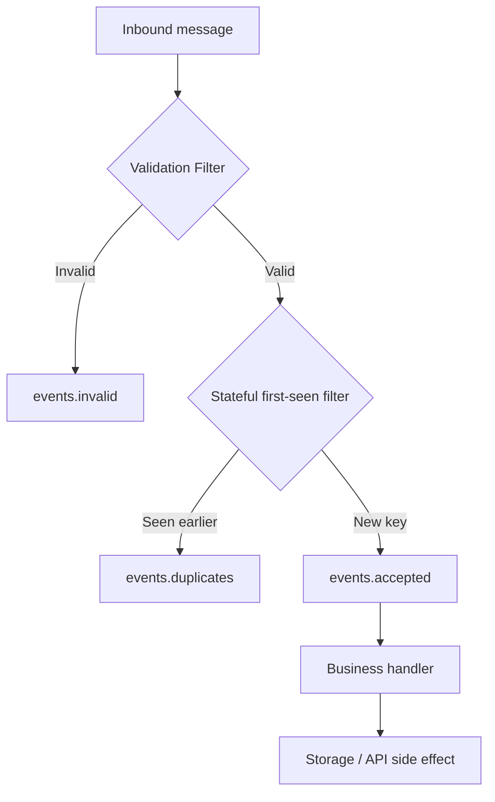
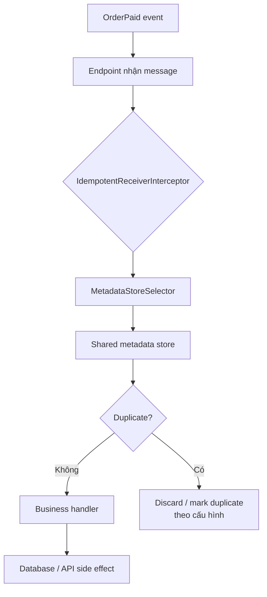
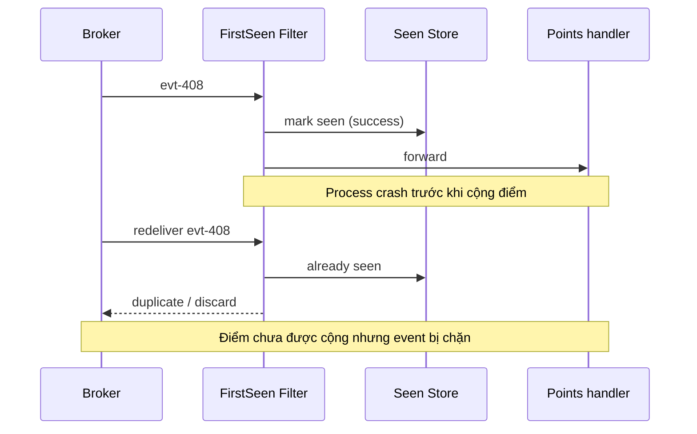
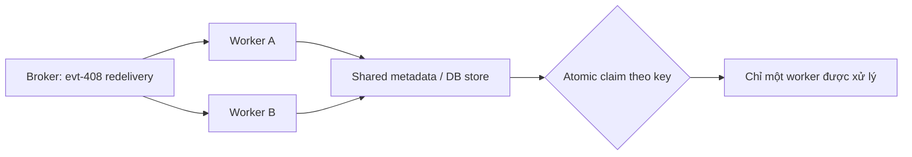
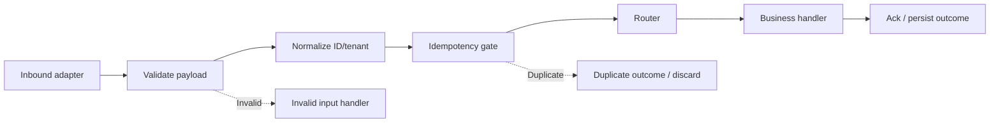

# Filter idempotent và filter stateful

## 1. Một sự kiện được gửi hai lần: lọc hay xử lý hai lần?

Giả sử hệ thống nhận sự kiện `OrderPaid` để cộng điểm thưởng cho khách hàng. Producer gửi message, consumer cập nhật điểm thưởng, nhưng kết nối bị ngắt trước khi producer hoặc broker nhận xác nhận. Hệ thống phát lại cùng sự kiện để tránh bỏ sót. Consumer có thể nhận:

```text
Lần 1: eventId=evt-408, orderId=O-408, points=50
Lần 2: eventId=evt-408, orderId=O-408, points=50
```

Hai lần giao message là điều bình thường trong nhiều kiến trúc **at-least-once delivery**. Nếu logic cộng điểm chạy cả hai lần, người dùng nhận 100 điểm thay vì 50. Lúc này một Message Filter đơn thuần kiểm tra “đơn hàng có hợp lệ không?” **không đủ**; cần biết sự kiện `evt-408` đã được nhận hoặc xử lý trước đó chưa.

Đó là chỗ cần phân biệt:

- **Stateless Filter** (*filter không trạng thái*): đưa ra quyết định chỉ từ message hiện tại và quy tắc tương ứng, không cần nhớ message trước.
- **Stateful Filter** (*filter có trạng thái*): dùng hoặc thay đổi trạng thái được duy trì giữa các message, ví dụ cửa sổ thời gian, hạn mức, tập ID đã thấy.
- **Idempotent Receiver** (*bên nhận xử lý lặp an toàn*): đảm bảo việc nhận/phát lại cùng một yêu cầu không gây ra tác dụng nghiệp vụ không mong muốn nhiều lần; có thể dùng stateful deduplication nhưng không chỉ đơn giản là “đã thấy ID thì bỏ”.

Bài thuộc chương **Filter** của module **SPRING_INTEGRATION_PATTERN**. Mục tiêu của module là triển khai Enterprise Integration Patterns với Spring Integration để xây dựng luồng message ít phụ thuộc và dễ mở rộng; phối hợp Router, Filter, Transformer, Splitter, Aggregator, Gateway, retry, error channel và correlation, đồng thời kiểm thử và theo dõi các nhánh xử lý.

Sau bài này, bạn sẽ:

1. Phân biệt điều kiện lọc thuần với điều kiện phụ thuộc trạng thái.
2. Thiết kế khóa idempotency phù hợp với nghiệp vụ, tenant và phiên bản event.
3. Dùng Spring Integration Filter để minh họa chống trùng ở mức **admission** trong một JVM.
4. Hiểu cơ chế `IdempotentReceiverInterceptor`, `MetadataStoreSelector` và các lựa chọn MetadataStore.
5. Phân tích race condition, crash window, retry, transaction và duplicate delivery.
6. Kiểm thử message trùng, message hợp lệ, key khác nhau, concurrent processing và việc phát lại sau lỗi.
7. Thiết kế quan sát, TTL, cleanup và recovery không làm mất dữ liệu quan trọng.

## 2. Điểm giống và khác nhau

| Tiêu chí | Stateless Filter | Stateful Filter | Idempotent Receiver |
| --- | --- | --- | --- |
| Câu hỏi điển hình | Message này có hợp lệ? | Message này có được tiếp nhận theo trạng thái hiện tại? | Cùng thao tác được giao lại có lặp side effect không? |
| Dữ liệu cần | Message và luật hiện tại | Message + lịch sử/counter/window/state | Business identity, trạng thái xử lý và kết quả đã commit |
| Ví dụ | `amount >= 0` | Trong 60 giây chỉ nhận tối đa N request | Một event thanh toán chỉ cộng điểm một lần |
| Có thể lọc trùng? | Không nếu thiếu lịch sử | Có, khi lưu tập key đã thấy | Có, nếu trạng thái idempotency gắn với outcome đúng |
| Lỗi crash/restart | Không có state nội bộ để mất | Có thể mất state nếu chỉ lưu trong RAM | Phải xét persistence, transaction/ack và replay |
| Nhiều instance | Thường dễ scale khi luật thuần | Phải chia sẻ/sắp xếp state nếu cần nhất quán toàn cụm | Cần kiểm soát trùng đồng thời trên key nghiệp vụ |
| Tác dụng phụ của predicate | Nên tránh | Có thể cần cập nhật state nguyên tử | Cần đồng bộ với nghiệp vụ hoặc cơ chế phục hồi |
| Mức bảo đảm | Chỉ pass/reject | Tùy khả năng nhất quán của state | Phụ thuộc định nghĩa nghiệp vụ và phạm vi commit |

**Mọi bộ lọc idempotency dựa trên “ID đã thấy” đều là một dạng stateful filtering, nhưng không phải mọi stateful filter đều bảo đảm idempotency.** Ví dụ bộ lọc hạn mức theo phút là stateful, song vẫn có thể cho cùng một yêu cầu đi qua hai lần trong cùng hạn mức.

Một kết quả `false` của Filter cũng không mặc nhiên là lỗi kỹ thuật. Có thể là message không thuộc phạm vi xử lý, dữ liệu không hợp lệ, request đã có kết quả, hoặc giới hạn đã hết. Những lý do này cần được phân biệt rõ trong thiết kế.

## 3. Stateful không nhất thiết đồng nghĩa với duplicate

Một Filter có trạng thái có thể dùng nhiều mô hình:

| Dạng trạng thái | Predicate | Trạng thái cần giữ | Rủi ro |
| --- | --- | --- | --- |
| **Seen-set** | Key chưa từng xuất hiện | Tập khóa | Tăng bộ nhớ, mất state khi restart |
| **Sliding-window rate limit** | Lượng request trong cửa sổ nhỏ hơn giới hạn | Counter/timestamps theo key | Clock, concurrent update, TTL |
| **Quota theo ngày** | Số lượng sự kiện chưa vượt hạn mức | Counter theo tenant/ngày | Reset đúng thời điểm và race condition |
| **Dedup theo phiên bản** | Chưa xử lý `aggregateId + version` | Phiên bản đã hoàn tất | Event đến lệch thứ tự, gap |
| **State machine gate** | Chuyển trạng thái hiện tại có hợp lệ? | Trạng thái nghiệp vụ | Cần transaction và concurrency control |
| **Temporal Filter** | Chưa quá hạn hoặc chưa được nhận trong một khoảng | Timestamp và cửa sổ | Đồng hồ lệch, dữ liệu đến trễ |

Đặt logic trạng thái vào một predicate không có nghĩa mọi dữ liệu state đều nên nằm trong một bean `@Component`. Với cụm nhiều instance hoặc các message quan trọng, state phải có **vòng đời, đồng bộ và độ bền** phù hợp.

### Ví dụ hạn mức theo tenant

Một bộ lọc “mỗi tenant tối đa 100 request/phút” không xử lý trùng theo business event. Cùng một event có thể vượt qua ở hai phút khác nhau. Ngược lại, idempotency theo `eventId` có thể từ chối event đã xử lý dù qua ngày mới. Cần định nghĩa yêu cầu thời gian và vòng đời riêng, thay vì tái sử dụng bừa một cache.

## 4. Semantics của Message Filter trong Spring Integration

Trong Spring Integration, **Message Filter** chọn pass hoặc reject dựa trên `MessageSelector` hoặc biểu thức/predicate của Java DSL. Message được pass đi tới output channel; message bị reject có thể:

- Bị loại khỏi đường chính.
- Được gửi đến **discard channel** nếu đã cấu hình.
- Làm endpoint phát exception nếu bật chế độ từ chối bằng lỗi.

Ví dụ cơ bản (giả định `OrderEvent` có trường `amount`):

```java
IntegrationFlow.from("orders.in")
    .filter(OrderEvent.class,
        event -> event.amount() != null
              && event.amount().signum() >= 0,
        spec -> spec.discardChannel("orders.invalid"))
    .channel("orders.validated")
    .get();
```

Filter ở đây **không nhớ** đơn hàng nào từng đến. Hai lần nhận cùng `OrderEvent` hợp lệ đều qua Filter.

Một Filter chỉ nên thực hiện nhiệm vụ rõ ràng. Với dữ liệu sai, có thể đưa sang `orders.invalid`. Với duplicate, nên dùng nhánh riêng `orders.duplicates`. Nếu gộp tất cả vào một discard channel, consumer sau khó phân biệt “dữ liệu sai” với “sự kiện đã được xử lý”.

### Hình dung pipeline



Điều kiện `firstSeen` ở sơ đồ chỉ nói **“được cho vào xử lý lần đầu theo state hiện tại”**, không nói side effect đã hoàn tất hoặc đã commit.

## 5. Khóa idempotency: chọn sai khóa là kiểm tra sai bài toán

Không thể thiết kế idempotency chỉ từ `MessageHeaders.ID` hoặc tên channel. Khóa nên đại diện cho **một thao tác nghiệp vụ mà việc thực hiện lặp không được phép tạo thêm tác dụng**.

Một số ví dụ:

| Use case | Khóa có thể phù hợp | Vì sao |
| --- | --- | --- |
| Cộng điểm khi thanh toán thành công | `tenantId + paymentEventId` | Một sự kiện thanh toán không được cộng điểm hai lần |
| Ghi một phiên bản aggregate | `tenantId + aggregateId + version` | Mỗi phiên bản xử lý một lần |
| Đặt lệnh chuyển tiền | `accountId + clientRequestId` hoặc operation ID được cấp | Cùng yêu cầu retry không tạo thêm lệnh |
| Gửi email thông báo | `campaignId + recipientId + notificationId` | Một thông báo không lặp tới cùng recipient |
| Fan-out theo Recipient List | `eventId + recipientId` | Audit xong không đồng nghĩa CRM đã xong |
| Xử lý một file upload | `tenantId + uploadId + operationType` | Một upload có thể thực hiện nhiều thao tác hợp lệ |

### Các sai lầm phổ biến

**1. Dùng Message ID của framework.** Mỗi lần tạo message mới, ID framework có thể khác. Hai lần giao cùng sự kiện nghiệp vụ có thể có hai `MessageHeaders.ID` khác nhau.

**2. Dùng hash của toàn payload mà không có contract.** Hai thao tác khác nhau có payload giống nhau; hoặc một thao tác retry có timestamp/header khác nhau khiến hash đổi.

**3. Không đưa tenant hoặc operation type vào phạm vi.** Hai tenant có cùng chuỗi `eventId` sẽ chặn nhầm nhau nếu dùng key global.

**4. Sinh UUID mới tại mỗi retry.** Mỗi retry có key mới nên bộ lọc không nhận ra duplicate.

**5. Gộp những event được phép đến nhiều lần.** Hai sự kiện `OrderUpdated` cho hai version khác nhau cùng một order ID đều có thể hợp lệ; key chỉ gồm `orderId` sẽ làm mất bản cập nhật sau.

### Một key có thể là cấu trúc thay vì chuỗi

Dùng một value object:

```java
record EventKey(String tenantId, String eventId) {}
```

Khi cần lưu state ra Redis/JDBC, thiết kế encoding có escaping/length-prefix hoặc định dạng chuẩn để tránh va chạm, ví dụ `tenant:abc` và `event:xyz` bị ghép sai. Khóa cần ổn định xuyên phiên bản code.

## 6. Ví dụ 1 — Stateful Filter dùng bộ nhớ (chỉ dành cho demo)

Ví dụ sau minh họa **tính nguyên tử trong một JVM** bằng `ConcurrentHashMap.newKeySet()`. Hệ thống nhận `OrderPaidEvent`; Filter đầu kiểm tra dữ liệu, Filter thứ hai chỉ cho qua sự kiện có key chưa từng thấy.

```java
import java.math.BigDecimal;
import java.util.Set;
import java.util.concurrent.ConcurrentHashMap;

import org.springframework.context.annotation.Bean;
import org.springframework.context.annotation.Configuration;
import org.springframework.integration.channel.DirectChannel;
import org.springframework.integration.channel.QueueChannel;
import org.springframework.integration.config.EnableIntegration;
import org.springframework.integration.dsl.IntegrationFlow;

record OrderPaidEvent(
        String tenantId,
        String eventId,
        String orderId,
        BigDecimal amount) {}

record EventKey(String tenantId, String eventId) {}

// Chỉ minh họa first-seen admission, KHÔNG phải exactly-once.
final class FirstSeenFilter {

    private final Set<EventKey> seen =
        ConcurrentHashMap.newKeySet();

    boolean firstSeen(OrderPaidEvent event) {
        EventKey key = new EventKey(
            event.tenantId(), event.eventId());
        // add() trả true đúng một lần cho cùng key trong cùng JVM.
        return seen.add(key);
    }
}

@Configuration
@EnableIntegration
public class FilterStatefulDemoConfig {

    @Bean
    FirstSeenFilter firstSeenFilter() {
        return new FirstSeenFilter();
    }

    @Bean("paid.in")
    DirectChannel paidInput() {
        return new DirectChannel();
    }

    @Bean("paid.invalid")
    QueueChannel invalid() {
        return new QueueChannel();
    }

    @Bean("paid.duplicates")
    QueueChannel duplicates() {
        return new QueueChannel();
    }

    @Bean("paid.accepted")
    QueueChannel accepted() {
        return new QueueChannel();
    }

    @Bean
    IntegrationFlow gatePaidEvents(FirstSeenFilter firstSeen) {
        return IntegrationFlow.from("paid.in")
            .filter(OrderPaidEvent.class,
                FilterStatefulDemoConfig::valid,
                spec -> spec.discardChannel("paid.invalid"))
            .filter(OrderPaidEvent.class,
                firstSeen::firstSeen,
                spec -> spec.discardChannel("paid.duplicates"))
            .channel("paid.accepted")
            .get();
    }

    static boolean valid(OrderPaidEvent event) {
        return event.tenantId() != null
            && !event.tenantId().isBlank()
            && event.eventId() != null
            && !event.eventId().isBlank()
            && event.orderId() != null
            && !event.orderId().isBlank()
            && event.amount() != null
            && event.amount().signum() >= 0;
    }
}
```

**Đọc flow:**

1. `paid.in` nhận một `OrderPaidEvent`.
2. Filter đầu **không có trạng thái** từ chối event thiếu tenant, event ID, order ID hoặc amount không hợp lệ.
3. Filter thứ hai dùng `seen.add(EventKey)`. Thêm thành công → pass; key đã có → discard sang `paid.duplicates`.
4. `paid.accepted` là một `QueueChannel` dành cho kiểm thử: message đã được chấp nhận, **chưa có business handler** cộng điểm hoặc ghi database.

### Vì sao Set thread-safe chưa đủ?

`ConcurrentHashMap.newKeySet()` giúp ngăn hai thread trong **một JVM** cùng được chấp nhận với một key, bởi thao tác `add()` là nguyên tử cho key đó. Tuy nhiên:

- State không chia sẻ giữa các instance: node A và B đều có thể nhận cùng key.
- State mất khi JVM restart: event cũ có thể lại được coi là mới.
- State tăng không giới hạn: hệ thống chạy lâu sẽ tăng bộ nhớ và có nguy cơ OOM.
- Key được đánh dấu **trước** side effect. Nếu worker crash sau `seen.add()` nhưng trước khi xử lý thành công, retry trong cùng JVM có thể bị loại dù chưa có kết quả nghiệp vụ.
- Với `QueueChannel`, việc add key thành công và việc enqueue message **không tạo một transaction nguyên tử**. Queue đầy hoặc gửi thất bại có thể để lại key đã đánh dấu.
- Nhánh duplicate được ghi nhận ở đây chỉ có nghĩa “key đã xuất hiện”, **không chắc nghiệp vụ đã hoàn thành**.

Vì vậy code này **chỉ thích hợp để học semantics filter, test routing trong một JVM hoặc loại duplicate không quan trọng**. Không dùng nó làm bảo đảm exactly-once cho thanh toán, điểm thưởng hoặc cập nhật dữ liệu quan trọng.

## 7. Kiểm thử ví dụ: duplicate và dữ liệu sai là hai nhánh khác nhau

Dùng JUnit 5 + AssertJ để kiểm tra Filter và việc giữ header truy vết:

```java
import static org.assertj.core.api.Assertions.assertThat;

import java.math.BigDecimal;

import org.junit.jupiter.api.Test;
import org.springframework.beans.factory.annotation.Autowired;
import org.springframework.beans.factory.annotation.Qualifier;
import org.springframework.integration.channel.QueueChannel;
import org.springframework.messaging.Message;
import org.springframework.messaging.MessageChannel;
import org.springframework.messaging.support.MessageBuilder;
import org.springframework.test.context.junit.jupiter.SpringJUnitConfig;

@SpringJUnitConfig(FilterStatefulDemoConfig.class)
class FilterStatefulDemoTest {

    @Autowired @Qualifier("paid.in")
    MessageChannel input;

    @Autowired @Qualifier("paid.accepted")
    QueueChannel accepted;

    @Autowired @Qualifier("paid.duplicates")
    QueueChannel duplicates;

    @Autowired @Qualifier("paid.invalid")
    QueueChannel invalid;

    private void send(OrderPaidEvent event, String requestId) {
        assertThat(input.send(
            MessageBuilder.withPayload(event)
                .setHeader("requestId", requestId)
                .build())).isTrue();
    }

    @Test
    void firstOccurrencePassesAndSecondIsDiscarded() {
        OrderPaidEvent event = new OrderPaidEvent(
            "tenant-A", "evt-408", "O-408", new BigDecimal("50"));

        send(event, "request-1");
        send(event, "request-2");

        Message<?> first = accepted.receive(1_000);
        Message<?> duplicate = duplicates.receive(1_000);

        assertThat(first).isNotNull();
        assertThat(duplicate).isNotNull();
        assertThat(first.getPayload()).isEqualTo(event);
        assertThat(first.getHeaders().get("requestId"))
            .isEqualTo("request-1");
        assertThat(duplicate.getHeaders().get("requestId"))
            .isEqualTo("request-2");

        assertThat(accepted.receive(0)).isNull();
        assertThat(invalid.receive(0)).isNull();
    }

    @Test
    void invalidEventDoesNotBecomeASeenKey() {
        OrderPaidEvent invalidEvent = new OrderPaidEvent(
            "tenant-A", "evt-invalid", "O-1",
            new BigDecimal("-1"));

        send(invalidEvent, "request-invalid");

        Message<?> rejected = invalid.receive(1_000);
        assertThat(rejected).isNotNull();
        assertThat(accepted.receive(0)).isNull();
        assertThat(duplicates.receive(0)).isNull();
    }

    @Test
    void sameEventIdFromDifferentTenantIsNotDuplicate() {
        OrderPaidEvent a = new OrderPaidEvent(
            "tenant-A", "evt-same", "O-A",
            BigDecimal.ONE);
        OrderPaidEvent b = new OrderPaidEvent(
            "tenant-B", "evt-same", "O-B",
            BigDecimal.ONE);

        send(a, "request-A");
        send(b, "request-B");

        assertThat(accepted.receive(1_000)).isNotNull();
        assertThat(accepted.receive(1_000)).isNotNull();
        assertThat(duplicates.receive(0)).isNull();
    }
}
```

**Lưu ý cô lập test:** `FirstSeenFilter` là singleton trong Spring context. Các test trong cùng context dùng chung tập `seen`. Ở ví dụ, các test sử dụng những event ID khác nhau và đọc hết queue liên quan; dự án thực nên dùng context/fixture riêng hoặc cleanup state có kiểm soát giữa test. Không phụ thuộc vào thứ tự chạy test.

### Test đồng thời nên kiểm tra gì?

Với cùng một `EventKey`, tạo nhiều thread cùng gọi `firstSeen(...)` và dùng `CountDownLatch` cho chúng bắt đầu gần nhau. Trong một JVM, tổng số lần trả `true` phải là **1**. Nếu triển khai nhiều instance với mỗi instance một Set riêng, test sẽ cho thấy chúng đều trả `true`: đó là bằng chứng cần shared store/unique constraint cho idempotency toàn cụm.

Test concurrency không nên dùng `Thread.sleep` như bằng chứng cho tính nguyên tử; hãy dùng barrier, chờ có giới hạn và kiểm tra kết quả.

## 8. Idempotent Receiver trong Spring Integration

Spring Integration có khái niệm **Idempotent Receiver** thể hiện bằng `IdempotentReceiverInterceptor` — một advice/interceptor có thể được gắn vào message handler — phối hợp với `MessageSelector` (thường là `MetadataStoreSelector`) để nhận diện message trùng theo khóa.

Khác với Filter tự viết ở trên, cơ chế này đưa duplicate detection vào lớp **interceptor trước một endpoint xử lý message**. Nó có thể:

- Đánh giá key/value được lấy từ message.
- Tham chiếu một `MetadataStore` hoặc `ConcurrentMetadataStore` để lưu và so sánh state.
- Nhận biết duplicate; tùy cấu hình có thể không chuyển đến handler hoặc gắn thông tin duplicate để handler quyết định cách xử lý.
- Phối hợp cùng các endpoint Spring Integration thay vì nhúng Set vào từng business service.

**Không đồng nhất IdempotentReceiverInterceptor với tính chất exactly-once end-to-end.** Interceptor vẫn cần store phù hợp, quy tắc retry/transaction, và business handler idempotent khi có rủi ro “đã commit nhưng chưa ack”.

### Các thành phần nên tìm hiểu

| Thành phần | Vai trò | Điểm cần xem xét |
| --- | --- | --- |
| `MessageSelector` | Quyết định message có được xử lý không | Predicate có side effect/đọc state ra sao |
| `MetadataStoreSelector` | Tạo selector dựa trên key/value và metadata store | Key phải ổn định, value/cập nhật phù hợp bài toán |
| `IdempotentReceiverInterceptor` | Advice để nhận diện duplicate tại endpoint | Behavior discard hoặc đánh dấu duplicate theo cấu hình |
| `SimpleMetadataStore` | Metadata store đơn giản trong bộ nhớ | Không bền vững, không chia sẻ đa JVM |
| `JdbcMetadataStore` | Metadata store dùng database | Transaction, unique key, connection và hiệu năng |
| `RedisMetadataStore` | Metadata store dùng Redis | Atomic operation, key namespace, TTL và khả năng phục hồi |

Các class cụ thể, constructor và tùy chọn advice có thể khác theo phiên bản Spring Integration; phải đối chiếu với API/reference của phiên bản đang chạy. Không nên xem một danh sách class là bảo đảm về cách commit hoặc giao tin.

### Sơ đồ áp dụng interceptor



Giả sử key là `tenantId:eventId`, interceptor chỉ được phép dựa trên **các giá trị đã xác thực**. Một duplicate message có thể cần được **xác nhận thành công với broker** khi đã có bằng chứng nghiệp vụ hoàn tất, thay vì tự động ném exception để broker tiếp tục retry vô hạn.

### Khi nào dùng Filter, khi nào dùng advice?

- Dùng **Filter trong pipeline** khi việc loại message là **một nhánh nghiệp vụ rõ ràng**: lọc validation, lọc event loại không quan tâm, đưa duplicate sang channel chuyên xử lý và đo metric.
- Dùng **IdempotentReceiverInterceptor** khi duplicate detection là **cross-cutting concern của một endpoint**, muốn cấu hình metadata store/advice để tránh lặp thao tác của handler mà không trộn kiểm tra vào domain logic.
- Dù chọn cách nào, một hệ thống có side effect quan trọng vẫn phải xác định **điểm đánh dấu đã xử lý** và tính nguyên tử của nó.

## 9. Vì sao “đánh dấu đã thấy” có thể gây mất message?

Xét quy trình lọc trước khi gọi dịch vụ cộng điểm:



Nếu store vẫn còn giá trị đã thấy sau crash, lần giao lại có thể bị coi là duplicate dù chưa hoàn tất nghiệp vụ. Đây là **false completion**: nhầm `SEEN` với `COMPLETED`.

Đảo thứ tự cũng có rủi ro:

```text
1. Handler cộng điểm và commit.
2. Process crash trước khi ghi trạng thái idempotency.
3. Broker redeliver event.
4. Handler cộng điểm lần nữa.
```

Hai khoảng crash này cho thấy **đơn thuần đặt Filter trước hay sau handler đều không đủ** nếu business update và idempotency marker là hai thao tác không được đồng bộ bằng một cơ chế nhất quán.

### State machine tốt hơn một boolean

Có thể mô hình hóa mỗi khóa theo các trạng thái:

| Trạng thái | Ý nghĩa | Cách xử lý khi nhận lại |
| --- | --- | --- |
| `ABSENT` | Chưa có bản ghi | Thử claim quyền xử lý |
| `PROCESSING` | Một worker đã claim; chưa có kết quả hoàn tất | Không nhân bản tác vụ; kiểm tra lease/timeout và cách recover |
| `COMPLETED` | Kết quả nghiệp vụ đã commit và được ghi nhận | Trả lại kết quả cũ hoặc xác nhận duplicate an toàn |
| `FAILED_RETRYABLE` | Lần xử lý trước chưa hoàn tất, có thể retry | Retry theo lịch với cùng key |
| `FAILED_PERMANENT` | Không thể xử lý nếu không sửa dữ liệu/hệ thống | Chuyển failure store/DLQ, có can thiệp phù hợp |

Đây là **state model đề xuất ở tầng ứng dụng**, không phải các trạng thái sẵn có mặc định của `MetadataStoreSelector`. Nếu thiết kế một stateful Filter đơn giản, bạn có thể không cần đủ năm trạng thái; nhưng với dữ liệu quan trọng và lỗi giữa chừng, phải có câu trả lời cho các trạng thái chưa hoàn tất.

## 10. Giải pháp đáng tin cậy: marker và side effect trong cùng transaction

Nếu idempotency marker và dữ liệu nghiệp vụ được lưu trong **cùng database giao dịch**, có thể dùng unique constraint và transaction để bảo đảm một message không làm thay đổi dữ liệu hai lần.

Ví dụ schema minh họa (cú pháp SQL cần điều chỉnh theo hệ quản trị):

```sql
CREATE TABLE processed_event (
    tenant_id       VARCHAR(100) NOT NULL,
    event_id        VARCHAR(150) NOT NULL,
    processed_at    TIMESTAMP NOT NULL,
    PRIMARY KEY (tenant_id, event_id)
);

CREATE TABLE reward_balance (
    tenant_id       VARCHAR(100) NOT NULL,
    account_id      VARCHAR(150) NOT NULL,
    points          BIGINT NOT NULL,
    PRIMARY KEY (tenant_id, account_id)
);
```

Luồng transaction:

```text
BEGIN TRANSACTION
  INSERT processed_event(tenant_id, event_id, processed_at)
    -- nếu unique-key conflict thì đây là duplicate;
    -- xác nhận theo chính sách, KHÔNG cộng điểm lần nữa
  UPDATE reward_balance
     SET points = points + 50
   WHERE tenant_id = ... AND account_id = ...
COMMIT
ACK broker sau commit (theo chính sách transport)
```

Nếu transaction rollback vì lỗi, **cả marker và cập nhật điểm** đều rollback. Lần retry có thể chạy lại an toàn. Nếu DB commit thành công rồi process chết trước ack, broker có thể phát lại; unique constraint cho phép nhận ra event đã xử lý và tránh cộng điểm lần nữa.

**Chú ý:** việc bắt duplicate key conflict phải tương thích transaction manager và isolation của database thực tế. Ở một số hệ quản trị, sau khi statement vi phạm unique constraint, transaction hiện tại không thể tiếp tục chạy như bình thường; code cần branch/rollback và một transaction mới để kiểm tra kết quả đã có.

### Mã pseudo-code cho service transaction

```java
// Mã minh họa nghiệp vụ, không phải class chạy độc lập.
// processedEventRepository và rewardRepository dùng cùng DB transaction.

@Transactional
public ProcessingResult applyPaidEvent(OrderPaidEvent event) {
    // insert-if-absent dựa trên unique constraint của (tenantId,eventId)
    // phải được hiện thực theo database thực tế.
    boolean claimed = processedEventRepository.tryInsert(
        event.tenantId(), event.eventId());

    if (!claimed) {
        return ProcessingResult.ALREADY_PROCESSED;
    }

    rewardRepository.addPoints(
        event.tenantId(), event.orderId(), pointsFor(event));

    return ProcessingResult.PROCESSED;
}
```

**Chỉ dùng mẫu này khi marker và side effect thực sự tham gia cùng một transaction.** Nếu rewardRepository gọi API bên ngoài (không nằm trong DB transaction), không được khẳng định có tính nguyên tử chung.

### Nếu side effect là API bên ngoài?

Khi handler phải thanh toán, gửi email hoặc gọi CRM qua HTTP, transaction local không bao phủ hệ thống từ xa. Cần:

- Idempotency key do phía API nhận và đảm bảo.
- Cơ chế tra cứu trạng thái theo operation ID sau timeout không rõ kết quả.
- Outbox hoặc delivery record để retry có kiểm soát.
- Workflow bù trừ khi không thể đảm bảo toàn bộ bước commit cùng nhau.

Không nên đưa HTTP call vào predicate của Filter rồi tin rằng `true/false` có thể diễn đạt hết mọi trạng thái remote.

## 11. Store dùng chung và tính nguyên tử khi có nhiều instance

Nhiều instance nhận event từ cùng một broker:



Nếu A và B dùng hai `HashSet` riêng, cả hai đều thấy key mới. Nếu cả hai đọc shared store theo kiểu **check rồi write** không nguyên tử, race vẫn xảy ra:

```text
Worker A: GET key -> ABSENT
Worker B: GET key -> ABSENT
Worker A: PUT key
Worker B: PUT key
Cả A và B đều bắt đầu side effect.
```

Để tránh race, store cần một phép **claim nguyên tử theo key**, ví dụ compare-and-set, insert-if-absent hoặc unique constraint. Trong Spring Integration, `ConcurrentMetadataStore` cung cấp các phép thao tác metadata có tính đồng thời ở cấp API; nhưng khả năng bền vững, rollback và semantics thực tế còn phụ thuộc hiện thực store được chọn.

### So sánh lựa chọn store

| Lựa chọn | Phạm vi | Ưu điểm | Điều cần kiểm soát |
| --- | --- | --- | --- |
| `ConcurrentHashMap`/`SimpleMetadataStore` | Một JVM | Đơn giản, dễ test | Restart, không chia sẻ, memory/TTL |
| JDBC-backed store | Nhiều instance cùng database | Có cơ chế unique/transaction của DB | Throughput, contention, cleanup, transaction boundary |
| Redis-backed store | Nhiều instance cùng Redis | Atomic key operations, độ trễ thấp | TTL, failover, durability policy, race với side effect DB |
| Broker deduplication | Phụ thuộc broker/transport | Giảm duplicate ở tầng truyền tải | Không thay thế idempotency ở business handler |
| Event store/outbox | Liên kết event với business state | Có thể phục vụ replay/audit | Thiết kế schema, retention, consumer idempotency |

**Shared store không tự tạo exactly-once end-to-end.** Chẳng hạn Redis lưu marker thành công nhưng database điểm thưởng rollback: duplicate có thể bị chặn dù nghiệp vụ chưa hoàn tất. Cần xem phạm vi nguyên tử giữa marker và side effect, không chỉ tốc độ lookup key.

## 12. TTL, cleanup và cửa sổ deduplication

Giữ mọi `eventId` mãi mãi có thể không khả thi. Nhưng xóa quá sớm khiến duplicate cũ được chấp nhận lại.

Định nghĩa **deduplication horizon** dựa trên:

- Thời gian broker còn có thể redeliver.
- Thời gian retry/backoff tối đa của producer/consumer.
- Khoảng trễ khi offline hoặc vận hành replay DLQ.
- Thời gian nghiệp vụ chấp nhận một yêu cầu là “cùng thao tác”.
- Nghĩa vụ lưu trạng thái theo pháp lý và giới hạn dữ liệu.

Ví dụ nếu broker có thể phát lại trong 7 ngày và operator có quyền replay DLQ sau 30 ngày, một TTL 1 giờ là không đủ để đảm bảo chống trùng cho các lần replay đó.

### TTL của stateful Filter không phải expiry nghiệp vụ

Một Filter chỉ muốn “lọc event lặp trong 60 giây để giảm noise” có thể dùng TTL ngắn. Nhưng **hệ thống thanh toán không được coi một lệnh chuyển tiền cũ như lệnh mới chỉ vì key hết TTL**, trừ khi hợp đồng idempotency đã quy định rõ.

Nếu dùng Redis TTL hoặc cleanup JDBC, cần test ranh giới expiry; tránh thao tác không nguyên tử kiểu đọc timestamp rồi update mà hai worker có thể cùng vượt qua. Cần biết chính xác store nào chịu trách nhiệm cleanup và việc xóa marker có ảnh hưởng tới replay như thế nào.

## 13. Đặt Filter ở đâu trong pipeline?



Một số quy tắc:

1. **Validate dữ liệu trước khi lưu key.** Nếu message có event ID rỗng bị mark seen, về sau dữ liệu sửa đúng có thể bị chặn sai.
2. **Xác thực tenant và nguồn trước khi quyết định key.** Không dùng header do client giả mạo để bỏ qua việc xử lý của tenant khác.
3. **Chuẩn hóa key một lần và có version.** Nếu pipeline thay event ID giữa chừng, cơ chế dedup trở nên khó dự đoán.
4. **Chọn đúng ranh giới tác dụng phụ.** Nếu event phải đi tới nhiều recipient, có thể cần idempotency riêng cho từng recipient, không chỉ một Filter chung trước Recipient List.
5. **Thống nhất chính sách với ack và error handling.** Duplicate đã xử lý thành công thường không cần retry vô hạn; duplicate đang PROCESSING hoặc lỗi cần xử lý khác.
6. **Đừng để Filter che mất business error.** Một validation fail, duplicate đã hoàn tất và thất bại transient phải là những trường hợp có đường xử lý khác nhau.

### Idempotency trước Router hay sau Router?

Nếu event đi qua Content-Based Router chọn **một** handler, một idempotency gate trước Router có thể phù hợp nếu business event chỉ cần xử lý ở một nhánh. Với **Recipient List** (fan-out) có Audit, CRM và Notification cùng nhận, một marker global `eventId` có thể không đủ để xác nhận cả ba đã xử lý.

Ví dụ:

```text
Audit xử lý thành công.
CRM thất bại trước khi commit.
Notification xử lý thành công.
Message được phát lại.
```

Nếu Filter global đã ghi `eventId=COMPLETED` ngay sau khi fan-out, lần retry sẽ chặn CRM. Kiến trúc cần **delivery status theo (eventId, recipientId)** và retry riêng nơi chưa thành công. Đây là liên hệ giữa stateful filter và Recipient List, retry, error channel.

## 14. Filter, Splitter/Aggregator và correlation

Một pipeline có thể nhận một đơn hàng, Splitter chia thành nhiều `OrderLine`, Filter loại những phần không hợp lệ và Aggregator ghép kết quả. Ở đây có **hai loại ID khác nhau**:

- **Correlation key:** xác định các message con thuộc cùng một nhóm để Aggregator kết hợp.
- **Idempotency key:** xác định một thao tác cụ thể đã được thực hiện thành công hay chưa.

Ví dụ một đơn có ba dòng:

```text
orderId = O-408
lineId = L1, L2, L3
correlationId = O-408
dedupKey per child = (O-408, lineId, processingVersion)
```

Nếu dùng mỗi `orderId` làm khóa idempotency tại Filter của từng message con, dòng L1 được nhận trước có thể khiến L2 và L3 bị chặn nhầm. Ngược lại, nếu chỉ dedup theo `sequenceNumber` mà không kèm correlation, các đơn hàng khác nhau đều có sequence 1 và gây va chạm.

### Filter có thể làm Aggregator không release

Nếu Splitter phát ba message với `sequenceSize=3`, một Filter ở giữa loại một phần mà Aggregator vẫn chờ đủ ba, nhóm có thể không đạt điều kiện release. Giải pháp phải nằm trong hợp đồng: phát trạng thái skip như một phần có ý nghĩa, thay đổi chiến lược release, hoặc xử lý timeout/partial result có kiểm soát. Không “sửa tạm” correlation/sequence ở một nhánh riêng.

## 15. Retry và error channel: phân biệt duplicate với lỗi

| Tình huống | Cách xử lý nên cân nhắc |
| --- | --- |
| Input không hợp lệ | Filter discard sang invalid channel hoặc exception nghiệp vụ rõ ràng |
| Event đã `COMPLETED` với cùng key | Trả kết quả cũ hoặc ACK theo contract, ghi duplicate metric |
| Event đang `PROCESSING` ở worker khác | Chờ, nêu trạng thái in-progress, retry có giới hạn hoặc cơ chế lease |
| Handler ném exception trước commit | Rollback marker và side effect cùng transaction, hoặc ghi trạng thái retryable |
| Handler commit rồi mất ack | Phát lại có thể xảy ra; idempotency nhận biết đã hoàn tất |
| Side effect remote timeout không rõ kết quả | Tra status/idempotency key của remote; không mặc định chưa xử lý |
| Store idempotency không khả dụng | Chọn fail-closed/retry hoặc policy rõ; không lặng lẽ cho mọi message qua |
| Key state đã hết TTL | Quyết định theo dedup horizon/hợp đồng replay; không mặc nhiên coi như thao tác mới |

Trong Spring Integration, lỗi đồng bộ trên `DirectChannel` có thể lan về sender; lỗi từ polling consumer, executor hay broker adapter có thể đi vào error channel hoặc cơ chế retry khác tùy cấu hình. Không có bảo đảm rằng mọi exception đều tự động vào một global `errorChannel`.

**Retry quanh cả pipeline** có thể chạy lại Filter và khiến state thay đổi. Nếu Filter đánh dấu key ngay trước handler, retry vào cùng Filter có nguy cơ tự chặn lần retry của một thao tác chưa thành công. Do đó cần xác định unit of retry: **lần giao message**, **handler của một recipient** hoặc **transaction nghiệp vụ**.

### Có nên throw khi duplicate?

Không nhất thiết. Duplicate đã xử lý thành công thường là kết quả bình thường của at-least-once delivery. Throw exception để broker phát lại mãi có thể gây retry storm. Có thể ACK với kết quả đã lưu hoặc bỏ qua có giám sát. Ngược lại, duplicate đang PROCESSING có thể yêu cầu chờ hoặc retry sau, không nên trả “đã hoàn tất” khi chưa có bằng chứng.

## 16. Quan sát một stateful/idempotent filter

Log chỉ nói `"filtered message"` không đủ. Nên ghi một **mã lý do** và thông tin có thể đối chiếu an toàn:

```text
event=idempotency_decision
requestId=req-408
eventId=evt-408
tenantScope=tenant-A
decision=DUPLICATE_COMPLETED
processor=reward-credit
store=jdbc
retryAttempt=2
```

Các trường và giá trị là **schema minh họa**, không phải log Spring Integration tự sinh. Không ghi token, dữ liệu nhạy cảm hoặc payload toàn bộ vào log.

Metrics gợi ý:

| Metric ứng dụng | Câu hỏi trả lời |
| --- | --- |
| `filter.input.total` | Có bao nhiêu message vào? |
| `filter.invalid.total{reason}` | Dữ liệu nào thường bị từ chối? |
| `idempotency.first_seen.total` | Có bao nhiêu key mới được nhận? |
| `idempotency.duplicate.total{state}` | Bao nhiêu duplicate đã hoàn tất hoặc đang xử lý? |
| `idempotency.store.error.total` | Store idempotency có đang lỗi không? |
| `idempotency.claim.duration` | Store có trở thành bottleneck? |
| `idempotency.processing.stuck` | Bao nhiêu key ở PROCESSING quá hạn? |
| `idempotency.replay.total` | Có bao nhiêu event được replay từ DLQ? |

Những tên trên do ứng dụng có thể thiết kế, không mặc định framework phát đúng các metric này. Không dùng `eventId`, `orderId` hoặc chuỗi tenant tùy ý làm metric label có cardinality vô hạn.

### Chẩn đoán các lỗi phổ biến

| Triệu chứng | Nguyên nhân có thể | Việc kiểm tra |
| --- | --- | --- |
| Sự kiện trùng vẫn được cộng điểm hai lần | Dùng MessageHeaders.ID hoặc cache local nhiều instance | Xem business key, shared store và transaction |
| Message hợp lệ không được xử lý sau một lần lỗi | Mark seen trước side effect, không rollback marker | Kiểm tra crash window, PROCESSING/COMPLETED |
| Hai event khác nhau bị coi là trùng | Key thiếu tenant/operation/version | Xem phạm vi khóa và chuẩn hóa |
| Duplicate xuất hiện sau restart | Store trong memory | Dùng store bền vững khi cần |
| Duplicate xuất hiện sau TTL | Expiry ngắn hơn thời gian replay | Điều chỉnh horizon hoặc contract |
| Queue đầy nhưng key vẫn bị mark | Claim trước enqueue không có transaction chung | Thiết kế recovery hoặc lưu delivery task bền vững |
| Lỗi của một recipient làm bỏ qua recipient khác | Marker global đặt trước fan-out | Theo dõi per-recipient completion |
| Aggregator không release | Filter loại một phần nhưng expected count không đổi | Thiết kế release/timeout/partial |
| Hai thread cùng xử lý một key | Check-then-put không nguyên tử | Atomic claim, unique constraint, transaction |
| Event bị discard mà không ai biết | Không cấu hình discard monitoring | Bổ sung discard/error flow và metrics |

## 17. Bảo mật và khả năng mở rộng

Stateful Filter dùng **state có thể ảnh hưởng trực tiếp tới quyết định nghiệp vụ**. Vì thế state phải được bảo vệ như dữ liệu ứng dụng:

- Khóa `tenantId` phải được xác minh tại ingress, không tin header giả mạo.
- Không cho client tự xóa hoặc sửa marker đã hoàn tất của tenant khác.
- Không dùng SpEL tùy ý từ request để chọn MetadataStore hoặc tên bean.
- Kiểm soát quyền đọc/ghi Redis/JDBC, mã hóa dữ liệu phù hợp và tránh lộ event ID nhạy cảm.
- Giới hạn độ lớn của tập key/state, TTL và lưu lượng đầu vào để tránh DoS.
- Khi scale worker, đo contention và lựa chọn partition/consistent hashing nếu thích hợp.
- Nếu dùng lease ở PROCESSING, bảo đảm timeout đủ dài, có fencing token hoặc cơ chế bảo vệ worker cũ tiếp tục ghi sau khi lease hết.
- Quy định cách migrate key/version khi schema event thay đổi. Nếu key cũ và key mới không tương thích, một event có thể được nhận lặp trong giai đoạn deploy.

**Thay MetadataStore từ in-memory sang shared store không phải một refactor thuần về hiệu năng**. Nó thay đổi phạm vi đồng bộ, độ bền, xử lý lỗi và điều kiện replay; cần kiểm thử lại semantics.

## 18. Checklist thiết kế trước khi triển khai

- [ ] Xác định message nào là **duplicate nghiệp vụ**, không dựa vào Message ID framework.
- [ ] Định nghĩa scope của key: tenant, operation, aggregate, version và recipient khi cần.
- [ ] Phân biệt `INVALID`, `NEW`, `PROCESSING` và `COMPLETED`.
- [ ] Đưa validation/authentication trước khi lưu marker.
- [ ] Chọn store có phạm vi và độ bền tương ứng với số instance, retention và SLA.
- [ ] Atomic claim/unique constraint ngăn hai worker xử lý cùng key đồng thời.
- [ ] Không đánh đồng `seen` với side effect đã commit.
- [ ] Marker và business update có cùng transaction hoặc recovery protocol đúng.
- [ ] Retry, ack, error channel, DLQ và replay dùng lại business key ổn định.
- [ ] Đối với side effect remote, đã có API idempotency hoặc cách kiểm tra kết quả.
- [ ] TTL/cleanup được tính theo horizon của replay và quy định nghiệp vụ.
- [ ] Với Recipient List, tracking completion theo từng recipient.
- [ ] Với Splitter/Aggregator, key chống trùng không xung đột correlation/sequence.
- [ ] Có unit test, integration test, concurrent test và test restart/failure phù hợp.
- [ ] Có observability theo lý do, trạng thái, lỗi store và backlog.
- [ ] Không log dữ liệu nhạy cảm hoặc để client chọn key/tenant không có quyền.

## 19. Bài thực hành

### Bài 1 — Phân loại các yêu cầu

Với từng yêu cầu sau, hãy xác định cần stateless filter, stateful filter hay idempotent receiver; giải thích vì sao:

1. Loại đơn hàng có `amount < 0`.
2. Cho mỗi tenant tối đa 200 request/phút.
3. Cùng một sự kiện đã cộng điểm thì không được cộng lại khi broker redeliver.
4. Chỉ nhận event có `eventType=PAID`.
5. Mỗi `aggregateVersion` chỉ được ghi một lần trên mỗi aggregate.
6. Loại các thông báo lặp trong 30 giây để giảm spam, không có yêu cầu lưu vĩnh viễn.

### Bài 2 — Thiết kế khóa idempotency

Cho message có `tenantId`, `orderId`, `eventId`, `eventType`, `version` và `recipientId`. Hãy chọn key cho ba nhiệm vụ: cộng điểm thanh toán, xử lý update của aggregate, và gửi sự kiện tới từng recipient. Nêu trường hợp key quá rộng làm mất message hợp lệ và key quá hẹp làm duplicate đi qua.

### Bài 3 — Chạy Filter demo

Dùng `FilterStatefulDemoConfig` ở mục 6, gửi ba lần cùng `eventId` và một lần cùng eventId ở tenant khác. Đọc lần lượt `paid.accepted`, `paid.duplicates` và `paid.invalid`. Thêm assertion header `requestId` được giữ đúng. Sau đó thử restart context để thấy điểm yếu của Set in-memory.

### Bài 4 — Race condition

Thay `ConcurrentHashMap.newKeySet()` bằng `HashSet` rồi gọi từ nhiều thread. Giải thích vì sao kết quả không an toàn; thay bằng atomic add hoặc shared store hỗ trợ claim nguyên tử. Đừng dùng kết quả “test lần này pass” để khẳng định không có race.

### Bài 5 — Crash sau marker

Mô phỏng hệ thống mark `SEEN`, sau đó handler ném exception trước khi ghi database. Gửi lại message. Chứng minh vì sao cơ chế đơn giản làm mất cơ hội xử lý và đề xuất transaction marker + business update hoặc state machine có retry.

### Bài 6 — Fan-out và idempotency

Một event phải đến Audit, CRM và Notification. Audit đã hoàn tất, CRM lỗi, Notification hoàn tất. Thiết kế delivery status per recipient để retry riêng CRM; giải thích vì sao Filter global theo eventId trước Recipient List có thể sai khi retry.

### Bài 7 — Hạn TTL và replay DLQ

Broker có thời gian redelivery 7 ngày; nhân viên vận hành được replay DLQ trong vòng 30 ngày. Chọn dedup horizon, chiến lược cleanup và trường hợp cần giữ khóa lâu hơn. Thực hiện test với đồng hồ giả thay vì `Thread.sleep` để kiểm chứng expiry.

### Bài 8 — Xử lý Splitter/Aggregator

Một đơn hàng có ba dòng được Splitter phát ra. Một dòng bị phát lại. Chọn key chống trùng cho từng dòng, giữ correlation và sequence, thiết kế Aggregator không bị kẹt vì duplicate hoặc vì Filter loại message.

**Tiêu chí hoàn thành:** giải thích được **điều gì đang được lọc**, **state nằm ở đâu**, **chống trùng ở cấp nào**, và **vì sao chưa thể gọi là xử lý đúng một lần** nếu thiếu transaction/recovery và kiểm thử lỗi.

## 20. Tổng kết

**Stateless Filter** quyết định từ message hiện tại. **Stateful Filter** dùng lịch sử hoặc trạng thái ngoài message. **Idempotent Receiver** đặt mục tiêu nghiệp vụ mạnh hơn: việc giao cùng thao tác nhiều lần không được tạo ra side effect không mong muốn nhiều lần.

Trong Spring Integration, có thể dùng Message Filter với predicate có state, hoặc `IdempotentReceiverInterceptor` kết hợp `MetadataStoreSelector`. Tuy nhiên việc thấy một key trong store **không chứng minh công việc đã commit**. Cần quan tâm đến **key nghiệp vụ, atomic claim, transaction, retry, ack, TTL, multi-instance và các trạng thái chưa hoàn tất**.

Hãy bắt đầu từ một câu hỏi: **“Nếu process chết ngay sau dòng code này, message được phát lại sẽ xảy ra chuyện gì?”** Nếu câu trả lời vẫn có thể là mất side effect hoặc thực hiện hai lần, cần cải thiện thiết kế idempotency thay vì chỉ thêm một Set vào Filter.

## Tài liệu tham khảo

- [Spring Integration Reference — Message Filtering](https://docs.spring.io/spring-integration/reference/filter.html)
- [Spring Integration Reference — Idempotent Receiver](https://docs.spring.io/spring-integration/reference/handler-advice/idempotent-receiver.html)
- [Spring Integration Reference — Metadata Store](https://docs.spring.io/spring-integration/reference/meta-data-store.html)
- [Spring Integration Reference — Message Channels](https://docs.spring.io/spring-integration/reference/channel.html)
- [Spring Integration Reference — Error Handling](https://docs.spring.io/spring-integration/reference/error-handling.html)
- [Spring Integration Reference — Java DSL](https://docs.spring.io/spring-integration/reference/dsl.html)
- [Enterprise Integration Patterns — Message Filter](https://www.enterpriseintegrationpatterns.com/patterns/messaging/Filter.html)
- [Enterprise Integration Patterns — Idempotent Receiver](https://www.enterpriseintegrationpatterns.com/patterns/messaging/IdempotentReceiver.html)

Các ví dụ dùng Java 17+, Spring Integration Java DSL và JUnit 5 để minh họa nguyên lý. Khi triển khai thật, cần đối chiếu API của phiên bản đang chạy, tính năng metadata store và transaction semantics của database/broker. Bài STEP 4 NEW cung cấp kiến thức và mã minh họa; vòng Content QA/refactor chuyên môn được thực hiện ở bước tiếp theo.
