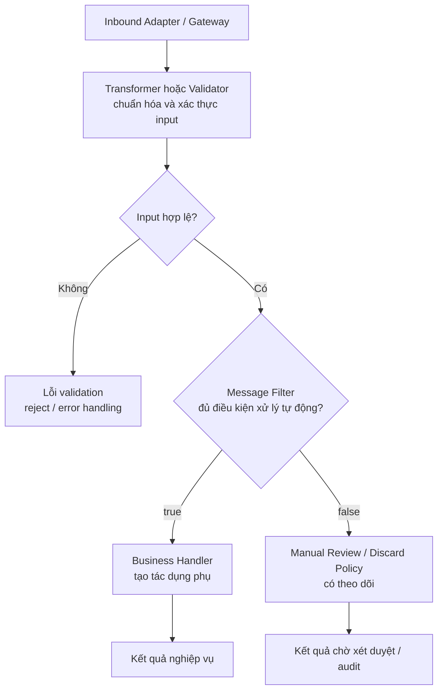
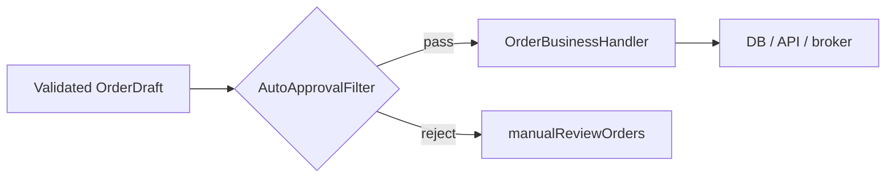
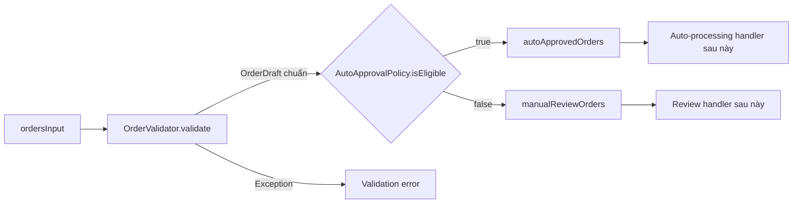
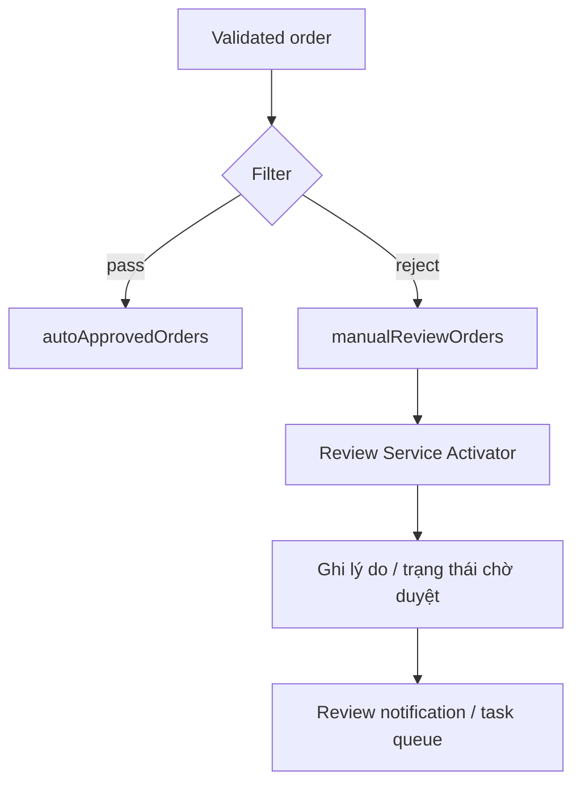
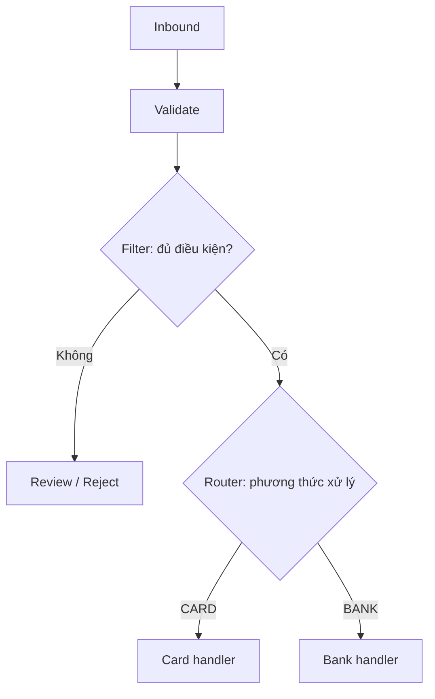
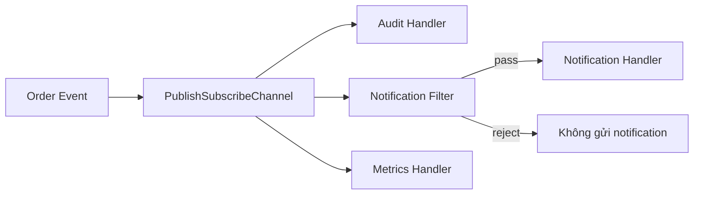
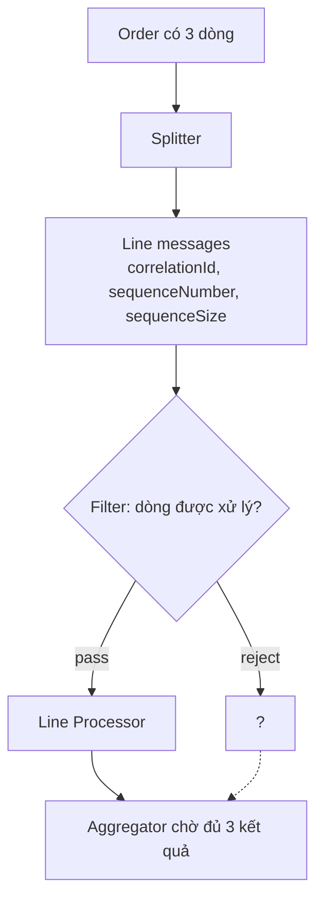

# Filter sau validation và trước business handler trong Spring Integration

> **Chương:** Filter  
> **Bài học:** Filter sau validation và trước business handler  
> **Ngữ cảnh:** Thực hành Enterprise Integration Patterns trong Spring Integration để xây dựng luồng message ít phụ thuộc, dễ mở rộng và có thể kiểm thử, theo dõi được các nhánh xử lý. Bài học tập trung vào vị trí của Message Filter trong pipeline, đồng thời liên hệ với Transformer, Router, Service Activator, Gateway, retry, error channel và correlation.

## 1. Bài toán: không phải message hợp lệ nào cũng được xử lý ngay

Một dịch vụ tiếp nhận đơn hàng từ web hoặc đối tác. Đơn hàng đi vào có thể thuộc một trong ba nhóm:

1. **Sai dữ liệu:** thiếu mã đơn, tiền âm hoặc mã tiền tệ không hợp lệ.
2. **Dữ liệu hợp lệ nhưng chưa đủ điều kiện tự động xử lý:** khách hàng chưa xác minh, tồn kho chưa được giữ chỗ, hoặc giá trị đơn vượt ngưỡng phê duyệt.
3. **Dữ liệu hợp lệ và đủ điều kiện tự động xử lý:** có thể chuyển tới business handler để thực hiện tác vụ nghiệp vụ.

Nếu đặt toàn bộ điều kiện vào một Service Activator lớn, code dễ pha trộn ba trách nhiệm: kiểm tra hợp đồng đầu vào, kiểm tra quyền đi tiếp và thực hiện tác dụng phụ. Cách này gây khó kiểm thử, khó theo dõi message bị từ chối và dễ phát sinh xử lý sai.

Mô hình thích hợp là:



**Quy tắc thiết kế:** Validation trả lời **“Dữ liệu có hợp lệ không?”**; Filter trả lời **“Message hợp lệ này có được đi tới handler cụ thể không?”**; Business Handler trả lời **“Cần thực hiện nghiệp vụ gì?”**.

Bài này không mặc định mọi message bị Filter từ chối đều nên bị xóa. Với thông điệp quan trọng như đơn hàng hoặc thanh toán, nhánh không đủ điều kiện thường cần **review, reject có nghĩa nghiệp vụ hoặc một kết quả rõ ràng**, thay vì biến mất khỏi pipeline.

### Mục tiêu học tập

Sau bài học, bạn có thể:

- Thiết kế pipeline `Validate → Filter → Business Handler` với hợp đồng rõ ràng.
- Dùng Spring Integration Java DSL để cài đặt Predicate của Filter và discard channel.
- Phân biệt lỗi dữ liệu, quyết định từ chối nghiệp vụ và lỗi xử lý downstream.
- Hiểu hậu quả của Filter trong luồng `@MessagingGateway` request-reply.
- Kiểm thử message được đi tiếp, message bị đưa vào nhánh review và input không hợp lệ.
- Áp dụng Filter an toàn với Router, Publish-Subscribe, Splitter/Aggregator, retry, error channel và tracing.
- Xác định chính sách không làm mất message, idempotency và quan sát khi vận hành.

## 2. Message Filter là gì?

Trong Enterprise Integration Patterns, **Message Filter** là một thành phần nhận message và đánh giá một điều kiện. Nó có hai khả năng:

- Điều kiện **true**: message được phép chuyển tới bước tiếp theo.
- Điều kiện **false**: message không đi tiếp ở đường chính; cần thực hiện chính sách reject/discard đã cấu hình.

```text
Message<OrderDraft>
         |
         v
    Predicate
    /       \
 true       false
  |           |
  v           v
downstream   discard/reject/error
```

Khác với Transformer, Filter **không có nhiệm vụ biến đổi payload**. Khác với Router, Filter không chọn một destination bất kỳ theo khóa; nó ra quyết định **cho phép hoặc không cho phép đi tiếp theo một đường xử lý**. Spring Integration cho phép gắn một discard channel hoặc discard flow để quan sát những message bị loại khỏi đường chính.

### Bảng so sánh trách nhiệm

| Thành phần | Câu hỏi nó trả lời | Hành vi điển hình |
| --- | --- | --- |
| **Validator / Transformer** | Input đã đúng schema và quy tắc cơ bản chưa? | Chuẩn hóa hoặc ném lỗi khi không hợp lệ |
| **Filter** | Message hợp lệ này có đủ điều kiện tiếp tục không? | Predicate true/false, giữ nguyên payload khi pass |
| **Router** | Message nên đi tới channel nào? | Chọn một hoặc nhiều đích |
| **Service Activator** | Cần thực thi nghiệp vụ nào? | Gọi service method, có thể ghi DB/gọi API |
| **Gateway** | Caller gửi request và nhận reply thế nào? | Cầu nối Java ↔ messaging với timeout/reply contract |
| **Error Channel** | Lỗi bất đồng bộ hoặc lỗi endpoint đi đâu? | Nhận error message tùy cấu hình endpoint/adapter |

Filter rất phù hợp để tách **điều kiện được phép vào một đoạn xử lý** khỏi đoạn xử lý đó. Nhưng nó không tự phân loại đầy đủ nguyên nhân từ chối, không tự retry và không tự đảm bảo lưu trữ bền vững.

## 3. Vì sao nên đặt Filter sau validation?

Một Predicate đáng tin cần nhận dữ liệu đã đạt **hợp đồng đầu vào**.

Giả sử raw message có `amount=" 1500000 "` dưới dạng chuỗi và `currency="vnd"`. Nếu Filter đọc ngay raw input:

- Nó phải kiêm luôn việc parse amount, xử lý null và chuẩn hóa currency.
- Có thể không xác định được sự khác nhau giữa input lỗi và đơn hợp lệ nhưng chưa đủ điều kiện.
- Khi thêm nguồn mới có cách biểu diễn khác, Predicate sẽ bị kéo vào logic adapter.
- Những lỗi parse không được quy về validator sẽ rất khó đối soát.

Cách rõ ràng hơn:

```text
Raw input
   |
   v
Normalize / Validate
   |  error -> validation error contract
   v
Validated OrderDraft
   |
   v
Eligibility Filter
   |  true -> Auto-processing handler
   |  false -> Manual-review policy
```

### Ba tình huống và ba kết quả khác nhau

| Input | Validation | Filter | Kết quả |
| --- | --- | --- | --- |
| Thiếu `orderId` | Fail | Không chạy | Validation error |
| `amount = -100` | Fail | Không chạy | Validation error |
| `amount = 500000`, khách chưa xác minh | Pass | false | Manual review / từ chối tự động |
| `amount = 1500000`, khách đã xác minh, tồn kho đã giữ | Pass | Tùy ngưỡng chính sách | Auto hoặc review |
| `amount = 200000`, đủ điều kiện | Pass | true | Business handler |

Đây không chỉ là cách chia code. Nó ảnh hưởng trực tiếp tới **retry, API response, metrics, audit và vận hành**. Một lỗi hợp đồng input thường không nên retry cùng payload. Ngược lại, một đơn đang chờ xác minh có thể được tiếp tục sau khi một sự kiện xác minh mới tới.

### Validation phải có trách nhiệm rõ

Validation có thể bao gồm:

1. **Schema/shape validation:** thiếu field, field sai kiểu, thiếu mã đơn.
2. **Normalization:** trim mã đơn, chuẩn hóa currency, chuyển dữ liệu ngoài về DTO nội bộ.
3. **Invariant cơ bản:** amount lớn hơn 0, currency thuộc tập hỗ trợ.
4. **Nguồn tin cậy:** các header quan trọng được xác thực/chuẩn hóa tại adapter.

**Không nên** đưa thao tác có tác dụng phụ như ghi đơn thật hoặc trừ tồn kho vào validator chỉ để “kiểm tra trước”. Nếu validation cần gọi tài nguyên ngoài, phải mô tả timeout, transaction và cách phân biệt validation với lỗi hạ tầng.

## 4. Filter đứng trước business handler có ý nghĩa gì?

Business Handler thường là nơi bắt đầu các tác dụng phụ đáng quan tâm:

- Ghi order vào database.
- Giữ hoặc trừ hàng tồn kho.
- Phát một event `OrderAccepted`.
- Gọi thanh toán hoặc dịch vụ vận chuyển.
- Tạo email/thông báo.

Đặt Filter ngay trước đoạn handler phù hợp giúp chặn message chưa đủ điều kiện **trước khi** các tác dụng phụ xảy ra.



**Bất biến thiết kế:** với một message bị Filter từ chối, **không được gọi business handler của đường chính**. Đây là điều cần chứng minh bằng kiểm thử, không chỉ nhìn vào biểu đồ.

Đặt Filter sau handler thường là quá muộn:

```text
Không phù hợp:
  Ghi DB -> Trừ tồn kho -> Filter (chưa đủ điều kiện)
```

Lúc này Filter có thể chặn message downstream nhưng **không hoàn tác được** các side effect đã thực hiện. Nếu cần kiểm tra sau xử lý, phải thiết kế bù trừ (compensation) hoặc một bước nghiệp vụ khác; đừng kỳ vọng Filter là transaction rollback.

## 5. Hợp đồng đầu vào, kết quả và chính sách reject

Trước khi viết code, cần xác định hợp đồng cho từng điểm.

| Thành phần | Hợp đồng minh họa |
| --- | --- |
| Input channel | `ordersInput` |
| Payload sau validation | `OrderDraft(orderId, amount, currency, customerVerified, stockReserved)` |
| Header nghiệp vụ | `businessCorrelationId` được tạo từ order ID đã xác minh |
| Validation | orderId không rỗng, amount dương, currency đúng tập hỗ trợ |
| Eligibility | khách đã xác minh, hàng đã được giữ chỗ, amount không vượt ngưỡng auto |
| Filter pass | Gửi đến `autoApprovedOrders` |
| Filter reject | Gửi đến `manualReviewOrders` |
| Validation fail | Báo exception/error theo ranh giới đồng bộ hoặc bất đồng bộ |
| Business Handler | Chỉ nhận message đã pass; vẫn tự kiểm tra invariant cần thiết trước side effect |

**Vì sao nhánh review không phải lỗi validation?** Một đơn giá trị cao có thể hoàn toàn hợp lệ nhưng chính sách không cho auto-approve. Nếu dùng chung một exception “invalid order” cho cả hai, tầng API và vận hành sẽ không phân biệt được lỗi client với yêu cầu cần nhân viên xét duyệt.

### Lựa chọn khi Predicate false

| Chính sách | Hành vi | Phù hợp |
| --- | --- | --- |
| **Discard channel/flow** | Chuyển message tới nhánh xử lý riêng | Đơn cần manual review, audit/reject |
| **Throw exception on rejection** | Báo lỗi từ chối theo cấu hình endpoint | Hợp đồng fail-fast, caller phải biết |
| **Discard âm thầm** | Message không đi tiếp và không có nhánh kết quả | Chỉ cho dữ liệu được phép bỏ có chủ đích |

Đối với các event có giá trị nghiệp vụ, mặc định nên ưu tiên **nhánh review có thể theo dõi** hoặc **exception từ chối rõ ràng**, thay vì cho phép drop không có tín hiệu.

## 6. Ví dụ Java DSL hoàn chỉnh: validation, Filter và hai kênh kết quả

Ví dụ dùng Spring Integration Java DSL trong một ứng dụng Java 17+ với Spring context, Spring Integration và JUnit 5 cho phần test. Để tập trung vào cách Filter làm việc, hai output channel là `QueueChannel` trong bộ nhớ.

### 6.1. Kiểu payload chung

```java
package example.integration;

import java.math.BigDecimal;

public record OrderDraft(
    String orderId,
    BigDecimal amount,
    String currency,
    boolean customerVerified,
    boolean stockReserved
) {}
```

`OrderDraft` là record với các field bất biến ở mức tham chiếu. `BigDecimal` và `String` cũng bất biến. Nhờ vậy, Filter có thể đọc điều kiện mà không phải lo một thread khác sửa field ngay giữa lúc đánh giá.

Lưu ý thực tế: không thể chỉ tin vào cờ `customerVerified` hoặc `stockReserved` do HTTP client tự gửi. Ở production, hai cờ này phải đến từ **trạng thái đáng tin cậy** của hệ thống hoặc một bước enrichment/verification đã được xác thực. Ví dụ giả định dữ liệu đã đi qua ranh giới tin cậy.

### 6.2. Validation và chuẩn hóa

```java
package example.integration;

import java.util.Locale;
import java.util.Set;

public final class OrderValidator {

    private static final Set<String> SUPPORTED_CURRENCIES =
        Set.of("VND", "USD");

    public OrderDraft validate(OrderDraft order) {
        if (order == null
                || order.orderId() == null
                || order.orderId().isBlank()
                || order.amount() == null
                || order.amount().signum() <= 0
                || order.currency() == null
                || order.currency().isBlank()) {
            throw new IllegalArgumentException(
                "OrderDraft thiếu dữ liệu hợp lệ");
        }

        String normalizedCurrency =
            order.currency().trim().toUpperCase(Locale.ROOT);

        if (!SUPPORTED_CURRENCIES.contains(normalizedCurrency)) {
            throw new IllegalArgumentException(
                "Currency không được hỗ trợ");
        }

        return new OrderDraft(
            order.orderId().trim(),
            order.amount(),
            normalizedCurrency,
            order.customerVerified(),
            order.stockReserved());
    }
}
```

Method trả **một `OrderDraft` mới** để thể hiện bước normalization trước Filter. Trong dự án thật, nếu quy tắc auto-approve phụ thuộc tiền tệ, không nên so sánh amount của VND và USD theo cùng một ngưỡng đơn giản; cần quy đổi hoặc policy riêng theo currency. Phần dưới chỉ chọn ngưỡng cho VND để tránh lỗi đơn vị.

### 6.3. Predicate Filter thuần, không side effect

```java
package example.integration;

import java.math.BigDecimal;

public final class AutoApprovalPolicy {

    private static final BigDecimal VND_LIMIT =
        new BigDecimal("1000000");

    public boolean isEligible(OrderDraft order) {
        return order.customerVerified()
            && order.stockReserved()
            && "VND".equals(order.currency())
            && order.amount().compareTo(VND_LIMIT) <= 0;
    }
}
```

Đầu vào của `isEligible` đã qua validation. Nó chỉ đọc dữ liệu và trả `boolean`, không ghi database, không gửi thông báo và không sửa payload.

**Vì sao đây là Filter?** Vì hàm chỉ quyết định message có được tiếp tục vào luồng auto-processing hay không. Nếu trả `false`, nó không tự biến order thành một “đơn lỗi”; chính sách discard quyết định số phận của message.

### 6.4. Cấu hình IntegrationFlow

```java
package example.integration;

import org.springframework.context.annotation.Bean;
import org.springframework.context.annotation.Configuration;
import org.springframework.integration.channel.DirectChannel;
import org.springframework.integration.channel.QueueChannel;
import org.springframework.integration.config.EnableIntegration;
import org.springframework.integration.dsl.IntegrationFlow;
import org.springframework.messaging.MessageChannel;

@Configuration
@EnableIntegration
public class OrderAdmissionConfig {

    @Bean
    public MessageChannel ordersInput() {
        return new DirectChannel();
    }

    @Bean
    public QueueChannel autoApprovedOrders() {
        return new QueueChannel();
    }

    @Bean
    public QueueChannel manualReviewOrders() {
        return new QueueChannel();
    }

    @Bean
    public OrderValidator orderValidator() {
        return new OrderValidator();
    }

    @Bean
    public AutoApprovalPolicy autoApprovalPolicy() {
        return new AutoApprovalPolicy();
    }

    @Bean
    public IntegrationFlow orderAdmissionFlow(
            OrderValidator validator,
            AutoApprovalPolicy policy) {

        return IntegrationFlow.from("ordersInput")
            // 1. Validate + normalize, sai dữ liệu thì throw.
            .transform(OrderDraft.class, validator::validate)

            // 2. Chỉ message hợp lệ mới đi đến Filter.
            .filter(
                OrderDraft.class,
                policy::isEligible,
                spec -> spec.discardChannel("manualReviewOrders"))

            // 3. Chỉ message pass mới được tới đường chính.
            .channel("autoApprovedOrders")
            .get();
    }
}
```

Đường đi:



Giải thích:

- `.transform(OrderDraft.class, validator::validate)` chuẩn hóa payload; nếu không hợp lệ thì exception được phát trước Filter.
- `.filter(OrderDraft.class, policy::isEligible, ...)` giữ lại message có Predicate `true`.
- `discardChannel("manualReviewOrders")` nhận message hợp lệ nhưng không được đi theo luồng chính.
- `.channel("autoApprovedOrders")` chỉ nhận message đi qua Filter.
- Không đặt một Service Activator thực hiện tác dụng phụ ngay trước Filter.
- Đây là **flow one-way**. `QueueChannel` dùng để test, không có handler business thật hoặc reply cho Gateway.

### 6.5. Gửi message vào flow

Giả sử `ordersInput` được inject vào caller dưới dạng `MessageChannel`:

```java
import java.math.BigDecimal;

import org.springframework.messaging.Message;
import org.springframework.messaging.support.MessageBuilder;

OrderDraft order = new OrderDraft(
    " ORD-101 ",
    new BigDecimal("500000"),
    "vnd",
    true,
    true);

Message<OrderDraft> message =
    MessageBuilder.withPayload(order)
        .setHeader("businessCorrelationId", "order:ORD-101")
        .setHeader("sourceSystem", "checkout-api")
        .build();

boolean dispatched = ordersInput.send(message);
```

Với `ordersInput` là `DirectChannel`, lời gọi send thường dispatch đồng bộ đến các bước trong flow. `dispatched=true` không có nghĩa đơn hàng đã hoàn tất; message mới được đưa vào một `QueueChannel` trong bộ nhớ.

Nếu validation ném exception đồng bộ, lỗi có thể truyền ngược về caller dưới dạng exception được framework bọc. Trường hợp bất đồng bộ sau `ExecutorChannel` cần error flow riêng.

## 7. Kiểm thử JUnit 5: pass, review và validation error

Để chứng minh Filter được đặt đúng chỗ, test cần đi qua **toàn bộ IntegrationFlow** chứ không chỉ gọi riêng `AutoApprovalPolicy.isEligible(...)`.

### 7.1. Integration test qua channel

```java
package example.integration;

import static org.junit.jupiter.api.Assertions.*;

import java.math.BigDecimal;

import org.junit.jupiter.api.Test;
import org.springframework.beans.factory.annotation.Autowired;
import org.springframework.beans.factory.annotation.Qualifier;
import org.springframework.integration.channel.QueueChannel;
import org.springframework.messaging.Message;
import org.springframework.messaging.MessageChannel;
import org.springframework.messaging.support.MessageBuilder;
import org.springframework.test.annotation.DirtiesContext;
import org.springframework.test.context.junit.jupiter.SpringJUnitConfig;

@SpringJUnitConfig(OrderAdmissionConfig.class)
@DirtiesContext(
    classMode = DirtiesContext.ClassMode.AFTER_EACH_TEST_METHOD)
class OrderAdmissionIntegrationTest {

    @Autowired
    @Qualifier("ordersInput")
    private MessageChannel ordersInput;

    @Autowired
    @Qualifier("autoApprovedOrders")
    private QueueChannel autoApprovedOrders;

    @Autowired
    @Qualifier("manualReviewOrders")
    private QueueChannel manualReviewOrders;

    @Test
    void eligibleOrderPassesFilter() {
        OrderDraft draft = new OrderDraft(
            " ORD-101 ",
            new BigDecimal("500000"),
            "vnd",
            true,
            true);

        assertTrue(ordersInput.send(
            MessageBuilder.withPayload(draft)
                .setHeader(
                    "businessCorrelationId", "order:ORD-101")
                .build()));

        Message<?> approved = autoApprovedOrders.receive(1_000);
        assertNotNull(approved);

        OrderDraft normalized = (OrderDraft) approved.getPayload();
        assertEquals("ORD-101", normalized.orderId());
        assertEquals("VND", normalized.currency());
        assertEquals(new BigDecimal("500000"), normalized.amount());
        assertTrue(normalized.customerVerified());
        assertTrue(normalized.stockReserved());

        assertEquals("order:ORD-101",
            approved.getHeaders().get("businessCorrelationId"));
        assertNull(manualReviewOrders.receive(0));
    }

    @Test
    void validButIneligibleOrderGoesToReview() {
        OrderDraft draft = new OrderDraft(
            "ORD-102",
            new BigDecimal("500000"),
            "VND",
            false, // chưa xác minh khách hàng
            true);

        assertTrue(ordersInput.send(
            MessageBuilder.withPayload(draft).build()));

        Message<?> review = manualReviewOrders.receive(1_000);
        assertNotNull(review);

        OrderDraft payload = (OrderDraft) review.getPayload();
        assertEquals("ORD-102", payload.orderId());
        assertFalse(payload.customerVerified());

        // Message không đi vào đường auto-processing.
        assertNull(autoApprovedOrders.receive(0));
    }

    @Test
    void invalidAmountFailsBeforeFilter() {
        OrderDraft invalid = new OrderDraft(
            "ORD-103",
            new BigDecimal("-100"),
            "VND",
            true,
            true);

        assertThrows(RuntimeException.class, () ->
            ordersInput.send(
                MessageBuilder.withPayload(invalid).build()));

        // Không đi tới cả hai output queue.
        assertNull(autoApprovedOrders.receive(0));
        assertNull(manualReviewOrders.receive(0));
    }

    @Test
    void amountAboveAutoLimitGoesToReview() {
        OrderDraft draft = new OrderDraft(
            "ORD-104",
            new BigDecimal("1500000"),
            "VND",
            true,
            true);

        assertTrue(ordersInput.send(
            MessageBuilder.withPayload(draft).build()));

        assertNotNull(manualReviewOrders.receive(1_000));
        assertNull(autoApprovedOrders.receive(0));
    }
}
```

### 7.2. Ý nghĩa các kiểm tra

| Test | Điều chứng minh |
| --- | --- |
| `eligibleOrderPassesFilter` | Dữ liệu được normalize trước; đủ điều kiện thì tới đường chính |
| `validButIneligibleOrderGoesToReview` | Message hợp lệ bị Filter loại khỏi đường chính nhưng không biến mất |
| `invalidAmountFailsBeforeFilter` | Input sai bị chặn ở validation, không bị nhầm thành manual review |
| `amountAboveAutoLimitGoesToReview` | Predicate áp dụng chính sách nghiệp vụ trên dữ liệu chuẩn hóa |

Lưu ý: test dùng `QueueChannel` để xác minh routing ở cấp độ message. Nó **không** chứng minh auto-processing thật đã ghi DB, trừ tồn kho hay gửi event thành công. Khi triển khai Service Activator thật, cần thêm test side effect và idempotency.

`assertThrows(RuntimeException.class, ...)` là kiểm tra minh họa vì Spring Integration có thể bọc exception gốc. Trong dự án thực, nên kiểm tra cause chain và mã lỗi đúng contract thay vì dựa vào một lớp exception tổng quát.

## 8. Đừng nhầm Filter reject với exception validation

**Validation fail** và **Filter false** là hai trạng thái khác nhau:

```text
Validation fail:
  dữ liệu sai -> không có OrderDraft chuẩn -> error/reject

Filter false:
  có OrderDraft chuẩn -> chưa đủ điều kiện auto -> review
```

Khi dùng `discardChannel`, message bị Filter từ chối vẫn có thể đến một handler khác. Nó không nhất thiết tạo exception ở sender.

Ngược lại, khi bật hành vi **throw exception on rejection** của Filter, một message không đạt điều kiện sẽ gây lỗi thay vì đi tiếp theo đường chính. Đây là chính sách khác với manual review; không nên bật đồng thời nhiều cơ chế reject nếu không hiểu thứ tự ưu tiên của endpoint trong phiên bản đang dùng.

### Khi nào throw exception on rejection hợp lý?

Ví dụ một nhánh chỉ chấp nhận sự kiện đã được xác thực mà không có ý nghĩa “xét duyệt sau”. Một request không đạt có thể cần fail-fast và trả mã từ chối rõ:

```java
.filter(OrderDraft.class, policy::isEligible,
    spec -> spec.throwExceptionOnRejection(true))
```

Đây là **biến thể thay thế** cho Filter có `discardChannel` ở mục 6, không ghép cả hai biến thể một cách tùy tiện.

Một exception tại Filter không tự tạo HTTP status hay domain error code. Adapter/controller hoặc Gateway error handling cần chuyển nó thành phản hồi phù hợp cho caller.

### Khi nào im lặng bỏ message được chấp nhận?

Chẳng hạn một luồng thống kê chỉ quan tâm event `CUSTOMER_ACTIVE`; event khác có thể được bỏ theo hợp đồng. Nhưng với đơn hàng cần đối soát hoặc nghiệp vụ thanh toán, mất message âm thầm là rủi ro đáng kể.

Nếu cố ý drop, nên có metric cho số lượng bị loại và test quy tắc drop. Đừng dùng `resolutionRequired(false)` của Router hoặc cấu hình Filter bỏ message để che một service thiếu consumer.

## 9. Thiết kế nhánh manual review có ý nghĩa nghiệp vụ

Một discard channel không nên chỉ tồn tại để “không thấy exception”. Nó phải có người xử lý thực sự.

Ví dụ:



Để vận hành tốt, review handler thường cần:

- Phân biệt lý do: chưa xác minh khách, chưa giữ tồn kho, vượt ngưỡng hoặc currency không thuộc diện auto.
- Ghi lại `orderId`, `businessCorrelationId`, thời điểm và policy version khi có.
- Có trạng thái `REQUIRES_REVIEW` hoặc tương đương để API/UI hiển thị đúng.
- Giới hạn retry và có idempotency khi tạo task review.
- Cho phép tiếp tục xử lý khi có sự kiện đủ điều kiện mới, không tự lặp Filter vô hạn.

### Predicate boolean không chứa lý do đầy đủ

Một boolean `isEligible` chỉ nói yes/no. Nếu cần audit **vì sao** false, ta có thể tách decision có cấu trúc:

```java
public record EligibilityDecision(
    boolean eligible,
    String reasonCode) {}
```

Một service policy trả `EligibilityDecision`; bước tiếp theo có thể lưu decision vào header hoặc payload phụ trợ trước Filter. Filter chỉ đọc `decision.eligible()`, còn review handler nhận `reasonCode` để ghi audit.

Ví dụ nguyên tắc:

```text
Validate
   -> EvaluateEligibility (eligible=false, reason=UNVERIFIED_CUSTOMER)
   -> Filter(decision.eligible)
       true  -> Business Handler
       false -> Review Handler (đọc reason)
```

Nếu xây theo kiểu này, phải giữ decision **nhất quán**: không gọi policy một lần trong Filter rồi gọi lại trong Review Handler với cấu hình mới để tạo một lý do có thể không khớp quyết định ban đầu. Đối với policy động, nên gắn policy version và decision ID.

## 10. Gateway request-reply: nhánh reject cũng cần kết quả

Một `@MessagingGateway` có thể đưa một lời gọi Java vào message flow và chờ một result. Nếu Filter loại message mà **không có reply**, Gateway có thể đợi đến reply timeout.

Tình huống không đúng mong đợi:

```text
OrderGateway.submit(draft) -> Filter(false)
                           -> message bị drop
                           -> Gateway không nhận OrderResult
```

Với hệ thống yêu cầu phản hồi tức thì, cần thống nhất hợp đồng cho **cả nhánh pass và reject**.

### 10.1. Hợp đồng response

```java
public record OrderDecision(
    String orderId,
    String status,
    String reasonCode) {}
```

Một số trạng thái có thể là:

- `ACCEPTED_FOR_PROCESSING`: đơn được chuyển qua auto-processing.
- `REQUIRES_REVIEW`: đơn hợp lệ nhưng đang chờ xử lý thủ công.
- `INVALID_REQUEST`: input sai hợp đồng, được chuyển thành lỗi ở ranh giới API.

**Không dùng `ACCEPTED_FOR_PROCESSING` để khẳng định đơn đã được thanh toán** nếu chưa có hệ thống downstream xác nhận.

### 10.2. Hai nhánh trả lời Gateway theo cùng message

Một thiết kế request-reply:

```text
Gateway -> Validate -> Filter
                       | true  -> Auto Handler -> OrderDecision
                       | false -> Review Handler -> OrderDecision
                                                   |
                                                   v
                                             Reply về Gateway
```

Trong Java DSL có thể tổ chức hai IntegrationFlow:

```java
@Bean
public IntegrationFlow requestOrderFlow(
        OrderValidator validator,
        AutoApprovalPolicy policy,
        OrderDecisionService decisions) {

    return IntegrationFlow.from("orderRequests")
        .transform(OrderDraft.class, validator::validate)
        .filter(OrderDraft.class, policy::isEligible,
            spec -> spec.discardChannel("manualReviewInput"))
        .handle(decisions, "accept")
        .get();
}

@Bean
public IntegrationFlow reviewOrderFlow(
        OrderDecisionService decisions) {

    return IntegrationFlow.from("manualReviewInput")
        .handle(decisions, "review")
        .get();
}
```

Đây là **phác thảo cấu hình thay thế**, không chạy đồng thời với demo QueueChannel ở mục 6. Để hoàn chỉnh, định nghĩa `orderRequests` và `manualReviewInput` là các channel phù hợp (ví dụ `DirectChannel`), đăng ký hai flow trên và tạo service:

```java
public final class OrderDecisionService {

    public OrderDecision accept(OrderDraft order) {
        // Ở đây mới thực hiện nghiệp vụ auto-processing phù hợp.
        return new OrderDecision(
            order.orderId(), "ACCEPTED_FOR_PROCESSING", "AUTO");
    }

    public OrderDecision review(OrderDraft order) {
        // Ghi request xét duyệt nếu contract đòi hỏi.
        return new OrderDecision(
            order.orderId(), "REQUIRES_REVIEW", "POLICY_REVIEW");
    }
}
```

Service method trả payload cho reply. Khi Filter chuyển message qua discard channel, cần giữ ngữ cảnh reply thích hợp để response của review handler quay về Gateway. Không ghi đè `replyChannel` tùy tiện.

### 10.3. Tránh hai lỗi thường gặp

1. **Discard vào queue không có consumer**: message nằm chờ; Gateway đợi reply rồi timeout.
2. **Discard vào handler `void`**: nghiệp vụ xét duyệt có thể được ghi nhận, nhưng không có result nếu Gateway đang cần reply.

Với quy trình xét duyệt kéo dài, một lựa chọn tốt là Gateway trả `REQUIRES_REVIEW` ngay sau khi ghi nhận task review, rồi hoàn tất nghiệp vụ bằng event riêng về sau. Không giữ kết nối HTTP mở suốt nhiều giờ/ngày.

## 11. Filter và Router: đặt cái nào trước?

Một pipeline có thể dùng cả Filter lẫn Router:



**Filter trước Router** phù hợp khi **mọi nhánh** đều phải đáp ứng điều kiện chung: đơn đã validate, người dùng đã xác minh, tồn kho đã giữ.

**Router trước Filter** phù hợp khi mỗi nhánh có điều kiện riêng: thanh toán thẻ cần đủ hạn mức, chuyển khoản cần xác nhận ngân hàng, ví điện tử cần policy khác.

```text
Validate -> Router
              | CARD -> CardEligibilityFilter -> CardHandler
              | BANK -> BankEligibilityFilter -> BankHandler
```

Thứ tự đúng không phải một quy tắc máy móc cho toàn hệ thống. Cần hỏi: **Điều kiện này áp dụng cho mọi business handler hay chỉ một nhánh?** Bài học tập trung vị trí Filter sau validation và **ngay trước đoạn business handler mà nó bảo vệ**.

### Tránh kiểm tra lại điều kiện mâu thuẫn

Nếu có nhiều Filter ở nhiều nhánh, nên chia rõ:

- Các invariant chung đặt tại validation hoặc filter chung.
- Các policy đặc thù đặt ở filter riêng.
- Những invariant an toàn quan trọng cần được handler/service cuối kiểm tra lại trong transaction thích hợp trước side effect nếu dữ liệu có thể thay đổi.

Ví dụ tồn kho có thể bị thay đổi bởi đơn khác sau khi Filter đã đọc `stockReserved=true`. Business Handler vẫn cần kiểm tra quyền giữ kho còn hiệu lực hoặc sử dụng giao dịch/idempotency; một Filter bên ngoài transaction không thể bảo đảm tính nhất quán tuyệt đối.

## 12. Publish-Subscribe: Filter chỉ chặn nhánh mà nó nằm trong

Trong Publish-Subscribe, một event có thể đến nhiều subscriber. Một Filter trong nhánh notification có thể loại event không cần gửi email, nhưng không nên tự chặn audit.



Đây là cách **mỗi subscriber tự quyết định điều kiện quan tâm**. Nếu đặt Filter trước PublishSubscribeChannel, sự kiện bị loại sẽ không đến **bất kỳ subscriber nào** của channel đó.

| Vị trí Filter | Hệ quả |
| --- | --- |
| Trước Pub/Sub | Message không pass không được broadcast |
| Trong một subscriber flow | Chỉ nhánh đó không đi tiếp |
| Sau một business handler trong nhánh | Không bảo vệ side effect của handler đó |

Đối với audit bắt buộc, cân nhắc điều gì phải được ghi nhận kể cả khi event bị Filter loại. Nếu mục tiêu của Filter là chặn auto-processing, không nên vô tình chặn cả nhánh audit.

## 13. Splitter, Filter và Aggregator: nguy cơ thiếu phần tử

Giả sử một đơn có ba dòng. Splitter tạo ba message con và Aggregator chờ đủ kết quả từ các dòng đó.



Nếu Filter âm thầm bỏ một message con, Aggregator có thể nhận 2/3 kết quả rồi đợi đến timeout vì release strategy yêu cầu đủ `sequenceSize`. Đặc biệt nguy hiểm khi một nhóm bị treo nhưng không có log reject.

### Các lựa chọn đúng

1. **Đưa message bị loại sang nhánh tạo kết quả lỗi** như `LineResult.REJECTED`, rồi gửi kết quả đó về Aggregator.
2. Cấu hình release/expiry strategy phù hợp nếu kết quả thiếu là điều có thể chấp nhận.
3. Validate các điều kiện có thể kiểm tra trước khi Splitter để không tạo nhóm không hoàn tất.
4. Nếu Filter thực sự loại bớt thành phần, thiết kế lại kỳ vọng kích thước nhóm ở Aggregator thay vì giả định vẫn phải có tất cả phần tử.

### Giữ correlation và sequence

Một số header quan trọng:

| Header | Vai trò |
| --- | --- |
| `businessCorrelationId` | Truy vết toàn bộ đơn hàng hoặc request |
| `correlationId` | Gom nhóm các message con cho Aggregator |
| `sequenceNumber` | Vị trí phần tử trong nhóm |
| `sequenceSize` | Số phần tử kỳ vọng trong nhóm khi xác định được |

Filter có trách nhiệm chặn/cho qua message, không tự tạo lại correlation strategy. Nếu discard handler tạo message kết quả mới để đưa vào Aggregator, phải giữ metadata nhóm phù hợp và kiểm thử group release. Không ghi đè `correlationId` chỉ để “sửa” vấn đề thiếu phần tử.

## 14. Filter trong luồng bất đồng bộ và error channel

Cấu hình demo dùng `DirectChannel` đồng bộ. Trong ứng dụng thực, bạn có thể đặt `ExecutorChannel` hoặc adapter broker trước Filter:

```text
HTTP/Kafka Adapter -> ExecutorChannel
                           |
                           v
                         Validate
                           |
                           v
                          Filter
                         /      \
                      pass     reject
                       |         |
                    Handler    Review
```

**Thay đổi quan trọng:** sender có thể đã trở về trước khi Filter chạy trên worker. Khi validation hoặc predicate ném exception:

- Lỗi không nhất thiết đi trực tiếp về thread caller.
- Cần error handler/error channel phù hợp với component/adapter.
- Broker acknowledgement và redelivery cần được cấu hình riêng.
- Transaction/ThreadLocal của thread gửi không tự propagate sang worker.
- Message và headers cần giữ business correlation để truy vết.

### Error channel không tương đương discard channel

| Cơ chế | Khi nào xảy ra? | Ý nghĩa |
| --- | --- | --- |
| **Discard channel** | Predicate trả `false` | Message hợp lệ không đáp ứng điều kiện đi tiếp |
| **Error channel** | Một endpoint/adapter phát lỗi theo cơ chế được cấu hình | Xử lý exception, retry/recovery |
| **Default Router channel** | Router không chọn được đích chính | Đích dự phòng của một quyết định route |
| **Dead-letter queue** | Chính sách transport/recovery đưa message lỗi tới nơi lưu giữ | Phục vụ điều tra/khôi phục có kiểm soát |

Nếu Filter false là **kết quả nghiệp vụ bình thường**, không nên đóng gói nó thành lỗi hạ tầng chỉ để kích hoạt retry. Ngược lại, lỗi khi gọi database để kiểm tra một điều kiện không phải một kết quả `false` chắc chắn; cần phân biệt “không đủ điều kiện” và “chưa thể xác định điều kiện”.

### Không nuốt exception trong Predicate

Phản mẫu:

```java
public boolean isEligible(OrderDraft order) {
    try {
        return remoteRiskService.check(order.orderId());
    } catch (Exception ignored) {
        return false;
    }
}
```

Cách viết này biến timeout API thành “đơn không đủ điều kiện”, dễ che một sự cố hạ tầng. Nếu policy yêu cầu fail-closed, vẫn phải **ghi nhận rõ reason=RISK_SERVICE_UNAVAILABLE**, phân biệt nó với một quyết định nghiệp vụ thật và có recovery thích hợp.

Tốt hơn, tách bước enrichment/call API trước Filter với timeout, retry và kết quả có trạng thái; Filter chỉ đọc dữ liệu đã được xác định.

## 15. Retry, idempotency và dữ liệu thay đổi theo thời gian

Một câu hỏi quan trọng: nếu Filter hôm nay trả false, ngày mai có nên trả true với cùng order?

Có thể có. Ví dụ khách hàng hoàn tất xác minh hoặc tồn kho được bổ sung. Nhưng đó là **một quyết định mới theo trạng thái mới**, không phải retry kỹ thuật của cùng một quyết định.

Phân biệt:

- **Retry lỗi kỹ thuật:** lỗi API timeout, executor quá tải; thường cần giữ message/decision có kiểm soát và backoff.
- **Re-evaluation có chủ đích:** business state thay đổi, phát event mới hoặc một workflow state transition để xét điều kiện lại.
- **Replay sau restart:** message được giao lại; phải tránh xử lý side effect trùng.
- **Manual override:** nhân viên phê duyệt, ghi audit và hành động rõ ràng, không âm thầm chuyển cờ `eligible`.

### Gắn policy version khi điều kiện có thể thay đổi

Nếu AutoApprovalPolicy được vận hành cập nhật runtime, cần cân nhắc chốt:

```text
eventId=EV-101
businessCorrelationId=order:ORD-101
eligibilityPolicyVersion=7
eligibilityDecision=REQUIRES_REVIEW
reasonCode=UNVERIFIED_CUSTOMER
```

Điều này giúp xác định message đã bị Filter loại theo chính sách nào. Khi retry downstream, không nên tự gọi lại một policy hoàn toàn mới nếu hợp đồng yêu cầu quyết định nhất quán theo lần tiếp nhận. Nếu muốn tái xét, tạo decision mới có version/ID riêng.

### Business handler vẫn cần idempotency

Ngay cả khi Filter chỉ cho phép message pass một lần ở cấp flow, adapter broker có thể redeliver event hoặc caller gửi lại. Filter không bảo đảm exactly-once effect.

Ví dụ:

```text
idempotencyKey = (eventId, operationType)
```

Cơ sở dữ liệu hoặc downstream API cần kiểm soát khóa đó theo hợp đồng. Correlation ID giúp truy vết, không tự chống trùng.

## 16. Performance: đặt Filter đúng chỗ để tiết kiệm tài nguyên

Filter thường là bước nhẹ so với business handler, nhưng vị trí và cách cài đặt ảnh hưởng độ trễ:

1. **Validate sớm** để loại input sai trước các bước có chi phí cao.
2. **Filter trước side effect** để tránh gọi dịch vụ ngoài cho message không đủ điều kiện.
3. **Giữ predicate thuần/nhẹ**: ưu tiên kiểm tra dữ liệu đã có trong payload/header.
4. **Cache hoặc enrich có kiểm soát** khi điều kiện cần dữ liệu từ nguồn ngoài; tránh gọi DB/API nhiều lần trong một predicate.
5. **Không làm một Filter lớn chứa toàn bộ workflow**; khi điều kiện trở nên nhiều nhánh phức tạp, cân nhắc Router hoặc decision service có kết quả có cấu trúc.

### Một phép tính chi phí minh họa

Giả sử mỗi business handler cần 200 ms, còn validation + Filter mất 5 ms. Trong 1.000 message, 300 message không đủ điều kiện auto-processing.

Nếu tất cả đều vào handler trước khi quyết định điều kiện, tổng lượng thời gian chiếm handler theo phép cộng đơn giản là khoảng 200.000 ms. Nếu Filter chặn 300 message trước handler, lượng công việc handler còn khoảng 140.000 ms, chưa tính công việc review. Đây là **mô hình minh họa về work**, không phải thời gian thực tế của hệ thống có nhiều thread hoặc I/O song song.

Mục tiêu không phải tối ưu vài mili giây bằng mọi giá, mà là giữ đúng ranh giới nghiệp vụ, tránh tác dụng phụ không cần thiết và kiểm soát nguồn lực khi tải tăng.

## 17. Quan sát Filter bằng metric, log và correlation

Một pipeline vận hành tốt phải trả lời:

- Có bao nhiêu input bị validation reject?
- Có bao nhiêu message hợp lệ pass Filter?
- Có bao nhiêu message không đủ điều kiện được chuyển review?
- Lý do chủ yếu là gì?
- Business handler đã xử lý thành công bao nhiêu message được pass?
- Có message nào bị drop không có audit?
- Retry và review có tạo xử lý trùng không?

### Các mốc nên theo dõi

```text
MESSAGE_RECEIVED
    |
    +-> VALIDATION_REJECTED
    |
    +-> VALIDATED
           |
           +-> FILTER_PASSED
           |       |
           |       +-> HANDLER_SUCCEEDED / HANDLER_FAILED
           |
           +-> FILTER_REJECTED
                   |
                   +-> REVIEW_QUEUED / REVIEW_FAILED
```

Ví dụ structured log:

```text
eventId=EV-101
businessCorrelationId=order:ORD-101
stage=FILTER_REJECTED
reason=UNVERIFIED_CUSTOMER
policyVersion=7
destination=manualReviewOrders
```

Một Filter Predicate chỉ trả boolean có thể không biết `reason`. Nếu cần lý do, hãy lưu kết quả policy có cấu trúc trước Filter như mục 9 hoặc để review handler tính/ghi theo một decision đã chốt.

### Metrics nên phân loại theo kết quả

| Metric | Ý nghĩa |
| --- | --- |
| `orders.received` | Tổng message vào |
| `orders.validation.rejected` | Input lỗi hợp đồng |
| `orders.filter.passed` | Message đủ điều kiện auto |
| `orders.filter.rejected` | Message hợp lệ nhưng không đủ điều kiện |
| `orders.review.queued` | Message đã được đưa vào nhánh review |
| `orders.handler.failed` | Lỗi trong business handler |
| `orders.retry.count` | Số lần retry có kiểm soát |
| `orders.processing.latency` | Độ trễ xử lý sau Filter |

Tránh đưa `orderId` hay `eventId` làm label cho metric có cardinality cao. Hãy giữ những ID đó trong trace hoặc log có khả năng tìm kiếm. Không log thông tin nhạy cảm như số thẻ, token hay dữ liệu cá nhân không cần thiết.

## 18. Test thêm các trường hợp góc cạnh

Ngoài bốn test chính ở mục 7, nên bổ sung:

| Trường hợp | Kết quả mong đợi |
| --- | --- |
| `orderId` toàn khoảng trắng | Validation fail, Filter không chạy |
| `currency=" usd "` | Được chuẩn hóa, sau đó chính sách auto có thể trả false |
| `amount` đúng ngưỡng 1.000.000 VND | Pass nếu các điều kiện khác đúng |
| `amount` vượt ngưỡng 1 đơn vị | Reject to review |
| `customerVerified=false` | Không gọi handler auto |
| `stockReserved=false` | Không gọi handler auto |
| Predicate ném exception do lỗi code | Error flow, không tự chuyển thành review bình thường |
| Bản tin bị Filter reject trong Gateway | Có response review hoặc timeout đã được chủ động thiết kế |
| Message con sau Splitter bị reject | Aggregator nhận kết quả lỗi hoặc có timeout/release strategy |
| Async flow với ExecutorChannel | Có test chờ completion và theo dõi lỗi trên worker |
| Một event giao lại hai lần | Handler chống trùng theo event/operation key |
| Thay policy giữa retry | Decision ổn định hoặc explicit re-evaluation có audit |

### Kiểm tra chắc chắn handler không bị gọi

Trong integration test thật, có thể thay business service bằng mock/spy rồi kiểm chứng:

```java
// Ý tưởng kiểm thử với Mockito:
// OrderDraft ineligible -> gửi vào flow.
// verify(autoProcessingService, never()).process(any());
// verify(reviewService, times(1)).record(any());
```

Đây là ví dụ về **mục tiêu kiểm thử**, không phải đoạn code chạy độc lập. Trong dự án cụ thể, cách dựng mock phụ thuộc Spring Test, cấu hình bean và annotation mocking đang được sử dụng.

### Test với timeouts

Trong flow bất đồng bộ, tránh `Thread.sleep(...)` cố định. Dùng `CountDownLatch`, Awaitility hoặc cơ chế polling có timeout; xác nhận trạng thái cuối cùng và số lần gọi handler. Nếu business action không được phép chạy hai lần, kiểm tra idempotency ngay cả khi message bị redeliver.

## 19. Những lỗi thiết kế thường gặp

### 19.1. Coi input không hợp lệ là message không đủ điều kiện

Đơn thiếu mã hoặc tiền âm đi manual review thay vì trả lỗi hợp đồng. Review queue bị đầy dữ liệu hỏng, còn upstream không biết mình đã gửi sai. Tách validation fail khỏi Filter false.

### 19.2. Đưa Filter sau business handler

Side effect đã xảy ra trước khi Filter từ chối; hệ thống có thể đã ghi DB hoặc gọi thanh toán. Đặt Filter trước bước cần bảo vệ và vẫn đảm bảo business invariant tại nơi thực hiện side effect.

### 19.3. Predicate vừa kiểm tra vừa ghi database

Một lần đánh giá lại hoặc retry Filter có thể tạo ghi dữ liệu trùng. Nên giữ Predicate thuần và đặt thao tác nghiệp vụ trong Service Activator hoặc service chuyên trách.

### 19.4. Bỏ message âm thầm rồi cho rằng đã xử lý

Filter false có thể không đưa ra output, sender hoặc Gateway thiếu thông tin kết quả. Với nghiệp vụ quan trọng, dùng discard channel, kết quả review hoặc exception rõ ràng.

### 19.5. Chỉ định discard channel nhưng không có consumer

Message được đưa vào kênh review, nhưng không ai đọc nó. Với `QueueChannel`, message chỉ nằm chờ trong bộ nhớ; với loại channel yêu cầu subscriber, dispatch có thể thất bại. Phải kiểm tra cả đường review.

### 19.6. Filter gọi API ngoài và “catch mọi lỗi → false”

Một timeout hạ tầng bị ghi nhận như không đủ điều kiện. Tách bước lookup/enrichment, lỗi transport và policy decision; không che sự cố.

### 19.7. Quên contract reply của Gateway

Nhánh auto trả `OrderDecision` nhưng nhánh false của Filter không trả gì, khiến caller timeout. Thiết kế reply trên cả hai nhánh hoặc khai báo rõ request chỉ chấp nhận một chiều.

### 19.8. Cho Filter loại message con trước Aggregator

Nhóm chờ đủ kết quả nhưng bị thiếu một phần tử. Dùng kết quả reject có cấu trúc hoặc release/expire strategy tương ứng.

### 19.9. Tin cờ eligibility do client khai báo

Nếu client tự gửi `customerVerified=true`, Filter pass không có giá trị bảo mật. Chỉ dùng trạng thái được xác thực từ nguồn tin cậy; handler kiểm tra lại những invariant quan trọng khi commit.

### 19.10. Nhầm Filter với hệ thống chống trùng

Filter có thể chặn event theo quy tắc, nhưng không đảm bảo redelivery không xảy ra. Idempotency và kho trạng thái nghiệp vụ phải được thiết kế riêng.

## 20. Bài thực hành: lọc yêu cầu hoàn tiền trước handler

**Bối cảnh:** hệ thống nhận `RefundRequest(refundId, orderId, amount, currency, paymentCaptured, withinRefundWindow)`. Chỉ một số yêu cầu đủ điều kiện được tự động hoàn tiền.

### Yêu cầu triển khai

1. Tạo DTO bất biến và `RefundValidator` kiểm tra mã yêu cầu, số tiền dương, currency hợp lệ và những invariant đầu vào.
2. Tạo `AutoRefundPolicy` trả `true` chỉ khi thanh toán đã được ghi nhận, còn trong thời hạn, số tiền không vượt ngưỡng.
3. Xây flow `refundInput → Validator → Filter → autoRefundHandler`.
4. Cấu hình `discardChannel("manualRefundReview")` cho yêu cầu hợp lệ nhưng không đủ điều kiện tự động.
5. Thêm review handler trả trạng thái `REQUIRES_REVIEW` hoặc ghi task review theo contract.
6. Kiểm thử yêu cầu hợp lệ/pass, hợp lệ/reject và invalid/fail trước Filter.
7. Chứng minh auto handler **không** bị gọi khi Filter false.
8. Nếu có Gateway request-reply, bảo đảm cả nhánh pass và review trả kết quả có nghĩa rõ ràng.
9. Giả lập downstream refund API timeout, thêm retry có backoff và idempotency key.
10. Khi refund được chia thành nhiều phần để xử lý rồi Aggregator ghép kết quả, giải thích cách tránh lọc mất một phần tử.
11. Thêm `businessCorrelationId`, `eventId`, policy version, metrics và audit cho mỗi decision.
12. Đánh giá cách thiết kế thay đổi nếu Filter/handler chạy qua `ExecutorChannel` hoặc message broker.

### Bảng hành vi mong đợi

| Input | Validation | Filter | Hành động |
| --- | --- | --- | --- |
| Thiếu `refundId` | Fail | Không chạy | Validation error |
| Amount âm | Fail | Không chạy | Validation error |
| Thanh toán chưa captured | Pass | false | Manual review / reject |
| Quá thời hạn hoàn tiền | Pass | false | Manual review / reject |
| Amount vượt ngưỡng tự động | Pass | false | Manual review |
| Đủ mọi điều kiện | Pass | true | Auto refund handler |
| Auto refund API timeout | Đã pass | Đã pass | Error/retry có idempotency |
| Message bị redeliver | Theo contract | Theo contract | Không hoàn tiền trùng |

### Câu hỏi tự đánh giá

**Câu 1.** Vì sao cần validation trước Filter?

*Vì Predicate phải làm việc với một payload có hợp đồng rõ và tránh nhầm dữ liệu sai thành kết quả từ chối nghiệp vụ.*

**Câu 2.** Filter false có tự động trả một domain error cho Gateway không?

*Không. Phải cấu hình discard/rejection và hợp đồng reply hoặc exception rõ ràng.*

**Câu 3.** Nếu Filter nằm sau handler đã gọi thanh toán, nó có ngăn được side effect trước đó không?

*Không. Filter chỉ kiểm soát message đi tiếp, không tự rollback tác dụng phụ đã xảy ra.*

**Câu 4.** Discard channel và error channel có giống nhau không?

*Không. Discard là một kết quả Predicate false theo policy; error channel xử lý lỗi từ endpoint/adapter theo cấu hình tương ứng.*

**Câu 5.** Khi một message con bị Filter loại trước Aggregator, có thể xảy ra điều gì?

*Aggregator có thể thiếu phần tử và chờ đến timeout; cần kết quả reject có cấu trúc hoặc chiến lược release khác.*

## 21. Checklist áp dụng trong hệ thống thực

- **Input contract:** payload và metadata được chuẩn hóa/xác thực ở ranh giới tin cậy.
- **Validation:** dữ liệu không hợp lệ có lỗi riêng, không trôi vào manual review như message bình thường.
- **Placement:** Filter sau validation và trước business handler mà nó cần bảo vệ.
- **Predicate:** thuần, dễ test, hạn chế I/O và không tạo side effect.
- **Pass path:** chỉ message đủ điều kiện đi vào đường xử lý tự động.
- **Reject path:** discard channel/flow, fail-fast hoặc drop có chủ đích; không mất message quan trọng.
- **Business Handler:** đảm nhận side effect và tự bảo vệ invariant/transaction/idempotency cần thiết.
- **Gateway:** có reply hoặc timeout contract trên mọi nhánh có thể xảy ra.
- **Error channel:** phân biệt validation failure, rejection bình thường và lỗi downstream.
- **Retry:** giữ policy decision khi cần, không retry mù lỗi dữ liệu; có backoff/idempotency.
- **Correlation:** bảo toàn business ID, event ID và headers nhóm của Splitter/Aggregator.
- **Async:** kiểm soát executor, context propagation, overload và redelivery.
- **Observability:** số message validated, pass, rejected, reviewed, succeeded/failed; có reason code.
- **Testing:** test cả message pass/reject/invalid, no side effect on reject, reply, retry và lỗi.
- **Durability:** QueueChannel trong RAM không thay thế broker hoặc persistent store khi cần chống mất message.

## 22. Kết luận

Đặt **Message Filter sau validation và trước business handler** là cách tổ chức flow Spring Integration có trách nhiệm rõ: validation đảm bảo dữ liệu đầu vào hợp lệ, Filter xác định message hợp lệ nào được đi tiếp, còn business handler thực hiện tác vụ nghiệp vụ có tác dụng phụ.

Điểm quan trọng không chỉ là gọi `.filter(...)`, mà còn là **thiết kế đường đi cho message bị từ chối**. Khi kết hợp discard channel, Gateway reply, error channel, retry, correlation và kiểm thử đầy đủ, pipeline trở nên dễ giải thích, dễ vận hành và giảm nguy cơ xử lý sai hoặc làm mất message quan trọng.
