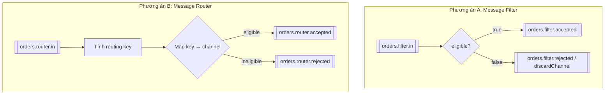
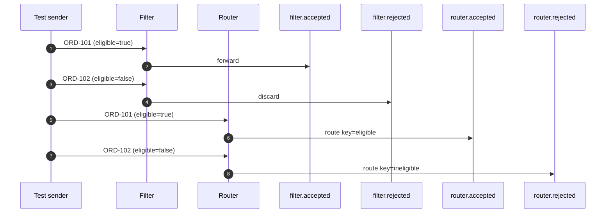
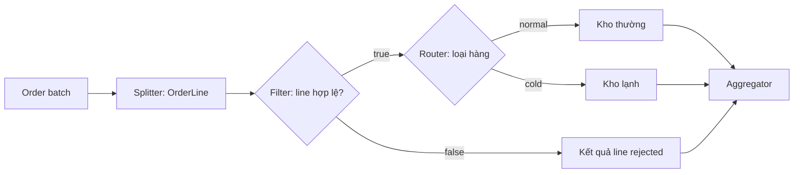

# Phân biệt filter với router chỉ có một nhánh

Trong một luồng tích hợp, cả **Message Filter** lẫn **Message Router** đều có thể khiến thông điệp chỉ đi tiếp tới **một kênh nghiệp vụ**. Ví dụ, đơn hàng đủ điều kiện được chuyển vào `orders.accepted`, còn đơn không đạt không được phép xử lý. Nhìn sơ đồ, hai cách làm dễ giống nhau. Nhưng chúng **khác mục đích, hợp đồng đầu ra, cách xử lý message không được chọn và cách mở rộng về sau**.

Bài thuộc chương **Filter** của module `SPRING_INTEGRATION_PATTERN`. Theo hướng học về **Enterprise Integration Patterns (EIP)** với Spring Integration, chúng ta sẽ chọn đúng giữa Filter, Router và các pattern liên quan, dùng Java DSL để triển khai, kiểm thử đường nhận/từ chối, xác định retry/error channel, correlation và observability, tránh nhầm việc **chặn message** với việc **chọn một đích trong nhiều đích**.

> **Ghi nhớ:** **Filter** trả lời **“Có cho message này đi tiếp không?”**. **Router** trả lời **“Message này đi tới kênh nào?”**. Một Router hiện chỉ có một **nhánh xử lý thành công** vẫn là Router nếu nó phải **tính routing key, phân giải destination hoặc có chính sách fallback**. Ngược lại, một Filter có `discardChannel` vẫn là Filter: kênh discard thể hiện **thông điệp không đạt điều kiện**, không phải một lựa chọn định tuyến nghiệp vụ ngang hàng với tuyến chấp nhận.

## 1. Mục tiêu học tập

Sau bài này, bạn có thể:

1. Phân biệt **Message Filter** với **Message Router chỉ có một tuyến xử lý chính** bằng ngữ nghĩa, không dựa vào hình dạng sơ đồ.
2. Mô tả đúng hai kết quả của Filter: **predicate trả `true`** thì message đi tiếp; **`false`** thì bị loại hoặc chuyển sang `discardChannel` theo cấu hình.
3. Giải thích Router chọn **routing key/destination**, và lý do Router chỉ map một khóa không mặc nhiên có hành vi “drop khi không khớp” giống Filter.
4. Viết hai IntegrationFlow bằng Spring Integration Java DSL để so sánh Filter với Router có một **success branch** và một tuyến **rejection** tường minh.
5. Kiểm thử được **đúng nhánh, không sang nhánh sai**, trường hợp thiếu mapping, exception, request–reply và downstream failure.
6. Lựa chọn giải pháp phù hợp khi luồng mở rộng với Transformer, Recipient List, Gateway, Splitter, Aggregator, retry và error channel.

## 2. Tình huống: chỉ đơn đủ điều kiện mới được xử lý

Giả sử hệ thống nhận `OrderCommand` sau khi đã xác thực, chuẩn hóa và kiểm tra schema. Một đơn có thuộc tính `eligible` cho biết đã đủ điều kiện chạy luồng fulfillment hay chưa.

| Message đầu vào | `eligible` | Kết quả nghiệp vụ mong muốn |
| --- | --- | --- |
| `ORD-101` | `true` | Đi tiếp tới `orders.accepted`. |
| `ORD-102` | `false` | Không được gọi fulfillment; ghi nhận `NOT_ELIGIBLE`. |

Chúng ta có hai phương án:

**Phương án A — Filter:** giữ lại những message mà predicate chấp nhận. Những message không đạt được **discard** hoặc gửi sang một kênh xử lý rejection.

**Phương án B — Router:** tính khóa `eligible` hoặc `ineligible`, rồi chọn một trong các channel. Nếu chỉ có một nhánh chính là `orders.accepted`, ta vẫn phải xác định **điều gì xảy ra khi không chọn nhánh đó**.



Hai sơ đồ cùng thể hiện một tuyến **được xử lý** và một tuyến **từ chối**, nhưng cách định nghĩa kết quả hoàn toàn khác:

- Với **Filter**, `false` là **kết quả predicate**; `discardChannel` chỉ mô tả nơi tiếp nhận message bị loại.
- Với **Router**, `ineligible` là **một routing key hợp lệ**; việc gửi tới kênh rejection là một quyết định routing được khai báo.

Vì vậy **đếm số mũi tên trên sơ đồ không đủ để phân biệt hai pattern**.

## 3. Message Filter thực sự làm gì?

Trong Spring Integration, **Message Filter** là endpoint đánh giá một điều kiện và quyết định một thông điệp **được tiếp tục qua output channel hay không**. Với payload `OrderCommand`:

```java
record OrderCommand(String orderId, boolean eligible) {}

boolean canProcess(OrderCommand order) {
    return order.eligible();
}
```

Hành vi logic:

```text
Input Message<OrderCommand>
              |
              v
          Message Filter
       predicate(order)
            /       \
         true       false
          |           |
    output channel   discard policy
          |           +-- drop nếu hợp đồng cho phép
          |           +-- discardChannel được cấu hình
          |           +-- hoặc ném lỗi khi chọn chính sách rejection
    downstream
```

### 3.1. `true`: cho qua cùng thông điệp về mặt hợp đồng

Filter không phải Transformer. Nó **không có nhiệm vụ đổi payload thành một đối tượng nghiệp vụ mới**. Nếu Filter trả `true`, message được chuyển tới endpoint/kênh kế tiếp theo cấu hình. Những header như `correlationId` vẫn có thể hữu ích cho downstream; tuy nhiên không nên dựa vào reference object hoặc metadata tự sinh luôn giống nhau qua mọi adapter.

### 3.2. `false`: một quyết định loại bỏ có chủ đích

Nếu Filter trả `false`, message **không tiếp tục trên tuyến được chấp nhận**. Cách xử lý message đó phụ thuộc cấu hình:

| Cấu hình/phương án | Ý nghĩa | Cần cân nhắc |
| --- | --- | --- |
| Không có `discardChannel` và không yêu cầu exception | Message bị loại khỏi flow chính theo chính sách Filter. | Chỉ phù hợp khi **drop có chủ đích** và có khả năng quan sát cần thiết. |
| Có `discardChannel` | Gửi message không đạt tới kênh được chỉ định. | Kênh từ chối phải có consumer, capacity và contract rõ. |
| Chọn `throwExceptionOnRejection(true)` | Coi rejection là exception thay vì chỉ loại thông thường. | Không bật nếu nghiệp vụ muốn một kết quả từ chối bình thường; kiểm tra tương tác với cấu hình discard. |

**Điểm then chốt:** `discardChannel` không phải **error channel**. Predicate trả `false` là một kết quả hợp lệ của điều kiện; Filter không tự tạo `ErrorMessage` cho trường hợp đó.

### 3.3. Exception khi đánh giá predicate khác `false`

Nếu predicate ném `IllegalStateException`, lỗi truy cập dữ liệu hoặc lỗi kết nối tới dịch vụ ngoài, đó là **lỗi đánh giá/xử lý** chứ không phải “message không đủ điều kiện”. Hãy phân loại error flow/retry theo ranh giới đồng bộ hoặc bất đồng bộ thực tế. Không tự chuyển mọi exception thành `false` rồi mất khả năng biết service đang gặp sự cố.

## 4. Message Router thực sự làm gì?

**Router** phân tích message hoặc metadata, tính một **routing key** rồi chọn **channel đích**. Kết quả có thể là một kênh, nhiều kênh ở một số loại router hoặc không tìm được đích theo cấu hình.

```text
Input Message<OrderCommand>
             |
             v
         Message Router
       compute routeKey
             |
             v
       channelMapping[key]
          /        \
      matched     unmatched
         |            |
   target channel   fallback/error/resolution policy
```

Khi Router chỉ định một nhánh nghiệp vụ duy nhất, ta vẫn cần tự trả lời **với mọi message không được chọn nhánh đó, hệ thống phải làm gì?**

### 4.1. “Router chỉ có một nhánh” có thể có ba nghĩa

| Cách hiểu | Ví dụ | Nhận xét |
| --- | --- | --- |
| **Chỉ có một nhánh thành công** | `eligible → orders.accepted`, còn `ineligible` được reject. | Router vẫn có **hai kết quả logic**; reject là nhánh tường minh hoặc fallback. |
| **Chỉ có một mapping khai báo** | Chỉ map `eligible`, không khai báo `ineligible`. | Với khóa khác, kết quả phụ thuộc **fallback/default/resolution**; không được mặc định là drop như Filter. |
| **Chỉ có một output channel cố định cho mọi message** | Mọi message đều đi `orders.accepted`. | Không còn quyết định chọn tuyến hữu ích; có thể dùng channel/bridge/handler thay Router. |

Một Router không trở thành Filter chỉ vì nó có một destination được cấu hình.

### 4.2. Khóa chưa map không đồng nghĩa message đã bị Filter từ chối

Giả sử Router trả `"eligible"` khi được xử lý, còn lại trả `"ineligible"`. Nhưng bảng mapping chỉ có:

```text
"eligible" -> "orders.accepted"
```

**Không có mapping `"ineligible"`.** Tùy loại Router và cấu hình `defaultOutputChannel`, `channelKeyFallback`, `resolutionRequired` hoặc cơ chế resolution của phiên bản đang dùng, message có thể:

- đi đến default output channel;
- gây lỗi không tìm được đích;
- bị bỏ qua nếu chính sách router cho phép;
- hoặc trong một số cấu hình, khóa được thử dùng như tên channel.

**Không nên dựa vào một hiệu ứng ngầm để giả lập Filter**. Khi muốn **`false` → drop/discard**, dùng Filter và nói rõ hành vi. Khi muốn **unmatched key → fallback**, dùng Router và cấu hình fallback tường minh.

## 5. So sánh trực diện theo ngữ nghĩa

| Tiêu chí | **Message Filter** | **Router có một tuyến thành công** |
| --- | --- | --- |
| Câu hỏi chính | Có cho thông điệp đi tiếp không? | Thông điệp đi tới channel nào? |
| Kết quả chính | Boolean/điều kiện chấp nhận hoặc từ chối. | Routing key/đích được tính từ message. |
| Đường thành công | Output channel nối tiếp. | Channel theo mapping. |
| Khi không đủ điều kiện | Discard/drop/throw theo chính sách Filter. | Khóa khác hoặc không có mapping; fallback/resolution phải định nghĩa. |
| Kênh từ chối | `discardChannel` là điểm xử lý message bị loại. | Kênh reject là destination được chọn, thường qua một routing key. |
| Bổ sung nhiều đích theo nội dung | Dễ phình predicate/không đúng trách nhiệm. | Phù hợp khi thật sự cần chọn nhiều tuyến. |
| Khả năng đọc code | Thể hiện rõ ý nghĩa “gate/check”. | Thể hiện rõ ý nghĩa “decision/routing”. |
| Error channel | `false` không mặc nhiên là exception. | Unmatched không mặc nhiên là exception; lỗi route/dispatch là chuyện khác. |
| Tác dụng phụ | Nên không có trong predicate. | Nên không có trong route-key function. |
| Khi nên dùng | Eligibility, validation gate, spam/duplicate policy, chặn trước xử lý. | Phân loại theo loại event, region, priority, tenant đã được xác thực. |

**Kết luận của bảng:** Nếu chỉ có một điều kiện `true/false` để quyết định đi tiếp hay không, **Filter thường diễn đạt ý định rõ nhất**. Nếu kết quả là **tên tuyến, hạng mục, loại xử lý** hoặc có dự kiến nhiều destination độc lập, **Router** phù hợp hơn.

## 6. Ví dụ Spring Integration Java DSL: một Filter, một Router

Ví dụ dùng Java hỗ trợ `record`, Spring Integration Java DSL và JUnit 5/Spring Test tương thích. Chúng ta đặt **hai flow độc lập** cạnh nhau để so sánh. Cả hai đều có **một kênh xử lý thành công**, nhưng xử lý thông điệp từ chối theo ngữ nghĩa riêng.

### 6.1. Payload

```java
// OrderCommand.java
public record OrderCommand(
    String orderId,
    boolean eligible
) {}
```

Trong hệ thống thật, `eligible` có thể là một kết quả validation/business rule được tính từ dữ liệu đã kiểm tra. DTO ví dụ chỉ dùng để tập trung vào **điều khiển luồng**; không nên tin cờ `eligible` do client ngoài tự khai là bằng chứng phân quyền.

### 6.2. Cấu hình hai flow

```java
import org.springframework.context.annotation.Bean;
import org.springframework.context.annotation.Configuration;
import org.springframework.integration.channel.QueueChannel;
import org.springframework.integration.config.EnableIntegration;
import org.springframework.integration.dsl.IntegrationFlow;

@Configuration
@EnableIntegration
class FilterVsRouterConfiguration {

    // Hai flow dùng các queue riêng để dễ kiểm thử.
    @Bean("orders.filter.accepted")
    QueueChannel filterAccepted() {
        return new QueueChannel(16);
    }

    @Bean("orders.filter.rejected")
    QueueChannel filterRejected() {
        return new QueueChannel(16);
    }

    @Bean("orders.router.accepted")
    QueueChannel routerAccepted() {
        return new QueueChannel(16);
    }

    @Bean("orders.router.rejected")
    QueueChannel routerRejected() {
        return new QueueChannel(16);
    }

    // A. FILTER: kiểm tra được phép đi tiếp hay không.
    @Bean
    IntegrationFlow filterOrders() {
        return IntegrationFlow.from("orders.filter.in")
            .filter(
                OrderCommand.class,
                order -> order.eligible(),
                spec -> spec.discardChannel("orders.filter.rejected"))
            .channel("orders.filter.accepted")
            .get();
    }

    // B. ROUTER: tính khóa rồi chọn một destination.
    @Bean
    IntegrationFlow routeOrders() {
        return IntegrationFlow.from("orders.router.in")
            .route(
                OrderCommand.class,
                order -> order.eligible() ? "eligible" : "ineligible",
                spec -> spec
                    .channelMapping("eligible", "orders.router.accepted")
                    .channelMapping("ineligible", "orders.router.rejected")
                    .channelKeyFallback(false))
            .get();
    }
}
```

**Điểm đọc code quan trọng:**

- `filterOrders` mô tả **một phép kiểm tra**. Khi `eligible=true`, message đi đến `orders.filter.accepted`, khi `false` đi đến `orders.filter.rejected` qua **`discardChannel`**.
- `routeOrders` mô tả **một quyết định định tuyến**. Nó tính `"eligible"` hoặc `"ineligible"` rồi dùng `channelMapping` để gửi tới `orders.router.accepted` hoặc `orders.router.rejected`.
- `channelKeyFallback(false)` thể hiện ý định không lấy một key ngoài mapping làm tên channel đích trực tiếp. Trong project cụ thể cần xác minh hành vi mapping/unmatched theo phiên bản Spring Integration.
- `QueueChannel(16)` dùng làm **điểm quan sát**, không tự xử lý nghiệp vụ hoặc lưu bền qua restart. Muốn xử lý thực tế cần consumer/poller hoặc flow khác.

Với cách khai báo trên, cả hai flow đều có **một success branch** và **một tuyến nhận rejection**. Nhưng trong Filter, rejection do **predicate false**; trong Router, rejection là **một routing destination được map tường minh**.

### 6.3. Diễn biến hai message



Hành vi tương đương **về kênh nhận trong ví dụ này**, nhưng **ngữ nghĩa điều khiển khác nhau**. Chính khác biệt đó trở nên quan trọng khi thêm loại xử lý, yêu cầu lỗi riêng hay gateway cần reply.

## 7. Kiểm thử bằng JUnit 5: cả hai đường đi đều đúng

Đặt test trong cùng package với `OrderCommand` và `FilterVsRouterConfiguration`.

```java
import static org.junit.jupiter.api.Assertions.*;

import org.junit.jupiter.api.Test;
import org.springframework.beans.factory.annotation.Autowired;
import org.springframework.context.ApplicationContext;
import org.springframework.integration.channel.QueueChannel;
import org.springframework.messaging.Message;
import org.springframework.messaging.MessageChannel;
import org.springframework.messaging.support.MessageBuilder;
import org.springframework.test.context.junit.jupiter.SpringJUnitConfig;

@SpringJUnitConfig(FilterVsRouterConfiguration.class)
class FilterVsRouterTest {

    @Autowired
    ApplicationContext context;

    private QueueChannel output(String name) {
        return context.getBean(name, QueueChannel.class);
    }

    private void send(String inputChannel, OrderCommand order) {
        MessageChannel input =
            context.getBean(inputChannel, MessageChannel.class);
        assertTrue(input.send(
            MessageBuilder.withPayload(order).build()));
    }

    @Test
    void filterPassesAcceptedAndDiscardsRejected() {
        OrderCommand accepted = new OrderCommand("ORD-101", true);
        OrderCommand rejected = new OrderCommand("ORD-102", false);

        send("orders.filter.in", accepted);
        send("orders.filter.in", rejected);

        Message<?> pass = output("orders.filter.accepted").receive(0);
        Message<?> discard = output("orders.filter.rejected").receive(0);

        assertNotNull(pass);
        assertNotNull(discard);
        assertEquals(accepted, pass.getPayload());
        assertEquals(rejected, discard.getPayload());
        assertNull(output("orders.filter.accepted").receive(0));
        assertNull(output("orders.filter.rejected").receive(0));
    }

    @Test
    void routerMapsTwoKeysEvenWithOneBusinessSuccessPath() {
        OrderCommand accepted = new OrderCommand("ORD-201", true);
        OrderCommand rejected = new OrderCommand("ORD-202", false);

        send("orders.router.in", accepted);
        send("orders.router.in", rejected);

        Message<?> pass = output("orders.router.accepted").receive(0);
        Message<?> reject = output("orders.router.rejected").receive(0);

        assertNotNull(pass);
        assertNotNull(reject);
        assertEquals(accepted, pass.getPayload());
        assertEquals(rejected, reject.getPayload());
        assertNull(output("orders.router.accepted").receive(0));
        assertNull(output("orders.router.rejected").receive(0));
    }
}
```

Các test chứng minh:

1. **Filter** chỉ chuyển message chấp nhận đến tuyến chính và đưa message `false` tới discard channel.
2. **Router** dùng **hai routing key** đúng mapping, dù chỉ có một tuyến thành công về nghiệp vụ.
3. Không có message dư ở kênh sai sau khi test đọc kết quả.

**Giới hạn:** Đây là test dispatch đồng bộ đến queue nội bộ. Chúng chưa chứng minh queue tồn tại qua restart, handler xử lý thành công, request–reply, retry hoặc error handling dưới tải cao. Nếu thay `QueueChannel` bằng executor/broker, phải chờ theo điều kiện có timeout và kiểm thử transaction/ack riêng.

### 7.1. Thử tình huống chỉ khai báo một mapping

Trong một bài thực hành khác, thử thay Router bằng dạng **chỉ có mapping `"eligible"`** rồi gửi message trả `"ineligible"`. Ghi nhận điều xảy ra:

- Nó có đi default output channel không?
- Nó có bị lỗi không tìm thấy destination không?
- Có đang bật cơ chế channel-key fallback không?
- Có policy cho phép bỏ unmatched mà không ném exception không?

Không ghi kết luận trước khi **kiểm tra cấu hình và chạy test của phiên bản Spring Integration đang sử dụng**. Với Filter, `false` đã có nghĩa **reject**; với Router, thiếu mapping phải được xử lý theo **hợp đồng routing**.

## 8. Khi nào dùng `discardChannel`, khi nào dùng nhánh rejection của Router?

**Filter + discardChannel** phù hợp khi nghiệp vụ có **một điều kiện quyết định có đi tiếp hay không**:

```text
Input -> Filter: valid?
    true  -> processing
    false -> rejected / audit
```

**Router với một tuyến thành công** hợp lý khi kết quả muốn diễn đạt là **một trạng thái phân loại**:

```text
Input -> Router: classify()
    "ready"    -> processing
    "hold"     -> pending-review
    "invalid"  -> rejected
```

Ngay khi có nhiều trạng thái `ready/hold/invalid` ngang hàng, **Router** thể hiện chính sách tốt hơn một chuỗi Filter khó đọc.

### 8.1. Đừng chọn pattern theo số đích vật lý

Có thể tất cả đơn chưa đủ điều kiện đều vào một queue `orders.review`, nhưng **lý do từ chối** có nhiều loại. Bạn có thể:

- Dùng **Filter** nếu chỉ cần pass/reject, gửi rejection tới `orders.review` rồi một handler tạo mã lý do.
- Dùng **Transformer/validator** tạo một `ValidationResult` đầy đủ và Router định tuyến theo `ACCEPTED/PENDING/REJECTED` nếu muốn phân loại nghiệp vụ rõ.
- Dùng **Recipient List** nếu một message phải được gửi đến **nhiều** đích (ví dụ processing và audit) thay vì một trong số các đích.

Một message được Filter pass rồi gửi thêm audit không tự khiến Filter thành Router. Ngược lại, một Router chọn kênh `orders.review` không đồng nghĩa message đã được validation đầy đủ.

### 8.2. Khi “drop” là hợp đồng hợp lệ

Filter có thể phù hợp khi lọc event không được quan tâm:

```text
Inbound audit stream -> Filter: type == "ORDER"
    true  -> order-event consumer
    false -> bỏ qua theo hợp đồng đã công bố
```

Nhưng nếu event có giá trị tài chính hoặc pháp lý, **drop im lặng** thường nguy hiểm. Cần lưu/quarantine theo chính sách, mã lý do và khả năng quan sát; đừng chỉ vì Filter mặc định có thể bỏ message mà coi việc đó phù hợp production.

## 9. Cách trả kết quả từ chối cho caller qua Gateway

Một tình huống phổ biến: HTTP adapter hoặc `@MessagingGateway` gọi vào flow và **chờ response**:

```java
import org.springframework.integration.annotation.MessagingGateway;

@MessagingGateway(defaultRequestChannel = "orders.filter.in")
interface OrderGateway {
    OrderReceipt submit(OrderCommand command);
}

// OrderReceipt là DTO phản hồi nghiệp vụ do ứng dụng định nghĩa.
```

**Cấu hình minh họa ở mục 6 chưa đủ làm request–reply.** Các `QueueChannel` chỉ giữ message, **không tự trả `OrderReceipt`** qua reply path. Nếu Filter drop message hoặc Router gửi vào một queue không có handler reply, Gateway có thể không nhận phản hồi/timeout theo cấu hình.

### 9.1. Phản hồi nghiệp vụ và lỗi kỹ thuật là hai thứ khác

| Trường hợp | Kết quả caller thường cần |
| --- | --- |
| Đơn hợp lệ và xử lý thành công | `OrderReceipt(ACCEPTED, ...)`. |
| Đơn không đủ điều kiện | `OrderReceipt(REJECTED, reasonCode)` hoặc domain exception theo hợp đồng. |
| Payload sai schema | Validation error rõ ràng. |
| ERP timeout | Trạng thái tạm thời/chưa xác định, retry/tra cứu trạng thái. |
| Router thiếu mapping do cấu hình | Lỗi kỹ thuật hoặc quarantine, không giả làm “không đủ điều kiện”. |

**Không dùng reply timeout để thay thế một kết quả `REJECTED` hợp lệ.** Nếu caller cần biết vì sao message không được xử lý, tuyến discard hoặc rejection phải có endpoint tạo response rõ ràng và giữ reply/correlation path.

### 9.2. Lưu ý với Router chọn một nhánh “không trả lời”

Nếu Router chọn `orders.accepted` còn các khóa khác đi fallback queue, nhưng caller vẫn chờ `OrderReceipt`, **fallback không có handler trả lời** cũng gây vấn đề giống Filter drop. Vấn đề này **không được giải quyết chỉ bằng đổi tên pattern**; phải thiết kế giao thức request–reply cho **tất cả outcome**.

## 10. Exception, error channel và retry

**Rejection** là quyết định nghiệp vụ hoặc chính sách; **exception** thường cho biết không thể hoàn thành việc xử lý bình thường. Không nên gộp chúng:

| Tình huống | Với Filter | Với Router |
| --- | --- | --- |
| Điều kiện không đạt | Predicate trả `false` → discard policy. | Route key dẫn tới kênh reject nếu khai báo. |
| Sai biểu thức/property | Exception trong predicate/expression. | Exception khi tính routing key. |
| Thiếu channel/subscriber | Gửi output/discard có thể lỗi. | Resolve/dispatch destination có thể lỗi. |
| Downstream handler lỗi | Lỗi sau Filter. | Lỗi sau Router. |
| Kênh đích quá tải | Backpressure/send failure. | Backpressure/send failure. |
| Chờ Gateway reply quá hạn | Caller thiếu kết quả. | Caller thiếu kết quả. |

### 10.1. `errorChannel` không phải `discardChannel`

- `discardChannel` gắn với Filter để nhận **message không đạt điều kiện**.
- `errorChannel` phục vụ **đường xử lý lỗi**, thường mang `ErrorMessage` khi endpoint/adapter phù hợp phát lỗi theo cấu hình.
- Router fallback là **đường định tuyến** khi không có destination phù hợp theo policy, không tự động là error channel.

Trong `DirectChannel` đồng bộ, exception có thể đi ngược về sender. Trong flow bất đồng bộ có executor/poller/adapter, exception có thể được đưa tới error flow tương ứng theo cấu hình. **Không giả định mọi exception của mọi endpoint đều tự đi vào một global error channel**.

### 10.2. Retry không chữa được một rejection xác định

Đơn `eligible=false` vì chưa đủ tài liệu không tự trở thành `true` nếu retry liên tục cùng payload. Những tình huống cần phân biệt:

| Sự cố | Retry thích hợp? |
| --- | --- |
| Predicate quyết định chắc chắn `false` | Thường **không** retry y nguyên; chờ dữ liệu/chính sách thay đổi có chủ đích. |
| Validation lỗi định dạng | Không retry cùng payload; yêu cầu sửa input. |
| Policy service đang tạm unavailable | Có thể retry giới hạn nếu operation an toàn, kèm backoff. |
| ERP timeout sau khi đã nhận message | Cần kiểm tra trạng thái và idempotency trước khi gửi lại. |
| Channel từ chối đầy | Xử lý capacity/backpressure; không drop mất thông tin lỗi quan trọng. |

Predicate và hàm tính route key nên **nhanh, deterministic, không gây side effect**. Nếu cần truy vấn dịch vụ ngoài, cân nhắc thực hiện ở bước chuẩn hóa/kiểm tra riêng có timeout và error policy rõ, rồi mới Filter/Router.

## 11. Filter/Router và Splitter, Aggregator, correlation

Một luồng xử lý đơn hàng có thể:



Trong sơ đồ:

1. **Splitter** tạo message cho từng dòng hàng.
2. **Filter** bỏ/đánh dấu dòng không được phép xử lý.
3. **Router** chọn kho **đối với những dòng đã được Filter chấp nhận**.
4. **Aggregator** cần kết quả đủ theo nhóm, kể cả các dòng rejected nếu hợp đồng phải tổng hợp toàn đơn.

### 11.1. Tại sao drop sau Splitter có thể làm Aggregator chờ mãi?

Splitter thường cung cấp metadata correlation/sequence hoặc một strategy tương đương. Nếu một phần bị Filter loại mà **không có kết quả thay thế**, Aggregator có thể không nhận đủ số phần kỳ vọng và không release.

Giải pháp phụ thuộc nghiệp vụ:

- Với `OrderLine` không hợp lệ, tạo **kết quả từ chối** mang correlation/part ID để Aggregator tính là một outcome.
- Nếu cho phép partial result, xác định release condition/group timeout/expiry.
- Nếu không cho phép thiếu phần, fail toàn bộ batch với mã lỗi rõ.
- Khi một nhánh Router xử lý chậm, thiết kế late arrival/retry/deduplication.

**Router chỉ có một nhánh thành công** không tự giải quyết việc Aggregator chờ các phần bị loại. Cần thiết kế **vòng đời nhóm**, không đổi pattern chỉ để làm biểu đồ đẹp hơn.

### 11.2. Preserve correlation

Nếu tạo `Message<?>` mới khi chuyển từ Filter rejection sang error/rejection handling, cần giữ metadata correlation và reply path đúng hợp đồng. Không ghi nguyên mọi header/secret vào log hay outbound transport; chỉ truyền những trường cần thiết.

## 12. Chọn pattern theo độ phức tạp tương lai

Một lý do hay được viện dẫn là: “Hôm nay có một nhánh, ngày mai có thể có thêm nên dùng Router ngay”. Lập luận này **có thể hợp lý** nếu domain thực sự chứa nhiều trạng thái phân loại, nhưng cũng có thể tạo cấu hình khó hiểu cho một phép pass/reject đơn giản.

| Hệ quả mong muốn | Lựa chọn thường rõ nghĩa hơn |
| --- | --- |
| Chỉ cho message đủ điều kiện đi tiếp | **Filter**. |
| Bỏ event không thuộc loại consumer quan tâm | **Filter**, có logging/metrics phù hợp. |
| Đơn có ba outcome `READY/PENDING/REJECTED` | **Router** theo kết quả phân loại. |
| Cùng `OrderCommand` nhưng chọn kho theo region | **Router**. |
| Một message gửi đồng thời Audit + Notification | **Recipient List/Publish–Subscribe**, không phải Filter/Router đơn nhánh. |
| Một đơn tách thành N dòng hàng | **Splitter**. |
| N dòng hàng cần gộp lại thành kết quả đơn | **Aggregator**. |
| Phải thay đổi điều kiện policy khi runtime | Có thể dùng **Dynamic Router**/policy service; Filter cũng có thể nhận policy động nếu thật sự chỉ là pass/reject. |
| Cần kiểm tra nhiều lỗi validation cùng lúc | Validator/Transformer tạo danh sách lỗi rồi Router theo outcome; Filter short-circuit không tự tổng hợp tất cả lỗi. |

**Không cần dùng Router để “mở đường cho tương lai” nếu mọi yêu cầu hiện tại chỉ là một cổng boolean.** Ngược lại, khi có nhiều đích thực sự, dùng nhiều Filter nối tiếp để giả lập Router có thể làm code khó đọc và gây mất message ở nhánh không mong muốn.

### 12.1. Ví dụ tiến hóa hợp lý

**Giai đoạn 1:** quy tắc đơn giản.

```text
Filter: eligible? → accepted / rejected
```

**Giai đoạn 2:** có thêm trạng thái cần chờ phê duyệt.

```text
Validator/Policy → outcome = ACCEPT / HOLD / REJECT
Router:
    ACCEPT -> processing
    HOLD   -> manual-review
    REJECT -> rejection-handler
```

**Giai đoạn 3:** mỗi nhánh cần fan-out.

```text
Router -> processing
       -> publish event tới Audit + Metrics qua PublishSubscribeChannel
```

Sự thay đổi pattern theo **ý nghĩa nghiệp vụ thực** thường dễ bảo trì hơn việc ép một Router chỉ có một mapping đảm nhiệm luôn vai trò Filter.

## 13. Observability: phải đo được pass, reject và route

Một hệ thống có nhiều message bị loại nhưng không có dấu vết có thể trông giống một hệ thống chạy khỏe — vì kênh xử lý chính vẫn ít lỗi. Do đó, cần quan sát cả **quyết định không gửi tiếp**.

Các chỉ số đề xuất:

- `filter_received_total`: số message đã vào Filter.
- `filter_passed_total`: số message được chuyển tới downstream.
- `filter_rejected_total`: số message bị predicate từ chối.
- `router_decisions_total` theo **routing key hữu hạn**.
- `router_unmatched_total`: số khóa không tìm được destination theo policy.
- `channel_send_failures_total`: số lần bàn giao output/discard/rejection thất bại.
- Latency và lỗi của handler đích, retry count và timeout ở adapter ngoài.

**Các tên chỉ số là gợi ý**, không tự xuất hiện chỉ vì khai báo `.filter(...)` hoặc `.route(...)` trong DSL.

### 13.1. Đừng đo nhầm mẫu số

Ví dụ có 1.000 message vào Filter, 200 bị reject và 800 pass. **Reject rate** là `200 / 1.000 = 20%`.

Nếu Router sau Filter chuyển 600/800 vào `primary` và 200/800 vào `canary`, **tỷ lệ canary trên input của Router** là `25%`, nhưng **tỷ lệ trên toàn bộ message ban đầu** là `20%`. Dashboard phải ghi rõ mẫu số và ranh giới đo.

### 13.2. Log an toàn

```text
event=integration_filter_rejected
flow=orderEligibility
component=eligibilityFilter
reason_code=NOT_ELIGIBLE
outcome=rejected
correlation_id=<opaque-id>
```

```text
event=integration_route_decision
flow=orderClassification
route_key=manual_review
destination=orders.review
outcome=routed
correlation_id=<opaque-id>
```

Đây là format minh họa, không phải log mặc định của framework. Tránh log toàn bộ `Message`, token, thông tin cá nhân hoặc dữ liệu thanh toán. Routing key và reason code nên thuộc **tập giá trị nhỏ, được chuẩn hóa**; không dùng correlation ID riêng mỗi request làm metric label.

## 14. Các lỗi thường gặp

### Lỗi 1 — “Router có một output cũng là Filter”

**Sai về ngữ nghĩa.** Một Router vẫn tính destination/key. Filter quyết định pass/reject. Số channel trên sơ đồ không xác định loại EIP.

### Lỗi 2 — “Chỉ map `eligible`, những key khác tự bị drop”

**Không nên giả định.** Router có default/resolution/key-fallback policy; unmatched có thể gây lỗi hoặc đi nơi khác. Nếu muốn Filter semantics, dùng Filter.

### Lỗi 3 — “Có `discardChannel` thì Filter đã trở thành Router hai nhánh”

**Không.** Discard channel là đầu ra cho message **không đạt predicate**. Nó không phải một phân loại tuyến nghiệp vụ ngang hàng với pass.

### Lỗi 4 — “Predicate `false` là exception”

**Sai.** Rejection bình thường khác lỗi kỹ thuật; chỉ biến nó thành exception nếu hợp đồng thực sự yêu cầu và cấu hình phù hợp.

### Lỗi 5 — “Gửi tới queue rejected nghĩa là caller sẽ nhận lỗi”

**Sai.** Queue chưa tự tạo `OrderReceipt`. Với Gateway request–reply cần handler/reply path cho cả reject và success.

### Lỗi 6 — “Có thể gọi thanh toán hoặc update DB ngay trong predicate”

**Không nên.** Retry/replay hoặc exception khi đánh giá có thể khiến side effect lặp và khó truy vết. Tách logic có side effect sang handler/service.

### Lỗi 7 — “Filter drop một dòng hàng, Aggregator tự điều chỉnh số phần”

**Không mặc nhiên.** Cần correlation, completion policy, kết quả rejection thay thế hoặc expiry/partial result.

### Lỗi 8 — “Router có fallback sẽ bắt mọi lỗi SpEL và mọi lỗi downstream”

**Sai.** Fallback cho khóa không chọn được destination theo chính sách, không phải bộ thu mọi exception hoặc timeout.

### Lỗi 9 — “Kênh reject không có consumer cũng không sao”

**Nguy hiểm.** `QueueChannel` có thể tích tụ đến đầy; `DirectChannel` thiếu subscriber có thể thất bại. Thiết kế consumer, capacity/backpressure và retention phù hợp.

## 15. Bài tập thực hành

**Bài 1 — Phân loại tình huống.** Với các yêu cầu (a) loại bỏ event không phải `ORDER`, (b) chọn kho SG/VN, (c) chọn `READY/HOLD/REJECTED`, (d) gửi tới Audit và Metrics, hãy chọn Filter/Router/Recipient List và giải thích bằng **ý nghĩa quyết định**.

**Bài 2 — Thử Router chỉ một mapping.** Bỏ mapping `ineligible` khỏi cấu hình ví dụ ở mục 6, thử có/không có default channel, bật/tắt channel-key fallback nếu API phù hợp. Ghi hành vi thực tế đối với message `eligible=false` và so sánh với Filter.

**Bài 3 — Filter drop có chủ đích.** Loại bỏ `discardChannel` của Filter. Kiểm thử message `false` không đến tuyến accepted. Nêu cách đo reject count để không nhầm với thất lạc dữ liệu.

**Bài 4 — Thông báo rejection cho Gateway.** Thay hai `QueueChannel` bằng handler sinh `OrderReceipt` cho accepted/rejected. Đảm bảo caller nhận được kết quả rõ thay vì timeout.

**Bài 5 — Exception không giống `false`.** Tạo predicate ném `IllegalStateException`, kiểm tra cách lỗi truyền về sender trong flow đồng bộ và qua error flow khi chuyển sang async phù hợp.

**Bài 6 — Chuỗi Filter.** Bổ sung điều kiện `hasItems` và `notCancelled`. Kiểm thử short-circuit: message trượt filter đầu không đến các filter sau. Giải thích vì sao cách này không tự gom được tất cả lỗi validation.

**Bài 7 — Từ Filter sang Router.** Bổ sung outcome `MANUAL_REVIEW`. Viết một hàm typed trả `READY/HOLD/REJECTED` và Router có mapping tường minh, không dùng chuỗi từ request để chọn channel có đặc quyền.

**Bài 8 — Splitter/Aggregator.** Một đơn có năm dòng, hai dòng bị Filter từ chối. Thiết kế kết quả rejection có correlation để Aggregator không đợi vô hạn và không kết luận đơn thành công khi thiếu phần.

## 16. Checklist trước khi triển khai

| Câu hỏi | Cách tự kiểm tra |
| --- | --- |
| Bài toán chỉ là pass/reject? | **Filter** thường biểu đạt trực tiếp nhất. |
| Cần chọn một trong nhiều đích theo nội dung? | **Router** với routing key và mapping tường minh. |
| Router chỉ có một nhánh được chọn? | Xác định **unmatched/default/resolution policy**, không giả định là Filter. |
| Message bị Filter từ chối đi đâu? | Drop có hợp đồng, `discardChannel` hoặc exception nếu được chỉ định. |
| Có phân biệt `false` với exception? | Có test và error policy riêng. |
| Có consumer cho output/discard/fallback? | Có handler/poller và capacity/retention phù hợp. |
| Có Gateway request–reply? | Mọi outcome cần thiết có response/reply path rõ. |
| Có side effect trong predicate/route key function? | Ưu tiên loại bỏ; bảo vệ retry/idempotency ở handler. |
| Routing key có đến từ dữ liệu ngoài? | Validate, allowlist, tránh dynamic privileged channels. |
| Có Splitter/Aggregator? | Xác định missing parts, correlation, release/expiry, late results. |
| Có timeout, retry, error channel? | Phân loại đúng send failure, evaluation error và downstream failure. |
| Có kiểm thử đúng/sai nhánh? | JUnit test pass/reject, unmatched, exception và negative assertions. |
| Có metrics/log cho rejection? | Đếm pass/drop/reject rõ mẫu số, không lộ PII/secret. |
| Có async/broker? | Kiểm thử thời gian đến, backpressure, redelivery và idempotency. |

## Kết luận

**Filter** và **Router chỉ có một nhánh xử lý thành công** có thể trông giống nhau trên sơ đồ nhưng khác **câu hỏi mà chúng trả lời**. Filter là **cổng điều kiện**: predicate `true` thì message đi tiếp; `false` thì áp dụng discard policy. Router là **bộ chọn đích**: nó tính routing key và phân giải channel, còn unmatched/fallback/error phải được định nghĩa riêng. **`discardChannel` của Filter không biến nó thành một Router nhiều nhánh**, cũng như một Router có một mapping không mặc nhiên trở thành Filter.

Trong Spring Integration, hãy ưu tiên **Filter cho pass/reject** và **Router khi cần phân loại destination thực sự**; dùng Transformer/validator để chuẩn hóa dữ liệu, Gateway để trả kết quả có hợp đồng và các handler riêng cho tác vụ nghiệp vụ. Khi kết hợp Splitter/Aggregator, retry, error channel, correlation và observability, việc phân biệt đúng hai pattern giúp luồng tích hợp **ít phụ thuộc, dễ kiểm thử và không đánh rơi message hoặc che giấu lỗi chỉ vì lựa chọn sai semantics**.
