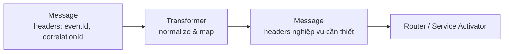
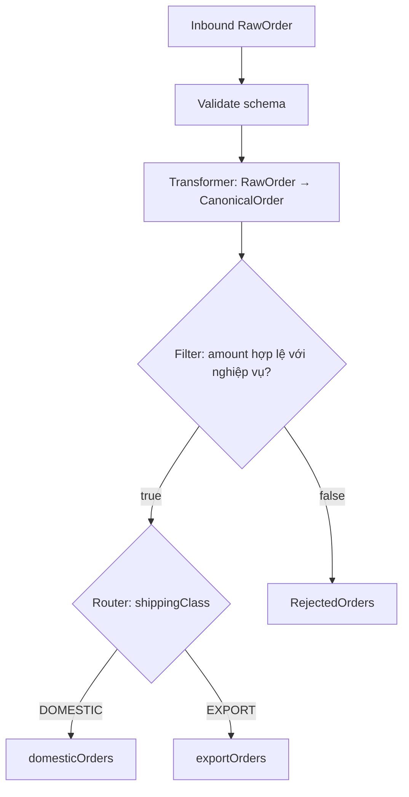
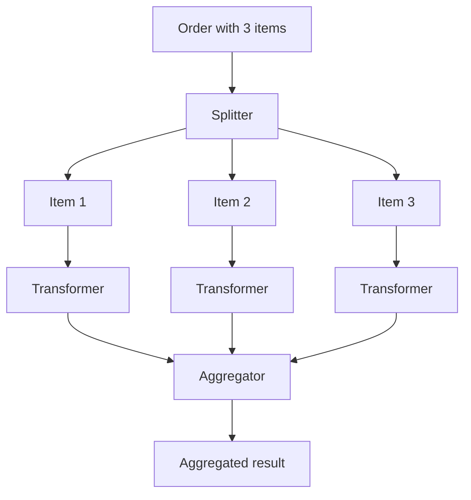

# Message Transformer chuyển dữ liệu trong flow

Trong một hệ thống tích hợp, hai thành phần thường hiểu cùng một sự kiện bằng **những cấu trúc dữ liệu khác nhau**. API bán hàng gửi đơn hàng với mã quốc gia và chuỗi loại giao hàng; bộ xử lý nội bộ lại cần một đối tượng Java chuẩn hóa, enum rõ nghĩa và số tiền có quy tắc biểu diễn nhất quán. Nếu từng consumer đều tự đọc, chuyển kiểu và chuẩn hóa dữ liệu từ đầu, logic bị lặp lại, khó kiểm thử và dễ phát sinh sai lệch.

**Message Transformer** là mẫu Enterprise Integration Patterns (EIP) biến đổi nội dung Message từ một biểu diễn sang biểu diễn khác trong khi Message tiếp tục chảy qua flow. Trong Spring Integration, Transformer thường chuyển **payload** của Message thành payload mới, đồng thời để hạ tầng xử lý việc tạo Message đầu ra và bảo toàn các header cần thiết. Nó giúp tách **hợp đồng dữ liệu đầu vào** khỏi **mô hình dữ liệu mà các endpoint tiếp theo sử dụng**.

Bài thuộc chương **Transformer** của module `SPRING_INTEGRATION_PATTERN`. Module hướng đến học triển khai Router, Filter, Transformer, Splitter, Aggregator, Gateway, retry, error channel và correlation bằng Spring Integration, xây dựng luồng thông điệp ít phụ thuộc, có thể mở rộng, kiểm thử và theo dõi. Trọng tâm bài này là: **Transformer thay đổi dữ liệu trong flow như thế nào, khi nào sử dụng, và làm sao kiểm chứng payload cùng metadata sau biến đổi**.

## 1. Tư duy về Message trước và sau Transformer

Một Message trong Spring Messaging về cơ bản gồm hai phần:

- **Payload:** dữ liệu nghiệp vụ, chẳng hạn `RawOrder` hoặc một JSON object.
- **Headers:** metadata như `id`, `timestamp`, `eventId`, `correlationId`, `replyChannel`, `errorChannel` hoặc những header được ứng dụng định nghĩa.

Giả sử đầu vào:

```json
{
  "orderId": " ord-1001 ",
  "customerCode": " cus-10 ",
  "currency": "usd",
  "total": 125.50,
  "shippingMode": "global"
}
```

Sau Transformer, payload có thể trở thành một `CanonicalOrder` dùng bên trong hệ thống:

```json
{
  "orderId": "ORD-1001",
  "customerCode": "CUS-10",
  "currency": "USD",
  "total": 125.50,
  "shippingClass": "EXPORT"
}
```

Sự thay đổi ở đây **không chỉ là đổi tên trường JSON**. Nó bao gồm chuẩn hóa mã, chuyển giá trị chuỗi sang enum, kiểm tra quy tắc biểu diễn số tiền và tạo kiểu payload phù hợp cho các endpoint tiếp theo.



Một Transformer không cần biết downstream sẽ xử lý đơn ở nội địa hay xuất khẩu. Nó chỉ có trách nhiệm tạo **biểu diễn chuẩn** mà downstream hiểu được.

## 2. Transformer giải quyết vấn đề gì?

Các tình huống thường cần Transformer:

| Đầu vào | Đầu ra | Lý do |
| --- | --- | --- |
| DTO từ HTTP hoặc broker | Domain command/event nội bộ | Tách hợp đồng ngoài và mô hình nội bộ |
| Chuỗi loại sự kiện | Enum hoặc value object | Tránh so sánh chuỗi rải rác |
| Tên trường/đơn vị không thống nhất | Canonical schema | Hợp nhất nhiều nguồn dữ liệu |
| JSON text | Java object | Deserialization, parsing theo schema |
| Java object | JSON/Avro/byte[] | Chuẩn bị gửi qua adapter hoặc transport |
| Bản ghi giàu chi tiết | DTO ít trường hơn | Chỉ chuyển phần dữ liệu consumer cần |
| Payload với trường có thể thiếu | Payload đã chuẩn hóa có chính sách rõ | Giảm ràng buộc downstream về trường hợp bất thường |

**Transformer làm thay đổi dữ liệu, không quyết định nơi gửi dữ liệu.** Nó có thể được đặt trước Router để bảo đảm Router đọc một trường/enum thống nhất, hoặc sau Router để mỗi nhánh chuyển sang định dạng riêng.

Không nên dùng Transformer để lén làm những tác vụ có side effect không liên quan như trừ tiền, cập nhật tồn kho hoặc gửi email. Những trách nhiệm đó thường phù hợp với Service Activator, outbound adapter hoặc một workflow được mô tả rõ.

## 3. Phân biệt Transformer với các mẫu EIP khác

| Thành phần | Mục tiêu chính | Ví dụ |
| --- | --- | --- |
| **Transformer** | Đổi payload/biểu diễn của Message | `RawOrder → CanonicalOrder` |
| **Filter** | Cho Message qua hoặc từ chối | Chỉ nhận đơn có `total > 0` |
| **Router** | Chọn channel/recipient | `shippingClass=EXPORT → exportOrders` |
| **Splitter** | Chia một Message thành nhiều Message con | Đơn hàng có nhiều dòng → từng dòng |
| **Aggregator** | Gom những Message có liên hệ thành một kết quả | Nhiều kết quả kiểm tra → quyết định tổng |
| **Service Activator** | Thực hiện chức năng nghiệp vụ | Tạo lệnh giao hàng |
| **Message Converter** | Chuyển dạng payload theo cơ chế chuyển đổi kiểu/marshalling | `String/byte[] ↔ JSON DTO` |

Transformer có thể **sử dụng một Message Converter** hoặc thư viện mapping để tạo payload mới, nhưng hai khái niệm không hoàn toàn đồng nghĩa. Message Converter thường giải quyết bài toán chuyển kiểu hoặc serialization; Transformer có thể chứa quy tắc biến đổi nghiệp vụ như chuẩn hóa mã, đổi đơn vị và tạo một command có ý nghĩa.

### Một Message sau biến đổi hay một Message mới?

Transformer thường nhận Message và tạo **kết quả biến đổi**; Spring Integration xây Message đầu ra phù hợp từ kết quả đó. Payload có thể là đối tượng khác, còn một số header vẫn được truyền tiếp theo quy tắc của framework. Không nên giả định mọi header nội bộ, Message ID hoặc timestamp luôn giống hệt ban đầu sau mọi phép biến đổi, adapter và serialization.

Với dữ liệu quan trọng cho correlation, cần kiểm tra những header nào phải tồn tại ở downstream và thử nghiệm chính đường đi đó.

## 4. Thiết kế hợp đồng dữ liệu trước khi viết code

Ví dụ sẽ chuẩn hóa sự kiện đơn hàng từ một hệ thống bên ngoài. Hợp đồng mẫu:

| Thuộc tính đầu vào | Quy tắc chuẩn hóa | Thuộc tính đầu ra |
| --- | --- | --- |
| `orderId` | Bỏ khoảng trắng đầu/cuối, viết hoa; không được rỗng | `orderId` |
| `customerCode` | Bỏ khoảng trắng, viết hoa; không được rỗng | `customerCode` |
| `currency` | Viết hoa theo `Locale.ROOT`; chỉ nhận loại được hỗ trợ | `currency` |
| `total` | Phải dương; biểu diễn chính xác hai chữ số sau dấu thập phân | `total` |
| `shippingMode` | `LOCAL/DOMESTIC → DOMESTIC`, `GLOBAL/EXPORT → EXPORT` | `shippingClass` |

Ví dụ các chuyển đổi:

```text
RawOrder(" ord-1 ", " cus-5 ", "usd", 125.5, "global")
        ↓ normalize
CanonicalOrder("ORD-1", "CUS-5", "USD", 125.50, EXPORT)
```

Quy tắc số tiền là **quy ước dành cho ví dụ**, không phải một chuẩn áp dụng cho mọi loại tiền tệ. Trong production, đơn vị nhỏ nhất và rounding phải dựa trên hợp đồng của từng currency và nghiệp vụ. Trong ví dụ, Transformer **không tự làm tròn** số có hơn hai chữ số có nghĩa; dữ liệu như `12.345` sẽ bị từ chối thay vì âm thầm đổi thành `12.35`.

Thiết kế theo hợp đồng trước giúp test có thể trả lời: đầu vào nào được chuyển đổi, đầu vào nào phải báo lỗi, và trường nào phải giữ nguyên ý nghĩa.

## 5. Viết Transformer thuần Java dễ kiểm thử

Tách logic chuyển đổi khỏi hạ tầng giúp kiểm thử nhanh, không cần Spring Context. Dưới đây là một cấu hình mẫu có `OrderNormalizer` chứa hàm thuần, không phụ thuộc `MessageChannel`.

```java
package example.integration;

import java.math.BigDecimal;
import java.math.RoundingMode;
import java.util.Locale;
import java.util.Set;

import org.springframework.context.annotation.Bean;
import org.springframework.context.annotation.Configuration;
import org.springframework.integration.channel.DirectChannel;
import org.springframework.integration.channel.QueueChannel;
import org.springframework.integration.config.EnableIntegration;
import org.springframework.integration.dsl.IntegrationFlow;
import org.springframework.messaging.MessageChannel;
import org.springframework.messaging.PollableChannel;

@Configuration
@EnableIntegration
public class OrderTransformationConfiguration {

    public record RawOrder(
            String orderId,
            String customerCode,
            String currency,
            BigDecimal total,
            String shippingMode) {
    }

    public enum ShippingClass {
        DOMESTIC, EXPORT
    }

    public record CanonicalOrder(
            String orderId,
            String customerCode,
            String currency,
            BigDecimal total,
            ShippingClass shippingClass) {
    }

    public static final class OrderNormalizer {

        private static final Set<String> SUPPORTED_CURRENCIES =
                Set.of("USD", "EUR");

        private OrderNormalizer() {
        }

        public static CanonicalOrder normalize(RawOrder raw) {
            if (raw == null) {
                throw new IllegalArgumentException("order must not be null");
            }

            String orderId = requiredUpper(raw.orderId(), "orderId");
            String customerCode =
                    requiredUpper(raw.customerCode(), "customerCode");
            String currency = requiredUpper(raw.currency(), "currency");

            if (!SUPPORTED_CURRENCIES.contains(currency)) {
                throw new IllegalArgumentException(
                        "Unsupported currency: " + currency);
            }

            if (raw.total() == null || raw.total().signum() <= 0) {
                throw new IllegalArgumentException(
                        "total must be positive");
            }

            // Không làm tròn ngầm; 12.345 làm phát sinh ArithmeticException.
            BigDecimal normalizedTotal =
                    raw.total().setScale(2, RoundingMode.UNNECESSARY);

            ShippingClass shippingClass = switch (
                    requiredUpper(raw.shippingMode(), "shippingMode")) {
                case "LOCAL", "DOMESTIC" -> ShippingClass.DOMESTIC;
                case "GLOBAL", "EXPORT" -> ShippingClass.EXPORT;
                default -> throw new IllegalArgumentException(
                        "Unsupported shippingMode");
            };

            return new CanonicalOrder(
                    orderId,
                    customerCode,
                    currency,
                    normalizedTotal,
                    shippingClass);
        }

        private static String requiredUpper(String value, String field) {
            if (value == null || value.isBlank()) {
                throw new IllegalArgumentException(
                        field + " must not be blank");
            }
            return value.trim().toUpperCase(Locale.ROOT);
        }
    }

    @Bean
    public MessageChannel rawOrders() {
        return new DirectChannel();
    }

    @Bean
    public PollableChannel canonicalOrders() {
        return new QueueChannel(20);
    }

    @Bean
    public IntegrationFlow normalizeOrderFlow() {
        return IntegrationFlow.from("rawOrders")
                .transform(RawOrder.class, OrderNormalizer::normalize)
                .channel("canonicalOrders")
                .get();
    }
}
```

**Hai lớp trách nhiệm** được phân biệt rõ:

1. `OrderNormalizer.normalize(...)` chỉ phụ thuộc dữ liệu đầu vào và trả một đối tượng mới. Nó không gửi Message, không thao tác database và không biết channel đích.
2. `normalizeOrderFlow()` nối hàm đó vào chuỗi Spring Integration, biến payload `RawOrder` thành `CanonicalOrder` và chuyển kết quả tới `canonicalOrders`.

Các bean `DirectChannel`, `QueueChannel` dùng để minh họa luồng đồng bộ, cho phép đọc kết quả ngay trong test. Chúng **không phải** cấu hình broker bền vững hay consumer sản xuất.

### 5.1. Vì sao dùng `Locale.ROOT`?

Khi chuẩn hóa mã mang tính kỹ thuật như `currency`, `orderId`, `shippingMode`, nên tránh việc đổi chữ hoa/thường phụ thuộc locale người dùng. `Locale.ROOT` làm quy tắc chuẩn hóa rõ ràng và ổn định hơn đối với các mã ASCII được nêu trong hợp đồng.

### 5.2. Vì sao dùng `RoundingMode.UNNECESSARY`?

`setScale(2, RoundingMode.UNNECESSARY)` cho phép `125.5` trở thành `125.50` nhưng không cho phép làm mất giá trị có nghĩa từ `125.555`. Nếu nghiệp vụ yêu cầu làm tròn, phải chỉ định rounding mode thích hợp như một phần hợp đồng, kèm bài kiểm thử giá trị biên.

### 5.3. Vì sao return object mới?

Một record bất biến dễ so sánh trong test, tránh tình huống downstream thấy payload bị handler trước đó thay đổi sau khi Message đã được gửi. Transformer không bắt buộc phải tạo record, nhưng **tránh sửa payload mutable dùng chung** đặc biệt quan trọng trong luồng có Publish–Subscribe hoặc xử lý song song.

## 6. Gửi Message và quan sát kết quả biến đổi

Ví dụ chạy thử sau dùng đúng cấu hình ở mục 5:

```java
package example.integration;

import java.math.BigDecimal;

import org.springframework.context.annotation.AnnotationConfigApplicationContext;
import org.springframework.messaging.Message;
import org.springframework.messaging.MessageChannel;
import org.springframework.messaging.PollableChannel;
import org.springframework.messaging.support.MessageBuilder;

import example.integration.OrderTransformationConfiguration.RawOrder;
import example.integration.OrderTransformationConfiguration.CanonicalOrder;

public class OrderTransformationDemo {

    public static void main(String[] args) {
        try (var context = new AnnotationConfigApplicationContext(
                OrderTransformationConfiguration.class)) {

            MessageChannel input =
                    context.getBean("rawOrders", MessageChannel.class);
            PollableChannel output =
                    context.getBean("canonicalOrders", PollableChannel.class);

            RawOrder raw = new RawOrder(
                    " ord-1001 ",
                    " cus-10 ",
                    "usd",
                    new BigDecimal("125.5"),
                    "global");

            Message<RawOrder> message = MessageBuilder.withPayload(raw)
                    .setHeader("eventId", "evt-1001")
                    .setHeader("businessOrderId", "ORD-1001")
                    .build();

            boolean sent = input.send(message);
            Message<?> normalized = output.receive(0);

            System.out.println("Sent: " + sent);
            if (normalized == null) {
                throw new IllegalStateException(
                        "Expected transformed Message in canonicalOrders");
            }

            CanonicalOrder result =
                    (CanonicalOrder) normalized.getPayload();

            System.out.println(result);
            System.out.println(
                    "eventId=" + normalized.getHeaders().get("eventId"));
        }
    }
}
```

Với dữ liệu này, payload đầu ra chứa:

```text
CanonicalOrder[
  orderId=ORD-1001,
  customerCode=CUS-10,
  currency=USD,
  total=125.50,
  shippingClass=EXPORT
]
```

Đây là cách biểu diễn để dễ đọc, không phải khẳng định Java record in nhiều dòng như trên. Khi `System.out.println(result)` chạy, Java tạo một chuỗi biểu diễn record với các trường tương ứng.

Sự kiện mang `eventId=evt-1001` tiếp tục giữ khóa nghiệp vụ phục vụ tracing. Header `eventId` không phải thuộc tính của `CanonicalOrder`; đây là **metadata của Message**, không cần nhúng trùng vào mọi DTO.

**Giới hạn của demo:** `input.send()` thành công chỉ có nghĩa Message đã được hạ tầng channel hiện tại chấp nhận theo cơ chế đồng bộ. Việc result nằm ở `QueueChannel` chưa chứng minh một Service Activator nghiệp vụ phía sau đã hoàn thành.

## 7. Headers sau Transformer: cần giữ những gì?

Trong Spring Integration, một phép biến đổi **chỉ trả payload** thường được framework đóng gói lại thành Message đầu ra, giữ các header đầu vào phù hợp. Tuy nhiên, không được đánh đồng điều đó với việc **mọi header luôn được sao chép nguyên xi trên mọi đoạn của hệ thống**.

| Loại header | Ví dụ | Hướng xử lý |
| --- | --- | --- |
| Định danh nghiệp vụ | `eventId`, `businessOrderId` | Thường cần giữ để tracing/idempotency |
| Correlation | `correlationId`, `sequenceNumber`, `sequenceSize` | Giữ nhất quán nếu downstream cần Aggregator |
| Reply/error infrastructure | `replyChannel`, `errorChannel` | Cẩn trọng khi Gateway/flow cần chuyển kết quả hoặc lỗi |
| Security/identity | Authentication context, tenant | Chỉ truyền metadata đáng tin, đúng phạm vi |
| Framework-managed | `id`, `timestamp`, routing slip internals | Không tự giả định giá trị bất biến hoặc sửa tùy tiện |
| Adapter-specific | Kafka/HTTP/AMQP headers | Phụ thuộc header mapper và transport |

Một số Transformer tùy chỉnh có thể chủ động trả về **Message mới**, thay vì chỉ trả payload. Khi đó, trách nhiệm quyết định các header nào được sao chép, loại bỏ hoặc thay đổi trở nên quan trọng. Ví dụ Java sau minh họa ý tưởng tạo Message mới bằng Spring Messaging API:

```java
import org.springframework.messaging.Message;
import org.springframework.messaging.support.MessageBuilder;

public Message<CanonicalOrder> transformWholeMessage(
        Message<RawOrder> original) {
    CanonicalOrder transformed =
            OrderNormalizer.normalize(original.getPayload());

    return MessageBuilder
            .withPayload(transformed)
            .copyHeaders(original.getHeaders())
            .setHeader("schemaVersion", 2)
            .build();
}
```

Đây là đoạn **minh họa phương thức**, dùng các kiểu ở mục 5 với import tương ứng, không phải một flow bổ sung được đăng ký trong cấu hình chạy thử. Việc gọi `.copyHeaders(...)` không bảo đảm mọi header bị hệ thống xem là bất biến có thể bị ghi đè; builder và hạ tầng có quy tắc riêng cho header chuẩn.

**Không copy không kiểm soát header nội bộ ra broker hoặc HTTP**. Một số header chứa đối tượng Java như channel, security context hoặc dữ liệu nhạy cảm không phù hợp để serialize qua transport. Hãy có hợp đồng rõ ràng cho envelope được gửi ra ngoài.

### 7.1. Nếu mất correlation metadata

Giả sử `Splitter` đã tạo ba Message con, mỗi Message mang `correlationId` và sequence headers. Nếu Transformer xây lại Message mà làm mất các header này, Aggregator phía sau có thể không biết phần tử thuộc nhóm nào hoặc khi nào nhóm hoàn tất.

Vì vậy, trong integration test của flow có Splitter/Aggregator, cần kiểm tra **headers cần thiết** ở đầu ra Transformer, không chỉ payload.

## 8. Transformer khác serialization và schema conversion ở đâu?

Một DTO Java có thể cần được mã hóa thành JSON khi gửi ra HTTP hoặc Kafka. Ta có thể dùng thư viện serialization, Jackson, Message Converter hoặc một Transformer riêng. Nhưng các lớp công việc cần phân biệt:

| Công việc | Ví dụ | Lưu ý |
| --- | --- | --- |
| **Parsing** | JSON bytes → DTO | Kiểm tra schema, encoding và lỗi parse |
| **Canonicalization** | `currency="usd"` → `"USD"` | Có thể dùng Transformer thuần Java |
| **Semantic mapping** | `shippingMode="global"` → `ShippingClass.EXPORT` | Quy tắc nghiệp vụ phải rõ |
| **Serialization** | `CanonicalOrder` → JSON bytes | Cần quản lý schema version và content type |
| **Enrichment** | Bổ sung thông tin từ service khác | Có thể là Content Enricher, không nhất thiết chỉ đổi kiểu |

Không nên mặc định rằng thay đổi tên thuộc tính JSON là đủ để đảm bảo **ngữ nghĩa nghiệp vụ** tương đương. Ví dụ, nếu nguồn gửi số tiền theo đơn vị cent nhưng hệ thống nội bộ dùng dollar, Transformer phải có phép đổi đơn vị chính xác và test giá trị biên; không thể chỉ gán hai trường `amount` cho nhau.

### 8.1. Thay đổi schema có thể phá downstream

Nếu `CanonicalOrder` được nhiều endpoint sử dụng, thay đổi từ `total` kiểu `BigDecimal` sang `long` biểu diễn cent là một **thay đổi hợp đồng dữ liệu**. Cần:

1. Mô tả rõ nghĩa và đơn vị của mỗi trường.
2. Xác định schema version hoặc kế hoạch chuyển đổi từng bước.
3. Kiểm thử các producer/consumer liên quan.
4. Kiểm soát cách xử lý trường mới, thiếu hoặc không còn dùng.

Transformer giúp tập trung mapping, nhưng không tự đảm bảo tương thích ngược khi schema thay đổi.

## 9. Transformer không phải nơi che giấu dữ liệu sai

Trong ví dụ, `OrderNormalizer` ném `IllegalArgumentException` khi gặp mã rỗng, loại giao hàng không hỗ trợ hoặc số tiền không dương; nó ném `ArithmeticException` nếu chuyển số tiền sang hai chữ số thập phân đòi hỏi làm tròn.

Các tình huống này khác với việc một Message không thuộc phạm vi xử lý:

- **Filter** có thể loại sự kiện không cần xử lý.
- **Validator** có thể xác minh dữ liệu đầu vào tuân thủ ràng buộc trước khi biến đổi.
- **Transformer** có thể báo lỗi nếu không thể tạo ra biểu diễn đầu ra đúng hợp đồng.
- **Error flow** cần xử lý exception kỹ thuật hoặc lỗi dữ liệu đã được xác định.

**Không nên bắt mọi exception rồi trả `null`** để “bỏ qua” Message lỗi. Trong Spring Integration, kết quả `null` từ Transformer không phải một payload được gửi đi bình thường và có thể gây lỗi tùy transformer/endpoint; nếu nghiệp vụ muốn discard, hãy thiết kế Filter hoặc luồng từ chối tường minh.

### 9.1. Lỗi giữa chặng và tính nguyên tử

Nếu Transformer chỉ thực hiện các phép biến đổi thuần trong bộ nhớ, lỗi trước khi tạo payload mới thường không tạo side effect nghiệp vụ. Nhưng nếu Transformer gọi database hoặc API ngoài trong lúc chuyển dữ liệu, một phần tác dụng có thể đã xảy ra trước khi exception được ném.

Tách hàm chuyển đổi khỏi side effect giúp:

- Test không cần mock quá nhiều dependency.
- Retry an toàn hơn vì chỉ tạo lại cùng đầu ra.
- Dễ đối chiếu đầu vào và đầu ra.
- Phân biệt lỗi dữ liệu với lỗi hạ tầng.

## 10. Error channel, retry và idempotency

Khi Transformer ném exception, cách quan sát lỗi phụ thuộc **ranh giới đồng bộ/bất đồng bộ**:

| Kiểu flow | Biểu hiện điển hình | Cần thiết kế |
| --- | --- | --- |
| `DirectChannel` đồng bộ | Exception có thể lan ngược về lời gọi `send()` hoặc Gateway | API trả lỗi hoặc bắt exception có thông tin |
| Poller/Executor async | Lỗi xuất hiện ở thread consumer | Error handler, `errorChannel`, retry/ack phù hợp |
| Broker inbound | Message có thể được redeliver | Retry, dead-letter, idempotency và kiểm soát offset/ack |
| Flow có transactional boundary | Có thể rollback phần việc trong transaction | Xác định transaction bao phủ những thao tác nào |

`errorChannel` của Spring Integration vận chuyển `ErrorMessage` **khi một thành phần lỗi được cấu hình để gửi tới nó**. Không nên suy luận mọi exception ở một Transformer đồng bộ đều mặc nhiên được đưa vào error channel toàn cục.

### 10.1. Retry có thực sự hữu ích?

Một lỗi **không thể chuyển đổi** vì `currency="UNKNOWN"` thường là lỗi dữ liệu lặp lại, không được sửa bằng cách retry cùng payload. Ngược lại, nếu Transformer làm enrichment qua API và API timeout, retry có giới hạn với backoff có thể hợp lý.

| Nguyên nhân | Ví dụ | Chính sách gợi ý |
| --- | --- | --- |
| Dữ liệu không hợp đồng | Thiếu `orderId`, số tiền âm | Reject hoặc dead-letter/inspection |
| Giá trị không hỗ trợ | `shippingMode="TELEPORT"` | Báo lỗi tích hợp, bổ sung mapping theo quy trình |
| Lỗi phụ thuộc tạm thời | Service tra cứu timeout | Retry có giới hạn |
| Chuyển đổi sai code | NPE trong mapping | Sửa lỗi, thêm regression test |
| Message phát lại | Cùng event được gửi lần nữa | Downstream có side effect cần idempotent |

Transformer thuần có thể tạo cùng kết quả khi retry cùng đầu vào, nhưng **idempotency của cả flow** còn phụ thuộc các handler sau đó. Để chống xử lý trùng xuyên nhiều lượt gửi, nên có `eventId` hoặc khóa nghiệp vụ ổn định; `MessageHeaders.ID` không nhất thiết ổn định khi event được tái tạo.

## 11. Kết hợp Transformer với Filter và Router

Thứ tự các EIP ảnh hưởng tới kết quả:



Trong cấu hình ví dụ ở mục 5, Transformer đã kiểm tra số tiền dương. Trong flow minh họa ở đây, Filter **có thể bổ sung một quy tắc nghiệp vụ khác**, chẳng hạn chỉ chuyển những đơn trên một ngưỡng nhất định tới một hoạt động cụ thể. Không cần lặp y nguyên validation ở cả hai bước nếu không có lý do.

### 11.1. Transformer trước Router

Hữu ích khi nhiều nguồn đầu vào gửi các giá trị khác nhau:

```text
"global", "EXPORT", "international"
         ↓ Transformer
ShippingClass.EXPORT
         ↓ Router
exportOrders
```

Router lúc này chỉ biết enum nội bộ, không cần biết mọi biến thể từ upstream. Cần xác định rõ biến thể nào được hỗ trợ và test từng mapping.

### 11.2. Transformer sau Router

Hữu ích khi từng consumer cần **schema khác nhau**:

```text
Router
 ├─ domesticOrders → DomesticCommandTransformer → DomesticHandler
 └─ exportOrders   → ExportDocumentTransformer → ExportHandler
```

Điều này giảm việc tạo một DTO khổng lồ cho mọi downstream. Tuy nhiên, nếu cần validation chung trước khi rẽ nhánh, đừng để mỗi Transformer tự thực hiện quy tắc đó theo cách khác nhau.

## 12. Gateway và kiểu dữ liệu trả về

Gateway có thể cung cấp API Java như:

```java
CanonicalOrder normalize(RawOrder order);
```

Nếu flow của Gateway gồm Transformer và một bước reply phù hợp, caller nhận kiểu dữ liệu đầu ra thay vì payload đầu vào. Đây là ứng dụng tự nhiên của Transformer cho request-reply.

Nhưng **Transformer trả payload mới không tự bảo đảm Gateway có reply**. Các yếu tố cần kiểm tra:

1. Gateway có `requestChannel` và đường `replyChannel` hợp lệ hay không?
2. Endpoint Transformer có trả một kết quả để đi tiếp hay không?
3. Channel/endpoint cuối có tạo reply cho Gateway hay không?
4. Khi transform thất bại, Gateway có nhận exception hoặc kết quả lỗi đúng hợp đồng không?
5. Khi flow bất đồng bộ, `replyTimeout` có đủ và có monitoring không?

Trong ví dụ ở mục 5, `canonicalOrders` là `QueueChannel` phục vụ quan sát, không phải một lời hứa rằng lời gọi Gateway đã hoàn tất. Nếu dùng Gateway kiểu request-reply, cần thiết kế một flow tương ứng có reply rõ ràng.

## 13. Splitter, Aggregator và correlation

Một flow lớn có thể tách đơn hàng thành nhiều item rồi biến đổi từng item:



Một Transformer có thể đổi `RawOrderItem` thành `CanonicalOrderItem`, nhưng nó **không tự động thay thế** nhiệm vụ tương quan và gom nhóm. Aggregator có thể cần:

- `correlationId`: xác định Message con thuộc nhóm nào.
- `sequenceNumber`: xác định vị trí hoặc thứ tự xử lý logic.
- `sequenceSize`: số phần tử kỳ vọng trong nhóm.
- Release strategy/timeout: khi nào trả kết quả tổng.

Nếu Transformer làm mất các header này hoặc trả lỗi trước khi tạo output cho một item, Aggregator có thể không gom được đủ nhóm và chờ timeout. Khi thiết kế, cần xác định chính sách cho item không thể chuyển đổi: **thất bại cả nhóm, tạo kết quả từ chối cho item đó hay trả kết quả một phần**.

### 13.1. Transformer có làm thay đổi số lượng Message không?

Một Transformer thông thường nhận một Message và tạo một kết quả biến đổi. Nếu muốn chia một `List<OrderItem>` thành nhiều Message riêng, hãy dùng Splitter. Nếu muốn kết hợp nhiều Message thành một, hãy dùng Aggregator.

Đừng dựa vào việc Transformer trả về `List` để mặc định framework sẽ **tách danh sách thành nhiều Message**; danh sách có thể trở thành **một payload kiểu List** tùy endpoint. Hành vi tách phải được cấu hình có chủ đích.

## 14. Kiểm thử Transformer: không chỉ so sánh chuỗi

Bộ kiểm thử nên có hai tầng:

1. **Unit test hàm mapping thuần Java:** kiểm tra giá trị, kiểu dữ liệu, các giá trị biên và lỗi.
2. **Integration test Spring Integration flow:** kiểm tra channel nhận, payload type, header còn cần thiết và lỗi khi chạy qua endpoint.

### 14.1. JUnit 5 kiểm thử mapping

```java
package example.integration;

import static org.junit.jupiter.api.Assertions.*;

import java.math.BigDecimal;

import org.junit.jupiter.api.Test;

import example.integration.OrderTransformationConfiguration.*;

class OrderNormalizerTest {

    @Test
    void convertsExternalOrderIntoCanonicalForm() {
        RawOrder raw = new RawOrder(
                " ord-77 ", " cus-9 ", "eur",
                new BigDecimal("125.5"), "local");

        CanonicalOrder result = OrderNormalizer.normalize(raw);

        assertEquals("ORD-77", result.orderId());
        assertEquals("CUS-9", result.customerCode());
        assertEquals("EUR", result.currency());
        assertEquals(new BigDecimal("125.50"), result.total());
        assertEquals(ShippingClass.DOMESTIC, result.shippingClass());
    }

    @Test
    void rejectsPrecisionLossInsteadOfRoundingSilently() {
        RawOrder raw = new RawOrder(
                "ORD-78", "CUS-9", "USD",
                new BigDecimal("12.345"), "global");

        assertThrows(
                ArithmeticException.class,
                () -> OrderNormalizer.normalize(raw));
    }

    @Test
    void rejectsUnsupportedShippingMode() {
        RawOrder raw = new RawOrder(
                "ORD-79", "CUS-9", "USD",
                new BigDecimal("10.00"), "teleport");

        assertThrows(
                IllegalArgumentException.class,
                () -> OrderNormalizer.normalize(raw));
    }
}
```

Nếu sau này policy tiền tệ hỗ trợ các currency có số chữ số thập phân khác, cần đổi hợp đồng và test tương ứng; không nên sửa một con số duy nhất rồi cho rằng mọi currency giống nhau.

### 14.2. JUnit 5 kiểm thử flow và headers

```java
package example.integration;

import static org.junit.jupiter.api.Assertions.*;

import java.math.BigDecimal;

import org.junit.jupiter.api.Test;
import org.springframework.context.annotation.AnnotationConfigApplicationContext;
import org.springframework.messaging.Message;
import org.springframework.messaging.MessageChannel;
import org.springframework.messaging.PollableChannel;
import org.springframework.messaging.support.MessageBuilder;

import example.integration.OrderTransformationConfiguration.*;

class OrderTransformerIntegrationTest {

    @Test
    void transformsPayloadAndRetainsBusinessHeaders() {
        try (var context = new AnnotationConfigApplicationContext(
                OrderTransformationConfiguration.class)) {

            MessageChannel input =
                    context.getBean("rawOrders", MessageChannel.class);
            PollableChannel output =
                    context.getBean("canonicalOrders", PollableChannel.class);

            RawOrder raw = new RawOrder(
                    " ord-1001 ", " cus-10 ", "usd",
                    new BigDecimal("125.5"), "global");

            Message<RawOrder> message = MessageBuilder.withPayload(raw)
                    .setHeader("eventId", "evt-1001")
                    .setHeader("businessOrderId", "ORD-1001")
                    .build();

            assertTrue(input.send(message));

            Message<?> transformed = output.receive(0);
            assertNotNull(transformed);
            assertInstanceOf(CanonicalOrder.class, transformed.getPayload());

            CanonicalOrder result =
                    (CanonicalOrder) transformed.getPayload();
            assertEquals("ORD-1001", result.orderId());
            assertEquals("CUS-10", result.customerCode());
            assertEquals("USD", result.currency());
            assertEquals(new BigDecimal("125.50"), result.total());
            assertEquals(ShippingClass.EXPORT, result.shippingClass());

            assertEquals("evt-1001",
                    transformed.getHeaders().get("eventId"));
            assertEquals("ORD-1001",
                    transformed.getHeaders().get("businessOrderId"));
            assertNull(output.receive(0));
        }
    }

    @Test
    void invalidPayloadDoesNotReachNormalOutput() {
        try (var context = new AnnotationConfigApplicationContext(
                OrderTransformationConfiguration.class)) {
            MessageChannel input =
                    context.getBean("rawOrders", MessageChannel.class);
            PollableChannel output =
                    context.getBean("canonicalOrders", PollableChannel.class);

            RawOrder invalid = new RawOrder(
                    "ORD-2", "CUS-2", "USD",
                    new BigDecimal("-1.00"), "local");

            assertThrows(RuntimeException.class, () -> input.send(
                    MessageBuilder.withPayload(invalid).build()));
            assertNull(output.receive(0));
        }
    }
}
```

Vì `rawOrders` là `DirectChannel` và `canonicalOrders` là `QueueChannel` không có consumer khác, test có thể dùng `receive(0)` ngay sau `send()`. Trong flow bất đồng bộ, cần chờ với timeout hữu hạn và xem xét error channel thay vì mặc định exception luôn xuất hiện tại thread gửi.

Spring Integration có thể bọc exception của hàm mapping thành một `MessagingException` ở tầng endpoint; test tiêu biểu ở trên chỉ khẳng định lỗi xảy ra, không khóa cứng loại exception wrapper. Unit test ở mục 14.1 mới khẳng định chi tiết lỗi của `OrderNormalizer`.

### 14.3. Bảng trường hợp cần kiểm thử thêm

| Kịch bản | Kỳ vọng |
| --- | --- |
| Dữ liệu hợp lệ với khoảng trắng/chữ thường | Chuẩn hóa như hợp đồng |
| Amount bằng 0 hoặc âm | Không có payload canonical hợp lệ |
| Amount cần làm tròn không cho phép | Phát sinh lỗi chính xác, không silently round |
| `currency` không hỗ trợ | Lỗi hợp đồng rõ |
| `shippingMode` là bí danh hợp lệ | Quy về đúng enum |
| Header `eventId`/`correlationId` có sẵn | Giữ được ở downstream cần thiết |
| Input sai kiểu payload | Lỗi chuyển đổi kiểu/dispatch, không hiểu nhầm thành dữ liệu hợp lệ |
| Hai Message cùng chạy | Payload và metadata không bị trộn |
| Kết quả đi qua Router tiếp theo | Chọn route theo giá trị canonical, không theo raw string |
| Splitter rồi Transformer rồi Aggregator | Nhóm kết quả giữ đúng correlation và completion rule |

## 15. Hiệu năng, bảo mật và quan sát Transformer

Một Transformer có thể chạy với tần suất rất cao, nên dù hàm chuyển đổi đơn giản, những lỗi thiết kế nhỏ vẫn có thể gây tác động lớn:

- Parsing JSON nhiều lần cho cùng Message làm tăng CPU và garbage collection.
- Gọi API ngoài bên trong Transformer có thể khiến `DirectChannel` bị chậm hoặc treo.
- Sửa object mutable dùng chung có thể tạo race condition khi nhiều subscriber nhận cùng payload.
- Ghi log toàn payload có thể làm lộ thông tin khách hàng hoặc token.
- Trả payload cực lớn có thể gây áp lực lên queue, broker và bộ nhớ.

### 15.1. Ghi nhận quyết định chuyển đổi

Một log gợi ý:

```json
{
  "stage": "order-transformer",
  "eventId": "evt-1001",
  "businessOrderId": "ORD-1001",
  "inputType": "RawOrder",
  "outputType": "CanonicalOrder",
  "schemaVersion": 2,
  "result": "SUCCESS"
}
```

`schemaVersion` là trường ứng dụng chọn quản lý, **không mặc định được framework thêm vào mọi Message**. Nếu xảy ra lỗi, có thể ghi loại lỗi đã được phân loại và một correlation key, nhưng tránh log dữ liệu nhạy cảm không cần thiết.

| Chỉ số gợi ý | Theo dõi điều gì? |
| --- | --- |
| `transformer.input.count` | Số Message đi vào |
| `transformer.success.count` | Số Message tạo payload thành công |
| `transformer.failure.count` | Số lần chuyển đổi thất bại |
| `transformer.duration` | Độ trễ theo kiểu payload/phiên bản schema |
| `transformer.output.size` | Kích thước payload sau chuyển đổi |
| `transformer.schema.unsupported` | Trường hợp nguồn gửi schema mới chưa hỗ trợ |
| `channel.queue.depth` | Backlog sau Transformer |

Đây là **tên metric minh họa**; có thể instrument bằng Micrometer, Spring Boot Actuator và quan sát message handler/channel theo cấu hình. Không dùng `eventId`, `orderId` làm metric tag vì số giá trị khác nhau lớn; các giá trị này thích hợp trong log và trace.

## 16. Những lỗi triển khai thường gặp

| Triệu chứng | Nguyên nhân | Cách khắc phục |
| --- | --- | --- |
| Router không thấy giá trị canonical | Transformer đặt sai vị trí hoặc downstream đọc nhầm kiểu payload | Kiểm tra thứ tự flow và contract DTO |
| Header `eventId` biến mất | Tạo Message mới mà không giữ header cần thiết | Test header propagation và xử lý copy có chủ đích |
| Amount bị đổi giá trị | Làm tròn ngầm, đổi đơn vị sai | Chỉ rõ currency, scale và rounding policy |
| Cùng input tạo output khác nhau | Logic dùng thời gian/trạng thái mutable không kiểm soát | Đặt quy tắc deterministic, inject dependency rõ |
| Timeout lan tới producer | Transformer gọi API nặng trên `DirectChannel` | Tách enrichment/async, đặt timeout |
| Lỗi bị biến thành Message hợp lệ | Bắt exception rồi trả giá trị mặc định sai | Phân biệt reject, failure và fallback |
| Consumer không deserialize được | Schema/version không tương thích | Versioning và contract tests |
| Aggregator chờ thiếu Message | Transformer lỗi hoặc làm mất correlation headers | Thiết kế error/partial group và test metadata |
| Gateway timeout sau transform | Không có đường reply cuối | Cấu hình reply channel/handler phù hợp |
| Duplicate side effect sau retry | Transformer có side effect hoặc downstream không idempotent | Tách logic thuần, dùng khóa nghiệp vụ ổn định |

## 17. Checklist xây dựng Message Transformer

- **Xác định hợp đồng đầu vào và đầu ra:** kiểu dữ liệu, trường bắt buộc, đơn vị và version.
- **Tách logic mapping khỏi hạ tầng:** hàm thuần Java dễ unit test, endpoint chỉ nối flow.
- **Không làm tròn hoặc sửa nghĩa dữ liệu ngầm:** nêu rõ các quy tắc chuẩn hóa.
- **Không dùng Transformer thay cho Router/Filter:** tách quyết định đi đâu và có đi tiếp hay không.
- **Giữ header cần thiết:** `eventId`, correlation, reply/error metadata theo hợp đồng thực tế.
- **Phân biệt lỗi dữ liệu với lỗi tạm thời:** tránh retry vô hạn payload không thể chuyển.
- **Không giấu side effect trong phép mapping:** giữ logic deterministic và retry an toàn.
- **Chuẩn bị cho schema evolution:** kiểm thử tương thích producer/consumer khi thay đổi DTO.
- **Kiểm tra Gateway và Aggregator:** kiểu payload mới không làm đứt reply hoặc correlation.
- **Kiểm thử hai tầng:** unit test giá trị/biên, integration test channel/payload/headers/error.
- **Đo được tốc độ và lỗi:** latency, failure rate, output size và backlog.

**Message Transformer là điểm chuyển đổi biểu diễn dữ liệu trong flow, không phải nơi gộp mọi trách nhiệm nghiệp vụ.** Khi đầu vào và đầu ra có hợp đồng rõ ràng, mapping không có side effect, metadata cần thiết được bảo toàn và các lỗi được phân loại/kiểm thử, Transformer giúp các endpoint của Spring Integration kết nối với nhau mà không phải phụ thuộc chặt vào schema của từng hệ thống bên ngoài.
