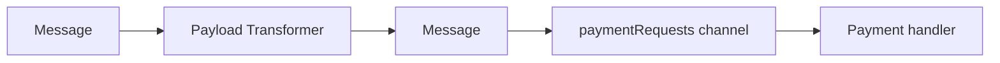
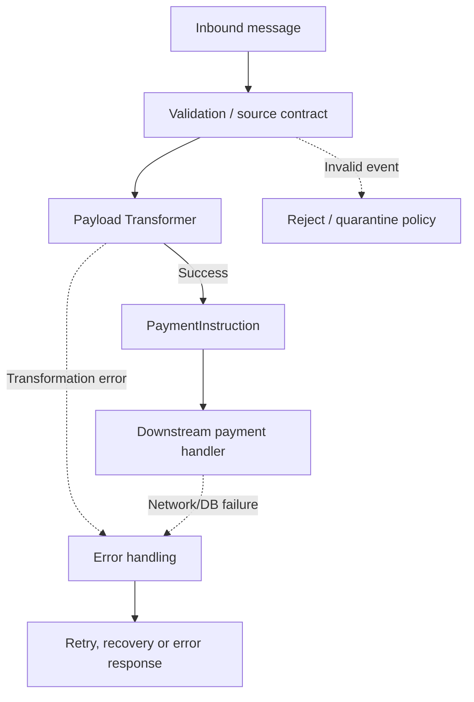
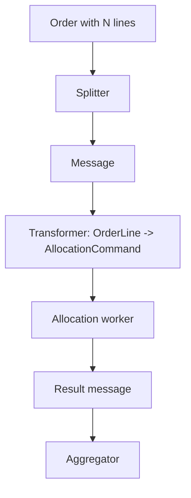
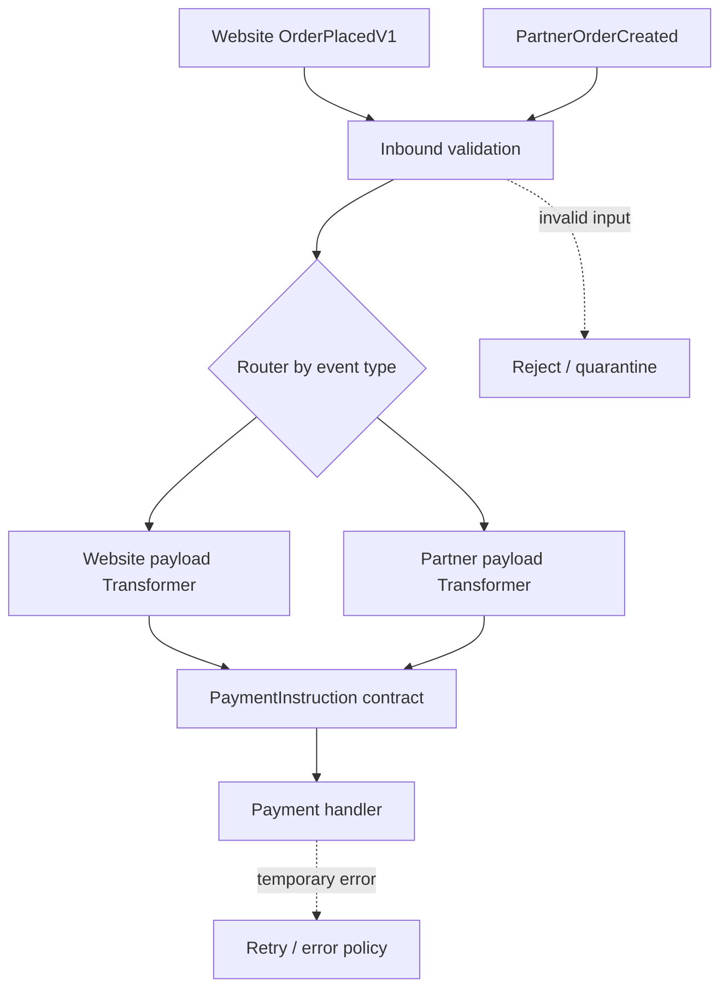

# Transformer payload-to-payload

Trong **Spring Integration**, các hệ thống thường trao đổi cùng một sự kiện dưới nhiều biểu diễn khác nhau. Dịch vụ đặt hàng phát `OrderPlaced`, còn dịch vụ thanh toán cần `PaymentInstruction`; hệ thống vận chuyển cần `ShipmentRequest`, trong khi ứng dụng báo cáo cần một DTO tổng hợp. Nếu buộc từng consumer phải hiểu trực tiếp mô hình của producer, các thành phần sẽ phụ thuộc chặt vào nhau. **Message Transformer** giải quyết vấn đề này bằng cách biến đổi dữ liệu của message từ **dạng đầu vào** sang **dạng đầu ra** phù hợp với bước tiếp theo.

Bài học thuộc chương **Transformer** của module `SPRING_INTEGRATION_PATTERN`: thực hành các Enterprise Integration Patterns (EIP) bằng Spring Integration để xây dựng luồng thông điệp ít phụ thuộc, dễ mở rộng; phối hợp Router, Filter, Transformer, Splitter, Aggregator, Gateway, retry, error channel và correlation, đồng thời kiểm thử và theo dõi từng nhánh. Trọng tâm là **payload-to-payload transformation**: một bước nhận payload thuộc kiểu/hợp đồng A và tạo payload thuộc kiểu/hợp đồng B; không đánh đồng thao tác này với định tuyến, lọc hoặc thực thi side effect nghiệp vụ.

**Sau bài này, bạn có thể:**

- Diễn giải hợp đồng **một message đầu vào → một message đầu ra khi biến đổi thành công**, với payload có thể khác kiểu hoặc cấu trúc.
- Viết phép ánh xạ từ domain event sang DTO/command bằng hàm Java, rồi gắn vào Spring Integration Java DSL hoặc phương thức `@Transformer`.
- Phân biệt **payload**, **headers**, **message ID**, **correlation** và khóa nghiệp vụ khi một message mới được tạo sau biến đổi.
- Xử lý dữ liệu thiếu, kiểu không hợp lệ, lỗi validation và giá trị `null` mà không làm message mất dấu.
- Chọn đúng pattern khi nghiệp vụ cần lọc, tách nhiều phần tử, định tuyến, thêm header hoặc gọi hệ thống ngoài.
- Kiểm thử mapper thuần và một IntegrationFlow thật; xem xét retry, idempotency, observability, schema/version và an toàn dữ liệu.

## 1. Payload-to-payload nghĩa là gì?

Một Spring message gồm **payload** và **headers**. Transformer nhận message hoặc payload, tạo **kết quả chuyển đổi**, sau đó endpoint phát message chứa payload mới sang bước tiếp theo nếu có output hợp lệ.



Ví dụ, hệ thống nhận sự kiện:

```json
{
  "eventId": "evt-101",
  "orderId": "ORD-101",
  "totalMinorUnits": 125000,
  "currencyCode": "VND",
  "customerEmail": "buyer@example.test"
}
```

Nhưng bước xử lý thanh toán chỉ cần:

```json
{
  "idempotencyKey": "evt-101",
  "orderReference": "ORD-101",
  "amountMinorUnits": 125000,
  "currencyCode": "VND"
}
```

Hai JSON ở trên là **hợp đồng dữ liệu minh họa của ứng dụng**, không phải định dạng serialization bắt buộc của Spring. Trong Java, payload của chúng có thể lần lượt là `OrderPlaced` và `PaymentInstruction`. Transformer tạo biểu diễn đích, đổi tên trường và **không chuyển tiếp email khách hàng** vì consumer không cần thông tin cá nhân đó.

### Tính chất cốt lõi

| Đặc điểm | Ý nghĩa trong payload-to-payload |
| --- | --- |
| **Dữ liệu vào** | Thường là một payload thuộc kiểu A hoặc cấu trúc A. |
| **Kết quả thành công** | Một payload thuộc kiểu B; Spring Integration có thể đưa nó vào một message đầu ra. |
| **Biến đổi cấu trúc** | Đổi tên trường, chọn field, chuyển kiểu, chuẩn hóa giá trị hoặc tổng hợp các field của **cùng một payload**. |
| **Không nhất thiết đổi dữ liệu nghiệp vụ** | Chỉ đổi cách biểu diễn phù hợp với contract consumer, không tự đổi sự thật của sự kiện. |
| **Không tự định tuyến** | Việc chọn channel đến từ cấu hình endpoint/flow hoặc Router riêng. |
| **Không tự loại message** | Nếu muốn quyết định cho qua hay loại, dùng Filter hoặc kết quả/nhánh có chủ đích. |
| **Không tự tạo độ bền** | Biến đổi trong JVM không đồng nghĩa đã ghi DB, broker, audit hay transaction. |

**“Một vào, một ra” là ngữ nghĩa thành công thường gặp**, không phải bảo đảm mọi message đều phát output bất kể lỗi. Nếu dữ liệu sai hợp đồng, handler ném exception hoặc không tạo output, luồng có thể dừng hoặc lỗi theo cơ chế endpoint. Điều quan trọng là thiết kế rõ **đường đi thành công và thất bại**.

## 2. Vì sao nên tách phép biến đổi khỏi xử lý nghiệp vụ?

Xét một flow đặt hàng:

```text
OrderPlaced
   |
   v
Validate event contract
   |
   v
Transform OrderPlaced -> PaymentInstruction
   |
   v
Send to payment channel
   |
   v
Invoke payment service / adapter
```

Nếu mapper vừa đổi tên trường, vừa gọi cổng thanh toán, vừa retry mạng và vừa ghi database, nó không còn là một bước chuyển đổi dữ liệu đơn giản. Những hành vi này khác nhau về **thời gian thực thi, lỗi, side effect và idempotency** nên khó kiểm thử và khó tái sử dụng.

Tách trách nhiệm giúp:

1. **Độc lập mô hình:** producer có thể giữ `OrderPlaced`, consumer làm việc với `PaymentInstruction` mà không phụ thuộc mọi field của producer.
2. **Kiểm thử quyết định:** mapper thuần có thể được test bằng input/output cụ thể, không cần broker hoặc database.
3. **Kiểm soát dữ liệu:** chỉ truyền field consumer thực sự cần, giảm rủi ro rò rỉ thông tin.
4. **Phiên bản hóa:** thay DTO ở một ranh giới được quản lý thay vì lan thay đổi vào mọi handler.
5. **Tách lỗi dữ liệu khỏi lỗi hạ tầng:** dữ liệu sai có thể bị từ chối trước khi gọi dịch vụ ngoài; lỗi mạng được xử lý ở adapter/handler phù hợp.

Không có nghĩa một Transformer **không bao giờ** được gọi dependency. Spring Integration có thể gọi phương thức biến đổi phức tạp. Tuy nhiên, với mapping thuần, hàm chuyển đổi **deterministic và side-effect-free** là một lựa chọn ưu tiên vì dễ lý giải retry, concurrency và audit.

## 3. Phân biệt Transformer với các EIP gần giống

| Thành phần | Câu hỏi nó giải quyết | Hành vi điển hình |
| --- | --- | --- |
| **Transformer** | “Payload A cần biểu diễn thành payload B như thế nào?” | Chuyển dữ liệu, thường một kết quả khi thành công. |
| **Filter** | “Message có được đi tiếp không?” | Đánh giá điều kiện, cho qua hoặc loại/discard. |
| **Router** | “Message sẽ đi channel nào?” | Quyết định đích theo content/header/policy. |
| **Splitter** | “Một cấu trúc chứa nhiều phần tử nên tách ra sao?” | Tạo nhiều message con từ một input có tập phần tử. |
| **Aggregator** | “Gom các message liên quan thành kết quả như thế nào?” | Nhóm theo correlation và release strategy. |
| **Header Enricher** | “Nên bổ sung metadata điều phối nào?” | Tạo/sửa headers, không nhất thiết đổi payload. |
| **Service Activator** | “Handler nghiệp vụ cần thực hiện thao tác gì?” | Gọi logic xử lý/side effect; có thể trả output. |
| **Gateway** | “Làm sao gọi flow và chờ phản hồi?” | Bao bọc request–reply, không thay thế việc chuẩn hóa payload. |

**Ví dụ dễ nhầm:** Một input chứa `List<OrderPlaced>` cần phát từng phần tử thành một message riêng; việc **chia danh sách thành nhiều message** là trách nhiệm của Splitter. Với mỗi message con, một Transformer có thể chuyển `OrderPlaced` thành `PaymentInstruction`. Nếu muốn chỉ xử lý các đơn `READY`, hãy dùng Filter hoặc bước validation trước khi phát command.

## 4. Hợp đồng chuyển đổi: mapping dữ liệu phải rõ ràng

Trước khi viết code, nên lập một bảng cho biết mỗi field đích đến từ đâu.

| `OrderPlaced` đầu vào | `PaymentInstruction` đầu ra | Quy tắc |
| --- | --- | --- |
| `eventId` | `idempotencyKey` | Giữ giá trị bền vững để consumer có thể nhận diện lại cùng sự kiện. |
| `orderId` | `orderReference` | Đổi tên, không tạo order ID mới. |
| `totalMinorUnits` | `amountMinorUnits` | Giữ số đơn vị tiền tệ nhỏ nhất theo hợp đồng; phải dương. |
| `currencyCode` | `currencyCode` | Chuẩn hóa và xác minh mã tiền tệ được chấp nhận. |
| `customerEmail` | *Không chuyển* | Consumer thanh toán không cần email; áp dụng nguyên tắc tối thiểu dữ liệu. |

Hợp đồng cũng cần định nghĩa **điều kiện đầu vào**. `eventId` rỗng có hợp lệ không? `amountMinorUnits=0` mang ý nghĩa gì? Có được làm tròn tiền tệ? Consumer có hiểu loại tiền mới chưa?

### Giá trị tiền và làm tròn

Trong ví dụ, số tiền là `long totalMinorUnits`, tức số **đơn vị tiền tệ nhỏ nhất** đã được hệ thống thống nhất trước đó. Với VND, thông thường một đơn vị này là một đồng; với USD, một đơn vị thường là cent. **Không phải mọi loại tiền đều dùng hai chữ số thập phân**. Transformer không nên tự động coi mọi tiền tệ đều có 100 minor units cho một major unit.

Nếu input là `BigDecimal amount`, phải xác định rõ **currency exponent**, quy tắc làm tròn và kiểm tra overflow khi chuyển sang kiểu nguyên. `BigDecimal.longValue()` có thể làm mất phần lẻ/giá trị không hợp lệ; trong trường hợp cần chuyển chính xác nên dùng phép biến đổi với scale đã xác thực và `longValueExact()` ở ranh giới phù hợp.

Trong một bài toán thanh toán, **đơn vị tính và chính sách làm tròn là phần của contract**, không phải chi tiết có thể tùy tiện thay trong mapper.

## 5. Viết mapper thuần bằng Java

Ví dụ dùng **Java 17+**. Chúng ta tạo hai record bất biến với tên field biểu đạt rõ hợp đồng của từng bên.

```java
record OrderPlaced(
        String eventId,
        String orderId,
        long totalMinorUnits,
        String currencyCode,
        String customerEmail
) {}

record PaymentInstruction(
        String idempotencyKey,
        String orderReference,
        long amountMinorUnits,
        String currencyCode
) {}
```

Mapper đọc payload đầu vào, validate các điều kiện tối thiểu và tạo payload đầu ra:

```java
import java.util.Locale;
import java.util.Set;

final class PaymentPayloadMapper {
    private static final Set<String> SUPPORTED_CURRENCIES =
            Set.of("VND", "USD");

    private PaymentPayloadMapper() {}

    static PaymentInstruction toInstruction(OrderPlaced event) {
        if (event == null) {
            throw new IllegalArgumentException("ORDER_EVENT_REQUIRED");
        }
        if (event.eventId() == null || event.eventId().isBlank()) {
            throw new IllegalArgumentException("MISSING_EVENT_ID");
        }
        if (event.orderId() == null || event.orderId().isBlank()) {
            throw new IllegalArgumentException("MISSING_ORDER_ID");
        }
        if (event.totalMinorUnits() <= 0) {
            throw new IllegalArgumentException("INVALID_AMOUNT");
        }
        if (event.currencyCode() == null) {
            throw new IllegalArgumentException("MISSING_CURRENCY");
        }

        String currency = event.currencyCode()
                .trim().toUpperCase(Locale.ROOT);
        if (!SUPPORTED_CURRENCIES.contains(currency)) {
            throw new IllegalArgumentException("UNSUPPORTED_CURRENCY");
        }

        return new PaymentInstruction(
                event.eventId(),
                event.orderId(),
                event.totalMinorUnits(),
                currency
        );
    }
}
```

**Điểm đáng chú ý:**

- Mapper nhận `OrderPlaced`, trả `PaymentInstruction`; **không gửi message, không gọi API thanh toán** và không cần biết channel nào sẽ nhận kết quả.
- `eventId` làm khóa idempotency **minh họa**, không dùng `MessageHeaders.id`. Hợp đồng thực tế phải xác nhận `eventId` là duy nhất trong phạm vi thao tác thanh toán; một event không nhất thiết tương đương một command.
- `currencyCode` được chuẩn hóa có quy tắc, không chuyển tùy ý mọi giá trị lạ sang `VND`.
- `customerEmail` không đi vào payload đích. Việc bỏ field là quyết định data minimization, không có nghĩa xóa thông tin khỏi payload đầu vào đã tồn tại ở mọi nơi.
- Với input không hợp lệ, mapper **ném lỗi có chủ đích** thay vì trả một command có số tiền âm hoặc ID rỗng.

Không nên mặc định mọi trường hợp dữ liệu không đạt là lỗi kỹ thuật đáng retry. Ví dụ amount không hợp lệ có thể cần một **business rejection** rõ ràng ở bước validation/filter trước Transformer; mapper minh họa chọn ném `IllegalArgumentException` để làm lộ contract sai.

## 6. Gắn payload mapper vào Spring Integration Java DSL

Một `IntegrationFlow` có thể nhận `Message<OrderPlaced>`, chuyển payload bằng mapper rồi gửi `Message<PaymentInstruction>` tới channel đích.

```java
import org.springframework.context.annotation.Bean;
import org.springframework.context.annotation.Configuration;
import org.springframework.integration.channel.DirectChannel;
import org.springframework.integration.channel.QueueChannel;
import org.springframework.integration.config.EnableIntegration;
import org.springframework.integration.dsl.IntegrationFlow;

@Configuration
@EnableIntegration
class PayloadTransformerConfiguration {

    @Bean
    DirectChannel ordersInput() {
        return new DirectChannel();
    }

    @Bean
    QueueChannel paymentRequests() {
        return new QueueChannel();
    }

    @Bean
    IntegrationFlow orderToPaymentFlow() {
        return IntegrationFlow.from("ordersInput")
                .transform(OrderPlaced.class,
                        PaymentPayloadMapper::toInstruction)
                .channel("paymentRequests")
                .get();
    }
}
```

**Đọc luồng từ trái sang phải:**

1. `ordersInput` nhận message có payload hợp đồng `OrderPlaced`.
2. `.transform(OrderPlaced.class, ...)` khai báo kiểu payload mong đợi và hàm ánh xạ tạo `PaymentInstruction`.
3. Spring Integration xây dựng/điều phối một message kết quả từ phép biến đổi, theo cơ chế propagation headers của endpoint.
4. `.channel("paymentRequests")` chỉ nơi gửi kết quả; nó **không tự gửi tiền, trừ tiền hay ghi thanh toán**.
5. `paymentRequests` là `QueueChannel` nội bộ, dùng để quan sát trong bài học. Muốn vận hành thật phải có consumer/poller hoặc thay bằng endpoint tích hợp thích hợp.

Các phương thức trên minh họa cách khai báo **payload-to-payload transformer** trong Java DSL của Spring Integration. Khi đưa vào dự án thực, cần bảo đảm các dependency tương thích, channel tồn tại, kiểu payload đúng và không đăng ký nhiều consumer trái ý định. Ở bước viết tài liệu này chưa chạy Gradle hoặc kiểm tra biên dịch.

### Gửi một message mẫu

```java
import org.springframework.messaging.MessageChannel;
import org.springframework.messaging.support.MessageBuilder;

class OrderEventPublisher {

    void publish(MessageChannel ordersInput) {
        OrderPlaced order = new OrderPlaced(
                "evt-101", "ORD-101", 125_000, "vnd",
                "buyer@example.test");

        ordersInput.send(MessageBuilder.withPayload(order)
                .setHeader("traceId", "trace-101")
                .setHeader("businessRoute", "PAYMENT")
                .build());
    }
}
```

Kết quả mong muốn: một message tới `paymentRequests` có payload `PaymentInstruction("evt-101", "ORD-101", 125000, "VND")`. Payload không chứa email. Các headers được phép/được framework truyền tiếp có thể vẫn gồm `traceId` và `businessRoute`; cần kiểm thử đúng cơ chế của flow và adapter đang dùng, đặc biệt khi qua ranh giới serialization.

## 7. Phương thức `@Transformer`: một cách wiring khác

Trong Spring Integration, ngoài DSL, có thể khai báo phương thức biến đổi bằng annotation `@Transformer`. Cách này hữu ích khi team muốn tách rõ một class đảm nhiệm chuyển đổi, hoặc nhiều flow cần gọi cùng mapping logic.

```java
import org.springframework.integration.annotation.Transformer;
import org.springframework.stereotype.Component;

@Component
class OrderToPaymentTransformer {

    @Transformer(inputChannel = "ordersInput", outputChannel = "paymentRequests")
    public PaymentInstruction convert(OrderPlaced order) {
        return PaymentPayloadMapper.toInstruction(order);
    }
}
```

`@Transformer` trên phương thức diễn đạt **một endpoint tiêu thụ từ input channel và tạo output**. Phương thức nhận payload là `OrderPlaced` và trả một payload mới `PaymentInstruction`. Nó **không cần nhận `Message<?>`** nếu chỉ cần đọc payload.

Đây là **phương án thay thế** `orderToPaymentFlow()` ở mục 6, **không** đăng ký cùng lúc cả hai endpoint tiêu thụ `ordersInput` trong một demo muốn mỗi message chỉ được transform một lần. Nếu sử dụng annotation, cần đảm bảo hạ tầng Spring Integration annotation được bật và bean component được scan/đăng ký.

### Khi nào viết mapper thuần, khi nào viết `@Transformer`?

| Cách tổ chức | Điểm mạnh | Điều cần cân nhắc |
| --- | --- | --- |
| **Hàm Java thuần** (`toInstruction`) | Dễ unit test, tái sử dụng trong nhiều cách wiring. | Cần IntegrationFlow hoặc endpoint gọi nó. |
| **Java DSL `.transform(...)`** | Topology dễ đọc theo thứ tự trong một flow. | Không nhét nhiều dòng logic nghiệp vụ vào lambda quá dài. |
| **`@Transformer`** | Endpoint được diễn đạt bằng annotation, phân tách theo component. | Dễ bị đăng ký trùng với DSL nếu không kiểm soát wiring. |
| **Custom `Message`-to-`Message`** | Chủ động chọn headers và payload kết quả. | Cần hiểu rõ reply/error/correlation/header propagation; rủi ro làm mất metadata quan trọng. |

Ưu tiên **mapper thuần là lớp lõi**, còn DSL hay annotation là **cách gắn mapper vào luồng**. Khi có nhiều API/adapter, lựa chọn này giúp test nghiệp vụ và test topology độc lập.

## 8. Payload thay đổi thì headers sẽ ra sao?

Khi đổi payload A thành payload B, Spring Integration thông thường có thể **kế thừa headers liên quan** từ message đầu vào khi tạo message đầu ra, theo cơ chế của transformer/endpoint. Tuy nhiên, phải phân biệt **metadata phục vụ điều phối** với **những định danh có thể được cấp lại**.

```text
INPUT Message<OrderPlaced>
  payload = OrderPlaced(...)
  headers:
    traceId       = trace-101
    correlationId = batch-77
    replyChannel  = ... (nếu có)
    id            = message-id-1

OUTPUT Message<PaymentInstruction>
  payload = PaymentInstruction(...)
  headers:
    traceId       = trace-101       (nếu được propagate)
    correlationId = batch-77        (nếu được propagate)
    replyChannel  = ...             (nếu được giữ cho request-reply)
    id            = message ID theo cơ chế tạo message mới
```

Sơ đồ là **mô tả khái niệm**. Không nên viết test mặc định `input.headers.id == output.headers.id`: một message mới có thể nhận ID/timestamp mới. Ngược lại, dữ liệu nghiệp vụ cần ổn định qua replay như `eventId`, `orderId`, command ID nên được giữ trong **payload hoặc event contract bền vững**, không dựa vào `headers.id`.

| Header/field | Vai trò | Điều cần làm khi transform |
| --- | --- | --- |
| `id`, `timestamp` | Metadata vòng đời của Spring message. | Không dùng như ID sự kiện bền vững; không ép phải giống input. |
| `traceId`/tracing context | Quan sát luồng. | Kiểm thử propagation qua endpoint và async/adapter. |
| `correlationId` | Gom nhóm trong Splitter/Aggregator hoặc ngữ cảnh flow. | Giữ khi còn cùng nhóm; không thay bằng `eventId` tùy tiện. |
| `sequenceNumber`, `sequenceSize` | Metadata thứ tự/độ lớn nhóm khi pattern tạo. | Không tự đặt lại khi chuyển từng item; kiểm thử với Aggregator. |
| `replyChannel` | Đường gửi phản hồi của Gateway. | Không làm mất nếu output cần đi tiếp và trả reply. |
| `errorChannel` | Metadata xử lý lỗi theo cơ chế hỗ trợ. | Hiểu ranh giới exception, không coi transform failure là business rejection. |
| `businessRoute` | Metadata nghiệp vụ/điều phối. | Chỉ giữ khi route đó còn áp dụng cho payload mới; có thể cần tính lại. |
| `eventId` trong payload | ID nghiệp vụ của sự kiện. | Giữ hoặc ánh xạ có chủ đích để consumer có thể deduplicate/replay. |

### Có nên trả `Message<PaymentInstruction>` trực tiếp?

Có những trường hợp cần làm chủ cả payload và headers, chẳng hạn đặt một header `transformationVersion`. Khi đó, Transformer có thể được thiết kế để trả về một **Spring `Message<?>`** và khai báo rõ các headers được phép giữ/thay.

Tuy nhiên, khi tự dựng message, đừng sao chép mù mọi header từ nguồn ngoài: một số header có thể chứa quyền, route hoặc nội dung nhạy cảm không phù hợp cho nhánh đích. Ngược lại, nếu chỉ tạo message với payload mới và bỏ mọi header, bạn có thể **đánh mất replyChannel, correlationId hoặc tracing context**. Hãy có **header contract** và test kết quả trên đúng ranh giới.

Trong ví dụ này, biến đổi chỉ liên quan payload nên để framework áp dụng quy tắc truyền headers phù hợp và kiểm thử những metadata thật sự quan trọng.

## 9. `null`, `Optional`, collection và dữ liệu đầu vào sai

### 9.1. Transformer trả `null` không phải biểu diễn payload null

Hợp đồng Spring `Message` thông thường **không chấp nhận payload `null`**. Khi hàm biến đổi trả `null`, không nên hiểu rằng một message mới với `getPayload() == null` sẽ tự xuất hiện ở channel tiếp theo. Tùy loại transformer/endpoint và cách cấu hình, đầu ra `null` có thể dẫn tới không có output hoặc lỗi; cần xác minh hành vi thực tế của phiên bản Spring Integration.

Nếu nghiệp vụ muốn nói “không tìm thấy thông tin”, hãy chọn mô hình rõ hơn:

- Dùng **Filter** khi message không nên đi tiếp.
- Dùng kết quả có kiểu như `NotFound`, `Rejected`, `UnsupportedCurrency` nếu downstream cần biết lý do.
- Dùng `Optional<T>` ở mức API mapper khi phù hợp rồi **xử lý rõ** trước khi tạo payload Spring Message; không coi `Optional.empty()` là thông điệp bị bỏ an toàn.
- Nếu nghiệp vụ cần biểu diễn JSON `null` hoặc một sự kiện “giá trị vắng mặt”, định nghĩa một kiểu sentinel/envelope có ngữ nghĩa phù hợp thay vì đưa Java `null` vào Spring Message.

### 9.2. Không đánh đồng mảng/danh sách với nhiều message

Nếu Transformer trả `List<PaymentInstruction>`, kết quả có thể là **một message chứa một danh sách**, chứ không mặc nhiên phát mỗi phần tử thành message riêng. Nếu cần **một đầu vào sinh nhiều message con**, hãy sử dụng Splitter với output và correlation/sequence được thiết kế rõ.

### 9.3. Sai kiểu payload là lỗi contract

Một flow cấu hình transform cho `OrderPlaced` nhưng lại nhận payload thuộc `ShipmentCreated` có thể thất bại khi chuyển kiểu/gọi mapper. Để tránh:

1. Định nghĩa input channel contract và validate loại sự kiện ở ranh giới adapter.
2. Nếu một channel nhận nhiều kiểu, dùng Router theo payload type/eventType trước Transformer.
3. Tách mapper cho từng kiểu, không ép `Object` sang record bất kỳ mà không kiểm tra.
4. Có error handling không làm mất event khi input sai hợp đồng.

### 9.4. Validation nên đặt ở đâu?

**Structural validation** (field bắt buộc, định dạng, số âm, currency không hỗ trợ) có thể nằm ở adapter hoặc mapper; điều quan trọng là người xử lý lỗi biết loại vi phạm nào đã xảy ra. **Business validation** (đơn hàng đã sẵn sàng, khách có đủ quyền, tồn kho còn) đôi khi thuộc về service/domain policy độc lập, không nên ẩn vào một phép đổi DTO đơn thuần.

Khi cần trả kết quả từ chối thay vì exception, hãy dùng một **Decision/Result type** có lý do rồi Router phân nhánh. Không nên “sửa” dữ liệu sai bằng giá trị mặc định nguy hiểm, ví dụ tự chuyển số tiền âm thành số dương hoặc đổi currency không hỗ trợ sang VND.

## 10. Lỗi trong Transformer và đường đi của exception

Một phép biến đổi có thể thất bại vì dữ liệu sai, logic mapper lỗi, overflow, hoặc phụ thuộc ngoài bị lỗi khi dùng một transformer phức tạp.



| Tình huống | Bản chất | Cách xử lý gợi ý |
| --- | --- | --- |
| `eventId` trống | Input vi phạm contract. | Reject/quarantine, phản hồi lý do; thường không retry nguyên payload. |
| `amountMinorUnits <= 0` | Giá trị đầu vào không phù hợp. | Dừng trước thanh toán; ghi rejection có kiểm soát. |
| Currency chưa hỗ trợ | Consumer chưa hiểu contract. | Versioning/fallback/review, không ép sang currency khác. |
| Converter bị lỗi lập trình | Exception trong mapper. | Sửa code, alert; tránh redelivery vô hạn không có recovery. |
| Payment API timeout **sau** transform | Lỗi handler/adapter downstream. | Retry có giới hạn và idempotency; không quy lỗi này cho mapper. |
| Outbound broker từ chối publish | Lỗi vận chuyển. | Ack/commit/recovery theo transport; transform success không có nghĩa publish success. |

Với `DirectChannel`/xử lý đồng bộ, một exception có thể **lan ngược tới caller** và được Spring Integration bọc trong ngoại lệ messaging phù hợp. Với executor/async endpoint hoặc poller, có thể có error handler và `errorChannel`. **Không mặc định** mọi exception trong Transformer tự được gửi đến một error channel chung, hoặc mọi lỗi đều cần retry.

### `discardChannel` của Filter không tự áp dụng cho Transformer

Filter có thể chuyển message bị predicate từ chối sang `discardChannel`. Một Transformer tạo exception **không tự biến đầu vào thành một message bị Filter loại**. Nếu muốn phân loại kết quả chuyển đổi thành `Accepted`/`Rejected` rồi phát qua các nhánh, thiết kế **decision type + Router** hoặc bước validation trước Transformer. Đừng coi việc mapper trả `null` như một API bỏ qua tương đương Filter.

## 11. Idempotency, retry và biến đổi có side effect

Một lý do mạnh để giữ payload mapper **thuần** là khả năng thực hiện lại cùng phép biến đổi. Nếu cùng một `OrderPlaced` với `eventId=evt-101` được nhận lại, mapper tạo cùng một `PaymentInstruction` tương ứng, thay vì gọi gateway để tạo một giao dịch thanh toán mới ngay trong lúc mapping.

```text
Broker redelivery / retry
   OrderPlaced(eventId=evt-101)
            |
            v
      Pure Transformer
            |
            v
   PaymentInstruction(idempotencyKey=evt-101)
            |
            v
    Payment Handler + idempotency check
```

**Các điểm kiểm soát:**

- **Khóa bền vững:** `eventId`/`commandId` phải có ý nghĩa duy nhất theo hợp đồng, tránh lấy Spring message ID của lần truyền.
- **Phép biến đổi ổn định:** không tự tạo ID ngẫu nhiên trong mapper cho thao tác cần deduplicate; nếu bắt buộc tạo, phải ghi quyết định vào nơi bền vững.
- **Tác dụng phụ ở handler:** thanh toán, đặt chỗ tồn kho, gửi email và ghi DB cần cơ chế idempotency riêng, đặc biệt khi broker có thể redeliver.
- **Retry có giới hạn:** lỗi dữ liệu không hợp lệ thường cần rejection; lỗi mạng tạm thời có thể thử lại, kèm backoff và recovery.
- **Versioning khi replay:** cùng event được map bởi phiên bản code khác có thể tạo kết quả khác. Nếu cần tái hiện chính xác, lưu `mappingVersion`/contract version hoặc quyết định đã áp dụng.

Một mapper thuần không tự tạo exactly-once processing cho cả hệ thống. Nó chỉ làm **một bước dễ tái thực hiện hơn**. Các bảo đảm end-to-end vẫn phụ thuộc database, broker, transaction, idempotency và logic nghiệp vụ.

## 12. Transformer với Router, Gateway và Splitter/Aggregator

### 12.1. Router trước hay sau Transformer?

Có hai cách bố trí:

```text
A. Inbound -> Router theo eventType -> Transformer riêng -> Handler

B. Inbound -> Transformer chuẩn hóa chung -> Router theo payload mới -> Handler
```

**A** phù hợp khi các event đầu vào khác kiểu và mỗi kiểu cần mapper riêng. **B** phù hợp khi nhiều nguồn có thể chuẩn hóa về một envelope chung rồi Router quyết định. Trong cả hai cách, Router chịu trách nhiệm **chọn channel**, còn Transformer chịu trách nhiệm **đổi biểu diễn payload**; tránh chôn việc chọn đích trong mapper rồi khó nhận ra topology.

### 12.2. Gateway yêu cầu trả kết quả

Giả sử Gateway nhận `submitOrder()` và cần `PaymentResult`. Transformer đầu luồng đổi `OrderPlaced` sang `PaymentInstruction`, nhưng nó **không tự tạo `PaymentResult`**. Phải có endpoint downstream xử lý instruction rồi tạo reply. Nếu mapper lỗi hoặc không tạo output, Gateway có thể nhận exception hoặc no-reply/timeout tùy cấu hình.

Các header như `replyChannel`, `errorChannel` cần được giữ theo cơ chế request–reply. Nếu một custom transformer tự dựng message mới mà bỏ chúng, caller có thể không nhận kết quả đúng. Thiết kế test cho accepted, rejected, exception và timeout của Gateway.

### 12.3. Splitter/Aggregator

Một danh sách order line có thể được Splitter tách thành nhiều item; mỗi item được Transformer đổi sang yêu cầu xử lý, rồi Aggregator gom kết quả:



Trong tình huống này, các header kỹ thuật như `correlationId`, `sequenceNumber`, `sequenceSize` giúp Aggregator xác định nhóm và điều kiện release. Transformer **không nên sửa chúng tùy tiện** khi vẫn thuộc cùng lượt split. Nếu một item lỗi chuyển đổi và bị bỏ qua, Aggregator có thể không nhận đủ số lượng; cần quyết định tạo `ItemRejected` có correlation/sequence, dùng timeout/release policy hoặc fail toàn batch.

`eventId` của order cũng không tự thay thế correlation group: một sự kiện có thể có nhiều item, nhiều lần xử lý hoặc nhiều nhánh độc lập. Thiết kế ID theo đúng mục đích.

### 12.4. Header Enricher song song với payload mapping

Nếu sau transform cần gắn `processingLane=PAYMENT`, có thể dùng Header Enricher ở bước riêng. Việc tách **dữ liệu cần cho consumer** khỏi **metadata chọn route** giúp tránh consumer phụ thuộc vào các header triển khai nội bộ. Nếu routing header có vai trò bền vững khi replay, cân nhắc đưa quyết định và version vào hợp đồng dữ liệu thay vì chỉ giữ trong Spring headers.

## 13. Kiểm thử mapper thuần với JUnit 5

Một transformer nên được kiểm thử ngay từ **bảng mapping** và **các điều kiện biên**, không chỉ một ví dụ happy path.

```java
import static org.junit.jupiter.api.Assertions.assertEquals;
import static org.junit.jupiter.api.Assertions.assertThrows;

import org.junit.jupiter.api.Test;

class PaymentPayloadMapperTest {

    @Test
    void mapsBusinessFieldsAndNormalizesCurrency() {
        OrderPlaced event = new OrderPlaced(
                "evt-101", "ORD-101", 125_000, " vnd ",
                "buyer@example.test");

        PaymentInstruction actual = PaymentPayloadMapper.toInstruction(event);

        assertEquals("evt-101", actual.idempotencyKey());
        assertEquals("ORD-101", actual.orderReference());
        assertEquals(125_000, actual.amountMinorUnits());
        assertEquals("VND", actual.currencyCode());
    }

    @Test
    void rejectsMissingIdInvalidAmountAndUnknownCurrency() {
        assertThrows(IllegalArgumentException.class, () ->
                PaymentPayloadMapper.toInstruction(new OrderPlaced(
                        "", "ORD-1", 100, "VND", "x@example.test")));

        assertThrows(IllegalArgumentException.class, () ->
                PaymentPayloadMapper.toInstruction(new OrderPlaced(
                        "evt-2", "ORD-2", -1, "VND", "x@example.test")));

        assertThrows(IllegalArgumentException.class, () ->
                PaymentPayloadMapper.toInstruction(new OrderPlaced(
                        "evt-3", "ORD-3", 100, "XXX", "x@example.test")));
    }
}
```

Các test này chạy trực tiếp mapper Java, không cần khởi động Spring context. Nên bổ sung cả `null` event/currency, whitespace ID, số tiền bằng 0, giá trị lớn nhất hợp đồng, schema version cũ, test định dạng và đặc biệt là chính sách về minor units. Nếu mapper đọc dữ liệu ngày/giờ hoặc tiền tệ, dùng đầu vào cố định, không phụ thuộc timezone hoặc đồng hồ hệ thống một cách ngầm định.

## 14. Integration test: chứng minh payload mới tới đúng channel

Unit test mapper **không chứng minh** rằng Transformer endpoint đã được wiring đúng, headers còn ở output, bean channel tồn tại hay lỗi có đường xử lý. Dưới đây là test Spring Integration thật với `PayloadTransformerConfiguration` ở mục 6.

```java
import static org.junit.jupiter.api.Assertions.assertEquals;
import static org.junit.jupiter.api.Assertions.assertNotNull;
import static org.junit.jupiter.api.Assertions.assertNull;
import static org.junit.jupiter.api.Assertions.assertTrue;

import org.junit.jupiter.api.Test;
import org.springframework.beans.factory.annotation.Autowired;
import org.springframework.beans.factory.annotation.Qualifier;
import org.springframework.integration.channel.QueueChannel;
import org.springframework.messaging.Message;
import org.springframework.messaging.MessageChannel;
import org.springframework.messaging.support.MessageBuilder;
import org.springframework.test.annotation.DirtiesContext;
import org.springframework.test.context.junit.jupiter.SpringJUnitConfig;

@SpringJUnitConfig(PayloadTransformerConfiguration.class)
@DirtiesContext(classMode = DirtiesContext.ClassMode.AFTER_EACH_TEST_METHOD)
class PayloadTransformerFlowTest {

    @Autowired
    @Qualifier("ordersInput")
    MessageChannel input;

    @Autowired
    @Qualifier("paymentRequests")
    QueueChannel paymentRequests;

    @Test
    void mapsPayloadAndKeepsTraceMetadata() {
        OrderPlaced event = new OrderPlaced(
                "evt-101", "ORD-101", 125_000, "vnd",
                "buyer@example.test");

        assertTrue(input.send(MessageBuilder.withPayload(event)
                .setHeader("traceId", "trace-101")
                .setHeader("correlationId", "batch-9")
                .build()));

        Message<?> result = paymentRequests.receive(1_000);
        assertNotNull(result);
        assertTrue(result.getPayload() instanceof PaymentInstruction);

        PaymentInstruction instruction = (PaymentInstruction) result.getPayload();
        assertEquals("evt-101", instruction.idempotencyKey());
        assertEquals("ORD-101", instruction.orderReference());
        assertEquals(125_000, instruction.amountMinorUnits());
        assertEquals("VND", instruction.currencyCode());

        assertEquals("trace-101", result.getHeaders().get("traceId"));
        assertEquals("batch-9", result.getHeaders().get("correlationId"));
        assertNull(paymentRequests.receive(0));
    }
}
```

Ở đây `QueueChannel` chỉ làm điểm quan sát, **không có consumer thực thi thanh toán**, nên test không cần kết nối database/broker. `@DirtiesContext` cô lập trạng thái queue giữa các test nhưng tăng chi phí khởi tạo context; dự án thực có thể dùng fixture reset khác. Test chứng minh một đường **hợp lệ**; thêm test invalid input ở mapper và test error propagation/recovery tùy topology thực.

### Ma trận kiểm thử quan trọng

| Trường hợp | Kỳ vọng |
| --- | --- |
| `OrderPlaced` hợp lệ | Có đúng một `PaymentInstruction` với field đã ánh xạ. |
| Currency viết thường/khoảng trắng | Được chuẩn hóa theo hợp đồng hoặc reject nhất quán. |
| ID rỗng, amount không dương | Không phát command thanh toán hợp lệ; có rejection/error policy. |
| Email có trong nguồn | Không xuất hiện trong payload đích khi consumer không cần. |
| Header `traceId`/correlation | Được giữ qua endpoint nếu contract yêu cầu; không nhầm với event ID. |
| Input khác kiểu dự kiến | Không bị ép kiểu âm thầm; phát hiện lỗi contract. |
| Mapper trả output không hợp lệ/`null` | Không có message payload null được hiểu nhầm là thành công. |
| Converter thay schema version | Có test tương thích và migration/rollback khi cần. |
| Gateway request–reply | Caller nhận đúng reply hoặc lỗi/timeout khi mapping thất bại. |
| Splitter → Transformer → Aggregator | Correlation/sequence được giữ hoặc tái tạo đúng chiến lược; nhóm hoàn tất. |
| Broker redelivery | Handler không tạo side effect trùng nhờ khóa nghiệp vụ bền vững. |
| Async/error channel | Error propagation và tracing đúng cấu hình thực tế. |

## 15. Performance, observability và vận hành Transformer

Payload mapping thường là bước CPU/memory nội bộ. Nhưng một mapper có thể trở thành nút thắt nếu parse JSON lớn, sao chép nhiều object, dùng reflection phức tạp hoặc gọi dịch vụ ngoài trên hot path.

### Một số nguyên tắc hiệu năng

1. **Giữ phép biến đổi theo kích thước dữ liệu hợp lý:** không tải toàn bộ tệp nhiều GB vào một payload rồi sao chép nhiều lần nếu có giải pháp streaming/chunking.
2. **Dùng dữ liệu bất biến:** record/DTO bất biến giúp tránh shared mutable state khi nhiều nhánh/subscriber nhìn cùng payload.
3. **Tránh I/O đồng bộ trong mapper thuần:** nếu cần enrichment bằng DB/API, tách thành bước riêng, có timeout/retry rõ ràng.
4. **Chọn conversion phù hợp:** đừng serialize Java object thành JSON rồi parse lại chỉ để đổi hai field nếu một mapper Java đơn giản đã đủ.
5. **Đo theo loại payload/mapper:** chú ý CPU, allocation, lỗi mapping, độ trễ p95/p99, kích thước message và backlog ở channel downstream.

Ví dụ metric do ứng dụng có thể định nghĩa:

| Tên minh họa | Ý nghĩa |
| --- | --- |
| `transform_received_total{type}` | Số lần nhận yêu cầu transform. |
| `transform_success_total{type}` | Số phép transform thành công. |
| `transform_failure_total{reason}` | Số lần thất bại theo loại lỗi. |
| `transform_duration_seconds{type}` | Phân phối thời gian chạy mapper. |
| `transformed_payload_size_bytes{type}` | Độ lớn dữ liệu đầu ra khi cần đo. |

Đây là **tên metric minh họa**, không phải bảo đảm Spring Integration tự sinh ra đúng các metric đó. Label nên hữu hạn như `mapperType`, `errorCategory`; **không** dùng `orderId`, `eventId`, email hoặc nội dung payload làm nhãn vì nguy cơ high cardinality và rò rỉ dữ liệu.

Một log có cấu trúc có thể là:

```text
eventId=evt-101 sourceType=OrderPlaced targetType=PaymentInstruction
mappingVersion=order-payment-v1 outcome=SUCCESS traceId=trace-101
```

Đừng log toàn bộ thông tin thanh toán và email vì mục đích debug. Nếu flow chạy qua `ExecutorChannel`, `PublishSubscribeChannel` async hoặc reactive bridge, cần kiểm tra **tracing context propagation** thay vì giả định MDC/`ThreadLocal` tự có ở mọi thread.

## 16. Bài tập tình huống: chuẩn hóa event từ nhiều nguồn

**Bối cảnh:** Một dịch vụ nhận event đặt hàng từ website và đối tác. Website gửi `OrderPlacedV1`, đối tác gửi `PartnerOrderCreated`. Downstream chỉ muốn xử lý `PaymentInstruction` theo một schema. Dữ liệu đầu vào có thể sai currency, trùng event hoặc chứa thông tin cá nhân không cần đưa sang dịch vụ thanh toán.



**Thiết kế đề xuất:**

1. **Định nghĩa canonical DTO:** `PaymentInstruction(idempotencyKey, orderReference, amountMinorUnits, currencyCode)` và contract version.
2. **Tạo mapper riêng theo nguồn:** hai mapper nhận kiểu cụ thể và tạo cùng DTO; không để payment handler tự phân nhánh theo JSON từ mọi đối tác.
3. **Xác thực contract:** field bắt buộc, currency exponent, tiền dương, kiểu dữ liệu, chữ ký/xác thực nguồn; dữ liệu thiếu phải có rejection/fallback.
4. **Giữ ID bền vững:** event/command ID cho deduplication, không dựa vào Spring message ID; quy định một event có thể tạo bao nhiêu payment command.
5. **Không chuyển tiếp thông tin thừa:** chỉ giữ dữ liệu payment handler cần; kiểm tra nhạy cảm của payload và headers.
6. **Chọn Router và Filter đúng chỗ:** Router chọn mapper tương ứng, Filter/validation xử lý các yêu cầu không được phép, Transformer chỉ đổi biểu diễn payload.
7. **Thiết kế Gateway và các nhánh async:** nếu caller cần reply, kiểm tra đường reply, timeout; nếu publish broker, định nghĩa ACK/commit, retry và outbox khi cần durability.
8. **Kiểm thử end-to-end:** event mới/cũ, nguồn sai kiểu, schema mới, mapping version thay đổi, currency không hỗ trợ, broker redelivery và downstream timeout.

### Câu hỏi tự đánh giá

**Câu 1:** Transformer nhận `OrderPlaced` rồi trả `PaymentInstruction` có nghĩa tiền đã được thanh toán không? **Không.** Nó chỉ tạo payload/command cho downstream; side effect xảy ra ở handler/adapter khác.

**Câu 2:** Mapper có nên lấy `headers.id` làm `idempotencyKey` cho payment không? **Không nên.** Header ID của message có thể đổi khi dựng lại hoặc replay, cần khóa nghiệp vụ bền vững.

**Câu 3:** Nếu mapper trả một `List<PaymentInstruction>`, có chắc từng phần tử thành message riêng không? **Không.** Tách nhiều phần tử là trách nhiệm của Splitter nếu flow cần nhiều message.

**Câu 4:** Nếu input không có `currencyCode`, có nên tự mặc định `VND` vì ứng dụng đang chạy ở Việt Nam không? **Không.** Chỉ dùng default khi hợp đồng cho phép và nguồn đã được xác minh; sai currency có thể tạo sai số tiền thật.

**Câu 5:** Nếu message đi qua Transformer rồi Aggregator chờ các kết quả đã split, có thể bỏ `correlationId`/sequence metadata không? **Không**, trừ khi Aggregator có một chiến lược grouping thay thế đã được thiết kế và kiểm thử rõ ràng.

## Tổng kết

- **Payload-to-payload Transformer** nhận dữ liệu A và tạo biểu diễn B, thường là **một output message khi transform thành công**; nó không tự chọn channel, lọc message, gửi payment hay tạo độ bền giao nhận.
- Dùng **mapper Java thuần** làm lõi chuyển đổi, gắn vào **Spring Integration Java DSL** hoặc `@Transformer` để giữ logic mapping dễ test và topology dễ đọc.
- Cần **hợp đồng mapping rõ ràng** cho field, kiểu, currency/minor units, validation, version và thông tin nhạy cảm; không tự sửa dữ liệu sai bằng default nguy hiểm.
- **Payload thay đổi không có nghĩa mọi header đều phải thay**: giữ metadata reply, correlation và tracing đúng contract, nhưng không lấy Spring message ID thay thế ID nghiệp vụ bền vững.
- `null`, collection và payload sai kiểu cần xử lý có chủ đích; dùng **Filter, Router, Splitter, Aggregator, Header Enricher** khi vấn đề không còn là đổi biểu diễn một payload.
- Kiểm thử **mapper và toàn flow**, có cả validation/error, metadata, retry/idempotency, khả năng tương thích schema và quan sát hoạt động downstream.
