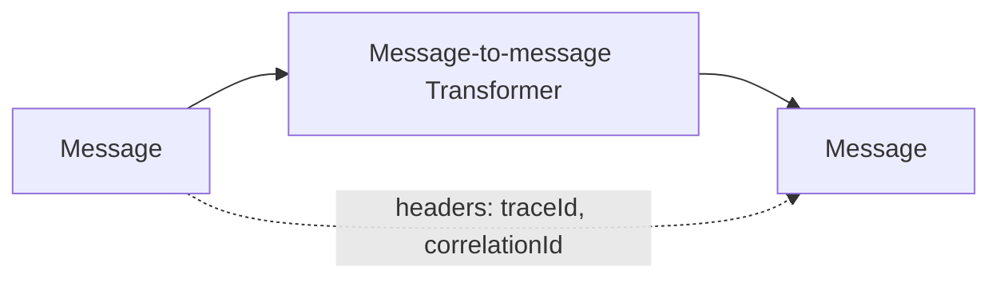
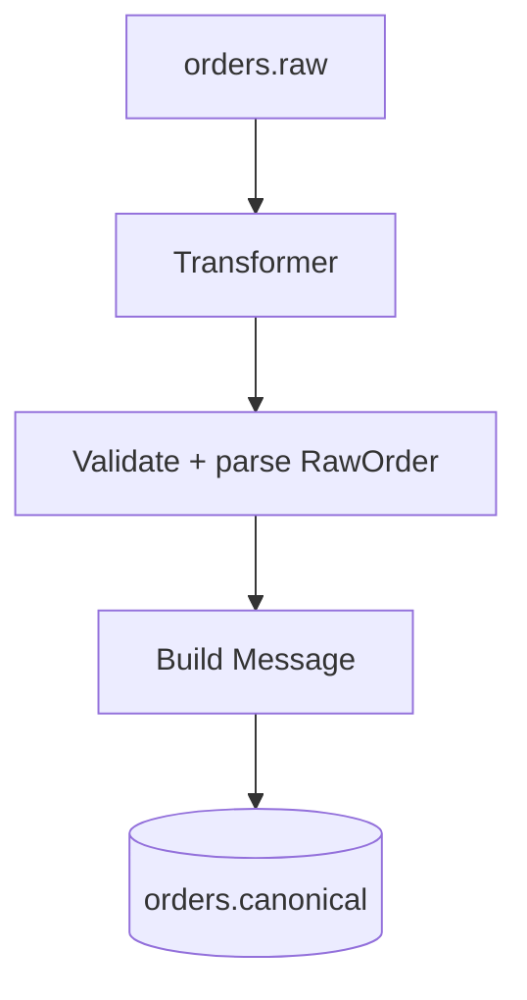
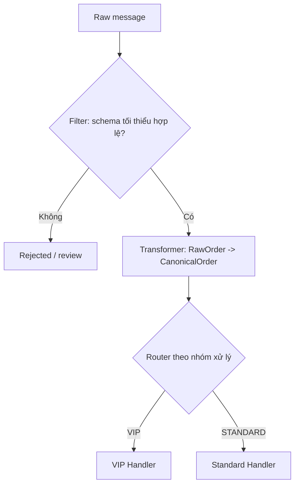
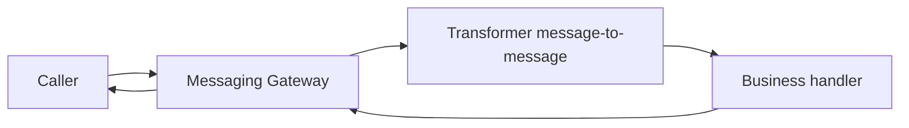
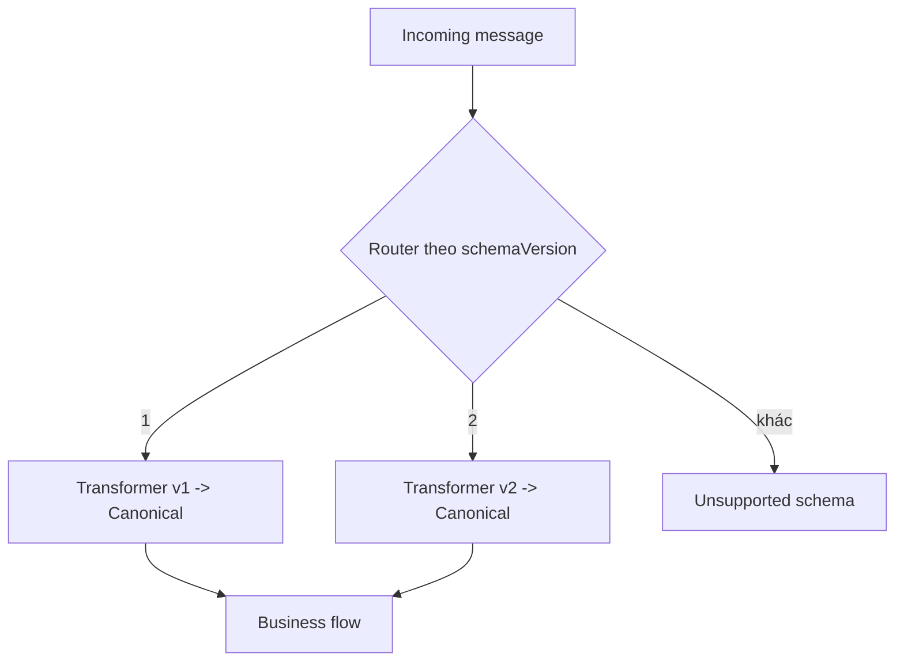

# Transformer message-to-message trong Spring Integration

## Mục tiêu bài học

Một dịch vụ đối tác gửi message chứa thông tin đơn hàng với số tiền ở dạng chuỗi và tên trường theo hợp đồng cũ. Hệ thống nội bộ cần chuyển thông tin ấy sang DTO chuẩn, đồng thời giữ `traceId`, `correlationId` và thông tin trả lời cho Gateway. Nếu chỉ chuyển đổi payload mà làm mất các header cần thiết, message có thể xử lý được ở bước kế tiếp nhưng mất khả năng truy vết hoặc không thể quay về caller.

**Message-to-message Transformer** là một endpoint của Enterprise Integration Patterns (EIP) nhận **một Spring `Message<?>`** và tạo **một `Message<?>` khác**, trong đó ứng dụng kiểm soát cả **payload** lẫn **headers**. Nó thường được dùng ở ranh giới giữa hai hợp đồng message, ví dụ từ message đối tác sang message nghiệp vụ nội bộ.

Bài thuộc chương **Transformer** của module **SPRING_INTEGRATION_PATTERN**. Trong module này, chúng ta thực hành Router, Filter, Transformer, Splitter, Aggregator, Gateway, retry, error channel và correlation để xây dựng luồng thông điệp ít phụ thuộc, dễ mở rộng, có khả năng kiểm thử và quan sát từng nhánh.

Sau bài học, bạn có thể:

1. Phân biệt **payload-to-payload** với **message-to-message** và biết khi nào cần điều khiển toàn bộ envelope.
2. Tạo message mới bằng `MessageBuilder`, biến đổi payload và chọn lọc/thay đổi headers.
3. Viết endpoint `@Transformer` nhận `Message<RawOrder>` và trả `Message<CanonicalOrder>`, kiểm tra luồng thật bằng JUnit.
4. Giải thích các header nghiệp vụ, header correlation và header điều khiển như `replyChannel` và `errorChannel`.
5. Phân biệt lỗi chuyển đổi với việc Filter trả `false` và việc Router không có đích.
6. Hiểu tác động của Transformer đến Splitter/Aggregator, Gateway, retry, serialization và message broker.
7. Thiết kế transformer dễ kiểm thử, có tính quyết định, không có side effect không cần thiết và an toàn tại ranh giới tin cậy.

## 1. Transformer thay đổi hình dạng dữ liệu, không chọn nhánh

Hãy xét message đầu vào:

```text
Message<RawOrder>
  payload:
    externalId = "P-100"
    amountText = "125.50"
    currency   = "usd"
  headers:
    traceId      = "trace-100"
    correlationId = "batch-7"
    schemaVersion = 1
```

Hệ thống nội bộ mong đợi:

```text
Message<CanonicalOrder>
  payload:
    orderId  = "P-100"
    amount   = BigDecimal("125.50")
    currency = "USD"
  headers:
    traceId      = "trace-100"
    correlationId = "batch-7"
    schemaVersion = 2
    transformStage = "partner-to-canonical"
```

Hai message có **payload khác kiểu**, header version thay đổi, còn trace/correlation giữ nguyên theo hợp đồng.



**Transformer không tự quyết định chấp nhận hay từ chối message như Filter** và cũng không dùng nội dung để chọn một trong nhiều destination như Router. Nó **chuyển đổi một biểu diễn thành biểu diễn khác**; những quyết định điều hướng nên được đặt ở endpoint khác khi phù hợp.

### Sự khác biệt với Transformer payload-only

Một phép biến đổi thông thường:

```java
CanonicalOrder normalize(RawOrder raw) {
    // Trả payload mới.
    return new CanonicalOrder(...);
}
```

Framework có thể bọc kết quả thành message đầu ra, đồng thời áp dụng cơ chế truyền header của Transformer. Nếu muốn quản lý **rõ ràng** header nào được giữ, bị xóa hoặc được thêm, ta có thể trả cả `Message<CanonicalOrder>`:

```java
Message<CanonicalOrder> normalize(Message<RawOrder> incoming) {
    CanonicalOrder canonical = ...;
    return MessageBuilder.withPayload(canonical)
        .copyHeaders(incoming.getHeaders())
        .setHeader("schemaVersion", 2)
        .build();
}
```

Sơ đồ:

```text
Payload-to-payload:    RawOrder --> CanonicalOrder
Message-to-message:   Message<RawOrder> --> Message<CanonicalOrder>
```

Hai cách không phải là hai “framework” riêng. Chúng khác nhau ở **hợp đồng đầu vào/đầu ra của hàm chuyển đổi** và trách nhiệm quản lý envelope.

## 2. Spring Message gồm những thành phần nào?

Giao diện `org.springframework.messaging.Message<T>` có hai phần chính:

- `getPayload()`: dữ liệu mang nội dung nghiệp vụ, kiểu generic `T`.
- `getHeaders()`: `MessageHeaders` chứa metadata dùng cho tương quan, theo dõi, điều khiển flow và tích hợp giao thức.

Ví dụ:

```java
import org.springframework.messaging.Message;

void inspect(Message<?> message) {
    Object payload = message.getPayload();
    Object traceId = message.getHeaders().get("traceId");
}
```

Một số header cần phân biệt:

| Header | Vai trò | Khi Transformer tạo message mới |
| --- | --- | --- |
| `traceId` | Theo dõi một yêu cầu qua các endpoint | Thường cần giữ khi còn cùng trace |
| `correlationId` | Nhận diện nhóm message được Splitter/Aggregator xử lý | Cần giữ đúng nếu còn trong cùng nhóm |
| `sequenceNumber` | Số thứ tự phần tử trong một nhóm | Không tự chỉnh nếu không đổi cấu trúc nhóm |
| `sequenceSize` | Số phần dự kiến của nhóm | Giữ theo hợp đồng Aggregator, không đoán lại |
| `replyChannel` | Đích trả lời của request-reply flow | Giữ qua nhánh nội bộ nếu downstream cần reply |
| `errorChannel` | Kênh xử lý lỗi trong những cơ chế hỗ trợ | Giữ hoặc thay theo chính sách error flow |
| `id` | ID kỹ thuật của Spring Message | Không dùng làm business id bền vững qua retry |
| `timestamp` | Thời điểm gắn với message kỹ thuật | Không xem là thời điểm nghiệp vụ bất biến |
| `tenantId` | Ngữ cảnh tenant | Chỉ giữ sau khi xác thực độ tin cậy |
| `schemaVersion` | Phiên bản contract | Có thể cập nhật khi đổi payload sang schema mới |

**Header và payload không có cùng mức độ tin cậy.** Header đến từ client hoặc broker có thể bị thiếu, sai kiểu hoặc giả mạo. Một Transformer không tự xác thực danh tính hay phân quyền chỉ vì header có tên `tenantId`.

### Message ID không phải định danh nghiệp vụ

Khi dựng message đầu ra, đừng dựa vào giả định rằng `MessageHeaders.ID` hoặc `timestamp` nhất thiết giữ nguyên hay đổi theo một quy tắc dùng được làm business contract. Tạo khóa riêng như `orderId`, `eventId` hoặc `commandId` và kiểm thử chúng xuyên quá trình chuyển đổi.

### Transformer có được sửa message đầu vào tại chỗ không?

Thông thường hãy **tạo message mới** thay vì sửa payload có thể thay đổi hoặc cố chỉnh một `MessageHeaders` đã tạo. Cách tiếp cận bất biến giúp nhiều subscriber/nhánh cùng đọc dữ liệu an toàn hơn, nhất là khi có xử lý song song.

Không được coi việc copy header là hành động vô điều kiện an toàn: những header nội bộ chứa đối tượng `MessageChannel` hoặc đối tượng không serializable có thể phù hợp trong một flow in-process nhưng không phù hợp khi gửi ra Kafka/JMS/HTTP.

## 3. Ví dụ thực tế: chuyển message đối tác sang DTO chuẩn

Giả sử đối tác cung cấp:

```json
{
  "externalId": "P-100",
  "amountText": "125.50",
  "currency": "usd"
}
```

Hợp đồng nội bộ yêu cầu:

- `orderId` không rỗng.
- `amount` là `BigDecimal` dương, nhận dấu chấm thập phân và tối đa hai chữ số sau dấu chấm.
- `currency` ở dạng chữ hoa và chỉ nhận `VND` hoặc `USD`.
- `schemaVersion` từ `1` chuyển sang `2`.
- Giữ `traceId`, `correlationId` và các header điều khiển cần thiết trong luồng nội bộ.

Đây là **quy tắc minh họa**, không phải một tiêu chuẩn định dạng tiền tệ tổng quát. Dữ liệu thực tế có thể yêu cầu số chữ số thập phân khác nhau theo loại tiền, làm tròn có quy tắc và chuyển đổi đơn vị.

### DTO đầu vào và đầu ra

```java
import java.math.BigDecimal;

public record RawOrder(
    String externalId,
    String amountText,
    String currency
) {}

public record CanonicalOrder(
    String orderId,
    BigDecimal amount,
    String currency
) {}
```

`RawOrder` và `CanonicalOrder` được định nghĩa ở đây để mô tả hợp đồng. Trong ứng dụng Java, có thể đặt mỗi record thành một source file hoặc khai báo thành nested record như cấu hình bên dưới.

### Luồng biến đổi



Ví dụ dùng `DirectChannel` cho input và `QueueChannel` cho output để test có thể `receive()` chủ động. Trong production, output queue cần consumer/poller hoặc adapter downstream.

## 4. Cài đặt bằng `@Transformer` nhận và trả toàn bộ Message

Spring Integration hỗ trợ annotation `@Transformer` gắn với method chuyển đổi. Method có thể nhận `Message<RawOrder>`, xử lý payload và trả `Message<CanonicalOrder>`.

### Cấu hình Java đầy đủ

```java
import java.math.BigDecimal;
import java.util.Locale;
import java.util.Set;

import org.springframework.context.annotation.Bean;
import org.springframework.context.annotation.Configuration;
import org.springframework.integration.annotation.Transformer;
import org.springframework.integration.channel.DirectChannel;
import org.springframework.integration.channel.QueueChannel;
import org.springframework.integration.config.EnableIntegration;
import org.springframework.messaging.Message;
import org.springframework.messaging.MessageChannel;
import org.springframework.messaging.PollableChannel;
import org.springframework.messaging.support.MessageBuilder;

@Configuration
@EnableIntegration
public class OrderMessageTransformConfig {

    public record RawOrder(
        String externalId,
        String amountText,
        String currency
    ) {}

    public record CanonicalOrder(
        String orderId,
        BigDecimal amount,
        String currency
    ) {}

    private static final Set<String> SUPPORTED =
        Set.of("VND", "USD");

    @Bean("orders.raw")
    MessageChannel input() {
        return new DirectChannel();
    }

    @Bean("orders.canonical")
    PollableChannel output() {
        return new QueueChannel();
    }

    @Transformer(
        inputChannel = "orders.raw",
        outputChannel = "orders.canonical"
    )
    public Message<CanonicalOrder> toCanonical(
        Message<RawOrder> incoming
    ) {
        RawOrder raw = incoming.getPayload();

        CanonicalOrder normalized = normalize(raw);

        // Tạo một Message mới, copy headers theo hợp đồng
        // của đường xử lý nội bộ, và cập nhật phiên bản.
        return MessageBuilder.withPayload(normalized)
            .copyHeaders(incoming.getHeaders())
            .setHeader("schemaVersion", 2)
            .setHeader("transformStage", "partner-to-canonical")
            .build();
    }

    static CanonicalOrder normalize(RawOrder raw) {
        if (raw == null
            || raw.externalId() == null
            || raw.externalId().isBlank()) {
            throw new IllegalArgumentException("MISSING_ORDER_ID");
        }

        if (raw.amountText() == null
            || !raw.amountText().matches("[0-9]+(?:\\.[0-9]{1,2})?")) {
            throw new IllegalArgumentException("INVALID_AMOUNT_FORMAT");
        }

        BigDecimal amount = new BigDecimal(raw.amountText());
        if (amount.signum() <= 0) {
            throw new IllegalArgumentException("NON_POSITIVE_AMOUNT");
        }

        if (raw.currency() == null) {
            throw new IllegalArgumentException("MISSING_CURRENCY");
        }

        String currency =
            raw.currency().trim().toUpperCase(Locale.ROOT);

        if (!SUPPORTED.contains(currency)) {
            throw new IllegalArgumentException("UNSUPPORTED_CURRENCY");
        }

        return new CanonicalOrder(
            raw.externalId().trim(),
            amount,
            currency
        );
    }
}
```

**Diễn giải theo từng bước:**

1. `orders.raw` nhận `Message<RawOrder>`.
2. Method `toCanonical(Message<RawOrder>)` được Spring Integration đăng ký làm Transformer endpoint.
3. `normalize(raw)` xử lý nội dung: kiểm tra mã, parse tiền, chuẩn hóa currency.
4. `MessageBuilder.withPayload(normalized)` tạo message với **payload mới**.
5. `copyHeaders(incoming.getHeaders())` chuyển những header đầu vào phù hợp trong ngữ cảnh flow nội bộ.
6. `setHeader("schemaVersion", 2)` và `setHeader("transformStage", ...)` ghi lại contract phiên bản mới.
7. Endpoint gửi message kết quả đến `orders.canonical`.

Khi Spring Integration chọn method thông qua annotation, việc method nhận `Message<RawOrder>` thể hiện rõ rằng logic **cần cả payload và metadata**. Không sử dụng một method chỉ nhận `RawOrder` rồi gọi `getHeaders()` trên đối tượng payload.

### Phân biệt endpoint với phương thức xử lý

`@Transformer` chỉ ra **endpoint của flow**. Chính method `toCanonical` định nghĩa quy tắc chuyển đổi. Lỗi ở `normalize` có thể khiến xử lý message thất bại; annotation không tự làm nghiệp vụ thành công hay tự phát phản hồi `REJECTED`.

Mã trên dùng Java 17+ do sử dụng `record`. Dự án cần Spring Integration, Spring Messaging và các dependency test tương ứng. Trong hệ thống thực tế, cấu hình `@Configuration` phải được import hoặc component scan để endpoint được đăng ký.

### Tránh xóa/đổi header ngoài chủ đích

`schemaVersion=2` diễn tả payload đầu ra đã là hợp đồng mới; không nên âm thầm giữ version cũ nếu biến đổi đã thực sự đổi schema. Nhưng `traceId` và `correlationId` nên được giữ khi còn cùng ngữ cảnh nghiệp vụ.

Với dữ liệu đến từ vùng tin cậy khác, thay vì copy toàn bộ headers, hãy dùng **allowlist** và thêm lại chính xác những trường đã được kiểm chứng. Ví dụ:

```java
import org.springframework.messaging.Message;
import org.springframework.messaging.support.MessageBuilder;

Message<CanonicalOrder> createSafeBoundaryMessage(
    Message<RawOrder> source,
    CanonicalOrder result
) {
    MessageBuilder<CanonicalOrder> builder =
        MessageBuilder.withPayload(result)
            .setHeader("schemaVersion", 2);

    Object traceId = source.getHeaders().get("traceId");
    if (traceId instanceof String trace && !trace.isBlank()) {
        builder.setHeader("traceId", trace);
    }

    return builder.build();
}
```

Đoạn trên là ví dụ **rút gọn** dùng các kiểu DTO `RawOrder` và `CanonicalOrder` đã định nghĩa. Nó cố ý **không** copy `replyChannel`, `errorChannel` và toàn bộ headers khác, vì thích hợp với **boundary tách biệt** hơn là flow Gateway nội bộ đòi reply. Chính sách giữ header phải dựa trên vị trí Transformer trong topology.

## 5. Kiểm thử Java: payload thay đổi và header được giữ

Chúng ta kiểm thử **qua channel** thay vì chỉ gọi method `normalize`. Dùng JUnit 5, AssertJ, Spring Test và các bean từ `OrderMessageTransformConfig`.

### Kiểm thử tích hợp

```java
import static org.assertj.core.api.Assertions.assertThat;
import static org.assertj.core.api.Assertions.assertThatThrownBy;

import java.math.BigDecimal;

import org.junit.jupiter.api.Test;
import org.springframework.beans.factory.annotation.Autowired;
import org.springframework.beans.factory.annotation.Qualifier;
import org.springframework.messaging.Message;
import org.springframework.messaging.MessageChannel;
import org.springframework.messaging.PollableChannel;
import org.springframework.messaging.support.MessageBuilder;
import org.springframework.test.context.junit.jupiter.SpringJUnitConfig;

@SpringJUnitConfig(OrderMessageTransformConfig.class)
class OrderMessageTransformTest {

    @Autowired
    @Qualifier("orders.raw")
    MessageChannel input;

    @Autowired
    @Qualifier("orders.canonical")
    PollableChannel output;

    private Message<OrderMessageTransformConfig.RawOrder> request(
        String id, String amount, String currency
    ) {
        return MessageBuilder.withPayload(
                new OrderMessageTransformConfig.RawOrder(
                    id, amount, currency))
            .setHeader("traceId", "trace-100")
            .setHeader("correlationId", "batch-7")
            .setHeader("schemaVersion", 1)
            .build();
    }

    @Test
    void convertsPayloadAndPreservesCorrelation() {
        assertThat(input.send(request("P-100", "125.50", "usd")))
            .isTrue();

        Message<?> result = output.receive(2_000);
        assertThat(result).isNotNull();

        var payload =
            (OrderMessageTransformConfig.CanonicalOrder)
                result.getPayload();

        assertThat(payload.orderId()).isEqualTo("P-100");
        assertThat(payload.amount())
            .isEqualByComparingTo(new BigDecimal("125.50"));
        assertThat(payload.currency()).isEqualTo("USD");

        assertThat(result.getHeaders().get("traceId"))
            .isEqualTo("trace-100");
        assertThat(result.getHeaders().get("correlationId"))
            .isEqualTo("batch-7");
        assertThat(result.getHeaders().get("schemaVersion"))
            .isEqualTo(2);
        assertThat(result.getHeaders().get("transformStage"))
            .isEqualTo("partner-to-canonical");

        assertThat(output.receive(0)).isNull();
    }

    @Test
    void missingOrMalformedAmountDoesNotProduceCanonicalMessage() {
        assertThatThrownBy(() ->
            input.send(request("P-101", "12,50", "USD"))
        ).isInstanceOf(RuntimeException.class);

        assertThat(output.receive(0)).isNull();
    }

    @Test
    void unsupportedCurrencyDoesNotReachOutput() {
        assertThatThrownBy(() ->
            input.send(request("P-102", "10.00", "EUR"))
        ).isInstanceOf(RuntimeException.class);

        assertThat(output.receive(0)).isNull();
    }
}
```

**Ý nghĩa test:**

- Test đầu chứng minh payload từ `RawOrder` được đổi thành `CanonicalOrder` và các header nghiệp vụ cần thiết đi cùng message.
- Test lỗi chứng minh khi việc chuẩn hóa không thành công, endpoint **không phát một message chuẩn giả** chỉ để tiếp tục pipeline.
- `DirectChannel` thực thi handler đồng bộ nên exception có thể truyền qua `input.send(...)`. Với poller/executor/broker, lỗi có thể được báo ở error flow của worker thay vì ném trực tiếp về producer.
- Trong ví dụ, các queue không có consumer nền; `receive(0)` phù hợp để xác minh không có output trong cùng test. Khi có asynchronous work, cần kiểm tra theo timeout/sự kiện hoàn thành.

Test này không chứng minh số lần ghi DB hay gửi HTTP, vì ví dụ cố ý chỉ chuyển đổi dữ liệu. Các ca kiểm thử biên khác nên bao gồm amount bằng `0`, âm, nhiều chữ số thập phân, currency `null`, mã đơn blank và header sai kiểu.

### Unit test thuần của hàm chuyển đổi

Một hàm `normalize(RawOrder)` không phụ thuộc Spring có thể test nhanh:

```java
import static org.assertj.core.api.Assertions.assertThat;
import static org.assertj.core.api.Assertions.assertThatThrownBy;

import java.math.BigDecimal;

import org.junit.jupiter.api.Test;

class NormalizeOrderTest {

    @Test
    void parsesAndNormalizesWithoutSpringContext() {
        var result = OrderMessageTransformConfig.normalize(
            new OrderMessageTransformConfig.RawOrder(
                " P-42 ", "0.01", "vnd")
        );

        assertThat(result.orderId()).isEqualTo("P-42");
        assertThat(result.amount())
            .isEqualByComparingTo(new BigDecimal("0.01"));
        assertThat(result.currency()).isEqualTo("VND");
    }

    @Test
    void rejectsMissingOrderId() {
        assertThatThrownBy(() ->
            OrderMessageTransformConfig.normalize(
                new OrderMessageTransformConfig.RawOrder(
                    "  ", "100", "VND"))
        ).isInstanceOf(IllegalArgumentException.class)
         .hasMessage("MISSING_ORDER_ID");
    }
}
```

Nên dùng **unit test** cho logic format và **integration test** cho header/channel/flow. Một Transformer có thể đúng ở cấp phương thức nhưng nối sai channel hoặc làm mất header khi qua adapter.

## 6. Tương đương trong Java DSL với Transformer nhận `Message<?>`

Có hai cách phổ biến để khai báo endpoint: annotation và Java DSL. Không cần bật **đồng thời** hai endpoint nhận cùng input channel chỉ để thử hai phong cách, bởi điều đó có thể khiến việc dispatch không còn như bạn kỳ vọng.

Đoạn sau minh họa **một cấu hình thay thế** cho `@Transformer`:

```java
import org.springframework.context.annotation.Bean;
import org.springframework.integration.dsl.IntegrationFlow;
import org.springframework.integration.transformer.Transformer;
import org.springframework.messaging.Message;
import org.springframework.messaging.support.MessageBuilder;

@Bean
IntegrationFlow orderMessageDslFlow() {
    Transformer mapper = incoming -> {
        var raw = (OrderMessageTransformConfig.RawOrder)
            incoming.getPayload();

        var canonical = OrderMessageTransformConfig.normalize(raw);

        return MessageBuilder.withPayload(canonical)
            .copyHeaders(incoming.getHeaders())
            .setHeader("schemaVersion", 2)
            .setHeader("transformStage", "partner-to-canonical")
            .build();
    };

    return IntegrationFlow.from("orders.raw")
        .transform(mapper)
        .channel("orders.canonical")
        .get();
}
```

Đặt đoạn `@Bean` này vào một class `@Configuration` có các channel như mục 4, **thay thế** method `@Transformer` của ví dụ trước. `Transformer` ở đây là interface Spring Integration nhận toàn bộ `Message<?>`, không phải `java.util.function.Function` chỉ xử lý payload.

### Khi nào dùng cách nào?

| Cách | Ưu điểm | Lưu ý |
| --- | --- | --- |
| `@Transformer` trên method | Method mang tên nghiệp vụ, dễ test trực tiếp | Phải đăng ký bean được Spring quét và annotation hoạt động |
| Java DSL `.transform(Transformer)` | Nhìn rõ toàn bộ flow trong một cấu hình | Lambda dài có thể khó bảo trì, nên tách thành class |
| DSL `.transform(PayloadType.class, mapper)` | Gọn khi chỉ cần payload-to-payload | Cần hiểu header propagation do endpoint xử lý |
| Transformer sử dụng SpEL | Thuận tiện với mapping đơn giản | Không phù hợp với phép chuẩn hóa phức tạp hoặc dữ liệu ngoài chưa kiểm tra |

Khi số field lớn, thường nên tách mapping thành class có unit test riêng và để IntegrationFlow chỉ mô tả topology.

## 7. Tạo message mới: giữ, thay, thêm và bỏ header

Message-to-message Transformer có trách nhiệm xác định rõ **bộ metadata của đầu ra**.

### Giữ header cần thiết

```java
MessageBuilder.withPayload(canonical)
    .copyHeaders(incoming.getHeaders())
    .build();
```

Thao tác trên tiện trong **flow nội bộ đáng tin cậy**, khi muốn downstream nhận `traceId`, `correlationId`, `replyChannel` và `errorChannel` do pipeline quản lý.

### Ghi đè header contract

```java
MessageBuilder.withPayload(canonical)
    .copyHeaders(incoming.getHeaders())
    .setHeader("schemaVersion", 2)
    .setHeader("contentType", "application/vnd.example.order+json")
    .build();
```

Không tự thay `contentType` thành JSON khi payload vẫn là Java DTO và adapter chưa serialize nó. Trong ví dụ trích này, việc gắn header media type chỉ hợp lý nếu **hợp đồng downstream** giải thích rõ nó là kiểu logical hoặc đã thực sự mã hóa payload phù hợp.

### Xóa header không còn hợp lệ

```java
MessageBuilder.withPayload(canonical)
    .copyHeaders(incoming.getHeaders())
    .removeHeader("legacyRoutingHint")
    .setHeader("schemaVersion", 2)
    .build();
```

Có thể loại các header chỉ tồn tại ở phiên bản cũ, hoặc thông tin định tuyến không nên được chuyển tiếp. Với các header đặc biệt được framework quản lý, chỉ thay khi bạn hiểu chính xác tác động đến reply/error/correlation.

### Không sao chép mù quáng ra bên ngoài

Khi gửi message qua một adapter đến hệ thống khác, copy toàn bộ headers có thể đưa `replyChannel` hoặc `errorChannel` dạng đối tượng không serializable ra ngoài, hoặc làm lộ metadata nội bộ. Hãy cân nhắc tạo **boundary message** chỉ có các trường được cho phép và dùng header mapper phù hợp với giao thức.

| Ranh giới | Hướng xử lý |
| --- | --- |
| Trong cùng một flow in-process | Có thể giữ các header điều khiển để reply/error flow hoạt động |
| Qua async queue nhưng cùng process | Giữ correlation/trace và kiểm tra reply contract |
| Qua HTTP, Kafka, AMQP, JMS | Chọn header/kiểu có thể serialize, kiểm tra mapper và chính sách bảo mật |
| Từ đối tác không tin cậy vào domain nội bộ | Validate payload; thiết lập lại tenant/role từ identity đáng tin |
| Sang hệ thống phân tích | Chỉ đưa metadata tối thiểu, tránh token và dữ liệu nhạy cảm |

### Mối quan hệ giữa `id`, `timestamp` và message mới

`MessageBuilder` và hạ tầng Spring Messaging có quy tắc riêng với các header kỹ thuật, nên không dùng `id` và `timestamp` làm bằng chứng bất biến của nghiệp vụ. Nếu cần truy vết “được tạo ra từ message nào”, ghi một `sourceMessageId` hoặc business key riêng theo hợp đồng, đồng thời không nhầm nó với ID kỹ thuật của message hiện tại.

## 8. Phân biệt Transformer và các pattern liên quan

| Pattern | Câu hỏi trả lời | Ví dụ |
| --- | --- | --- |
| **Transformer** | Đổi representation nào sang representation nào? | `Message<RawOrder> → Message<CanonicalOrder>` |
| **Filter** | Message có được đi tiếp không? | Chấp nhận đơn đủ schema, loại đơn bị chặn |
| **Router** | Message nên đi channel nào? | `VIP → vipChannel`, `STANDARD → standardChannel` |
| **Splitter** | Một message cần thành mấy phần? | Batch thành các `OrderLine` |
| **Aggregator** | Gom các message liên quan khi nào? | Các kết quả theo `correlationId` |
| **Gateway** | Làm sao giao tiếp request-reply? | Nhận request và trả response cho caller |
| **Enricher** | Bổ sung dữ liệu mới từ nguồn khác? | Thêm mã vùng/metadata vào message |

Trong pipeline, một Transformer thường đứng **sau bước validation/Filter** và **trước Router**:



Ví dụ khi payload chuẩn hóa `currency` thành `"USD"`, các predicate hoặc Router sau đó có thể sử dụng một định dạng ổn định. Không nên lặp lại normalize riêng rẽ trong mọi nhánh nếu có thể đặt một bước chuyển đổi chung.

### Transformer có được trả `null` để loại message không?

Không nên dùng Transformer như Filter. Nếu không thể chuyển đổi do dữ liệu sai, hãy phát **lỗi chuyển đổi** có chủ đích hoặc dùng bước Filter/validation riêng. Đừng dựa vào `null` như một “thông báo bỏ qua” vì framework có thể coi việc Transformer không tạo kết quả là lỗi hoặc có hành vi không đáp ứng hợp đồng endpoint. Khi muốn discard có chủ đích, dùng `Filter` với `discardChannel`.

### Transformer có thể định tuyến không?

Nếu output là một kiểu mới và Router phía sau chọn tuyến dựa trên output, đó là mô hình **Transformer → Router**. Tách trách nhiệm như vậy giúp các quy tắc thay đổi độc lập: thay schema không bắt buộc thay routing table, và ngược lại.

## 9. Lỗi chuyển đổi: validation, parsing và exception

Không phải mọi input đều có thể chuyển thành DTO chuẩn:

- Số tiền `"12,50"` không phù hợp định dạng ví dụ dùng dấu chấm.
- `currency="EUR"` chưa được hỗ trợ theo policy bài học.
- `externalId` blank không thể tạo `orderId`.
- Header thiếu hoặc sai kiểu khiến transformer không xác định được ngữ cảnh nếu nó cần header để chuyển đổi.

**Đừng tự sửa những dữ liệu sai contract bằng những giả định nguy hiểm.** Ví dụ tự chuyển `"12,50"` thành `1250` có thể gây sai số tiền.

### Phân loại lỗi

| Lỗi | Ví dụ | Hướng xử lý |
| --- | --- | --- |
| **Invalid input** | ID rỗng, format số không hợp lệ | Reject với mã lỗi nghiệp vụ, không retry vô hạn |
| **Unsupported contract** | `schemaVersion=99` | Quarantine hoặc trả unsupported-schema |
| **Transformation bug** | `ClassCastException` do mapping sai kiểu | Sửa mã, log/alert, không coi message hợp lệ |
| **Transient dependency error** | Transformer gọi metadata service và timeout | Retry có giới hạn, circuit breaker hoặc tách enrichment |
| **Serialization error** | DTO không serialize qua adapter | Validate serializer/schema ở boundary |
| **Downstream handler error** | Router chọn đúng nhánh nhưng DB update lỗi | Retry/error flow của downstream, không đổ cho Transformer |

### Truyền lỗi qua DirectChannel và error flow

Trong ví dụ Java `DirectChannel → @Transformer`, exception thường xuất hiện ngay trên call stack gửi. Khi Transformer chạy qua `QueueChannel`, poller, executor hoặc broker adapter, lỗi có thể được đưa đến error flow theo cấu hình endpoint/adapter. Cần kiểm tra điểm phát lỗi, chính sách ack/redelivery và nơi nhận `ErrorMessage`.

Không giả định `errorChannel` tự động nhận mọi exception bất kể topology; cũng không dùng `discardChannel` của Filter để xử lý lỗi Transformer.

### Có nên retry một phép biến đổi thuần?

Nếu `RawOrder("P-1", "bad", "USD")` luôn gây lỗi format, retry với cùng input và policy **không có ích**. Nên reject/quarantine với mã lỗi rõ và cơ chế sửa dữ liệu.

Nếu kết quả phụ thuộc một dịch vụ ngoài đang tạm thời không sẵn sàng, retry có thể hữu ích; nhưng tốt hơn thường là tách I/O vào **enrichment/service endpoint** có timeout/retry riêng, giữ Transformer chủ yếu là phép chuyển đổi thuần.

## 10. Message-to-message Transformer với Gateway và replyChannel

Gateway xử lý request-reply. Spring Integration dùng các header điều khiển như `replyChannel` để truyền kết quả về nơi gửi.



Nếu Transformer tạo message mới và **loại bỏ `replyChannel`** trong flow nội bộ mà downstream trông cậy vào nó, kết quả có thể không quay về đúng nơi hoặc Gateway chờ đến timeout.

Hợp đồng phù hợp:

1. Trong đường request-reply nội bộ, giữ các header điều khiển cần cho lời đáp.
2. Khi qua broker hay vùng tin cậy khác, không gửi thẳng object channel nội bộ; dùng adapter và correlation/reply destination phù hợp.
3. Nếu Transformer từ chối input, trả response lỗi hoặc ném exception theo API contract, không im lặng làm mất message.
4. Khi một nhánh không sinh reply, cần timeout có kiểm soát và log correlation.

### Phản hồi nghiệp vụ do ứng dụng định nghĩa

```java
public record TransformError(
    String requestId,
    String code,
    String message
) {}
```

Ví dụ `TransformError("REQ-42", "INVALID_AMOUNT_FORMAT", "Amount format is invalid")` do ứng dụng xây dựng; không phải payload tự sinh mặc định của `@Transformer`.

## 11. Transformer sau Splitter và trước Aggregator

Một batch có thể được Splitter tạo thành các message con:

```text
Batch
  |
Splitter
  |------ Line #1 -> Transformer -> Result #1
  |------ Line #2 -> Transformer -> Result #2
  |------ Line #3 -> Transformer -> Result #3
                                      |
                                  Aggregator
```

Nếu Transformer dựng message mới mà **mất `correlationId`, `sequenceNumber` hoặc `sequenceSize`**, Aggregator không còn đủ metadata để gom đúng nhóm theo chiến lược mặc định.

### Một ví dụ header

```text
Message<RawLine>
  correlationId = BATCH-42
  sequenceNumber = 2
  sequenceSize = 3

Message<CanonicalLine>
  correlationId = BATCH-42
  sequenceNumber = 2
  sequenceSize = 3
```

Transformer thay payload nhưng không làm thay đổi “phần thứ mấy trong batch” nếu nghiệp vụ không thay đổi cấu trúc nhóm.

### Khi một message con chuyển đổi lỗi

Giả sử phần #2 không convert được và **không phát kết quả**. Aggregator chỉ nhận 2/3 message, có thể chờ mãi hoặc chờ đến timeout. Một số cách xử lý:

- Biến lỗi được kiểm soát thành `PartResult(status=FAILED)` mang correlation/sequence phù hợp.
- Có custom release strategy và group timeout để tạo kết quả một phần.
- Reject cả batch trước Splitter khi không cho phép thiếu phần.
- Bảo toàn một business key như `batchId` và `lineId` để xử lý retry/late result chính xác.

**Không tự thay `sequenceSize` riêng một message để “khớp” số phần còn lại.** Thông tin nhóm cần nhất quán giữa các nhánh.

### Không nhầm Transformer với Splitter

Message-to-message Transformer thường giữ **một message đầu vào → một message đầu ra**. Nếu cần một message thành **nhiều message con**, dùng Splitter. Một Transformer trả về payload dạng `List` không tự có nghĩa hạ tầng đã phát mỗi phần tử thành message riêng, trừ khi flow có cấu hình xử lý thích hợp.

## 12. Tính quyết định, idempotency và concurrency

Một Transformer lý tưởng là phép biến đổi:

```text
(input message + version của policy) -> output message
```

Với cùng input và cùng policy, nó cho ra cùng **nội dung nghiệp vụ**, dù một số metadata kỹ thuật có thể khác khi tạo message mới.

### Tránh side effect

Một phản ví dụ:

```java
Message<?> transformBadly(Message<?> input) {
    chargePayment(input.getPayload()); // Side effect không thuộc mapping.
    return input;
}
```

Hàm `chargePayment` là lời gọi minh họa không có định nghĩa ở đây. Đưa side effect vào Transformer khiến retry/redelivery dễ thực thi nghiệp vụ lặp và khó phân biệt lỗi đổi representation với lỗi thanh toán. Nên tách side effect sang Service Activator/handler có idempotency key.

### Có cần tạo business ID trong Transformer?

Một số integration layer chuyển `externalId` sang `orderId`. Nếu input không có định danh ổn định, việc **tự sinh UUID mới trong mỗi lần retry** có thể tạo hai đơn khác nhau từ cùng một message. Hãy thiết kế mapping ID theo nguồn hoặc sinh ID một lần ở ingress rồi lưu bền, thay vì sinh lại không kiểm soát.

### Thread safety

Transformer dùng chung một bean có thể được gọi đồng thời khi flow dùng executor, nhiều poller hoặc broker consumers. Vì vậy:

- Tránh state mutable dùng chung cho quá trình chuyển đổi.
- Không dùng `SimpleDateFormat` không đồng bộ dưới nhiều thread; dùng `java.time`/formatter bất biến.
- Với cấu hình ánh xạ thay đổi runtime, dùng snapshot bất biến để một lần transform đọc chính sách nhất quán.
- Không dùng một biến instance `lastOrderId` để truyền dữ liệu giữa các message.

### Idempotency của kết quả

Nếu chuyển đổi tạo payload xác định nhưng downstream có side effect, **idempotency cần được áp dụng tại downstream**. Một phép transform đúng không bảo đảm một đơn hàng sẽ chỉ được ghi DB hoặc gửi thông báo một lần.

## 13. Chuyển đổi schema, phiên bản và compatibility

Trong hệ thống tích hợp nhiều đối tác, contract thường tiến hóa:

```text
Partner v1                 Canonical v2
externalId: String    ->   orderId: String
amountText: String    ->   amount: BigDecimal
currency: String      ->   currency: normalized ISO-like code
```

Thông thường nên đặt Transformer ở **anti-corruption layer** giữa message bên ngoài và domain nội bộ.

### Quy tắc schema evolution

1. Xác định schema đầu vào/đầu ra có version rõ.
2. Với field bị đổi tên, định nghĩa quy tắc chuyển đổi tường minh.
3. Với field mới, chỉ đặt default khi nghiệp vụ cho phép; tránh tự bịa giá trị ảnh hưởng giao dịch.
4. Với enum/currency không biết, reject hoặc quarantine thay vì tự map vào nhánh mặc định có side effect.
5. Ghi contract tests với ví dụ đầu vào v1, v2 và trường hợp biên.
6. Khi cần hỗ trợ nhiều schema đầu vào, một Router có thể chọn Transformer phù hợp theo `schemaVersion` đã được xác thực.

### Một ví dụ có hai Transformer theo version



Phân biệt đây với một Transformer “đa năng” chứa rất nhiều `if` điều kiện khó kiểm soát. Khi version khác nhau đáng kể, tách theo Router giúp test từng contract độc lập.

## 14. Chuyển đổi qua HTTP, Kafka, AMQP hoặc JMS

Message-to-message trong Spring Integration **không đồng nghĩa** với việc tự serialize sang JSON/Avro/Protobuf. Khi message đi ra ngoài process, cần quan tâm đến:

- Payload có đúng kiểu adapter/serializer mong đợi?
- Header mapper nào được sử dụng?
- Header `replyChannel` hay `errorChannel` có được giữ trong nội bộ thay vì đưa ra broker?
- `correlationId` cần được chuyển thành chuỗi/byte/field giao thức nào?
- Có giới hạn kích thước message, schema registry hoặc content type không?
- Có rủi ro dữ liệu nhạy cảm trong payload hoặc headers?
- Consumer có chấp nhận schema/serialization version tương ứng không?

Một ví dụ ranh giới:

```text
HTTP JSON
   |
HTTP inbound adapter
   |
Message<RawOrder>
   |
Message-to-message Transformer
   |
Message<CanonicalOrder>
   |
Kafka outbound adapter + serializer
   |
Kafka record (bytes, selected headers)
```

**Transformer thay mô hình message ở tầng ứng dụng; adapter/codec phụ trách cách message đi qua giao thức.** Đôi khi bạn cần Transformer chuyên biệt đổi DTO sang `String` hoặc `byte[]`, nhưng khi đó vẫn phải xác định chuẩn serialization và header mapping một cách riêng biệt.

## 15. Hiệu năng và khả năng quan sát

Một phép đổi vài field thường nhanh, nhưng Transformer có thể thành bottleneck nếu thực hiện parse phức tạp, copy payload lớn hoặc gọi dịch vụ ngoài.

### Chỉ số nên theo dõi

| Metric minh họa | Ý nghĩa |
| --- | --- |
| `transform_received_total{stage}` | Có bao nhiêu message đến Transformer? |
| `transform_succeeded_total{stage}` | Bao nhiêu message được chuyển đổi? |
| `transform_failed_total{stage,reason}` | Bao nhiêu message thất bại theo mã lỗi? |
| `transform_duration{stage}` | Thời gian thực hiện chuyển đổi |
| `transform_input_schema_total{version}` | Phân bố phiên bản đầu vào |
| `transform_output_schema_total{version}` | Phân bố phiên bản đầu ra |
| `transform_output_queue_depth` | Đầu ra có đang tồn đọng? |
| `transform_retry_total{stage}` | Phép chuyển đổi bị gọi lại bao nhiêu lần? |

Đây là **tên do ứng dụng có thể định nghĩa**, không khẳng định Spring Integration tự xuất các metric đúng tên này. Có thể sử dụng Micrometer, Spring Integration observation, structured logging và tracing theo môi trường.

### Log kết quả an toàn

```text
traceId=trace-100 orderId=P-100
stage=partner-to-canonical
inputSchema=1 outputSchema=2 result=SUCCEEDED durationMs=3

traceId=trace-101 orderId=P-101
stage=partner-to-canonical
inputSchema=1 result=FAILED reason=INVALID_AMOUNT_FORMAT
```

Không log nguyên payload hoặc header có token, thông tin cá nhân, dữ liệu thanh toán. Tránh dùng `orderId` hoặc `traceId` làm nhãn metric có cardinality cao; chúng phù hợp hơn cho log/trace hoặc dữ liệu tra cứu riêng.

### Một số chỉ số khó thấy

Nếu Transformer nằm sau `QueueChannel`, producer `send()` thành công không có nghĩa việc chuyển đổi hoàn tất. Cần theo dõi thời gian chờ queue trước Transformer, thời gian thực hiện Transformer và thời gian chờ đầu ra. Trong xử lý bất đồng bộ, thứ tự hoàn tất có thể khác thứ tự nhận message.

## 16. Sai lầm phổ biến

| Triệu chứng | Nguyên nhân | Hướng xử lý |
| --- | --- | --- |
| Payload đã đổi nhưng mất `traceId` | Tạo message mới mà không giữ header cần thiết | Copy/allowlist headers theo contract |
| Gateway timeout sau Transformer | `replyChannel` bị bỏ trong flow nội bộ hoặc handler không reply | Giữ header điều khiển và xác nhận đường response |
| Aggregator không release | Mất `correlationId`/`sequenceSize` khi dựng message mới | Giữ metadata nhóm, test đủ kết quả |
| Tưởng đổi `schemaVersion` là đã đổi JSON | Chỉ thêm header, chưa serialize payload | Phân biệt logical schema và codec/adapter |
| Input format lỗi nhưng vẫn được xử lý | Tự suy đoán format hoặc default không an toàn | Validate cụ thể và reject/quarantine |
| Transformer trả `null` để bỏ message | Dùng sai pattern | Dùng Filter có discard/error contract |
| Kết quả khác nhau sau retry | Sinh ID ngẫu nhiên hoặc đọc policy runtime nhiều lần | Dùng business ID ổn định và policy snapshot |
| Cùng message bị side effect nhiều lần | Gọi DB/thanh toán trong Transformer | Tách Service Activator, idempotency downstream |
| Message bị reject nhưng log chỉ thấy `send()` thành công | Queue/async đã nhận message trước khi transform | Theo dõi outcome ở Transformer |
| Header nội bộ bị lộ ra broker | Copy toàn bộ headers ra boundary | Dùng allowlist và header mapper |
| Test method pass nhưng flow fail | Chưa test annotation/channel/output thực | Bổ sung Spring integration test |
| Handler downstream nhận sai DTO | Schema/type contract không thống nhất | Contract test, versioning, Router theo schema |

## 17. Bài tập thực hành

### Bài 1 — Message-to-message cơ bản

Dùng `OrderMessageTransformConfig`, gửi một message có amountText `"125.50"` và currency `"usd"`. Xác nhận payload đầu ra là `CanonicalOrder`, amount có giá trị đúng, currency thành `"USD"`.

### Bài 2 — Kiểm tra header propagation

Thêm `traceId`, `tenantId` và `correlationId` vào input. Viết integration test xác nhận các header cần giữ ở output, `schemaVersion` đã chuyển thành 2, `transformStage` được bổ sung. Giải thích vì sao không dùng `MessageHeaders.ID` làm business key.

### Bài 3 — So sánh payload-only và message-to-message

Viết một Transformer trả `CanonicalOrder` trực tiếp và một Transformer trả `Message<CanonicalOrder>`. So sánh code, các header sau khi đi qua flow và lựa chọn nào phù hợp khi cần xóa `legacyRoutingHint`.

### Bài 4 — Xử lý input không hợp lệ

Gửi `amountText="12,50"`, amount `"0"`, currency `"EUR"`, externalId blank và null. Viết test chứng minh không có message hợp lệ giả đi vào kênh `orders.canonical`; chọn cơ chế trả lỗi hoặc quarantine rõ ràng.

### Bài 5 — Gateway và replyChannel

Tạo Messaging Gateway gọi một Transformer rồi Service Activator trả `OrderResponse`. Thử một phiên bản message-to-message giữ header điều khiển và một phiên bản cố tình loại `replyChannel`; kiểm tra timeout/error và mô tả cách sửa.

### Bài 6 — Splitter/Aggregator

Tách một batch ba `RawOrder` thành ba message con có correlation/sequence. Chuyển từng phần sang `CanonicalOrder` và gom kết quả; thử trường hợp một phần chuyển đổi lỗi. Thiết kế `PartResult(FAILED)` hoặc custom release strategy để tránh nhóm bị chờ vô hạn.

### Bài 7 — Ranh giới broker

Tạo một phép chuyển đổi giữa `RawOrder` và `CanonicalOrder` trước Kafka/AMQP outbound adapter. Liệt kê những header cần serialize, header nội bộ cần loại và schema version mà consumer mong đợi.

### Bài 8 — Idempotency và policy runtime

Mô phỏng một Transformer tạo `orderId` từ externalId và thay đổi chính sách normalize ở runtime. Replay cùng message sau khi đổi policy; ghi rõ contract yêu cầu tái hiện kết quả cũ hay cho phép kết quả mới.

## 18. Checklist triển khai

1. Transformer cần chỉ đổi **payload** hay thực sự cần nhận/trả **Message<?>**?
2. Input/output DTO đã có schema version và contract test?
3. Những field nào phải validate, parse, normalize; có case null/biên?
4. Có dùng `BigDecimal` đúng chuẩn cho tiền thay vì làm tròn ngoài ý muốn?
5. Những header nào phải giữ: `traceId`, `correlationId`, sequence, reply/error?
6. Có header nào cần thêm, ghi đè hoặc loại bỏ không?
7. Các header từ client có được xác thực/allowlist trước khi tin cậy?
8. Message có đi qua broker/HTTP/JMS không; serializer và header mapper đã rõ?
9. Có tách chuyển đổi thuần khỏi side effect và những lời gọi I/O không cần thiết?
10. Khi lỗi transform, có contract reject/error channel/retry rõ ràng?
11. Nếu dùng Gateway, đường reply có còn thông suốt khi đổi message?
12. Nếu sau Splitter, Aggregator có đủ correlation và release strategy?
13. Nếu retry/replay, business ID và policy version có ổn định?
14. Có unit test logic chuyển đổi và integration test toàn bộ endpoint/channel?
15. Có metric và log an toàn theo stage, schema version, latency và mã lỗi?

### Ghi nhớ

**Message-to-message Transformer đổi toàn bộ envelope một cách có chủ đích.** Nó không chỉ chuẩn hóa payload từ một kiểu sang kiểu khác mà còn quyết định bộ header phù hợp với flow tiếp theo. Trong Spring Integration, bạn có thể dùng method `@Transformer` nhận `Message<T>` và trả `Message<R>`, hoặc Java DSL với `Transformer` nhận toàn bộ message.

Chất lượng của phép biến đổi được thể hiện ở **tính đúng đắn của schema, bảo toàn correlation/reply metadata cần thiết, loại bỏ header không đáng tin ở boundary, lỗi rõ ràng và khả năng kiểm thử từng bước**. Khi kết hợp với Filter, Router, Splitter, Aggregator, Gateway và cơ chế retry/error channel, một Transformer có hợp đồng tốt giúp hệ thống tích hợp thay đổi dữ liệu mà không làm mất ngữ cảnh xử lý.

### Tài liệu tham khảo

- [Spring Integration Reference — Message Transformation](https://docs.spring.io/spring-integration/reference/transformer.html)
- [Spring Integration Reference — Message Handling and Endpoints](https://docs.spring.io/spring-integration/reference/message.html)
- [Spring Integration API — Transformer](https://docs.spring.io/spring-integration/api/org/springframework/integration/transformer/Transformer.html)
- [Spring Messaging API — MessageBuilder](https://docs.spring.io/spring-framework/docs/current/javadoc-api/org/springframework/messaging/support/MessageBuilder.html)
