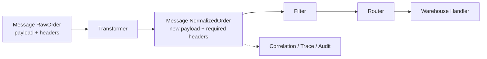
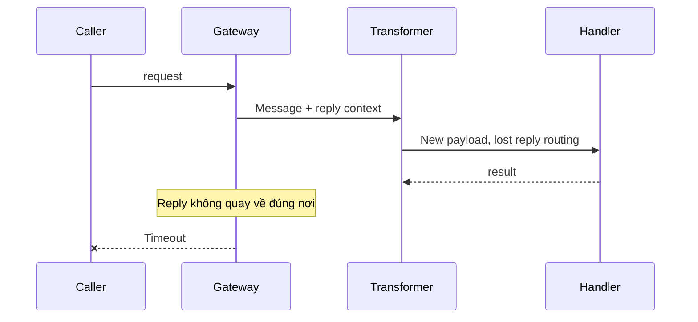
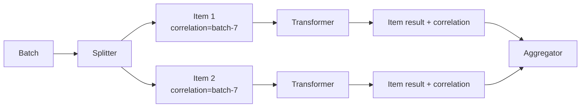
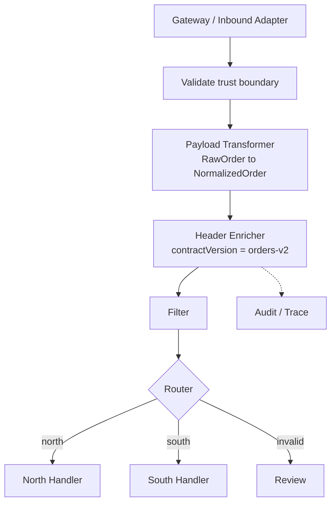
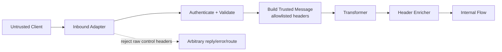
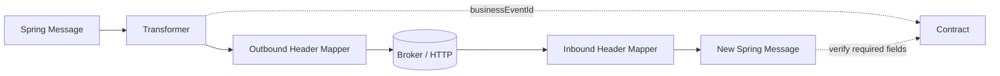
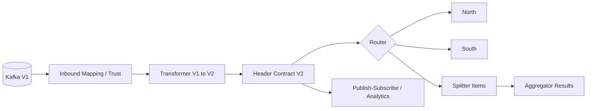

# Giữ hoặc thay đổi headers khi transform

Trong Enterprise Integration Patterns (EIP), **Message Transformer** biến đổi cấu trúc hoặc nội dung của một message để hệ thống phía sau hiểu và xử lý được. Ví dụ, một ứng dụng nhận `OrderReceived` từ API, chuẩn hóa vùng giao hàng và tạo `NormalizedOrder` cho kho. Nhưng message trong Spring Integration không chỉ chứa payload: nó còn có **headers** mang thông tin correlation, reply/error routing, kiểu nội dung, tracing, nguồn dữ liệu và các thuộc tính nghiệp vụ.

Một Transformer có thể chuyển đổi payload đúng mà vẫn khiến toàn bộ luồng thất bại nếu làm mất những header cần thiết. Một Gateway đang chờ reply có thể timeout; Splitter và Aggregator có thể không còn ghép được message theo nhóm; trace qua nhiều endpoint bị đứt; hoặc tệ hơn, một header do client giả mạo được mang nguyên vào bước xử lý có quyền cao.

Vì vậy, bài toán **“Giữ hoặc thay đổi headers khi transform”** không phải đơn giản là “copy tất cả” hay “xóa tất cả”. Ta phải xác định **header nào thuộc hợp đồng cần giữ, header nào cần tạo lại, header nào phải loại bỏ khi đi qua ranh giới tin cậy**.

Bài học thuộc chương **Transformer** của module **SPRING_INTEGRATION_PATTERN**: sử dụng Spring Integration để thực hành các Enterprise Integration Patterns như Router, Filter, Transformer, Splitter, Aggregator, Gateway, retry, error channel và correlation; đồng thời kiểm thử và quan sát những nhánh xử lý ít phụ thuộc, dễ mở rộng.

**Kết quả mong đợi:** Bạn có thể giải thích quy tắc propagation khi Transformer trả payload so với khi tự tạo `Message<?>`; thiết kế hợp đồng headers; sử dụng Java DSL và `MessageBuilder` hợp lý; bảo toàn correlation, định tuyến phản hồi và trace; và kiểm thử các trường hợp headers bị giữ sai, thay sai hoặc làm mất.

## 1. Một Spring Message gồm payload và headers

Trong Spring Messaging, message thường được biểu diễn bằng `Message<T>`:

```text
Message<RawOrder>
├── payload
│   ├── orderId = "ORD-101"
│   ├── region  = " north "
│   └── amount  = 250000
└── headers
    ├── id                 = framework-generated
    ├── timestamp          = framework-generated
    ├── businessEventId    = "evt-101"
    ├── correlationId      = "checkout-101"
    ├── tenantId           = "tenant-a"
    ├── contentType        = application/json
    └── trace context      = ... (nếu đã được cấu hình)
```

Transformer đổi payload, ví dụ từ `RawOrder` sang `NormalizedOrder`, trong khi downstream vẫn cần biết đơn này thuộc sự kiện nào, khách hàng/tenant nào và nhánh nào phải trả lời.



**Điểm phân biệt:** Payload là dữ liệu mà bước hiện tại cần xử lý; headers là metadata đi kèm message. Nhưng việc một giá trị nằm trong header **không làm nó đáng tin cậy hơn**. Header `tenantId` đọc từ HTTP của client vẫn là dữ liệu chưa xác thực nếu ingress chưa kiểm tra.

### Header thường phục vụ ba nhóm trách nhiệm

| Nhóm | Ví dụ | Ai chịu trách nhiệm? |
| --- | --- | --- |
| **Kỹ thuật truyền tin** | `id`, `timestamp`, `replyChannel`, `errorChannel`, `contentType` | Framework, channel, adapter và cấu hình application |
| **Điều phối integration** | `correlationId`, `sequenceNumber`, `sequenceSize`, route/flow metadata | Splitter, Aggregator, Gateway, Router hoặc bước điều phối |
| **Nghiệp vụ và truy vết** | `businessEventId`, `orderId`, `tenantId` đã xác thực, policy version, trace context | Ứng dụng theo hợp đồng và ranh giới tin cậy |

Ba nhóm có quy tắc bảo toàn khác nhau. Không nên mặc định copy mọi header vào mọi hệ thống, nhất là khi message đi qua broker hoặc qua application context khác.

## 2. Transformer trả payload hay trả Message<?> sẽ khác ở đâu?

Trong Spring Integration, hai cách viết Transformer phổ biến là:

**Cách A — trả một payload mới:**

```java
NormalizedOrder normalize(RawOrder input) {
    return new NormalizedOrder(
        input.orderId(),
        input.region().trim().toUpperCase(java.util.Locale.ROOT),
        input.amount()
    );
}
```

Khi Transformer trả một object payload (không phải `Message<?>`), **cơ chế endpoint của Spring Integration tạo message đầu ra từ payload đó và thông thường truyền tiếp các header phù hợp của message đầu vào**. Đây là cách thuận tiện nếu bạn chỉ muốn thay đổi dữ liệu, không muốn tự quản lý metadata kỹ thuật.

**Cách B — tự tạo một Message mới:**

```java
import org.springframework.messaging.Message;
import org.springframework.messaging.support.MessageBuilder;

Message<NormalizedOrder> normalizeMessage(Message<RawOrder> input) {
    RawOrder raw = input.getPayload();
    NormalizedOrder converted = new NormalizedOrder(
        raw.orderId(),
        raw.region().trim().toUpperCase(java.util.Locale.ROOT),
        raw.amount()
    );

    return MessageBuilder.withPayload(converted)
        .setHeader("businessEventId",
            input.getHeaders().get("businessEventId"))
        .setHeader("correlationId",
            input.getHeaders().get("correlationId"))
        .setHeader("contractVersion", "orders-v2")
        .build();
}
```

Khi trả `Message<?>`, bạn **chủ động tạo header trên message trả về**. Những header nào thực sự được giữ còn phụ thuộc vào message builder, cơ chế endpoint và việc framework có bổ sung/ghép header từ request tại điểm xử lý cụ thể hay không. Vì thế, **không được dựa trên giả định rằng tự tạo Message sẽ luôn giữ tất cả, hoặc luôn làm mất tất cả, header đầu vào**. Hãy thể hiện chính sách metadata tường minh và kiểm tra message cuối cùng sau Transformer.

| Khía cạnh | Trả payload | Tự tạo `Message<?>` |
| --- | --- | --- |
| Mục tiêu chính | Chuyển đổi dữ liệu | Chuyển đổi dữ liệu **và** kiểm soát envelope |
| Khả năng giữ headers | Endpoint thường truyền tiếp headers thích hợp | Phụ thuộc headers của Message tạo ra và cách endpoint xử lý nó |
| Độ phức tạp | Thấp, dễ tập trung vào mapping | Cao hơn, cần chú ý header kỹ thuật và bảo mật |
| Thay đổi header | Dùng Header Enricher hoặc component riêng | Có thể đặt/sao chép có chọn lọc khi xây Message |
| Rủi ro | Tự động mang theo header không nên tin qua một boundary | Bỏ sót header cần thiết hoặc copy nhầm header không an toàn |
| Kiểm thử | Assert payload **và** headers đầu ra | Assert rõ allowlist, replacement, omission và propagation |

**Quy tắc thực hành:** Chỉ transform payload thì ưu tiên trả payload. Khi yêu cầu metadata phức tạp, hãy dùng Header Enricher hoặc một bước xây Message có hợp đồng rõ ràng; không trộn logic chuyển đổi dữ liệu với quản trị quyền truy cập chỉ vì mọi thứ đều nằm trong một method.

## 3. Header nào cần giữ nguyên, thay đổi hoặc loại bỏ?

Không nên trả lời bằng một quy tắc chung cho mọi flow. Hãy định nghĩa một **header contract** giữa các endpoint.

| Header / loại metadata | Giữ, thay hay bỏ? | Lý do |
| --- | --- | --- |
| `businessEventId` từ nguồn đã tin cậy | **Giữ** | Dedup, retry và audit xuyên bước |
| `correlationId` dùng chung flow | **Giữ** khi các bước cùng thuộc một correlation scope | Giúp liên kết thông điệp, đặc biệt trước Aggregator |
| `sequenceNumber` / `sequenceSize` | **Giữ** nếu còn thuộc cùng nhóm; **tạo lại** khi tạo nhóm mới | Tránh nhầm sequence ở các phạm vi khác nhau |
| `tenantId` | **Giữ nếu đã được xác thực; tạo lại nếu chưa đáng tin** | Không cho client giả mạo tenant |
| `contentType` | **Cập nhật khi định dạng thực sự đổi** | Tránh parser/adapter hiểu sai payload |
| `contractVersion` / `schemaVersion` | **Cập nhật theo output contract** | Downstream biết phiên bản dữ liệu mới |
| `replyChannel` | **Giữ ở luồng request-reply nội bộ nếu cần và được phép** | Mất reply routing có thể gây gateway timeout |
| `errorChannel` | **Giữ hoặc thay theo chính sách error handling** | Không cho untrusted source điều khiển nơi nhận lỗi |
| Trace context | **Giữ/truyền qua adapter đúng chuẩn** | Liên kết span và log nhiều service |
| `id` / `timestamp` của framework | **Để framework quản lý, không dùng làm business identity** | Có thể phát sinh lại khi tạo message mới |
| Raw HTTP/JMS/Kafka headers | **Allowlist/normalize tại boundary** | Không đưa dữ liệu không tin cậy thành lệnh nội bộ |
| Secret/token hoặc header tạm thời | **Loại khỏi output nếu không cần** | Hạn chế rò rỉ dữ liệu và lạm dụng quyền |

Ba câu hỏi phải trả lời trước khi thay header:

1. Header có **thuộc hợp đồng downstream** hay chỉ là thông tin tạm của bước hiện tại?
2. Giá trị này có **còn đúng sau khi payload đã đổi** không?
3. Nguồn nào đã cấp giá trị và giá trị đó có **đủ tin cậy** để chuyển qua ranh giới mới không?

### Giữ nội dung mà đổi schema phải cập nhật metadata

Nếu input là XML và Transformer tạo JSON, giữ nguyên `contentType=application/xml` là sai ngữ nghĩa, kể cả payload chuyển đổi đúng.

Tương tự, nếu một Transformer đổi payload từ `LegacyOrderV1` sang `OrderV2`, metadata `schemaVersion=v1` không nên được mang qua nguyên trạng nếu downstream dựa vào nó để deserialize.

Ngược lại, việc đổi nội dung không phải lúc nào cũng làm đổi correlation. Một đơn được chuẩn hóa thường vẫn thuộc **cùng business event**, nên `businessEventId` và `correlationId` cần được bảo toàn theo hợp đồng.

## 4. Những lỗi thực tế khi xử lý headers sai

### 4.1. Gateway chờ reply nhưng header điều phối bị mất

Một request-reply Gateway có thể sử dụng thông tin reply routing để nhận phản hồi. Nếu một bước tự tạo message mới hoặc đi qua adapter mà không bảo toàn đúng thông tin reply, request gốc có thể timeout dù handler đã tính được kết quả.



Giải pháp là xác định **request-reply contract** và cơ chế reply channel tại từng endpoint; dùng built-in message handling khi phù hợp và kiểm thử cả đường trả lời. Không nên copy `replyChannel` nhận từ client bên ngoài vào mạng nội bộ: nó có thể tạo đường trả dữ liệu không được phép.

### 4.2. Splitter/Aggregator bị mất correlation

Splitter có thể tạo nhiều message con thuộc một nhóm và mang metadata như `correlationId`, `sequenceNumber`, `sequenceSize`. Một Transformer ở giữa nhận từng phần, đổi payload nhưng không giữ correlation cần thiết có thể làm Aggregator không nhận biết nhóm.



Ngoài chuyện mất header, việc **giữ header đã lỗi thời** cũng nguy hiểm: một Transformer mới tạo ra **một nhóm khác** nhưng tiếp tục dùng sequenceNumber của nhóm cũ. Khi cần tách/ghép lại ở phạm vi mới, phải xác định correlation scope mới và release strategy tương ứng.

### 4.3. Router đọc nhầm header cũ

Một Router có thể chọn nhánh dựa trên header `businessType`. Nếu Transformer đổi payload từ loại A thành B nhưng header vẫn ghi A, Router sẽ đi sai đường.

Ví dụ:

```text
Input:
  payload.type       = LEGACY_EXPRESS
  header.routeClass  = LEGACY

Transformer:
  payload.type       = EXPRESS_V2
  header.routeClass  = LEGACY  <-- đã lỗi thời

Downstream Router:
  routeClass=LEGACY -> chọn nhánh sai
```

Giải pháp: biến đổi dữ liệu **cùng metadata phụ thuộc vào dữ liệu** trong một policy có thể kiểm thử; hoặc tốt hơn, để Router tính route key từ payload đã chuẩn hóa nếu không cần duy trì header routeClass.

### 4.4. Rò rỉ metadata qua broker hoặc hệ thống ngoài

Một header nội bộ như `securityContext`, object `MessageChannel`, token hoặc lỗi chi tiết không nên được serialize nguyên vẹn vào message gửi ra bên ngoài. Không phải mọi adapter đều có thể hoặc nên chuyển toàn bộ header; các mapping mặc định cũng có thể khác nhau.

Nếu một header ngoài được map trở lại nội bộ và được coi là đã xác thực, đây là **đường header injection**. Cần thiết kế **whitelist và nguồn gốc tin cậy** tại inbound/outbound boundary.

### 4.5. Dùng message ID làm khóa chống trùng

Các Transformer hoặc adapter có thể tạo message mới với `id`/`timestamp` khác. Nếu dedup dựa vào message ID ở một điểm nhưng replay từ broker lại tạo ID mới, consumer có thể xử lý trùng.

**Business event ID** hoặc idempotency key ổn định cần được định nghĩa trong hợp đồng, không dùng `MessageHeaders.ID` như một business identity xuyên mọi chặng.

## 5. Hợp đồng headers nên được thể hiện ngay trong thiết kế flow

Ví dụ một luồng chuẩn hóa đơn hàng:



Có thể viết contract tường minh:

| Field | Input expectation | Output expectation |
| --- | --- | --- |
| Payload | `RawOrder` | `NormalizedOrder` |
| `businessEventId` | Bắt buộc, được nguồn tin cậy cấp | Giữ nguyên |
| `correlationId` | Có khi thuộc workflow liên quan | Giữ nguyên scope |
| `tenantId` | Được xác thực/ánh xạ tại ingress | Giữ giá trị đã xác thực |
| `contractVersion` | `orders-v1` hoặc chưa có | `orders-v2` |
| `traceparent` | Có thể có, đã được adapter xử lý theo trust policy | Tiếp tục trace theo instrumentation |
| `contentType` | Theo biểu diễn input | Cập nhật nếu adapter cần một biểu diễn output khác |
| `replyChannel` | Chỉ khi flow nội bộ yêu cầu | Giữ theo hợp đồng request-reply, không export tùy ý |
| `errorChannel` | Theo cấu hình nội bộ | Theo chính sách lỗi của flow |
| Payload fields | Có thể chưa chuẩn hóa | Đáp ứng invariant output |

**Một contract như vậy giúp test chính xác hơn** so với assertion chung “mọi header không được thay đổi”. Trong một số luồng, bỏ một header là đúng; trong luồng khác, giữ nó là bắt buộc.

## 6. Ví dụ Java DSL: transform payload, giữ header cần thiết

Ta xây flow đồng bộ đơn giản trong Spring Integration:

- Gateway nhận `Message<RawOrder>` đã đi qua ingress tin cậy.
- Transformer chuyển `RawOrder` thành `NormalizedOrder`.
- Header Enricher bổ sung version của contract output.
- Message kết quả được đặt vào một `QueueChannel` để test có thể đọc trực tiếp.

### 6.1. Định nghĩa dữ liệu và Transformer thuần Java

```java
import java.math.BigDecimal;
import java.util.Locale;

record RawOrder(
    String orderId,
    String region,
    BigDecimal amount
) {}

record NormalizedOrder(
    String orderId,
    String region,
    BigDecimal amount
) {}

final class OrderNormalizer {

    NormalizedOrder normalize(RawOrder raw) {
        if (raw == null
                || raw.orderId() == null
                || raw.orderId().isBlank()
                || raw.region() == null
                || raw.region().isBlank()
                || raw.amount() == null
                || raw.amount().signum() <= 0) {
            throw new IllegalArgumentException(
                "Invalid RawOrder");
        }

        return new NormalizedOrder(
            raw.orderId().trim(),
            raw.region().trim().toUpperCase(Locale.ROOT),
            raw.amount());
    }
}
```

Hàm `normalize` **chỉ biết payload**, không cần đọc correlation hoặc reply headers. Đây là thiết kế thuận lợi: logic biến đổi dữ liệu có thể unit test độc lập với framework, trong khi flow quản lý envelope và metadata.

### 6.2. Gateway, channel và IntegrationFlow

```java
import org.springframework.context.annotation.Bean;
import org.springframework.context.annotation.Configuration;
import org.springframework.integration.annotation.Gateway;
import org.springframework.integration.annotation.IntegrationComponentScan;
import org.springframework.integration.annotation.MessagingGateway;
import org.springframework.integration.channel.DirectChannel;
import org.springframework.integration.channel.QueueChannel;
import org.springframework.integration.config.EnableIntegration;
import org.springframework.integration.dsl.IntegrationFlow;
import org.springframework.messaging.Message;
import org.springframework.messaging.MessageChannel;
import org.springframework.messaging.PollableChannel;

@MessagingGateway
interface OrderInputGateway {
    @Gateway(requestChannel = "orders.raw")
    void submit(Message<RawOrder> order);
}

@Configuration
@EnableIntegration
@IntegrationComponentScan
class OrderTransformConfiguration {

    @Bean
    OrderNormalizer orderNormalizer() {
        return new OrderNormalizer();
    }

    @Bean("orders.raw")
    MessageChannel rawOrders() {
        return new DirectChannel();
    }

    @Bean("orders.normalized")
    PollableChannel normalizedOrders() {
        // Queue in-memory để bài test đọc; KHÔNG tự bền vững.
        return new QueueChannel();
    }

    @Bean
    IntegrationFlow normalizeOrders(OrderNormalizer normalizer) {
        return IntegrationFlow.from("orders.raw")
            .transform(RawOrder.class, normalizer::normalize)
            .enrichHeaders(spec ->
                spec.header("contractVersion", "orders-v2"))
            .channel("orders.normalized")
            .get();
    }
}
```

Cấu hình này minh họa Java DSL cho các phiên bản Spring Integration có API nêu trên. Ứng dụng cần dependency Spring Integration và cơ chế đăng ký Gateway; `QueueChannel` dùng để quan sát output, không phải broker hoặc message store bền vững.

**Diễn giải:**

1. Gateway gửi message có payload `RawOrder` vào `orders.raw`.
2. Transformer gọi `normalizer.normalize` và trả về `NormalizedOrder`, không tự tạo `Message<?>`.
3. Endpoint chuyển tiếp các header phù hợp của message đầu vào theo cơ chế Spring Integration.
4. Header Enricher đặt metadata `contractVersion=orders-v2` cho output.
5. Message vào `orders.normalized` với payload đã chuẩn hóa.

Lưu ý: `header("contractVersion", "orders-v2")` trong ví dụ dựa trên giả định **input đã được kiểm soát** và không mang một phiên bản độc hại có quyền ưu tiên. Khi cần thay **một header đã tồn tại**, phải dùng chính sách overwrite rõ ràng của Header Enricher và kiểm thử nó; đừng chỉ dựa vào tên method để suy đoán header cũ đã bị thay.

### 6.3. Xây input message trong bài test

```java
import java.math.BigDecimal;
import org.springframework.messaging.Message;
import org.springframework.messaging.support.MessageBuilder;

Message<RawOrder> input = MessageBuilder
    .withPayload(new RawOrder(
        " ORD-101 ",
        " north ",
        new BigDecimal("250000")))
    .setHeader("businessEventId", "evt-101")
    .setHeader("correlationId", "checkout-101")
    .setHeader("tenantId", "tenant-a")
    .build();

gateway.submit(input);

Message<?> output = normalizedOrders.receive(1000);
// Assertion:
// output.getPayload() là NormalizedOrder.
// businessEventId, correlationId, tenantId vẫn theo contract.
// contractVersion là orders-v2.
```

`gateway` và `normalizedOrders` trong đoạn này là các bean được inject vào test fixture, không phải biến có sẵn trong class cấu hình. Đây là **phác thảo cách gọi**, phần integration test đầy đủ được trình bày ở mục kiểm thử bên dưới.

**Chú ý bảo mật:** Trong ví dụ test, `tenantId` được đặt sẵn để thử propagation. Với request HTTP thật, không nên đưa thẳng `tenantId` do client gửi vào channel tin cậy; phải lấy từ principal/claims đã được kiểm tra ở ingress.

## 7. Khi cần thay header: Header Enricher hay MessageBuilder?

Có hai hướng thường gặp:

**Header Enricher:** Phù hợp khi Transformer chủ yếu đổi payload, còn thay đổi metadata được tách thành một bước dễ quan sát. Có thể khai báo các header output, tính giá trị bằng logic phía server, và xác định hành vi nếu header đã có.

**MessageBuilder:** Phù hợp khi cần tạo một message mới với tập headers có kiểm soát hoặc cần tách hẳn message từ nguồn không tin cậy.

### 7.1. Bổ sung metadata bằng Header Enricher

Với luồng đã kiểm soát từ đầu, có thể thêm các header mô tả payload mới:

```java
@Bean
IntegrationFlow normalizeAndVersion(OrderNormalizer normalizer) {
    return IntegrationFlow.from("orders.raw")
        .transform(RawOrder.class, normalizer::normalize)
        .enrichHeaders(spec -> spec
            .header("schemaVersion", "2")
            .header("transformationName", "normalize-order"))
        .channel("orders.normalized")
        .get();
}
```

Đoạn này là **một phương án thay thế** cho bean `normalizeOrders`, không chạy đồng thời hai flow cạnh tranh trên cùng input channel trong ví dụ. Nếu cần ghi đè header cũ, phải kiểm tra cấu hình overwrite và nguồn phát header. Một transformer output schema v2 mà vẫn giữ `schemaVersion=1` là sai; do đó test phải khẳng định giá trị thực sự sau khi enrich.

### 7.2. Tạo Message mới với allowlist rõ ràng

Khi đi qua một ranh giới tin cậy hoặc muốn **giới hạn headers chuyển tiếp**, có thể tạo message với những trường được phép thay vì sao chép toàn bộ.

```java
import org.springframework.messaging.Message;
import org.springframework.messaging.support.MessageBuilder;

final class TrustedOrderEnvelopeMapper {
    private final OrderNormalizer normalizer =
        new OrderNormalizer();

    Message<NormalizedOrder> convert(
            Message<RawOrder> incoming,
            String verifiedTenantId) {

        // verifiedTenantId phải từ security context/policy tin cậy.
        if (verifiedTenantId == null
                || verifiedTenantId.isBlank()) {
            throw new IllegalArgumentException(
                "Missing verified tenant");
        }

        Object eventId =
            incoming.getHeaders().get("businessEventId");
        if (!(eventId instanceof String id) || id.isBlank()) {
            throw new IllegalArgumentException(
                "Missing trusted businessEventId");
        }

        NormalizedOrder output =
            normalizer.normalize(incoming.getPayload());

        MessageBuilder<NormalizedOrder> builder =
            MessageBuilder.withPayload(output)
                .setHeader("businessEventId", eventId)
                .setHeader("tenantId", verifiedTenantId)
                .setHeader("contractVersion", "orders-v2");

        Object correlation =
            incoming.getHeaders().get("correlationId");
        if (correlation != null) {
            builder.setHeader("correlationId", correlation);
        }

        return builder.build();
    }
}
```

Hàm này chủ động chỉ đưa qua `businessEventId`, `tenantId` đã xác thực, `correlationId` nếu có và phiên bản contract mới. **Nó không mang tất cả technical headers**; do đó phù hợp khi ta muốn tạo envelope mới theo chính sách riêng, **không mặc nhiên phù hợp trong mọi luồng request-reply, Splitter/Aggregator hoặc trace**.

Đoạn code không có HTTP security implementation thật. `verifiedTenantId` phải được cấp từ một component đã xác thực; nếu lấy lại từ `incoming.getHeaders().get("tenantId")` không kiểm tra, chính sách bảo mật chưa được thực hiện.

### 7.3. Vì sao copyHeaders từ input không phải lúc nào cũng an toàn?

Một cách viết ngắn thường gặp:

```java
Message<NormalizedOrder> result = MessageBuilder
    .withPayload(normalized)
    .copyHeaders(incoming.getHeaders())
    .build();
```

Đoạn trên **chỉ phù hợp khi toàn bộ headers đầu vào được tin cậy và hợp đồng yêu cầu**. Nếu message đến từ nguồn ngoài, nó có thể chứa các header không nên chuyển qua: quyền hạn tự khai, routing hint, reply/error channel, nội dung nhạy cảm hoặc metadata transport.

Việc sao chép hàng loạt còn có thể đưa theo `id`, `timestamp` hoặc metadata đã cũ. Không nên hứa rằng ID/timestamp sẽ luôn được giữ hay luôn được cấp mới theo một quy tắc tự viết; để framework quản lý chúng và dùng **business event ID riêng** khi cần idempotency.

**Nếu chỉ cần đổi một vài header trên cùng payload**, có thể dùng `MessageBuilder.fromMessage(original).setHeader(...)`, nhưng khi thay đổi *kiểu payload*, cách rõ nhất vẫn là tạo message từ payload mới và áp dụng contract metadata cần giữ. Luôn test kết quả thực tế của endpoint có tham gia Spring Integration, không chỉ test object do builder tạo trước khi gửi.

## 8. Những header kỹ thuật phải hiểu trước khi chạm vào

### 8.1. `id` và `timestamp`

Chúng thường do framework tạo để mô tả một message cụ thể. Khi message được tạo lại bởi Transformer, builder hoặc adapter, giá trị có thể khác. **Không dùng message ID để kết nối hai hệ thống theo một giao dịch nghiệp vụ dài**. Thay vào đó, định nghĩa `businessEventId` hoặc `requestId` ổn định.

Khi ghi log, có thể lưu cả message ID và business ID, nhưng phải biết chúng phục vụ các lớp định danh khác nhau.

### 8.2. `replyChannel` và `errorChannel`

`replyChannel` phục vụ phản hồi theo cơ chế messaging; `errorChannel` xác định hoặc hỗ trợ đường xử lý lỗi theo cấu hình. Chúng có thể được biểu diễn bằng đối tượng channel hoặc tên tùy cơ chế, và không phải header nào cũng có thể serialize qua broker.

Giữ chúng khi **flow nội bộ thật sự cần**, nhưng tránh copy hoặc tin các giá trị do client bên ngoài tự chỉ định. Nếu Transformer nằm giữa Gateway và endpoint trả lời, phải kiểm thử request-reply, kể cả timeout và exception.

### 8.3. `correlationId`, `sequenceNumber` và `sequenceSize`

Splitter có thể đánh dấu những message con để Aggregator ghép lại. Khi Transformer biến đổi **từng phần** mà vẫn thuộc nhóm cũ, việc giữ correlation/sequence theo hợp đồng là cần thiết.

Nếu Transformer biến một item thành một nhóm hoàn toàn khác, cần xác định lại correlation scope. Không nên tái sử dụng `sequenceNumber=2` của một nhóm cũ làm “version nghiệp vụ” hoặc thứ tự của một stream mới.

### 8.4. `contentType` và schema metadata

Những header này thường phục vụ serializer/deserializer hoặc router. Nếu Transformer chỉ đổi Java object nội bộ nhưng adapter downstream mới chuyển sang JSON, có thể **chưa nên** tuyên bố content type là JSON ở bước quá sớm. Hãy cập nhật metadata ở ranh giới mà **biểu diễn dữ liệu thực sự thay đổi**, không chỉ vì lớp Java đã đổi.

### 8.5. Trace context và baggage

Thông tin tracing có thể tồn tại trong thread context, message headers hoặc carrier của adapter tùy instrumentation. Chỉ copy một header tên `traceId` không tự bảo đảm context được nối đúng qua executor hoặc broker.

Cần cấu hình propagation qua ranh giới; kiểm thử log/span correlation trong async flow và tránh đưa dữ liệu nhạy cảm vào baggage. Khi trace sampling bỏ một sự kiện, audit bền vững vẫn cần cơ chế riêng.

## 9. Header filtering ở ranh giới tin cậy

Ở inbound adapter, **không sao chép raw headers từ HTTP/Kafka/JMS vào các header điều khiển nội bộ một cách vô điều kiện**. Một client có thể gửi:

```text
tenantId: other-tenant
replyChannel: privileged-output
errorChannel: internal-admin-errors
routingSlip: ["skip-auth", "reserve-inventory"]
```

Không nên coi bất kỳ giá trị nào trong ví dụ trên là quyền định tuyến hay ủy quyền thực sự.

Giải pháp cần xét:

1. **Xác thực source** và gắn `tenantId`/principal từ security context đã kiểm tra.
2. **Allowlist header dữ liệu** được chuyển từ inbound vào nội bộ: ví dụ `externalRequestId` đã giới hạn độ dài, media type được kiểm tra.
3. **Tạo lại hoặc ghi đè header kỹ thuật tin cậy** từ chính server, không để client quyết định `replyChannel`, `errorChannel`, routing slip hay đích nội bộ.
4. **Giới hạn kiểu/độ dài** trước khi ghi log, serialize hoặc map thành thuộc tính.
5. **Kiểm soát outbound header mapping**: chỉ đẩy sang hệ thống ngoài những giá trị cần thiết, tránh lộ cấu trúc channel nội bộ.
6. **Giữ correlation sau khi đã xác thực** và không vô tình xóa nó ở những bước nội bộ tiếp theo.

Tính an toàn nằm ở **điểm dựng ranh giới tin cậy**, không phải cứ thêm một Transformer cuối cùng để xóa toàn bộ header. Xóa ở sai điểm có thể phá Gateway hoặc Aggregator.



## 10. Transformer và Filter, Router: đừng làm metadata mâu thuẫn payload

Một Filter có thể kiểm tra `tenantId` hoặc `currency` ở header, còn Transformer lại thay payload liên quan. Nếu hai nguồn thông tin không đồng bộ, Filter có thể chấp nhận dữ liệu mà Router đưa tới nơi không phù hợp.

Ví dụ:

```text
RawOrder.region = " north "
header.region   = "SOUTH"

Transformer:
  NormalizedOrder.region = "NORTH"
  header.region vẫn = "SOUTH"

Router chọn theo header.region -> SOUTH
```

Hai cách tránh:

- **Dùng một nguồn sự thật rõ ràng:** Router/Filter đọc region đã chuẩn hóa từ payload.
- **Nếu phải dùng header để route:** cập nhật header từ giá trị được server tính ra sau normalize, thay vì tin một header cũ.

Với Transformer chỉ đổi payload, message headers có thể được giữ theo cơ chế của framework. Đó là tiện lợi khi metadata không thay đổi ngữ nghĩa, nhưng cũng là lý do **phải rà soát những header phụ thuộc vào nội dung**.

### Khi Filter loại message sau transform

Nếu Filter loại `NormalizedOrder` vì không hỗ trợ region, nhánh discard cần biết `businessEventId`, `correlationId` và reason code. Nếu Transformer đã làm mất business ID, hệ thống khó xác định message nào bị loại.

Một giải pháp là để validation tạo kết quả có cấu trúc `CandidateCheck` trước Filter; rồi discard flow nhận chính kết quả ấy. **Header retention không tự tạo reason code**; hai nhiệm vụ cần hợp đồng riêng.

### Khi Router hoặc Routing Slip dựa trên headers

Một header route key chỉ nên được tạo bởi policy tin cậy. Không để client gửi `nextChannel` rồi giữ nguyên qua Transformer tới Router có thể tạo điều hướng tùy ý. Nếu dynamic route phụ thuộc vào version policy, hãy ghi version và reason code cùng quyết định, không mù quáng tin header do upstream không đáng tin cậy gửi.

## 11. Headers qua Splitter, Aggregator và Publish-Subscribe

### 11.1. Splitter: bảo toàn correlation khi biến đổi item

Một batch có ba item, Splitter phát ba message với correlation metadata. Mỗi item đi qua Transformer đổi `LegacyItem` thành `NormalizedItem`.

**Yêu cầu:** Các message biến đổi vẫn thuộc đúng nhóm, trừ khi ứng dụng có chủ đích lập nhóm mới. Nếu correlation hoặc sequence bị mất, Aggregator có thể chờ đến timeout hoặc gom nhầm nhóm.

### 11.2. Aggregator: header output không nhất thiết là toàn bộ header input

Aggregator nhận nhiều message; khi release nhóm, output có thể có header được tổng hợp hoặc chọn theo chiến lược của nó. Không nên giả định **mọi header của mọi thành viên** sẽ tự xuất hiện nguyên vẹn trên message kết quả.

Khi cần `tenantId`, `correlationId` hoặc policy version trên kết quả tổng hợp, hãy xác định **hợp đồng output** của Aggregator và kiểm tra nhóm không trộn dữ liệu từ các tenant khác nhau. Sau Aggregator, một Transformer tiếp theo phải dựa vào headers thực có, không suy diễn từ một item ban đầu.

### 11.3. Publish-Subscribe và Recipient List

Hai cơ chế này có thể phân phối cùng message tới nhiều nhánh. Nếu payload là một object mutable, các handler trong cùng JVM có thể cùng tham chiếu payload; việc Transformer ở một nhánh sửa object tại chỗ sẽ ảnh hưởng nhánh khác.

Ưu tiên **payload bất biến** hoặc tạo bản sao độc lập. Headers của Spring Message cũng được quản lý theo cơ chế bất biến/copy khi tạo message mới; không nên cố sửa trực tiếp object header của message đã phát.

Nếu mỗi subscriber cần schema riêng, để mỗi nhánh Transformer tạo payload/header theo contract của nhánh đó, thay vì áp một output contract chung không phù hợp.

## 12. Transformer với retry, error channel và idempotency

**Transform thất bại** khác với **Filter từ chối message**. Ví dụ `OrderNormalizer.normalize` ném `IllegalArgumentException` vì dữ liệu sai; đó là exception ở bước transform, không tự động chuyển message tới discard channel của một Filter khác.

| Tình huống | Hành vi cần thiết kế |
| --- | --- |
| Payload không parse được | Ghi lỗi/đường review hoặc báo 4xx theo contract, tránh retry vô hạn |
| Header bắt buộc bị thiếu | Reject hoặc dừng với lỗi có cấu trúc; không tạo business ID giả không ổn định |
| Transformer gọi service ngoài và timeout | Retry có giới hạn, đối soát nếu có side effect |
| Header lỗi thời làm Router chọn sai | Sửa header contract và test; không chỉ thêm fallback |
| Async transform thất bại | Error handler, error channel, retry/dead-letter theo cấu hình |
| Message bị redelivery | Giữ `businessEventId` hoặc idempotency key, tránh side effect lặp |
| Message đã qua transform rồi replay từ đầu | Version/schema migration rõ ràng, tránh transform hai lần ngoài dự kiến |

Trong `DirectChannel`, exception thường có thể truyền về sender đồng bộ. Trong executor, poller hoặc inbound adapter, lỗi có thể được bắt và công bố thành `ErrorMessage` nếu cơ chế tương ứng được cấu hình. **Chỉ tạo một bean tên `errorChannel` không bảo đảm mọi exception tự tới đó**.

### Retry không nên làm metadata mất ổn định

Giả sử Transformer tạo `businessEventId` bằng `UUID.randomUUID()` mỗi lần chạy. Khi broker redeliver message, event ID sẽ đổi, khiến dedup ở downstream không nhận diện hai lần là cùng một sự kiện.

Một business ID ổn định nên được cấp ở một ranh giới nguồn có kiểm soát và được giữ khi transform. Ngược lại, `transformAttemptId` có thể tạo mới cho mỗi lần thử nếu chỉ phục vụ quan sát; nó không được thay thế idempotency key.

### Không tạo side effect trong Transformer nếu không cần thiết

Transformer lý tưởng là bước biến đổi dữ liệu thuần, dễ retry. Nếu nó vừa đổi payload vừa gọi API thanh toán hoặc cập nhật database, việc retry từ trước Transformer có thể tạo side effect trùng.

Nên tách biến đổi dữ liệu khỏi endpoint thực thi side effect; dùng Service Activator/handler và chính sách idempotency/transaction phù hợp. Khi buộc phải gọi service ngoài để enrich dữ liệu, ghi rõ timeout, cache, retry và đường lỗi.

## 13. Xuyên ranh giới transport: header không tự tồn tại mãi

Trong cùng một ứng dụng Spring Integration, header thường đi theo `Message<?>` qua các bước như Transformer, Filter và Router theo cơ chế framework. Nhưng khi chuyển sang HTTP, Kafka, AMQP hoặc JMS, **header mapper, serialization và giới hạn transport** quyết định điều gì thực sự đi qua.

Một số header là object Java nội bộ, không có ý nghĩa ở hệ thống khác. Một số header không được phép serialize hoặc bị mapper bỏ theo mặc định. Message ID, correlation ID hoặc timestamp bên ngoài có thể có semantics khác header nội bộ.



Ví dụ hợp đồng xuyên service:

```json
{
  "eventId": "evt-101",
  "orderId": "ORD-101",
  "schemaVersion": "orders-v2",
  "correlationId": "checkout-101",
  "payload": {
    "region": "NORTH",
    "amount": 250000
  }
}
```

Đây là một **event envelope JSON minh họa**; không phải Spring Message được serialize tự động theo đúng cấu trúc trên. Đối với các trường thiết yếu để truy vết, idempotency và schema, có thể đặt chúng vào envelope bền vững đã được xác minh, thay vì phụ thuộc vào một header có thể mất khi qua adapter.

**Quy tắc:** tại mỗi transport boundary, hãy kiểm tra **outbound mapping → wire format → inbound mapping**, thay vì chỉ unit test Transformer trong cùng JVM.

## 14. Quan sát biến đổi payload và metadata

Một log transform có ích nên giải thích input/output contract mà không ghi dữ liệu nhạy cảm:

```json
{
  "event": "message_transformed",
  "businessEventId": "evt-101",
  "correlationId": "checkout-101",
  "transformer": "order-normalizer",
  "inputContract": "orders-v1",
  "outputContract": "orders-v2",
  "result": "SUCCESS"
}
```

Nếu transform lỗi, ghi loại lỗi và vị trí; nếu một header bắt buộc bị mất, ghi reason như `MISSING_CORRELATION_ID` hoặc `UNTRUSTED_TENANT_HEADER` (theo taxonomy ứng dụng), không log payload đầy đủ.

Một số metric gợi ý:

```text
transform_messages_total{transformer="order-normalizer",result="success"}
transform_messages_total{transformer="order-normalizer",result="error"}
transform_header_contract_violations_total{header="correlationId"}
transform_duration_seconds{transformer="order-normalizer"}
```

Đây là **tên metric thiết kế**, không phải mặc định Spring Integration tự phát sinh. Không đặt `businessEventId` hay `correlationId` vào metric tag vì cardinality cao; dùng chúng trong log/trace/audit với kiểm soát truy cập.

### Tại sao không log toàn bộ headers?

Một message có thể chứa token, địa chỉ, trace baggage, đối tượng channel hoặc thông tin tenant. Ghi toàn bộ header map vào log có thể lộ dữ liệu hoặc khiến log không serialize được.

Nên log **allowlist fields**: transformer name, input/output schema, correlation/business ID đã được xác minh, reason code và trạng thái. Với lỗi quan trọng, audit record cần chính sách retention và độ bền riêng; log thông thường không tự là audit bền vững.

## 15. Kiểm thử hợp đồng headers sau Transformer

Kiểm thử tốt không chỉ xác minh payload đã đổi đúng. Cần assert **metadata cần giữ, metadata cần đổi và metadata không được lọt qua**.

### 15.1. Ma trận kiểm thử

| Trường hợp | Điều cần xác minh |
| --- | --- |
| Input hợp lệ | Payload `RawOrder` → `NormalizedOrder` |
| Có `businessEventId` | Output giữ nguyên business event ID |
| Có `correlationId` | Output còn correlation với cùng scope |
| Có verified `tenantId` | Output giữ đúng tenant đã được kiểm tra |
| Output schema v2 | `contractVersion`/`schemaVersion` là v2 theo overwrite policy |
| Input có header chỉ dành cho transport ngoài | Không mang vào nội bộ nếu header không được allowlist |
| Có `replyChannel` ở flow request-reply | Reply vẫn tới Gateway, không timeout |
| Có `errorChannel` tin cậy | Error handling đi đúng nơi theo cấu hình |
| Sau Splitter | Sequence/correlation còn hợp lệ trước Aggregator |
| Transform dữ liệu cần cập nhật route key | Router chọn theo payload/header đã chuẩn hóa, không theo giá trị cũ |
| Message qua broker | Required headers/envelope tồn tại sau mapping hai chiều |
| Redelivery cùng event | Idempotency key không đổi qua transform/retry |
| Transform exception | Không được ghi thành discard nghiệp vụ nếu chưa có Filter quyết định |
| Header client giả mạo | Không biến thành tenant/reply/route nội bộ hợp lệ |

### 15.2. Unit test Transformer thuần Java

```java
import static org.junit.jupiter.api.Assertions.*;
import java.math.BigDecimal;
import org.junit.jupiter.api.Test;

class OrderNormalizerTest {

    private final OrderNormalizer normalizer =
        new OrderNormalizer();

    @Test
    void normalizesRegionAndOrderId() {
        NormalizedOrder result = normalizer.normalize(
            new RawOrder(" ORD-101 ", " north ",
                new BigDecimal("250000")));

        assertEquals("ORD-101", result.orderId());
        assertEquals("NORTH", result.region());
        assertEquals(new BigDecimal("250000"), result.amount());
    }

    @Test
    void rejectsInvalidAmount() {
        assertThrows(IllegalArgumentException.class,
            () -> normalizer.normalize(
                new RawOrder("ORD-102", "south", BigDecimal.ZERO)));
    }
}
```

Các test này chỉ kiểm tra **mapping payload**; chưa biết header nào được giữ. Header propagation phải được test tại flow.

### 15.3. Integration test với Gateway và QueueChannel

Với `OrderTransformConfiguration` ở mục 6, sử dụng Spring test fixture để inject `OrderInputGateway` và `orders.normalized`:

```java
import static org.junit.jupiter.api.Assertions.*;

import java.math.BigDecimal;
import org.junit.jupiter.api.Test;
import org.springframework.messaging.Message;
import org.springframework.messaging.support.MessageBuilder;

// Phác thảo test trong Spring test fixture:
// gateway = bean OrderInputGateway
// normalizedOrders = bean PollableChannel "orders.normalized"
class OrderHeaderIntegrationTest {

    OrderInputGateway gateway;           // inject trong fixture
    org.springframework.messaging.PollableChannel normalizedOrders;

    @Test
    void preservesBusinessHeadersAfterPayloadTransform() {
        Message<RawOrder> input = MessageBuilder
            .withPayload(new RawOrder(
                " ORD-101 ", " north ",
                new BigDecimal("250000")))
            .setHeader("businessEventId", "evt-101")
            .setHeader("correlationId", "checkout-101")
            .setHeader("tenantId", "tenant-a")
            .build();

        gateway.submit(input);

        Message<?> received = normalizedOrders.receive(1000);
        assertNotNull(received);
        assertInstanceOf(NormalizedOrder.class,
            received.getPayload());

        NormalizedOrder output =
            (NormalizedOrder) received.getPayload();
        assertEquals("NORTH", output.region());
        assertEquals("evt-101",
            received.getHeaders().get("businessEventId"));
        assertEquals("checkout-101",
            received.getHeaders().get("correlationId"));
        assertEquals("tenant-a",
            received.getHeaders().get("tenantId"));
        assertEquals("orders-v2",
            received.getHeaders().get("contractVersion"));
    }
}
```

Đây là **phác thảo integration test**: cần cấu hình Spring Test/JUnit và inject thực tế hai bean vào fixture; không phải class độc lập có thể chạy mà không có application context. Trước khi chạy test, nên có một flow/consumer được cấu hình phù hợp và bảo đảm queue không chứa message từ test khác.

**Không assert rằng `received.getHeaders().getId()` phải bằng message ID đầu vào.** Đây không phải hợp đồng nghiệp vụ mà ta muốn bảo toàn.

### 15.4. Test một Message Transformer tạo envelope có allowlist

Với `TrustedOrderEnvelopeMapper` ở mục 7, tạo input chứa cả header nguy hiểm:

```java
Message<RawOrder> input = MessageBuilder
    .withPayload(new RawOrder(
        "ORD-101", "north", new BigDecimal("250000")))
    .setHeader("businessEventId", "evt-101")
    .setHeader("correlationId", "checkout-101")
    .setHeader("tenantId", "forged-tenant")
    .setHeader("routingSlip", "internal.admin")
    .build();

Message<NormalizedOrder> output =
    mapper.convert(input, "verified-tenant");

// Trong test:
// tenantId phải là "verified-tenant"
// businessEventId và correlationId phải được giữ
// routingSlip độc hại không có trong Message do mapper tạo ra
```

Đoạn này là phần test cho **kết quả trực tiếp của mapper**. Nếu mapper được đặt vào một endpoint Spring Integration, vẫn cần integration test tại **output của endpoint/adapter thật** để xác nhận framework và các bước tiếp theo không tự gộp lại header đầu vào ngoài ý muốn. Đặc biệt với thông tin điều hướng có quyền, không nên chỉ dựa vào “MessageBuilder không set header đó” rồi bỏ qua kiểm tra tại trust boundary.

### 15.5. Test xuyên transport và bất đồng bộ

Với Kafka, JMS, AMQP, HTTP hoặc queue/poller bất đồng bộ:

- Gửi event có `businessEventId`, correlation và schema version qua adapter thực trong môi trường test.
- Đọc message ở consumer và kiểm tra đúng required fields/headers sau mapping.
- Cho consumer ném exception; xác minh nơi lỗi được bắt, ack/retry/dead-letter và việc giữ event ID.
- Giả lập redelivery; test idempotency và version migration.
- Khi có Splitter/Aggregator, assert kết quả được ghép đúng và không thiếu correlation.
- Khi trace được bật, kiểm tra trace context qua thread/broker và tránh khẳng định trace sampling luôn lưu mọi event.

## 16. Những sai lầm thường gặp

**“Transformer chỉ biến payload nên headers luôn không đổi.”** Khi trả payload, framework thường chuyển tiếp headers thích hợp; nhưng Header Enricher, MessageBuilder, endpoint và adapter có thể làm khác. Không được bỏ qua contract đầu ra.

**“Trả `Message<?>` tức là tự động giữ mọi header.”** Hành vi còn phụ thuộc object trả về và cách framework xử lý. Hãy kiểm tra output thực tế.

**“Copy toàn bộ headers là an toàn nhất.”** Nó có thể mang theo metadata không tin cậy hoặc lỗi thời, gồm reply/error/routing hints và dữ liệu nhạy cảm.

**“Đổi payload từ v1 lên v2 mà giữ `schemaVersion=v1`.”** Header mâu thuẫn với dữ liệu sẽ khiến downstream parse hoặc route sai.

**“Xóa hết headers giúp tránh lỗi.”** Mất business ID, correlation, reply/error metadata hoặc trace có thể làm quy trình khó hoặc không thể hoàn thành.

**“Spring Message ID là event ID.”** ID framework không phải idempotency key ổn định qua mọi Transformer, broker hay replay.

**“`sequenceNumber` của Splitter cũng là version nghiệp vụ.”** Sequence của nhóm và version của aggregate là hai phạm vi khác nhau.

**“Thay header `tenantId` bằng giá trị từ client vì header có sẵn.”** Header từ untrusted source không chứng minh quyền; cần nguồn đã xác thực.

**“Header `contentType` không cần đổi khi payload/serialization đổi.”** Nếu transport dựa trên content type, metadata sai sẽ gây lỗi hợp đồng.

**“Error channel sẽ nhận mọi lỗi Transform dù không cấu hình.”** Phụ thuộc cơ chế bắt/công bố lỗi và loại channel; lỗi đồng bộ có thể truyền về caller.

**“Unit test output payload đủ chứng minh flow đúng.”** Cần test giữ/thay/bỏ headers, request-reply, correlation và transport boundaries.

**“Có trace ID trong một header là đã nối được trace phân tán.”** Cần propagation/instrumentation đúng qua executor và adapter, đồng thời không dùng trace sampling làm audit bắt buộc.

## 17. Bài tập thiết kế: chuyển đổi đơn hàng v1 sang v2

Một hệ thống nhận sự kiện `OrderCreatedV1` qua Kafka, normalize thành `OrderCreatedV2` rồi dùng Router đưa đến kho phù hợp. Một nhánh analytics nhận sự kiện qua Publish-Subscribe, còn một flow khác dùng Splitter để tách item và Aggregator để tổng hợp kết quả.

Yêu cầu:

1. Mỗi sự kiện có `eventId` ổn định để consumer dedup khi Kafka redeliver.
2. `tenantId` phải lấy từ mapping đã xác thực của producer/topic, không từ header tùy ý.
3. `correlationId` cần giữ để nối trace xử lý đơn và nhóm item.
4. `schemaVersion` phải từ v1 sang v2 đúng thời điểm.
5. Một header `legacyRoute` không còn phù hợp phải được bỏ hoặc thay theo policy, không được khiến Router đi nhầm kho.
6. Không serialize đối tượng `replyChannel` hoặc `errorChannel` nội bộ ra broker.
7. Nếu Transformer lỗi vì dữ liệu sai, message được xử lý theo error/review policy; không giả định Filter discard tự chạy.
8. Khi replay sự kiện, idempotency không phụ thuộc vào Spring Message ID mới sinh.



Hãy trả lời các câu hỏi:

1. Những header nào nên ở payload/event envelope để sống sót qua adapter?
2. Vì sao không nên gọi `copyHeaders` trên mọi incoming Kafka header?
3. Nếu Gateway đang chờ reply, có thể thay `replyChannel` tùy ý theo client không?
4. Nếu Transformer trả payload mới, còn header `legacyRoute` lỗi thời thì dùng cách nào đổi hoặc loại nó?
5. Nếu một branch analytics không cần `tenantId`, có nên gửi nguyên header ấy sang branch đó không?
6. Nếu Splitter tạo các message con rồi Transformer của từng item tạo `Message<?>` mới, cần test những metadata nào trước Aggregator?
7. Khi output schema đổi, test nào sẽ phát hiện header `schemaVersion` chưa được cập nhật?
8. Khi Kafka redeliver cùng event với Spring Message ID khác, khóa dedup ở downstream là gì?

**Tiêu chí đạt:** Có bảng hợp đồng input/output headers, ranh giới tin cậy rõ ràng, Transformer trả payload hoặc Message theo lý do cụ thể, schema/correlation/idempotency được giữ đúng, các header điều khiển không bị giả mạo và có integration tests kiểm tra qua adapter thực.

## 18. Checklist trước khi đưa Transformer vào production

- [ ] Đã liệt kê các header **bắt buộc giữ** qua bước transform.
- [ ] Đã liệt kê các header **phải đổi** khi schema, content type hoặc route key thay đổi.
- [ ] Đã liệt kê các header **không được chuyển** ra ngoài trust boundary.
- [ ] Transformer trả payload khi chỉ cần mapping dữ liệu, thay vì tự tạo Message không cần thiết.
- [ ] Khi tạo `Message<?>`, có allowlist/merge policy rõ và test tại output endpoint.
- [ ] `businessEventId` hoặc idempotency key ổn định qua retry/replay.
- [ ] `correlationId` và metadata nhóm đúng khi dùng Splitter/Aggregator.
- [ ] `replyChannel`/`errorChannel` được kiểm tra trong flow yêu cầu chúng.
- [ ] `tenantId`, role và metadata quyền không được lấy nguyên từ client.
- [ ] `schemaVersion` và `contentType` mô tả đúng dữ liệu thực tế ở downstream.
- [ ] Outbound/inbound header mapper được kiểm tra khi qua Kafka/JMS/AMQP/HTTP.
- [ ] Có test cho accepted, rejected/exception, async/retry và transport boundary phù hợp.
- [ ] Structured logs/metrics chỉ ghi metadata cần thiết, không lộ dữ liệu nhạy cảm.
- [ ] Rõ điểm nào là transform thành công, điểm nào là dispatch/side effect hoàn tất.

## Ghi nhớ

**Giữ hoặc thay đổi headers khi transform** là một phần của **hợp đồng message**, không phải chi tiết phụ. Trong Spring Integration, Transformer trả payload thường được endpoint tạo message mới và truyền tiếp các header phù hợp; khi tự tạo `Message<?>`, phải kiểm soát rõ những header của message mới và kiểm tra cơ chế xử lý thực tế.

Hãy **giữ business event ID và correlation khi ngữ nghĩa còn nguyên**, **cập nhật schema/content type hoặc route key khi dữ liệu đã đổi**, **loại bỏ/không tin metadata điều khiển từ nguồn không đáng tin** và để framework quản lý các header kỹ thuật như message ID. Kết hợp Header Enricher, MessageBuilder có chọn lọc, kiểm thử request-reply, Splitter/Aggregator, Router, error channel và adapter boundary để luồng Transformer vừa đúng dữ liệu vừa đúng thông tin điều phối, có thể truy vết và mở rộng an toàn.

