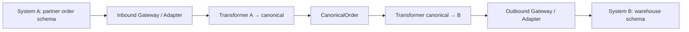
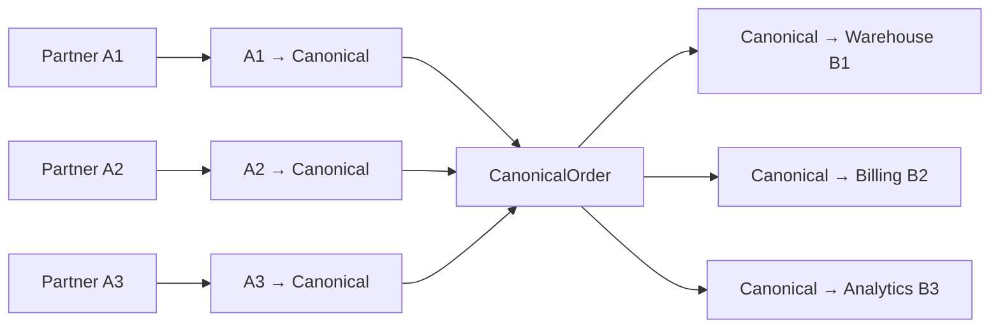
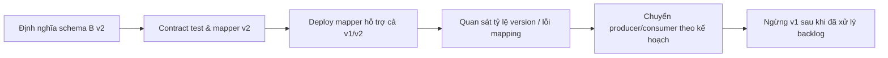

# Chuyển đổi schema giữa hai hệ thống

> **Chương:** Transformer  
> **Module:** `SPRING_INTEGRATION_PATTERN` — học triển khai Enterprise Integration Patterns với Spring Integration để xây dựng luồng thông điệp ít phụ thuộc và dễ mở rộng. Thực hành Router, Filter, Transformer, Splitter, Aggregator, Gateway, retry, error channel, correlation, đồng thời kiểm thử và theo dõi các nhánh xử lý. Bài này tập trung vào **Message Translator/Transformer chuyển dữ liệu giữa hai schema khác nhau** mà không để hai hệ thống phụ thuộc trực tiếp vào cấu trúc nội bộ của nhau.

## 1. Mục tiêu học tập

Sau bài học, bạn có thể:

1. Giải thích vấn đề **schema mismatch** giữa hai hệ thống và vai trò của **Message Transformer** trong Enterprise Integration Patterns (EIP).
2. Phân biệt **đổi tên trường/cấu trúc** với **chuyển đổi ngữ nghĩa**, ví dụ số tiền theo đơn vị nhỏ, múi giờ, enum, trường bắt buộc và đơn vị đo.
3. Thiết kế contract `System A → canonical model → System B` với DTO có kiểu rõ ràng, mapping nhất quán và chính sách dữ liệu thiếu.
4. Viết một **hàm mapper Java thuần**, sau đó nối nó vào **Spring Integration Java DSL** bằng `.transform(...)`.
5. Phân biệt Transformer với **Filter, Enricher, Router, Splitter, Aggregator** và outbound Gateway/Adapter.
6. Kiểm thử mapping theo giá trị, kiểu dữ liệu, precision, timestamp, version, headers, lỗi và hợp đồng đầu ra; vận hành an toàn khi schema thay đổi.

## 2. Bài toán: cùng một đơn hàng, hai ngôn ngữ dữ liệu

Một đối tác thương mại điện tử (**Hệ thống A**) gửi yêu cầu tạo đơn sang hệ thống quản lý kho (**Hệ thống B**). Hai bên cùng nói về đơn hàng nhưng có cách biểu diễn khác nhau:

| Khía cạnh | Hệ thống A | Hệ thống B |
| --- | --- | --- |
| Mã đơn | `externalOrderId` | `documentCode` |
| Mã tài khoản | `accountRef` | `warehouseAccountRef` |
| Tổng tiền | `amountMinor`: số nguyên theo đơn vị nhỏ nhất | `grossAmount`: số thập phân theo đơn vị tiền chuẩn |
| Tiền tệ | `currency`: `USD` | `currencyCode`: `USD` |
| Thời điểm | `createdAt`: ISO-8601 có offset | `occurredAtUtc`: ISO-8601 UTC |
| Dòng hàng | `lines[{productCode, count}]` | `items[{sku, quantity}]` |

Ví dụ thông điệp A:

```json
{
  "externalOrderId": "P-1001",
  "accountRef": "ACCT-42",
  "currency": "USD",
  "amountMinor": 125050,
  "createdAt": "2026-07-12T08:15:00+07:00",
  "lines": [
    { "productCode": "SKU-A", "count": 2 },
    { "productCode": "SKU-B", "count": 1 }
  ]
}
```

Hệ thống B muốn nhận:

```json
{
  "documentCode": "P-1001",
  "warehouseAccountRef": "ACCT-42",
  "currencyCode": "USD",
  "grossAmount": 1250.50,
  "occurredAtUtc": "2026-07-12T01:15:00Z",
  "items": [
    { "sku": "SKU-A", "quantity": 2 },
    { "sku": "SKU-B", "quantity": 1 }
  ]
}
```

**Các giả định nghiệp vụ của ví dụ:** cả hai API hỗ trợ `USD`; một USD có 100 cents; `accountRef` của A đã là định danh hợp lệ mà B chấp nhận; `grossAmount` có cùng ý nghĩa tổng tiền với `amountMinor`; các dòng hàng đã đáp ứng contract của cả hai. Nếu hai hệ thống dùng **khác nghĩa** của mã tài khoản hoặc tổng tiền (bao gồm/không bao gồm thuế, phí...), chỉ đổi tên trường là **chưa đúng** — cần có quy tắc chuyển đổi hoặc làm giàu riêng được nghiệp vụ xác nhận.



**Mục tiêu:** A không phải biết cấu trúc của B, và B không bị buộc thay đổi mỗi khi A đổi tên field. Các bước chuyển đổi trở thành các thành phần riêng, có thể kiểm thử và thay thế.

## 3. Message Transformer và schema translation là gì?

Trong EIP, **Message Translator** giúp hai bên có mô hình dữ liệu khác nhau giao tiếp thông qua một bước chuyển đổi. Trong Spring Integration, **Transformer** là endpoint nhận message, biến đổi payload hoặc thông điệp theo contract, rồi tạo kết quả cho bước sau.

Một Transformer điển hình:

```text
Message<PartnerOrderV1>
   headers: correlationId, sourceSystem, schemaVersion, ...
   payload: partner schema
          |
          v
Transformer
          |
          v
Message<CanonicalOrder>
   headers: metadata được giữ/chủ động cập nhật theo contract
   payload: canonical schema
```

Transformer **không phải chỉ là đổi tên field**. Nó có thể chuyển kiểu số, chuẩn hóa ngày giờ, ánh xạ enum, đổi cấu trúc phẳng sang lồng nhau hoặc tạo DTO đích. Nhưng Transformer không nên trở thành một “hộp đen” vừa gọi dịch vụ ngoài, vừa ghi database, vừa chọn channel, vừa thực hiện nghiệp vụ; tách trách nhiệm giúp retry và kiểm thử rõ ràng.

### 3.1. Phân biệt với các EIP liên quan

| Thành phần | Ý định chính | Ví dụ |
| --- | --- | --- |
| **Transformer** | Đổi biểu diễn hoặc hợp đồng dữ liệu | `amountMinor` → `BigDecimal`, `createdAt` → UTC |
| **Filter** | Chặn toàn bộ message không đạt điều kiện | Loại đơn thiếu `externalOrderId` trước khi xử lý |
| **Content/Header Enricher** | Thêm dữ liệu mà message chưa có | Tra `warehouseAccountId` từ dịch vụ mapping khách hàng |
| **Router** | Chọn nhánh/đích | Đơn thuộc vùng `EU` → flow dành cho EU |
| **Splitter** | Tạo nhiều message từ phần tử của payload | Tách từng dòng hàng để xử lý riêng |
| **Aggregator** | Gom các message có correlation | Gom kết quả xác nhận từ nhiều kho |
| **Gateway/Adapter** | Kết nối code/transport với messaging | HTTP inbound, JMS/Kafka/AMQP/outbound API |

**Điểm phân biệt:** chuyển một `List<PartnerLine>` thành một `List<WarehouseItem>` **trong cùng một payload đích** vẫn có thể là một Transformer thuần. Chỉ khi **tách danh sách thành nhiều message con**, bạn mới đang dùng ngữ nghĩa Splitter; khi cần gom các message con trở lại, phải có Aggregator cùng correlation/release strategy phù hợp.

## 4. Trước khi code: lập bảng mapping có ngữ nghĩa

Hãy ghi rõ mỗi trường được xử lý thế nào; bảng mapping là một phần contract có thể review trước khi triển khai.

| A: trường/kiểu | Canonical: trường/kiểu | B: trường/kiểu | Quy tắc và validation |
| --- | --- | --- | --- |
| `externalOrderId: String` | `orderId: String` | `documentCode: String` | Bắt buộc, không trống; không tự phát sinh ID mới |
| `accountRef: String` | `accountId: String` | `warehouseAccountRef: String` | Chỉ copy nếu hai bên dùng cùng định danh |
| `currency: String` | `currency: String` | `currencyCode: String` | Ví dụ chỉ chấp nhận `USD`; không mặc định tiền tệ khi thiếu |
| `amountMinor: long` | `total: BigDecimal` | `grossAmount: BigDecimal` | USD cents → USD với scale 2, không dùng `double` |
| `createdAt: String` | `createdAt: Instant` | `occurredAtUtc: String` | ISO-8601 có offset → thời điểm UTC tương đương |
| `lines[].productCode` | `lines[].sku` | `items[].sku` | Không rỗng; bảo toàn từng item |
| `lines[].count` | `lines[].quantity` | `items[].quantity` | Số lượng nguyên dương |

### 4.1. Kiểu dữ liệu và precision

`125050` cents phải thành `1250.50` USD. Không thực hiện `amountMinor / 100` bằng phép chia số nguyên, vì có thể mất cents. Không dùng `double` cho tiền chỉ để đổi kiểu nhanh. Sử dụng `BigDecimal.valueOf(amountMinor, 2)` tạo giá trị thập phân **chính xác** với scale 2 theo contract USD minh họa.

**Không hard-code scale 2 cho mọi currency.** Các đơn vị tiền có số chữ số thập phân khác nhau; nếu contract nhận nhiều tiền tệ, dùng bảng fraction digits được duyệt theo nghiệp vụ và kiểm thử từng currency. Một số hệ thống còn có cách làm tròn/đơn vị nội bộ khác chuẩn ISO; phải ưu tiên hợp đồng hai bên.

### 4.2. Thời điểm và múi giờ

`2026-07-12T08:15:00+07:00` và `2026-07-12T01:15:00Z` là **cùng một thời điểm**, không phải hai sự kiện khác nhau. Parse với `OffsetDateTime.parse(...).toInstant()` rồi format theo UTC. Không dùng phép trừ 7 giờ thủ công hoặc `LocalDateTime` nếu dữ liệu gốc có offset cần bảo toàn.

Nếu A chỉ gửi ngày không có giờ, `2026-07-12` chưa đủ thông tin để suy ra một `Instant`. Nếu gửi local datetime không có timezone, cần contract/zone rõ ràng; đừng mặc định timezone của máy chạy ứng dụng.

### 4.3. Giá trị thiếu, `null` và default

Một trường thiếu có thể có ý nghĩa khác với chuỗi rỗng hoặc giá trị mặc định. Ví dụ `currency=null` không được ngầm biến thành `USD` trừ khi contract và nghiệp vụ cho phép. Phân biệt:

- **Required:** thiếu/`null`/rỗng phải bị từ chối có lý do.
- **Optional:** có thể thiếu; biết rõ cách thể hiện ở canonical và ở B.
- **Default hợp lệ:** chỉ thêm khi có nguồn chính sách rõ ràng và đã được nghiệp vụ chấp thuận.
- **Unknown enum:** xử lý lỗi version/compatibility hoặc ánh xạ sang trạng thái `UNKNOWN` *nếu B hỗ trợ*, không tự đoán.

### 4.4. Field mapping không sửa được khác biệt ngữ nghĩa

Nếu A gửi `customerCode="C-1"` nhưng B yêu cầu `warehouseAccountRef="WH-900"`, hai trường **không phải cùng ID**. Khi đó cần một bước **Enricher/lookup** từ dịch vụ mapping đáng tin cậy, có timeout và xử lý not-found; đừng đặt `"WH-" + customerCode` chỉ vì cấu trúc chuỗi trông hợp lý.

Tương tự, nếu A tính `total` trước thuế còn B cần tổng sau thuế, Transformer chỉ có thể chuyển đúng nếu **quy tắc thuế** được cung cấp đầy đủ và có phiên bản. Nếu tính toán cần tra một policy service, tách bước enrichment khỏi mapper thuần để có error/retry rõ ràng.

## 5. Canonical model: giảm số điểm phụ thuộc

Nếu một nền tảng có ba nguồn A1/A2/A3 và ba đích B1/B2/B3, viết mapping trực tiếp cho từng cặp có thể tạo nhiều điểm phụ thuộc. **Canonical Data Model** cung cấp một schema trung gian đại diện cho ý nghĩa nghiệp vụ chung.



**Lợi ích:** thêm nguồn mới thường chỉ cần thêm mapper vào canonical; đổi schema của một consumer thường chỉ ảnh hưởng mapper đi ra consumer đó. Canonical cũng giúp chuẩn hóa kiểu tiền, thời gian và danh tính ở một nơi.

**Đánh đổi:** Canonical có thể trở nên quá lớn, mang tính “siêu schema” và khó thay đổi nếu nhiều team cùng sở hữu. Không nên ép mọi field của tất cả hệ thống vào một DTO duy nhất. Hãy xác định bounded context, version rõ ràng và giữ một số thông tin đặc thù ở **extension được kiểm soát** hoặc contract riêng khi thực sự cần.

## 6. Ví dụ Java: mapper A → canonical → B

Ví dụ dùng Java 17+ (`record`), `BigDecimal`, `Instant`. Mọi class dưới đây là các mảnh minh họa trong cùng package. Khi đưa vào dự án, hãy đặt chúng trong những file Java phù hợp và cấu hình package/visibility theo quy ước.

### 6.1. DTO từ hệ thống A

```java
import java.util.List;

record PartnerLineV1(String productCode, int count) {}

record PartnerOrderV1(
    String externalOrderId,
    String accountRef,
    String currency,
    long amountMinor,
    String createdAt,
    List<PartnerLineV1> lines
) {}
```

DTO này phản ánh schema A, **không đồng nghĩa dữ liệu đã hợp lệ**. Bên gửi có thể cung cấp `lines=null`, `currency="EUR"`, thời gian sai định dạng hoặc item sai. Không chuyển thẳng DTO của đối tác vào handler kho.

### 6.2. Canonical và DTO đích B

```java
import java.math.BigDecimal;
import java.time.Instant;
import java.util.List;
import java.util.Objects;

record CanonicalLine(String sku, int quantity) {}

record CanonicalOrder(
    String orderId,
    String accountId,
    String currency,
    BigDecimal total,
    Instant createdAt,
    List<CanonicalLine> lines
) {
    CanonicalOrder {
        Objects.requireNonNull(orderId);
        Objects.requireNonNull(accountId);
        Objects.requireNonNull(currency);
        Objects.requireNonNull(total);
        Objects.requireNonNull(createdAt);
        lines = List.copyOf(Objects.requireNonNull(lines));
    }
}

record WarehouseItem(String sku, int quantity) {}

record WarehouseCreateOrder(
    String documentCode,
    String warehouseAccountRef,
    String currencyCode,
    BigDecimal grossAmount,
    String occurredAtUtc,
    List<WarehouseItem> items
) {
    WarehouseCreateOrder {
        items = List.copyOf(Objects.requireNonNull(items));
    }
}
```

`CanonicalOrder` và `WarehouseCreateOrder` dùng `List.copyOf(...)` để không phụ thuộc vào một `ArrayList` bị producer sửa sau khi gửi. Trong ví dụ, phần tử danh sách là record chỉ chứa `String` và `int`; với DTO lồng nhau mutable, chỉ copy danh sách ngoài **chưa đủ** để có bất biến sâu.

### 6.3. Mapper thuần, kiểm tra lỗi trước khi trả kết quả

```java
import java.math.BigDecimal;
import java.time.OffsetDateTime;
import java.time.Instant;
import java.time.format.DateTimeFormatter;
import java.time.format.DateTimeParseException;
import java.util.List;

final class SchemaMappingException extends RuntimeException {
    SchemaMappingException(String code) { super(code); }
    SchemaMappingException(String code, Throwable cause) {
        super(code, cause);
    }
}

final class OrderSchemaMapper {

    CanonicalOrder toCanonical(PartnerOrderV1 source) {
        if (source == null || blank(source.externalOrderId())
            || blank(source.accountRef()) || blank(source.currency())
            || blank(source.createdAt())
            || source.lines() == null || source.lines().isEmpty()) {
            throw new SchemaMappingException("REQUIRED_FIELD_MISSING");
        }

        // Hợp đồng ví dụ chỉ hỗ trợ USD/cents.
        if (!"USD".equals(source.currency())) {
            throw new SchemaMappingException("UNSUPPORTED_CURRENCY");
        }
        if (source.amountMinor() <= 0) {
            throw new SchemaMappingException("INVALID_AMOUNT");
        }

        List<CanonicalLine> items = source.lines().stream()
            .map(line -> {
                if (line == null || blank(line.productCode())
                    || line.count() <= 0) {
                    throw new SchemaMappingException("INVALID_ORDER_LINE");
                }
                return new CanonicalLine(line.productCode(), line.count());
            })
            .toList();

        Instant createdAt;
        try {
            // Bắt buộc input có timezone offset rõ ràng.
            createdAt = OffsetDateTime.parse(source.createdAt()).toInstant();
        } catch (DateTimeParseException ex) {
            throw new SchemaMappingException("INVALID_CREATED_AT", ex);
        }

        BigDecimal amount = BigDecimal.valueOf(source.amountMinor(), 2);
        return new CanonicalOrder(
            source.externalOrderId(), source.accountRef(), "USD",
            amount, createdAt, items);
    }

    WarehouseCreateOrder toWarehouse(CanonicalOrder order) {
        if (order == null || !"USD".equals(order.currency())) {
            throw new SchemaMappingException("INVALID_CANONICAL_ORDER");
        }

        List<WarehouseItem> items = order.lines().stream()
            .map(line -> new WarehouseItem(line.sku(), line.quantity()))
            .toList();

        return new WarehouseCreateOrder(
            order.orderId(),
            order.accountId(),
            order.currency(),
            order.total(),
            DateTimeFormatter.ISO_INSTANT.format(order.createdAt()),
            items);
    }

    private static boolean blank(String value) {
        return value == null || value.isBlank();
    }
}
```

**Kết quả minh họa:** `amountMinor=125050` được chuyển thành `BigDecimal("1250.50")`; `createdAt="2026-07-12T08:15:00+07:00"` thành `Instant` rồi được format thành `"2026-07-12T01:15:00Z"`. Hai bước mapper **không sửa** `PartnerOrderV1` đầu vào, không gọi network và không tạo vận đơn.

### 6.4. Điểm cần phân biệt giữa mapper và validation toàn hệ thống

Mapper minh họa đã kiểm tra các điều kiện cần để chuyển an toàn; đây **không phải** bộ validation nghiệp vụ hoàn chỉnh. Ví dụ chưa kiểm tra tổng tiền có khớp với tổng dòng hàng hoặc giá sau thuế, quyền sử dụng `accountRef`, SKU có tồn tại hay B có chấp nhận giá trị tổng tiền âm trong những loại chứng từ khác hay không.

Khi nghiệp vụ cần lookup external account, currency conversion hoặc kiểm tra tồn kho, tách thành **Enricher/Service Activator** để lỗi mạng có timeout/retry riêng. Đừng đặt I/O ngầm vào một mapper thuần rồi khiến mọi lỗi kỹ thuật bị nhầm là `SchemaMappingException`.

## 7. Spring Integration Java DSL: nối hai Transformer

Chuyển đổi schema nên được nhìn thấy rõ trong topology. Ví dụ chia thành hai `IntegrationFlow` để có thể kiểm tra **canonical boundary** giữa các hệ thống.

```java
import org.springframework.context.annotation.Bean;
import org.springframework.context.annotation.Configuration;
import org.springframework.integration.channel.DirectChannel;
import org.springframework.integration.channel.QueueChannel;
import org.springframework.integration.config.EnableIntegration;
import org.springframework.integration.dsl.IntegrationFlow;

@Configuration
@EnableIntegration
class OrderTranslationFlowConfiguration {

    @Bean
    OrderSchemaMapper orderSchemaMapper() {
        return new OrderSchemaMapper();
    }

    @Bean("partner.orders.in")
    DirectChannel partnerInput() { return new DirectChannel(); }

    @Bean("orders.canonical")
    DirectChannel canonicalChannel() { return new DirectChannel(); }

    @Bean("warehouse.orders.out")
    QueueChannel warehouseRequests() { return new QueueChannel(); }

    @Bean
    IntegrationFlow partnerToCanonical(OrderSchemaMapper mapper) {
        return IntegrationFlow.from("partner.orders.in")
            .transform(PartnerOrderV1.class, mapper::toCanonical)
            .channel("orders.canonical")
            .get();
    }

    @Bean
    IntegrationFlow canonicalToWarehouse(OrderSchemaMapper mapper) {
        return IntegrationFlow.from("orders.canonical")
            .transform(CanonicalOrder.class, mapper::toWarehouse)
            .channel("warehouse.orders.out")
            .get();
    }
}
```

### 7.1. Diễn giải topology

```text
partner.orders.in
    |
    v
Transformer<PartnerOrderV1, CanonicalOrder>
    |
    v
orders.canonical (DirectChannel)
    |
    v
Transformer<CanonicalOrder, WarehouseCreateOrder>
    |
    v
warehouse.orders.out (QueueChannel trong demo)
    |
    v
Outbound adapter/Gateway production sẽ gửi tới Hệ thống B
```

- `.transform(PartnerOrderV1.class, mapper::toCanonical)` biểu diễn **một phép chuyển đổi payload có kiểu**; nó không làm I/O.
- `orders.canonical` thể hiện một boundary có ý nghĩa, có thể gắn monitoring, một handler khác hoặc test quan sát tại đó nếu topology được thiết kế phù hợp.
- `QueueChannel` ở đầu ra **chỉ giữ message trong ứng dụng minh họa**. Chưa có lời gọi HTTP hoặc commit tại B; production phải có consumer/poller và outbound adapter/Gateway phù hợp.
- Message Transformer trong Spring Integration thông thường tạo output message có payload mới và các header được giữ theo cơ chế framework. Tuy nhiên không dựa vào khẳng định “mọi header mãi mãi còn nguyên” nếu qua custom Transformer, message được xây dựng lại, serialization hoặc protocol adapter; phải kiểm thử contract của từng boundary.

### 7.2. Gửi message từ code ứng dụng

```java
import java.util.List;
import org.springframework.messaging.Message;
import org.springframework.messaging.support.MessageBuilder;

PartnerOrderV1 payload = new PartnerOrderV1(
    "P-1001", "ACCT-42", "USD", 125050L,
    "2026-07-12T08:15:00+07:00",
    List.of(new PartnerLineV1("SKU-A", 2),
            new PartnerLineV1("SKU-B", 1)));

Message<PartnerOrderV1> inbound = MessageBuilder.withPayload(payload)
    .setHeader("businessCorrelationId", "P-1001")
    .setHeader("sourceSystem", "partner-A")
    .setHeader("partnerSchemaVersion", "v1")
    .build();

partnerInputChannel.send(inbound);
```

`partnerInputChannel` ở ví dụ là bean `partner.orders.in` đã được inject. `sourceSystem` và `partnerSchemaVersion` là **header ứng dụng**, không có ý nghĩa an toàn nếu client tự khai mà ingress không xác thực. Ở demo, việc gửi vào `QueueChannel` thành công **không** đồng nghĩa Hệ thống B đã tạo đơn.

## 8. Một tầng mapping hay hai tầng canonical?

Với một source và một target duy nhất, mapping trực tiếp A → B có thể là lựa chọn đơn giản hơn:

```text
System A → Transformer A-to-B → System B
```

Với nhiều hệ thống dùng chung khái niệm đơn hàng, canonical giúp giảm coupling:

```text
A1/A2/A3 → mỗi adapter riêng → CanonicalOrder
                                   → B1/B2/B3
```

| Tiêu chí | Direct A → B | A → Canonical → B |
| --- | --- | --- |
| Số hệ thống | Một cặp hoặc rất ít cặp | Nhiều producer/consumer |
| Phạm vi mapping | Cục bộ, dễ triển khai | Có model và governance chung |
| Thay đổi schema A | Ảnh hưởng mapping A → B | Chủ yếu mapper A → Canonical |
| Thay đổi schema B | Ảnh hưởng mapping A → B | Chủ yếu mapper Canonical → B |
| Rủi ro chính | Nhiều mapping khi số cặp tăng | Canonical quá lớn/khó version |
| Tính quan sát | Một boundary | Nhiều boundary, dễ biết lỗi ở phía nào |

**Không có lựa chọn mặc định đúng cho mọi tổ chức.** Chọn cấu trúc đơn giản nhất bảo vệ được contract và tốc độ thay đổi của các hệ thống liên quan.

## 9. Vấn đề version: A v1, A v2, B v1 và B v2

Schema sẽ thay đổi: A có thể chuyển `createdAt` sang epoch milliseconds, đổi `lines` thành `items`, hoặc thêm field `discounts`. B có thể đổi tên `grossAmount` hoặc yêu cầu trường mới. Một Transformer production phải xác định **phiên bản nào được hỗ trợ**.

### 9.1. Compatibility matrix

| Source schema | Target schema | Chiến lược |
| --- | --- | --- |
| A v1 | B v1 | Mapper và contract tests như ví dụ |
| A v2 | B v1 | Mapper A v2 → canonical rồi canonical → B v1 |
| A v1 | B v2 | Giữ mapper A v1, thay mapper canonical → B v2 |
| A v3 chưa biết | B bất kỳ | Từ chối/đưa xử lý có kiểm soát; không giả vờ decode như v1 |

Nên chọn schema version dựa trên **nguồn tin cậy**: metadata được adapter/schema registry xác định, hợp đồng API, content type hoặc trường version đã được validate. Không chỉ tin header `schemaVersion=v1` do người gửi tùy ý gắn. Nếu schema v2 khác nghĩa của field, cần migration rules/versioned DTO riêng, không chỉ dùng một DTO v1 và bỏ qua field mới.

### 9.2. Quy trình rollout khi schema thay đổi



Nếu consumer mới chỉ nhận B v2, cần bảo đảm B v2 đã sẵn sàng **trước** khi gửi message theo v2. Với queue/broker, message cũ có thể được xử lý sau khi triển khai code mới; phải có thời hạn hỗ trợ version hoặc migration rõ ràng. Rollback code không tự động đảo những message đã chuyển sang schema mới.

### 9.3. Schema registry và compatibility rules

Một schema registry có thể giúp quản lý Avro/Protobuf/JSON Schema, version và các quy tắc compatibility. Nhưng “schema tương thích ở tầng cú pháp” **không đồng nghĩa** “ngữ nghĩa nghiệp vụ không thay đổi”. Ví dụ thêm `taxIncluded: boolean` có default mà bên nhận hiểu ngược vẫn làm sai tổng tiền.

Lưu **schema version + mapping version + contract tests** trong quy trình release khi nhiều đội cùng triển khai. Không cần đưa tất cả version vào mọi payload nếu metadata có thể được quản lý an toàn ở protocol; nhưng cần truy vết khi replay hoặc điều tra sự cố.

## 10. Validation, conversion errors và dead-letter

Một Transformer có thể thất bại vì message không thỏa contract hoặc vì code mapping có lỗi. Không nên coi mọi thất bại là một loại.

| Nhóm lỗi | Ví dụ | Cách xử lý |
| --- | --- | --- |
| **Malformed input** | JSON lỗi cú pháp, sai type | Từ chối ở inbound adapter/deserializer với reason phù hợp |
| **Validation error** | Thiếu ID, `lines=null`, count ≤ 0 | Không route sang warehouse; báo `REQUIRED_FIELD_MISSING`/`INVALID_ORDER_LINE` |
| **Unsupported schema/version** | A v3 chưa có mapper | Quarantine/reject có metric, cập nhật contract |
| **Unsupported semantics** | Currency không hỗ trợ, tổng tiền không cùng nghĩa | Không tự chuyển bừa; yêu cầu mapping nghiệp vụ rõ ràng |
| **Bug trong mapper** | Ném `NullPointerException` ngoài dự kiến | Technical error, điều tra và sửa code; không mặc định dữ liệu xấu |
| **External lookup thất bại** | Mapping customer ID qua CRM timeout | Retry hữu hạn tại Enricher/Gateway, không retry dữ liệu sai vĩnh viễn |
| **Downstream failure** | B trả HTTP 503 sau khi mapping đúng | Retry/idempotency ở outbound handler, không kết luận Transformer sai |

### 10.1. Filter và Transformer nên đặt theo thứ tự nào?

Nếu có một bước validation **chỉ dựa trên dữ liệu A**, hãy chạy trước một phép lookup/enrichment tốn kém. Nhưng nếu validation cần canonical semantics (ví dụ tổng tiền sau quy đổi), nó phải chạy **sau** khi đã chuyển đổi dữ liệu cần thiết.

```text
Inbound/deserialization
    → Validate cú pháp và required fields
    → Transformer A → Canonical
    → Validate ngữ nghĩa canonical
    → Enrich nếu cần tra cứu dữ liệu ngoài
    → Transformer Canonical → B
    → Outbound Gateway/Adapter
```

**Không được dùng Filter để drop im lặng một đơn bị lỗi schema** nếu bên gửi cần ACK/NACK hoặc API response. Phải xác định nơi báo lỗi, lưu dấu và đảm bảo retry/replay không vô hạn.

### 10.2. `errorChannel` và lỗi ở flow đồng bộ/bất đồng bộ

Với `DirectChannel`, exception khi transform có thể lan ngược về caller. Với poller, executor hoặc inbound adapter bất đồng bộ, exception có thể được chuyển thành `ErrorMessage` theo cấu hình và gửi đến error channel tương ứng. **Một channel tên `errorChannel` không tự động xử lý mọi lỗi theo mọi topology**; cần kiểm tra cấu hình và viết test cho đúng ranh giới.

Nếu dùng dead-letter/quarantine, nên lưu **payload gốc tối thiểu an toàn**, source/schema version, reason code, correlation ID, số lần thử và thời điểm nhận. Tránh ghi bí mật và dữ liệu cá nhân không cần thiết trong DLQ hoặc logs.

## 11. Correlation, headers và idempotency qua phép biến đổi

Một payload `PartnerOrderV1` thành `CanonicalOrder`, rồi `WarehouseCreateOrder` có thể sinh **message envelopes mới** ở mỗi Transformer. Vì vậy cần phân biệt:

| Trường | Ý nghĩa | Lưu ý |
| --- | --- | --- |
| `businessCorrelationId` | Liên kết request/trace xuyên hai hệ thống | Giữ/ánh xạ qua Adapter theo contract |
| `externalOrderId` | Business key của đơn | Không tự đổi mất khóa nếu B dùng để chống trùng |
| `MessageHeaders.id` | ID của message do framework quản lý | Có thể đổi khi tạo message mới; không dùng làm idempotency key nghiệp vụ |
| `partnerSchemaVersion` | Phiên bản đầu vào | Hữu ích khi điều tra mapping lỗi |
| `mappingVersion` | Phiên bản quy tắc chuyển đổi | Hữu ích khi replay/rollback |
| `trace context` | Theo dõi spans/chặng | Qua HTTP/broker cần header mapper phù hợp |

### 11.1. Idempotency khi mapping và gửi ra ngoài

Chuyển đổi DTO thuần có thể được chạy lại mà không tạo side effect. Nhưng **gửi yêu cầu tạo đơn sang B** có side effect: nếu B đã tạo đơn rồi kết nối timeout, lần retry sau có thể tạo trùng. Hãy dùng **khóa idempotency ổn định** như `(sourceSystem, externalOrderId, operation)` hoặc khóa theo hợp đồng B và tra cứu trạng thái nếu cần.

Không dùng một `UUID` mới sinh ở mỗi lần Transformer chạy làm idempotency key cho cùng một lệnh; điều đó phá hỏng dedup. Nếu cần một `commandId` riêng, hãy tạo/định danh từ đầu quy trình và giữ qua mọi bước, kể cả replay.

### 11.2. Splitter/Aggregator sau chuyển đổi

Nếu B yêu cầu từng dòng hàng được xử lý riêng, có thể đặt **Splitter** sau canonical transform. Khi đó các message con cần correlation/sequence để Aggregator gom lại, đồng thời lỗi một dòng hàng phải có cách đóng nhóm hoặc xử lý timeout.

```text
PartnerOrderV1
     → Transformer A → CanonicalOrder
     → Splitter(lines)
     → Router by warehouse
     → Handler per item
     → Aggregator by orderId
     → Transformer aggregated result → target schema
```

Nếu chỉ đổi danh sách từ `PartnerLineV1` thành `WarehouseItem` bên trong **một payload** như ví dụ mục 6, không cần Splitter/Aggregator.

## 12. Kiểm thử: giá trị phải đúng, không chỉ đúng kiểu

### 12.1. Unit test mapper

Các test dưới đây kiểm tra phép chuyển đổi chính xác và lỗi có chủ đích. Sử dụng JUnit 5 với các DTO và mapper đã khai báo ở mục 6.

```java
import static org.junit.jupiter.api.Assertions.*;

import java.math.BigDecimal;
import java.time.Instant;
import java.util.List;
import org.junit.jupiter.api.Test;

class OrderSchemaMapperTest {
    private final OrderSchemaMapper mapper = new OrderSchemaMapper();

    private PartnerOrderV1 validSource() {
        return new PartnerOrderV1(
            "P-1001", "ACCT-42", "USD", 125050L,
            "2026-07-12T08:15:00+07:00",
            List.of(new PartnerLineV1("SKU-A", 2),
                    new PartnerLineV1("SKU-B", 1)));
    }

    @Test
    void mapsMoneyTimestampAndLineItemsWithoutLosingMeaning() {
        CanonicalOrder canonical = mapper.toCanonical(validSource());

        assertEquals("P-1001", canonical.orderId());
        assertEquals("ACCT-42", canonical.accountId());
        assertEquals("USD", canonical.currency());
        assertEquals(new BigDecimal("1250.50"), canonical.total());
        assertEquals(Instant.parse("2026-07-12T01:15:00Z"),
            canonical.createdAt());
        assertEquals(List.of(new CanonicalLine("SKU-A", 2),
                             new CanonicalLine("SKU-B", 1)),
            canonical.lines());

        WarehouseCreateOrder target = mapper.toWarehouse(canonical);
        assertEquals("P-1001", target.documentCode());
        assertEquals(new BigDecimal("1250.50"), target.grossAmount());
        assertEquals("2026-07-12T01:15:00Z", target.occurredAtUtc());
        assertEquals(List.of(new WarehouseItem("SKU-A", 2),
                             new WarehouseItem("SKU-B", 1)), target.items());
    }

    @Test
    void rejectsUnsupportedCurrencyRatherThanGuessingScale() {
        PartnerOrderV1 input = new PartnerOrderV1(
            "P-1002", "ACCT-42", "EUR", 1200L,
            "2026-07-12T08:15:00+07:00",
            List.of(new PartnerLineV1("SKU-A", 1)));

        SchemaMappingException ex = assertThrows(
            SchemaMappingException.class, () -> mapper.toCanonical(input));
        assertEquals("UNSUPPORTED_CURRENCY", ex.getMessage());
    }

    @Test
    void rejectsLocalTimestampWithoutOffset() {
        PartnerOrderV1 input = new PartnerOrderV1(
            "P-1003", "ACCT-42", "USD", 100L,
            "2026-07-12T08:15:00",
            List.of(new PartnerLineV1("SKU-A", 1)));

        SchemaMappingException ex = assertThrows(
            SchemaMappingException.class, () -> mapper.toCanonical(input));
        assertEquals("INVALID_CREATED_AT", ex.getMessage());
    }

    @Test
    void rejectsInvalidLineRatherThanDroppingIt() {
        PartnerOrderV1 input = new PartnerOrderV1(
            "P-1004", "ACCT-42", "USD", 100L,
            "2026-07-12T08:15:00+07:00",
            List.of(new PartnerLineV1("SKU-A", 0)));

        SchemaMappingException ex = assertThrows(
            SchemaMappingException.class, () -> mapper.toCanonical(input));
        assertEquals("INVALID_ORDER_LINE", ex.getMessage());
    }

    @Test
    void canonicalLinesCannotBeMutatedAfterConstruction() {
        CanonicalOrder canonical = mapper.toCanonical(validSource());
        assertThrows(UnsupportedOperationException.class, () ->
            canonical.lines().add(new CanonicalLine("SKU-C", 1)));
    }
}
```

Unit tests chứng minh **logic mapper Java**, không chứng minh `.transform(...)` đã nối đúng channel hay serializer gửi JSON đúng cấu trúc mà B nhận.

### 12.2. Integration test ở ranh giới channel

Ví dụ sau gửi DTO A vào `partner.orders.in`, nhận DTO B tại `warehouse.orders.out` và xác minh correlation header theo topology nội bộ.

```java
import static org.junit.jupiter.api.Assertions.*;

import java.util.List;
import java.math.BigDecimal;
import org.junit.jupiter.api.Test;
import org.springframework.beans.factory.annotation.Autowired;
import org.springframework.beans.factory.annotation.Qualifier;
import org.springframework.messaging.Message;
import org.springframework.messaging.MessageChannel;
import org.springframework.messaging.PollableChannel;
import org.springframework.messaging.support.MessageBuilder;
import org.springframework.test.context.junit.jupiter.SpringJUnitConfig;

@SpringJUnitConfig(OrderTranslationFlowConfiguration.class)
class OrderTranslationFlowTest {
    @Autowired @Qualifier("partner.orders.in") MessageChannel input;
    @Autowired @Qualifier("warehouse.orders.out") PollableChannel output;

    @Test
    void translatesPayloadAndPreservesRequiredBusinessHeaders() {
        PartnerOrderV1 source = new PartnerOrderV1(
            "P-1001", "ACCT-42", "USD", 125050L,
            "2026-07-12T08:15:00+07:00",
            List.of(new PartnerLineV1("SKU-A", 2)));

        assertTrue(input.send(MessageBuilder.withPayload(source)
            .setHeader("businessCorrelationId", "P-1001")
            .setHeader("partnerSchemaVersion", "v1")
            .build()));

        Message<?> translated = output.receive(1000);
        assertNotNull(translated);
        assertInstanceOf(WarehouseCreateOrder.class, translated.getPayload());

        WarehouseCreateOrder target =
            (WarehouseCreateOrder) translated.getPayload();
        assertEquals("P-1001", target.documentCode());
        assertEquals(new BigDecimal("1250.50"), target.grossAmount());
        assertEquals("2026-07-12T01:15:00Z", target.occurredAtUtc());
        assertEquals("P-1001", translated.getHeaders()
            .get("businessCorrelationId"));
        assertEquals("v1", translated.getHeaders()
            .get("partnerSchemaVersion"));
        assertNull(output.receive(0), "Không được gửi trùng trong fixture");
    }
}
```

Test này chạy ở **ranh giới Spring Integration message channels**, không kiểm tra HTTP/JSON serialization thật, authentication của đối tác hay việc B đã xử lý thành công. Nếu thay `QueueChannel` bằng broker/executor, cần chờ có timeout và kiểm soát trạng thái test giữa các lần chạy.

### 12.3. Ma trận kiểm thử schema translation

| Nhóm | Đầu vào | Kỳ vọng |
| --- | --- | --- |
| Happy path | Đơn hợp lệ, USD cents, offset +07:00 | Đúng ID, BigDecimal, UTC, số dòng |
| Số tiền lẻ | `amountMinor=1` | `0.01` USD, không thành `0` |
| Số tiền bằng 0/âm | `0`, `-1` | Rejection theo contract ví dụ |
| Currency sai | `EUR`, `null`, chuỗi rỗng | Không ngầm giả định USD |
| Thời gian sai | Không có offset hoặc sai cú pháp | Mapping error có mã lý do |
| UTC tương đương | `08:15+07:00` và `01:15Z` | Cùng `Instant` |
| Thiếu ID/account | `null`, rỗng | Không phát payload B không có khóa |
| Dòng hàng sai | count `0`, SKU rỗng, list null | Không âm thầm bỏ dòng lỗi |
| Danh sách nhiều phần tử | Hai item | B giữ thứ tự và đúng số lượng |
| Message có correlation | Header business ID | Được giữ qua Transformer nội bộ |
| Payload sai kiểu | Không phải `PartnerOrderV1` | Không được route như DTO hợp lệ; xử lý theo cấu hình lỗi |
| A v2/B v2 | Schema version mới | Chọn mapper đúng hoặc reject có kiểm soát |
| Replay cùng order | Cùng business key | Không tạo trùng đơn ở downstream qua idempotency |
| Header nhạy cảm | Token/tin cậy từ inbound | Không bị truyền ra ngoài sai policy |
| Outbound B timeout | Payload đã map đúng | Retry/error ở adapter, không đổi sai mapping |

**Lưu ý với property-based tests:** có thể sinh ngẫu nhiên nhiều giá trị `amountMinor > 0` trong phạm vi cho phép, kiểm tra phép đổi USD cents là chính xác; hoặc sinh timestamp có offset khác nhau nhưng cùng `Instant`. Không lấy chính kết quả của mapper làm *expected*; hãy dùng invariant/giá trị chuẩn đã xác định độc lập.

## 13. Kiểm thử contract thật giữa hai hệ thống

Một IntegrationFlow có thể chuyển đúng DTO trong JVM nhưng **thất bại khi gửi sang B** vì JSON field name, kiểu số, casing enum hoặc timezone format không khớp. Cần thêm tầng contract/serialization tests:

1. **Schema validation:** JSON/Avro/Protobuf outbound tuân thủ schema B ở version được hỗ trợ.
2. **Golden-file tests:** so sánh body JSON thực tế với một fixture từ hợp đồng B đã được phê duyệt, tránh so sánh JSON như chuỗi nếu thứ tự field không có ý nghĩa.
3. **Consumer-driven contract tests:** nếu tổ chức áp dụng, B xác nhận những field/kiểu B thực sự cần.
4. **Negative tests:** unknown field, required field thiếu, null vs absent, enum chưa hỗ trợ, BigDecimal serialize thành chuỗi hay number.
5. **Adapter integration tests:** headers/auth, content type, timeout, error mapping, retry và idempotency khi kết nối giả lập hoặc môi trường kiểm thử.

Ví dụ B có thể yêu cầu `"grossAmount": "1250.50"` là **string**, không phải số JSON `1250.50`. Nếu vậy `WarehouseCreateOrder` hoặc cấu hình serializer phải phản ánh **hợp đồng B thật**, không giả định hai kiểu là tương đương chỉ vì cùng hiển thị chữ số.

## 14. Observability: thấy lỗi ở bước mapping nào?

Với nhiều Translator trong một flow, thông tin chẩn đoán cần phân biệt lỗi tại ingestion, mapping A → canonical, mapping canonical → B và outbound network.

| Điểm quan sát | Tín hiệu hữu ích | Câu hỏi |
| --- | --- | --- |
| Inbound adapter | Source system, schema version, deserialize failures | A có gửi dữ liệu đúng contract? |
| Transformer A → canonical | Mapping outcome, reason code, latency | Dữ liệu nào chưa thể chuẩn hóa? |
| Canonical boundary | DTO type/schema version, count | Model trung gian có hợp lệ không? |
| Transformer canonical → B | Target version, validation outcome | Hợp đồng B có được tạo đúng? |
| Outbound adapter | HTTP/broker ack, latency, retries | Message đã được chuyển đi chưa? |
| Hệ thống B | Business success/error, idempotency result | Đơn đã thực sự được tạo chưa? |

Có thể dùng `ChannelInterceptor`, Wire Tap, Spring Integration metrics và distributed tracing để nối các bước, nhưng không ghi nguyên payload có PII/credentials ở mọi boundary. `orderId`, `correlationId` hữu ích trong log/trace có kiểm soát; **không dùng làm metric tags** do cardinality cao. Nên tag metrics bằng `sourceSchemaVersion`, `targetSchemaVersion`, `mappingOutcome`, `errorCode` với tập giá trị được kiểm soát.

### 14.1. Không đánh đồng `send=true` với kết quả nghiệp vụ

Một message đã đi tới `warehouse.orders.out` trong test chỉ cho thấy **chuyển đổi và dispatch nội bộ**. Nếu output là queue hoặc broker, message còn có thể chờ, retry hoặc thất bại ở consumer. Kết quả nghiệp vụ “đơn đã được tạo trong kho B” cần tín hiệu/ACK riêng theo hợp đồng của B.

## 15. Anti-pattern thường gặp

| Anti-pattern | Hậu quả | Cách cải thiện |
| --- | --- | --- |
| Map A trực tiếp vào entity database của B | Coupling sâu, thay schema phá nhiều lớp | DTO đích và mapper tại boundary |
| Chỉ đổi tên trường, bỏ qua ngữ nghĩa | Sai tiền, thời điểm, khách hàng hoặc thuế | Bảng mapping có đơn vị/ý nghĩa rõ ràng |
| Dùng `double`/chia nguyên cho tiền | Mất chính xác hoặc mất cents | BigDecimal với scale theo currency |
| Dùng timezone của server | Sai thời điểm khi deploy ở nơi khác | Parse offset và chuyển sang `Instant` |
| `null` mặc định thành giá trị hợp lệ | Che dữ liệu lỗi, gây sai nghiệp vụ | Validation, mã lý do, policy default rõ ràng |
| DTO mutable chia sẻ qua các nhánh | Producer/consumer thay dữ liệu bất ngờ | Immutable records và defensive copy |
| Transformer vừa query API vừa gửi command | Retry khó phân loại, side effect lẫn mapping | Mapper thuần; Enricher/Gateway/handler tách biệt |
| Bỏ qua schema version | A v2 bị parse như v1, âm thầm mất field | DTO/mapper versioned, compatibility tests |
| Xem test Java mapper là contract test JSON | Serializer có thể sai field/type thực tế | Golden-file + schema/consumer contract tests |
| Xóa correlation khi tạo message mới | Trace/retry/response khó ghép | Headers propagation theo boundary contract |
| Retry toàn flow khi B timeout | Gửi trùng một đơn đã tạo ở B | Idempotency tại outbound và tra cứu trạng thái |

## 16. Checklist trước khi triển khai

- [ ] Có tài liệu mapping các trường A ↔ canonical ↔ B, bao gồm **ý nghĩa**, đơn vị và kiểu.
- [ ] Các trường required/optional/default và unknown enum có chính sách tường minh.
- [ ] Tiền dùng biểu diễn chính xác; fraction digits và cách làm tròn được xác nhận theo currency.
- [ ] Timestamp có timezone/offset rõ ràng; chuẩn hóa sang `Instant` hoặc kiểu được contract quy định.
- [ ] Không copy một mã ID từ A sang B nếu hai hệ thống dùng không cùng namespace/ngữ nghĩa.
- [ ] Mapper thuần dễ unit test; I/O, enrichment, validation nghiệp vụ và outbound tách trách nhiệm.
- [ ] DTO có kiểu rõ ràng, cấu trúc lồng nhau an toàn, không sửa payload nguồn tại chỗ.
- [ ] Có chiến lược version tương thích khi A/B cập nhật schema không đồng thời.
- [ ] Message lỗi mapping có error/reject/quarantine phù hợp, không biến lỗi kỹ thuật thành dữ liệu nghiệp vụ hợp lệ.
- [ ] Có test dữ liệu biên/null/version, kiểm tra headers và số message trên từng channel.
- [ ] Có serialization/contract tests với payload thực tế mà B chấp nhận.
- [ ] Có correlation, retry/idempotency cho downstream side effects, và monitoring theo từng boundary.

## 17. Bài tập vận dụng

Một CRM gửi `CustomerChanged` theo schema:

```json
{
  "customer_code": "C-42",
  "full_name": "Nguyen Van A",
  "updated_epoch_ms": 1783876500000,
  "status_code": 2,
  "tags": ["vip", "online"]
}
```

Hệ thống marketing cần một sự kiện `ProfileUpdated` có `customerId`, `displayName`, `changedAtUtc`, `lifecycleStatus`, `segments`. Quy định minh họa: `status_code=1` là ACTIVE, `2` là INACTIVE; các mã khác không được phép đoán.

**Yêu cầu:**

1. Viết bảng mapping đầy đủ và chỉ rõ những ý nghĩa **chưa thể suy ra** nếu hợp đồng CRM không quy định.
2. Tạo `CrmCustomerV1`, `CanonicalCustomer`, `MarketingProfileV1` với record/enum và immutable list.
3. Chuyển epoch milliseconds sang `Instant` UTC; kiểm thử giá trị biên và tình huống số thời gian không hợp lý.
4. Ánh xạ enum code rõ ràng; với `status_code=99` quyết định reject/quarantine hay dùng `UNKNOWN` nếu B hỗ trợ.
5. Viết mapper thuần Java và hai Transformer Java DSL; thêm integration test chứng minh giữ `businessCorrelationId`.
6. Nếu CRM v2 đổi `full_name` thành `first_name` + `last_name`, thiết kế compatibility matrix và test v1/v2.
7. Nếu marketing API timeout sau khi tạo profile, đề xuất idempotency key/reconciliation; giải thích vì sao không retry vô hạn từ đầu flow.
8. Đề xuất một kiểm thử privacy: consumer marketing **không** được nhận trường nhạy cảm ngoài hợp đồng, kể cả khi payload CRM bổ sung field mới.

**Gợi ý:** `Gateway/Adapter → Validate source contract → Transformer CRM → CanonicalCustomer → Enrich nếu cần mapping ngoài → Transformer Canonical → MarketingProfile → Outbound Adapter`. Khi phải route các phiên bản khác nhau, chọn mapper qua Router/dispatch có policy rõ ràng; không biến Transformer thành công cụ truy cập API nội bộ tùy ý.

## 18. Tổng kết

**Chuyển đổi schema giữa hai hệ thống** là bài toán vừa **cú pháp** vừa **ngữ nghĩa**. Transformer giúp các bên tiến hóa độc lập hơn, nhưng chỉ đúng khi mapping bảo toàn ý nghĩa của **ID, tiền, thời gian, enum, field bắt buộc và cấu trúc dữ liệu**. Một canonical model có thể giúp giảm coupling trong hệ thống nhiều nguồn/đích, song cũng phải được quản lý phiên bản và giới hạn phạm vi hợp lý.

Trong Spring Integration, dùng **Transformer** cho việc biểu diễn dữ liệu, **Filter** cho điều kiện tiếp tục, **Enricher** cho dữ liệu cần tra cứu, **Router** cho chọn nhánh và **Gateway/Adapter** cho giao tiếp ngoài. Kết hợp unit test mapper, integration test channel, serialization/contract tests, error channel, correlation, retry, idempotency và observability để tránh tình huống **đúng schema nhưng sai nghiệp vụ**, hoặc **đã chuyển đổi thành công nhưng phía đích chưa xử lý xong**.

**Tài liệu tham khảo:** Gregor Hohpe & Bobby Woolf, *Enterprise Integration Patterns* (Message Translator, Canonical Data Model, Pipes and Filters); tài liệu Spring Integration về Transformers, Java DSL, Message Channels, Header Enricher, Error Handling và Testing; tài liệu Java SE về `BigDecimal`, `Instant` và `OffsetDateTime`.
