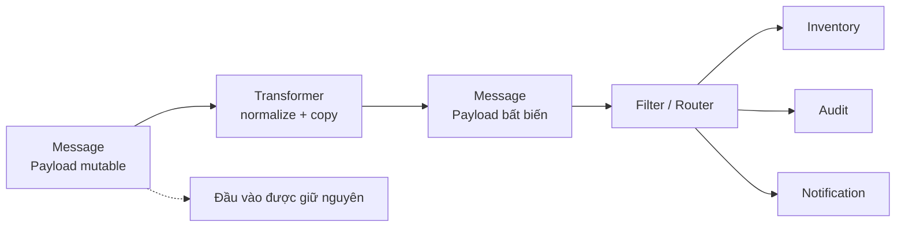
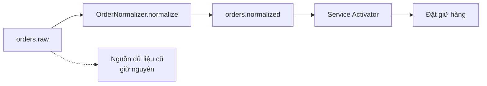
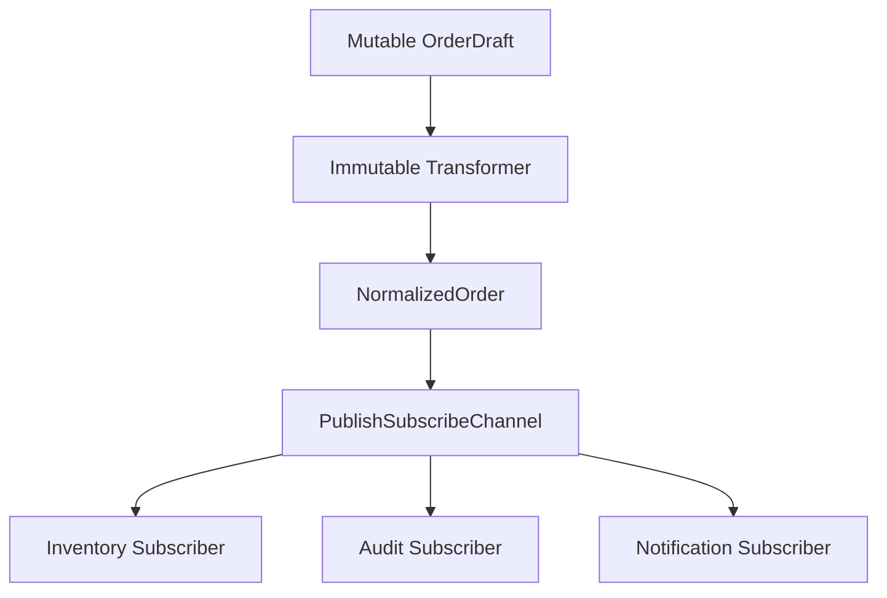

# Chuyển đổi bất biến và không sửa payload gốc

## 1. Vì sao Transformer không nên thay đổi payload đầu vào?

Trong một hệ thống xử lý đơn hàng, adapter nhận một đối tượng `OrderDraft` từ ứng dụng cũ. Đối tượng này chứa danh sách dòng hàng có thể thay đổi: các trường SKU, số lượng và đơn giá vẫn có setter. Bước tiếp theo cần một `NormalizedOrder` đã chuẩn hóa mã hàng và tính tổng tiền để xử lý nhất quán.

Một cách làm hấp dẫn là lấy `OrderDraft`, sửa trực tiếp `sku` thành chữ hoa, cập nhật số lượng hoặc thay danh sách hàng ngay trong Transformer. Tuy nhiên, message có thể được gửi đến nhiều nhánh, ghi vào log, phát lại hoặc kiểm thử nhiều lần. **Sửa đối tượng gốc** khiến các thành phần khác quan sát dữ liệu thay đổi dù không hề được thông báo; lỗi thường chỉ xuất hiện khi có fan-out, xử lý bất đồng bộ hoặc retry.

**Message Transformer** trong Enterprise Integration Patterns (EIP) chuyển đổi một message từ dạng này sang dạng khác. Với bài học này, nguyên tắc là:

> **Nhận dữ liệu đầu vào, tính một kết quả mới, trả kết quả mới; không chỉnh sửa đối tượng đầu vào hoặc những đối tượng mutable nằm bên trong nó.**

Bài thuộc chương **Transformer** trong module **SPRING_INTEGRATION_PATTERN**, tập trung thực hành Enterprise Integration Patterns với Spring Integration để xây dựng luồng thông điệp ít phụ thuộc, dễ mở rộng. Transformer thường đứng giữa Gateway/Inbound Adapter và Router, Filter, Splitter, Aggregator hoặc Service Activator. Khi dữ liệu được biến đổi bất biến, việc retry, error channel, correlation, kiểm thử và theo dõi các nhánh trở nên dễ hiểu hơn.



### 1.1. Ba cam kết khác nhau

| Cam kết | Ý nghĩa | Cách kiểm chứng |
| --- | --- | --- |
| **Không mutate input** | Transformer không gọi setter, không sửa collection của input | So sánh dữ liệu trước/sau; dùng đầu vào được giám sát |
| **Output không bị sửa được qua public API** | Các trường dữ liệu và cấu trúc lồng nhau là bất biến | Thử sửa list/map và phần tử; phải thất bại hoặc không có cách sửa |
| **Không chia sẻ tham chiếu mutable** | Sửa input sau khi transform không làm output đổi | Mutate input sau transform và assert output vẫn giữ nguyên |

Ba cam kết này liên quan nhau nhưng **không đồng nghĩa**. Không gọi setter trên input chưa đủ nếu output vẫn giữ tham chiếu tới một `List` có thể sửa từ bên ngoài.

## 2. Phân biệt immutable, unmodifiable và defensive copy

**Immutable object** là đối tượng mà trạng thái có ý nghĩa của nó không thể bị thay đổi sau khi xây dựng. Trong Java, `record` giúp khai báo dữ liệu dạng value ngắn gọn, nhưng **không tự biến tất cả object được tham chiếu thành bất biến**.

Ví dụ dễ mắc lỗi:

```java
import java.util.List;

record UnsafeOrder(String orderId, List<MutableLine> lines) {}
```

Một record như vậy không có setter cho trường `lines`, nhưng `order.lines().clear()` vẫn có thể thực hiện nếu caller truyền vào `ArrayList`. Hơn nữa, ngay cả khi list là unmodifiable, các phần tử `MutableLine` bên trong vẫn có thể bị sửa.

### 2.1. `List.copyOf` là shallow copy

```java
List<MutableLine> source = new java.util.ArrayList<>();
source.add(new MutableLine("sku-a", 2, 15_000));

List<MutableLine> snapshot = List.copyOf(source);
source.clear();

// snapshot vẫn có một phần tử:
assert snapshot.size() == 1;

// Nhưng phần tử mutable có thể vẫn là cùng một object:
snapshot.get(0).setSku("changed");
```

`List.copyOf(source)` tạo một danh sách không thể thay đổi cấu trúc qua API của nó, **không deep-copy từng phần tử**. Nếu từng phần tử vẫn mutable, output chưa phải snapshot bất biến hoàn toàn. Với các value type bất biến như `String`, `Integer`, `BigDecimal`, `Instant` hoặc một record chỉ chứa các thành phần thực sự bất biến, chia sẻ tham chiếu có thể an toàn.

### 2.2. Bốn mức phòng vệ

| Cấu trúc đầu vào | Copy phù hợp | Cạm bẫy |
| --- | --- | --- |
| `String`, primitive, `BigDecimal` | Dùng lại giá trị bất biến | Chuẩn hóa sai ý nghĩa nghiệp vụ |
| `List<String>` | `List.copyOf(list)` | Không chấp nhận phần tử `null` |
| `List<MutableLine>` | Tạo **LineItem mới cho từng phần tử**, rồi `List.copyOf` | Chỉ copy list mà không copy element |
| `Map<String, MutableValue>` | Copy từng value sang value type mới rồi `Map.copyOf` | `Map.copyOf` không deep-copy value |
| `Date`, mảng, byte buffer | Copy giá trị/bytes thích hợp | Lộ reference mutable qua getter |

Không nên viết một tiện ích “deep copy tổng quát” bằng serialization cho mọi domain object mà không rõ semantics: dễ mất kiểu dữ liệu, tốn CPU/bộ nhớ, che giấu lỗi và không biết nên sao chép những trường nào.

## 3. Phản mẫu: thay đổi payload tại chỗ

Giả sử một class dữ liệu legacy cho phép sửa SKU. Một Transformer có thể bị viết theo kiểu:

```java
// PHẢN MẪU: sửa đối tượng mutable đang được message khác tham chiếu.
OrderDraft normalizeInPlace(OrderDraft input) {
    for (MutableLine line : input.lines()) {
        line.setSku(line.sku().trim().toUpperCase(java.util.Locale.ROOT));
    }
    return input;
}
```

Hàm trên có thể trả về **cùng một reference** `input`, đã bị thay đổi. Hậu quả:

1. Nếu một nhánh audit ghi lại dữ liệu ban đầu, nó có thể thấy SKU đã chuẩn hóa thay vì SKU người dùng gửi.
2. Khi retry cùng message, lần thứ hai nhận được **payload đã bị sửa**, không còn trạng thái ban đầu.
3. Với `PublishSubscribeChannel`, hai subscriber có thể đọc/cập nhật chung một object, dẫn đến race hoặc kết quả tùy thứ tự chạy.
4. Khi unit test chạy các hàm trên cùng một instance, test sau phụ thuộc test trước.
5. Nếu Transformer ném lỗi giữa vòng lặp, chỉ **một phần** danh sách đã thay đổi: input ở trạng thái nửa cũ nửa mới.

Một biến thể khác cũng không an toàn:

```java
// Cũng không đảm bảo bất biến nếu MutableLine vẫn mutable:
record NotActuallyImmutable(String orderId, List<MutableLine> lines) {
    NotActuallyImmutable {
        lines = List.copyOf(lines);
    }
}
```

Ở đây chỉ cấu trúc list được bảo vệ, còn từng `MutableLine` vẫn có setter. **Thiết kế đúng** là chuyển từng phần tử mutable thành một value object mới không có cách sửa.

## 4. Thiết kế mô hình đầu vào mutable và đầu ra bất biến

Ta triển khai một ví dụ đơn hàng có hai kiểu dữ liệu rõ ràng:

- `OrderDraft`: biểu diễn dữ liệu do adapter nhận; chứa các phần tử `MutableLine` từ hệ thống cũ.
- `NormalizedOrder`: biểu diễn dữ liệu đã chuẩn hóa, chỉ chứa các `LineItem` bất biến.

### 4.1. Kiểu đầu vào legacy

```java
import java.util.List;

// Dữ liệu nguồn có nested mutable elements.
record OrderDraft(String orderId, List<MutableLine> lines) {}

final class MutableLine {
    private String sku;
    private int quantity;
    private long unitPriceVnd;

    MutableLine(String sku, int quantity, long unitPriceVnd) {
        this.sku = sku;
        this.quantity = quantity;
        this.unitPriceVnd = unitPriceVnd;
    }

    String sku() {
        return sku;
    }

    int quantity() {
        return quantity;
    }

    long unitPriceVnd() {
        return unitPriceVnd;
    }

    void setSku(String sku) {
        this.sku = sku;
    }

    void setQuantity(int quantity) {
        this.quantity = quantity;
    }

    void setUnitPriceVnd(long unitPriceVnd) {
        this.unitPriceVnd = unitPriceVnd;
    }
}
```

Ví dụ này cố tình làm `MutableLine` có setter để minh họa rủi ro. Mã ứng dụng mới không nên tiếp tục truyền đối tượng dạng này qua các nhánh async nếu không có một bước sao chép/làm bất biến tại biên.

### 4.2. Kiểu đầu ra bất biến

```java
import java.util.List;

record LineItem(String sku, int quantity, long unitPriceVnd) {
    LineItem {
        if (sku == null || sku.isBlank()
                || quantity <= 0
                || unitPriceVnd < 0) {
            throw new IllegalArgumentException("Invalid line item");
        }
    }
}

record NormalizedOrder(
        String orderId,
        List<LineItem> lines,
        long totalVnd) {

    NormalizedOrder {
        if (orderId == null || orderId.isBlank()) {
            throw new IllegalArgumentException("Missing order ID");
        }
        lines = List.copyOf(lines); // Bảo vệ collection.
        if (lines.isEmpty() || totalVnd < 0) {
            throw new IllegalArgumentException("Invalid normalized order");
        }
    }
}
```

`LineItem` chỉ chứa `String`, `int` và `long`, đều bất biến ở mức giá trị. `NormalizedOrder` sao chép list vào một danh sách không thể chỉnh sửa qua public API. Nhờ đó không còn reference mutable từ `OrderDraft` nằm trong output.

**Vì sao dùng `long` cho số tiền?** Ví dụ giả định tiền VND nguyên đơn vị để làm rõ thiết kế bất biến, không bàn về số lẻ. Với tiền tệ có phần thập phân, nên dùng `BigDecimal` và quy tắc currency/scale/rounding rõ ràng; không dùng `double` cho tiền. `BigDecimal` cũng là kiểu bất biến, nhưng phải thống nhất cách diễn giải số tiền khi chuyển đổi.

## 5. Viết Transformer thuần: tạo snapshot mới

Hàm `normalize` thực hiện đúng ba bước: **đọc input → validate + chuẩn hóa → xây output mới**. Nó không gọi setter trên `MutableLine`, không thêm/xóa phần tử trong danh sách gốc, không gọi I/O.

```java
import java.util.ArrayList;
import java.util.List;
import java.util.Locale;
import java.util.Objects;

final class OrderNormalizer {

    NormalizedOrder normalize(OrderDraft source) {
        Objects.requireNonNull(source, "OrderDraft is required");
        if (source.orderId() == null
                || source.orderId().isBlank()
                || source.lines() == null
                || source.lines().isEmpty()) {
            throw new IllegalArgumentException("Invalid source order");
        }

        List<LineItem> normalizedLines = new ArrayList<>();
        long totalVnd = 0;

        for (MutableLine sourceLine : source.lines()) {
            if (sourceLine == null || sourceLine.sku() == null) {
                throw new IllegalArgumentException("Missing line/SKU");
            }

            String sku = sourceLine.sku()
                    .trim()
                    .toUpperCase(Locale.ROOT);

            // Mỗi dòng output là một object mới, không còn setter.
            LineItem line = new LineItem(
                    sku,
                    sourceLine.quantity(),
                    sourceLine.unitPriceVnd());

            normalizedLines.add(line);

            // Tránh silently overflow khi số tiền lớn.
            long lineTotal = Math.multiplyExact(
                    (long) line.quantity(), line.unitPriceVnd());
            totalVnd = Math.addExact(totalVnd, lineTotal);
        }

        return new NormalizedOrder(
                source.orderId().trim(),
                normalizedLines,
                totalVnd);
    }
}
```

Điểm cần chú ý:

1. `source.orderId().trim()` tạo giá trị mới, không sửa string cũ.
2. Từng `MutableLine` được **đọc** và chuyển sang `LineItem` mới; output không giữ reference đến phần tử cũ.
3. Danh sách tạm `normalizedLines` chỉ tồn tại bên trong hàm; constructor của `NormalizedOrder` dùng `List.copyOf` trước khi công bố kết quả.
4. `Math.multiplyExact` và `Math.addExact` ném `ArithmeticException` nếu tính tổng bị tràn `long`; lỗi phải được báo thay vì âm thầm tạo kết quả sai.
5. Không có `System.currentTimeMillis()`, random, HTTP hay database call trong hàm; với cùng một snapshot nguồn và cùng quy tắc, kết quả mang cùng giá trị.

`normalize` là **pure transformation theo hợp đồng ứng dụng**: nó không thay đổi trạng thái bên ngoài. Tuy nhiên đầu vào vẫn có cấu trúc mutable. Nếu một thread khác sửa `source.lines()` ngay trong lúc Transformer đang duyệt, không có bảo đảm snapshot nhất quán. Cần **ownership/safe publication**: nhận, hoàn tất copy ở một ranh giới được kiểm soát rồi mới chia sẻ output cho các luồng khác, hoặc đồng bộ việc đọc nếu dữ liệu nguồn thật sự có thể bị chỉnh sửa đồng thời.

### 5.1. Phân biệt copy khi xây dựng và copy sau khi đã rò tham chiếu

Nếu caller được giữ reference đến `MutableLine` rồi Timer/Executor bắt đầu xử lý bất đồng bộ trước khi Transformer copy, caller có thể thay đổi dữ liệu ngay lúc copy. Do đó:

- Copy/normalize **trước** khi đưa payload vào channel async, nếu có thể.
- Không lưu tham chiếu đến collection mutable đã chuyển qua ranh giới thread để sửa tiếp.
- Nếu không thể tránh chia sẻ đầu vào, dùng cơ chế đồng bộ và một hợp đồng ownership rõ ràng.

Việc output bất biến không sửa được **sau khi tạo thành công** là một cam kết khác với bảo đảm ảnh chụp nguyên tử **trong lúc input đang thay đổi**.

## 6. Cấu hình Spring Integration Java DSL cho Transformer

Ta tạo flow nhận `OrderDraft` rồi chuyển sang `NormalizedOrder`. Downstream chỉ thấy kiểu đã chuẩn hóa và gọi `OrderProcessingService`. Ví dụ dùng `DirectChannel` để có thể kiểm thử đồng bộ.



```java
import org.springframework.context.annotation.Bean;
import org.springframework.context.annotation.Configuration;
import org.springframework.integration.channel.DirectChannel;
import org.springframework.integration.config.EnableIntegration;
import org.springframework.integration.dsl.IntegrationFlow;
import org.springframework.messaging.MessageChannel;

interface OrderProcessingService {
    void accept(NormalizedOrder order, String eventId);
}

@Configuration
@EnableIntegration
class OrderTransformerConfig {

    @Bean("orders.raw")
    MessageChannel rawOrders() {
        return new DirectChannel();
    }

    @Bean("orders.normalized")
    MessageChannel normalizedOrders() {
        return new DirectChannel();
    }

    @Bean
    OrderNormalizer orderNormalizer() {
        return new OrderNormalizer();
    }

    @Bean
    IntegrationFlow normalizeOrders(OrderNormalizer normalizer) {
        return IntegrationFlow.from("orders.raw")
                .transform(OrderDraft.class, normalizer::normalize)
                .channel("orders.normalized")
                .get();
    }

    @Bean
    IntegrationFlow consumeNormalizedOrders(OrderProcessingService service) {
        return IntegrationFlow.from("orders.normalized")
                .handle(NormalizedOrder.class, (order, headers) -> {
                    String eventId = (String) headers.get("eventId");
                    if (eventId == null || eventId.isBlank()) {
                        throw new IllegalArgumentException("Missing eventId");
                    }
                    service.accept(order, eventId);
                    return null;  // One-way Service Activator.
                })
                .get();
    }
}
```

Ở đây, `transform(OrderDraft.class, normalizer::normalize)` chỉ trả payload mới. Spring Integration xây message cho bước tiếp theo theo cơ chế của transformer. Downstream nhận `NormalizedOrder` thay vì object legacy; nó không cần biết logic chuẩn hóa SKU hay phép nhân tiền.

Trong ứng dụng thực tế, nên xác thực các header bắt buộc như `eventId` **ngay tại ingress** trước khi thực hiện side effect. Ví dụ để ở consumer nhằm minh họa rằng validation của payload và validation của message envelope là hai trách nhiệm riêng.

### 6.1. Producer và ranh giới đầu vào

```java
import java.util.ArrayList;
import java.util.List;

import org.springframework.beans.factory.annotation.Qualifier;
import org.springframework.messaging.MessageChannel;
import org.springframework.messaging.support.MessageBuilder;
import org.springframework.stereotype.Component;

@Component
class RawOrderPublisher {
    private final MessageChannel rawInput;

    RawOrderPublisher(@Qualifier("orders.raw") MessageChannel rawInput) {
        this.rawInput = rawInput;
    }

    void submitExample() {
        var lines = new ArrayList<>(List.of(
                new MutableLine(" sku-a ", 2, 15_000),
                new MutableLine("sku-b", 1, 25_000)));
        var source = new OrderDraft(" ORD-105 ", lines);

        rawInput.send(MessageBuilder.withPayload(source)
                .setHeader("eventId", "evt-105")
                .setHeader("traceId", "trace-105")
                .setHeader("tenantId", "store-hcm")
                .build());
    }
}
```

Từ `source` trên, dữ liệu output dự kiến:

```text
NormalizedOrder(
  orderId = "ORD-105",
  lines = [
    LineItem("SKU-A", quantity=2, unitPriceVnd=15000),
    LineItem("SKU-B", quantity=1, unitPriceVnd=25000)
  ],
  totalVnd = 55000
)
```

`source` vẫn có `orderId=" ORD-105 "`, `sku=" sku-a "` và collection ban đầu không bị Transformer sửa. Đây là một điểm rất quan trọng khi cần lưu dữ liệu nguồn để đối chiếu hoặc phát lại.

### 6.2. Phương án thay thế: `@Transformer`

Với annotation style, có thể biểu diễn tương tự bằng một endpoint:

```java
import org.springframework.integration.annotation.Transformer;
import org.springframework.stereotype.Component;

@Component
class AnnotatedOrderTransformer {
    private final OrderNormalizer normalizer;

    AnnotatedOrderTransformer(OrderNormalizer normalizer) {
        this.normalizer = normalizer;
    }

    @Transformer(
            inputChannel = "orders.raw",
            outputChannel = "orders.normalized")
    public NormalizedOrder convert(OrderDraft source) {
        return normalizer.normalize(source);
    }
}
```

Đây là **phương án thay thế**, không đăng ký đồng thời với `IntegrationFlow normalizeOrders` trên cùng `DirectChannel` trừ khi có chủ đích đặc biệt. Một `DirectChannel` có nhiều subscriber không mặc nhiên broadcast mọi message tới cả hai Transformer; có thể tạo hành vi cạnh tranh nhận message. Trong ví dụ, hãy chọn **một** cách cấu hình.

## 7. Bất biến payload không đồng nghĩa bất biến toàn bộ Message

Một `Message<T>` có **payload** và **headers**. Khi Transformer trả về payload mới, Spring Integration thường truyền tiếp các header cần thiết theo cơ chế của endpoint; nhưng vẫn phải kiểm thử khi có adapter, custom Transformer hoặc crossing protocol boundaries.

```text
Input Message:
  payload: OrderDraft
  headers:
    eventId: evt-105
    traceId: trace-105
    correlationId: checkout-105

Transformer:
  OrderDraft -> NormalizedOrder

Output Message:
  payload: NormalizedOrder
  headers:
    eventId: evt-105
    traceId: trace-105
    correlationId: checkout-105
```

Trong ví dụ Java DSL, `eventId` phải đi qua để consumer có thể xác định sự kiện. Đừng tự tạo một `MessageBuilder.withPayload(normalized).build()` mà quên copy metadata cần thiết khi viết custom message-transforming logic; ở ranh giới protocol, kiểm tra thêm mapping và serialization.

### 7.1. Headers có thể chứa giá trị mutable

`MessageHeaders` có API map được bảo vệ khỏi chỉnh sửa trực tiếp, **nhưng một giá trị header vẫn có thể là object mutable**. Ví dụ:

```java
// Phản mẫu: list mutable nằm trong header nghiệp vụ.
var tags = new java.util.ArrayList<String>();
tags.add("new");
var message = org.springframework.messaging.support.MessageBuilder
        .withPayload("order")
        .setHeader("tags", tags)
        .build();
```

Nếu `tags` được dùng qua nhiều nhánh, một consumer có thể sửa nó. Vì vậy, với metadata tự định nghĩa, ưu tiên header values bất biến, ví dụ `List.copyOf(tags)`; không tái sử dụng header chứa object mutable hoặc object phụ thuộc bean nội bộ khi truyền qua broker nếu adapter không hỗ trợ.

### 7.2. Header `contentType` sau khi đổi định dạng

Nếu Transformer thay payload từ JSON bytes sang Java object, giá trị `contentType` của **payload cũ** có thể không còn đúng nghĩa. Khi downstream dựa vào `contentType`, cần cập nhật hoặc loại bỏ metadata không còn phù hợp theo hợp đồng. Những header như `correlationId`, `sequenceNumber` và `sequenceSize` liên quan tới Splitter/Aggregator thường cần được truyền chính xác.

**Không copy tất cả hệ thống headers một cách mù quáng** giữa message mới hoặc hai giao thức khác nhau; kiểm tra header nào mang ý nghĩa chung, header nào do framework quản lý, và cái nào chỉ hợp lệ ở transport hiện tại.

## 8. Transformer bất biến và fan-out đồng thời

Một vấn đề dễ bị bỏ sót là payload có thể được **chia sẻ tham chiếu** giữa nhiều subscriber của một `PublishSubscribeChannel` hoặc Recipient List.



Nếu `NormalizedOrder` thực sự bất biến, ba subscriber có thể đọc cùng một object an toàn mà không cần đồng bộ các **thao tác đọc trên trạng thái đã được công bố an toàn**. Không cần deep-copy lại cho từng recipient khi các thành phần bên trong đã bất biến.

Tuy nhiên, **đọc an toàn** không đồng nghĩa:

- Mỗi subscriber hoàn thành thành công;
- Các subscriber thực thi đúng thứ tự đã đăng ký;
- Toàn bộ fan-out có transaction chung;
- Các service ngoài không bị gọi trùng khi broker redelivery.

Các vấn đề này vẫn cần error handling, retry/recovery, idempotency và quan sát riêng từng nhánh.

### 8.1. Dữ liệu phụ thuộc hệ thống ngoài nên đặt ở đâu?

Nếu Transformer tự gọi database hoặc HTTP để lấy giá, kết quả có thể khác theo thời điểm hoặc tạo thêm I/O ở mỗi lần retry. Một thiết kế dễ kiểm soát hơn:

```text
Inbound Adapter
  -> Validation / Enricher (lấy dữ liệu tham chiếu, quản lý I/O)
  -> Immutable Transformer (chuẩn hóa dữ liệu đã có)
  -> Router / Filter
  -> Consumer có transaction và idempotency
```

Điều này không có nghĩa mọi Transformer của Spring Integration đều **bắt buộc** là pure function. Đây là **quy ước thiết kế khuyến nghị** cho những biến đổi mà mục tiêu là giữ input nguyên vẹn, dễ test và dễ retry.

## 9. Retry và idempotency khi Transformer không mutate dữ liệu

Giả sử `OrderDraft` được gửi lại sau khi consumer ghi DB xong nhưng ACK bị mất. Nếu Transformer không thay đổi input và không sử dụng clock/random tùy ý, việc chạy lại `normalize(source)` cho cùng dữ liệu tạo ra cùng một `NormalizedOrder` theo giá trị.

Đó là một lợi ích lớn, nhưng **không có nghĩa cả flow là idempotent**. Downstream vẫn có thể ghi DB, trừ tiền hoặc gửi email lần thứ hai.

| Vị trí | Mong muốn | Cơ chế |
| --- | --- | --- |
| Transformer | Cùng snapshot nguồn + cùng rule → cùng output | Hàm xác định, không side effect |
| Router | Chọn nhánh nhất quán | Rule version/mapping rõ ràng |
| Filter | Không thay đổi trạng thái khi đánh giá lại | Predicate thuần |
| Service Activator | Không lặp side effect khi nhận duplicate | Idempotency key và transaction |
| Gateway/broker adapter | Retry/ACK có hợp đồng | Giới hạn retry, timeout, recovery |
| Aggregator | Không đếm duplicate thành phần mới | Correlation + dedup/release strategy |

Một khóa idempotency hợp lý cho consumer là `(eventId, consumerName)`; nó **không** nên dựa vào `MessageHeaders.ID`, vì khi message được tạo lại ID envelope có thể thay đổi.

### 9.1. Không mutate payload trong một attempt rồi retry

Với phản mẫu `normalizeInPlace`, nếu lỗi phát sinh sau khi xử lý một phần list, lần thử lại bắt đầu từ **input đã bị sửa dở**. Với kiểu thiết kế tạo output mới, khi có exception giữa việc xây `normalizedLines`, danh sách tạm có thể bị bỏ đi mà không để lại trạng thái nửa hoàn tất trong input.

Tuy nhiên, nếu input đang bị chỉnh sửa đồng thời hoặc producer đã thay đổi cùng object trước lần retry, snapshot nguồn **không còn giống nhau**; cần kiểm soát nguồn và identity. Với workflow dài hạn, cân nhắc lưu input envelope dạng immutable hoặc serialized event, kèm `schemaVersion` và `eventId` để replay có thể tái lập.

### 9.2. Thay đổi rule version ảnh hưởng kết quả

Ví dụ hôm nay SKU được chuẩn hóa bằng `Locale.ROOT`, nhưng ngày mai hệ thống thêm quy tắc ánh xạ SKU alias. Cùng input có thể cho output khác qua hai phiên bản. Nếu nghiệp vụ yêu cầu replay chính xác, cần lưu **transformation policy/schema version** hoặc snapshot kết quả đã áp dụng. Bất biến dữ liệu không tự làm quy tắc biến đổi bất biến qua thời gian.

## 10. Xử lý dữ liệu sai và lỗi Transformer

Transformer là một endpoint thực thi code. Khi input thiếu trường cần thiết hoặc tổng tiền overflow, việc phát sinh exception là hợp lý hơn trả một output “gần đúng” và để downstream xử lý âm thầm.

| Tình huống | Biểu hiện | Hướng xử lý |
| --- | --- | --- |
| `orderId` rỗng | `IllegalArgumentException` | Validation/reject, không retry vô hạn cùng input |
| `lines=null` hoặc empty | Invalid source order | Trả lỗi đầu vào hoặc quarantine |
| `line.sku=null` | Thiếu dữ liệu cần chuẩn hóa | Reject/quarantine với lý do |
| `quantity<=0` | Invalid line item | Validation |
| `Math.multiplyExact` overflow | `ArithmeticException` | Báo lỗi, điều chỉnh mô hình tiền nếu yêu cầu |
| Serializer không hiểu kiểu output | Lỗi tại outbound adapter | Xác định schema/codec cho payload mới |
| Consumer timeout sau transform | Lỗi downstream | Retry/idempotency ở consumer |
| Header mất khi qua adapter | Thiếu `eventId`/correlation | Header mapping và integration test |

**Đừng nuốt exception rồi trả input gốc** chỉ để message “tiếp tục chạy”: downstream chờ `NormalizedOrder` nhưng lại nhận `OrderDraft`, dễ gây lỗi kiểu dữ liệu hoặc tính toán sai. Nếu hệ thống muốn chọn một phương án dự phòng, hãy mô tả nó thành nhánh lỗi rõ ràng với dữ liệu hợp lệ được định nghĩa trước.

### 10.1. `errorChannel` và đường xử lý lỗi

Trong flow đồng bộ dùng `DirectChannel`, exception từ Transformer có thể lan về sender. Trong flow bất đồng bộ dùng poller, executor hoặc broker, lỗi có thể được chuyển thành `ErrorMessage` thông qua error handler/`errorChannel` theo cấu hình thực tế.

`errorChannel` không đồng nghĩa một storage bền vững và cũng không tự retry mọi lỗi. Những lỗi **schema không hợp lệ** nên được phân loại khác với lỗi **I/O tạm thời**; retry bất tận một giá trị `quantity=-2` không sửa được dữ liệu. Nếu Transformer chủ yếu là pure function, các lỗi dữ liệu thường cần sửa nguồn hoặc contract, chứ không phải tăng số lần thử.

## 11. Kiểm thử tính bất biến ở cấp unit

Một unit test tốt cần chứng minh **cả chiều trước và sau khi chuyển đổi**:

1. Input giữ nguyên ngay sau khi normalize.
2. Output có dữ liệu đã chuẩn hóa.
3. Sửa input **sau** normalize không làm output thay đổi.
4. Không thể thêm/xóa phần tử vào output list.
5. Cùng dữ liệu không thay đổi tạo kết quả giống nhau.
6. Input invalid khiến hàm ném lỗi mà không để lại thay đổi một phần.

```java
import java.util.ArrayList;
import java.util.List;
import org.junit.jupiter.api.Test;
import static org.junit.jupiter.api.Assertions.*;

class OrderNormalizerTest {
    private final OrderNormalizer normalizer = new OrderNormalizer();

    @Test
    void createsIndependentImmutableSnapshotWithoutMutatingSource() {
        var sourceLine = new MutableLine(" sku-a ", 2, 15_000);
        var sourceLines = new ArrayList<>(List.of(sourceLine));
        var source = new OrderDraft(" ORD-105 ", sourceLines);

        NormalizedOrder output = normalizer.normalize(source);

        // Input còn nguyên giá trị ban đầu.
        assertEquals(" ORD-105 ", source.orderId());
        assertEquals(" sku-a ", sourceLine.sku());
        assertEquals(1, sourceLines.size());

        // Output đã chuẩn hóa và chứa value object độc lập.
        assertEquals("ORD-105", output.orderId());
        assertEquals("SKU-A", output.lines().get(0).sku());
        assertEquals(30_000L, output.totalVnd());

        // Sửa input sau transform không làm output đổi.
        sourceLine.setSku("CHANGED");
        sourceLine.setQuantity(99);
        sourceLines.clear();
        assertEquals("SKU-A", output.lines().get(0).sku());
        assertEquals(2, output.lines().get(0).quantity());
        assertEquals(30_000L, output.totalVnd());

        // Danh sách output không thể chỉnh sửa.
        assertThrows(UnsupportedOperationException.class,
                () -> output.lines().clear());
    }

    @Test
    void producesEqualValueForSameInputSnapshot() {
        var source = new OrderDraft("ORD-106",
                List.of(new MutableLine("sku-b", 1, 20_000)));

        assertEquals(normalizer.normalize(source),
                     normalizer.normalize(source));
    }

    @Test
    void rejectsInvalidInputWithoutPartialMutation() {
        var line = new MutableLine(" sku-c ", -1, 12_000);
        var source = new OrderDraft("ORD-107", List.of(line));

        assertThrows(IllegalArgumentException.class,
                () -> normalizer.normalize(source));
        assertEquals(" sku-c ", line.sku());
        assertEquals(-1, line.quantity());
    }

    @Test
    void failsRatherThanOverflowingTheTotal() {
        var source = new OrderDraft("ORD-108",
                List.of(new MutableLine("sku-z", 2, Long.MAX_VALUE)));
        assertThrows(ArithmeticException.class,
                () -> normalizer.normalize(source));
    }
}
```

Đây là các test độc lập với Spring context: chỉ kiểm tra logic chuyển đổi. Nếu đầu vào chứa map, mảng byte hoặc các object mutable khác, cần thêm test mutation tương ứng; đừng dừng ở việc test `List.copyOf` mà bỏ qua phần tử lồng nhau.

## 12. Kiểm thử tích hợp: payload mới và headers được truyền tiếp

Test Spring Integration cần xác minh Transformer **đã được gắn vào flow thật**, output có đúng kiểu, `eventId` được truyền sang consumer và không có code downstream vô tình dựa vào mutable source.

```java
import java.util.ArrayList;
import java.util.List;
import org.junit.jupiter.api.BeforeEach;
import org.junit.jupiter.api.Test;
import org.mockito.ArgumentCaptor;
import org.springframework.beans.factory.annotation.Autowired;
import org.springframework.beans.factory.annotation.Qualifier;
import org.springframework.context.annotation.Bean;
import org.springframework.context.annotation.Configuration;
import org.springframework.messaging.MessageChannel;
import org.springframework.messaging.support.MessageBuilder;
import org.springframework.test.context.junit.jupiter.SpringJUnitConfig;

import static org.junit.jupiter.api.Assertions.*;
import static org.mockito.ArgumentMatchers.eq;
import static org.mockito.Mockito.*;

@SpringJUnitConfig(classes = {
        OrderTransformerConfig.class,
        OrderTransformerFlowTest.Stubs.class
})
class OrderTransformerFlowTest {

    @Autowired
    @Qualifier("orders.raw")
    MessageChannel input;

    @Autowired
    OrderProcessingService service;

    @BeforeEach
    void resetMock() {
        reset(service);
    }

    @Test
    void forwardsNewPayloadAndPreservesEventId() {
        var line = new MutableLine(" sku-a ", 2, 15_000);
        var draft = new OrderDraft(" ORD-105 ",
                new ArrayList<>(List.of(line)));

        assertTrue(input.send(MessageBuilder.withPayload(draft)
                .setHeader("eventId", "evt-105")
                .setHeader("traceId", "trace-105")
                .build()));

        ArgumentCaptor<NormalizedOrder> captor =
                ArgumentCaptor.forClass(NormalizedOrder.class);
        verify(service).accept(captor.capture(), eq("evt-105"));

        NormalizedOrder result = captor.getValue();
        assertEquals("ORD-105", result.orderId());
        assertEquals("SKU-A", result.lines().get(0).sku());
        assertEquals(30_000L, result.totalVnd());

        // Message source vẫn được ứng dụng sở hữu ở dạng cũ.
        assertEquals(" sku-a ", line.sku());
        assertEquals(" ORD-105 ", draft.orderId());
        verifyNoMoreInteractions(service);
    }

    @Configuration
    static class Stubs {
        @Bean
        OrderProcessingService orderProcessingService() {
            return mock(OrderProcessingService.class);
        }
    }
}
```

Vì ví dụ dùng `DirectChannel` đồng bộ, có thể verify sau `send()`. Với `ExecutorChannel`, `QueueChannel` có poller hay broker, cần chờ bằng tín hiệu/`Awaitility` với timeout hữu hạn, không dùng `Thread.sleep` cố định hoặc suy luận rằng `send()==true` đồng nghĩa consumer đã hoàn thành.

### 12.1. Các kịch bản tích hợp nên thêm

| Kịch bản | Kết quả cần kiểm tra |
| --- | --- |
| Hai dòng hàng với khoảng trắng/chữ thường | SKU chuẩn hóa; total tính chính xác |
| Đầu vào bị sửa sau transform | Output đang ở downstream không thay đổi |
| Message qua Publish-Subscribe | Các subscriber đều đọc cùng snapshot bất biến |
| Input thiếu `eventId` | Nhánh xác thực envelope báo lỗi rõ |
| Transformer ném exception vì dữ liệu sai | Không có consumer side effect; lỗi được quan sát |
| Redelivery cùng `eventId` | Output theo cùng policy nhất quán; consumer tránh side effect trùng |
| Transformer đổi payload kiểu | Router/Filter nhận đúng type mới, không `ClassCastException` |
| Message qua Kafka/Rabbit/HTTP | Headers và payload serialize/deserialize theo hợp đồng |
| Splitter/Aggregator | Correlation và sequence headers được giữ đúng |
| Rule chuẩn hóa đổi phiên bản | Quy định replay theo version cũ hay mới và test rõ |

## 13. Hiệu năng, bộ nhớ và điểm đánh đổi

Một biến đổi bất biến cần cấp phát các object mới. Với đơn hàng nhiều dòng, copy toàn bộ danh sách có chi phí **O(n)** về thời gian và bộ nhớ tương ứng số phần tử. Điều này thường đáng giá vì:

- Loại bỏ phụ thuộc vào setter và tránh race khi fan-out.
- Dễ cache/so sánh kết quả theo value semantics.
- Tránh input bị đổi khi validation, retry hoặc logging.
- Giúp ranh giới dữ liệu giữa hai giai đoạn của flow rõ ràng.

Tuy nhiên, cần cân bằng:

1. Không copy nhiều lần không cần thiết: sau khi đã có `NormalizedOrder` bất biến, các consumer đọc có thể chia sẻ an toàn snapshot.
2. Không giữ cả input và output vô hạn trong queue/buffer: cấu hình giới hạn lưu trữ và thời gian sống.
3. Với file/stream rất lớn, cân nhắc streaming theo chunk hoặc chia message, nhưng bảo đảm **mỗi phần được công bố** có trạng thái bất biến rõ.
4. Dữ liệu lớn chứa `byte[]` cần defensive copy vào và ra; nếu chỉ lưu reference, caller vẫn có thể sửa nội dung.
5. Nếu domain có cấu trúc cây lồng sâu, chuyển đổi từng node sang immutable value thay vì cố gắng shallow-copy root.

Một dữ liệu được gọi là “immutable” chỉ thực sự an toàn khi **toàn bộ cấu trúc có thể truy cập được** không cho phép mutation làm thay đổi trạng thái có nghĩa. Đừng giả định rằng `final` hoặc `record` đồng nghĩa deep immutable.

## 14. Những lỗi thiết kế thường gặp

1. **Dùng setter trên payload input** trong `@Transformer` hoặc Java DSL rồi trả lại input.
2. **Trả cùng `List<MutableLine>`** trong record output và cho rằng record bất biến.
3. **Chỉ dùng `Collections.unmodifiableList` trên list gốc**: caller vẫn có thể sửa list nguồn hoặc phần tử bên trong.
4. **Không defensive-copy map, array hoặc nested object** nhưng chuyển qua async subscriber.
5. **Bỏ qua overflow hoặc rounding** khi đổi kiểu số tiền.
6. **Chỉnh sửa input dở dang rồi mới validate**: lỗi giữa đường làm mất trạng thái nguồn.
7. **Mất `eventId` hoặc correlation headers** khi tạo message mới trong custom transformer.
8. **Mang `contentType` lỗi thời** sau khi chuyển JSON bytes thành Java object.
9. **Tưởng pure Transformer làm cả flow exactly-once**: downstream vẫn cần idempotency.
10. **Bỏ qua policy version khi replay** khiến cùng input cho kết quả khác qua các lần triển khai.
11. **Không kiểm thử mutation sau transform**: test chỉ nhìn output đúng ngay thời điểm trả về.
12. **Mutate input đồng thời khi Transformer copy** rồi tưởng snapshot luôn nguyên tử.

## 15. Bài tập thực hành và tự đánh giá

**Bài tập:** Dựng pipeline từ `LegacyInvoice` có `List<MutableInvoiceLine>` sang `NormalizedInvoice` chỉ chứa immutable value types. Nguồn dữ liệu có thể bị sửa sau khi gửi và có thể được broker phát lại.

1. Định nghĩa `MutableInvoiceLine` có setter và một immutable `InvoiceLine` (record) có validate trong compact constructor.
2. Định nghĩa `NormalizedInvoice` giữ `List.copyOf` của danh sách value objects. Giải thích tại sao không thể chỉ copy collection nguồn.
3. Viết Transformer thuần tạo `InvoiceLine` mới, chuẩn hóa SKU/tên hàng, tính `BigDecimal` tổng tiền với scale/rounding chính thức.
4. Viết test xác nhận input không đổi, output đúng, sửa input sau transform không làm output thay đổi.
5. Kiểm tra `normalized.lines().clear()` bị từ chối; thử sửa nested element và chứng minh không có setter.
6. Cấu hình `IntegrationFlow.transform(...)` và Service Activator nhận `NormalizedInvoice` thay vì `LegacyInvoice`.
7. Gửi message với `eventId`, `traceId`, `correlationId`; xác minh metadata cần thiết đến được consumer.
8. Mô phỏng retry sau lỗi consumer, chứng minh Transformer không tạo side effect và consumer dùng idempotency key.
9. Chuyển thông điệp qua một broker giả lập; xác minh schema/codec không phụ thuộc object mutable hoặc bean Java nội bộ.
10. So sánh chi phí bộ nhớ giữa deep copy một lần ở ingress và copy lại cho từng subscriber; đo trên dữ liệu thực tế trước khi tối ưu.

**Tự đánh giá:** Vì sao `record OrderDraft(List<MutableLine> lines)` chưa bất biến? `List.copyOf` bảo vệ được điều gì và không bảo vệ điều gì? Khi Transformer ném exception giữa việc tạo output, input có thay đổi không? Vì sao immutable Transformer không thay thế idempotent consumer? Headers nào cần duy trì sau chuyển đổi?

**Chuyển đổi bất biến và không sửa payload gốc** là một quy ước thực tế giúp Transformer tập trung vào tạo dữ liệu đầu ra mới có cấu trúc rõ ràng. Khi sao chép đúng tới các phần tử mutable, không để lộ tham chiếu sửa được, bảo toàn metadata cần thiết và kiểm thử cả tình huống mutation/retry/concurrency, những flow Spring Integration kết hợp Router, Filter, Splitter, Aggregator và nhiều subscriber sẽ dễ mở rộng và ít gặp lỗi khó tái hiện hơn.
