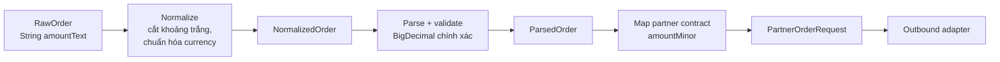
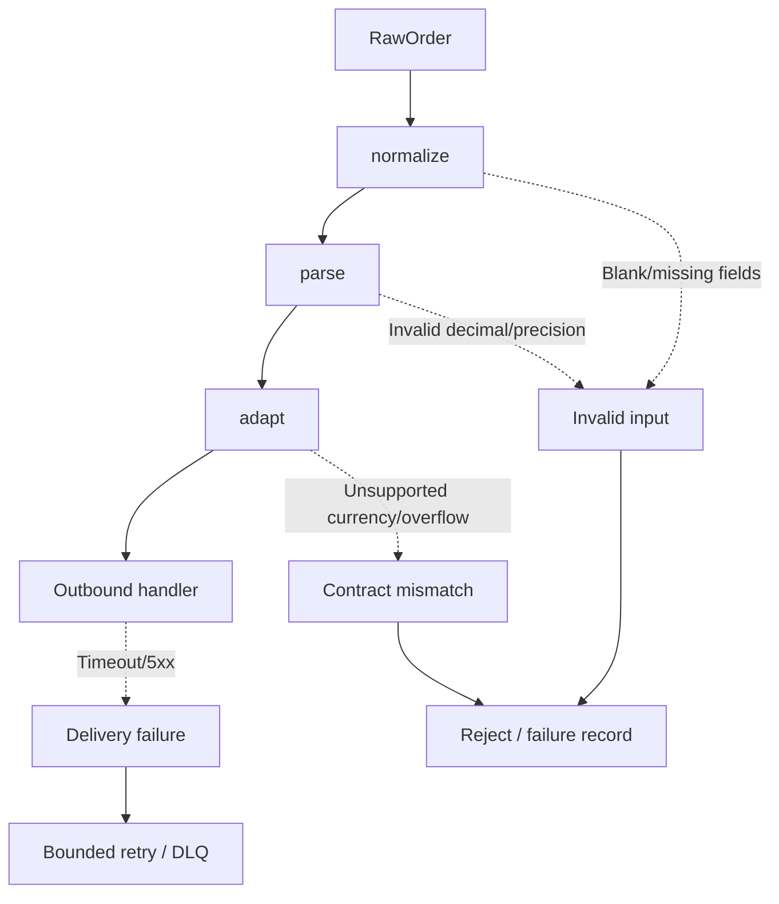
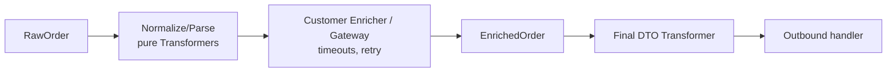
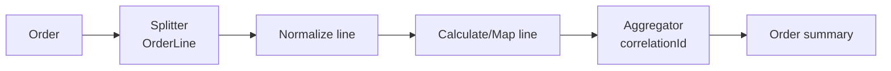
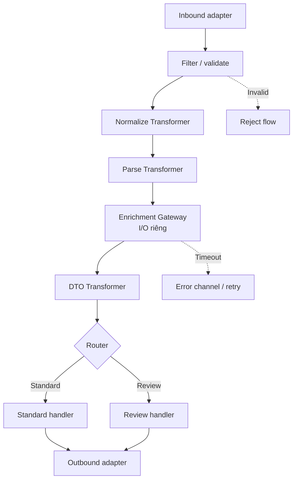

# Chain nhiều transformer

## 1. Bài toán: vì sao một Transformer thường chưa đủ?

Một ứng dụng tích hợp đơn hàng nhận dữ liệu dạng text từ hệ thống A, nhưng hệ thống B chỉ chấp nhận một DTO có cấu trúc:

- A gửi `orderId` có khoảng trắng, `amountText` là chuỗi như `"19.95"`, `currency` có thể là `" usd "`.
- B cần `orderReference` đã chuẩn hóa, `amountMinor` biểu diễn **số cent chính xác** bằng số nguyên và mã tiền tệ `USD`.
- Trên đường xử lý, ứng dụng cần kiểm tra thiếu trường, số tiền không hợp lệ, loại tiền được hỗ trợ và giữ `requestId` để truy vết.

Một Transformer duy nhất có thể làm tất cả những công việc đó. Nhưng khi mỗi quy tắc mở rộng, một method lớn sẽ trộn **chuẩn hóa**, **phân tích cú pháp**, **kiểm tra hợp đồng dữ liệu** và **ánh xạ DTO đầu ra**. Sửa ngưỡng, định dạng tiền hoặc một trường của đối tác có thể vô tình làm hỏng các phần khác.

Giải pháp là **chain nhiều Transformer**: mỗi Transformer thực hiện một phép biến đổi có trách nhiệm riêng và output của bước trước trở thành input của bước sau.



Bài thuộc chương **Transformer** của module **SPRING_INTEGRATION_PATTERN**: triển khai Enterprise Integration Patterns (EIP) bằng Spring Integration nhằm tạo các luồng thông điệp ít phụ thuộc, dễ mở rộng; thực hành Router, Filter, Transformer, Splitter, Aggregator, Gateway, retry, error channel và correlation cùng khả năng kiểm thử, theo dõi từng nhánh.

Sau bài này, bạn có thể:

1. Thiết kế chuỗi Transformer với **hợp đồng đầu vào/đầu ra có kiểu rõ ràng**.
2. Phân biệt **biến đổi payload**, **biến đổi toàn bộ Message**, **Filter** và **Header Enricher**.
3. Viết một IntegrationFlow chứa nhiều bước `transform(...)`, có unit test từng bước và integration test toàn chuỗi.
4. Hiểu điều gì xảy ra với header, `replyChannel`, `errorChannel`, correlation và kiểu payload qua từng bước.
5. Xử lý exception, null/no reply, retry, timeout và ranh giới bất đồng bộ đúng cách.
6. Biết khi nào giữ các bước trong một flow, tách chúng thành nhiều flow, hoặc đóng gói thành một transformation service.
7. Tránh side effect, lỗi làm tròn tiền và chi phí chuyển đổi/serialize không cần thiết.

## 2. Transformer trong EIP làm nhiệm vụ gì?

Theo EIP, **Message Translator/Transformer** đổi message từ dạng mà bên gửi hiểu sang dạng bên nhận cần mà không buộc hai bên biết chi tiết của nhau. Trong Spring Integration, Transformer thường được dùng để chuyển đổi **payload** hoặc tạo một **Message** mới có payload/header khác.

Ví dụ:

```text
RawOrder(String) → ParsedOrder(BigDecimal)
```

Nó **không phải** một thành phần chọn nơi gửi message. Chọn channel là trách nhiệm của Router. Transformer cũng **không mặc nhiên loại message** chỉ vì một điều kiện không đúng; nếu nghiệp vụ muốn bỏ hoặc đưa vào discard channel, dùng Filter hoặc một nhánh từ chối rõ ràng.

Bảng so sánh:

| Thành phần | Câu hỏi chính | Ví dụ |
| --- | --- | --- |
| **Transformer** | Message cần đổi biểu diễn như thế nào? | Text amount → `BigDecimal`; DTO A → DTO B |
| **Filter** | Message có được đi tiếp không? | Không xử lý đơn không đủ điều kiện |
| **Router** | Message đi đến nhánh nào? | Đơn VIP → `orders.priority` |
| **Header Enricher** | Cần bổ sung metadata nào vào header? | Thêm `sourceSystem`, `schemaVersion` |
| **Splitter** | Một message cần tách thành các phần nào? | Order → từng order line |
| **Aggregator** | Những message liên quan được ghép ra sao? | Gom kết quả của nhiều order line |
| **Gateway** | Làm sao gọi flow theo hợp đồng request/reply? | Service gọi flow chuyển đổi rồi nhận DTO mới |

Một chain đúng có thể kết hợp nhiều EIP. Tuy nhiên trong bài này, trọng tâm là **các phép biến đổi nối tiếp**; những Filter và Router bổ sung nên giữ trách nhiệm riêng thay vì lẫn vào phép mapping.

## 3. Chain khác một Transformer lớn ở điểm nào?

Đặt phép biến đổi theo dạng hàm:

```text
normalize : RawOrder        → NormalizedOrder
parse     : NormalizedOrder → ParsedOrder
adapt     : ParsedOrder     → PartnerOrderRequest

chain = adapt ∘ parse ∘ normalize
```

Một chuỗi tốt có các tính chất:

- **Contract rõ:** mỗi stage nhận đúng một loại dữ liệu và trả về một loại dữ liệu được đặt tên.
- **Single responsibility:** mỗi stage có một lý do chính để thay đổi.
- **Có thể kiểm thử độc lập:** test phần parse không cần dựng toàn bộ topology hoặc broker.
- **Lỗi định vị được:** có thể biết input sai ở bước nào.
- **Có thể tái sử dụng có chủ đích:** stage chuẩn hóa không phụ thuộc adapter của đối tác.
- **Ít side effect:** cùng input và quy tắc được kiểm soát cho output tương đương, dễ retry.

Tuy nhiên “nhiều bước” không tự động tốt hơn. Nếu tách một phép gán trường thành mười class nhỏ mà không có ranh giới hợp đồng thực sự, flow sẽ khó đọc và tốn công theo dõi hơn. Nên tách tại **ranh giới có tên, kiểu dữ liệu, chính sách lỗi hoặc khả năng tái sử dụng rõ**.

### Độ dài chain không phải chỉ số duy nhất

| Chain quá lớn | Chain quá vụn |
| --- | --- |
| Một method 300 dòng vừa parse, validate, gọi HTTP, map DTO | Mỗi field được đổi bởi một Transformer riêng |
| Lỗi khó khoanh vùng | Nhiều endpoint/log không mang ý nghĩa nghiệp vụ |
| Unit test phải chuẩn bị nhiều input không liên quan | Kiểu trung gian không có ý nghĩa domain |
| Thay format đối tác dễ ảnh hưởng validation | Chi phí điều hướng qua quá nhiều bước |

Độ dài hợp lý là độ dài mà người đọc **nhìn vào tên các stage đã hiểu đường biến đổi chính**.

## 4. Chọn contract cho từng stage trước khi viết DSL

Ví dụ xuyên suốt sử dụng các record Java:

| Stage | Input | Output | Trách nhiệm |
| --- | --- | --- | --- |
| 1 — Normalize | `RawOrder` | `NormalizedOrder` | Trim field, chuẩn hóa mã tiền tệ, kiểm tra trường bắt buộc |
| 2 — Parse | `NormalizedOrder` | `ParsedOrder` | Parse `BigDecimal`, kiểm tra số tiền dương và tối đa hai chữ số thập phân có nghĩa |
| 3 — Adapt | `ParsedOrder` | `PartnerOrderRequest` | Kiểm tra `USD`, quy đổi sang cent bằng phép toán chính xác, đặt tên field của đối tác |

Các điều kiện của ví dụ:

- Chỉ hỗ trợ **USD**, một đồng tiền được chia thành 100 cent. Đây là quy ước của *ví dụ*, không phải một phép quy đổi có thể áp dụng cho mọi loại tiền.
- Amount phải lớn hơn 0.
- Có thể viết `"19.5"`; sau khi chuẩn hóa scale thành `19.50` thì amountMinor bằng `1950`.
- `"19.999"` bị từ chối vì không thể biểu diễn chính xác thành cent mà không làm tròn.
- Không tự đổi `"19,95"` thành `"19.95"` khi chưa có hợp đồng locale.
- `orderId`, `amountText`, `currency` không được để trống.
- Header `requestId` được giữ để truy vết, nhưng không bị nhúng vào payload đối tác nếu đối tác không yêu cầu.

### Data contract là thứ được kiểm thử

```java
record RawOrder(
    String orderId,
    String amountText,
    String currency,
    String note) {}

record NormalizedOrder(
    String orderId,
    String amountText,
    String currencyCode,
    String note) {}

record ParsedOrder(
    String orderId,
    BigDecimal amount,
    String currencyCode,
    String note) {}

record PartnerOrderRequest(
    String orderReference,
    long amountMinor,
    String currencyCode,
    String note) {}
```

Bốn kiểu này tránh tình trạng stage trước trả `Map<String, Object>` và stage sau phải ép kiểu thủ công. Một thay đổi về trường hoặc kiểu được trình biên dịch và unit tests phát hiện sớm hơn.

## 5. Java: hiện thực từng Transformer dưới dạng phương thức thuần

Đặt logic chuyển đổi trong một class độc lập với Spring Integration. Mỗi method có tên và kiểu rõ; IntegrationFlow chỉ dùng method reference.

```java
import java.math.BigDecimal;
import java.math.RoundingMode;
import java.util.Locale;

final class OrderTransformations {

    NormalizedOrder normalize(RawOrder raw) {
        if (raw == null) {
            throw new IllegalArgumentException("order is required");
        }

        String orderId = required(raw.orderId(), "orderId");
        String amountText = required(raw.amountText(), "amountText");
        String currencyCode = required(raw.currency(), "currency")
            .toUpperCase(Locale.ROOT);
        String note = raw.note() == null ? "" : raw.note().strip();

        return new NormalizedOrder(
            orderId, amountText, currencyCode, note);
    }

    ParsedOrder parse(NormalizedOrder order) {
        final BigDecimal amount;

        try {
            amount = new BigDecimal(order.amountText())
                .setScale(2, RoundingMode.UNNECESSARY);
        } catch (NumberFormatException | ArithmeticException ex) {
            throw new IllegalArgumentException(
                "amountText must be an exact USD cent amount", ex);
        }

        if (amount.signum() <= 0) {
            throw new IllegalArgumentException(
                "amount must be positive");
        }

        return new ParsedOrder(
            order.orderId(), amount, order.currencyCode(),
            order.note());
    }

    PartnerOrderRequest adapt(ParsedOrder order) {
        if (!"USD".equals(order.currencyCode())) {
            throw new IllegalArgumentException(
                "unsupported currency: " + order.currencyCode());
        }

        final long cents;

        try {
            cents = order.amount()
                .movePointRight(2)
                .longValueExact();
        } catch (ArithmeticException ex) {
            throw new IllegalArgumentException(
                "amount exceeds supported output range", ex);
        }

        return new PartnerOrderRequest(
            order.orderId(), cents, order.currencyCode(),
            order.note());
    }

    private static String required(String input, String name) {
        if (input == null || input.isBlank()) {
            throw new IllegalArgumentException(
                name + " is required");
        }
        return input.strip();
    }
}
```

Đây là **logic chuyển đổi thuần và tất định theo input**, không có truy vấn database, gọi HTTP hoặc ghi audit. Với các record đã khai báo ở mục 4, code có thể được đặt trong cùng package; khi dùng dự án thực, tổ chức thành các file Java thích hợp.

### Vì sao phải dùng BigDecimal?

Tiền tệ không nên đi qua `double` rồi nhân 100:

```java
// Tránh phép tính tiền theo floating point.
long cents = Math.round(Double.parseDouble(text) * 100);
```

Phép tính trên có thể xuất hiện sai số và đang **tự quyết định làm tròn** mà hợp đồng chưa cho phép. Với `BigDecimal` và `RoundingMode.UNNECESSARY`, stage cố ý từ chối giá trị không thể biểu diễn đúng ở đơn vị cent.

Lưu ý `setScale(2, RoundingMode.UNNECESSARY)` cho phép `"19.950"` vì chỉ có số 0 dư; nó từ chối `"19.951"` vì phải mất thông tin nếu hạ xuống hai chữ số. Nếu hợp đồng yêu cầu input **chỉ được viết tối đa hai chữ số**, cần kiểm tra lexical format riêng trước bước parse.

### Tại sao không đưa mọi validation vào một Transformer?

Các kiểm tra ở đây là **hợp đồng cần để tạo output hợp lệ**: thiếu order ID, chuỗi tiền không parse được, currency không hỗ trợ. Nếu cần phân nhánh xử lý “hóa đơn trên 5.000 phải duyệt”, đó là quy tắc nghiệp vụ **Router**, không phải trách nhiệm của `adapt()`.

Tương tự, nếu message sai định dạng phải được đưa vào `orders.invalid` thay vì ném exception, có thể cấu hình một validation/Filter riêng có discard channel hoặc nhánh xử lý lỗi. Điểm quan trọng là hành vi fail phải **rõ ràng**, không trả `null` để che giấu lỗi.

## 6. Spring Integration Java DSL: nối ba Transformer

Một `IntegrationFlow` có thể gọi nhiều bước `transform(...)` liên tiếp. DSL nối output của Transformer trước vào input của Transformer sau thông qua các channel bên trong flow.

```java
import org.springframework.context.annotation.Bean;
import org.springframework.context.annotation.Configuration;
import org.springframework.integration.channel.DirectChannel;
import org.springframework.integration.channel.QueueChannel;
import org.springframework.integration.config.EnableIntegration;
import org.springframework.integration.dsl.IntegrationFlow;

@Configuration
@EnableIntegration
public class ChainedTransformConfig {

    @Bean
    OrderTransformations orderTransformations() {
        return new OrderTransformations();
    }

    @Bean("orders.raw")
    DirectChannel rawInput() {
        return new DirectChannel();
    }

    @Bean("orders.partner")
    QueueChannel partnerOutput() {
        return new QueueChannel(100);
    }

    @Bean
    IntegrationFlow orderTransformChain(OrderTransformations steps) {
        return IntegrationFlow.from("orders.raw")
            .transform(RawOrder.class, steps::normalize)
            .transform(NormalizedOrder.class, steps::parse)
            .transform(ParsedOrder.class, steps::adapt)
            .channel("orders.partner")
            .get();
    }
}
```

**Giải thích:**

1. `orders.raw` là input channel cho message có payload `RawOrder`.
2. Stage thứ nhất đổi thành `NormalizedOrder`.
3. Stage thứ hai đổi thành `ParsedOrder`.
4. Stage thứ ba đổi thành `PartnerOrderRequest`.
5. Output đi đến `orders.partner`; trong ví dụ là `QueueChannel` để test đọc kết quả.

Với một pipeline như trên, các bước được nối **tuần tự về mặt dữ liệu**: stage 2 không thể xử lý trước khi có output của stage 1. Không nên suy ra mọi cấu hình luôn chạy trên cùng thread hoặc luôn kết thúc trước khi producer trả về: điều đó còn phụ thuộc các loại channel được chèn vào, poller, executor và adapter.

### Biểu diễn channel rõ ràng có cần thiết?

Không bắt buộc phải đặt tên channel ở giữa mỗi `transform(...)`. Nếu ba phép biến đổi cùng thuộc một transaction logic, xử lý nhanh và không cần điều phối riêng, giữ chúng trong **một flow** thường dễ đọc hơn.

Ngược lại, khi stage parse được dùng bởi nhiều flow, hoặc stage sau cần chạy bất đồng bộ/scale riêng, có thể tách flow tại một **named channel**. Ranh giới đó phải được thiết kế cùng semantics về thread, retry và message ownership; không đơn thuần thêm channel để “code đẹp”.

## 7. Từ message đầu vào đến DTO đầu ra

Gửi một message:

```text
Payload:
  RawOrder(
    orderId    = " O-51 ",
    amountText = "19.95",
    currency   = " usd ",
    note       = "  customer gift  "
  )

Header:
  requestId = req-51
  tenantId  = tenant-demo
```

Các stage tạo ra:

| Điểm | Kiểu payload | Nội dung quan trọng |
| --- | --- | --- |
| Input | `RawOrder` | ID và currency có khoảng trắng |
| Sau normalize | `NormalizedOrder` | `orderId="O-51"`, `currencyCode="USD"`, `note="customer gift"` |
| Sau parse | `ParsedOrder` | `amount=BigDecimal("19.95")` |
| Sau adapt | `PartnerOrderRequest` | `amountMinor=1995L`, `currencyCode="USD"` |

Các header ứng dụng như `requestId` thông thường được giữ khi Transformer trả về **payload object** và framework tạo message reply từ input theo hợp đồng transformer. Nhưng đừng mặc định tất cả header bất biến trong mọi cấu hình: một stage tạo `Message` mới, một Header Filter, outbound adapter hoặc transport mapper có thể thay đổi/bỏ header.

**Không nên suy rằng `MessageHeaders.ID`/timestamp sẽ giữ nguyên** qua các bước; framework có thể tạo Message mới. Dùng business event ID hoặc request ID ổn định để trace/idempotency thay vì phụ thuộc vào Message ID do framework sinh.

## 8. Unit test từng Transformer: nhanh và xác định lỗi chính xác

Các hàm trong `OrderTransformations` không phụ thuộc Spring context, nên có thể kiểm thử bằng JUnit 5 và AssertJ mà không dùng IntegrationFlow.

```java
import static org.assertj.core.api.Assertions.assertThat;
import static org.assertj.core.api.Assertions.assertThatThrownBy;

import java.math.BigDecimal;

import org.junit.jupiter.api.Test;

class OrderTransformationsTest {

    private final OrderTransformations steps =
        new OrderTransformations();

    @Test
    void normalizesInputWithoutChangingBusinessMeaning() {
        RawOrder raw = new RawOrder(
            " O-51 ", " 19.95 ", " usd ", " gift ");

        NormalizedOrder result = steps.normalize(raw);

        assertThat(result.orderId()).isEqualTo("O-51");
        assertThat(result.amountText()).isEqualTo("19.95");
        assertThat(result.currencyCode()).isEqualTo("USD");
        assertThat(result.note()).isEqualTo("gift");
    }

    @Test
    void parsesExactCentAmount() {
        NormalizedOrder input = new NormalizedOrder(
            "O-51", "19.5", "USD", "");

        ParsedOrder parsed = steps.parse(input);

        assertThat(parsed.amount())
            .isEqualByComparingTo(new BigDecimal("19.50"));
        assertThat(parsed.amount().scale()).isEqualTo(2);
    }

    @Test
    void mapsParsedOrderToPartnerContract() {
        ParsedOrder input = new ParsedOrder(
            "O-51", new BigDecimal("19.95"),
            "USD", "gift");

        PartnerOrderRequest result = steps.adapt(input);

        assertThat(result).isEqualTo(
            new PartnerOrderRequest("O-51", 1995L, "USD", "gift"));
    }

    @Test
    void rejectsAmountThatRequiresRounding() {
        NormalizedOrder input = new NormalizedOrder(
            "O-51", "19.999", "USD", "");

        assertThatThrownBy(() -> steps.parse(input))
            .isInstanceOf(IllegalArgumentException.class)
            .hasMessageContaining("exact USD cent");
    }

    @Test
    void rejectsUnsupportedCurrency() {
        ParsedOrder input = new ParsedOrder(
            "O-51", new BigDecimal("10.00"), "EUR", "");

        assertThatThrownBy(() -> steps.adapt(input))
            .isInstanceOf(IllegalArgumentException.class)
            .hasMessageContaining("unsupported currency");
    }

    @Test
    void rejectsMissingRequiredFields() {
        RawOrder raw = new RawOrder(
            " ", "19.95", "USD", null);

        assertThatThrownBy(() -> steps.normalize(raw))
            .isInstanceOf(IllegalArgumentException.class)
            .hasMessageContaining("orderId");
    }
}
```

Các test này tập trung vào **logic chuyển đổi và contract**. Nếu `parse()` có lỗi làm tròn, unit test chỉ ra stage lỗi mà không cần đọc exception stack trace qua nhiều endpoint.

### Các ca biên nên kiểm tra thêm

| Input | Kỳ vọng | Lý do |
| --- | --- | --- |
| `"0"` hoặc `"-0.01"` | Reject | Amount phải lớn hơn 0 |
| `"19.950"` | Accept và biểu diễn thành `19.95` | Chuyển scale không mất giá trị |
| `"19.951"` | Reject | Tránh tự làm tròn |
| `"1,23"` | Reject theo contract demo | Locale chưa được quy định |
| `"1E+2"` | BigDecimal có thể parse; cần bổ sung lexical validation nếu cấm | Giá trị đúng không đồng nghĩa format đầu vào đúng |
| Giá trị vượt `long` khi đổi cent | Reject | Tránh overflow |
| `null`/blank currency | Reject | Ngăn DTO lỗi sang adapter |
| `"usd"`, `" UsD "` | Normalize thành `USD` | Chuẩn hóa nhất quán theo `Locale.ROOT` |

## 9. Integration test: bảo vệ wiring và header propagation

Unit test không phát hiện việc ghép sai thứ tự Transformer hoặc ánh xạ nhầm channel. Test toàn `IntegrationFlow` có thể kiểm tra output và header.

```java
import static org.assertj.core.api.Assertions.assertThat;
import static org.assertj.core.api.Assertions.assertThatThrownBy;

import org.junit.jupiter.api.Test;
import org.springframework.beans.factory.annotation.Autowired;
import org.springframework.beans.factory.annotation.Qualifier;
import org.springframework.integration.channel.QueueChannel;
import org.springframework.messaging.Message;
import org.springframework.messaging.MessageChannel;
import org.springframework.messaging.support.MessageBuilder;
import org.springframework.test.context.junit.jupiter.SpringJUnitConfig;

@SpringJUnitConfig(ChainedTransformConfig.class)
class ChainedTransformFlowTest {

    @Autowired
    @Qualifier("orders.raw")
    MessageChannel input;

    @Autowired
    @Qualifier("orders.partner")
    QueueChannel output;

    @Test
    void transformsThroughAllStagesAndPreservesTraceHeader() {
        Message<RawOrder> request = MessageBuilder
            .withPayload(new RawOrder(
                " O-51 ", "19.95", " usd ", " gift "))
            .setHeader("requestId", "req-51")
            .setHeader("tenantId", "trusted-tenant")
            .build();

        assertThat(input.send(request)).isTrue();

        Message<?> reply = output.receive(1_000);
        assertThat(reply).isNotNull();
        assertThat(reply.getPayload()).isEqualTo(
            new PartnerOrderRequest(
                "O-51", 1995L, "USD", "gift"));
        assertThat(reply.getHeaders().get("requestId"))
            .isEqualTo("req-51");
        assertThat(reply.getHeaders().get("tenantId"))
            .isEqualTo("trusted-tenant");

        assertThat(output.receive(0)).isNull();
    }

    @Test
    void invalidAmountDoesNotProducePartnerDto() {
        Message<RawOrder> invalid = MessageBuilder
            .withPayload(new RawOrder(
                "O-52", "19.999", "USD", ""))
            .build();

        // DirectChannel: lỗi chuyển đổi có thể lan về sender
        // dưới một framework exception bao ngoài nguyên nhân.
        assertThatThrownBy(() -> input.send(invalid))
            .isInstanceOf(RuntimeException.class);

        assertThat(output.receive(0)).isNull();
    }
}
```

Đây là kiểm thử **flow đồng bộ và channel nội bộ** trong cấu hình ví dụ. Nếu có executor, poller hoặc transport ở giữa, exception có thể không trở về caller và message có thể xuất hiện sau khi `send()` trả về. Khi đó phải kiểm tra error channel và dùng thời gian chờ có giới hạn phù hợp, không bê nguyên assertion synchronous sang asynchronous.

### Một lỗi thường gặp với test queue

Nếu nhiều test dùng cùng một `QueueChannel` trong ApplicationContext, message không được đọc hết ở test trước có thể làm test sau sai. Cần:

- Mỗi test dùng event/ID khác nhau và tiêu thụ hết message nó tạo.
- Cô lập context/fixture hoặc reset queue có kiểm soát.
- Không giả định thứ tự thực thi của các test JUnit.
- Với flow async, dùng latch/await có deadline thay vì `Thread.sleep()` để “đoán” message đã đến.

## 10. Message payload và header khi chain nhiều Transformer

Một Transformer có thể trả về:

1. **Payload object:** framework thường tạo reply message chứa payload mới và kế thừa metadata thích hợp từ request.
2. **Message object:** stage có quyền kiểm soát payload/header ở mức message; phải cẩn thận giữ metadata cần thiết.
3. **Không có output hợp lệ:** có thể không phát reply hoặc gặp lỗi theo contract của endpoint, khiến flow dừng hay Gateway timeout.

Trong bài học, các method `normalize()`, `parse()` và `adapt()` đều trả về **payload object** không null. Cách này giảm nguy cơ làm mất header trong những stage chỉ cần đổi kiểu payload.

### Những header quan trọng

| Header | Ý nghĩa | Sai lầm thường gặp |
| --- | --- | --- |
| `requestId`/`eventId` ứng dụng | Truy vết và xác định event qua các bước | Lấy nhầm ID message framework làm ID nghiệp vụ |
| `correlationId` | Ghép message con sau Splitter/fan-out | Thay/loại header khiến Aggregator không tìm đúng nhóm |
| `sequenceNumber` và `sequenceSize` | Xác định vị trí và kích thước nhóm | Transformer ghi đè không đúng khiến Aggregator chờ mãi |
| `replyChannel` | Kênh trả response khi có request/reply | Tạo Message mới rồi bỏ header, làm mất reply Gateway |
| `errorChannel` | Chỉ dẫn xử lý lỗi trong ngữ cảnh được hỗ trợ | Cho rằng mọi exception chắc chắn đến channel này |
| `tenantId` đã xác thực | Phân tách tenant, phân quyền | Tin header do client tự nhập và gửi dữ liệu nhầm tenant |
| `contentType`/schema version | Giúp adapter biết format | Không cập nhật khi Transformer đổi từ DTO sang JSON/text |

**Không được coi header như vùng dữ liệu hoàn toàn đáng tin.** Ingress HTTP/broker nên chọn lọc header được phép giữ và tái tạo thông tin nhạy cảm (tenant, quyền, source) từ ngữ cảnh đã xác thực.

### Nếu phải tạo Message mới

Ví dụ một stage mã hóa/serialize payload để gửi ra transport có thể cần tạo message với `contentType` và metadata mới. Khi đó:

- Giữ những header hợp đồng yêu cầu: `requestId`, correlation, routing info hợp lệ.
- Không copy vô điều kiện internal-only header như credential, đối tượng không serializable hoặc thông tin có thể làm rò rỉ quyền.
- Đảm bảo content type thực sự khớp bytes mới.
- Test tại ranh giới transport, không chỉ so payload Java object.

Một DTO Transformer và một Message Transformer là hai mức trách nhiệm khác nhau; nên dùng mức tối thiểu đáp ứng yêu cầu.

## 11. Lỗi ở stage nào: contract và phân loại

Một chain có thể lỗi ở normalize, parse, adapt hoặc downstream:



Bốn câu hỏi phải trả lời riêng:

1. **Input sai hợp đồng?** Ví dụ `amountText="xx"`. Retry cùng message không giúp số trở nên hợp lệ.
2. **Lỗi do cấu hình adapter?** Ví dụ không hỗ trợ loại tiền được yêu cầu. Cần chính sách reject hoặc sửa policy/configuration, không retry vô hạn.
3. **Lỗi tạm thời?** Ví dụ outbound HTTP 503. Đây là chỗ cân nhắc retry với backoff và idempotency.
4. **Không rõ remote đã commit hay chưa?** Ví dụ timeout sau khi adapter gửi một lệnh. Có thể cần API tra trạng thái hoặc idempotency key.

**Đừng đặt retry quanh toàn flow** khi retry sẽ lặp side effect của những bước đã hoàn tất. Với chuỗi Transformer thuần, việc tính lại thường không có side effect; nhưng khi thêm bước gọi database/HTTP vào giữa, phạm vi retry cần được thiết kế lại.

### Exception không tự động trở thành message vào errorChannel

Trên đường `DirectChannel` đồng bộ, exception trong Transformer thường lan về sender (có thể được Spring Integration bao trong một `MessagingException`). Với executor, polling consumer hoặc outbound adapter khác, lỗi được quan sát và xử lý qua cơ chế error flow tương ứng.

Đừng giả định **mọi lỗi** sẽ tự động được gửi đến global `errorChannel`. Cần xác định endpoint nào chịu trách nhiệm chuyển error, thread nào chạy và có thể truy cập `failedMessage`, `requestId` hay payload đã chuẩn hóa không.

### Vì sao không dùng `return null` để xử lý sai dữ liệu?

Một Transformer trả `null` có thể tạo tình huống không có reply và dừng đường đi, tùy framework/endpoint contract. Gateway hoặc caller chờ kết quả có thể timeout; lỗi input không có bằng chứng rõ ràng. Nếu dữ liệu sai và nghiệp vụ phải biết, **ném exception có ý nghĩa** hoặc đưa vào nhánh reject rõ ràng.

## 12. Chain và Filter: xử lý input không hợp lệ ở đâu?

Có hai cách hợp lý, tùy hợp đồng:

**Cách A — Transformer fail-fast.** Mỗi stage throw khi không tạo được output hợp lệ. Hợp lý cho dịch vụ request/reply, nơi caller muốn nhận lỗi ngay.

**Cách B — Validation Filter hoặc Router trước chain.** Filter kiểm tra hợp đồng đầu vào và gửi message sai sang discard/rejection flow:

```java
// Một biến thể của flow; chỉ minh họa đoạn DSL.
IntegrationFlow.from("orders.raw")
    .filter(RawOrder.class,
        order -> order != null
            && order.orderId() != null
            && !order.orderId().isBlank()
            && order.amountText() != null,
        spec -> spec.discardChannel("orders.invalid"))
    .transform(RawOrder.class, steps::normalize)
    .transform(NormalizedOrder.class, steps::parse)
    .transform(ParsedOrder.class, steps::adapt)
    .channel("orders.partner")
    .get();
```

Đây **không phải** yêu cầu cài song song hai flow cùng lắng nghe input đó trong cùng ví dụ. Nó là một lựa chọn thay thế cho flow ở mục 6. Nếu dùng discard channel, phải tạo handler/endpoint nhận `orders.invalid` và quyết định có log, trả lỗi, hay sửa dữ liệu.

**Không nên thêm một Filter làm lại chính xác mọi kiểm tra parse** rồi vẫn giữ kiểm tra trùng trong Transformer. Chọn một hợp đồng giữa Filter và Transformer để tránh hai bộ quy tắc trôi lệch.

## 13. Nên dùng nhiều Transformer hay một composite transformer?

Có ba lựa chọn thường gặp:

| Thiết kế | Khi phù hợp | Ưu điểm | Đánh đổi |
| --- | --- | --- | --- |
| Nhiều `transform(...)` trong một IntegrationFlow | Stage có kiểu và ranh giới rõ, cần quan sát từng bước | DSL dễ đọc, dễ chèn Filter/Router/interceptor | Nhiều endpoint nội bộ hơn |
| Một `OrderTransformations.convert(...)` gọi các hàm nhỏ | Không cần topology giữa các stage; chỉ cần một endpoint ở flow | Ít endpoint, code domain unit-test được | Monitoring riêng từng stage cần chủ động thiết kế |
| Nhiều IntegrationFlow nối bằng named channels | Stage được dùng lại, scale riêng, cần async/broker boundary | Ownership và operational isolation rõ | Thêm channel, retry, trạng thái bàn giao, cấu hình phức tạp |

### Composite method để gom logic thuần

Nếu flow không cần quan sát từng phép biến đổi:

```java
PartnerOrderRequest convert(RawOrder order) {
    NormalizedOrder normalized = normalize(order);
    ParsedOrder parsed = parse(normalized);
    return adapt(parsed);
}
```

Flow có thể dùng:

```java
IntegrationFlow.from("orders.raw")
    .transform(RawOrder.class, steps::convert)
    .channel("orders.partner")
    .get();
```

Đoạn `convert()` nằm trong class `OrderTransformations` của ví dụ, giả sử đã bổ sung method trên. Đây là **phương án thay thế**, không nối thêm đồng thời cùng các stage cũ. Nó giúp giảm số endpoint framework, nhưng đổi lại phải gắn đo đạc/trace nội bộ nếu cần phân biệt thời gian ở từng phép biến đổi.

### Chain nhiều flow và ranh giới bất đồng bộ

Một mẫu khác:

```java
@Bean
IntegrationFlow normalizeOrders(OrderTransformations steps) {
    return IntegrationFlow.from("orders.raw")
        .transform(RawOrder.class, steps::normalize)
        .channel("orders.normalized")
        .get();
}

@Bean
IntegrationFlow parseAndAdaptOrders(OrderTransformations steps) {
    return IntegrationFlow.from("orders.normalized")
        .transform(NormalizedOrder.class, steps::parse)
        .transform(ParsedOrder.class, steps::adapt)
        .channel("orders.partner")
        .get();
}
```

Mẫu này yêu cầu cấu hình duy nhất một `orders.normalized` có consumer phù hợp; không đặt song song với flow mục 6 khi dùng cùng input/output channel. Nếu `orders.normalized` là `DirectChannel`, vẫn thường là xử lý đồng bộ. Nếu đổi thành queue, cần poller/consumer đúng; việc gửi vào queue không chứng minh các stage sau đã chạy xong.

**Tách flow để đáp ứng một ranh giới thực** (lifecycle, reuse, scale, retry, transport) chứ không chỉ nhằm tăng số tệp hoặc số bean.

## 14. @Transformer và Java DSL: cách kết nối stage

Ngoài DSL, Spring Integration hỗ trợ khai báo Transformer thông qua annotation và endpoint cấu hình.

Một phương án cho stage riêng:

```java
import org.springframework.integration.annotation.Transformer;
import org.springframework.stereotype.Component;

@Component
class NormalizeOrderEndpoint {

    private final OrderTransformations steps =
        new OrderTransformations();

    @Transformer(
        inputChannel = "orders.raw",
        outputChannel = "orders.normalized")
    public NormalizedOrder normalize(RawOrder raw) {
        return steps.normalize(raw);
    }
}
```

Code này là một **cách triển khai thay thế**, không nên kích hoạt đồng thời với `ChainedTransformConfig` nếu cả hai đều nhận từ `orders.raw`. Nếu bạn chọn annotation cho ba stage, cần cấu hình những channel nối tiếp phù hợp để không vô tình tạo hai consumer cạnh tranh trên `DirectChannel`.

### Chọn cách khai báo

- **Java DSL** dễ đọc toàn bộ hành trình chuyển đổi trong một nơi, thuận tiện kiểm thử topology.
- **Annotation** có thể dễ tổ chức theo adapter/stage riêng, nhưng muốn thấy đường đi cần ghép thông tin từ nhiều class và tên channel.
- **Plain Java functions** phù hợp nhất cho luật đổi dữ liệu thuần, có unit test và tái sử dụng ngoài Spring Integration.

Kết hợp được cả ba, nhưng cần quy ước ownership để một endpoint không bị khai báo hai lần và tên channel không bị định nghĩa khác nhau ở các module.

## 15. Retry, idempotency và side effect trong chuỗi

Một hàm Transformer tốt thường là **pure function**:

```text
f(x) → y
f(x) → y   // cùng input, cùng logic/version, cùng output
```

Các phương thức `normalize()`, `parse()` và `adapt()` trong ví dụ không gọi dịch vụ ngoài. Vì vậy chúng có thể được chạy lại nếu message phát lại mà **không tự tạo side effect**. Nhưng tính thuần đó không chứng minh toàn pipeline là exactly-once, bởi adapter phía sau có thể:

- Gửi HTTP tạo đơn hai lần.
- Ghi database rồi mất ack từ broker.
- Gửi mail hoặc chuyển tiền thành công rồi timeout.

Để retry an toàn cần **business event ID/idempotency key**, hợp đồng consumer và chính sách xác nhận của transport. Nếu outbound adapter tạo side effect, không đặt nó trong một Transformer rồi giấu lỗi sau một method tên `toPartner()`.

### Ví dụ refactor bước có I/O

**Không nên:**

```java
// Hàm tên transform nhưng thực tế gọi API bên ngoài.
PartnerOrderRequest transform(RawOrder raw) {
    Customer remote = customerApi.fetch(raw.orderId());
    // ... biến đổi dữ liệu dựa trên remote
}
```

Đây là pseudocode để minh họa anti-pattern; nó trộn parsing, timeout, retry và phụ thuộc mạng vào một phép đổi dữ liệu.

**Nên cân nhắc:**



Khi enrichment lỗi, bạn biết đó là lỗi I/O; khi parsing lỗi, biết đó là lỗi input; khi adapter đích lỗi, biết đó là lỗi delivery. Mỗi loại lỗi có chính sách retry riêng.

## 16. Chuyển đổi schema và compatibility

Trong hệ thống tích hợp, yêu cầu thường không chỉ đổi tên trường mà còn đổi **phiên bản schema**.

Ví dụ hệ A phát `RawOrderV1`, sau đó thêm `discount` ở V2. Bên B lại yêu cầu `PartnerRequestV3` với trường bắt buộc mới. Chain có thể tổ chức thành:

```text
RawOrderV1/V2
   → Parse + Normalize to CanonicalOrder
   → Validate domain invariants
   → Map CanonicalOrder to PartnerRequestV3
```

**Canonical model** giúp giảm số lượng converter trực tiếp giữa mọi cặp version. Nếu có N định dạng vào và M định dạng ra, mapping qua một dạng chuẩn có thể giảm độ phức tạp từ nhiều cặp N×M xuống các adapter đầu vào và đầu ra có trách nhiệm riêng.

Nhưng canonical model không phải “định dạng thần kỳ” phù hợp với mọi domain. Nếu các đối tác có ý nghĩa tiền tệ, timezone, precision hoặc enum khác nhau, việc ép chúng vào một model thiếu thông tin có thể làm mất dữ liệu. Cần quy định:

- Field nào bắt buộc, field nào tùy chọn, default hợp lệ ở đâu.
- Thời điểm/timezone và precision của số.
- Mã enum chưa biết được reject, map sang UNKNOWN hay giữ nguyên extension.
- Quy tắc chuyển V1/V2 và version của transformer.
- Cách phản hồi khi adapter đích không chấp nhận schema mới.
- Cách test backward/forward compatibility.

**Đừng thay đổi âm thầm ý nghĩa dữ liệu** trong `normalize()` chỉ để làm output qua được schema validation. Việc làm tròn hoặc mất field quan trọng cần chính sách được phê duyệt.

## 17. Header và correlation khi có Splitter/Aggregator

Một chuỗi Transformer có thể nằm giữa **Splitter** và **Aggregator**:



Lúc này phải giữ ba nhóm thông tin:

1. **Group identity:** các message con thuộc cùng đơn, ví dụ `correlationId`.
2. **Sequence:** `sequenceNumber`/`sequenceSize` nếu release strategy dựa vào số lượng phần.
3. **Business identity:** `orderId + lineId + version` nếu cần dedup khi message con được giao lại.

Nếu một Transformer tự tạo message mới và **làm rơi correlation headers**, Aggregator có thể không ghép được nhóm hoặc tạo nhóm sai. Nếu một Filter loại message con nhưng Aggregator vẫn chờ đủ sequence, group có thể treo tới timeout.

Cần test không chỉ output của Transformer mà cả **header contract qua mỗi ranh giới** và release behavior của Aggregator. Đừng suy rằng Message ID framework có thể thay thế correlation hoặc business key.

## 18. Hiệu năng: nhiều Transformer có nhất thiết chậm?

Không nhất thiết. Một chuỗi gồm vài hàm thuần xử lý DTO nhỏ thường có chi phí thấp so với HTTP, database hoặc serialization. Các yếu tố đáng đo:

| Yếu tố | Có thể gây tốn kém khi nào? | Cách tiếp cận |
| --- | --- | --- |
| Cấp phát object trung gian | Payload lớn, throughput rất cao | Đo heap allocation, tránh copy dữ liệu nặng không cần thiết |
| Regex, parse JSON/XML | Input phức tạp hoặc format lớn | Reuse parser/thread-safe cấu hình thích hợp; benchmark thực tế |
| Tạo nhiều endpoint/channel | Flow cực dài với số stage rất lớn | Cân nhắc composite method khi không cần ranh giới EIP |
| Chuyển thread | Có executor/queue ở giữa mỗi bước | Tách async boundary có mục đích; theo dõi queue và context |
| Serialize/deserialize lặp | Chuyển DTO ↔ JSON nhiều lần trong một process | Giữ object nội bộ và serialize ở transport boundary |
| Gọi I/O trong transform | Database/API theo từng message | Đưa thành enrichment/gateway; cache/batch đúng hợp đồng |
| Logging payload lớn | Lưu toàn bộ DTO tại mỗi stage | Log mã giai đoạn, correlation và loại lỗi; không log dữ liệu nhạy cảm |

**Không tối ưu bằng cách xóa tất cả stage trước khi đo.** Hãy đo latency end-to-end và từng giai đoạn có giá trị, sau đó chỉ gộp các stage không mang ranh giới nghiệp vụ/quan sát hữu ích.

### Theo dõi latency stage

Ví dụ metric ứng dụng:

```text
transform.stage.duration{stage=normalize}
transform.stage.duration{stage=parse}
transform.stage.duration{stage=adapt}
transform.stage.error.total{stage=parse,reason=INVALID_DECIMAL}
transform.flow.completed.total
```

Đây là **tên metric đề xuất**, không khẳng định Spring Integration tự tạo đúng chúng. Không dùng `orderId` hoặc `requestId` làm metric label cardinality cao.

## 19. Observability: biết lỗi ở đâu mà không làm lộ dữ liệu

Khi có nhiều stage, log kiểu `"transform failed"` khó hỗ trợ vận hành. Gợi ý envelope theo dõi:

```text
event=message_transformation_failed
requestId=req-51
sourceSystem=partner-A
pipeline=order-to-partner
stage=parse
errorCode=INVALID_DECIMAL
schemaVersion=raw-order-v2
retryable=false
```

Thông tin cần thiết:

- Stage có tên ổn định (`normalize`, `parse`, `adapt`).
- Source/destination logical ID đã được kiểm soát.
- `requestId` hoặc business `eventId` để truy vết.
- Error code được quản lý, không chỉ stack trace.
- Phiên bản schema hoặc transformer nếu có nhiều phiên bản.
- Quyết định retryable/permanent phù hợp nguyên nhân.
- Thời gian xử lý và chỉ số success/failure.

**Không log nguyên payload** chỉ để debug Transformer, đặc biệt khi chứa tên khách hàng, email, số thẻ hoặc token. Nếu bắt buộc giữ message lỗi để replay, dùng failure store với retention/quyền truy cập và cơ chế che dữ liệu thích hợp.

### Một số triệu chứng thường gặp

| Triệu chứng | Nguyên nhân có thể | Cách kiểm tra |
| --- | --- | --- |
| `ClassCastException` ở stage 2 | Stage 1 đổi payload sang kiểu khác với hợp đồng | Test kiểu output của từng stage; kiểm tra Transformer trả Message hay payload |
| Header `requestId` biến mất | Stage tự tạo Message mới mà không giữ metadata | Test header trước/sau stage; xem header mapper/filter |
| Amount sai cent | Dùng `double`, làm tròn không có quy tắc hoặc nhầm scale | Test boundary bằng `BigDecimal` |
| Message im lặng không có output | Transformer trả null, Filter drop hoặc downstream thiếu subscriber | Kiểm tra contract null/reply, error/discard flow và topology |
| Gateway timeout | Không có reply, stage bất đồng bộ chậm hoặc downstream không phản hồi | Quan sát request/reply headers, stage latency và timeout |
| Retry vẫn lỗi y hệt | Input sai định dạng, lỗi schema vĩnh viễn | Phân loại permanent; chuyển reject/failure store |
| Đơn hàng được tạo trùng | Retry đã chạy lại outbound side effect | Idempotency key và trạng thái giao |
| Message sau Splitter không được Aggregator ghép | Mất correlation/sequence header | Test header contract và group release |
| Throughput giảm sau khi thêm stage | Excessive parsing/serialization, thread hops hoặc I/O trong transform | Profile allocation và latency từng stage |
| Khi chạy multi-instance kết quả khác nhau | Converter/config/schema version không đồng nhất | Ghi deployment/policy version, kiểm tra rollout |

## 20. Refactor một Transformer lớn thành chain

Giả sử code cũ:

```java
// Ví dụ phản diện: quá nhiều trách nhiệm trong một method.
PartnerOrderRequest convert(RawOrder raw) {
    // 1. trim, uppercase
    // 2. parse + validate decimal
    // 3. gọi remote customer API
    // 4. đổi sang partner DTO
    // 5. ghi audit
    // 6. xử lý retry
    // return ...
}
```

Để refactor an toàn:

1. **Chụp hợp đồng cũ:** input/output schema, header, lỗi và những giá trị biên. Viết characterization tests cho các case hiện đang hoạt động.
2. **Phân loại công việc:** normalization, parsing, business validation, enrichment, external calls và mapping đích. Chỉ phần đổi dữ liệu thuần là Transformer thuần.
3. **Tạo DTO trung gian có tên:** ví dụ `NormalizedOrder` và `ParsedOrder` thay vì Map.
4. **Tách method và thêm unit tests:** mỗi stage có positive, negative, null, boundary, precision cases.
5. **Ghép DSL theo thứ tự rõ:** chạy các stage theo contract từ trái sang phải; không đổi topology/I/O cùng lúc nếu không cần.
6. **Kiểm tra header propagation:** request ID, tenant, content type, reply/error channel và correlation nếu có.
7. **Tách I/O ra Gateway/Enricher:** cấu hình timeout/retry/error flow riêng.
8. **Kiểm thử end-to-end:** output, lỗi stage, kiểu payload, side effect và idempotency với message replay.
9. **Đo sự khác biệt hiệu năng và ổn định:** profile trên dữ liệu đại diện và quan sát production.
10. **Cập nhật version/schema nếu hợp đồng thay đổi:** không tự coi một refactor là tương thích khi đã thay precision hoặc cách xử lý giá trị rỗng.

Một refactor tốt giữ nguyên kết quả với những input hợp lệ theo contract đã thống nhất, đồng thời khiến điều kiện reject và nguồn lỗi rõ ràng hơn. Nếu muốn thay đổi semantics nghiệp vụ, hãy tách thay đổi đó ra khỏi việc tổ chức lại code để test và review dễ đánh giá.

## 21. Tương tác với các EIP khác trong flow thực tế

Một pipeline có thể hình thành như sau:



Cần giữ ranh giới:

| EIP | Kết hợp với chain Transformer | Lỗi cần tránh |
| --- | --- | --- |
| **Filter** | Kiểm tra liệu message được đi tiếp hay phải reject | Dùng Transformer `return null` để thay discard policy |
| **Router** | Chọn nhánh dựa trên payload đã chuẩn hóa | Đặt hàng loạt điều kiện route trong method parse |
| **Recipient List** | Gửi DTO đã biến đổi cho nhiều recipient | Đánh đồng thành công một recipient với tất cả đã xử lý |
| **Splitter** | Biến đổi từng phần của message lớn | Mất sequence, tạo output sai thứ tự |
| **Aggregator** | Ghép kết quả sau khi biến đổi từng phần | Thiếu correlation/release logic |
| **Gateway** | Lấy dữ liệu bổ sung hoặc request/reply với bên ngoài | Giấu I/O trong Transformer và retry không kiểm soát |
| **Retry/Error Channel** | Phân biệt lỗi dữ liệu và lỗi hạ tầng | Retry vô hạn đối với dữ liệu sai không thể tự sửa |
| **Wire Tap** | Theo dõi đầu vào/đầu ra stage | Giả định tap bảo đảm audit bền vững |

Nếu chain được dùng giữa nhiều service, cần xem xét schema registry, JSON/XML mapper, khả năng serializable của header và cách map metadata giữa HTTP/JMS/AMQP/Kafka. Một class Java có thể hợp lệ trong một JVM nhưng không tự trở thành hợp đồng truyền qua mạng.

## 22. Những lưu ý về bảo mật và độ tin cậy

Transformer thường là điểm **biên giữa hai hợp đồng dữ liệu**; dữ liệu không đáng tin cậy đi vào từ hệ ngoài có thể ảnh hưởng mọi stage phía sau.

- **Validate độ dài, kích thước và định dạng input:** không parse một payload bất kỳ lớn không giới hạn hoặc JSON/XML nguy hiểm mà thiếu giới hạn.
- **Không tin tenant/channel do client tự khai:** chỉ dùng identity đã xác thực để quyết định route hoặc thông tin nhạy cảm.
- **Giữ trường dữ liệu cần thiết, tránh rò rỉ:** DTO đầu ra chỉ chứa những gì đối tác cần, không mang credential/header nội bộ.
- **Không tự làm tròn/mất thông tin:** tiền, timestamp, timezone và mã enum phải có contract.
- **Tránh mutable shared state:** Transformer singleton có thể chạy đồng thời; đừng giữ giá trị của message trước trong field mutable.
- **Phân biệt lỗi business và lỗi transport:** input sai không nên làm broker retry vô tận; network timeout cần deadline và recovery.
- **Dùng schema version và kiểm thử compatibility:** nếu đối tác nâng version, tránh đổi đồng thời mọi hệ thống mà không có kế hoạch.
- **Định nghĩa retention:** message lỗi có thể cần lưu để điều tra, nhưng không ghi thông tin cá nhân không cần thiết vào DLQ/log.
- **Bảo vệ replay:** khi outbound có side effect, dùng idempotency key ổn định thay vì Message ID framework.

## 23. Bài thực hành

### Bài 1 — Chain ba bước bằng Java DSL

Tạo `RawOrder`, `NormalizedOrder`, `ParsedOrder`, `PartnerOrderRequest` như bài học. Viết ba Transformer nối nhau và test:

- `RawOrder(" O-51 ", "19.95", " usd ", " note ")` → `PartnerOrderRequest("O-51", 1995, "USD", "note")`.
- Header `requestId` đi xuyên chuỗi.
- Không có output thừa.
- Stage `parse` từ chối `"19.999"`.

### Bài 2 — Thay đổi schema đối tác

Đối tác yêu cầu thêm `clientReference` và mã tiền chỉ chấp nhận `USD`. Chỉ sửa stage mapping cuối cùng và DTO đối tác; chứng minh các unit tests của normalize và parse vẫn giữ nguyên. Bổ sung test compatibility cho schema mới.

### Bài 3 — Filter tách khỏi Transformer

Thêm một nhánh xử lý các message có `orderId` thiếu. So sánh hai phương án: fail-fast exception tại normalize và Filter có `discardChannel`. Chỉ rõ caller/Gateway nhận tín hiệu gì và kiểm thử đường reject có mất message không.

### Bài 4 — Lỗi downstream không phải lỗi parse

Thêm outbound adapter giả lập ném timeout. Kiểm tra stage `normalize/parse/adapt` vẫn cho kết quả đúng. Thiết kế retry cho outbound handler với idempotency key, nhưng không retry input sai format như `"abc"`.

### Bài 5 — Tách hai IntegrationFlow

Đưa normalize vào flow A, parse + adapt vào flow B, nối bằng `orders.normalized`. Chạy với `DirectChannel` trước, sau đó thay ranh giới bằng `QueueChannel` và polling consumer. Giải thích sự khác nhau về thread, error handling, backpressure và thời điểm có kết quả.

### Bài 6 — Bảo toàn correlation

Một Order có ba OrderLine được Splitter chia ra. Mỗi line phải được chuyển từ raw price text sang BigDecimal rồi map thành DTO. Viết test rằng `correlationId` và sequence headers không bị mất trước Aggregator; thêm trường hợp một line bị Filter loại để xem release strategy có phù hợp không.

### Bài 7 — Hiệu năng và số stage

Tạo hai biến thể: một flow có ba `transform(...)` và một flow dùng `steps.convert(...)` gộp. Đo trên cùng tập input (có warm-up, số lần lặp và môi trường cố định). So sánh allocation/latency, nhưng phải cân nhắc chi phí bảo trì và quan sát thay vì kết luận chỉ từ một phép đo nhỏ.

### Bài 8 — Kiểm tra dữ liệu khó

Viết test cho các giá trị `"1,23"`, `"0"`, `"19.950"`, `"19.951"`, số cực lớn, currency `EUR` và dữ liệu rỗng. Quy định rõ case nào được chấp nhận, bị từ chối, và lỗi phải có mã nguyên nhân nào để người vận hành xử lý.

**Tiêu chí hoàn thành:** người học phải giải thích được hợp đồng của từng stage, chọn vị trí đặt validation và I/O, chứng minh header cần thiết còn nguyên, và xử lý lỗi đúng phạm vi.

## 24. Checklist trước khi đưa chain vào production

- [ ] Mỗi Transformer có input/output type và ý nghĩa riêng.
- [ ] Thứ tự các bước dựa trên hợp đồng, không dựa vào việc “chạy được là đủ”.
- [ ] Kiểu DTO trung gian có tên, tránh `Map<String,Object>` thiếu contract.
- [ ] Có test cho null, dữ liệu sai, ranh giới số, locale và schema version.
- [ ] Tiền tệ/timezone/precision không bị đổi ngầm.
- [ ] Không giấu external I/O và side effect trong method tên `transform`.
- [ ] Header nghiệp vụ/correlation/reply contract được kiểm thử qua các stage.
- [ ] Không đánh đồng Message ID của framework với business event ID.
- [ ] Null/no-reply được xử lý có chủ đích, không làm Gateway timeout im lặng.
- [ ] Lỗi input vĩnh viễn có đường reject/failure store; retry chỉ áp dụng nơi phù hợp.
- [ ] Có idempotency/ack/recovery ở phần outbound có side effect.
- [ ] Channel async, poller và executor có quản lý tải và error handling rõ.
- [ ] Các flow/named channel chỉ được khai báo một lần và không tạo consumer cạnh tranh ngoài ý muốn.
- [ ] Có trace stage, metric latency/error và chính sách bảo vệ dữ liệu.
- [ ] Có regression tests khi refactor hoặc thay schema.
- [ ] Đã xác minh số lượng bản sao và trạng thái fan-out/fan-in nếu chain nằm trong Splitter/Recipient List/Aggregator.

## 25. Tổng kết

**Chain nhiều Transformer** không chỉ là nối các lời gọi `transform(...)`; đó là cách chia hợp đồng chuyển đổi thành các **bước có tên, có kiểu, có test và có chính sách lỗi rõ ràng**.

Với ví dụ xuyên suốt:

**RawOrder → NormalizedOrder → ParsedOrder → PartnerOrderRequest**

mỗi stage làm một việc: chuẩn hóa, phân tích số tiền chính xác, rồi ánh xạ sang DTO đối tác. Spring Integration Java DSL kết nối những stage đó trong một flow dễ đọc; unit tests chứng minh logic từng stage và integration tests bảo vệ wiring, header cùng output.

Khi cần dùng Router, Filter, Gateway, Splitter, Aggregator, retry hoặc error channel, hãy bổ sung chúng ở **ranh giới trách nhiệm thích hợp**, tránh làm Transformer trở thành nơi chứa toàn bộ nghiệp vụ và side effect.

## Tài liệu tham khảo

- [Spring Integration Reference — Message Transformation](https://docs.spring.io/spring-integration/reference/transformer.html)
- [Spring Integration Reference — Transformer implementations](https://docs.spring.io/spring-integration/reference/transformer/implementations.html)
- [Spring Integration Reference — Java DSL](https://docs.spring.io/spring-integration/reference/dsl.html)
- [Spring Integration Reference — Service Activator](https://docs.spring.io/spring-integration/reference/service-activator.html)
- [Spring Integration Reference — Content Enrichment](https://docs.spring.io/spring-integration/reference/content-enrichment.html)
- [Spring Integration Reference — Message Channels](https://docs.spring.io/spring-integration/reference/channel.html)
- [Spring Integration Reference — Message Filtering](https://docs.spring.io/spring-integration/reference/filter.html)
- [Spring Integration Reference — Error Handling](https://docs.spring.io/spring-integration/reference/error-handling.html)
- [Enterprise Integration Patterns — Message Translator](https://www.enterpriseintegrationpatterns.com/patterns/messaging/MessageTranslator.html)
- [Enterprise Integration Patterns — Normalizer](https://www.enterpriseintegrationpatterns.com/patterns/messaging/Normalizer.html)

Các ví dụ dùng Java 17+ (record), Spring Integration Java DSL và JUnit 5. API cụ thể có thể khác theo phiên bản Spring Integration của dự án. Bài này thuộc STEP 4 NEW, cung cấp kiến thức và ví dụ; biên dịch trên dependency thực tế, kiểm thử hệ thống và vòng Content QA chuyên môn là công việc riêng.
