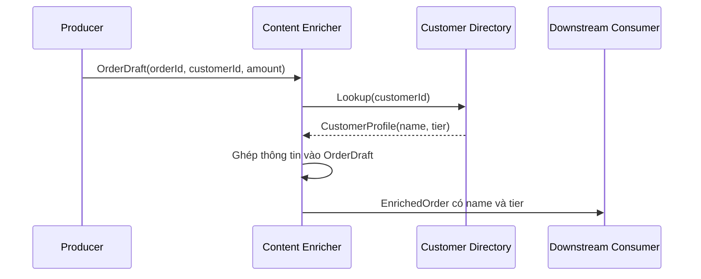
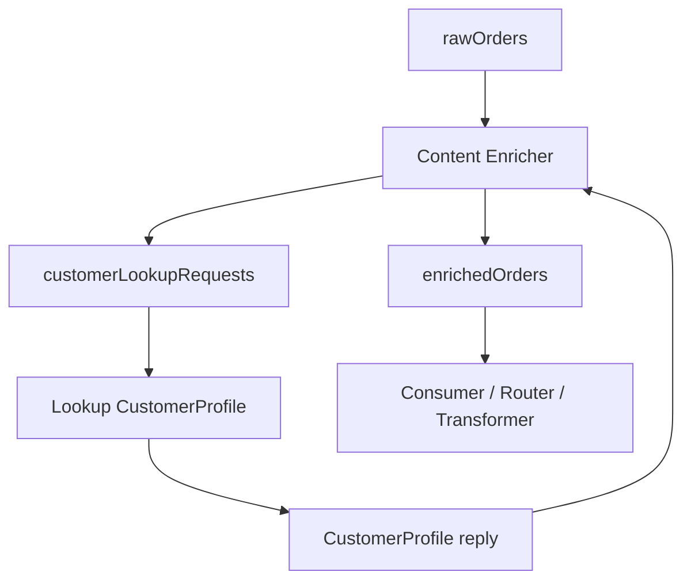
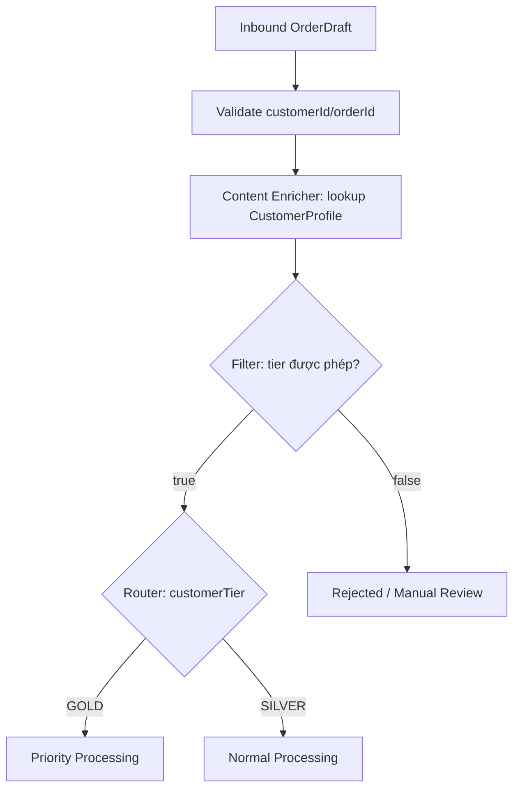
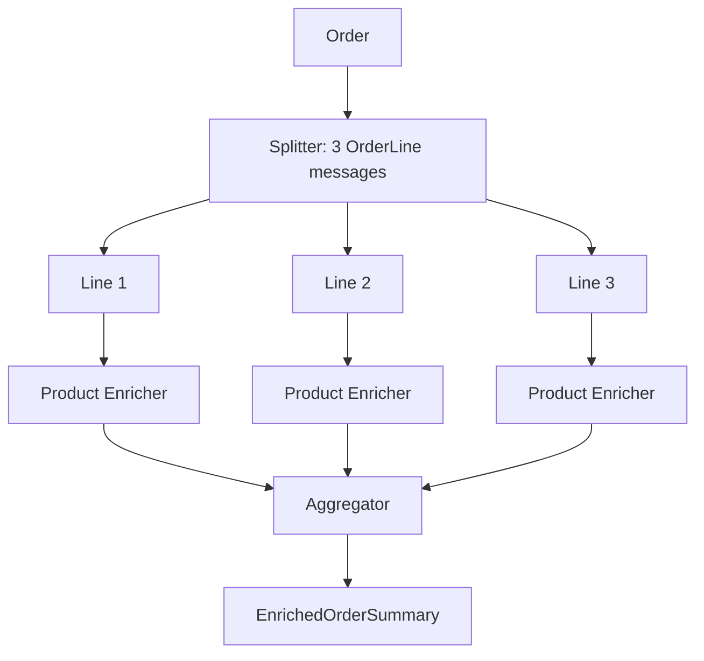

# Content Enricher bổ sung dữ liệu cho message

Một đơn hàng đi vào hệ thống tích hợp có thể chỉ chứa `orderId`, `customerId` và số tiền. Tuy nhiên, bộ xử lý tiếp theo cần thêm tên khách hàng, nhóm chăm sóc hoặc cấp độ ưu tiên. Những thông tin đó có thể đang nằm trong dịch vụ khách hàng, cơ sở dữ liệu khác hoặc một cache nội bộ. Nếu yêu cầu phía gửi phải cung cấp toàn bộ dữ liệu, các hệ thống trở nên phụ thuộc chặt vào nhau; nếu từng consumer tự tra cứu, logic bổ sung dữ liệu bị phân tán và khó kiểm soát lỗi.

**Content Enricher** là mẫu Enterprise Integration Patterns (EIP) nhận một Message, tìm hoặc tính thêm thông tin cần thiết rồi **bổ sung vào nội dung của Message** trước khi chuyển sang bước kế tiếp. Với Spring Integration, một content enricher có thể gửi yêu cầu tới một endpoint tra cứu theo cơ chế request-reply, lấy kết quả và ánh xạ các thuộc tính trả về vào payload của Message gốc.

Bài thuộc chương **Content enricher** của module `SPRING_INTEGRATION_PATTERN`. Mục tiêu module là triển khai Router, Filter, Transformer, Splitter, Aggregator, Gateway, retry, error channel và correlation bằng Spring Integration để tạo luồng thông điệp ít phụ thuộc, dễ mở rộng, kiểm thử được và quan sát rõ từng nhánh. Chủ đề ở đây là **cách bổ sung dữ liệu cho Message trong flow, giữ đúng hợp đồng dữ liệu và xử lý phụ thuộc tra cứu một cách an toàn**.

## 1. Bài toán: Message có dữ liệu lõi nhưng thiếu ngữ cảnh

Giả sử kênh `rawOrders` nhận:

```json
{
  "orderId": "ORD-1001",
  "customerId": "CUS-100",
  "amount": 1250000
}
```

Dịch vụ khách hàng biết thêm:

```json
{
  "customerId": "CUS-100",
  "displayName": "Nguyen An",
  "tier": "GOLD"
}
```

Sau khi bổ sung, nhánh nghiệp vụ nhận một payload có cả dữ liệu lõi và dữ liệu tra cứu:

```json
{
  "orderId": "ORD-1001",
  "customerId": "CUS-100",
  "amount": 1250000,
  "customerName": "Nguyen An",
  "customerTier": "GOLD"
}
```

Trong bài này, các giá trị tên và hạng khách hàng chỉ là **dữ liệu minh họa**. Điều cần hiểu là cách ghép thông tin bổ sung vào một Message đã có, không phải thuật toán phân loại khách hàng.



Content Enricher tập trung vào câu hỏi **“Message cần thêm dữ liệu gì để thực hiện bước sau?”**, thay vì câu hỏi **“Message phải gửi đi đâu?”** của Router hoặc **“Message có được phép đi tiếp?”** của Filter.

## 2. Đầu vào, kết quả tra cứu và đầu ra

Ba đối tượng cần phân biệt:

| Thành phần | Ví dụ | Trách nhiệm |
| --- | --- | --- |
| **Original Message** | `Message<OrderDraft>` | Mang dữ liệu gốc và metadata |
| **Enrichment request** | `customerId="CUS-100"` | Chỉ chứa dữ liệu cần để tra cứu |
| **Enrichment reply** | `CustomerProfile` | Chứa thông tin được bổ sung |
| **Enriched output** | `Message<OrderDraft>` có `customerName`, `customerTier` | Đưa Message đã đủ ngữ cảnh tới downstream |

Không nhất thiết phải gửi cả `OrderDraft` vào dịch vụ tra cứu nếu dịch vụ chỉ cần `customerId`. Việc dùng **request payload nhỏ nhất cần thiết** giúp giảm coupling, hạn chế lộ dữ liệu và làm cho endpoint lookup có hợp đồng rõ ràng.

Content Enricher cũng không đồng nghĩa với việc *thay thế hoàn toàn payload gốc bằng reply*. Nếu kết quả cuối chỉ là `CustomerProfile` và làm mất `orderId`, hệ thống đã không còn thực hiện ý định **bổ sung thông tin vào đơn hàng**. Mapping cần được thiết kế để giữ dữ liệu lõi và chỉ cập nhật những thuộc tính định trước.

### Đọc đúng dữ liệu trước khi ghép

Một trường khách hàng có thể được trả về dưới dạng `null`, chuỗi trống hoặc một giá trị chưa đồng bộ. Content Enricher phải quyết định:

- Chấp nhận giá trị trả về hay từ chối dữ liệu không đầy đủ?
- Có được ghi đè trường đã có trong payload hay không?
- Dữ liệu bổ sung có nguồn gốc và thời điểm hiệu lực nào?
- Sau khi tra cứu thất bại, flow dừng, retry hay dùng giá trị mặc định?

Đây là các **quy tắc nghiệp vụ**, không phải những lựa chọn được framework giải quyết tự động.

## 3. Content Enricher khác Transformer và Header Enricher

| Mẫu / thành phần | Mục tiêu | Ví dụ |
| --- | --- | --- |
| **Content Enricher** | Bổ sung thuộc tính vào payload bằng dữ liệu phụ trợ | `OrderDraft + CustomerProfile → OrderDraft` giàu thông tin |
| **Transformer** | Chuyển đổi biểu diễn payload | `RawOrder → CanonicalOrder` |
| **Header Enricher** | Bổ sung hoặc thay đổi Message headers | Thêm `sourceSystem`, `tenantId`, `traceContext` |
| **Filter** | Chấp nhận hoặc loại Message | Bỏ các đơn không thỏa chính sách |
| **Router** | Chọn channel hoặc recipient | Đơn `EXPORT` đi nhánh xuất khẩu |
| **Content-Based Router** | Định tuyến dựa trên dữ liệu | Chọn xử lý theo nội dung đơn |
| **Service Activator** | Thực hiện thao tác nghiệp vụ | Ghi database hoặc gọi API |

Trong Spring Integration, các cách triển khai có thể dùng chung cơ chế xử lý Message và biểu thức SpEL. Một Transformer tùy chỉnh cũng *có thể* gọi dịch vụ tra cứu rồi tạo payload mới; tuy nhiên, Content Enricher mô tả **ý định bổ sung dữ liệu vào payload hiện có**, cung cấp điểm cấu hình cho yêu cầu tra cứu và ánh xạ thuộc tính.

**Header Enricher không thay thế Content Enricher.** Nếu bộ xử lý downstream cần `customerName` như một phần của domain payload, chỉ đặt thông tin này trong header có thể khiến hợp đồng dữ liệu trở nên khó rõ ràng. Ngược lại, correlation ID và thông tin tracing thường phù hợp hơn ở headers/envelope, không cần nhúng vào mọi DTO nghiệp vụ.

## 4. Cơ chế request-reply của Content Enricher

Một Content Enricher điển hình có các bước:

1. Nhận Message gốc từ input channel.
2. Tạo *request payload* dựa trên dữ liệu gốc, ví dụ lấy `customerId`.
3. Gửi request tới channel của dịch vụ bổ sung dữ liệu.
4. Chờ reply chứa dữ liệu cần bổ sung.
5. Áp dụng mapping từ reply vào các thuộc tính được phép của payload gốc.
6. Chuyển Message đã được làm giàu sang output channel.



**Đây là request-reply ở một chặng trong flow**, không nhất thiết là request-reply giữa hệ thống bên ngoài và API của bạn. Nếu producer dùng Gateway request-reply, phải thiết kế tiếp đường trả lời của toàn flow; việc nhận được reply tra cứu nội bộ chưa phải reply nghiệp vụ cuối cùng cho producer.

Khi endpoint tra cứu chạy đồng bộ qua `DirectChannel`, Content Enricher thường chờ đến lúc handler trả kết quả rồi mới chuyển Message tiếp. Nếu request đi qua queue, executor hoặc mạng, phải quy định **reply timeout, lỗi mạng, retry và cơ chế correlation** phù hợp.

## 5. Thiết kế hợp đồng dữ liệu và chính sách ghi đè

Ví dụ sử dụng hai lớp Java:

```text
OrderDraft
  orderId       (giá trị gốc, không được sửa)
  customerId    (khóa tra cứu)
  amount        (giá trị gốc, không được sửa)
  customerName  (được làm giàu)
  customerTier  (được làm giàu)

CustomerProfile
  displayName
  tier
```

Bảng mapping:

| Nguồn dữ liệu | Target property | Quy tắc |
| --- | --- | --- |
| `OrderDraft.orderId` | `OrderDraft.orderId` | Giữ nguyên |
| `OrderDraft.customerId` | `OrderDraft.customerId` | Giữ nguyên |
| `OrderDraft.amount` | `OrderDraft.amount` | Giữ nguyên |
| `CustomerProfile.displayName` | `OrderDraft.customerName` | Gán nếu dữ liệu tra cứu hợp lệ |
| `CustomerProfile.tier` | `OrderDraft.customerTier` | Gán nếu hạng nằm trong tập được hỗ trợ |

Một **Content Enricher cấu hình trực tiếp vào các property** thường thuận tiện với payload kiểu **JavaBean có setter**. Với payload bất biến như Java record hoặc value object không có setter, cần cân nhắc tạo đối tượng mới qua Transformer/custom mapping phù hợp. Không nên giả định một Content Enricher dựa trên property setter có thể ghi vào một record bất biến.

### 5.1. Nếu payload đã có giá trị?

Giả sử producer gửi `customerTier="PLATINUM"` nhưng directory trả `"GOLD"`. Trước khi viết code cần quy định:

- **Overwrite từ nguồn tin cậy:** directory luôn là nguồn sự thật.
- **Fill-if-missing:** chỉ bổ sung khi target đang rỗng.
- **Reject conflict:** nếu dữ liệu nguồn và dữ liệu tra cứu mâu thuẫn, báo lỗi.
- **Version-aware merge:** so sánh phiên bản hoặc thời điểm hiệu lực.

Không nên để thứ tự áp dụng biểu thức hoặc một giá trị `null` quyết định chính sách một cách tình cờ.

## 6. Ví dụ Spring Integration Java DSL: tra cứu và bổ sung thông tin khách hàng

Ví dụ Java 17+ dưới đây dùng Spring Integration Java DSL, các channel nội bộ và một endpoint lookup giả lập. Không cần HTTP hay database để quan sát cơ chế của Content Enricher.

### 6.1. Cấu hình đầy đủ

```java
package example.integration;

import java.math.BigDecimal;

import org.springframework.context.annotation.Bean;
import org.springframework.context.annotation.Configuration;
import org.springframework.integration.annotation.ServiceActivator;
import org.springframework.integration.channel.DirectChannel;
import org.springframework.integration.channel.QueueChannel;
import org.springframework.integration.config.EnableIntegration;
import org.springframework.integration.dsl.IntegrationFlow;
import org.springframework.messaging.MessageChannel;
import org.springframework.messaging.PollableChannel;

@Configuration
@EnableIntegration
public class CustomerEnrichmentConfiguration {

    // JavaBean mutable để Content Enricher có thể gán các property.
    public static final class OrderDraft {
        private final String orderId;
        private final String customerId;
        private final BigDecimal amount;
        private String customerName;
        private String customerTier;

        public OrderDraft(
                String orderId, String customerId, BigDecimal amount) {
            this.orderId = orderId;
            this.customerId = customerId;
            this.amount = amount;
        }

        public String getOrderId() {
            return orderId;
        }

        public String getCustomerId() {
            return customerId;
        }

        public BigDecimal getAmount() {
            return amount;
        }

        public String getCustomerName() {
            return customerName;
        }

        public void setCustomerName(String customerName) {
            this.customerName = customerName;
        }

        public String getCustomerTier() {
            return customerTier;
        }

        public void setCustomerTier(String customerTier) {
            this.customerTier = customerTier;
        }
    }

    // Reply của lookup: JavaBean chỉ có getter để SpEL đọc property.
    public static final class CustomerProfile {
        private final String displayName;
        private final String tier;

        public CustomerProfile(String displayName, String tier) {
            this.displayName = displayName;
            this.tier = tier;
        }

        public String getDisplayName() {
            return displayName;
        }

        public String getTier() {
            return tier;
        }
    }

    @Bean
    public MessageChannel rawOrders() {
        return new DirectChannel();
    }

    @Bean
    public MessageChannel customerLookupRequests() {
        return new DirectChannel();
    }

    @Bean
    public PollableChannel enrichedOrders() {
        return new QueueChannel(20);
    }

    @Bean
    public IntegrationFlow enrichOrderFlow() {
        return IntegrationFlow.from("rawOrders")
                .enrich(spec -> spec
                        .requestChannel("customerLookupRequests")
                        .requestPayloadExpression("payload.customerId")
                        .propertyExpression(
                                "customerName", "payload.displayName")
                        .propertyExpression(
                                "customerTier", "payload.tier"))
                .channel("enrichedOrders")
                .get();
    }

    @ServiceActivator(inputChannel = "customerLookupRequests")
    public CustomerProfile findCustomer(String customerId) {
        if ("CUS-100".equals(customerId)) {
            return new CustomerProfile("Nguyen An", "GOLD");
        }
        if ("CUS-200".equals(customerId)) {
            return new CustomerProfile("Tran Binh", "SILVER");
        }
        throw new IllegalArgumentException(
                "Unknown customer: " + customerId);
    }
}
```

### 6.2. Đọc cấu hình từng dòng

- `IntegrationFlow.from("rawOrders")` là điểm nhận `Message<OrderDraft>`.
- `.enrich(...)` tạo bước Content Enricher ở giữa flow.
- `.requestChannel("customerLookupRequests")` chỉ định channel cho **yêu cầu tra cứu**.
- `.requestPayloadExpression("payload.customerId")` chọn khóa khách hàng từ **payload của Message ban đầu** để làm request payload.
- `.propertyExpression("customerName", "payload.displayName")` đọc `displayName` từ **reply payload** (`CustomerProfile`) và ghi vào property `customerName` của đối tượng đơn hàng.
- `.propertyExpression("customerTier", "payload.tier")` làm tương tự với trường hạng khách hàng.
- `.channel("enrichedOrders")` chuyển Message sau enrich tới queue để consumer đọc.
- `@ServiceActivator(inputChannel = "customerLookupRequests")` là endpoint tra cứu mẫu trả `CustomerProfile`; Spring Integration dùng kết quả này làm reply cho yêu cầu enrich.

Các biểu thức như `payload.customerId` hoặc `payload.displayName` là **SpEL** trong ngữ cảnh tương ứng. Dù đều bắt đầu bằng `payload`, chúng có thể nhắm vào **hai Message khác nhau**: Message gốc lúc tạo request và Message reply lúc áp dụng mapping.

### 6.3. Vì sao không đặt `outputChannel` cho lookup handler?

Trong kiểu request-reply qua Content Enricher, hạ tầng gửi yêu cầu cùng thông tin cần thiết để **đưa reply trở lại bước enrich**. Handler lookup chỉ cần trả `CustomerProfile`. Ép reply vào một channel khác không thuộc đường trao đổi có thể khiến enricher không nhận được kết quả và chờ đến timeout. Khi thay endpoint bằng HTTP/AMQP/Kafka gateway, phải cấu hình reply/correlation theo adapter và transport thực tế.

### 6.4. Phạm vi của ví dụ

Mã trên thể hiện một luồng đơn giản với `DirectChannel` và `QueueChannel` trong cùng application context, không phải hệ thống tra cứu phân tán có retry, cache hay circuit breaker. Hai customer ID chỉ là dữ liệu cố định để test; với production, thay service mẫu bằng adapter đến nguồn dữ liệu có hợp đồng rõ ràng.

## 7. Gửi Message và đọc dữ liệu đã bổ sung

Ví dụ chạy ứng dụng bằng Spring Context:

```java
package example.integration;

import java.math.BigDecimal;

import org.springframework.context.annotation.AnnotationConfigApplicationContext;
import org.springframework.messaging.Message;
import org.springframework.messaging.MessageChannel;
import org.springframework.messaging.PollableChannel;
import org.springframework.messaging.support.MessageBuilder;

import example.integration.CustomerEnrichmentConfiguration.OrderDraft;

public class CustomerEnrichmentDemo {

    public static void main(String[] args) {
        try (var context = new AnnotationConfigApplicationContext(
                CustomerEnrichmentConfiguration.class)) {

            MessageChannel input =
                    context.getBean("rawOrders", MessageChannel.class);
            PollableChannel output =
                    context.getBean("enrichedOrders", PollableChannel.class);

            OrderDraft order = new OrderDraft(
                    "ORD-1001", "CUS-100",
                    new BigDecimal("1250000"));

            Message<OrderDraft> message = MessageBuilder
                    .withPayload(order)
                    .setHeader("eventId", "evt-1001")
                    .setHeader("businessOrderId", "ORD-1001")
                    .build();

            boolean sent = input.send(message);
            Message<?> enriched = output.receive(0);

            if (!sent || enriched == null) {
                throw new IllegalStateException(
                        "Expected enriched order in output channel");
            }

            OrderDraft result = (OrderDraft) enriched.getPayload();
            System.out.println(result.getOrderId());
            System.out.println(result.getCustomerName()); // Nguyen An
            System.out.println(result.getCustomerTier()); // GOLD
            System.out.println(
                    enriched.getHeaders().get("eventId")); // evt-1001
        }
    }
}
```

Đầu ra mong đợi:

```text
ORD-1001
Nguyen An
GOLD
evt-1001
```

Một điểm quan trọng: Content Enricher kiểu gán property có thể **làm thay đổi đối tượng payload mutable** đang được giữ tham chiếu ở nơi khác. Trong ví dụ, hãy kiểm tra dữ liệu trong **Message đầu ra** thay vì phụ thuộc vào giả định có/không có object identity giữa đầu vào và đầu ra. Khi một payload có thể được chia sẻ cho nhiều subscriber hoặc thread, cân nhắc dùng copy/immutable DTO cùng custom Transformer phù hợp.

## 8. Lookup thất bại: không được biến thành dữ liệu hợp lệ giả

Có hai nhóm lỗi cơ bản:

**Lỗi dữ liệu:** `customerId` không tồn tại, sai định dạng hoặc khách hàng không đủ điều kiện. Retry cùng một ID không nhất thiết giúp ích.

**Lỗi hạ tầng:** HTTP timeout, database không sẵn sàng, connection bị từ chối hoặc executor quá tải. Những lỗi này có thể phục hồi, nhưng cần giới hạn retry và thời gian chờ.

| Tình huống | Hành vi cần quyết định | Gợi ý |
| --- | --- | --- |
| Customer không tồn tại | Từ chối hay cho phép đi tiếp với thông tin thiếu? | Fail fast hoặc nhánh kiểm tra |
| Customer thiếu `tier` | Có mặc định hay báo lỗi? | Theo hợp đồng, không tự đặt `GOLD` |
| Lookup timeout | Chờ bao lâu, retry bao nhiêu lần? | Deadline, retry có backoff |
| Lookup trả dữ liệu cũ | Có cần version/TTL? | Kiểm soát freshness |
| Reply sai schema | Mapping có được phép tiếp tục không? | Validation của reply |
| Customer service trả 5xx | Là lỗi tạm thời hay lỗi toàn hệ thống? | Error flow/circuit breaker |
| Không có reply | Gateway/enricher kết thúc thế nào? | Timeout rõ, không chờ vô hạn |

**Không nên lặng lẽ bổ sung `customerTier="STANDARD"` cho mọi lỗi tra cứu** nếu downstream dùng tier để phân loại rủi ro, giá hoặc quyền lợi. Giá trị mặc định là **một quyết định nghiệp vụ**, cần được chấp thuận và có marker cho biết dữ liệu thực hay suy diễn.

### 8.1. Thiết kế fallback

Một số hệ thống cho phép lookup lỗi nhưng vẫn tiếp tục một nhánh có quyền hạn hạn chế:

```text
lookup failed
    ↓
mark enrichmentStatus = UNAVAILABLE
    ↓
route to manualReviewOrders
```

Nếu dùng chiến lược này, phải biểu diễn trạng thái rõ ràng trong payload/header tin cậy. Không cho Message chưa có dữ liệu enrichment đi vào `approvedOrders` chỉ vì cấu hình catch-all nuốt mọi exception.

### 8.2. Đừng coi discard và error là như nhau

Một **Filter** trả `false` có thể bỏ Message hoặc đưa vào discard channel. Một Content Enricher không nhận được dữ liệu cần thiết thường có **lỗi chuyển đổi/tra cứu**, có thể lan dưới dạng exception hoặc `ErrorMessage` tùy ranh giới đồng bộ/bất đồng bộ. Không mặc định lỗi Enricher luôn đi vào `discardChannel`.

## 9. Timeout, retry và ranh giới đồng bộ/bất đồng bộ

Với các channel trong ví dụ, endpoint lookup chạy đồng bộ; producer gửi Message vào `rawOrders` thường phải đợi thao tác lookup rồi mới thấy quá trình gửi hoàn tất. Nếu tra cứu là một HTTP call chậm, luồng đồng bộ có thể giữ thread rất lâu.

Một thiết kế thực tế cần xem xét:

1. **Request timeout:** tối đa bao lâu để gửi được yêu cầu tra cứu?
2. **Reply timeout:** tối đa bao lâu để chờ một kết quả tra cứu?
3. **Retry scope:** chỉ gọi lại lookup hay phát lại toàn bộ Message?
4. **Backoff và giới hạn thử:** tránh gây quá tải customer service khi gặp sự cố.
5. **Circuit breaker/bulkhead:** giới hạn ảnh hưởng khi dependency chậm hoặc không khả dụng.
6. **Tính lặp lại:** dùng cùng customer ID ở hai thời điểm có thể trả dữ liệu khác nhau.

Chú ý phân biệt **timeout vận chuyển yêu cầu** và **timeout đợi reply**. Nếu không nhận được reply, Gateway hoặc enricher có thể ném lỗi hoặc đi vào error flow theo cấu hình; không coi một `null` reply là profile khách hàng thành công.

### Nếu lookup là hoạt động đọc thì có cần idempotency không?

Lookup thuần đọc thường ít rủi ro side effect khi retry hơn một lệnh ghi. Tuy nhiên, Message sau enrich có thể được gửi tới endpoint **có side effect** và bị phát lại từ đầu khi sự cố xảy ra. Vì vậy:

- Giữ `eventId` hoặc khóa nghiệp vụ ổn định qua retry.
- Không dựa vào `MessageHeaders.ID` như định danh duy nhất xuyên lần phát lại.
- Thiết kế idempotency ở những bước ghi/đặt hàng/gửi thông báo sau enrichment.
- Nếu cần lặp lại chính xác kết quả lịch sử, lưu phiên bản hoặc snapshot dữ liệu lookup thay vì luôn đọc giá trị mới nhất.

## 10. Payload mutable, immutable và kiểm soát dữ liệu chia sẻ

Content Enricher dùng mapping tới property của payload thường phù hợp với **JavaBean có setter**. Nhưng trong kiến trúc có Publish–Subscribe, cùng một payload mutable có thể được nhiều subscriber giữ tham chiếu; nếu một nhánh bổ sung `customerTier`, nhánh khác có thể quan sát trạng thái thay đổi mà không mong muốn.

### 10.1. Khi nào dùng immutable payload?

Với DTO bất biến, ta có thể tạo **một đối tượng mới** sau lookup:

```java
public record OrderDraftImmutable(
        String orderId,
        String customerId,
        BigDecimal amount) {
}

public record EnrichedOrder(
        String orderId,
        String customerId,
        BigDecimal amount,
        String customerName,
        String customerTier) {
}

public EnrichedOrder merge(
        OrderDraftImmutable original, CustomerProfile profile) {
    return new EnrichedOrder(
            original.orderId(),
            original.customerId(),
            original.amount(),
            profile.getDisplayName(),
            profile.getTier());
}
```

Đây là **đoạn minh họa mapping Java thuần**, không thay thế cấu hình flow ở mục 6. Với payload bất biến, có thể dùng Transformer/custom processor làm bước hợp nhất sau lookup hoặc cơ chế enrich có khả năng tạo payload mới theo API phù hợp của phiên bản dự án. Không nên ép một setter-based Enricher ghi vào các trường `final`.

### 10.2. Chọn hướng nào?

| Tiêu chí | Bean mutable được enrich property | Tạo DTO bất biến mới |
| --- | --- | --- |
| Cấu hình property-based enrichment | Trực tiếp, ít code | Cần bước merge tùy chỉnh |
| Chia sẻ payload giữa subscriber | Cần cẩn trọng với mutation | Ít rủi ro mutation |
| Phân biệt trước/sau enrich | Cần kiểm soát reference | Rõ kiểu dữ liệu |
| Mapping phức tạp | Có thể khó nếu nhiều quy tắc | Có thể tập trung trong factory/constructor |
| Kiểm thử | Test các property thay đổi và giữ nguyên | So sánh object trước/sau dễ hơn |

Không có một lựa chọn duy nhất cho mọi dự án. Cần ưu tiên tính đúng đắn của hợp đồng dữ liệu và ranh giới xử lý song song.

## 11. Content Enricher với Header Enricher, Filter và Router

Một flow có thể kết hợp nhiều EIP:



**Thứ tự quan trọng:** nếu Router dựa trên `customerTier`, phải chạy sau bước bổ sung tier. Nếu Filter được dùng để loại những yêu cầu thiếu mã khách hàng, nó có thể chạy **trước lookup** để không lãng phí một request.

Một Header Enricher có thể bổ sung metadata từ thông tin đã xác minh, ví dụ `customerSegment` để routing nội bộ. Nhưng khi một giá trị có ý nghĩa nghiệp vụ cần được lưu với entity/command, thường nên xuất hiện trong payload canonical.

### 11.1. Không để client tự áp đặt dữ liệu enrichment

Một client có thể gửi header `customerTier=GOLD`. Điều này không chứng minh khách hàng thực sự thuộc hạng GOLD. Hệ thống nên dùng nguồn thông tin đáng tin cậy, kiểm soát quyền truy cập và không cho upstream không đáng tin ghi đè các thuộc tính ảnh hưởng đến hạn mức, giá, chiết khấu hoặc quyền lợi.

### 11.2. Lookup phục vụ nhiều nhánh

Nếu ba nhánh đều cần cùng `CustomerProfile`, có thể enrich **một lần trước fan-out** thay vì để từng subscriber gọi directory. Tuy nhiên cần xét phạm vi dữ liệu: một nhánh không nên nhận thông tin nhạy cảm mà nó không cần. Đôi khi enrich riêng sau routing với dữ liệu tối thiểu lại an toàn hơn.

## 12. Splitter, Aggregator và correlation sau khi enrich

Giả sử Splitter chia một đơn có ba dòng hàng thành ba Message con. Mỗi dòng hàng cần bổ sung thông tin sản phẩm rồi mới được tính phí:



Trong flow này, các Message con thường cần **correlation/sequence metadata** để Aggregator biết chúng thuộc cùng nhóm và khi nào đủ phần tử. Content Enricher **không tự làm công việc Splitter hay Aggregator**: nó chỉ bổ sung dữ liệu cho từng Message đang xử lý.

Các điều cần kiểm tra:

- `correlationId` vẫn gắn đúng nhóm sau lookup.
- `sequenceNumber` và `sequenceSize` không bị vô tình làm mất khi tạo Message mới.
- Một lookup lỗi không khiến Aggregator chờ mãi mà không có timeout/release policy.
- Nếu một Message con được retry, tránh tạo hai kết quả cho cùng một phần tử.
- Dữ liệu bổ sung thuộc về đúng product/customer trong Message con, không bị trộn giữa hai request đồng thời.

### 12.1. Vì sao phải giữ correlation của lookup?

Khi nhiều Message đang gọi lookup bất đồng bộ, Reply A phải trở lại đúng Enricher đang chờ A, không được ghép vào Order B. Với `DirectChannel` đồng bộ, mối liên hệ request-reply tương đối trực tiếp; với broker hoặc giao thức bất đồng bộ, cần thiết kế **reply address, request ID và correlation ID** theo hạ tầng tích hợp.

Không mặc định Spring Integration tự chuyển mọi header qua một adapter khác giao thức. Header mapper có thể loại bỏ header nội bộ hoặc không serialize được đối tượng Java như `replyChannel`.

## 13. Cache, batching và chi phí của enrichment

Tra cứu bổ sung dữ liệu làm phát sinh thêm dependency và thường thêm latency vào flow. Nếu một nghìn Message cùng chứa `customerId=CUS-100`, việc gọi directory một nghìn lần có thể không cần thiết.

Một vài chiến lược:

| Chiến lược | Lợi ích | Rủi ro |
| --- | --- | --- |
| Cache theo customer ID | Giảm số lần lookup và độ trễ | Dữ liệu stale hoặc cache key thiếu tenant |
| Cache có TTL | Giới hạn độ cũ theo thời gian | TTL không bảo đảm nhất quán tuyệt đối |
| Batch lookup | Giảm số request mạng khi nhiều Message có thể gom | Thêm độ trễ chờ batch; mapping kết quả phức tạp |
| Enrich trước fan-out | Tránh tra cứu lặp giữa các subscriber | Có thể gửi quá nhiều dữ liệu đến nhánh không cần |
| Enrich sau Router | Chỉ nhánh cần dữ liệu mới lookup | Cùng key có thể được tra cứu nhiều lần |
| Circuit breaker | Giới hạn tác động khi dependency lỗi | Cần chính sách fallback rõ |

### 13.1. Cache key phải phản ánh ngữ cảnh

Nếu cùng `customerId` tồn tại ở nhiều tenant, cache key chỉ là ID có thể trả sai thông tin. Một khóa có thể cần:

```text
cacheKey = tenantId + ":" + customerId
```

Nếu dữ liệu enrichment ảnh hưởng đến giá hoặc quyền hạn, cần thận trọng với cache stale và tính nhất quán của nguồn. Một số quyết định cần dữ liệu mới nhất hoặc phiên bản có hiệu lực, không thể chỉ dựa vào TTL.

## 14. Kiểm thử Content Enricher với JUnit 5

Một bài unit test riêng cho hàm `merge()` có ích, nhưng không chứng minh **request đã được gửi đến lookup channel, reply đã được dùng, và Message đầu ra còn header**. Do đó nên có integration test qua các channel thực tế.

### 14.1. Test thành công với Spring Context

Ví dụ sau sử dụng cấu hình tại mục 6:

```java
package example.integration;

import static org.junit.jupiter.api.Assertions.*;

import java.math.BigDecimal;

import org.junit.jupiter.api.Test;
import org.springframework.context.annotation.AnnotationConfigApplicationContext;
import org.springframework.messaging.Message;
import org.springframework.messaging.MessageChannel;
import org.springframework.messaging.PollableChannel;
import org.springframework.messaging.support.MessageBuilder;

import example.integration.CustomerEnrichmentConfiguration.OrderDraft;

class CustomerEnrichmentIntegrationTest {

    @Test
    void enrichesCustomerFieldsWithoutLosingOriginalOrderData() {
        try (var context = new AnnotationConfigApplicationContext(
                CustomerEnrichmentConfiguration.class)) {

            MessageChannel input =
                    context.getBean("rawOrders", MessageChannel.class);
            PollableChannel output =
                    context.getBean("enrichedOrders", PollableChannel.class);

            OrderDraft order = new OrderDraft(
                    "ORD-1001", "CUS-100",
                    new BigDecimal("1250000"));

            Message<OrderDraft> request = MessageBuilder
                    .withPayload(order)
                    .setHeader("eventId", "evt-1001")
                    .setHeader("businessOrderId", "ORD-1001")
                    .build();

            assertTrue(input.send(request));

            Message<?> received = output.receive(0);
            assertNotNull(received);
            assertInstanceOf(OrderDraft.class, received.getPayload());

            OrderDraft enriched = (OrderDraft) received.getPayload();
            assertEquals("ORD-1001", enriched.getOrderId());
            assertEquals("CUS-100", enriched.getCustomerId());
            assertEquals(new BigDecimal("1250000"), enriched.getAmount());
            assertEquals("Nguyen An", enriched.getCustomerName());
            assertEquals("GOLD", enriched.getCustomerTier());
            assertEquals("evt-1001", received.getHeaders().get("eventId"));
            assertEquals(
                    "ORD-1001",
                    received.getHeaders().get("businessOrderId"));
            assertNull(output.receive(0));
        }
    }

    @Test
    void unknownCustomerMustNotBePublishedAsEnrichedOrder() {
        try (var context = new AnnotationConfigApplicationContext(
                CustomerEnrichmentConfiguration.class)) {
            MessageChannel input =
                    context.getBean("rawOrders", MessageChannel.class);
            PollableChannel output =
                    context.getBean("enrichedOrders", PollableChannel.class);

            OrderDraft order = new OrderDraft(
                    "ORD-1002", "UNKNOWN", BigDecimal.TEN);

            assertThrows(RuntimeException.class, () -> input.send(
                    MessageBuilder.withPayload(order).build()));
            assertNull(output.receive(0));
        }
    }
}
```

Ví dụ dùng `DirectChannel` cho input và lookup, còn output là `QueueChannel` không có consumer khác. Vì vậy việc `send()` và lookup diễn ra đồng bộ, `receive(0)` có thể quan sát ngay kết quả sau khi gửi. Nếu thêm executor/broker/poller, cần chờ kết quả hoặc error flow bằng timeout hữu hạn, không chỉ `assertThrows` quanh `send()`.

Test lỗi chỉ khẳng định có exception ở flow đồng bộ; Spring Integration có thể bọc nguyên nhân thành một `MessagingException`. Không nên viết test phụ thuộc vào toàn bộ chuỗi exception message, vì nó có thể đổi theo phiên bản framework.

### 14.2. Những kịch bản cần bổ sung

1. **Hai khách hàng khác nhau:** `CUS-100` nhận `GOLD`, `CUS-200` nhận `SILVER`.
2. **Không mất dữ liệu gốc:** `orderId`, `customerId`, `amount` không thay đổi.
3. **Header propagation:** `eventId`, `businessOrderId`, correlation header còn ở output khi cần.
4. **Reply thiếu trường:** `displayName` hoặc `tier` thiếu → chính sách reject/fallback rõ ràng.
5. **Tra cứu không tồn tại:** không được phát payload với thông tin giả là hợp lệ.
6. **Lookup timeout:** flow trả lỗi hoặc trạng thái chờ theo hợp đồng, không treo mãi.
7. **Nhiều Message đồng thời:** reply không bị ghép nhầm giữa các đơn.
8. **Giá trị cũ trong target:** verify chính sách overwrite/fill-if-missing.
9. **Retry:** không làm lại side effect nghiệp vụ đã hoàn tất ở downstream.
10. **Cache theo tenant:** không trả profile của tenant khác khi customer ID trùng nhau.
11. **Splitter/Aggregator:** correlation và số phần tử chờ không bị mất sau enrich.
12. **Gateway:** nếu flow yêu cầu reply, kết quả cuối phải được trả về đúng request.

## 15. Observability: biết Message được bổ sung dữ liệu từ đâu

Khi một Message sau enrich có thông tin sai, cần phân biệt **lỗi lookup**, **lỗi mapping** và **lỗi dữ liệu nguồn**.

Log gợi ý:

```json
{
  "stage": "customer-content-enricher",
  "eventId": "evt-1001",
  "businessOrderId": "ORD-1001",
  "lookupKey": "CUS-100",
  "lookupSource": "customer-directory",
  "lookupResult": "FOUND",
  "enrichedFields": ["customerName", "customerTier"],
  "result": "SUCCESS"
}
```

Đây là **schema log do ứng dụng lựa chọn**, không phải nội dung Spring Integration tự tạo. Chỉ nên ghi những trường đủ để chẩn đoán, không log nguyên hồ sơ khách hàng hoặc thông tin nhạy cảm.

| Chỉ số gợi ý | Dùng để |
| --- | --- |
| `enricher.input.count` | Đếm Message đi vào bước enrich |
| `enricher.success.count` | Đếm trường hợp bổ sung dữ liệu thành công |
| `enricher.lookup.failure.count` | Phân biệt lỗi tra cứu với lỗi mapping |
| `enricher.mapping.failure.count` | Theo dõi lỗi SpEL/property/schema |
| `enricher.lookup.duration` | Đo độ trễ của nguồn bổ sung dữ liệu |
| `enricher.cache.hit` | Đánh giá hiệu quả cache |
| `enricher.timeout.count` | Cảnh báo nguồn lookup không đáp ứng đúng hạn |
| `channel.backlog` | Quan sát queue sau enricher hoặc nhánh xử lý lỗi |

Các tên metric chỉ là **đề xuất**, không mặc định có sẵn trong Micrometer/Spring Boot Actuator. Tránh dùng `eventId` hoặc `customerId` làm metric tags có cardinality cao; dùng chúng trong log hoặc tracing có kiểm soát.

### 15.1. Điều tra một Message bị dừng

Trình tự:

1. Message gốc có đủ `customerId` để tra cứu không?
2. Enricher đã gửi request tới đúng `customerLookupRequests` chưa?
3. Lookup handler có nhận request và trả reply đúng kiểu không?
4. Reply có mang dữ liệu hợp lệ, đúng customer/tenant không?
5. Biểu thức `propertyExpression` có đọc đúng trường trong reply không?
6. Target payload có setter/thuộc tính ghi được không?
7. Có exception, timeout hoặc queue/reply channel bị nghẽn không?
8. Nếu output đã có Message, downstream nhận đúng header và kiểu payload chưa?

## 16. Những lỗi triển khai thường gặp

| Biểu hiện | Nguyên nhân | Cách khắc phục |
| --- | --- | --- |
| `customerName` không được bổ sung | Mapping sai tên property hoặc reply thiếu field | Kiểm tra SpEL, getter/setter và reply schema |
| Enricher chờ reply quá lâu | Lookup handler không trả kết quả hoặc reply bị chuyển sai kênh | Kiểm tra request/reply channel và timeout |
| Message gốc bị mất trường | Dùng reply làm payload thay thế thay vì ghép | Chọn property mapping đúng ý định |
| Enrichment thất bại với record bất biến | Target không có writable property | Dùng custom merge/Transformer tạo DTO mới |
| Hai Message dùng lẫn profile | Correlation sai trong đường lookup bất đồng bộ | Gắn request ID, reply correlation và test concurrency |
| Router chọn sai quyền lợi | Dùng tier do client tự khai thay vì dữ liệu tin cậy | Xác thực nguồn enrichment, phân quyền |
| Khó phục hồi khi directory lỗi | Không có timeout, retry/queue lỗi hoặc fallback | Thiết kế error flow và backoff rõ |
| Nhánh khác thấy payload bị thay đổi | Mutation object dùng chung | Dùng DTO bất biến/copy phù hợp |
| Dữ liệu cũ hơn chính sách hiện tại | Cache stale hoặc snapshot thiếu version | TTL, invalidation hoặc truy vấn theo version |
| Hệ thống chậm khi lượng Message tăng | Tra cứu một lần cho mọi Message không có cache/batch | Đo latency, cache đúng ngữ cảnh và giới hạn tải |
| Aggregator chờ thiếu phần tử | Một Message con enrich lỗi hoặc mất correlation | Giữ metadata, timeout/release strategy |
| Retry gây side effect trùng | Phát lại toàn flow không có idempotency | Khóa sự kiện ở các bước nghiệp vụ có side effect |

## 17. Checklist xây dựng Content Enricher

- **Xác định dữ liệu cần bổ sung:** trường nào thiếu, nguồn tin cậy nào cung cấp?
- **Tách request lookup khỏi payload gốc:** chỉ gửi dữ liệu cần để tra cứu.
- **Quy định mapping rõ ràng:** trường reply nào ghi vào target property nào?
- **Bảo vệ dữ liệu lõi:** không vô tình thay `orderId`, `amount` hoặc danh tính nguồn.
- **Chọn mutable hay immutable có chủ đích:** tránh mutation bất ngờ trên Message chia sẻ.
- **Phân loại lookup failure và business rejection:** không tự điền giá trị giả cho dữ liệu không biết.
- **Có timeout và retry phù hợp:** không để một nguồn phụ trợ làm treo toàn bộ flow.
- **Kiểm soát security và cache:** lookup đúng tenant, không lộ trường dữ liệu nhạy cảm.
- **Giữ metadata nghiệp vụ và correlation:** đặc biệt khi đi qua Gateway, Splitter và Aggregator.
- **Kiểm thử trên channel thật:** xác nhận Message đã enrich đến đúng output, không chỉ test hàm mapping.
- **Theo dõi được kết quả:** lỗi lookup, lỗi mapping, độ trễ, cache hit và backlog.

**Content Enricher giúp bổ sung ngữ cảnh vào Message mà không bắt mỗi producer hoặc consumer phải biết toàn bộ dữ liệu ở các hệ thống khác.** Khi yêu cầu tra cứu, ánh xạ thuộc tính, xử lý lỗi, mutation và correlation được thiết kế minh bạch, nó trở thành một bước tích hợp dễ kiểm thử, dễ quan sát và có thể mở rộng cùng flow Spring Integration.
