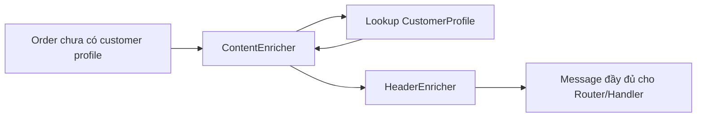
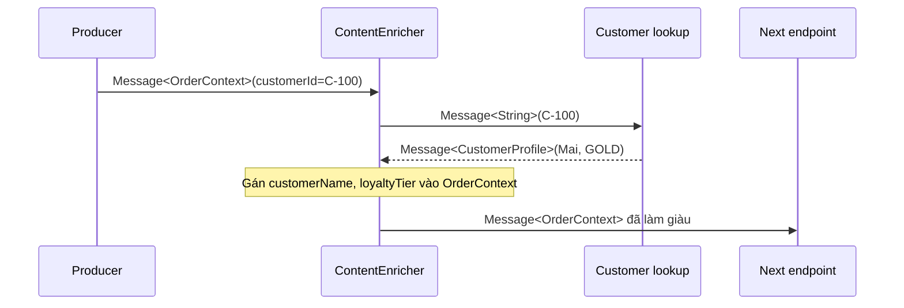
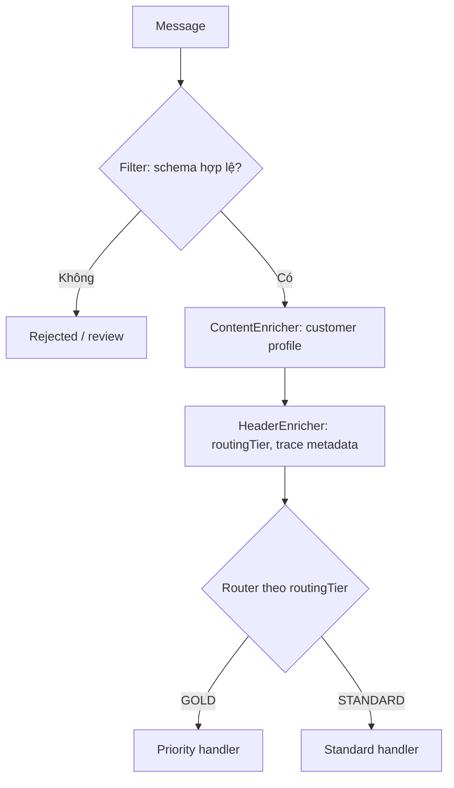
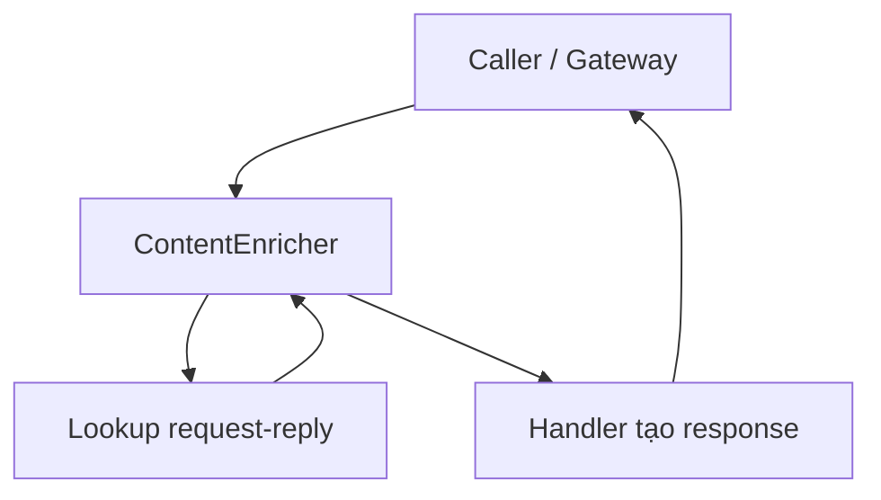

# Enrich payload và enrich header trong Spring Integration

## Mục tiêu bài học

Một message đặt hàng thường chỉ chứa những thông tin do producer biết tại thời điểm gửi: mã đơn, mã khách hàng và các dòng hàng. Trước khi tính phí vận chuyển hoặc định tuyến xử lý ưu tiên, hệ thống có thể phải **bổ sung** tên khách hàng, hạng thành viên, vùng giao hàng và những metadata phục vụ Router/observability. Ta không muốn từng downstream handler phải tự gọi cùng một dịch vụ tra cứu hoặc tự suy đoán dữ liệu còn thiếu.

**Content Enricher** là mẫu Enterprise Integration Patterns (EIP) dùng để bổ sung dữ liệu vào message. Spring Integration cung cấp hai hướng chính:

- **Payload enrichment:** bổ sung hoặc cập nhật thuộc tính **bên trong payload**, thường bằng dữ liệu lấy từ một luồng request-reply khác.
- **Header enrichment:** thêm hoặc cập nhật **metadata của message**, ví dụ thông tin nguồn, khóa định tuyến, mức ưu tiên hoặc phiên bản chính sách.

Bài thuộc chương **Content enricher** trong module **SPRING_INTEGRATION_PATTERN**. Module học cách triển khai Router, Filter, Transformer, Splitter, Aggregator, Gateway, retry, error channel và correlation để xây luồng thông điệp ít phụ thuộc, dễ mở rộng, có thể kiểm thử và theo dõi từng nhánh xử lý.

Sau bài học, bạn có thể:

1. Phân biệt chính xác phần nào của `Message<T>` được làm giàu: payload hay headers.
2. Dùng `ContentEnricher` và Java DSL `.enrich(...)` để tra cứu dữ liệu bên ngoài rồi gán vào thuộc tính payload.
3. Dùng `HeaderEnricher` và Java DSL `.enrichHeaders(...)` để bổ sung header tĩnh, từ SpEL hoặc từ hàm.
4. Hiểu cơ chế **request-channel → reply → property expression** và cách `requestPayloadExpression` thay payload gửi đi tra cứu.
5. Thiết kế rõ quy tắc **overwrite**, xử lý dữ liệu thiếu, timeout và sai kiểu.
6. Kiểm thử sự thay đổi của payload, tính đúng đắn của headers và việc giữ `traceId`/`correlationId` bằng JUnit.
7. Nhận biết tác động đến Router, Filter, Gateway, Splitter/Aggregator, retry, idempotency và an toàn dữ liệu.

## 1. “Enrich” khác “replace” như thế nào?

Giả sử inbound event:

```text
Message<OrderContext>
  payload:
    orderId:       "ORD-42"
    customerId:    "C-100"
    customerName:  null
    loyaltyTier:   null

  headers:
    traceId:        "trace-42"
    correlationId:  "batch-7"
    routingTier:    null
```

Một bước tra cứu customer profile trả về:

```text
CustomerProfile:
  displayName: "Mai"
  tier:        "GOLD"
```

Message sau enrichment:

```text
Message<OrderContext>
  payload:
    orderId:       "ORD-42"
    customerId:    "C-100"
    customerName:  "Mai"       <-- enrich payload
    loyaltyTier:   "GOLD"      <-- enrich payload

  headers:
    traceId:          "trace-42"
    correlationId:    "batch-7"
    enrichmentSource: "customer-catalog"  <-- enrich header
    routingTier:      "GOLD"              <-- enrich header
```

**Bản chất của enrichment:** giữ đối tượng thông tin gốc trong flow, đồng thời bổ sung các dữ kiện mà downstream cần. Nó khác với kiểu Transformer thay hoàn toàn mô hình dữ liệu từ `RawOrder` sang `CanonicalOrder`, mặc dù trên nền tảng Spring Integration, enrichers cũng là những thành phần có khả năng biến đổi message.



### So sánh nhanh

| Tiêu chí | Enrich payload | Enrich header |
| --- | --- | --- |
| Cần thêm gì? | Dữ liệu nghiệp vụ trong `payload` | Metadata trong `headers` |
| Ví dụ | `customerName`, `loyaltyTier`, `shippingZone` | `routingTier`, `enrichmentSource`, `policyVersion` |
| Thành phần Spring Integration | `ContentEnricher` / `.enrich(...)` | `HeaderEnricher` / `.enrichHeaders(...)` |
| Nguồn giá trị | Literal, SpEL, function hoặc **reply** từ request channel | Literal, SpEL, function, message processor |
| Đối tượng bị tác động | Các property/setter của payload hoặc các entry Map | Bộ headers của output message |
| Cần tra cứu ngoài? | Thường có, nhưng **không bắt buộc** | Thường không, nhưng có thể |
| Rủi ro cần chú ý | Mutation dữ liệu, timeout, thiếu reply, field ghi đè | Header spoofing, không overwrite, rò rỉ header kỹ thuật |
| Giá trị xuống downstream | Bản payload được bổ sung | Metadata hỗ trợ routing, tracing, điều khiển flow |

Cả hai có thể nằm trong **cùng một flow**. Một `ContentEnricher` cũng hỗ trợ gán header; tuy nhiên khi bài toán chủ yếu là thêm metadata, dùng `HeaderEnricher` chuyên biệt thường rõ mục đích hơn.

## 2. Cấu trúc của Spring Message

Spring Messaging biểu diễn message bằng `Message<T>` gồm hai phần chính:

```java
import org.springframework.messaging.Message;

void inspect(Message<?> message) {
    Object payload = message.getPayload();
    Object traceId = message.getHeaders().get("traceId");
}
```

- **Payload:** dữ liệu nghiệp vụ được consumer xử lý.
- **Headers:** metadata hỗ trợ định tuyến, kiểm soát reply/error, correlation và quan sát.

Một số header cần phân loại:

| Header | Nguồn/ý nghĩa | Chính sách enrichment |
| --- | --- | --- |
| `traceId` | Định danh trace do hệ thống thiết lập | Thường giữ, không ghi đè tùy ý |
| `correlationId` | Nhóm kết quả trong Splitter/Aggregator | Không thay nếu vẫn cùng nhóm |
| `sequenceNumber` / `sequenceSize` | Vị trí và số phần của một nhóm | Giữ theo contract sequence |
| `replyChannel` | Đích nhận reply của request-reply | Bảo toàn trong flow nội bộ nếu cần |
| `errorChannel` | Đích xử lý lỗi ở những topology hỗ trợ | Không thay bằng header client tự gửi |
| `tenantId` | Ngữ cảnh tenant đã xác thực | Lấy từ vùng tin cậy, không tin vô điều kiện |
| `routingTier` | Phân loại phục vụ Router | Có thể tính sau khi enrich payload |
| `enrichmentSource` | Ghi nhận nguồn làm giàu dữ liệu | Có thể thêm/ghi đè theo chính sách |
| `schemaVersion` | Phiên bản biểu diễn dữ liệu | Chỉ cập nhật khi thực sự thay đổi contract |

Đừng dùng `MessageHeaders.ID` hoặc `timestamp` thay cho `orderId`/`eventId` bền vững. Message có thể được tạo lại qua nhiều endpoint; cần định danh nghiệp vụ và correlation riêng.

## 3. Payload enricher: lấy dữ liệu từ một luồng request-reply

Cơ chế điển hình của Spring Integration `ContentEnricher` gồm bốn bước:

1. Nhận **message gốc** cần làm giàu.
2. Tạo một **lookup request** đến `requestChannel`; có thể gửi toàn bộ payload hoặc một phần như `customerId`.
3. **Chờ reply** từ luồng lookup.
4. Đánh giá các `propertyExpression` dựa trên **reply message** để gán thuộc tính tương ứng vào payload mục tiêu; rồi phát output message.



Đây là một **request-reply bên trong flow**, không phải publish-subscribe. Nếu lookup không trả reply, bước enrichment có thể chờ đến timeout và không thể mặc nhiên tạo dữ liệu đúng.

### Ý nghĩa của `requestPayloadExpression`

Mặc định lookup request thường sử dụng payload gốc. Với:

```java
.requestPayloadExpression("payload.customerId")
```

request gửi tới lookup chỉ mang `customerId` (ví dụ `"C-100"`) làm payload. **Headers liên quan vẫn được mang theo request theo cơ chế của enricher**, nhưng không nên chuyển các header nhạy cảm sang một hệ thống ngoài vùng tin cậy mà không dùng header mapper/allowlist.

### Cực kỳ quan trọng: expression gán property đọc từ reply

Với reply:

```java
record CustomerProfile(String displayName, String tier) {}
```

có thể dùng:

```java
.propertyExpression("customerName", "payload.displayName()")
.propertyExpression("loyaltyTier", "payload.tier()")
```

Hai expression **đọc `payload` của reply lookup**, không mặc nhiên đọc payload OrderContext ban đầu. Nếu không có `requestChannel`, ngữ cảnh evaluation khác: nó có thể là incoming message. Phân biệt ngữ cảnh là chìa khóa để tránh lấy sai dữ liệu.

## 4. Ví dụ Java DSL hoàn chỉnh: Enrich payload rồi enrich header

Ví dụ dưới đây tự tạo Customer lookup bằng một flow giả lập để tập trung vào hành vi của Spring Integration. Không cần database hay HTTP server ngoài.

Các message:

- Input: `OrderContext(orderId, customerId)`, còn thiếu customer profile.
- Lookup request: `String customerId`.
- Lookup reply: `CustomerProfile(displayName, tier)`.
- Output: `OrderContext` có customerName và loyaltyTier, đồng thời có header `enrichmentSource` và `routingTier`.

**Lưu ý về kiểu payload:** `ContentEnricher` gán property trên đối tượng mục tiêu thông qua SpEL/property access. Ví dụ dùng **JavaBean mutable với public setters** để phép enrichment hoạt động rõ ràng; một Java `record` bất biến không có setter sẽ **không phù hợp** để gán property tại chỗ.

### Cấu hình Java DSL

```java
import org.springframework.context.annotation.Bean;
import org.springframework.context.annotation.Configuration;
import org.springframework.integration.channel.DirectChannel;
import org.springframework.integration.channel.QueueChannel;
import org.springframework.integration.config.EnableIntegration;
import org.springframework.integration.dsl.IntegrationFlow;
import org.springframework.messaging.MessageChannel;
import org.springframework.messaging.PollableChannel;

@Configuration
@EnableIntegration
public class OrderEnrichmentConfig {

    // Payload mục tiêu có property setter để ContentEnricher gán dữ liệu.
    public static class OrderContext {
        private String orderId;
        private String customerId;
        private String customerName;
        private String loyaltyTier;

        public OrderContext() { }

        public OrderContext(String orderId, String customerId) {
            this.orderId = orderId;
            this.customerId = customerId;
        }

        public String getOrderId() {
            return orderId;
        }

        public String getCustomerId() {
            return customerId;
        }

        public String getCustomerName() {
            return customerName;
        }

        public String getLoyaltyTier() {
            return loyaltyTier;
        }

        public void setCustomerName(String customerName) {
            this.customerName = customerName;
        }

        public void setLoyaltyTier(String loyaltyTier) {
            this.loyaltyTier = loyaltyTier;
        }
    }

    public record CustomerProfile(String displayName, String tier) {}

    @Bean("orders.in")
    MessageChannel input() {
        return new DirectChannel();
    }

    @Bean("customer.lookup")
    MessageChannel customerLookup() {
        return new DirectChannel();
    }

    @Bean("orders.ready")
    PollableChannel output() {
        // Queue chỉ để test chủ động receive(); chưa có worker nền.
        return new QueueChannel();
    }

    // Luồng lookup mô phỏng request-reply, không có side effect.
    @Bean
    IntegrationFlow customerLookupFlow() {
        return IntegrationFlow.from("customer.lookup")
            .handle(String.class, (customerId, headers) -> {
                if ("C-100".equals(customerId)) {
                    return new CustomerProfile("Mai", "GOLD");
                }
                if ("C-200".equals(customerId)) {
                    return new CustomerProfile("An", "STANDARD");
                }
                throw new IllegalArgumentException("PROFILE_NOT_FOUND");
            })
            .get();
    }

    @Bean
    IntegrationFlow orderEnrichmentFlow() {
        return IntegrationFlow.from("orders.in")
            .enrich(e -> e
                .requestChannel("customer.lookup")
                .requestPayloadExpression("payload.customerId")
                .propertyExpression(
                    "customerName", "payload.displayName()")
                .propertyExpression(
                    "loyaltyTier", "payload.tier()"))
            .enrichHeaders(h -> h
                // Ghi đè để client không giả mạo nguồn enrichment.
                .header("enrichmentSource", "customer-catalog", true)
                // Header được tính sau khi payload đã được enrich.
                .headerFunction("routingTier", message -> {
                    var order = (OrderContext) message.getPayload();
                    return order.getLoyaltyTier();
                }, true))
            .channel("orders.ready")
            .get();
    }
}
```

### Đọc từng bước của flow

1. `orders.in` nhận message; `DirectChannel` chuyển đến ContentEnricher đồng bộ trong ví dụ này.
2. `requestPayloadExpression("payload.customerId")` tạo lookup request có payload `"C-100"`.
3. `customerLookupFlow` tìm hồ sơ và trả `CustomerProfile("Mai", "GOLD")`.
4. `propertyExpression("customerName", "payload.displayName()")` gọi trên reply để lấy `"Mai"`, gán bằng `setCustomerName`.
5. Tương tự, `setLoyaltyTier("GOLD")` bổ sung dữ liệu payload.
6. `.enrichHeaders(...)` chạy **sau** payload enrichment, nên `routingTier` được tính từ `getLoyaltyTier()` đã có dữ liệu.
7. Message tới `orders.ready` mang payload đã được enrich và các header cần thiết.

Các bean channel `orders.in`, `customer.lookup` và `orders.ready` khác nhau vì có **hai luồng nghiệp vụ lồng nhau**: lookup trong bước enrichment và luồng đơn hàng chính.

### Nếu đảo thứ tự hai bước enrichment thì sao?

Nếu `.enrichHeaders(...)` chạy **trước** `.enrich(...)`, biểu thức tính `routingTier` đọc `loyaltyTier` lúc đó còn `null`, dẫn tới header thiếu/sai theo chính sách. **Thứ tự endpoint trong flow có ý nghĩa**.

## 5. Header enricher: thêm metadata mà không đổi nội dung nghiệp vụ

`HeaderEnricher` được dùng khi cần thêm metadata nhưng không muốn tự tạo một custom Transformer chỉ để chép payload và thêm vài header.

Ví dụ chỉ enrich header:

```java
@Bean
IntegrationFlow annotateIncomingEvents() {
    return IntegrationFlow.from("events.in")
        .enrichHeaders(h -> h
            .header("sourceSystem", "customer-portal", true)
            .headerExpression(
                "eventCategory", "payload.category", true))
        .channel("events.annotated")
        .get();
}
```

Đây là **trích đoạn**: cần khai báo hai channel và payload có property `category` được SpEL truy cập. Trong flow hoàn chỉnh, chỉ enrich header sẽ **giữ payload** theo hợp đồng; các header được thêm vào output message.

### Giá trị header có thể đến từ đâu?

| Cấu hình | Loại giá trị | Ví dụ |
| --- | --- | --- |
| `header("name", value)` | Literal/tĩnh | `sourceSystem="customer-portal"` |
| `headerExpression("name", expression)` | SpEL trên incoming message | `headers['tenantId']` hoặc `payload.category` |
| `headerFunction("name", fn)` | Hàm Java nhận `Message<?>` | Tính `routingTier` từ payload |
| `messageProcessor(...)` | Một processor trả map header | Bổ sung nhiều header có chính sách riêng |

Phân biệt **header static** và **header expression**: chuỗi truyền vào `header(...)` là literal; chuỗi trong `headerExpression(...)` được **đánh giá**, không được sao chép nguyên văn.

### Overwrite không phải thao tác vô hại

Đôi khi inbound message đã có header `routingTier="STANDARD"` do producer gửi, nhưng sau customer lookup ta thấy hồ sơ đã là `GOLD`. Cần quyết định:

- **Giữ header cũ** nếu contract nói producer là nguồn sự thật.
- **Ghi đè** nếu contract nói profile được xác thực là nguồn sự thật.
- **Reject hoặc audit** khi hai nguồn bất đồng và việc ghi đè im lặng là nguy hiểm.

Trong ví dụ, `headerFunction("routingTier", ..., true)` **chủ động ghi đè** header đã có. Nếu bỏ tham số `true`, behavior phụ thuộc default overwrite của HeaderEnricher; mặc định thường chỉ thêm header khi chưa tồn tại. Có thể dùng `defaultOverwrite(true)` nếu **mọi** header trong spec được phép ghi đè, nhưng nên ưu tiên chỉ định cho các trường nhạy cảm.

**Không thay `replyChannel` hoặc `errorChannel` chỉ vì một header từ bên ngoài trùng tên.** Đây là metadata có khả năng ảnh hưởng đến flow và có thể chứa đối tượng channel nội bộ.

## 6. Kiểm thử JUnit 5: dữ liệu bổ sung và header bị ghi đè đúng

Một bài kiểm thử tốt không chỉ kiểm tra `customerName` có dữ liệu, mà còn cần xác minh:

- `orderId` và `customerId` ban đầu còn nguyên.
- Các thuộc tính được enrich đúng nguồn.
- `traceId` và `correlationId` được giữ.
- `routingTier` do bước enrich tạo, không bị header giả từ input chi phối.
- Input không có customer profile gây lỗi có chủ đích, **không phát message “đã enrich” giả**.

### Kiểm thử qua channel

```java
import static org.assertj.core.api.Assertions.assertThat;
import static org.assertj.core.api.Assertions.assertThatThrownBy;

import org.junit.jupiter.api.Test;
import org.springframework.beans.factory.annotation.Autowired;
import org.springframework.beans.factory.annotation.Qualifier;
import org.springframework.messaging.Message;
import org.springframework.messaging.MessageChannel;
import org.springframework.messaging.PollableChannel;
import org.springframework.messaging.support.MessageBuilder;
import org.springframework.test.context.junit.jupiter.SpringJUnitConfig;

@SpringJUnitConfig(OrderEnrichmentConfig.class)
class OrderEnrichmentFlowTest {

    @Autowired
    @Qualifier("orders.in")
    MessageChannel input;

    @Autowired
    @Qualifier("orders.ready")
    PollableChannel output;

    @Test
    void enrichesPayloadAndOverridesOnlyTrustedHeaders() {
        var order = new OrderEnrichmentConfig.OrderContext(
            "ORD-42", "C-100");

        assertThat(input.send(
            MessageBuilder.withPayload(order)
                .setHeader("traceId", "trace-42")
                .setHeader("correlationId", "batch-7")
                .setHeader("routingTier", "CLIENT_SUPPLIED")
                .setHeader("enrichmentSource", "UNTRUSTED")
                .build()
        )).isTrue();

        Message<?> result = output.receive(2_000);
        assertThat(result).isNotNull();

        var enriched =
            (OrderEnrichmentConfig.OrderContext) result.getPayload();

        assertThat(enriched.getOrderId()).isEqualTo("ORD-42");
        assertThat(enriched.getCustomerId()).isEqualTo("C-100");
        assertThat(enriched.getCustomerName()).isEqualTo("Mai");
        assertThat(enriched.getLoyaltyTier()).isEqualTo("GOLD");

        assertThat(result.getHeaders().get("traceId"))
            .isEqualTo("trace-42");
        assertThat(result.getHeaders().get("correlationId"))
            .isEqualTo("batch-7");
        assertThat(result.getHeaders().get("routingTier"))
            .isEqualTo("GOLD");
        assertThat(result.getHeaders().get("enrichmentSource"))
            .isEqualTo("customer-catalog");

        assertThat(output.receive(0)).isNull();
    }

    @Test
    void enrichesAStandardCustomerWithoutChangingBusinessId() {
        var order = new OrderEnrichmentConfig.OrderContext(
            "ORD-43", "C-200");

        assertThat(input.send(
            MessageBuilder.withPayload(order)
                .setHeader("traceId", "trace-43")
                .build()
        )).isTrue();

        Message<?> result = output.receive(2_000);
        assertThat(result).isNotNull();

        var enriched =
            (OrderEnrichmentConfig.OrderContext) result.getPayload();

        assertThat(enriched.getCustomerName()).isEqualTo("An");
        assertThat(enriched.getLoyaltyTier()).isEqualTo("STANDARD");
        assertThat(result.getHeaders().get("routingTier"))
            .isEqualTo("STANDARD");
        assertThat(result.getHeaders().get("traceId"))
            .isEqualTo("trace-43");
        assertThat(output.receive(0)).isNull();
    }

    @Test
    void unknownCustomerDoesNotEmitFakeEnrichedOrder() {
        var order = new OrderEnrichmentConfig.OrderContext(
            "ORD-44", "C-UNKNOWN");

        assertThatThrownBy(() ->
            input.send(MessageBuilder.withPayload(order).build())
        ).isInstanceOf(RuntimeException.class);

        assertThat(output.receive(0)).isNull();
    }
}
```

Trong ví dụ, lookup và đường xử lý đều đi qua `DirectChannel` nên exception có thể truyền về `send()`. Nếu thay lookup bằng HTTP, broker, executor hoặc polling consumer, hãy dùng kiểm thử **theo timeout/kết quả thực tế**, không suy luận từ một lần `receive(0)` tức thời.

Những test này minh họa kỹ thuật; module cần JUnit 5, AssertJ, Spring Test, Spring Integration và cấu hình tương thích. Việc chạy test/build thực tế thuộc bước kiểm thử của repository, không được thực hiện trong bước soạn tài liệu này.

## 7. Payload enrichment có thể làm thay đổi chính đối tượng đầu vào

Đây là một điểm quan trọng về thiết kế state.

`ContentEnricher` gán thuộc tính trên **target payload**. Với một JavaBean mutable, cấu hình mặc định thường làm giàu trên đối tượng payload ban đầu. Nếu object ấy đồng thời đang được một thread/nhánh khác tham chiếu, mutation có thể gây race condition hoặc khiến các subscriber nhìn thấy dữ liệu thay đổi bất ngờ.

### Ví dụ rủi ro fan-out

```text
Một Message<OrderContext> được PublishSubscribeChannel phát tới:
  Subscriber A -> ContentEnricher thay customerName trên bean
  Subscriber B -> Audit log đọc OrderContext

Hai subscriber có thể chia sẻ cùng một instance payload mutable.
Nếu chạy song song, Audit có thể thấy trạng thái trước/sau update.
```

Đừng giả định mỗi nhánh nhận một deep copy độc lập của payload. **Bản sao của message envelope không đồng nghĩa bản sao của object payload**.

### Tùy chọn `shouldClonePayload(true)`

`ContentEnricher` có `shouldClonePayload(true)` để thử clone payload **nếu payload hỗ trợ `Cloneable`** theo cơ chế của thành phần. Nó **không phải một bộ deep-copy tổng quát** cho mọi Java object hoặc nested graph. Nếu không clone được, không nên giả định cấu hình này tự tạo bản sao sâu.

Một snippet DSL:

```java
.enrich(e -> e
    .requestChannel("customer.lookup")
    .requestPayloadExpression("payload.customerId")
    .shouldClonePayload(true)
    .propertyExpression("customerName", "payload.displayName()"))
```

Đây chỉ là **đoạn trích** dành cho payload có cơ chế clone phù hợp; không bật tùy chọn này trong ví dụ chính vì `OrderContext` không triển khai `Cloneable`.

### Nếu domain model bất biến thì sao?

Một Java `record` hoặc entity immutable không cho phép ContentEnricher gán property qua setter. Khi đó cân nhắc:

1. Dùng `Transformer` tạo **DTO enriched mới**, ghép dữ kiện gốc với lookup result.
2. Dùng một builder/copy constructor ngoài flow và trả message mới.
3. Tạo một `EnrichedOrder` bao gồm `OrderDraft` và `CustomerProfile` thay vì sửa object ban đầu.
4. Khi payload là `Map`, ContentEnricher có thể thêm entry; nhưng `Map` mutable vẫn cần tránh chia sẻ không an toàn.

Không nên hy sinh tính bất biến của domain model chỉ vì DSL enrichment ngắn gọn. Chọn component theo hợp đồng dữ liệu của dự án.

## 8. So sánh ContentEnricher, HeaderEnricher, Transformer và Header Filter

| Thành phần | Câu hỏi cần giải quyết | Hành vi điển hình |
| --- | --- | --- |
| **ContentEnricher** | Thiếu property nghiệp vụ nào? Lấy từ đâu? | Lookup và bổ sung thuộc tính lên payload |
| **HeaderEnricher** | Message cần metadata gì trước khi sang bước sau? | Thêm/ghi đè header trên output message |
| **Transformer** | Cần chuyển sang biểu diễn dữ liệu nào? | Tạo payload/message mới theo contract |
| **Filter** | Message này có được đi tiếp? | Trả true/false và discard/reject nếu không đạt |
| **Router** | Message phải đi đâu? | Chọn một hay nhiều destination |
| **Service Activator** | Cần thực thi nghiệp vụ hoặc gọi service nào? | Xử lý request, trả reply hoặc side effect |

Một pipeline có thể dùng cả sáu:



- Filter trước Enricher giúp tránh gọi lookup với `customerId` rỗng.
- ContentEnricher bổ sung dữ liệu dùng cho quyết định.
- HeaderEnricher tạo khóa route đã được kiểm soát.
- Router chọn channel dựa trên key đã chuẩn hóa.
- Handler phía sau thực hiện side effect theo hợp đồng riêng.

Nếu nhu cầu chỉ là tính một header từ payload, ContentEnricher lookup bên ngoài là không cần thiết. Nếu nhu cầu chuyển kiểu từ `RawOrder` sang `CanonicalOrder` bất biến, Transformer có thể phù hợp hơn.

## 9. Header tĩnh, expression và overwrite: các bẫy phổ biến

### `header(...)` không đánh giá SpEL

```java
.enrichHeaders(h -> h.header(
    "sourceSystem", "partner-api"))
```

Chuỗi `"partner-api"` là **giá trị literal**.

### `headerExpression(...)` tính lúc xử lý message

```java
.enrichHeaders(h -> h.headerExpression(
    "sourceCustomerId", "payload.customerId"))
```

Expression cần truy cập được property `customerId` trên payload khi endpoint chạy.

### `headerFunction(...)` cho phép logic Java dễ test

```java
.enrichHeaders(h -> h.headerFunction(
    "isPriority",
    message -> "GOLD".equals(
        ((OrderEnrichmentConfig.OrderContext)
            message.getPayload()).getLoyaltyTier())))
```

Kết quả là `Boolean` chứ không phải chuỗi `"true"`. Downstream Router/Filter phải thống nhất kiểu header.

### Định nghĩa overwrite rõ ràng

```java
.enrichHeaders(h -> h
    .header("sourceSystem", "customer-catalog", true)
    .header("optionalNote", "manual", false))
```

Ví dụ này chủ động ghi đè `sourceSystem`, trong khi `optionalNote` chỉ được thêm nếu chưa có.

**Không coi mọi trường hợp ghi đè là tốt.** Đối với `tenantId`, `role` hoặc khóa bảo mật, header phải dựa trên danh tính đã xác thực; việc copy và ghi đè không thay thế kiểm tra quyền ở ingress.

### Header null

Một function trả `null` không nhất thiết có ý nghĩa như “đặt giá trị null vào map”. Chính sách thêm/bỏ qua header null, overwrite, và cách SpEL xử lý null phụ thuộc API/spec được dùng. Nếu header là bắt buộc, hãy kiểm tra điều kiện **trước** HeaderEnricher hoặc phát lỗi theo contract thay vì kỳ vọng downstream tự hiểu header bị thiếu.

## 10. Lookup trả thiếu dữ liệu hoặc không có reply

Không phải lookup nào cũng tìm được profile:

```text
Order customerId=C-999
        |
        v
customer.lookup
        |
        +--> Không tìm thấy hồ sơ
        +--> Dịch vụ timeout
        +--> Dịch vụ trả tier=null
```

Những tình huống có ý nghĩa khác nhau.

| Tình huống | Bản chất | Chính sách gợi ý |
| --- | --- | --- |
| `customerId` rỗng | Input không hợp lệ | Filter/validate trước lookup, trả lý do |
| Không có profile | Dữ liệu nghiệp vụ không tồn tại | Reject, review hoặc profile “UNKNOWN” nếu được cho phép |
| Lookup timeout | Lỗi phụ thuộc tạm thời | Retry có giới hạn, timeout, circuit breaker |
| Reply có field `tier=null` | Kết quả không đủ dữ liệu | Validation/null fallback có chủ đích |
| Reply kiểu sai | Sai contract giữa lookup và enricher | Fail fast, alert, test contract |
| Cập nhật profile giữa request và reply | Tính nhất quán/phiên bản dữ liệu | Chọn snapshot/version phù hợp SLA |

**Không dùng một default “GOLD” cho mọi lỗi lookup**: điều đó có thể cấp quyền/ưu đãi không đúng cho đối tượng chưa được xác thực.

### Request timeout và reply timeout

Payload Enricher đóng vai trò giống một Gateway nội bộ:

- `requestTimeout` giới hạn thời gian gửi request nếu channel có thể block (ví dụ queue đầy).
- `replyTimeout` giới hạn thời gian chờ reply, quan trọng khi lookup chạy qua executor/broker hoặc có độ trễ mạng.
- Error handling phụ thuộc topology và cấu hình `errorChannel`/advice chain.

Ví dụ snippet:

```java
.enrich(e -> e
    .requestChannel("customer.lookup")
    .requestPayloadExpression("payload.customerId")
    .requestTimeout(500L)
    .replyTimeout(2_000L)
    .propertyExpression(
        "customerName", "payload.displayName()"))
```

Hai con số trên là **ví dụ cấu hình mili-giây**, không phải SLA mặc định. Đặt timeout theo hệ thống và kiểm thử thực tế. Một lookup không reply có thể khiến enrichment không thể hoàn tất, thay vì tự bỏ qua bước tra cứu.

### Fallback phải thể hiện bằng hợp đồng

Một số trường hợp cho phép tiếp tục với profile tối giản, chẳng hạn khách vãng lai. Khi đó có thể tạo reply:

```java
new CustomerProfile("Guest", "STANDARD")
```

nhưng **chỉ** khi nghiệp vụ cho phép và nguồn input được phân loại đúng. Không coi fallback do lỗi hạ tầng là sự thật nghiệp vụ mặc định.

### Lỗi và `errorChannel`

Nếu lookup ném exception khi chạy đồng bộ qua `DirectChannel`, exception có thể truyền ngược đến caller của enricher. Nếu chạy bất đồng bộ, lỗi có thể được gửi tới error flow tùy endpoint/adapter. Một số cấu hình ContentEnricher có error channel để nhận lỗi trong quá trình request và tạo dữ liệu thay thế, nhưng **phải kiểm thử rõ** error-reply semantics, không giả định mọi lỗi đều được tự động convert thành profile giả.

## 11. Enricher với Gateway: giữ đúng request-reply

Khi một Gateway gửi message vào flow enrichment, caller có thể chờ kết quả cuối cùng:



Có **hai vòng request-reply**:

1. **Lookup bên trong ContentEnricher**: request tới `customer.lookup`, chờ `CustomerProfile`.
2. **Request-reply của Gateway bên ngoài**: chờ handler nghiệp vụ trả response từ flow chính.

Đừng nhầm temporary reply channel của lookup với `replyChannel` của request từ Gateway. Framework có cơ chế quản lý reply nội bộ, nhưng nếu custom Transformer sau Enricher tự dựng message mới và làm mất header điều khiển, Gateway có thể timeout.

Khi gửi qua broker hoặc serialize message, object `MessageChannel` không phù hợp để chuyển nguyên vẹn như header thông thường. Có thể dùng cơ chế header channel registry hoặc mapping reply destination theo giao thức khi cần, đồng thời kiểm tra TTL và độ tin cậy của kênh.

## 12. Filter, Router và kiểm soát thời điểm enrichment

**Enrich trước Router** hay **Router trước Enrich** phụ thuộc mức dữ liệu cần thiết để chọn route.

### Enrich trước Router

```text
Order(customerId)
  -> ContentEnricher lấy loyaltyTier
  -> HeaderEnricher tạo routingTier
  -> Router GOLD / STANDARD
```

Phù hợp khi `loyaltyTier` là **đầu vào bắt buộc** cho quyết định routing.

### Router trước Enrich

```text
Order(channel=EXPORT)
  -> Router EXPORT / LOCAL
  -> EXPORT: enrich customsDetails
  -> LOCAL:  enrich localWarehouse
```

Phù hợp khi mỗi nhánh có nhu cầu lookup khác nhau và không muốn gọi toàn bộ dịch vụ ở mọi message.

### Filter trước Enrich

Nếu `customerId` thiếu, Filter có thể reject sớm. Điều này tiết kiệm một lookup vô ích và giúp phân biệt “input không hợp lệ” với “dịch vụ tra cứu lỗi”.

### Recipient List và Publish-Subscribe

Khi một message được phát cho nhiều nhánh, không nên để các nhánh cùng sửa **một payload mutable được chia sẻ** nếu có khả năng chạy đồng thời. Enrich trước fan-out hoặc tạo copy bất biến cho mỗi nhánh; kiểm soát side effect và idempotency riêng cho từng recipient.

## 13. Enrichment trong Splitter và Aggregator

Một batch có thể được Splitter thành nhiều message con:

```text
Batch
  | Splitter
  +--> Line 1 -> Enricher -> Result 1
  +--> Line 2 -> Enricher -> Result 2
  +--> Line 3 -> Enricher -> Result 3
                         |
                       Aggregator
```

Khi mỗi phần có một lookup khác nhau:

- Mỗi message con cần giữ `correlationId` để kết quả thuộc đúng batch.
- `sequenceNumber` và `sequenceSize` cần đi xuyên qua bước enrichment, trừ khi flow thay đổi mô hình nhóm có chủ đích.
- Nếu phần 2 lookup timeout và không tạo output, Aggregator chờ đủ 3 phần có thể không release.
- Nếu phần 2 được biến thành `PartResult(FAILED)` và vẫn mang metadata nhóm, Aggregator có thể tạo `BatchResult(PARTIAL)`.
- Khi retry một phần, dùng `batchId + lineId` hoặc `eventId + recipient` để tránh nhân đôi kết quả.

**Không nên tự thay `correlationId` bằng ID của profile lookup**. Correlation của batch nghiệp vụ khác với correlation của request-reply lookup nội bộ.

### Chuyển lỗi thành kết quả có chủ đích

Ví dụ DTO do ứng dụng định nghĩa:

```java
public record PartResult(
    String batchId,
    String lineId,
    String status,
    String errorCode
) {}
```

Một lookup thất bại có thể dẫn đến `PartResult("B-42", "L-2", "FAILED", "PROFILE_TIMEOUT")`, rồi Aggregator dựa trên **kết quả cuối của từng phần**, không chờ nhầm một profile trả lời ở channel khác.

## 14. Retry, idempotency và dữ liệu thay đổi theo thời gian

Một lookup là hoạt động đọc, nhưng dữ liệu có thể thay đổi giữa hai lần thử:

```text
Lần 1 (10:00): customer C-100 có tier GOLD
Lần 2 (10:02): customer C-100 có tier STANDARD
```

Nếu cùng một đơn được retry sau lỗi downstream, giá trị loyaltyTier mới có thể làm Router chọn nhánh khác. Cần quyết định **thời điểm nào là nguồn sự thật**:

- Tính theo profile tại **thời điểm nhận đơn**.
- Tính tại **thời điểm xử lý**.
- Tính theo **phiên bản policy/profile** đã cố định cho đơn.

Đối với quy trình quan trọng, có thể lưu `profileVersion`, `enrichedAt` hoặc snapshot dữ kiện đã xác nhận trong payload/domain record. Đây là metadata do ứng dụng tạo; Spring Integration không tự quản lý policy version của dịch vụ bên ngoài.

### Retry lookup khác retry toàn flow

Nếu lookup timeout nhưng chưa có side effect, retry riêng bước lookup có thể hợp lý. Nếu đã enrich xong, Router đã gửi sang handler có side effect rồi retry toàn flow, có thể ghi DB/gửi thông báo lần hai.

Khuyến nghị:

1. Đặt timeout và retry có backoff ở vùng lookup theo SLA.
2. Sử dụng cache/snapshot khi lookup bị gọi lặp lại và staleness được cho phép.
3. Áp dụng idempotency tại handler có side effect.
4. Ghi lại quyết định routing và profile version nếu có replay.
5. Không biến tất cả lỗi thành dữ liệu “STANDARD” im lặng.

### Cache có giúp gì?

Có thể cache `customerId → CustomerProfile` khi dữ liệu tương đối ổn định. Nhưng cache cũng tạo nguy cơ **stale enrichment**. Hãy xác định TTL, invalidation, giới hạn kích thước và metric hit/miss trước khi thêm cache.

## 15. Security: header và lookup data phải có ranh giới tin cậy

Một attacker có thể gửi:

```text
headers:
  tenantId: "another-tenant"
  routingTier: "GOLD"
  replyChannel: "sensitiveInternalChannel"
```

Nếu ứng dụng giữ nguyên các header này và để Router/Gateway dùng trực tiếp, message có thể bị chuyển sai tuyến hoặc lộ dữ liệu.

Các guardrail cần có:

1. Xác thực identity tại ingress, không coi `tenantId` do client gửi là nguồn đáng tin.
2. Với header điều hướng quan trọng, **tính lại từ dữ liệu đã kiểm chứng** hoặc reject khi bất đồng.
3. Dùng allowlist destination cho Router, tránh để header key lạ thành tên channel nội bộ.
4. Không cho phép client chỉ định `replyChannel`/`errorChannel` để thay đổi control flow.
5. Khi gọi lookup multi-tenant, luôn truyền tenant context đáng tin, không chỉ `customerId` trần nếu ID không toàn cục.
6. Không copy toàn bộ headers ra HTTP/Kafka/AMQP/JMS nếu một số giá trị có chứa object nội bộ hoặc dữ liệu nhạy cảm.
7. Giới hạn payload/header size và số lượng lookup để giảm nguy cơ quá tải.
8. Không log toàn bộ profile, token, dữ liệu cá nhân hoặc thông tin thanh toán.

**Ví dụ chính chỉ dùng `customerId` toàn cục giả lập.** Trong ứng dụng nhiều tenant, lookup phải kiểm tra quyền theo tenant và profile ID ở tầng service; việc HeaderEnricher thêm `routingTier` không tạo ra bảo đảm phân quyền.

## 16. Observability: đo rõ bước lookup, enrich và route

Một message đi qua ContentEnricher có ít nhất ba khoảng thời gian đáng phân biệt:

```text
receivedAt -> lookupStartedAt -> lookupRepliedAt
           -> enrichedAt -> routedAt -> processedAt
```

Nếu log chỉ có “message xử lý chậm”, sẽ không biết nguyên nhân ở lookup hay handler cuối.

### Metric minh họa

| Metric ứng dụng có thể định nghĩa | Câu hỏi |
| --- | --- |
| `enrich_received_total{stage}` | Bao nhiêu message vào Enricher? |
| `enrich_completed_total{stage}` | Bao nhiêu message đã enrich xong? |
| `enrich_failed_total{reason}` | Các lỗi thiếu profile, timeout, sai schema? |
| `enrich_lookup_duration{service}` | Lookup nào chậm? |
| `enrich_total_duration{stage}` | Tổng thời gian enrich? |
| `enrich_profile_cache_hit_total` | Cache có đang hiệu quả? |
| `enrich_overwrite_total{header}` | Header nào bị ghi đè theo policy? |
| `enrich_missing_field_total{field}` | Field quan trọng bị thiếu bao nhiêu lần? |
| `enrich_output_route_total{route}` | Những tuyến nào được chọn sau enrichment? |

Các tên trên là **ví dụ**, không khẳng định Spring Integration mặc định xuất toàn bộ metric đúng tên. Có thể dùng Micrometer, structured logging, tracing và các công cụ management/observation phù hợp.

### Log gợi ý

```text
traceId=trace-42 orderId=ORD-42
event=enrichment_completed
source=customer-catalog profileTier=GOLD
lookupDurationMs=14

traceId=trace-43 orderId=ORD-43
event=enrichment_failed reason=PROFILE_NOT_FOUND
lookupDurationMs=7
```

Tránh dùng `orderId` hoặc `customerId` làm metric tag/cardinality cao; giữ chúng trong log/trace có quyền truy cập phù hợp. Đừng log raw profile chứa thông tin riêng tư.

## 17. Lỗi thường gặp và cách chẩn đoán

| Triệu chứng | Nguyên nhân hay gặp | Cách sửa |
| --- | --- | --- |
| `propertyExpression` trả null | Nhầm root evaluation là request thay vì **lookup reply**, hoặc sai tên property | Đọc contract reply, test SpEL với reply DTO |
| SpEL báo property không writable | Dùng record/DTO không có setter | Dùng JavaBean/Map writable hoặc Transformer tạo DTO mới |
| Header `routingTier` vẫn là giá trị client | HeaderEnricher không overwrite header đã tồn tại | Chỉ định overwrite=true theo chính sách đáng tin |
| Header `routingTier` bị null | HeaderEnricher chạy trước ContentEnricher | Chuyển thứ tự endpoint và test |
| Lookup không nhận đúng customerId | Thiếu/sai `requestPayloadExpression` | Kiểm tra request channel và kiểu payload lookup |
| Timeout dù lookup đã chạy | Handler không trả reply hoặc reply channel bị mất | Đảm bảo contract request-reply, kiểm tra headers và timeout |
| Producer `send()` thành công nhưng thiếu kết quả | Asynchronous queue mới chấp nhận message; lookup chưa hoàn tất | Theo dõi outcome, không suy từ send result |
| Một nhánh nhìn thấy payload bị sửa ngoài ý muốn | Dùng mutable payload được chia sẻ qua fan-out | Dùng immutable DTO/copy, enrich trước fan-out |
| Gateway timeout sau enrichment | Custom handler làm mất reply metadata hoặc downstream không reply | Giữ reply contract và correlation |
| Aggregator không release | Mất sequence/correlation hoặc phần lookup lỗi không trả result | Phát outcome lỗi, timeout/release policy rõ |
| Retry tạo hai side effect | Retry toàn flow sau handler đã thực thi | Idempotency theo business key |
| Header nội bộ đi ra broker | Copy/mapping header không có allowlist | Dùng header mapper/registry theo protocol |
| Router đi tuyến sai sau enrich | Policy/profile thay đổi hoặc header chưa chuẩn hóa | Snapshot/version và test tuyến sau enrichment |
| Lookup tăng đột biến | Mỗi message gọi service dù dữ liệu có thể cache | Cache có TTL, đo hit/miss và backpressure |

## 18. Bài tập thực hành

### Bài 1 — Enrich payload từ lookup

Dùng `OrderEnrichmentConfig`. Gửi OrderContext với `customerId=C-100` và kiểm tra `customerName=Mai`, `loyaltyTier=GOLD`. Test cả `C-200` và giá trị không tồn tại.

### Bài 2 — Phân biệt header và payload

Thêm header `region="VN"` mà không sửa payload. Sau đó thêm property `shippingZone` vào OrderContext và enrich từ reply. So sánh dữ liệu downstream đọc từ `message.getPayload()` và `message.getHeaders()`.

### Bài 3 — Header overwrite

Gửi input có `routingTier=CLIENT_SUPPLIED`. Thử `headerFunction` với `overwrite=false` và `overwrite=true`. Kiểm tra kết quả và giải thích bên nào có quyền quyết định routing.

### Bài 4 — Nhầm expression context

Đổi `propertyExpression("customerName", "payload.displayName()")` thành expression đọc `payload.customerId`. Chạy test và xác định vì sao reply `CustomerProfile` không có trường ấy. Sửa bằng cách hiểu đúng request/reply.

### Bài 5 — Timeout

Thay lookup đồng bộ bằng service giả lập reply chậm hoặc không reply. Cấu hình `requestTimeout`/`replyTimeout` và xây luồng trả lỗi `PROFILE_TIMEOUT` hoặc phản hồi Gateway theo hợp đồng.

### Bài 6 — Payload bất biến

Thay OrderContext mutable bằng `record OrderDraft`. Chứng minh việc gán property trực tiếp không phù hợp; thiết kế một Transformer tạo `EnrichedOrder` mới từ `OrderDraft` và `CustomerProfile`.

### Bài 7 — Splitter/Aggregator

Chia một batch ba đơn thành message con, mỗi đơn đi qua lookup rồi Aggregator. Một profile không tồn tại: hãy phát `PartResult(FAILED)` hoặc dùng release strategy có timeout. Kiểm tra `correlationId` và sequence.

### Bài 8 — Multi-tenant security

Giả lập hai tenant có cùng `customerId`. Thiết kế lookup lấy cả tenant đã xác thực; chứng minh không thể tra nhầm profile tenant khác chỉ vì header do client cung cấp.

### Bài 9 — Observability và retry

Đo thời gian lookup, tổng thời gian enrichment, số lỗi và route được chọn sau enrichment. Cho profile thay đổi giữa hai lần retry, rồi chọn policy đảm bảo kết quả nhất quán.

## 19. Checklist triển khai

1. Dữ liệu thiếu nằm trong **payload** hay **headers**?
2. Cần một lookup reply hay chỉ thêm giá trị static/tính từ message?
3. `requestChannel` và `requestPayloadExpression` có đúng kiểu của lookup handler?
4. `propertyExpression` được đánh giá trên **reply message** đúng contract?
5. Target payload có property writable, hay cần Transformer tạo DTO immutable?
6. Có nguy cơ cùng một mutable payload được nhiều subscriber/thread chia sẻ?
7. `HeaderEnricher` có chạy sau bước payload enrichment khi cần dữ liệu vừa tra?
8. Header nào cần overwrite, header nào phải giữ, header nào không được tin?
9. `replyChannel`, `errorChannel`, `traceId` và correlation/sequence có được giữ đúng khi cần?
10. Không tìm thấy dữ liệu và timeout có kết quả nghiệp vụ/error flow rõ ràng?
11. Lookup lỗi có được retry đúng tầng, tránh replay toàn bộ side effect?
12. Có idempotency key và quy tắc profile/policy version khi retry?
13. Nếu dùng Splitter/Aggregator, nhánh không có reply có làm nhóm chờ vô hạn?
14. Có test cả payload, headers, overwrite, missing field, timeout, sai kiểu?
15. Đã kiểm tra header mapper/serializer khi ra broker hoặc qua HTTP?
16. Có metrics/log an toàn cho lookup, enrichment, routing và lỗi?

### Ghi nhớ

**Enrich payload** làm giàu **nội dung nghiệp vụ** — như tên khách hàng và hạng thành viên — bằng giá trị tĩnh hoặc dữ liệu trả về từ request-reply lookup. **Enrich header** làm giàu **metadata** — như nguồn bổ sung và khóa Router — mà không cần thay payload. Hai hướng có thể kết hợp trong cùng một Spring Integration flow, nhưng phải thống nhất **thứ tự xử lý, chính sách overwrite, quyền tin cậy, correlation, timeout và retry**.

Một Content Enricher đúng không chỉ “thêm được field”: nó cần trả dữ liệu nhất quán, không làm mất reply/correlation context, không tạo fan-out race condition trên payload mutable và có khả năng giải thích vì sao một message được route theo dữ liệu đã làm giàu.

### Tài liệu tham khảo

- [Spring Integration Reference — Content Enricher](https://docs.spring.io/spring-integration/reference/content-enrichment.html)
- [Spring Integration API — EnricherSpec](https://docs.spring.io/spring-integration/api/org/springframework/integration/dsl/EnricherSpec.html)
- [Spring Integration API — HeaderEnricherSpec](https://docs.spring.io/spring-integration/api/org/springframework/integration/dsl/HeaderEnricherSpec.html)
- [Spring Messaging — Message](https://docs.spring.io/spring-framework/docs/current/javadoc-api/org/springframework/messaging/Message.html)
