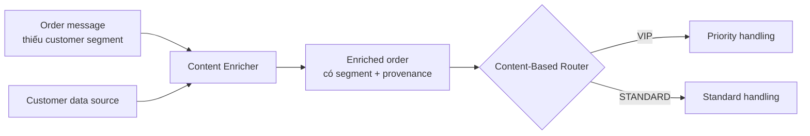
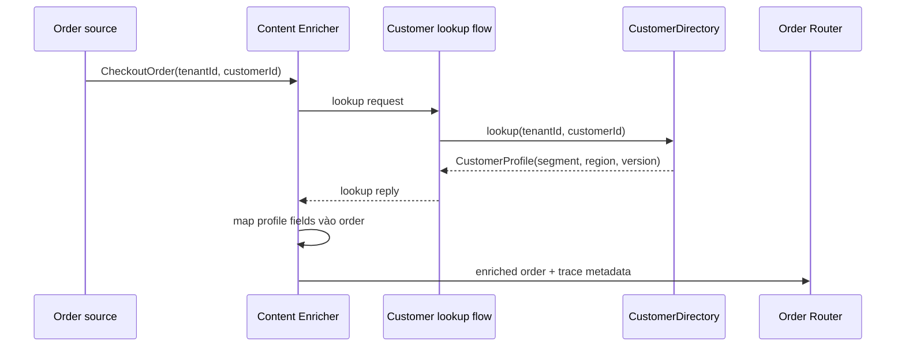
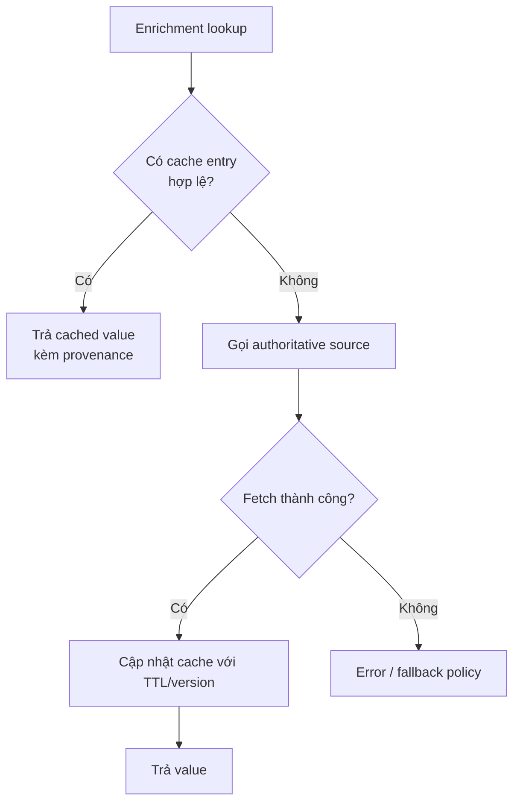
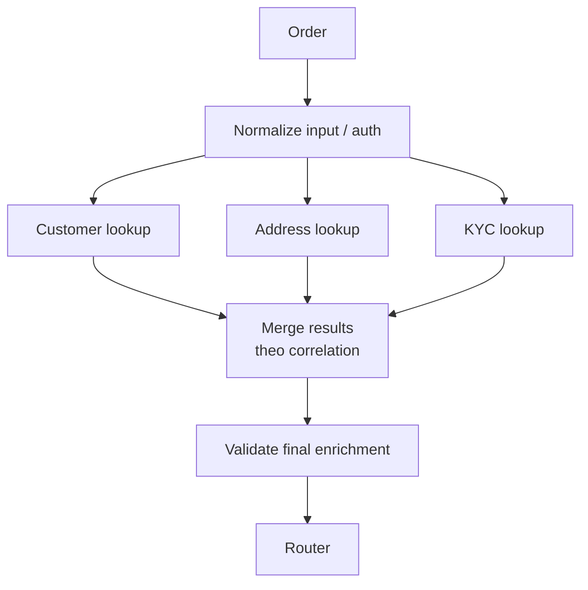
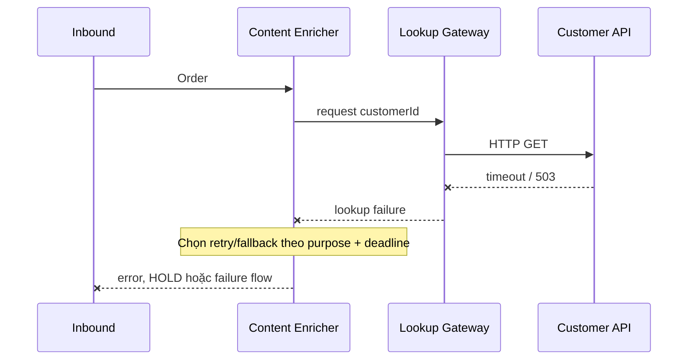

# Chọn nguồn dữ liệu bổ sung

## 1. Vì sao Content Enricher phải chọn đúng nguồn dữ liệu?

Một hệ thống tiếp nhận đơn hàng nhận message như sau:

```json
{
  "orderId": "O-204",
  "customerId": "C-18",
  "amount": 320000,
  "currency": "VND"
}
```

Trong khi đó, hệ thống phân tuyến đơn hàng cần biết thêm:

- Khách hàng thuộc nhóm `STANDARD` hay `VIP`.
- Khách có bị khóa giao dịch hay cần xác minh danh tính không.
- Địa điểm giao hàng thuộc khu vực phục vụ nào.
- Mã chính sách giá hoặc hạn mức nào đang hiệu lực.

Những thuộc tính này **không nhất thiết nằm trong message gốc**. Ta có thể lấy chúng từ header, dữ liệu đã chuẩn hóa trong payload, cache, bảng database, một API quản lý khách hàng, hệ thống địa chỉ hoặc bản snapshot của sự kiện cũ.

Vấn đề không chỉ là **“làm sao lấy thêm trường?”**, mà là **“lấy trường đó từ đâu để quyết định đúng, đủ tin cậy, có thể giải thích và không phá vỡ độ sẵn sàng của flow?”**.

Trong Enterprise Integration Patterns, **Content Enricher** là thành phần dùng thông tin bổ sung để làm giàu message trước khi message được xử lý tiếp. Bài **“Chọn nguồn dữ liệu bổ sung”** thuộc chương **Content enricher** của module **SPRING_INTEGRATION_PATTERN**. Mục tiêu của module là xây dựng các luồng thông điệp ít phụ thuộc, dễ mở rộng bằng Spring Integration, phối hợp Router, Filter, Transformer, Splitter, Aggregator, Gateway, retry, error channel và correlation, đồng thời kiểm thử và theo dõi từng nhánh xử lý.

Sau bài học, bạn có thể:

1. Xác định dữ liệu nào cần bổ sung, do hệ thống nào sở hữu và cần tươi đến mức nào.
2. So sánh nguồn trong payload/header, cache, database, service API và event snapshot.
3. Xây dựng **source-selection policy** theo mục đích nghiệp vụ thay vì dùng một thứ tự ưu tiên cứng cho mọi trường.
4. Hiểu request–reply của Content Enricher và ranh giới timeout, retry, fallback.
5. Triển khai ví dụ Java DSL tra cứu profile khách hàng và ánh xạ thông tin vào message.
6. Kiểm thử nguồn được chọn, dữ liệu thiếu, timeout, cross-tenant và bảo toàn header.
7. Ghi provenance/version/độ tươi để giải thích các quyết định downstream.

## 2. Content Enricher có gì khác Transformer, Header Enricher và Router?

Sơ đồ đơn giản:



Content Enricher **tăng thông tin sẵn có** bằng một nguồn khác. Transformer thường **thay đổi cách biểu diễn** một payload đã có. Router sử dụng thông tin để **chọn nhánh**, chứ không nên giấu cả thao tác truy vấn nguồn vào expression.

| Pattern | Trách nhiệm chính | Ví dụ |
| --- | --- | --- |
| **Transformer** | Chuyển biểu diễn A sang B | Chuẩn hóa mã tiền; DTO bên A → DTO bên B |
| **Header Enricher** | Thêm/sửa metadata của Message | Thêm `traceId`, `sourceSystem`, `schemaVersion` |
| **Content Enricher** | Làm giàu nội dung bằng thông tin bổ sung | Tra cứu hồ sơ khách hàng rồi điền `segment` vào đơn |
| **Content-Based Router** | Định tuyến dựa trên message đã có đủ dữ kiện | Segment VIP → channel ưu tiên |
| **Gateway** | Thực hiện tương tác request–reply với flow hoặc hệ thống khác | Lấy customer profile từ dịch vụ riêng |
| **Filter** | Quyết định tiếp tục hoặc loại/từ chối message | Không cho đơn thiếu mã khách hàng đi tiếp |

Một `ContentEnricher` trong Spring Integration có thể gửi **request** tới một channel, đợi **reply** và ánh xạ thuộc tính từ reply vào payload gốc. Tuy nhiên không phải mọi lần enrich đều cần gọi mạng: dữ liệu có thể nằm trong một bean local hoặc cache, và **thiết kế nguồn mới là yếu tố quyết định hành vi**.

**Nguyên tắc:** trách nhiệm chọn nguồn thuộc policy/enrichment service; trách nhiệm vận chuyển request và ánh xạ kết quả thuộc IntegrationFlow. Tránh để một biểu thức SpEL dài tự chọn giữa nhiều API, xử lý retry và làm thay đổi business state.

## 3. Bắt đầu từ nhu cầu dữ liệu, không phải từ API có sẵn

Đừng chọn nguồn chỉ vì “dịch vụ X đã có endpoint GET”. Hãy viết **hợp đồng của trường cần làm giàu** trước:

| Thuộc tính cần bổ sung | Ý nghĩa nghiệp vụ | Độ tươi yêu cầu | Nguồn có thẩm quyền gợi ý |
| --- | --- | --- | --- |
| `customerSegment` | Quyết định ưu tiên phục vụ | Theo chính sách có hiệu lực lúc xử lý | Customer master hoặc snapshot được phê duyệt |
| `kycStatus` | Cho phép giao dịch hay phải giữ lại | Rất mới, không chấp nhận trạng thái chưa rõ | KYC/compliance service có trách nhiệm |
| `deliveryZone` | Chọn kho hoặc đối tác giao hàng | Theo phiên bản dữ liệu địa giới/địa chỉ | Address/fulfillment service |
| `displayName` | Hiển thị nội bộ, không quyết định rủi ro | Có thể chấp nhận dữ liệu cache ngắn hạn | Customer profile cache |
| `promotionLabel` | Nội dung hiển thị gợi ý | Có thể thiếu hoặc stale theo hợp đồng | Cache/campaign service |
| `historicalPrice` | Đối soát đơn đã đặt tháng trước | **Giá tại thời điểm đơn được tạo** | Snapshot sự kiện/giao dịch đã ghi |
| `currentExchangeRate` | Đổi tiền tại thời điểm thanh toán | Theo rate ID/effective time được quy định | Pricing/FX source đã được phê duyệt |

Hai trường đều tên “giá” có thể có **nguồn đúng khác nhau**: giá giao dịch lịch sử phải dùng snapshot đã commit, còn tỷ giá hiện hành phải gắn thời điểm áp dụng. Không thể dùng quy tắc chung “cache trước, API sau” cho cả hai.

### Bảy câu hỏi phải trả lời

1. **Ai sở hữu dữ liệu?** Hệ thống nào được phép sửa và công bố giá trị?
2. **Dùng để làm gì?** Hiển thị, định tuyến, định giá, kiểm soát rủi ro hay audit?
3. **Thời điểm nào đúng?** Giá trị hiện hành, tại lúc event phát sinh, hay tại lúc workflow quyết định?
4. **Độ trễ/staleness chấp nhận được?** 0, vài giây, vài phút, hay theo phiên bản bất biến?
5. **Có thể thiếu không?** Nếu thiếu, dừng flow, tạm giữ, dùng fallback hay bỏ trường?
6. **Ai được quyền xem?** Tenant, vùng dữ liệu, quyền truy cập và mức nhạy cảm?
7. **Nếu gọi nguồn bị lỗi thì sao?** Deadline, retry, circuit breaker, cache dự phòng và đường lỗi?

Chỉ khi có câu trả lời, việc chọn cache, database hoặc API mới có cơ sở.

## 4. Các nguồn dữ liệu thường dùng và đặc điểm của chúng

| Nguồn | Ưu điểm | Hạn chế/rủi ro | Thường phù hợp |
| --- | --- | --- | --- |
| **Payload hiện có** | Không thêm I/O, tính nhất quán với event gốc | Có thể cũ, không đầy đủ, chưa được xác thực | Snapshot đáng tin đã có sẵn |
| **Header đã xác thực** | Truy cập nhanh, giữ metadata qua flow | Có thể bị giả mạo từ ingress nếu không bảo vệ; header mapper có thể bỏ | Correlation, tenant đã xác thực, nguồn sự kiện |
| **Local in-memory cache** | Độ trễ rất thấp | Mỗi instance có thể có dữ liệu khác, mất state khi restart | Metadata hiển thị ít nhạy cảm và có TTL rõ |
| **Distributed cache** | Dùng chung nhiều instance, giảm tải source | Stale data, invalidation, network, cache stampede | Dữ liệu đọc nhiều, chịu được staleness định nghĩa trước |
| **Database/service owner** | Gần nguồn sự thật, có transaction/schema | Tăng độ trễ và phụ thuộc availability | Trạng thái bắt buộc, thông tin nguồn có thẩm quyền |
| **External HTTP/gRPC service** | Đóng gói ownership, chính sách và quyền truy cập | Timeout, rate limit, circuit breaker, contract/schema drift | Customer/KYC/risk/geo service |
| **Event snapshot / event store** | Tái lập quyết định lịch sử, không phụ thuộc current state | Có thể không phản ánh trạng thái hiện tại | Replay, đối soát, quy tắc “as-of” |
| **Configuration/policy store** | Version và rollout có kiểm soát | Có thể không đồng nhất giữa các instance | Ngưỡng/rule/lookup table theo phiên bản |

**Đừng nhầm “có cache” với “nguồn sự thật”.** Cache thường là bản sao có thời gian sống. Cần xác định hệ thống sở hữu dữ liệu và cách cache được cập nhật, invalidated hoặc làm mới.

### Khi nào nguồn trong payload được ưu tiên?

Nếu payload chứa **snapshot đã ký/xác thực từ producer có thẩm quyền** và nghiệp vụ cần tái lập một quyết định lịch sử, dữ liệu đó có thể **đúng hơn** thông tin mới nhất từ database. Ví dụ đơn hàng đã được chốt giá theo `pricingVersion=p-7` thì retry sau một ngày không nên tự ý lấy giá mới `p-8`.

Ngược lại, nếu message đến từ HTTP client chưa xác thực, các trường như `customerTier=VIP` hoặc `kycApproved=true` **không nên là nguồn sự thật**. Chúng có thể là dữ liệu khai báo cần kiểm tra lại, không phải căn cứ để bỏ qua điều kiện quản trị.

## 5. “Nguồn tốt nhất” phụ thuộc vào mục đích sử dụng

Hãy phân loại dữ liệu bổ sung thành ba nhóm:

**Nhóm A — bắt buộc, nhạy cảm hoặc ảnh hưởng quyền/lợi ích:** KYC, khóa tài khoản, hạn mức, quyền tenant. Cần nguồn có thẩm quyền, xác thực, độ tươi được chứng minh; khi không xác minh được phải có chính sách **fail closed/HOLD** thay vì mặc định “được phép”.

**Nhóm B — cần tính nhất quán theo giao dịch:** giá chốt, thuế đã áp dụng, phí vận chuyển cam kết. Nên dùng snapshot hoặc dữ liệu có version/effective time đã gắn với giao dịch. “Giá mới nhất” không mặc nhiên đúng với đơn hàng cũ.

**Nhóm C — không quan trọng về quyết định nghiệp vụ:** nhãn hiển thị, gợi ý cá nhân hóa, ảnh đại diện. Có thể dùng cache, stale-while-revalidate hoặc thiếu trường có chủ đích, nếu hợp đồng cho phép.

Ví dụ bảng quyết định nguồn:

| Trường | Primary source | Cache/fallback | Khi primary lỗi |
| --- | --- | --- | --- |
| `kycStatus` | KYC service được ủy quyền | Chỉ cache có thời hạn và mức đảm bảo được quy định | HOLD / ERROR, không coi là APPROVED |
| `customerSegment` | Customer master versioned | Cache nếu còn trong TTL và version hợp lệ | Chọn HOLD hoặc fallback theo quy tắc kinh doanh |
| `promotionLabel` | Campaign service | Cache kể cả stale ngắn hạn | Có thể bỏ nhãn, ghi trạng thái thiếu |
| `historicalPrice` | Transaction snapshot | Bản ghi snapshot cùng giao dịch | Báo thiếu dữ liệu lịch sử; không lấy current price |
| `deliveryZone` | Fulfillment/address mapping | Cache theo mapping version | Retry hoặc manual review theo deadline |

**Lưu ý:** “fallback” không nhất thiết có nghĩa **lấy giá trị mặc định**. Đôi khi fallback an toàn là **đưa message sang nhánh chờ** hoặc **trả lỗi có thể xử lý lại**.

## 6. Một policy chọn nguồn có thể kiểm thử

Một policy tốt nhận **ngữ cảnh yêu cầu** (mục đích, độ tươi, quyền, phiên bản, deadline) rồi quyết định nguồn phù hợp. Nó không nên trực tiếp nhúng tên channel Spring Integration hoặc biểu thức truy vấn dữ liệu.

Ví dụ decision table:

```text
Nếu request là REPLAY_HISTORICAL:
    yêu cầu snapshot và effectiveVersion của event
    không dùng current customer state thay cho snapshot
Ngược lại, nếu dataClass là COMPLIANCE:
    lấy nguồn authoritative có quyền truy cập
    nếu không chứng minh được freshness -> HOLD/ERROR
Ngược lại, nếu dataClass là DISPLAY_ONLY:
    có thể dùng cache hợp lệ
    nếu cache miss -> primary service
    nếu primary timeout -> optional missing + warning, nếu hợp đồng cho phép
Ngược lại:
    primary source, cache chỉ khi TTL/version đáp ứng yêu cầu
```

Đây là **chính sách minh họa**, không phải thuật toán Spring Integration áp dụng mặc định.

### Ví dụ Java: chọn nguồn bằng kiểu dữ liệu rõ ràng

```java
enum DataPurpose {
    HISTORICAL_REPLAY,
    COMPLIANCE_DECISION,
    DISPLAY_ONLY
}

enum DataSourceChoice {
    EVENT_SNAPSHOT,
    AUTHORITATIVE_SERVICE,
    VALIDATED_CACHE,
    OPTIONAL_MISSING
}

record EnrichmentRequirements(
        DataPurpose purpose,
        boolean snapshotPresent,
        boolean cacheFresh,
        boolean primaryAvailable) {}

final class EnrichmentSourcePolicy {

    DataSourceChoice select(EnrichmentRequirements r) {
        return switch (r.purpose()) {
            case HISTORICAL_REPLAY -> {
                if (!r.snapshotPresent()) {
                    throw new IllegalStateException(
                        "Historical snapshot is required");
                }
                yield DataSourceChoice.EVENT_SNAPSHOT;
            }
            case COMPLIANCE_DECISION -> {
                if (!r.primaryAvailable()) {
                    throw new IllegalStateException(
                        "Cannot verify compliance state");
                }
                yield DataSourceChoice.AUTHORITATIVE_SERVICE;
            }
            case DISPLAY_ONLY -> {
                if (r.cacheFresh()) {
                    yield DataSourceChoice.VALIDATED_CACHE;
                }
                if (r.primaryAvailable()) {
                    yield DataSourceChoice.AUTHORITATIVE_SERVICE;
                }
                yield DataSourceChoice.OPTIONAL_MISSING;
            }
        };
    }
}
```

Trong production, `primaryAvailable` không chỉ là một cờ mà thường phải được xác định qua circuit breaker, health, thời hạn request và kết quả thực tế. Quan trọng hơn, sự lựa chọn nguồn phải đáp ứng **mục đích nghiệp vụ**; không nên đem quyết định COMPLIANCE về cache chỉ vì service chậm nếu cache không có bảo đảm phù hợp.

**Một policy nguồn không thể thay thế xử lý lỗi I/O.** Dù đã chọn authoritative service, request vẫn có thể timeout. Phải thiết kế riêng các trạng thái `SELECTED`, `FETCH_SUCCEEDED`, `FETCH_FAILED` và `ENRICHED`.

## 7. Luồng enrichment trong Spring Integration

Một Content Enricher có thể gửi request đến một message channel, đợi reply từ một service activator hoặc gateway rồi dùng reply bổ sung property vào payload ban đầu.



Quan trọng:

- **Request channel** thể hiện đường gửi yêu cầu tra cứu.
- **Reply** chứa dữ liệu dùng để bổ sung vào message gốc.
- **Property mapping** cho biết trường nào được copy, không phải quy tắc chọn nguồn phức tạp.
- Với request–reply đồng bộ, lookup chậm sẽ kéo dài latency của cả flow.
- Nếu cần thêm dữ liệu từ nhiều nguồn, phải định nghĩa thứ tự, độ phụ thuộc và fallback; Spring Integration không tự biết nguồn nào đáng tin hơn.

### Có nhất thiết enrich bằng service bên ngoài?

Không. Một bean local có map lookup hoặc một cache adapter cũng có thể là nguồn dữ liệu. Khi nguồn thật là remote HTTP/gRPC, đặt client có timeout, circuit breaker và policy xác thực ở tầng adapter rõ ràng; Content Enricher chỉ nên biết hợp đồng lookup có kiểu, không biết chi tiết tên host, token hay retry nội bộ.

## 8. Ví dụ Java: Content Enricher tra cứu profile theo tenant

Ví dụ sau minh họa **lookup local** để có thể kiểm thử không cần mạng. Trong ứng dụng thật, `CustomerDirectory` có thể là một adapter gọi service/DB qua Gateway hoặc outbound adapter; hợp đồng trả `CustomerProfile` giữ nguyên.

Dữ liệu đầu vào là một JavaBean **có setter** cho những trường cần được Content Enricher cập nhật. Nếu dùng Java record bất biến, không nên cố set property trên record; nên dùng Transformer/merge function trả một record mới hoặc cách tạo output DTO phù hợp phiên bản framework.

### 8.1. Data model và nguồn dữ liệu

```java
import java.util.Map;

record CustomerKey(String tenantId, String customerId) {}

record CustomerProfile(
        String segment,
        String region,
        String sourceVersion) {}

final class CustomerDirectory {

    private final Map<CustomerKey, CustomerProfile> profiles =
        Map.of(
            new CustomerKey("tenant-A", "C-18"),
            new CustomerProfile("VIP", "VN", "customer-v3"),
            new CustomerKey("tenant-B", "C-18"),
            new CustomerProfile("STANDARD", "SG", "customer-v5"));

    CustomerProfile lookup(CheckoutOrder order) {
        CustomerKey key = new CustomerKey(
            order.getTenantId(), order.getCustomerId());

        CustomerProfile profile = profiles.get(key);
        if (profile == null) {
            throw new IllegalArgumentException(
                "Unknown customer for tenant");
        }
        return profile;
    }
}

// Bean được làm giàu: các trường cần gán phải có setter.
public class CheckoutOrder {

    private final String orderId;
    private final String tenantId;
    private final String customerId;

    private String customerSegment;
    private String customerRegion;
    private String customerSourceVersion;

    public CheckoutOrder(
            String orderId, String tenantId, String customerId) {
        this.orderId = orderId;
        this.tenantId = tenantId;
        this.customerId = customerId;
    }

    public String getOrderId() { return orderId; }
    public String getTenantId() { return tenantId; }
    public String getCustomerId() { return customerId; }

    public String getCustomerSegment() { return customerSegment; }
    public void setCustomerSegment(String segment) {
        this.customerSegment = segment;
    }

    public String getCustomerRegion() { return customerRegion; }
    public void setCustomerRegion(String region) {
        this.customerRegion = region;
    }

    public String getCustomerSourceVersion() {
        return customerSourceVersion;
    }
    public void setCustomerSourceVersion(String version) {
        this.customerSourceVersion = version;
    }
}
```

**Giới hạn mô hình:** `tenantId` trong `CheckoutOrder` phải đến từ bước xác thực đáng tin cậy. Một HTTP client không được phép tự gửi `tenantId=tenant-B` để đọc hồ sơ khách của tenant B. Việc dùng `Map<CustomerKey, CustomerProfile>` với tenant trong khóa thể hiện điều kiện phân vùng dữ liệu, **không thay thế kiểm tra quyền truy cập**.

Lớp `CheckoutOrder` trong ví dụ có thể đặt ở file riêng cùng package với cấu hình. Java chỉ cho phép một top-level `public` class trong một file tương ứng; khi chép mã vào dự án, tách các class theo quy tắc Java.

### 8.2. Java DSL dùng Content Enricher

```java
import org.springframework.context.annotation.Bean;
import org.springframework.context.annotation.Configuration;
import org.springframework.integration.channel.DirectChannel;
import org.springframework.integration.channel.QueueChannel;
import org.springframework.integration.config.EnableIntegration;
import org.springframework.integration.dsl.IntegrationFlow;

@Configuration
@EnableIntegration
public class CustomerEnrichmentConfig {

    @Bean
    CustomerDirectory customerDirectory() {
        return new CustomerDirectory();
    }

    @Bean("orders.enrichment.in")
    DirectChannel ordersInput() {
        return new DirectChannel();
    }

    @Bean("customers.lookup")
    DirectChannel lookupRequests() {
        return new DirectChannel();
    }

    @Bean("orders.enriched")
    QueueChannel ordersEnriched() {
        return new QueueChannel();
    }

    @Bean
    IntegrationFlow customerLookupFlow(CustomerDirectory directory) {
        return IntegrationFlow.from("customers.lookup")
            .handle(CheckoutOrder.class,
                (order, headers) -> directory.lookup(order))
            .get();
    }

    @Bean
    IntegrationFlow enrichCustomerDetails() {
        return IntegrationFlow.from("orders.enrichment.in")
            .enrich(spec -> spec
                .requestChannel("customers.lookup")
                .requestPayloadExpression("payload")
                .propertyExpression(
                    "customerSegment", "payload.segment()")
                .propertyExpression(
                    "customerRegion", "payload.region()")
                .propertyExpression(
                    "customerSourceVersion",
                    "payload.sourceVersion()"))
            .channel("orders.enriched")
            .get();
    }
}
```

Các phương thức DSL minh họa **Content Enricher dạng request–reply**: `requestPayloadExpression("payload")` chuyển payload order sang luồng tra cứu, `CustomerDirectory` trả `CustomerProfile`, và các `propertyExpression` đọc giá trị từ reply để điền vào `CheckoutOrder`.

Trong code này:

1. Luồng vào bắt đầu với `CheckoutOrder` đã xác thực tenant.
2. Enricher gửi lookup request tới `customers.lookup`.
3. Lookup flow trả `CustomerProfile` hoặc báo lỗi nếu không tìm thấy khách.
4. Enricher ánh xạ `segment`, `region`, `sourceVersion` từ reply sang order.
5. Message đã enrich được chuyển tới `orders.enriched` để consumer tiếp theo xử lý.

**Lưu ý về tính biến đổi của payload:** vì đây là JavaBean mutable, một số kiểu enrichment có thể sửa property trên chính object đã được truyền qua flow. Không chia sẻ cùng instance `CheckoutOrder` không đồng bộ giữa các thread/recipient nếu không có hợp đồng an toàn. Với event bất biến hoặc fan-out, ưu tiên một DTO mới kết hợp thông tin gốc và enrichment.

**Lưu ý phiên bản API:** các ví dụ dùng phong cách Spring Integration Java DSL phổ biến. Khi chạy dự án thật, cần đối chiếu overload/behavior của `ContentEnricher`, `propertyExpression` và channel request–reply theo dependency đang dùng; STEP 6 sẽ kiểm tra thêm.

## 9. Kiểm thử luồng: nguồn đúng, tenant đúng, header còn nguyên

Ví dụ JUnit 5 với Spring Test và AssertJ:

```java
import static org.assertj.core.api.Assertions.assertThat;
import static org.assertj.core.api.Assertions.assertThatThrownBy;

import org.junit.jupiter.api.Test;
import org.springframework.beans.factory.annotation.Autowired;
import org.springframework.beans.factory.annotation.Qualifier;
import org.springframework.integration.channel.QueueChannel;
import org.springframework.messaging.Message;
import org.springframework.messaging.MessageChannel;
import org.springframework.messaging.support.MessageBuilder;
import org.springframework.test.context.junit.jupiter.SpringJUnitConfig;

@SpringJUnitConfig(CustomerEnrichmentConfig.class)
class CustomerEnrichmentFlowTest {

    @Autowired
    @Qualifier("orders.enrichment.in")
    MessageChannel input;

    @Autowired
    @Qualifier("orders.enriched")
    QueueChannel output;

    @Test
    void enrichesFromCustomerDirectoryAndPreservesHeaders() {
        CheckoutOrder order = new CheckoutOrder(
            "O-204", "tenant-A", "C-18");

        Message<CheckoutOrder> request = MessageBuilder
            .withPayload(order)
            .setHeader("requestId", "req-204")
            .build();

        assertThat(input.send(request)).isTrue();

        Message<?> reply = output.receive(1_000);
        assertThat(reply).isNotNull();

        CheckoutOrder enriched =
            (CheckoutOrder) reply.getPayload();

        assertThat(enriched.getOrderId()).isEqualTo("O-204");
        assertThat(enriched.getCustomerSegment())
            .isEqualTo("VIP");
        assertThat(enriched.getCustomerRegion())
            .isEqualTo("VN");
        assertThat(enriched.getCustomerSourceVersion())
            .isEqualTo("customer-v3");
        assertThat(reply.getHeaders().get("requestId"))
            .isEqualTo("req-204");
        assertThat(output.receive(0)).isNull();
    }

    @Test
    void sameCustomerIdIsIsolatedByTenant() {
        assertThat(input.send(MessageBuilder
            .withPayload(new CheckoutOrder(
                "O-205", "tenant-B", "C-18"))
            .build())).isTrue();

        Message<?> message = output.receive(1_000);
        assertThat(message).isNotNull();

        CheckoutOrder order =
            (CheckoutOrder) message.getPayload();
        assertThat(order.getCustomerSegment())
            .isEqualTo("STANDARD");
        assertThat(order.getCustomerRegion()).isEqualTo("SG");
    }

    @Test
    void unknownCustomerDoesNotSilentlyBecomeVip() {
        CheckoutOrder order = new CheckoutOrder(
            "O-206", "tenant-A", "missing");

        assertThatThrownBy(() -> input.send(
            MessageBuilder.withPayload(order).build()))
            .isInstanceOf(RuntimeException.class);

        assertThat(output.receive(0)).isNull();
    }
}
```

Những test này chứng minh source local được dùng, dữ liệu theo tenant không bị lấy nhầm và header truy vết được giữ trong cấu hình **đồng bộ**. Chúng chưa chứng minh database hoặc service remote có timeout, circuit breaker, bảo mật thật hay dữ liệu được lưu bền vững. Khi thay nguồn bằng API/broker, phải bổ sung integration tests cho transport thực tế.

### Unit test source-selection policy

Không cần dựng IntegrationFlow để test bảng quyết định ở mục 6:

```java
import static org.assertj.core.api.Assertions.assertThat;
import static org.assertj.core.api.Assertions.assertThatThrownBy;

import org.junit.jupiter.api.Test;

class EnrichmentSourcePolicyTest {

    private final EnrichmentSourcePolicy policy =
        new EnrichmentSourcePolicy();

    @Test
    void replayRequiresHistoricalSnapshot() {
        assertThat(policy.select(
            new EnrichmentRequirements(
                DataPurpose.HISTORICAL_REPLAY,
                true, true, true)))
            .isEqualTo(DataSourceChoice.EVENT_SNAPSHOT);

        assertThatThrownBy(() -> policy.select(
            new EnrichmentRequirements(
                DataPurpose.HISTORICAL_REPLAY,
                false, true, true)))
            .isInstanceOf(IllegalStateException.class);
    }

    @Test
    void complianceMustNotUseUnverifiedFallback() {
        assertThatThrownBy(() -> policy.select(
            new EnrichmentRequirements(
                DataPurpose.COMPLIANCE_DECISION,
                false, true, false)))
            .isInstanceOf(IllegalStateException.class);
    }

    @Test
    void displayDataCanUseFreshCache() {
        assertThat(policy.select(
            new EnrichmentRequirements(
                DataPurpose.DISPLAY_ONLY,
                false, true, false)))
            .isEqualTo(DataSourceChoice.VALIDATED_CACHE);
    }

    @Test
    void optionalDisplayDataCanBeAbsent() {
        assertThat(policy.select(
            new EnrichmentRequirements(
                DataPurpose.DISPLAY_ONLY,
                false, false, false)))
            .isEqualTo(DataSourceChoice.OPTIONAL_MISSING);
    }
}
```

**Quan trọng:** một test policy không thay thế test *actual source resolution*. Khi code gọi nhiều endpoint hoặc cache khác nhau, hãy kiểm thử bằng fake adapter xác nhận **đã gọi nguồn được chọn**, **không gọi nguồn bị cấm** và **không lấy dữ liệu từ tenant khác**.

## 10. Provenance: dữ liệu đến từ đâu và khi nào?

Một giá trị `customerSegment="VIP"` không đủ để giải thích một quyết định routing sau ba tuần. Cần biết ít nhất **nguồn**, **version** và **thời điểm hiệu lực hoặc lấy dữ liệu**, tùy use case.

Một envelope dữ liệu bổ sung có thể là:

```java
import java.time.Instant;

enum LookupSource {
    CUSTOMER_MASTER,
    SHARED_CACHE,
    EVENT_SNAPSHOT
}

record EnrichedValue<T>(
        T value,
        LookupSource source,
        String sourceVersion,
        Instant fetchedAt,
        Instant validAsOf,
        boolean stale) {}
```

Chẳng hạn:

```text
customerSegment = VIP
source = CUSTOMER_MASTER
sourceVersion = customer-v3
fetchedAt = 2026-11-21T03:00:00Z
validAsOf = 2026-11-21T02:58:00Z
stale = false
```

Đây là metadata **do ứng dụng tạo và kiểm chứng**, không mặc nhiên có trong `ContentEnricher`.

### Chú ý phân biệt timestamp

- `eventTime`: thời điểm sự kiện nghiệp vụ xảy ra.
- `fetchedAt`: thời điểm enrichment đọc dữ liệu.
- `validAsOf` hoặc `effectiveAt`: thời điểm giá trị được hệ thống nguồn xác nhận có hiệu lực.
- `expiresAt`: giới hạn chấp nhận cache theo policy.

Dữ liệu được fetch lúc 12:00 **không có nghĩa** nó phản ánh trạng thái hiệu lực lúc 12:00 nếu nguồn đồng bộ theo lô và mới cập nhật đến 11:45. Độ tươi phải dựa trên hợp đồng của source, không chỉ đồng hồ của consumer.

Với audit hoặc replay, lưu định danh nguồn và version/hash đáng tin cậy; nếu cần full snapshot, dùng store có kiểm soát truy cập và retention thay vì log toàn bộ payload.

## 11. Cache trước hay database trước?

Hai chiến lược hay gặp:

### Cache-aside



Ưu điểm: giảm tải nguồn, latency thấp cho hit. Rủi ro: stale data và cache stampede. Một entry **tồn tại** chưa đủ: phải còn hợp lệ theo TTL, schema/version, tenant và use case.

### Authoritative-first

Với dữ liệu nhạy cảm, hệ thống có thể chọn nguồn chính trước; chỉ fallback sang cache khi có hợp đồng bảo đảm cụ thể, ví dụ signed response chưa hết hiệu lực và đáp ứng độ tươi tối đa cho phép.

Không nên lặng lẽ viết:

```text
try primary
catch (Exception):
    return cachedOrDefaultApproved
```

nhất là với KYC/khóa tài khoản. Một lỗi quyền truy cập hoặc dữ liệu không tồn tại có ý nghĩa khác timeout, không thể gom tất cả thành “cache hit”.

### Thời hạn và memory

Local cache có thể tối ưu latency nhưng lưu cùng key trên nhiều instance gây kết quả không đồng nhất sau khi cập nhật. Distributed cache cải thiện phạm vi chia sẻ nhưng vẫn cần:

- Invalidation/versioning khi source đổi.
- TTL và chính sách stale.
- Negative caching với thời gian sống riêng.
- Single-flight hoặc chống cache stampede khi nhiều message miss cùng key.
- Giới hạn bộ nhớ, cardinality key, namespace tenant.
- Đo hit ratio theo nguồn, không chỉ đo số request tổng.

## 12. Khi có nhiều nguồn: thứ tự, song song và gộp kết quả

Một đơn hàng có thể cần dữ liệu từ:

1. Customer master cho `segment`.
2. Address service cho `deliveryZone`.
3. KYC service cho `verificationStatus`.

Có hai phương án:

**Tuần tự:** tra Customer → Address → KYC. Phù hợp nếu dữ liệu sau phụ thuộc dữ liệu trước, hoặc cần fail-fast trước khi gọi nguồn tốn kém.

**Độc lập:** các lookups thực sự không phụ thuộc có thể chạy đồng thời, sau đó ghép một DTO đã enrich. Phù hợp khi SLA yêu cầu và framework/adapter được thiết kế để điều phối fan-out/fan-in.



**Đừng suy rằng ba bước `enrich(...)` liên tiếp là song song.** Theo semantics thông thường, một stage phải hoàn thành/cho output trước stage tiếp. Khi cần chạy đồng thời, phải thiết kế executor, Splitter/Recipient List và Aggregator hoặc một orchestration service phù hợp, kèm timeout và partial-result policy.

Một phép gộp kết quả đúng cần:

- Một request/correlation ID ổn định.
- Quy tắc về bản ghi nào thuộc cùng đơn/tenant.
- Expected result set và deadline.
- Chính sách trường bắt buộc, trường tùy chọn.
- Retry/idempotency từng nguồn.
- Tránh “mix” snapshot từ hai thời điểm không tương thích nếu quyết định nghiệp vụ cần consistency.

### N+1 queries

Nếu Splitter tách một đơn thành 100 dòng và mỗi dòng gọi Customer service giống nhau để lấy cùng `segment`, ta tạo 100 request không cần thiết. Khi scope cho phép, nên enrich ở cấp đơn **trước** khi split; hoặc batch/cache theo `tenantId + customerId + version`.

Tương tự, có thể cần enrich **sau** Aggregator nếu chỉ khi ghép tất cả kết quả mới biết nguồn cần tra cứu. Vị trí enrich quyết định chi phí, consistency và cách retry.

## 13. Xử lý nguồn không trả dữ liệu hoặc trả thông tin mâu thuẫn

Thiết kế enrichment cần tách ít nhất các trạng thái:

| Trường hợp | Ý nghĩa | Phản ứng nên cân nhắc |
| --- | --- | --- |
| Không tìm thấy customer | Khóa tồn tại trong request nhưng source không có bản ghi | Reject/manual review hoặc báo không tồn tại; không tự coi STANDARD |
| Source báo khách đã bị khóa | Dữ liệu hợp lệ với trạng thái nhạy cảm | Route HOLD/REJECT theo policy |
| Timeout trước khi có reply | Không biết dữ liệu mới nhất; service có thể chậm | Retry ngắn có giới hạn hoặc fallback an toàn |
| HTTP 503 / transient DB error | Nguồn không khả dụng tạm thời | Backoff, circuit breaker, error flow |
| HTTP 403 / tenant mismatch | Không được phép truy cập hoặc vi phạm phân vùng | Dừng, alert/security audit; không fallback sang dữ liệu khác tenant |
| Schema reply thay đổi | Contract mismatch | Báo lỗi mapping, không chuyển sang giá trị default lặng lẽ |
| Primary và cache khác nhau | Có thể do TTL, version hoặc source lag | Chọn theo policy với version/freshness; ghi provenance |
| Nhiều nguồn mâu thuẫn | Hai authority hoặc dữ liệu không đồng bộ | Định nghĩa owner/precedence; nếu không rõ thì giữ message chờ |

**Không nên dùng một default thiếu ngữ nghĩa:** `customerSegment="STANDARD"` chỉ vì lookup lỗi có thể làm thay đổi ưu tiên hoặc quyền lợi. Nếu hệ thống cho phép fallback “unknown segment → STANDARD”, đó phải là một quy tắc nghiệp vụ được phê duyệt và được ghi rõ `source=FALLBACK` cùng reason.

### Phân biệt missing, unknown và unavailable

- **Missing:** nguồn xác nhận không có dữ liệu.
- **Unknown:** dữ liệu chưa được xác minh hoặc không đủ điều kiện suy ra kết quả.
- **Unavailable:** không thể liên hệ với nguồn hoặc nguồn đang lỗi.

Ba trạng thái này không nên cùng bị biến thành `null` rồi để Router tự đoán. Dùng một kết quả có kiểu như `Found<T>`, `NotFound`, `Unavailable` hoặc exception được phân loại và error flow cụ thể.

## 14. Timeout, retry và ranh giới request–reply

Một Content Enricher dựa trên request channel thường **cần reply** để biết giá trị sẽ merge. Nếu source không trả lời, flow có thể bị chặn hoặc hết thời gian chờ, tùy cách cấu hình endpoint/adapter.

Tình huống mẫu:



Nên phân tách trách nhiệm:

1. **Transport client:** connect/read timeout, TLS/auth, retry ở mức network nếu an toàn, circuit breaker.
2. **Lookup service/Gateway:** phân loại `NOT_FOUND`, `FORBIDDEN`, `UNAVAILABLE` và giới hạn tổng thời gian.
3. **Enrichment policy:** xác định khi không có dữ liệu thì cho qua, giữ chờ hay fail.
4. **Content Enricher:** gắn data trả về vào message và tiếp tục flow khi có kết quả hợp lệ.
5. **Error flow:** ghi lỗi, retry có giới hạn hoặc đưa message sang failure store/DLQ.

### Retry ở đâu là đúng?

- Một HTTP GET không có side effect thường có thể retry nếu lỗi transient, nhưng vẫn phải tính deadline và giới hạn tải.
- Nếu lookup là API có side effect (ví dụ “reserve” chứ không chỉ “read”), nó **không còn là enrichment đơn giản**; cần idempotency và workflow riêng.
- Retry toàn flow sau khi một bước downstream đã commit có thể gây side effect trùng.
- Nếu nguồn authoritative đang lỗi, retry vô hạn có thể gây thác lỗi. Dùng backoff, jitter, circuit breaker và alert theo SLO.

Một chính sách minh họa:

```text
Customer profile lookup:
  connect timeout: 300 ms
  read timeout: 800 ms
  max attempts: 2 (gồm lần đầu)
  retry: connection reset / 503 nếu deadline còn
  no retry: 400, 403, schema invalid
  not found: xử lý theo hợp đồng nghiệp vụ
  exhausted: HOLD hoặc error flow, không âm thầm gán VIP/STANDARD
```

Con số chỉ minh họa thiết kế; production cần dùng SLO và điều kiện hệ thống thực, không sao chép máy móc.

### Error channel không phải chiếc hộp bắt mọi lỗi

Với `DirectChannel` đồng bộ, exception từ lookup/Transformer có thể lan về caller (có thể được framework wrap). Trong flow có executor, poller hoặc broker, lỗi thường được quan sát ở endpoint xử lý bất đồng bộ và qua error handler/error channel phù hợp **nếu được cấu hình**. Không được khẳng định mọi exception đều tự động vào một global `errorChannel`.

Nếu nguồn lookup timeout nhưng request Gateway đang chờ reply, phải định nghĩa kết quả lỗi rõ để tránh caller thấy timeout mơ hồ trong khi message đã được xử lý một phần.

## 15. Độ nhất quán theo thời điểm và replay

Giả sử `OrderPlaced` được phát ngày 1/11 với khách có segment `STANDARD`. Ngày 5/11, khách chuyển lên `VIP`. Ngày 10/11, operator replay message ngày 1/11 sau khi một adapter lỗi.

Nếu flow enrich bằng **customer profile hiện tại** mà không có policy về replay, kết quả có thể đổi từ STANDARD sang VIP. Điều này đôi khi đúng, đôi khi vi phạm hợp đồng nghiệp vụ.

Cần định nghĩa **điểm thời gian của dữ liệu bổ sung**:

| Nhu cầu | Dữ liệu phù hợp |
| --- | --- |
| Khôi phục quyết định được đưa ra lúc event phát sinh | Snapshot/version đã áp dụng tại thời điểm đó |
| Tính điều kiện giao hàng theo tình trạng mới nhất | Dữ liệu hiện hành có độ tươi đủ |
| Đối soát tài chính | Giá/trạng thái giao dịch đã commit và có bằng chứng |
| Gửi email thông báo hiện tại | Có thể dùng customer display name mới nhất nếu policy cho phép |
| Thực hiện lại cùng business command sau timeout | Giữ idempotency key, decision và enrichment snapshot đã được commit nếu cần |

Một số cách thực hiện:

- Lưu `enrichmentVersion` hoặc `dataAsOf` vào business event.
- Persist một snapshot đã chuẩn hóa trong transaction/outbox gốc.
- Khi replay, đọc đúng version nguồn nếu hệ thống hỗ trợ temporal query.
- Ghi rõ “re-evaluate with current data” là một hành động nghiệp vụ mới.
- Giữ idempotency trên các side effect, không dùng mỗi Message ID framework.

**Enrichment lấy dữ liệu mới không đồng nghĩa tự động đúng hơn.** “Đúng” phụ thuộc thời điểm và mục đích của quyết định.

## 16. Bảo mật khi chọn nguồn

Việc thêm dữ liệu thường làm message **nhạy cảm hơn trước**. Một order ban đầu chỉ chứa mã khách hàng có thể được enrich với segment, địa chỉ, trạng thái KYC hoặc dữ liệu cá nhân.

Checklist:

- Xác thực nguồn của `tenantId`, `customerId` và quyền lookup trước khi gọi service.
- Không dùng URL/host lookup tùy ý do client cung cấp (rủi ro SSRF và truy cập tài nguyên nội bộ).
- Chỉ cho phép **source ID** và lookup key thuộc hợp đồng server-side.
- Không gửi toàn bộ payload đơn hàng tới customer API nếu API chỉ cần `tenantId + customerId`; tối thiểu hóa dữ liệu.
- Không tin kết quả cache từ tenant khác hoặc khóa cache thiếu namespace tenant.
- Kiểm soát quyền đọc dữ liệu KYC/profile và scope token của outbound client.
- Không lưu PII, credential, token, raw HTTP header hoặc lỗi chứa bí mật vào log/metric.
- Chỉ đưa những trường downstream cần vào enriched payload; nếu một Recipient List phát nhiều đích, xem xét DTO/Filter riêng theo quyền của từng recipient.
- Giữ version/schema rõ ràng để không trộn trường của nhiều loại nguồn.
- Với failure store/DLQ, áp dụng retention và kiểm soát truy cập tương xứng mức nhạy cảm của enriched message.

**Một trường hợp nguy hiểm:** source selection trả về một profile đúng `customerId` nhưng sai `tenantId`. Vì vậy kiểm thử negative theo tenant là yêu cầu bắt buộc, không chỉ so giá trị segment ở một test happy path.

## 17. Quan sát nguồn được chọn và kết quả làm giàu

Một dòng `"enriched successfully"` không cho biết dữ liệu đến từ cache hay master, có stale không hoặc policy nào cho phép fallback.

Gợi ý structured event:

```text
event=enrichment_completed
requestId=req-204
dataClass=customerSegment
source=CUSTOMER_MASTER
sourceVersion=customer-v3
freshnessStatus=FRESH
policyVersion=enrichment-policy-v2
lookupDurationMs=42
result=FOUND
```

Đây là **dạng log đề xuất**, không phải những trường Spring Integration tự sinh. Khi log, nên dùng mã nguồn, nhóm dữ liệu và kết quả có cardinality thấp; business ID nên nằm trong trace/log theo chính sách bảo vệ dữ liệu, **không đưa vào metric labels**.

Metric có thể gồm:

| Metric gợi ý | Ý nghĩa |
| --- | --- |
| `enrichment.requests.total{dataClass}` | Tổng nhu cầu làm giàu dữ liệu |
| `enrichment.source.selected.total{source}` | Phân bố nguồn được chọn |
| `enrichment.lookup.duration{source}` | Độ trễ theo nguồn |
| `enrichment.lookup.failures.total{reason}` | Lỗi timeout, missing, unauthorized, schema |
| `enrichment.cache.hit.ratio` | Mức độ hiệu quả cache |
| `enrichment.stale.used.total{dataClass}` | Số lần dùng stale theo policy |
| `enrichment.fallback.total{reason}` | Tần suất fallback |
| `enrichment.incomplete.total` | Message không có đủ field bắt buộc |
| `enrichment.downstream.rejected.total` | Downstream từ chối dữ liệu sau enrich |

Các metric trên do ứng dụng thiết kế; cần tránh gắn `customerId`/`orderId` làm label có cardinality cao.

### Bảng khoanh vùng sự cố

| Triệu chứng | Nguyên nhân có thể | Hướng điều tra |
| --- | --- | --- |
| Khách VIP bị xử lý STANDARD | Dùng stale cache hoặc fallback không đúng | Kiểm tra source, version, `validAsOf` và rule |
| Hai instance enrich khác nhau | Cache local chưa đồng bộ hoặc rule rollout lệch | So policy version/cache metadata tại từng instance |
| Enricher timeout nhưng service có response | Reply đến trễ, reply channel/Gateway mismatch | Theo dõi correlation, reply timeout và transport |
| Xảy ra lỗi ngay khi map property | Target DTO không có setter, sai tên property hoặc reply schema đổi | Kiểm tra bean property, SpEL, contract test |
| “Không tìm thấy khách” dù có dữ liệu | Query thiếu tenant, key không chuẩn hóa hoặc source lag | Kiểm tra lookup key và source schema |
| Header requestId mất sau enrich | Tạo Message mới không giữ metadata hoặc header mapper lọc | Test header trước/sau ranh giới |
| Cache hit cao nhưng quyết định sai | TTL/nguồn không phù hợp cho dữ liệu nhạy cảm | Xem lại source policy theo mục đích |
| Retry gây rate-limit downstream | Retry đồng loạt, cache stampede, thiếu backoff | Thêm giới hạn tải, jitter, batching |
| DLQ chứa PII không cần thiết | Lưu nguyên enriched payload vào lỗi | Giảm dữ liệu, masking, ACL và retention |
| Replay đơn cũ ra quyết định mới | Tra customer state hiện hành thay vì snapshot | Xác định contract replay/event-time |

## 18. Kiểm thử chọn nguồn toàn diện

Unit test policy và integration test flow chỉ là nền tảng. Một source-selection strategy đáng tin cậy cần test từng chiều:

### 18.1. Decision matrix

| Purpose | Snapshot | Cache | Primary | Expected |
| --- | --- | --- | --- | --- |
| Historical replay | Có | Fresh | Có | Dùng snapshot |
| Historical replay | Thiếu | Fresh | Có | Báo không thể tái lập |
| Compliance | Không cần | Fresh | Có | Dùng authoritative service |
| Compliance | Không cần | Fresh | Down | Fail closed/HOLD |
| Display only | Không cần | Fresh | Down | Có thể dùng cache |
| Display only | Không cần | Stale | Có | Dùng primary |
| Display only | Không cần | Stale | Down | Optional missing nếu hợp đồng cho phép |

### 18.2. Các tình huống lỗi cần chủ động tiêm vào

1. Cache miss và source trả found.
2. Cache stale nhưng nguồn hiện tại đã đổi version.
3. Source trả 404/not found.
4. Source trả 403/tenant mismatch.
5. Source trả 503 rồi thành công ở lần retry phù hợp.
6. Source timeout sau khi deadline end-to-end đã hết.
7. Reply thiếu field bắt buộc hoặc sai kiểu.
8. Một request bị gửi lại sau khi policy chọn nguồn thay đổi.
9. Hai message cùng key được xử lý đồng thời, gây cache stampede.
10. Source A và B trả dữ liệu mâu thuẫn.
11. Enriched payload đi qua Router, Filter và outbound adapter nhưng header correlation vẫn đúng.
12. Gateway hoặc consumer không nhận reply dù lookup đã chạy.

Kiểm thử cần khẳng định **không gọi nguồn sai**: ví dụ historical replay phải không gọi current primary service thay snapshot; compliance failure không được chuyển sang nguồn tùy tiện chưa được xác thực.

### 18.3. Hợp đồng với source API

Nếu `CustomerDirectory` được thay bằng HTTP client, nên dùng contract tests cho:

- Request gồm đủ `tenantId + customerId` theo quyền.
- Status code và mô hình lỗi có phân loại.
- Tính toàn vẹn của sourceVersion/ETag/as-of metadata.
- Quy tắc pagination hoặc batching nếu có.
- Timeout và retry ở client.
- Data mapping khi thêm trường hoặc đổi enum.
- Thông tin nhạy cảm không lọt sang log hoặc header outbound.

## 19. Lựa chọn phương án kiến trúc

Một số cách hiện thực khác nhau cho cùng một nhu cầu làm giàu:

| Thiết kế | Khi phù hợp | Ưu điểm | Đánh đổi |
| --- | --- | --- | --- |
| `ContentEnricher` request–reply | Muốn tra thêm dữ liệu rồi map property vào payload | Luồng rõ, gần EIP, DSL diễn tả ý định | Phải quản lý request/reply, mutable target và timeout |
| Transformer + lookup service | Kết quả là DTO bất biến mới, logic merge phức tạp | Contract kiểu rõ, unit test service dễ | Nếu lookup có I/O, Transformer sẽ phụ thuộc service và cần error policy rõ |
| Header Enricher | Thông tin là metadata phục vụ route/trace | Giữ nguyên payload, Router đọc header thuận tiện | Header qua transport có thể bị lọc; không nên nhét PII vào header |
| Gateway/adapter riêng + Transformer | Enrichment dùng nguồn remote, policy phức tạp hoặc nhiều service | Tách I/O, retry, circuit breaker và mapping | Nhiều endpoint/cấu hình hơn |
| Event snapshot, không gọi nguồn | Replay/historical decision hoặc bản ghi cần nhất quán | Tái lập dễ, ít phụ thuộc remote | Snapshot có thể cũ so với trạng thái hiện hành |
| Cache-aside với service owner | Dữ liệu đọc nhiều, chấp nhận staleness | Latency thấp, giảm tải nguồn | TTL/invalidation, multi-instance consistency |

Khi chọn, hãy hỏi **dữ liệu cần thiết và cách xác minh nguồn đúng** trước khi hỏi nên dùng class nào của Spring Integration.

### Bất biến hay mutable payload?

Đoạn code mục 8 minh họa cơ chế gán property vào JavaBean, nhưng ở hệ thống event-driven lớn, DTO bất biến có nhiều ưu điểm:

- Tránh shared reference bị thay đổi sau khi fan-out.
- Dễ lưu snapshot, cache và replay.
- Dễ test equality và audit.
- Giữ contract rõ giữa original event và dữ liệu bổ sung.

Nếu cần tạo một DTO mới, có thể tổ chức:

```text
OrderEvent (immutable)
    ├─ CustomerLookupGateway → CustomerProfile
    └─ Merge Transformer → EnrichedOrder (immutable)
                               ↓
                             Router
```

Đây là một **kiến trúc thay thế**, không phải yêu cầu cài cả hai cách đồng thời. Khi dùng Gateway/lookup, tách request–reply và merge sao cho có version, error handling và correlation phù hợp.

## 20. Liên hệ với các EIP khác

| EIP | Vai trò cùng Content Enricher | Rủi ro khi đặt sai |
| --- | --- | --- |
| **Filter** | Kiểm tra request hợp lệ trước lookup hoặc từ chối enriched result thiếu trường | Đánh dấu fallback là success dù dữ liệu bắt buộc thiếu |
| **Router** | Chọn nhánh từ dữ kiện đã enrich | Expression Router trực tiếp gọi API tạo timeout khó theo dõi |
| **Transformer** | Chuẩn hóa lookup key hoặc map profile thành DTO | Giấu I/O và retry trong mapper thuần |
| **Recipient List** | Phát enriched message tới nhiều recipient | Gửi PII không cần thiết cho mọi đích; shared mutable object |
| **Splitter** | Làm giàu theo item | N+1 queries và duplicate lookups |
| **Aggregator** | Gom kết quả từ nhiều nguồn/song song | Thiếu correlation, partial-result/timeout policy |
| **Gateway** | Tương tác request–reply với source remote | Không quản lý deadline, reply mapping, error flow |
| **Retry/Error Channel** | Phục hồi lookup transient và lưu lỗi vĩnh viễn | Retry vô hạn, mất nguồn gốc lỗi hoặc làm sai fallback |
| **Wire Tap** | Theo dõi source decision và latency | Nhầm log tap với audit bền vững |

### Fan-out/fan-in khi nguồn ở nhiều hệ thống

Nếu làm giàu từ Customer, KYC và Address đồng thời, mỗi lookup có thể trả kết quả hoặc lỗi riêng. Aggregator không thể mặc định chờ đủ ba nếu một nguồn optional không trả reply. Phải quy định:

- Có bao nhiêu kết quả **bắt buộc**.
- Deadline tổng, thời điểm release khi có partial.
- Correlation theo cùng order/request và tenant.
- Thứ tự ưu tiên dữ liệu khi source conflict.
- Lỗi nguồn bắt buộc có chặn Router không.
- Side effect/tính idempotent nếu một lookup không chỉ đọc.

Đừng tự ý dùng một default để điền dữ liệu chưa có rồi cho flow xử lý đơn như bình thường.

## 21. Checklist triển khai

- [ ] Mỗi trường enrich có owner/source-of-truth được xác định.
- [ ] Đã thống nhất mục đích và thời điểm đúng: current, event-time hay replay.
- [ ] Độ tươi/TTL/version và khả năng thiếu dữ liệu được diễn đạt trong hợp đồng.
- [ ] Policy nguồn phân biệt critical, historical và optional/display.
- [ ] Tenant và quyền truy cập được xác thực trước lookup.
- [ ] Cache key có namespace tenant; stale fallback chỉ dùng khi được cho phép.
- [ ] Không tự coi “API lỗi” là “not found” hoặc “approved”.
- [ ] Có giới hạn deadline, timeout, backoff và tải cho nguồn remote.
- [ ] Không giấu network I/O trong SpEL Router hoặc mapper vô danh.
- [ ] Enricher giữ header cần thiết nhưng không rò rỉ metadata nhạy cảm.
- [ ] Reply schema và property mapping có kiểm thử, nhất là mutable/immutable DTO.
- [ ] Có provenance gồm source, version và mốc thời gian liên quan.
- [ ] Retry/replay dùng snapshot đúng hợp đồng, không đổi quyết định âm thầm.
- [ ] Nếu nhiều nguồn, có correlation và luật partial result rõ.
- [ ] Tránh N+1 query; cân nhắc batch/cache ở đúng scope.
- [ ] Có unit test policy, integration test DSL và failure injection.
- [ ] Có observability theo source/result/reason, không log PII.
- [ ] Có runbook khi source-of-truth down, cache stale hoặc reply timeout.

## 22. Bài thực hành

### Bài 1 — Chọn nguồn cho từng loại dữ liệu

Thiết kế bảng gồm năm trường: `customerSegment`, `kycStatus`, `deliveryZone`, `promotionLabel` và `historicalPrice`. Với mỗi trường, chỉ ra nguồn primary, dữ liệu có thể cache hay không, độ tươi tối đa, fallback khi unavailable và chính sách khi not found.

### Bài 2 — Viết Content Enricher Java DSL

Dựa trên `CustomerEnrichmentConfig`:

1. Thêm `CustomerProfile` cho tenant C.
2. Gửi `CheckoutOrder` hợp lệ.
3. Assert các trường segment/region/sourceVersion đã được điền.
4. Assert `requestId` không mất.
5. Cho `CustomerDirectory` throw exception khi thiếu customer, chứng minh downstream không nhận order giả định đã enrich thành công.

### Bài 3 — Cache-aside và stale data

Tạo fake cache với `fetchedAt`, `validAsOf`, `expiresAt`. Viết unit tests cho cache hit còn hạn, cache stale, primary down và primary success. Thêm test chứng minh dữ liệu KYC không được lấy từ cache expired dù cache vẫn chứa trạng thái `APPROVED`.

### Bài 4 — Historical replay

Một đơn cũ có segment `STANDARD` tại thời điểm đặt, nhưng customer hiện tại đã lên `VIP`. Thiết kế event snapshot hoặc version query để replay giữ quyết định trước. Nếu nghiệp vụ yêu cầu re-evaluate, ghi một operation riêng và audit quyết định mới.

### Bài 5 — Bảo mật multi-tenant

Cho hai tenant có cùng customer ID `C-18` nhưng segment khác nhau. Viết test đảm bảo lookup không trộn dữ liệu, và test một request giả mạo `tenantId` trong HTTP header không thể lấy profile tenant khác. Đề xuất boundary nào xác thực tenant.

### Bài 6 — Deadline và fallback

Một flow có thời hạn 2 giây, customer API đôi khi mất 1,5 giây và KYC API đôi khi timeout. Thiết kế deadline tổng, retry budget và chính sách HOLD khi không lấy được KYC. Giải thích vì sao không được cho đơn đi tiếp với `kycStatus=APPROVED` mặc định.

### Bài 7 — Giảm N+1 lookup

Một đơn có 100 order lines, mỗi line cần segment khách hàng như nhau. So sánh enrich trước Splitter và enrich trong từng line handler. Đưa ra cách tính số request dự kiến, cost và vị trí cache/batch nếu source có giới hạn gọi.

### Bài 8 — Phân biệt các kết quả lỗi

Định nghĩa kiểu kết quả lookup có `FOUND`, `NOT_FOUND`, `UNAUTHORIZED`, `UNAVAILABLE` và `STALE_NOT_ALLOWED`. Thiết kế error flow/Router cho từng trường hợp; viết test không trường hợp nào bị biến ngầm thành giá trị `STANDARD` hoặc `APPROVED`.

**Tiêu chí hoàn thành:** chứng minh được **vì sao nguồn được chọn là đúng cho mục đích đó**, **độ tươi nào được chấp nhận**, **xử lý thế nào khi nguồn lỗi**, **không vượt ranh giới quyền truy cập**, và **có thể giải thích quyết định nhờ provenance**.

## 23. Tổng kết

Trong Content Enricher, việc thêm một trường vào payload chỉ là phần cuối của thiết kế. Chất lượng của luồng phụ thuộc vào khả năng chọn **nguồn dữ liệu có thẩm quyền**, gắn **ngữ cảnh thời gian và phiên bản**, chấp nhận hay từ chối **cache/staleness**, và xử lý rõ ràng **missing, unavailable, unauthorized, inconsistent**.

Spring Integration giúp hiện thực request–reply, property mapping, Gateway, Filter, Router và error flow. Nhưng framework **không tự biết dữ liệu nào là nguồn sự thật**; đó là quyết định nghiệp vụ/kiến trúc được đặc tả và kiểm thử.

Một quy trình có trách nhiệm thường là:

**Validate/Authorize → Select source → Lookup with timeout → Validate freshness/provenance → Enrich → Route/Process → Observe outcome.**

Không dùng dữ liệu dự phòng không được phê duyệt để biến một lần tra cứu thất bại thành quyết định nghiệp vụ có vẻ thành công.

## Tài liệu tham khảo

- [Spring Integration Reference — Content Enrichment](https://docs.spring.io/spring-integration/reference/content-enrichment.html)
- [Spring Integration Reference — Message Transformation](https://docs.spring.io/spring-integration/reference/transformer.html)
- [Spring Integration Reference — Java DSL](https://docs.spring.io/spring-integration/reference/dsl.html)
- [Spring Integration Reference — Header Enricher](https://docs.spring.io/spring-integration/reference/content-enrichment.html)
- [Spring Integration Reference — Messaging Gateways](https://docs.spring.io/spring-integration/reference/gateway.html)
- [Spring Integration Reference — Error Handling](https://docs.spring.io/spring-integration/reference/error-handling.html)
- [Spring Integration Reference — Message Routing](https://docs.spring.io/spring-integration/reference/router.html)
- [Enterprise Integration Patterns — Content Enricher](https://www.enterpriseintegrationpatterns.com/patterns/messaging/DataEnricher.html)
- [Enterprise Integration Patterns — Message Translator](https://www.enterpriseintegrationpatterns.com/patterns/messaging/MessageTranslator.html)

Các ví dụ sử dụng Java 17+ và Spring Integration Java DSL theo phong cách phổ biến ở các phiên bản hiện đại. Khi tích hợp vào dự án cụ thể, cần đối chiếu API, timeout semantics, property mapping, dependency và hệ thống nguồn thật. Bài thuộc STEP 4 NEW; kiểm tra biên dịch và vòng Content QA chuyên môn thuộc giai đoạn riêng.
