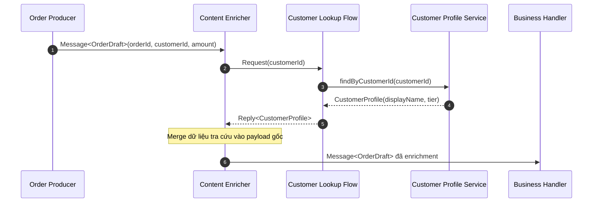
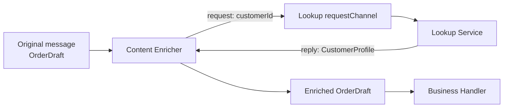
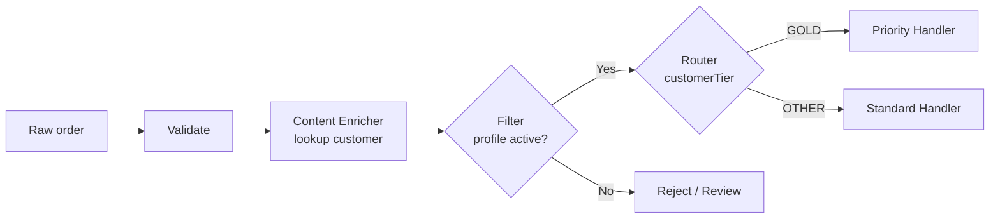
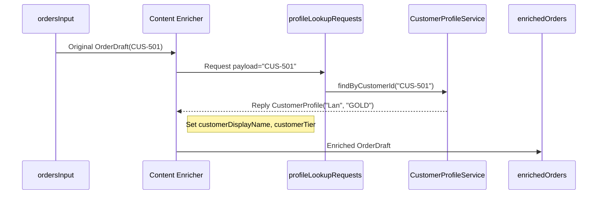
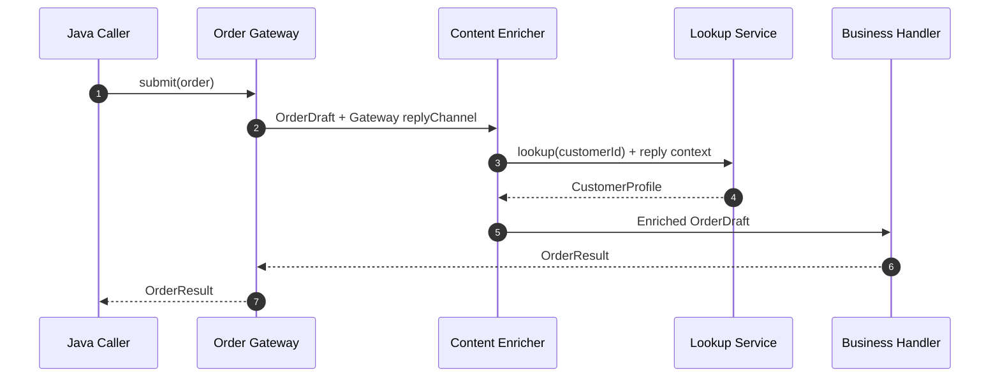
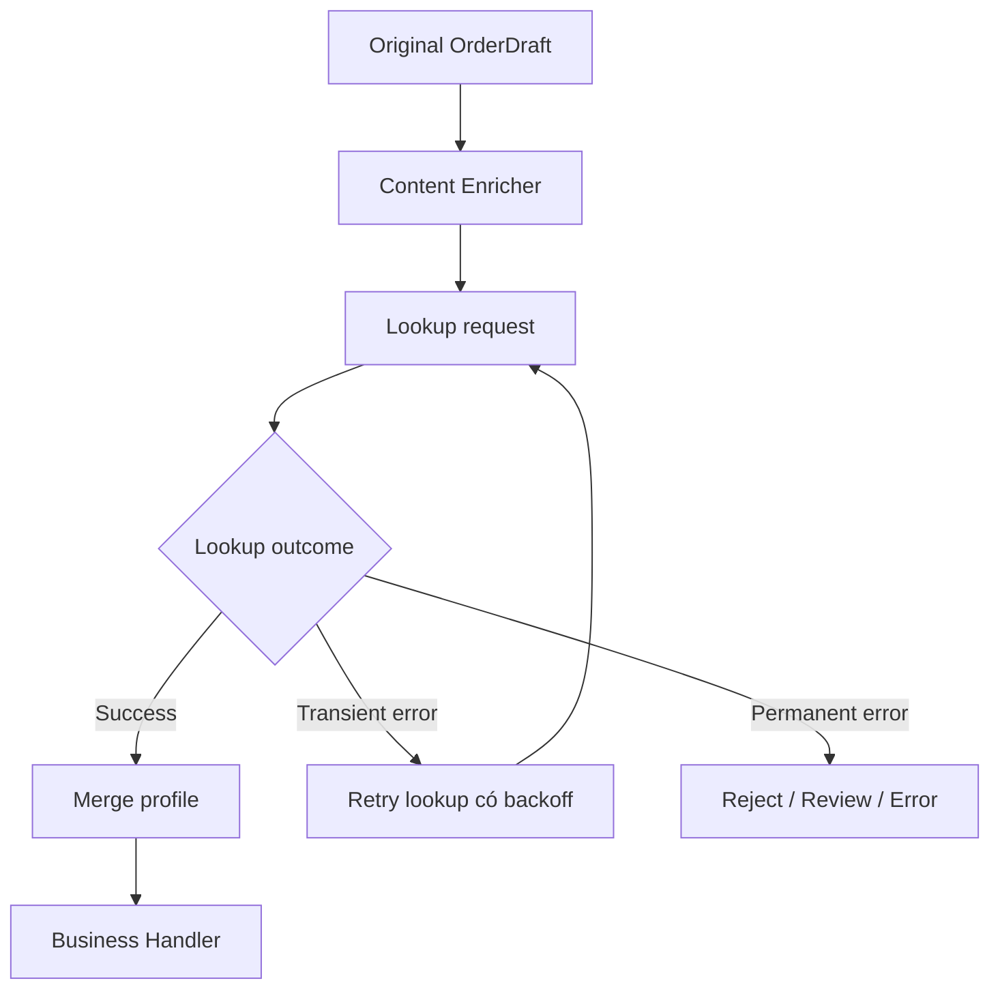
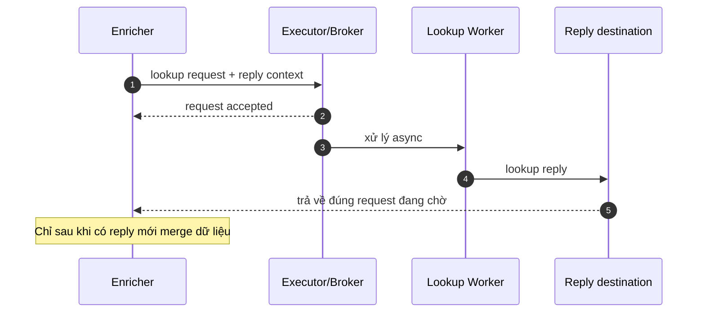
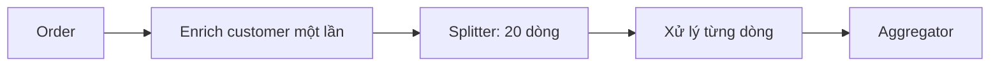
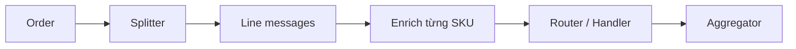

# Request-reply trong quá trình enrichment với Spring Integration

> **Chương:** Content enricher  
> **Bài học:** Request-reply trong quá trình enrichment  
> **Phạm vi:** Thực hành Enterprise Integration Patterns (EIP) bằng Spring Integration để xây dựng các luồng thông điệp ít phụ thuộc, dễ mở rộng và kiểm thử được. Bài học kết nối Content Enricher với Service Activator, Gateway, Transformer, Router, Filter, retry, error channel và correlation.

## 1. Bài toán: message đầu vào thiếu thông tin để xử lý nghiệp vụ

Một nền tảng nhận đơn hàng từ ứng dụng bán hàng. Sự kiện đầu vào chỉ có mã đơn, mã khách và tổng tiền:

```json
{
  "orderId": "ORD-101",
  "customerId": "CUS-501",
  "amount": 750000
}
```

Để áp dụng chính sách vận chuyển hoặc chăm sóc khách hàng, hệ thống cần thêm **tên hiển thị** và **hạng thành viên** của khách. Hai trường này không có trong sự kiện và phải lấy từ một service hoặc kho dữ liệu khác.

Một cách triển khai không tốt là để business handler tự gọi service khách hàng, rồi vừa tra cứu vừa xử lý đơn. Khi đó logic enrichment bị trộn với nghiệp vụ; những luồng khác cần thông tin khách hàng sẽ phải lặp lại việc tra cứu.

**Content Enricher** giải quyết vấn đề: nhận message gốc, gửi một **request** sang nguồn bổ sung dữ liệu, chờ **reply**, sau đó dùng kết quả để làm giàu nội dung message ban đầu.



Ở đoạn trên có **hai lớp công việc**:

1. Content Enricher thực hiện một **request-reply nội bộ** để lấy dữ liệu cần bổ sung.
2. Sau khi nhận reply, flow chính tiếp tục xử lý **message gốc đã được làm giàu**; reply tra cứu không tự trở thành kết quả cuối của đơn hàng.

Đây là điểm trọng tâm: request-reply trong enrichment là một **cuộc trao đổi phụ trợ bên trong pipeline**, không đồng nghĩa một API Gateway đã hoàn thành toàn bộ nghiệp vụ.

### Sau bài học, bạn sẽ

- Hiểu request message, reply message và original message của Content Enricher.
- Cấu hình `requestChannel`, `requestPayloadExpression`, property mapping và timeout.
- Viết một lookup flow có Service Activator trả reply phù hợp.
- Phân biệt Content Enricher với Header Enricher, Transformer và Gateway.
- Kiểm thử dữ liệu gốc được giữ lại trong khi thông tin tra cứu được thêm vào.
- Xử lý trường hợp nguồn tra cứu không trả reply, trả lỗi, chậm hoặc dữ liệu không đủ.
- Giữ correlation, reply channel và yêu cầu idempotency khi có retry/bất đồng bộ.
- Quyết định khi nào nên làm enrichment trước Filter, Router và business handler.

## 2. Content Enricher là gì?

Trong Enterprise Integration Patterns, **Content Enricher** bổ sung thông tin cho một message nhờ dữ liệu lấy từ nơi khác. Nơi khác có thể là service, database, cache, API hoặc một integration flow đã được tách riêng.

Một luồng thường có ba thông điệp logic:

| Vai trò | Ví dụ payload | Ý nghĩa |
| --- | --- | --- |
| **Original message** | `OrderDraft("ORD-101", "CUS-501", 750000)` | Dữ liệu mà producer gửi vào pipeline |
| **Enrichment request** | `"CUS-501"` | Yêu cầu tra cứu thông tin cần bổ sung |
| **Enrichment reply** | `CustomerProfile("Lan", "GOLD")` | Dữ liệu trả về từ lookup |
| **Enriched output** | `OrderDraft` có thêm `customerDisplayName`, `customerTier` | Message tiếp tục vào luồng nghiệp vụ |

**Original message và enrichment request không cần cùng payload.** Với đơn hàng, chỉ cần gửi `customerId` đi lookup thay vì gửi toàn bộ order. Điều này giảm coupling và hạn chế phát tán dữ liệu không cần thiết sang service tra cứu.



Cần phân biệt **làm giàu payload** với **thay thế payload**. Content Enricher có nhiệm vụ giữ ngữ cảnh ban đầu và hợp nhất dữ liệu bổ sung theo các property/field mapping đã khai báo. Nếu ứng dụng chỉ cần chuyển hoàn toàn từ kiểu input sang kiểu output mới, một Transformer có thể phù hợp hơn.

## 3. Request-reply diễn ra bên trong Enricher như thế nào?

Hãy theo dõi thứ tự xử lý:

1. Content Enricher nhận `Message<OrderDraft>` và lưu ngữ cảnh của message gốc.
2. Nó tạo **request message** theo cấu hình; ví dụ lấy `payload.customerId`.
3. Request được gửi đến `requestChannel`.
4. Service Activator hoặc downstream flow nhận request và tính một kết quả.
5. Downstream phải tạo **reply** và gửi lại qua cơ chế reply channel tương ứng.
6. Content Enricher nhận reply, trích xuất các property từ reply và gán vào nội dung gốc.
7. Enricher phát message đã làm giàu sang output channel của flow chính.

```text
ordersInput
   |
   v
Content Enricher
   | originalPayload = OrderDraft
   | requestPayload  = customerId
   |
   +------> profileLookupRequests
   |                   |
   |                   v
   |             Profile Service Activator
   |                   |
   <------ reply: CustomerProfile
   |
   | property mappings:
   |   customerDisplayName <- reply.displayName
   |   customerTier        <- reply.tier
   v
enrichedOrders (OrderDraft + enrichment fields)
```

### Vì sao cần reply?

Vì Enricher phải có một **kết quả tra cứu** để áp dụng property mappings. Nếu downstream chỉ ghi log hoặc trả `void`, Enricher không có dữ liệu cần bổ sung và không thể coi bước enrichment đã hoàn tất bình thường.

Đặc biệt trong luồng request-reply, thiếu reply có thể gây **timeout**, khiến caller phải đợi quá lâu hoặc không nhận được kết quả đúng hợp đồng.

### Request channel và reply channel

- **Request channel:** nơi Enricher gửi message tra cứu. Có thể là `DirectChannel`, một kênh bất đồng bộ hoặc kênh dẫn tới adapter khác.
- **Reply channel:** đường để dữ liệu tra cứu quay lại Enricher. Khi sử dụng cơ chế request-reply chuẩn, Enricher quản lý reply channel của cuộc gọi phụ trợ; endpoint trả reply về đường này.
- **Output channel của Enricher:** nơi message **đã enrichment** đi tiếp. Nó không nhất thiết là reply channel của lookup.

**Không tùy tiện ghi đè `replyChannel` của một message đang do Gateway/Enricher quản lý.** Framework cần metadata đó để điều phối đúng request và reply. Tự thay bằng channel dùng chung có thể khiến reply thất lạc hoặc bị nhận nhầm khi nhiều request chạy song song.

## 4. Phân biệt Content Enricher với các EIP liên quan

Các pattern có thể nằm cạnh nhau, nhưng không cùng trách nhiệm.

| Pattern | Mục đích | Ví dụ |
| --- | --- | --- |
| **Content Enricher** | Bổ sung thông tin từ nguồn phụ trợ vào payload hiện có | Tra cứu hồ sơ khách để bổ sung hạng thành viên |
| **Header Enricher** | Bổ sung/chỉnh metadata trong message headers | Thêm `businessCorrelationId` hoặc `sourceSystem` |
| **Transformer** | Đổi hình dạng hoặc kiểu payload | `OrderDraft → FulfillmentCommand` |
| **Service Activator** | Gọi phương thức nghiệp vụ/lookup và có thể trả reply | `CustomerProfileService.findByCustomerId` |
| **Gateway** | Đưa lời gọi Java vào hệ thống message và nhận phản hồi | `OrderGateway.submit(order)` |
| **Router** | Chọn nhánh xử lý | `customerTier=GOLD → priorityOrders` |
| **Filter** | Cho message đủ điều kiện đi tiếp | `profileActive=true` thì tiếp tục |

Ví dụ kết hợp:



Enricher làm cho Filter/Router có đủ dữ liệu để quyết định. Filter và Router **không nên tự gọi lại lookup** nếu thông tin đã được làm giàu.

## 5. Thiết kế hợp đồng dữ liệu trước khi viết flow

Ví dụ đặt ra hợp đồng rõ ràng:

### 5.1. Dữ liệu gốc

```text
OrderDraft:
  orderId: ORD-101
  customerId: CUS-501
  amount: 750000
  customerDisplayName: null
  customerTier: null
```

### 5.2. Request gửi tới lookup

```text
payload: "CUS-501"
replyChannel: <do Enricher/framework quản lý>
businessCorrelationId: "order:ORD-101" (nếu cần cho observability)
```

### 5.3. Reply từ lookup

```text
CustomerProfile:
  displayName: "Lan"
  tier: "GOLD"
```

### 5.4. Kết quả enrichment

```text
OrderDraft:
  orderId: ORD-101
  customerId: CUS-501
  amount: 750000
  customerDisplayName: "Lan"
  customerTier: "GOLD"
```

**Bất biến:** `orderId`, `customerId` và `amount` không bị thay đổi chỉ vì lookup trả hồ sơ khách. Chỉ những property được chủ đích khai báo mới được bổ sung.

Có thể còn một điều kiện nghiêm ngặt hơn: **hồ sơ reply phải thực sự thuộc khách hàng được yêu cầu**. Nếu trả sai `customerId` do cache, adapter hoặc bug, Enricher không nên hợp nhất dữ liệu vào nhầm order. Trong production, nên xác minh ID của reply hoặc dùng một lớp kiểm tra/trung gian trước merge.

### Hợp đồng khi không có hồ sơ

Chọn một chính sách ngay từ đầu:

- **Required enrichment:** không tìm được hồ sơ là lỗi; không cho business handler chạy khi thiếu dữ liệu bắt buộc.
- **Optional enrichment:** có thể sử dụng một giá trị fallback có phân biệt rõ `UNKNOWN` hoặc chuyển manual review.
- **Deferred enrichment:** lưu request và hoàn tất sau khi dữ liệu bổ sung xuất hiện, theo workflow bền vững.

Không trả một `CustomerProfile` giả có `tier=GOLD` chỉ để tránh lỗi; điều đó có thể dẫn tới quyết định nghiệp vụ sai.

## 6. Ví dụ Java đầy đủ: enrich OrderDraft từ CustomerProfile

Ví dụ dùng Java 17+ và Spring Integration Java DSL. Để minh họa Content Enricher ở dạng **property mapping**, `OrderDraft` là JavaBean có setter cho hai thuộc tính cần bổ sung. Ứng dụng thực tế có thể chọn một kiểu immutable khác cùng custom Transformer nếu không muốn mutate payload.

### 6.1. Payload gốc dưới dạng JavaBean

```java
package example.integration;

import java.math.BigDecimal;
import java.util.Objects;

public class OrderDraft {

    private final String orderId;
    private final String customerId;
    private final BigDecimal amount;

    private String customerDisplayName;
    private String customerTier;

    public OrderDraft(
            String orderId,
            String customerId,
            BigDecimal amount) {
        this.orderId = Objects.requireNonNull(orderId);
        this.customerId = Objects.requireNonNull(customerId);
        this.amount = Objects.requireNonNull(amount);
    }

    public String getOrderId() {
        return orderId;
    }

    public String getCustomerId() {
        return customerId;
    }

    public BigDecimal getAmount() {
        return amount;
    }

    public String getCustomerDisplayName() {
        return customerDisplayName;
    }

    public void setCustomerDisplayName(String customerDisplayName) {
        this.customerDisplayName = customerDisplayName;
    }

    public String getCustomerTier() {
        return customerTier;
    }

    public void setCustomerTier(String customerTier) {
        this.customerTier = customerTier;
    }
}
```

Đây là **mutable DTO**: setter làm thay đổi chính nội dung object. Vì vậy, không nên dùng cùng một `OrderDraft` instance để nhiều thread cùng enrich. Ở các hệ thống dùng payload bất biến, nên tạo một enriched DTO mới trong một bước merge được xác định rõ; mục 12 giải thích lựa chọn đó.

### 6.2. Reply trả về từ profile service

```java
package example.integration;

public final class CustomerProfile {

    private final String customerId;
    private final String displayName;
    private final String tier;

    public CustomerProfile(
            String customerId,
            String displayName,
            String tier) {
        this.customerId = customerId;
        this.displayName = displayName;
        this.tier = tier;
    }

    public String getCustomerId() {
        return customerId;
    }

    public String getDisplayName() {
        return displayName;
    }

    public String getTier() {
        return tier;
    }
}
```

Sử dụng class có getter giúp SpEL truy cập `payload.displayName` hoặc `payload.tier` một cách rõ ràng.

### 6.3. Lookup Service

```java
package example.integration;

public class CustomerProfileService {

    public CustomerProfile findByCustomerId(String customerId) {
        // Demo dữ liệu trong bộ nhớ; thay bằng DB/HTTP ở production.
        if ("CUS-501".equals(customerId)) {
            return new CustomerProfile(
                "CUS-501", "Lan", "GOLD");
        }
        if ("CUS-502".equals(customerId)) {
            return new CustomerProfile(
                "CUS-502", "Minh", "STANDARD");
        }

        // Required enrichment: fail rõ ràng khi không có hồ sơ.
        throw new IllegalArgumentException(
            "Không tìm thấy customerId=" + customerId);
    }
}
```

Service trả một kết quả xác định; nó **không** gửi reply trực tiếp sang một channel hard-code và cũng không cần biết `OrderDraft` chứa những thuộc tính gì.

Trong production cần tách rõ “không tìm thấy khách” (kết quả nghiệp vụ) với “database/HTTP timeout” (lỗi hạ tầng). Cả hai có thể dẫn tới xử lý khác nhau.

## 7. Tạo luồng request-reply bằng Spring Integration Java DSL

Cấu hình gồm:

- `ordersInput`: đầu vào của pipeline.
- `profileLookupRequests`: request channel để Enricher hỏi thông tin khách.
- `enrichedOrders`: output channel nhận message đã enrichment.
- `CustomerProfileService`: method được Service Activator gọi để trả reply.

```java
package example.integration;

import org.springframework.context.annotation.Bean;
import org.springframework.context.annotation.Configuration;
import org.springframework.integration.channel.DirectChannel;
import org.springframework.integration.channel.QueueChannel;
import org.springframework.integration.config.EnableIntegration;
import org.springframework.integration.dsl.IntegrationFlow;
import org.springframework.messaging.MessageChannel;

@Configuration
@EnableIntegration
public class OrderEnrichmentConfiguration {

    @Bean
    public MessageChannel ordersInput() {
        return new DirectChannel();
    }

    @Bean
    public MessageChannel profileLookupRequests() {
        return new DirectChannel();
    }

    @Bean
    public QueueChannel enrichedOrders() {
        return new QueueChannel();
    }

    @Bean
    public CustomerProfileService customerProfileService() {
        return new CustomerProfileService();
    }

    // Flow chính: original -> request/reply enrichment -> output.
    @Bean
    public IntegrationFlow enrichOrdersFlow() {
        return IntegrationFlow.from("ordersInput")
            .enrich(spec -> spec
                .requestChannel("profileLookupRequests")

                // Gửi customerId, không gửi toàn bộ OrderDraft.
                .requestPayloadExpression("payload.customerId")

                // Các expression này đọc dữ liệu từ reply lookup.
                .propertyExpression(
                    "customerDisplayName", "payload.displayName")
                .propertyExpression(
                    "customerTier", "payload.tier")

                // Đặt ngân sách thời gian cho send và receive.
                .requestTimeout(2_000)
                .replyTimeout(2_000))
            .channel("enrichedOrders")
            .get();
    }

    // Flow phụ: nhận customerId và trả CustomerProfile.
    @Bean
    public IntegrationFlow lookupCustomerProfile(
            CustomerProfileService service) {

        return IntegrationFlow.from("profileLookupRequests")
            .handle(service, "findByCustomerId")
            .get();
    }
}
```

### Giải thích từng cấu hình

**`requestChannel("profileLookupRequests")`** cho Enricher biết nơi gửi yêu cầu bổ sung dữ liệu. Nó không phải output channel của đơn hàng đã làm giàu.

**`requestPayloadExpression("payload.customerId")`** lấy mã khách từ original message và tạo request có payload gọn hơn. Khi request đến `CustomerProfileService`, method nhận một `String` là customer ID.

**`propertyExpression("customerDisplayName", "payload.displayName")`** đọc `displayName` từ reply `CustomerProfile` rồi áp dụng vào property `customerDisplayName` trên payload gốc.

**`propertyExpression("customerTier", "payload.tier")`** xử lý tương tự cho `tier`.

**`requestTimeout(...)`** giới hạn thời gian gửi request tới kênh khi việc gửi có thể bị chặn. Với `DirectChannel` đơn giản, send thường chạy đồng bộ; timeout gửi **không phải** một timeout tổng cho toàn bộ service method.

**`replyTimeout(...)`** giới hạn thời gian chờ reply theo cơ chế request-reply của Enricher. Trong luồng hoàn toàn đồng bộ, một method xử lý chậm trực tiếp trong cùng call stack có thể không bị ngắt chỉ vì ta đặt reply timeout; cần timeout ở HTTP client/DB driver hoặc async boundary nếu muốn chặn thời gian thực thi của I/O.

**`channel("enrichedOrders")`** định nghĩa nơi gửi **OrderDraft đã được enrichment**, không phải nơi Service Activator trả `CustomerProfile`.

### Vì sao lookup flow có thể trả reply mà không khai báo output channel?

`ContentEnricher` khi gửi request sử dụng cơ chế reply message/`replyChannel` tương ứng. Service Activator trả object `CustomerProfile`, framework xây reply và điều hướng về request-reply caller. Không cần gán cứng một output channel chung để gom reply của nhiều yêu cầu.

Nếu một custom handler tự tạo `Message<?>`, phải bảo đảm metadata phản hồi thích hợp được giữ theo hợp đồng. Một reply bị gửi nhầm channel có thể làm Enricher chờ đến timeout.

### Điều demo này chưa làm

`enrichedOrders` là `QueueChannel` trong bộ nhớ để test output. Nó chưa ghi đơn vào database, chưa thực hiện Router/Filter nghiệp vụ và chưa bảo đảm event tồn tại sau restart. Các yêu cầu đó phải được thiết kế ở các endpoint tiếp theo.

## 8. Timeline với một đơn hàng cụ thể

Giả sử producer gửi:

```java
import java.math.BigDecimal;

OrderDraft order = new OrderDraft(
    "ORD-101",
    "CUS-501",
    new BigDecimal("750000"));
```

Các bước logic:

| Bước | Payload đang xử lý | Channel hoặc component |
| --- | --- | --- |
| 1 | `OrderDraft(ORD-101, CUS-501, 750000)` | `ordersInput` |
| 2 | `"CUS-501"` | Enricher tạo request |
| 3 | `"CUS-501"` | `profileLookupRequests` |
| 4 | `CustomerProfile(CUS-501, Lan, GOLD)` | Service Activator tạo reply |
| 5 | `CustomerProfile` | Reply quay về Enricher |
| 6 | `OrderDraft` có `customerDisplayName=Lan`, `customerTier=GOLD` | Enricher áp dụng property mappings |
| 7 | `OrderDraft` đã enrichment | `enrichedOrders` |



**Điểm quan trọng:** Enricher không yêu cầu business handler biết cách tra cứu khách hàng. Business handler nhận cùng một hợp đồng enriched payload, bất kể data được lấy từ cache, database hay adapter HTTP ở phía lookup flow.

## 9. Kiểm thử JUnit 5: dữ liệu gốc được giữ và bổ sung đúng

Chỉ unit test `CustomerProfileService` không chứng minh Content Enricher đã kết nối đúng request-reply. Ta cần gửi message tới `ordersInput` và kiểm tra output `enrichedOrders`.

```java
package example.integration;

import static org.junit.jupiter.api.Assertions.*;

import java.math.BigDecimal;

import org.junit.jupiter.api.Test;
import org.springframework.beans.factory.annotation.Autowired;
import org.springframework.beans.factory.annotation.Qualifier;
import org.springframework.integration.channel.QueueChannel;
import org.springframework.messaging.Message;
import org.springframework.messaging.MessageChannel;
import org.springframework.messaging.support.MessageBuilder;
import org.springframework.test.annotation.DirtiesContext;
import org.springframework.test.context.junit.jupiter.SpringJUnitConfig;

@SpringJUnitConfig(OrderEnrichmentConfiguration.class)
@DirtiesContext(
    classMode = DirtiesContext.ClassMode.AFTER_EACH_TEST_METHOD)
class OrderEnrichmentTest {

    @Autowired
    @Qualifier("ordersInput")
    private MessageChannel ordersInput;

    @Autowired
    @Qualifier("enrichedOrders")
    private QueueChannel enrichedOrders;

    @Test
    void enrichesCustomerFieldsWithoutLosingOriginalData() {
        OrderDraft original = new OrderDraft(
            "ORD-101", "CUS-501", new BigDecimal("750000"));

        Message<OrderDraft> input =
            MessageBuilder.withPayload(original)
                .setHeader("businessCorrelationId", "order:ORD-101")
                .setHeader("sourceSystem", "checkout-api")
                .build();

        assertTrue(ordersInput.send(input));

        Message<?> result = enrichedOrders.receive(1_000);
        assertNotNull(result);
        assertInstanceOf(OrderDraft.class, result.getPayload());

        OrderDraft enriched = (OrderDraft) result.getPayload();

        // Dữ liệu gốc còn đầy đủ.
        assertEquals("ORD-101", enriched.getOrderId());
        assertEquals("CUS-501", enriched.getCustomerId());
        assertEquals(new BigDecimal("750000"), enriched.getAmount());

        // Hai property được bổ sung từ reply.
        assertEquals("Lan", enriched.getCustomerDisplayName());
        assertEquals("GOLD", enriched.getCustomerTier());

        // Header nghiệp vụ cần thiết còn trên message chính.
        assertEquals("order:ORD-101",
            result.getHeaders().get("businessCorrelationId"));
        assertEquals("checkout-api",
            result.getHeaders().get("sourceSystem"));

        // Một input chỉ tạo một output trên đường chính này.
        assertNull(enrichedOrders.receive(0));
    }

    @Test
    void anotherCustomerGetsItsOwnProfile() {
        OrderDraft order = new OrderDraft(
            "ORD-102", "CUS-502", new BigDecimal("200000"));

        assertTrue(ordersInput.send(
            MessageBuilder.withPayload(order).build()));

        Message<?> output = enrichedOrders.receive(1_000);
        assertNotNull(output);

        OrderDraft enriched = (OrderDraft) output.getPayload();
        assertEquals("Minh", enriched.getCustomerDisplayName());
        assertEquals("STANDARD", enriched.getCustomerTier());
    }

    @Test
    void unknownCustomerDoesNotProduceEnrichedOrder() {
        OrderDraft missing = new OrderDraft(
            "ORD-404", "CUS-UNKNOWN", new BigDecimal("100000"));

        // Flow DirectChannel đồng bộ: lỗi lookup có thể lan tới sender.
        assertThrows(RuntimeException.class, () ->
            ordersInput.send(
                MessageBuilder.withPayload(missing).build()));

        assertNull(enrichedOrders.receive(0));
    }
}
```

Các test chứng minh:

- Content Enricher gửi request tới lookup flow và nhận reply.
- Dữ liệu đầu vào quan trọng được bảo toàn về **giá trị**.
- Các property được bổ sung đúng theo reply của từng customer.
- Header correlation của original message vẫn xuất hiện ở output flow chính.
- Unknown customer trong ví dụ bị fail, không tự đi vào business handler với thông tin hồ sơ giả.

**Không nên dùng `assertSame(original, enriched)` làm hợp đồng enrichment chung.** Với cơ chế property mutation, một object có thể được cập nhật trực tiếp; ở một triển khai khác, framework hoặc custom transformer có thể tạo bản sao. Bài test nên tập trung vào **giá trị, schema, nguồn và ranh giới side effect**, không gắn business contract với Java object identity.

### Vì sao không test bằng `Thread.sleep(...)`?

Trong demo `DirectChannel` đồng bộ, `receive(...)` có timeout đủ để xác nhận output. Khi chuyển sang lookup bất đồng bộ, cần dùng `CountDownLatch`, Awaitility hoặc test fixture có thời gian chờ được kiểm soát. Không dùng sleep tùy ý để suy đoán service đã xử lý xong.

## 10. Request timeout và reply timeout khác nhau thế nào?

Hai khái niệm thường gây nhầm khi cấu hình Content Enricher.

### 10.1. Request timeout

Request timeout liên quan đến bước **gửi request** vào `requestChannel`. Một channel có thể bị chặn trong thao tác gửi vì backpressure, capacity hoặc chính sách send.

Ví dụ:

```text
Enricher
  |
  | send request
  v
Queue/Channel đang đầy
  |
  +-- send có thể chờ hoặc thất bại theo channel policy
```

Thời gian chờ gửi không nên bị hiểu là “mọi hoạt động lookup phải xong trong 2 giây”. Với channel đồng bộ chạy handler trực tiếp, handler có thể tốn 10 giây gọi API trong cùng call stack. Muốn giới hạn cuộc gọi API, cần cấu hình timeout của HTTP client/DB và có thể dùng circuit breaker hoặc async boundary.

### 10.2. Reply timeout

Reply timeout liên quan đến việc chờ **reply quay lại Enricher** sau khi request được gửi theo cơ chế request-reply.

```text
Enricher --request--> Async lookup
  |
  +--- waiting for reply ---+
                           |
              timeout nếu không nhận được reply kịp
```

Nếu một downstream handler trả `void`, không phát reply, hoặc reply bị chuyển nhầm channel, Enricher có thể không nhận được dữ liệu để merge.

### Bảng tình huống

| Tình huống | Vấn đề chính | Cách xử lý |
| --- | --- | --- |
| Request channel không có subscriber | Send/dispatch thất bại | Kiểm tra endpoint, cấu hình channel |
| Kênh gửi bị nghẽn | Send có thể chặn hoặc bị từ chối | Backpressure, request timeout |
| Lookup HTTP chạy chậm trong thread đồng bộ | I/O chậm | Client timeout, circuit breaker, async design |
| Lookup bất đồng bộ không gửi reply | Receive timeout | Reply timeout, error path |
| Lookup trả lỗi | Error/exception | Retry có giới hạn, phân loại lỗi |
| Lookup trả kết quả nhưng thiếu field | Dữ liệu không đủ để merge | Validate reply, fallback/review |
| Lookup trả reply sang channel sai | Lost/misrouted reply | Đúng reply-channel contract và correlation |

**Thực hành an toàn:** xác định *tổng ngân sách thời gian* của request từ Gateway hoặc adapter đầu vào, rồi phân bổ hợp lý cho gửi request, lookup và reply. Tránh đặt từng timeout quá dài khiến nhiều worker chờ đồng thời và gây nghẽn toàn hệ thống.

## 11. Gateway ở ngoài và request-reply của Enricher ở trong

Ta cần phân biệt **hai chu trình request-reply**:



- **Enrichment reply**: `CustomerProfile` trả về Enricher.
- **Gateway reply**: `OrderResult` trả về caller sau khi business handler xử lý.
- **Không được** đưa `CustomerProfile` về Java caller như thể đó là kết quả submit order.

### Ví dụ hợp đồng Gateway

```java
package example.integration;

import org.springframework.integration.annotation.MessagingGateway;

@MessagingGateway(defaultRequestChannel = "ordersInput")
public interface OrderGateway {
    OrderResult submit(OrderDraft draft);
}

public record OrderResult(
    String orderId,
    String status,
    String customerTier) {}
```

Đây là **mở rộng minh họa**, không chạy nguyên xi với output `QueueChannel` của demo ở mục 7. Để Gateway trả `OrderResult`, cần nối một Service Activator **sau enrichment** tạo reply và bảo đảm message quay về Gateway. Ví dụ:

```java
public final class OrderBusinessService {

    public OrderResult submitEnriched(OrderDraft order) {
        if (order.getCustomerTier() == null) {
            throw new IllegalStateException("Thiếu enrichment");
        }

        // Ví dụ không có ghi DB; production cần transaction/idempotency.
        return new OrderResult(
            order.getOrderId(),
            "ACCEPTED_FOR_PROCESSING",
            order.getCustomerTier());
    }
}
```

Bước business handler này được gọi **sau** Content Enricher trong một flow request-reply hoàn chỉnh. Không khai báo đồng thời output `QueueChannel` và handler reply ở cùng vị trí mà không hiểu rõ thông điệp được dispatch tới đâu.

### Khi nào Gateway timeout?

Gateway có thể timeout nếu:

1. Enricher không nhận được lookup reply và chưa có error/recovery phù hợp.
2. Enricher đã làm giàu nhưng downstream handler không tạo reply.
3. Handler trả reply nhưng routing của `replyChannel` bị mất.
4. Luồng bất đồng bộ dùng executor/broker, tổng thời gian vượt SLA.
5. Một Filter sau enrichment loại message mà không gửi kết quả từ chối cho caller.

Vì vậy, cần thiết kế reply contract **xuyên suốt** chứ không chỉ nhìn timeout của Content Enricher.

## 12. Mutable payload, immutable DTO và trách nhiệm merge

Ví dụ property mapping dùng JavaBean có setter để dễ học. Đây là một lựa chọn hợp lệ nhưng cần hiểu điểm yếu.

### 12.1. Rủi ro của việc mutate object gốc

Giả sử cùng một `OrderDraft` instance được chia sẻ trong nhiều nhánh `PublishSubscribeChannel`:

```text
Shared OrderDraft
  |
  +-> Audit subscriber đọc tier
  |
  +-> Enricher subscriber setCustomerTier("GOLD")
  |
  +-> Notification subscriber đọc tier
```

Nếu các nhánh chạy song song, audit có thể thấy `tier=null` còn notification thấy `tier=GOLD`, tùy lịch thread. Đây là **race condition** và có thể làm log hoặc kết quả nghiệp vụ không nhất quán.

Nên giới hạn mutation trong một pipeline tuần tự, tránh dùng cùng object ở nhiều worker. Với hệ thống có broadcast, caching hoặc lưu message lâu, ưu tiên payload immutable.

### 12.2. Mẫu immutable: tạo object đã enrichment mới

Một thiết kế khác dùng hai kiểu dữ liệu:

```java
public record OrderInput(
    String orderId,
    String customerId,
    BigDecimal amount) {}

public record EnrichedOrder(
    String orderId,
    String customerId,
    BigDecimal amount,
    String customerDisplayName,
    String customerTier) {}
```

Sau khi lookup trả `CustomerProfile`, một **merge service** tạo `EnrichedOrder` mới từ input và profile:

```java
public EnrichedOrder merge(
        OrderInput order,
        CustomerProfile profile) {

    if (!order.customerId().equals(profile.getCustomerId())) {
        throw new IllegalArgumentException(
            "Profile không khớp customerId của order");
    }

    return new EnrichedOrder(
        order.orderId(),
        order.customerId(),
        order.amount(),
        profile.getDisplayName(),
        profile.getTier());
}
```

Đây là **mẫu nghiệp vụ**, không phải đoạn code tự động nối với `ContentEnricher` ở mục 7. Để triển khai hoàn chỉnh, dùng một Gateway/lookup service để nhận `CustomerProfile` rồi gọi merge trong Transformer/Service Activator, hoặc cấu hình custom enrichment có khả năng tạo/copy payload theo API của phiên bản Spring Integration.

Ưu điểm: dữ liệu gốc không bị thay đổi, output có hợp đồng rõ và dễ chạy song song. Đổi lại, cần thêm bước phối hợp request-reply và merge.

### 12.3. Không sao chép toàn bộ reply thành payload gốc

Một lỗi hay gặp là thay `OrderDraft` bằng `CustomerProfile` rồi downstream handler không còn orderId/amount.

```text
Sai về hợp đồng:
  OrderDraft -> lookup -> CustomerProfile -> OrderBusinessHandler

Đúng theo enrichment:
  OrderDraft + CustomerProfile -> EnrichedOrder/OrderDraft đã enrich
```

Nếu mục đích là thay kiểu dữ liệu từ đầu đến cuối, đó là Transformer. Nếu mục đích là **bổ sung dữ liệu cho message gốc**, phải giữ dữ liệu gốc trong bước merge.

## 13. Reply dữ liệu rỗng, không hợp lệ hoặc không tồn tại

Một lookup có thể trả:

- Không tìm thấy khách.
- Có record nhưng thiếu tên hoặc tier.
- Record thuộc customer ID khác.
- Record đã hết hạn hoặc quá cũ.
- Dữ liệu mâu thuẫn với policy hiện tại.

**Phân biệt lỗi hạ tầng và dữ liệu thiếu:**

| Tình huống | Loại vấn đề | Hướng xử lý |
| --- | --- | --- |
| Customer ID không có trong kho | Not found theo nghiệp vụ | Reject/Review hoặc fallback tường minh |
| Lookup API timeout | Hạ tầng tạm lỗi | Retry có giới hạn, circuit breaker |
| Reply sai customer ID | Vi phạm tính toàn vẹn | Fail fast, audit, không merge |
| Reply thiếu tier | Dữ liệu enrichment không đủ | Validate reply, Review |
| Reply chứa tier không hỗ trợ | Hợp đồng dữ liệu sai/chưa đồng bộ | Quarantine hoặc policy version mới |
| Reply quá cũ | Data freshness | TTL/cache invalidation, dùng snapshot phù hợp |

Không nên tự động coi thiếu dữ liệu là `STANDARD` trong mọi trường hợp. Ví dụ một khách VIP bị thiếu tier sẽ mất quyền lợi; ngược lại, thiếu risk profile có thể khiến hệ thống xử lý giao dịch nguy hiểm. Fallback phải là **quyết định nghiệp vụ được phê duyệt**.

### Null reply không phải một kết quả enrichment hữu ích

Nếu lookup service trả `null` như một cách biểu diễn “not found”, Enricher có thể thiếu reply để xử lý property expressions hoặc bị ảnh hưởng bởi cơ chế requires-reply/timeout của endpoint. Với required enrichment, nên **ném exception có ý nghĩa hoặc trả một kiểu kết quả có cấu trúc** và xử lý tường minh.

Ví dụ kết quả có cấu trúc:

```java
public record ProfileLookupResult(
    boolean found,
    String customerId,
    String displayName,
    String tier,
    String reasonCode) {}
```

Nếu dùng kiểu này, cần thêm logic kiểm tra `found` và ID trước khi áp dụng property mappings. Không dùng property mapping mù quáng khi `found=false`.

## 14. Retry trong enrichment: retry ở đâu, bao nhiêu lần?

Một điểm quan trọng: khi lookup thất bại, có nên retry **toàn bộ order pipeline** hay chỉ **lookup**?



Nên giới hạn retry tại nơi xảy ra **lỗi tạm thời**, thường là lookup service/adapter, trước khi business handler thực hiện side effect.

**Không nên** retry vô hạn khi customer không tồn tại hoặc customer ID sai schema. Cùng request sẽ tiếp tục không có kết quả, chỉ làm tăng tải.

### Retry có idempotency

Lookup thuần đọc thông tin thường dễ retry hơn một tác vụ ghi dữ liệu. Tuy nhiên nếu lookup đồng thời ghi audit, tăng counter hoặc gọi API tính phí, retry cũng có thể tạo tác dụng phụ.

Một số nguyên tắc:

- Giới hạn số lần retry, có exponential backoff và jitter khi phù hợp.
- Có overall timeout cho pipeline.
- Phân biệt retryable (HTTP 503/timeout) và non-retryable (customer ID không tồn tại).
- Dùng correlation ID và request attempt để ghi nhận từng lần thử.
- Dùng circuit breaker/bulkhead nếu service lookup thường xuyên chậm.
- Khi message đã qua business handler có side effect, retry từ đầu có thể tạo xử lý trùng; cần idempotency key.

### Recovery và nhánh xử lý lỗi

Có thể sử dụng `RequestHandlerRetryAdvice`, error channel hoặc cơ chế retry của adapter phù hợp với điểm lỗi. Không giả định mỗi exception đều tự động quay về một error channel toàn cục khi flow đang đồng bộ qua `DirectChannel`; trong trường hợp đó, exception có thể lan ngược về caller.

Một nhánh recovery có thể đưa order vào queue xét duyệt, nhưng phải kèm **lý do thật**: `PROFILE_SERVICE_UNAVAILABLE` khác với `CUSTOMER_NOT_FOUND`.

## 15. Bất đồng bộ: reply phải quay đúng về request gốc

Trong ví dụ, `profileLookupRequests` là `DirectChannel`, lookup diễn ra đồng bộ. Nếu đổi sang `ExecutorChannel` hoặc đưa request qua broker, reply có thể đến sau và trên thread khác.



Những điều cần đảm bảo:

1. Request có một **reply destination** hợp lệ.
2. Worker gửi kết quả về đúng nơi framework/adapter đã khai báo.
3. Khi có nhiều request đồng thời, reply **không bị nhận nhầm**.
4. Có timeout và xử lý reply đến muộn.
5. Headers cần thiết qua serialization được map rõ ràng.
6. Không giữ vô hạn hàng nghìn request đang chờ trong RAM nếu lookup có độ trễ dài.

### Correlation ID không phải replyChannel

Có ít nhất ba khái niệm dễ bị nhầm:

| Metadata | Vai trò |
| --- | --- |
| `businessCorrelationId` | Truy vết tất cả sự kiện liên quan tới cùng order |
| `correlationId` | Có thể là khóa nhóm của Splitter/Aggregator hoặc correlation kỹ thuật theo một adapter |
| `replyChannel` | Đích phản hồi của một cuộc trao đổi request-reply |

Một `businessCorrelationId=order:ORD-101` **không đủ** để bảo đảm reply tự quay lại đúng Content Enricher. Framework và transport cần một reply-channel/reply-address/correlation protocol tương ứng.

Khi đi qua HTTP, Kafka hay AMQP, các header và reply destination có thể không serialize giống trong JVM. Không truyền nguyên một `MessageChannel` object qua broker rồi giả định consumer ở process khác có thể dùng nó. Cần thiết kế request-reply phù hợp transport, mapping metadata và khả năng tiếp nhận reply đến muộn.

### Khi nào nên tránh synchronous enrichment?

Nếu việc tra cứu là một tác vụ dài nhiều phút hoặc chờ con người, không nên giữ một lời gọi Gateway đồng bộ chờ. Thiết kế workflow state:

```text
Receive order
  -> Persist pending enrichment
  -> Reply "RECEIVED / PENDING"
  -> Async lookup event
  -> Persist profile result
  -> Resume processing
```

Content Enricher request-reply phù hợp hơn với truy vấn có **độ trễ dự đoán được và thời hạn chờ rõ**. Với quy trình dài, dùng broker, database/outbox hoặc workflow engine để lưu state và nối các bước theo correlation.

## 16. Correlation, Splitter/Aggregator và payload nguồn

Enrichment thường được dùng trước hoặc sau Splitter. Vị trí ảnh hưởng số lần lookup, hiệu năng và correlation.

### 16.1. Enrich trước Splitter

Nếu một đơn có 20 dòng nhưng cả đơn đều cần cùng profile khách:



Enrich một lần giúp tránh 20 lần gọi cùng profile service. Dữ liệu enrichment cần được chuyển hợp lệ sang các message con.

### 16.2. Enrich sau Splitter

Nếu từng dòng hàng cần lookup thông tin riêng, enrichment **sau** Splitter mới hợp lý:



Các message con thường mang metadata nhóm như `correlationId`, `sequenceNumber`, `sequenceSize`. Khi Enricher hoặc custom merge tạo reply message mới, cần giữ những headers theo hợp đồng để Aggregator nhóm đúng.

### Mối nguy nếu enrichment thất bại ở một dòng

Nếu một trong 20 message con không nhận reply lookup và không tạo kết quả tiếp theo, Aggregator có thể chỉ nhận 19/20 kết quả rồi chờ đến timeout. Các lựa chọn:

- Tạo một `LineResult.FAILED` có cấu trúc để Aggregator nhận đủ 20 kết quả.
- Dùng release/expiry strategy cho trường hợp có phần tử thất bại.
- Validate khả năng lookup trước Splitter nếu phù hợp.
- Dùng recovery flow có correlation đầy đủ.

**Không ghi đè `correlationId` của Splitter bằng customer ID chỉ vì bước lookup liên quan khách hàng.** Correlation nhóm và ID nghiệp vụ có vai trò khác nhau.

## 17. Content Enricher trước Filter và Router

Khi Filter/Router cần thông tin không có ở message gốc, enrichment nên đi **trước quyết định**.

Ví dụ:

```text
Original OrderDraft
   |
   v
Validate orderId/customerId/amount
   |
   v
Content Enricher: lookup tier, profile status
   |
   v
Filter: customer active?
   | true
   v
Router: GOLD -> priorityOrderChannel
        OTHER -> standardOrderChannel
   |
   v
Business Handler
```

**Quan trọng:** không cho Filter hoặc Router giả định rằng mọi message sau Enricher chắc chắn có dữ liệu đầy đủ nếu lookup có chính sách optional/fallback. Hãy khai báo invariant sau enrichment:

```text
Enrichment thành công:
  customerDisplayName != null
  customerTier thuộc tập cho phép
  profile gắn với đúng customerId

Enrichment không thành công:
  fail/review/recovery
  KHÔNG tự đi vào business handler yêu cầu profile hợp lệ
```

Nếu policy định tuyến được cập nhật động, nên chốt một policy version sau khi enrichment hoàn tất. Không gọi lookup nhiều lần cho cùng message ở những Router/Filter khác nhau khi không có nhu cầu refresh dữ liệu được khai báo rõ.

### Enrichment dữ liệu tin cậy

Nếu business handler quyết định hạn mức hoặc quyền theo customer tier, dữ liệu đó phải đến từ **nguồn có thẩm quyền**. Không tin một `customerTier=GOLD` do client tự gắn vào request header. Enricher có thể ghi đè thông tin không đáng tin bằng reply từ service nội bộ đã được xác thực.

Nhưng Content Enricher không tự cấp quyền truy cập. Business handler vẫn phải thực hiện authorization/invariant quan trọng tại nơi thực hiện side effect.

## 18. Tính nhất quán dữ liệu và freshness

Profile khách hàng có thể thay đổi trong lúc xử lý đơn. Lookup trả `tier=GOLD` lúc 10:00:00, nhưng khách bị hạ hạng lúc 10:00:02.

Enricher đang cung cấp một **snapshot thông tin tại thời điểm tra cứu**, không tự bảo đảm đó là phiên bản mới nhất khi business handler commit.

### Các chiến lược

| Chiến lược | Khi phù hợp | Hạn chế |
| --- | --- | --- |
| Đọc trực tiếp từ authoritative service | Quyết định cần dữ liệu tương đối mới | Độ trễ cao, phụ thuộc network |
| Dùng cache có TTL | Dữ liệu ít thay đổi, SLA cho phép | Có thể stale |
| Trả `profileVersion` và `asOf` | Cần audit chính sách/tính nhất quán | Downstream phải hiểu version |
| Validate lại tại transaction boundary | Quyết định rủi ro cao | Thêm chi phí và phức tạp |
| Pin snapshot theo event | Quy trình cần quyết định có thể tái hiện | Không luôn phản ánh thay đổi tức thời |

Một reply có thể mang:

```json
{
  "customerId": "CUS-501",
  "displayName": "Lan",
  "tier": "GOLD",
  "profileVersion": 17,
  "asOf": "2026-11-21T03:00:00Z"
}
```

Bài học chỉ dùng hai field để dễ tập trung, nhưng production nên cân nhắc lưu version/as-of nếu enrichment tham gia quyết định có yêu cầu đối soát. Dữ liệu thời gian trên là ví dụ minh họa, không phải một kết quả tra cứu thật.

## 19. Observability: theo dõi đầy đủ thời gian và kết quả tra cứu

Nếu chỉ log “đã nhận đơn”, khi business handler không chạy sẽ khó biết vì lookup không có reply hay vì một Filter từ chối.

Nên ghi các mốc:

```text
ORDER_RECEIVED
   |
   v
ENRICHMENT_REQUESTED
   |
   +-> ENRICHMENT_SUCCEEDED
   |      |
   |      v
   |    BUSINESS_HANDLER_STARTED
   |      |
   |      v
   |    BUSINESS_HANDLER_COMPLETED
   |
   +-> ENRICHMENT_FAILED / ENRICHMENT_TIMED_OUT
          |
          v
        REVIEW / ERROR POLICY
```

Một structured log ví dụ:

```text
eventId=EV-101
businessCorrelationId=order:ORD-101
customerId=CUS-501
stage=ENRICHMENT_SUCCEEDED
lookupService=customer-profile
replyType=CustomerProfile
durationMs=27
```

Không log token xác thực, dữ liệu cá nhân nhạy cảm hoặc toàn bộ profile reply. Nếu `displayName` là dữ liệu cá nhân, tránh đưa nó vào metric labels và log khi không cần thiết.

### Những metric hữu ích

| Metric | Mục đích |
| --- | --- |
| `enrichment.request.count` | Tổng request lookup |
| `enrichment.success.count` | Số reply được merge thành công |
| `enrichment.not_found.count` | Số khách không tồn tại |
| `enrichment.timeout.count` | Số lần chờ quá hạn |
| `enrichment.error.count` | Lỗi tra cứu hoặc merge |
| `enrichment.latency` | Độ trễ tra cứu, percentiles |
| `enrichment.inflight` | Số request đang chờ reply |
| `enrichment.retry.count` | Số lần retry |
| `business.handler.started` | Số message đã đủ dữ liệu vào handler |
| `business.handler.failed` | Lỗi sau enrichment |

Đừng tạo metric label theo từng `customerId` hoặc `orderId` vì cardinality quá lớn. Dùng tracing/structured logging để tra cứu từng yêu cầu.

## 20. Những phản mẫu thường gặp

### 20.1. Lookup handler không trả reply

```java
public void findByCustomerId(String customerId) {
    profileService.fetch(customerId);
    // Không return dữ liệu.
}
```

Enricher không có `CustomerProfile` để merge. Nếu cần one-way lookup dài hạn, thiết kế async workflow khác thay vì gọi một Service Activator `void` trong request-reply enrichment.

### 20.2. Trả toàn bộ OrderDraft từ lookup

Lookup chỉ nên trả những gì nó chịu trách nhiệm, ví dụ `CustomerProfile`. Nếu để customer service tự sửa toàn bộ order, dependency giữa hai domain trở nên lớn hơn và gây khó bảo trì.

### 20.3. Ghi đè replyChannel

Một handler tự gửi reply tới một bean channel cố định, không trả theo reply context. Khi nhiều request đồng thời, message có thể tới sai nơi hoặc Enricher timeout. Để framework quản lý reply channel của exchange hoặc triển khai correlation protocol đầy đủ ở transport.

### 20.4. Nhầm requestTimeout với thời gian chạy của service

Đặt `requestTimeout(2000)` rồi kỳ vọng HTTP client đồng bộ tự bị ngắt sau đúng hai giây. Cần timeout của HTTP client/driver và có thể một ranh giới bất đồng bộ với ngân sách thời gian tổng.

### 20.5. “Not found” được biểu diễn bằng null không rõ nghĩa

Null có thể làm mất reply hoặc gây lỗi mơ hồ. Dùng lỗi nghiệp vụ rõ hoặc kết quả `found=false` với nhánh xử lý cụ thể.

### 20.6. Merge vào payload mutable dùng chung

Một subscriber đọc payload trước khi Enricher sửa; subscriber khác đọc sau khi sửa. Dùng immutable DTO hoặc tách enrichment tuần tự khỏi broadcast, và không mutate object chia sẻ đa thread.

### 20.7. Không kiểm tra identity của lookup reply

Một cache trả nhầm profile của customer khác. Property mapping vẫn điền displayName/tier, nhưng order mang dữ liệu sai người. Với thông tin quan trọng, kiểm tra `reply.customerId == original.customerId` trước khi chấp nhận enrichment.

### 20.8. Retry toàn bộ luồng sau khi đã có side effect

Lookup tạm lỗi có thể retry riêng. Nhưng nếu order handler đã ghi DB, chạy lại từ đầu có thể gây trùng. Dùng idempotency và xác định retry boundary phù hợp.

### 20.9. Cho Filter/Router dùng field chưa được enrichment

Sau lookup timeout, pipeline vẫn chạy và coi `customerTier=null` như STANDARD. Nếu tier quan trọng, đó là lỗ hổng hợp đồng dữ liệu. Dùng validation sau enrichment hoặc nhánh review.

### 20.10. Dùng Content Enricher như workflow engine lâu ngày

Một request-reply chờ con người phê duyệt 24 giờ không phù hợp với việc giữ request in-flight trong JVM. Persist state, phát event tiếp nối hoặc dùng công cụ workflow có lưu trạng thái.

## 21. Bài thực hành: enrichment thông tin sản phẩm trước tính phí

**Bối cảnh:** ứng dụng bán hàng nhận `OrderLine(orderId, sku, quantity)`. Phải tra cứu `ProductInfo(sku, productName, unitPrice, currency, taxCategory)` rồi mới tính tổng tiền và thuế.

### Yêu cầu

1. Tạo DTO input có `orderId`, `sku`, `quantity`; validate quantity dương.
2. Tạo request channel `productLookupRequests` và reply từ `ProductCatalogService.findBySku`.
3. Dùng `ContentEnricher` với `requestPayloadExpression("payload.sku")` để chỉ gửi SKU đi tra cứu.
4. Map các field cần thiết từ reply thành enriched order line hoặc tạo immutable output với merge service.
5. Giữ `orderId`, `sku`, `quantity` từ message gốc.
6. Kiểm tra `reply.sku` khớp SKU gốc trước khi merge.
7. Đặt request/reply timeout và timeout của HTTP client khi dùng catalog API bên ngoài.
8. Xử lý SKU không tồn tại bằng lỗi hoặc manual review, không mặc nhiên tính giá 0.
9. Thêm test cho lookup thành công, thiếu SKU, reply sai SKU, timeout và nhiều request chạy song song.
10. Sau enrichment, dùng Filter kiểm tra sản phẩm còn bán và Router chọn nhánh tính thuế theo `taxCategory`.
11. Nếu dùng Splitter/Aggregator cho nhiều dòng hàng, thiết kế cách giữ correlation và trả kết quả lỗi cho một SKU không lookup được.
12. Nếu lookup qua broker và kéo dài, đề xuất workflow state store để không giữ Gateway request mở quá lâu.

### Bảng hành vi kỳ vọng

| Tình huống | Lookup reply | Output của enrichment |
| --- | --- | --- |
| SKU hợp lệ | `ProductInfo` đầy đủ | Có tên, giá, currency, tax category |
| SKU không tồn tại | Not found | Reject/review, không tính giá giả |
| Catalog timeout | Không có reply kịp | Timeout/retry/recovery rõ |
| Reply sai SKU | Có nhưng ID không khớp | Fail, không merge |
| Cùng order có 3 SKU | 3 request độc lập hoặc batch | Correlation từng line và group vẫn đúng |
| Có Gateway request-reply | Kết quả nghiệp vụ sau enrichment | Không trả `ProductInfo` thay `OrderResult` |
| Retry lookup sau lỗi tạm | Cùng request ID hoặc attempt | Có log/correlation, không side effect trùng |

### Câu hỏi tự đánh giá

**Câu 1.** Content Enricher nhận lại `CustomerProfile`, vậy payload output có nhất thiết trở thành `CustomerProfile` không?

*Không. Nội dung reply được dùng để bổ sung vào payload gốc theo property mapping hoặc merge contract.*

**Câu 2.** Vì sao `requestPayloadExpression("payload.customerId")` có ích?

*Vì lookup chỉ cần mã khách; không phải phát tán toàn bộ order sang nguồn dữ liệu phụ trợ.*

**Câu 3.** `requestTimeout` có tự giới hạn toàn bộ thời gian HTTP lookup đồng bộ không?

*Không. Nó liên quan đến thao tác gửi request; cần timeout ở client/driver và ngân sách thời gian tổng của pipeline.*

**Câu 4.** Khi Gateway chờ `OrderResult`, lookup reply `CustomerProfile` có được trả thẳng về caller không?

*Không. Enricher nhận profile để merge; downstream business handler mới tạo OrderResult cho Gateway.*

**Câu 5.** Nếu Enricher chạy trong một message con của Splitter và lookup thất bại không có kết quả, Aggregator có thể ra sao?

*Nhóm có thể thiếu một phần tử và chờ tới timeout; cần error result hoặc release/expiry strategy phù hợp.*

## 22. Checklist thiết kế trước khi vận hành

- **Input contract:** message gốc được validate; ID sử dụng cho lookup có nguồn đáng tin.
- **Request payload:** chỉ chứa dữ liệu mà lookup thực sự cần.
- **Request channel:** có consumer/adapter rõ, không bị bỏ trống.
- **Reply:** lookup thực sự trả giá trị phù hợp, không trả `void`/null mơ hồ.
- **Mapping:** property expressions hoặc merge logic được kiểm tra với reply schema.
- **Identity:** có xác nhận reply thuộc đúng customer/SKU/order đang được enrich.
- **Payload mutation:** không dùng chung object mutable giữa các subscriber/worker.
- **Timeout:** phân biệt send timeout, reply timeout, I/O client timeout và tổng SLA.
- **Failure:** not found, invalid reply, timeout và hạ tầng lỗi có chính sách riêng.
- **Retry:** có giới hạn/backoff; tránh chạy lại side effect đã thực hiện.
- **Gateway:** lookup reply và business reply được tách biệt; có reply cho caller trên mọi nhánh.
- **Correlation:** giữ business correlation, reply context và group headers của Aggregator.
- **Async transport:** có header mapping, reply matching và xử lý late replies.
- **Freshness:** quyết định TTL, version, snapshot và lúc cần revalidate dữ liệu.
- **Security:** không tin profile/tier tự khai từ client và không tiết lộ dữ liệu quá nhu cầu.
- **Observability:** request, success, timeout, error, in-flight, latency, correlation.
- **Testing:** tích hợp send → lookup reply → merge → business handler, gồm cả case thất bại.
- **Durability:** không kỳ vọng `QueueChannel` trong RAM tự bảo đảm qua restart.

## 23. Kết luận

**Request-reply trong Content Enricher** là một cuộc trao đổi bổ sung bên trong pipeline Spring Integration: giữ ngữ cảnh message gốc, tạo request tới một nguồn dữ liệu, nhận reply rồi **hợp nhất những field cần thiết** trước khi chuyển sang Filter, Router hoặc Business Handler.

Muốn triển khai đúng, không chỉ cần `.enrich(...)` và `requestChannel`; còn phải bảo đảm lookup trả reply, property mapping đúng schema, timeouts rõ nghĩa, lỗi được phân loại, correlation không bị mất và business handler không chạy khi enrichment bắt buộc chưa hoàn tất.

Khi các trách nhiệm đó được phân tách rõ ràng, Content Enricher giúp các luồng Enterprise Integration Patterns ít phụ thuộc vào nguồn dữ liệu phụ trợ, dễ kiểm thử và đủ khả năng quan sát để vận hành an toàn.
