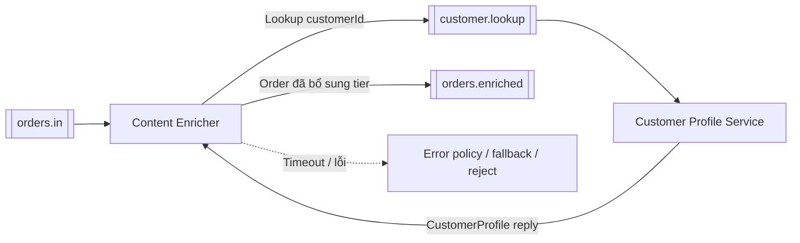
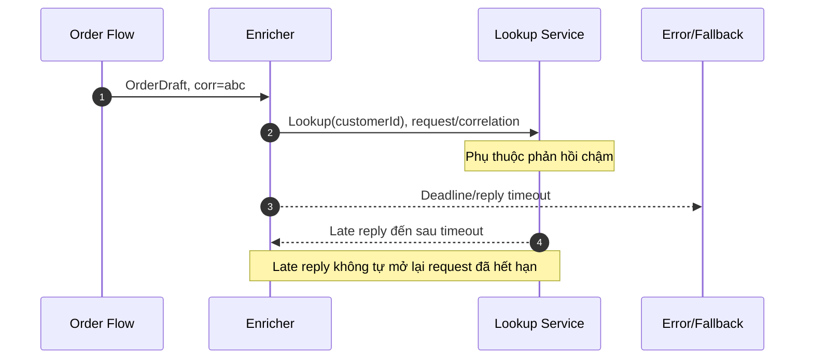
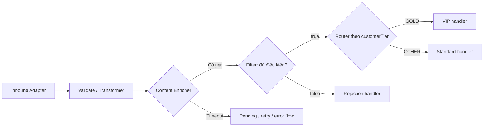

# Timeout khi lấy nội dung bổ sung

Một luồng tích hợp tiếp nhận yêu cầu đặt hàng, nhưng message đầu vào chỉ có `customerId` và các dòng hàng. Trước khi cho phép xử lý tiếp, hệ thống cần tra cứu **hạng khách hàng**, **điều kiện ưu đãi** hoặc **giới hạn tín dụng** từ một dịch vụ khác. Đây là bài toán của **Content Enricher** trong *Enterprise Integration Patterns (EIP)*: lấy thông tin bổ sung rồi làm phong phú nội dung của message ban đầu.

Trong điều kiện bình thường, bước enrich khá đơn giản: gửi request đến dịch vụ tra cứu, nhận reply và ghép thuộc tính vào payload. Nhưng nếu dịch vụ không phản hồi, network chập chờn hoặc hàng đợi đang đầy, **chờ bao lâu** là hợp lý? Khi hết thời gian, có nên loại đơn, dùng dữ liệu cache, retry hay trả trạng thái đang xử lý?

Bài **“Timeout khi lấy nội dung bổ sung”** thuộc chương **Content enricher** trong module `SPRING_INTEGRATION_PATTERN`. Mục tiêu là triển khai luồng thông điệp Spring Integration có ranh giới thời gian rõ ràng, kết hợp **Transformer, Filter, Router, Gateway, Splitter, Aggregator, retry, error channel và correlation**, đồng thời kiểm thử được cả tuyến thành công và tuyến timeout. Ta phân biệt **timeout gửi request**, **timeout đợi reply**, **timeout của HTTP/database client** và **deadline tổng của nghiệp vụ** — những giới hạn thường bị nhầm là một.

> **Nguyên tắc quan trọng:** `requestTimeout` và `replyTimeout` của một endpoint request–reply **không phải công tắc hủy mọi công việc bên ngoài**. Chúng liên quan đến những lần chờ giao message và đợi reply theo semantics của kênh. Một handler đồng bộ đang gọi API chậm có thể tiếp tục giữ thread ngay cả khi người thiết kế tưởng đã đặt reply timeout. Cần kiểm soát **rành mạch từng ranh giới** và kiểm thử đúng topology thực tế.

## 1. Content Enricher làm gì?

Giả sử payload đầu vào:

```json
{
  "orderId": "ORD-101",
  "customerId": "C-207",
  "totalAmount": 1250000
}
```

Sau khi truy vấn `Customer Profile Service`, payload mong muốn:

```json
{
  "orderId": "ORD-101",
  "customerId": "C-207",
  "totalAmount": 1250000,
  "customerTier": "GOLD"
}
```

Hai đoạn JSON chỉ minh họa hợp đồng dữ liệu, không phải output mặc định của framework. Content Enricher giữ **ý nghĩa message ban đầu** và bổ sung trường được phép, thay vì thay toàn bộ nghiệp vụ bằng một hoạt động tra cứu.



### 1.1. Trách nhiệm của các thành phần

| Thành phần | Vai trò |
| --- | --- |
| **Order message** | Mang đơn hàng đã qua kiểm tra schema tối thiểu. |
| **Content Enricher** | Tạo enrichment request, chờ kết quả trong giới hạn, ghép thuộc tính hợp lệ. |
| **Lookup channel** | Đưa request đến endpoint/service tra cứu. |
| **Lookup handler/adapter** | Đọc profile từ database, cache hoặc HTTP service; trả reply đúng hợp đồng. |
| **Output channel** | Chỉ nhận message đã enrich thành công theo định nghĩa. |
| **Error/fallback path** | Quản lý timeout, lỗi dữ liệu hoặc quyết định không thể enrich. |

Không nên biến Content Enricher thành nơi tự quyết định các nhánh nghiệp vụ quá phức tạp. Khi đã có `customerTier`, **Router** có thể chuyển đơn vào luồng VIP hay thường; **Filter** có thể ngăn đơn thiếu dữ liệu bắt buộc. **Enricher** tập trung vào lấy và bổ sung dữ liệu.

### 1.2. Content Enricher khác Header Enricher

| Pattern | Phần được bổ sung | Ví dụ |
| --- | --- | --- |
| **Content Enricher** | **Payload** hoặc các thuộc tính nội dung nghiệp vụ. | `OrderDraft.customerTier = GOLD`. |
| **Header Enricher** | **Message headers** phục vụ metadata/tích hợp. | `correlationId`, `routingRegion` đã xác thực. |
| **Transformer** | Có thể thay đổi hình dạng/kiểu payload toàn diện. | JSON String → `OrderDraft`, hoặc `OrderDraft` → `InvoiceRequest`. |

Không đưa dữ liệu nhạy cảm hoặc toàn bộ profile khách hàng vào header chỉ để tránh thiết kế Content Enricher. Header có thể bị chuyển tiếp sang log, broker, error message hoặc adapter khác; chỉ đặt metadata thật sự cần thiết.

## 2. Có bao nhiêu loại timeout trong một lần enrich?

Một flow có thể đi qua nhiều điểm chờ liên tiếp:

```text
Producer
  → [A] gửi request vào MessageChannel
  → [B] lookup endpoint được dispatch
  → [C] chờ lấy connection / DNS / TCP
  → [D] gọi HTTP/DB và chờ response
  → [E] gửi reply về replyChannel
  → [F] Content Enricher nhận reply và ghép payload
  → [G] gửi message enriched xuống downstream
```

Các thời gian chờ này **không có nghĩa tương đương**:

| Giới hạn | Phạm vi chờ | Không tự bảo đảm |
| --- | --- | --- |
| **Request send timeout** | Chờ giao request cho một channel có hỗ trợ chờ/giới hạn capacity. | Dịch vụ tra cứu đã nhận hoặc xử lý xong. |
| **Reply timeout** | Chờ có reply từ request–reply exchange khi cơ chế thực thi thực sự cho phép chờ. | Hủy/interrupt lời gọi HTTP/DB đang chạy đồng bộ. |
| **Connection timeout** | Thiết lập kết nối network hoặc lấy connection từ pool, tùy client. | Response body được đọc xong. |
| **Read/response timeout** | Chờ dữ liệu/response ở client tương ứng. | Bao trùm toàn bộ timeout của lookup có nhiều retry/DNS/pool. |
| **Gateway reply timeout** | Chờ reply ở facade request–reply đối với caller. | Tác vụ downstream đã rollback khi caller hết hạn. |
| **Business deadline** | Ngân sách thời gian tối đa mà nghiệp vụ chấp nhận, tính xuyên nhiều bước. | Được tự động thực thi chỉ bằng một tham số endpoint. |
| **Aggregator group timeout** | Chờ các phần/kết quả cùng nhóm. | Thay cho timeout của một lần lookup. |

**Phân biệt đặc biệt:** nếu `customer.lookup` là `DirectChannel` và handler đồng bộ gọi HTTP trong nhiều giây, thread gửi request có thể **đang bị giữ trong lời gọi handler**. Đặt `replyTimeout(300)` trên Content Enricher **không bảo đảm toàn flow quay về sau 300 ms**. Muốn deadline thực sự, phải cấu hình timeout ở **client** hoặc đưa lookup qua ranh giới async/circuit breaker phù hợp, rồi kiểm thử.

## 3. Cách chia ngân sách thời gian cho một lần xử lý

Giả sử gateway nhận đơn phải trả kết quả trong **1.500 ms**. Có thể phân bổ:

| Công đoạn | Ngân sách minh họa |
| --- | ---: |
| Validate/chuẩn hóa đầu vào | 100 ms |
| Lấy profile khách hàng (gồm queue + network + reply) | 700 ms |
| Áp dụng quy tắc giá/giới hạn tín dụng | 300 ms |
| Gửi tới downstream và xây response | 250 ms |
| Dự phòng cho scheduling/serialization/dao động | 150 ms |
| **Tổng** | **1.500 ms** |

Đây là **ngân sách ví dụ**, không phải khuyến nghị latency chung cho mọi hệ thống. Trong enrichment 700 ms, có thể đặt **send 100 ms**, **network client 450 ms**, **reply wait 650 ms**; các ngưỡng này **có thể chồng lấp** chứ không mặc nhiên cộng thẳng với nhau. Phải hiểu cách framework/client đo từng khoảng.

### 3.1. Deadline khác tập hợp timeout rời rạc

Giả sử lookup lỗi, hệ thống thử lại ba lần:

```text
Attempt 1: 450 ms
Backoff:   100 ms
Attempt 2: 450 ms
Backoff:   200 ms
Attempt 3: 450 ms
----------------
Tổng:    1.650 ms (chưa tính queue và overhead)
```

Nếu enrichment chỉ được cấp 700 ms, policy ba lần retry như trên **không thể đáp ứng ngân sách**. Mỗi lần retry phải tính **thời gian còn lại**. Một cách diễn đạt:

```text
remaining = deadline - now
if remaining <= 0:
    fail with deadline exceeded
else:
    nextTimeout = min(clientCap, remaining - safetyMargin)
```

Đối với tiến trình dùng thời gian tương đối, ưu tiên đồng hồ đo thời gian trôi qua dạng **monotonic** ở trong process (chẳng hạn `System.nanoTime()`) hơn là suy từ đồng hồ tường có thể được chỉnh. Khi truyền deadline xuyên service, cần chọn format thời gian và xử lý clock skew rõ ràng.

### 3.2. Không dùng timeout “vô hạn” cho một phụ thuộc bắt buộc

Một enrichment bắt buộc không có deadline có thể giữ thread, connection và message group quá lâu. Khi upstream tăng tải, chỉ vài lookup chậm cũng có thể làm pool cạn, queue đầy, làm trễ các request không liên quan và tạo **cascade failure**.

Timeout là **một phần của cơ chế bảo vệ tài nguyên**, cùng với concurrency limit, queue capacity, circuit breaker, bulkhead và backpressure. Nhưng timeout quá ngắn cũng làm tăng false failures và retry storm; cần đo độ trễ thật và error budget để chọn ngưỡng.

## 4. Ví dụ Spring Integration Java DSL: enrich từ Customer Profile

Phần này tạo một luồng nhỏ có thể kiểm thử trong JVM, không cần HTTP/Kafka thật. Ví dụ giả định Java hỗ trợ `record` và Spring Integration Java DSL tương thích. Để tránh nhầm lẫn về payload, dùng một JavaBean `OrderDraft` có setter cho trường bổ sung.

### 4.1. Payload đầu vào

```java
// OrderDraft.java
public final class OrderDraft {
    private String orderId;
    private String customerId;
    private String customerTier;

    public OrderDraft(String orderId, String customerId) {
        this.orderId = orderId;
        this.customerId = customerId;
    }

    public String getOrderId() {
        return orderId;
    }

    public String getCustomerId() {
        return customerId;
    }

    public String getCustomerTier() {
        return customerTier;
    }

    public void setCustomerTier(String tier) {
        this.customerTier = tier;
    }
}
```

Đây là mutable JavaBean **chỉ nhằm minh họa cơ chế bổ sung property**. Với hệ thống chia sẻ payload giữa nhiều subscriber, cần cân nhắc DTO bất biến và Transformer tạo object mới để tránh hai nhánh cùng sửa một instance.

### 4.2. Reply từ lookup service

```java
// CustomerProfile.java
public final class CustomerProfile {
    private final String customerId;
    private final String tier;

    public CustomerProfile(String customerId, String tier) {
        this.customerId = customerId;
        this.tier = tier;
    }

    public String getCustomerId() {
        return customerId;
    }

    public String getTier() {
        return tier;
    }
}
```

Trong triển khai thực tế, response còn có thể mang `profileVersion`, `observedAt` hoặc `validUntil` để quyết định dữ liệu còn dùng được hay không. Không tải toàn bộ email, địa chỉ hoặc thông tin nhạy cảm chỉ để lấy một trường `tier`.

### 4.3. Content Enricher gửi request, chờ reply, cập nhật property

```java
// OrderEnrichmentConfiguration.java
import org.springframework.context.annotation.Bean;
import org.springframework.context.annotation.Configuration;
import org.springframework.integration.channel.QueueChannel;
import org.springframework.integration.config.EnableIntegration;
import org.springframework.integration.dsl.IntegrationFlow;

@Configuration
@EnableIntegration
public class OrderEnrichmentConfiguration {

    @Bean("orders.enriched")
    QueueChannel enrichedOrders() {
        return new QueueChannel(16);
    }

    @Bean
    IntegrationFlow enrichOrderWithCustomerProfile() {
        return IntegrationFlow.from("orders.in")
            .enrich(spec -> spec
                .requestChannel("customer.lookup")
                .requestPayloadExpression("payload.customerId")
                .propertyExpression("customerTier", "payload.tier")
                .requestTimeout(200)
                .replyTimeout(600))
            .channel("orders.enriched")
            .get();
    }

    @Bean
    IntegrationFlow customerLookupFlow() {
        return IntegrationFlow.from("customer.lookup")
            .handle(String.class,
                (customerId, headers) ->
                    new CustomerProfile(customerId, "GOLD"))
            .get();
    }
}
```

**Giải thích:**

1. `IntegrationFlow.from("orders.in")` nhận message có `OrderDraft`.
2. `requestPayloadExpression("payload.customerId")` tạo nội dung **lookup request** từ `customerId` của order.
3. `requestChannel("customer.lookup")` đưa request đến luồng tra cứu.
4. Handler ví dụ trả `CustomerProfile` ngay trong JVM.
5. `propertyExpression("customerTier", "payload.tier")` lấy `tier` từ reply payload và gán vào thuộc tính của message gốc.
6. `requestTimeout(200)` giới hạn **chờ gửi request** trong tình huống channel có semantics phù hợp; `replyTimeout(600)` giới hạn **chờ reply** khi quá trình dispatch cho phép trả về để đợi.
7. `orders.enriched` là queue để kiểm thử output; ngoài môi trường test cần consumer/poller thật.

Các chữ ký DSL/API có thể thay đổi giữa phiên bản Spring Integration; khi triển khai vào dự án cụ thể, hãy đối chiếu API được sử dụng. **Ví dụ này minh họa enrichment thành công, không chứng minh deadline 600 ms với một handler đồng bộ bị treo**.

### 4.4. Luồng đồng bộ và vấn đề “replyTimeout không hủy handler”

Luồng `customer.lookup` ở trên sử dụng kiểu dispatch đồng bộ thông thường. Nếu thay handler giả bằng client HTTP gọi chậm, caller có thể bị giữ ở bước:

```text
Enricher → DirectChannel → Handler → HTTP call đang chờ ...
                                    ↑
                    thread gọi send vẫn đang ở đây
```

Trong cấu hình này, **đặt reply timeout không tự làm HTTP client timeout**. Phải cấu hình **connect/pool/read/response timeout ở HTTP client**, và nếu muốn kiểm soát deadline độc lập với thời gian handler chạy thì xem xét ranh giới bất đồng bộ, khả năng hủy tác vụ và cơ chế lỗi. Tránh khẳng định một tham số Gateway có thể `interrupt` mọi I/O hoặc rollback side effect từ xa.

## 5. Kiểm thử đường thành công bằng JUnit 5

Vì ví dụ trên trả CustomerProfile đồng bộ, test có thể gửi message rồi nhận từ `QueueChannel` mà không cần broker.

```java
import static org.junit.jupiter.api.Assertions.*;

import org.junit.jupiter.api.Test;
import org.springframework.beans.factory.annotation.Autowired;
import org.springframework.context.ApplicationContext;
import org.springframework.integration.channel.QueueChannel;
import org.springframework.messaging.Message;
import org.springframework.messaging.MessageChannel;
import org.springframework.messaging.support.MessageBuilder;
import org.springframework.test.context.junit.jupiter.SpringJUnitConfig;

@SpringJUnitConfig(OrderEnrichmentConfiguration.class)
class OrderEnrichmentTest {

    @Autowired
    ApplicationContext context;

    @Test
    void enrichesOrderWithCustomerTier() {
        OrderDraft order = new OrderDraft("ORD-101", "C-207");
        MessageChannel input =
            context.getBean("orders.in", MessageChannel.class);

        assertTrue(input.send(
            MessageBuilder.withPayload(order)
                .setHeader("correlationId", "corr-101")
                .build()));

        QueueChannel output =
            context.getBean("orders.enriched", QueueChannel.class);
        Message<?> enriched = output.receive(0);

        assertNotNull(enriched);
        assertInstanceOf(OrderDraft.class, enriched.getPayload());

        OrderDraft result = (OrderDraft) enriched.getPayload();
        assertEquals("ORD-101", result.getOrderId());
        assertEquals("C-207", result.getCustomerId());
        assertEquals("GOLD", result.getCustomerTier());
        assertEquals("corr-101",
            enriched.getHeaders().get("correlationId"));
        assertNull(output.receive(0));
    }
}
```

**Test này chứng minh:** request payload lấy từ `customerId`, lookup trả profile, thuộc tính `customerTier` được bổ sung và message được gửi xuống output. Nó **không chứng minh** lookup timeout, HTTP timeout, cancellation hoặc tính an toàn dưới concurrent fan-out.

Đừng assert rằng input và output nhất thiết là cùng object reference hoặc khác reference trong mọi phiên bản/cách cấu hình. Với JavaBean mutable, việc enrichment cập nhật thuộc tính có thể ảnh hưởng object gốc; nếu cần bất biến, thiết kế DTO/Transformer tạo bản kết quả mới và kiểm thử rõ.

## 6. Làm thế nào để reply timeout có ý nghĩa?

Để kiểm thử **chờ reply**, phải có topology mà sender **không bị chặn mãi trong cùng một handler đồng bộ**. Một lựa chọn là tách lookup sang `ExecutorChannel` hoặc broker; sender giao request xong rồi đợi reply qua đường reply channel của exchange.

### 6.1. Một ranh giới executor minh họa

```java
// Ví dụ cấu hình thay thế cho customerLookupFlow()
// trong một application, không khai báo hai flow cùng input channel.
import org.springframework.integration.dsl.IntegrationFlow;
import org.springframework.scheduling.concurrent.ThreadPoolTaskExecutor;

@Bean
ThreadPoolTaskExecutor customerLookupExecutor() {
    ThreadPoolTaskExecutor pool = new ThreadPoolTaskExecutor();
    pool.setCorePoolSize(2);
    pool.setMaxPoolSize(4);
    pool.setQueueCapacity(16);
    pool.setThreadNamePrefix("customer-lookup-");
    pool.initialize();
    return pool;
}

@Bean
IntegrationFlow asyncCustomerLookup(
        ThreadPoolTaskExecutor customerLookupExecutor,
        CustomerLookupService service) {
    return IntegrationFlow.from("customer.lookup")
        .channel(c -> c.executor(customerLookupExecutor))
        .handle(service, "findProfile")
        .get();
}

// CustomerLookupService là bean ứng dụng cung cấp;
// findProfile(String customerId) trả CustomerProfile.
```

Với executor, handler có thể chạy trên thread khác, cho phép đầu gửi **chờ reply có timeout** khi request đã được chấp nhận. Tuy vậy:

- Pool có thể **đầy** hoặc từ chối task; phải đo và xử lý.
- Khi reply timeout, **task đang chạy có thể chưa dừng**.
- Late reply có thể không còn nơi nhận hoặc phát sinh lỗi theo cơ chế reply channel.
- Executor chỉ tách thread, **không lưu bền** task qua restart.
- Không bảo đảm downstream service bị hủy khi caller ngừng chờ.

Nếu lookup đi qua broker, còn phải xét correlation ID, reply queue, TTL/expiration, consumer ack/redelivery và định nghĩa late reply. Không bê trực tiếp semantics của `QueueChannel` nội bộ sang Kafka/RabbitMQ.

### 6.2. Kịch bản test timeout nên kiểm chứng

Sử dụng một fake `CustomerLookupService` có thể **chặn bằng `CountDownLatch`** hoặc cố ý không tạo reply. Test cần xác minh:

1. Request **được dispatch** qua ranh giới async trong thời gian phù hợp.
2. Đầu gọi **hết hạn chờ reply** theo configured `replyTimeout`, trả lỗi theo hợp đồng.
3. Message timeout **không được xuất hiện trong `orders.enriched`** như thể đã đầy đủ dữ liệu.
4. Nếu fake service hoàn thành sau timeout, **late reply** được xử lý có kiểm soát.
5. Không tạo side effect trùng khi caller retry.
6. Test có khoảng dung sai thực tế và cleanup task/threads, tránh kiểm tra thời gian tuyệt đối quá sát dẫn đến flaky test.

Nếu muốn kiểm thử tổng thời gian dưới một giới hạn chặt, phải đưa **timeout của client thật và queue wait** vào test tích hợp. Một unit test chỉ khẳng định `replyTimeout(600)` tồn tại trong config **chưa chứng minh** hệ thống đáp ứng SLA.

## 7. Timeout xảy ra thì nên làm gì?

Không có một fallback phù hợp cho mọi dữ liệu bổ sung. Cần phân loại **mức độ bắt buộc** của enrichment.

| Tình huống | Chiến lược có thể chọn | Điều kiện bắt buộc |
| --- | --- | --- |
| `customerTier` chỉ phục vụ gợi ý UI | Dùng giá trị mặc định hoặc bỏ qua enrichment. | Output phải đánh dấu **không xác minh được tier**, không coi default là sự thật. |
| `customerTier` ảnh hưởng chiết khấu | Có thể dùng cache còn hạn hoặc chuyển sang chờ xác minh. | Có freshness/version, quy tắc giá và giới hạn rủi ro rõ. |
| Hạn mức tín dụng bắt buộc | **Fail closed**, không tiếp tục phê duyệt đơn thiếu dữ liệu. | Trả trạng thái `PENDING_VERIFICATION`/lỗi nghiệp vụ đúng hợp đồng. |
| Tra cứu phụ cho analytics | Retry độc lập sau hoặc xử lý bất đồng bộ. | Không chặn giao dịch chính nếu không cần thiết. |
| Lookup phụ thuộc đã lỗi hàng loạt | Circuit breaker/bulkhead, degrade có chủ đích. | Có giám sát, recovery và giới hạn dữ liệu stale. |

**Không được âm thầm chuyển một đơn chưa xác minh vào nhánh `approved`** chỉ để tránh lỗi kỹ thuật. Fallback phải diễn đạt được **mức độ tin cậy của dữ liệu**, và downstream phải biết nó đang dùng giá trị fresh, cached hay unavailable.

### 7.1. Fail closed và fail open

**Fail closed:** không cho qua khi dữ liệu bắt buộc chưa được lấy.

```text
OrderDraft → Content Enricher → TIMEOUT
                               ↓
                        PENDING_VERIFICATION
                               ↓
                   retry / tra cứu trạng thái sau
```

**Fail open có kiểm soát:** cho một tác vụ ít rủi ro đi tiếp mà không cần trường phụ, nhưng phải gắn trạng thái enrichment rõ:

```json
{
  "orderId": "ORD-101",
  "customerTier": null,
  "enrichmentStatus": "UNAVAILABLE",
  "tierSource": "NONE"
}
```

Đây là một **hợp đồng payload do ứng dụng định nghĩa**, không phải trường Spring Integration tự tạo khi timeout. Nếu hệ thống cần tạo output như trên, phải thiết kế **error/fallback flow** rõ, thay vì trông chờ Enricher tự thêm `null` khi thiếu reply.

### 7.2. Cache phải có độ tươi

Nếu dùng cache khi lookup không thành công, cần quy định:

- TTL/freshness của profile theo mục đích sử dụng.
- Version hoặc `observedAt` của dữ liệu cache.
- Khi nào một profile quá cũ bị từ chối.
- Nguồn dữ liệu và quyền xóa/cập nhật cache.
- Cách quan sát tỷ lệ fresh, cached, stale và unavailable.

Đối với dữ liệu định giá/quyền truy cập, **cache cũ có thể gây sai nghiệp vụ nghiêm trọng hơn timeout**. Không mặc định cache là fallback an toàn.

## 8. Retry: không vượt quá deadline và không gây lặp tác vụ

Content Enricher thường tra cứu (read-only), nhưng **không nên giả định mọi endpoint lookup đều không gây side effect**. Một API có thể đồng thời ghi audit, khóa hàng hoặc tính phí theo request.

### 8.1. Phân loại lỗi trước khi retry

| Lỗi | Có nên retry? | Vì sao |
| --- | --- | --- |
| Mất kết nối nhất thời | Có thể retry giới hạn. | Khả năng phục hồi cao nếu service trở lại. |
| Timeout chờ reply | Có thể retry khi còn deadline và operation idempotent. | Đáp án cũ có thể đang tới; tránh fan-out request trùng. |
| HTTP 429/503 | Có thể retry có backoff/jitter, tôn trọng gợi ý rate limit. | Cần tránh retry storm. |
| `customerId` sai định dạng | Không retry cùng dữ liệu. | Đây là lỗi input, không phải lỗi hạ tầng tạm thời. |
| Không tìm thấy khách hàng hợp lệ | Thường không retry liên tục. | Kết quả nghiệp vụ xác định, tùy quy tắc đồng bộ dữ liệu. |
| Field response sai schema | Không retry vô hạn; cần quarantine và sửa integration contract. | Sai cấu hình/phiên bản thường không tự khỏi. |
| Client đã đóng, không còn deadline | Không bắt đầu retry mới nếu không có workflow async rõ. | Tránh tiêu tốn tài nguyên vô ích. |

### 8.2. Ngân sách retry

```text
total_deadline = 1_500 ms
time_used_before_lookup = 300 ms
remaining_before_lookup = 1_200 ms
lookup_budget = 700 ms

attempt1 = 300 ms
backoff  = 100 ms
attempt2 = min(300 ms, remaining_lookup_budget)
```

**Mỗi lần retry phải tính cả queue/network/handler/serialization**, không chỉ tham số read timeout của client. Không đồng thời đặt retry ở **Gateway, Enricher, HTTP client và broker consumer** mà không tính tổng; nhiều tầng retry nhân nhau có thể tạo **retry amplification**.

### 8.3. Circuit breaker và bulkhead

- **Circuit breaker** tạm ngăn các lời gọi mới khi tỷ lệ lỗi/timeout cao, rồi kiểm tra phục hồi theo policy.
- **Bulkhead/concurrency limit** ngăn việc một lookup service chậm chiếm hết threads/connections của toàn ứng dụng.
- **Rate limit và bounded queue** điều chỉnh lưu lượng chờ, tránh tích tụ vô hạn.

Spring Integration có thể phối hợp với thư viện resilience hoặc `RequestHandlerRetryAdvice`/endpoint advice khi phù hợp. Những cơ chế đó **không tự xuất hiện** chỉ bằng khai báo `.enrich(...)`; cần cấu hình và test ở **đúng endpoint/ràng giới**.

## 9. Xử lý lỗi: timeout không đồng nghĩa message bị Filter loại

Phân biệt những đường kết quả:

| Sự kiện | Ý nghĩa | Đường xử lý |
| --- | --- | --- |
| Lookup trả `CustomerProfile` hợp lệ | Enrichment thành công. | Gửi `orders.enriched`. |
| Customer lookup trả “not found” | Một kết quả nghiệp vụ có thể xác định. | Có thể `rejected`, `pending` hoặc fallback theo hợp đồng. |
| Không gửi được request tới lookup channel | Send failure/backpressure. | Lỗi kỹ thuật hoặc retry khi còn deadline. |
| Hết `replyTimeout` | Không nhận reply đúng hạn. | Timeout policy, không tự suy là lookup chưa làm gì. |
| HTTP client timeout | Client không hoàn thành I/O trong giới hạn. | Lỗi adapter/handler, có thể đi error flow. |
| Response thiếu field `tier` | Vi phạm schema response hoặc dữ liệu không đầy đủ. | Validation/Transformer/Filter sau lookup. |
| Downstream handler lỗi sau enrich | Lỗi ở bước tiếp theo. | Retry/error flow của handler đó. |

**Filter rejection** (`predicate=false`), **Router fallback** (không có key/channel hợp lệ), **Content Enricher timeout** và **ErrorMessage** là những khái niệm **khác nhau**.

### 9.1. `errorChannel` không tự bắt mọi timeout

Với luồng đồng bộ, exception phát sinh khi enrich hoặc handler có thể truyền ngược caller. Trong luồng async/poller/adapter, hạ tầng có thể đóng gói exception thành `ErrorMessage` và gửi tới error channel **khi cấu hình phù hợp**.

Đừng giả định:

- Mọi timeout tự vào một `globalErrorChannel` duy nhất.
- Mọi timeout tự sinh output `OrderDraft` thiếu field rồi vẫn đi tiếp.
- Bất kỳ exception nào cũng thích hợp retry.
- Lỗi gửi reply về channel đã đóng tương đương timeout ban đầu.

Thiết kế **error policy rõ ở từng boundary**: lookup adapter, Content Enricher/Gateway, executor, downstream processing và broker nếu có.

### 9.2. Không log toàn bộ message khi lỗi

Một exception/`ErrorMessage` có thể chứa failed message hoặc exception message với dữ liệu nhạy cảm. Chỉ log metadata được cho phép, ví dụ:

```text
event=content_enrichment_failed
flow=orderIntake
dependency=customerProfile
failure_type=REPLY_TIMEOUT
policy=RETRY_OR_PENDING
budget_remaining_ms=0
correlation_id=<opaque-id>
```

Đây là format **minh họa**, không phải log mặc định. Không in token, cookie, email, dữ liệu thanh toán hoặc toàn bộ response. Không dùng `correlation_id` riêng từng request làm metric label.

## 10. Header, correlation và late reply

Content Enricher thường có request–reply exchange. Hạ tầng cần biết **reply thuộc request nào**, đặc biệt khi tách thread hoặc gửi qua broker.



### 10.1. Correlation ID khác deadline

- **Correlation ID:** liên kết request, lookup reply và các log/traces tương ứng.
- **Deadline:** giới hạn thời gian còn được chờ/xử lý.
- **Idempotency key:** bảo đảm side effect không bị thực hiện lặp ngoài hợp đồng.
- **Request/reply channel metadata:** hỗ trợ framework trả đúng reply trong flow.

Không dùng một giá trị duy nhất làm cả bốn nếu hợp đồng khác nhau. Nếu một batch được Splitter chia thành nhiều phần, correlation còn phải xác định phần nào thuộc cùng nhóm và Aggregator đợi đủ những phần nào.

### 10.2. Xử lý late reply

Khi reply đến sau timeout:

1. Không cho nó **âm thầm sửa một đơn đã có quyết định mới**.
2. Nếu muốn dùng để cập nhật cache, cần kiểm soát version/TTL và không ghi đè dữ liệu mới hơn.
3. Nếu request–reply channel đã không còn subscriber, xử lý lỗi reply delivery theo topology thực tế.
4. Cần theo dõi `late_reply_total`/độ trễ để điều chỉnh deadline và năng lực service.
5. Nếu lookup có side effect, phải kiểm tra trạng thái trước khi retry.

Không coi `replyTimeout` là một cơ chế tự động **cancellation distributed**. Có thể cancel task cục bộ nếu API hỗ trợ, nhưng remote server vẫn có thể đang thực thi.

## 11. Enricher trước Router, Filter và Gateway

Một luồng đặt hàng có thể yêu cầu profile để lựa chọn đích:



**Điểm cần kiểm soát:** Router hoặc Filter **không được nhầm `customerTier=null` vì timeout với một tier hợp lệ**. Nếu chọn degrade, thêm một trạng thái được định nghĩa rõ và chỉ cho những consumer có khả năng xử lý dữ liệu chưa đầy đủ đi tiếp.

### 11.1. Gateway request–reply

Một `@MessagingGateway` có thể cung cấp facade:

```java
import org.springframework.integration.annotation.MessagingGateway;

@MessagingGateway(defaultRequestChannel = "orders.in")
public interface OrderGateway {
    OrderReceipt submit(OrderDraft order);
}

// OrderReceipt do ứng dụng định nghĩa;
// flow thật cần handler tạo reply phù hợp.
```

Các `QueueChannel` minh họa ở mục 4 **không tự trả `OrderReceipt`**. Với Gateway chờ kết quả, flow phải có reply path và định nghĩa điều gì xảy ra nếu enrichment timeout. Một kết quả `PENDING_VERIFICATION` có thể phù hợp hơn để caller tự tra cứu sau, thay vì chờ một phụ thuộc chậm vô hạn.

**Reply timeout của Gateway và reply timeout của Content Enricher không đồng nghĩa**. Nếu mỗi tầng có 1 giây nhưng tổng SLA 1,5 giây, chưa chắc deadline được tuân thủ. Cần phân bổ rõ ngân sách và test end-to-end.

### 11.2. Một nhánh timeout không được mặc nhiên dùng retry chung của toàn flow

Nếu retry đặt bên ngoài toàn bộ order flow, mỗi lần tra cứu profile timeout có thể khiến **validation, lưu dữ liệu, phát message** hoặc các bước đã thành công trước đó chạy lại. Nếu bước trước có side effect, cần idempotency hoặc **đặt retry sát lookup** để chỉ lặp công việc chưa hoàn tất.

## 12. Enricher trong Splitter/Aggregator

Giả sử một đơn có N dòng hàng; mỗi dòng cần enrich thông tin tồn kho hoặc giá từ service ngoài.

```text
Order with N lines
    → Splitter: N OrderLine messages
    → Content Enricher: lookup stock/price for each line
    → Filter/Router by availability
    → Aggregator: collect N results
```

Khi một phần bị timeout:

- **Aggregator có thể thiếu reply**, dẫn đến group không release.
- Nếu fallback trả một `LineResult(UNAVAILABLE)`, Aggregator có thể kết thúc đúng số phần nhưng phải ghi rõ kết quả không hoàn chỉnh.
- Nếu policy cho phép partial result, cần release strategy/expiry và yêu cầu về thứ tự/kết quả muộn.
- Nếu retry một line sau khi Aggregator đã release, cần xử lý duplicate/late message.
- **Correlation ID, sequence number, part ID và deadline** cần được xác định theo nhóm và không bị mất qua Transformer/adapter.

### 12.1. Tổng latency của N lookup

Với N lookup chạy tuần tự, thời gian có thể xấp xỉ **tổng** của N lần chờ. Với thực thi song song, deadline nhóm gần với **nhánh chậm nhất** cộng overhead, nhưng concurrency quá cao có thể khiến pool/service ngoài bão hòa.

Không giả định “bật parallel” là luôn nhanh. Cần batch lookup khi API hỗ trợ, giới hạn concurrency, quota và nhóm timeout rõ ràng.

## 13. Những bài kiểm thử timeout phải có

| Kịch bản | Điều cần chứng minh |
| --- | --- |
| Lookup trả trong deadline | Content được bổ sung chính xác; xuống kênh success. |
| Request channel đầy/không nhận | Send failure/request timeout được xử lý đúng, không tính là reply timeout. |
| Lookup handler đồng bộ chạy lâu | Client deadline/timeout thực sự chặn chờ; không ngộ nhận `replyTimeout` cắt HTTP call. |
| Async lookup không reply | Reply timeout theo topology, không phát output enrich giả. |
| Reply tới sát deadline | Kết quả không flaky hoặc bị xử lý hai lần; có dung sai test hợp lý. |
| Late reply sau timeout | Không ghi đè trạng thái mới, không gây side effect trùng. |
| HTTP 503 rồi phục hồi | Retry hữu hạn, còn ngân sách, có backoff. |
| HTTP 400/sai schema | Không retry mù quáng; route validation error. |
| Cache còn hạn | Được phép fallback nếu policy quy định, có `source=cache`/freshness. |
| Cache hết hạn | Không tự phê duyệt dựa trên dữ liệu quá cũ. |
| Gateway chờ kết quả | Nhận success/error/pending theo hợp đồng, không đợi vô hạn. |
| N lookup sau Splitter, một nhánh timeout | Aggregator release/expiry/partial outcome đúng. |
| Tăng concurrency/lỗi hàng loạt | Pool, queue và connection không bị chiếm hết; circuit breaker hoạt động. |
| Có dữ liệu nhạy cảm | ErrorMessage/log/metrics không lộ raw profile/token. |

### 13.1. Kiểm thử độ trễ bằng fake service

Một fake service testable có thể dùng `CountDownLatch` để giữ một reply trong lúc test quan sát timeout, thay vì dựa quá nhiều vào `Thread.sleep(...)`. Ví dụ kế hoạch:

```text
Given: Lookup chạy trên executor và bị chặn bởi latch.
And:   Enricher replyTimeout = 300 ms.
When:  gửi OrderDraft vào flow.
Then:  Đường đợi reply kết thúc theo timeout contract.
And:   Không có message được coi là enriched success.
When:  mở latch sau timeout.
Then:  Late reply không kích hoạt lại xử lý đơn đã timeout.
```

Giá trị 300 ms chỉ là ví dụ; test thật nên có dung sai/scheduling margin, cleanup thread và tránh dùng duration quá sát giới hạn CI. Nếu triển khai trên broker, cần test thêm queue/reply TTL, correlation và message redelivery.

### 13.2. Test không chỉ nhìn exception class

Trong Spring Integration, lỗi có thể được **wrap** qua messaging/gateway layers. Đừng viết test quá phụ thuộc vào một exception class nếu chưa xác định đúng topology/phiên bản. Quan trọng hơn là xác minh:

1. **Không có output success giả**.
2. Có **mã lý do timeout** ở error/fallback path.
3. Deadline thực tế được tuân thủ ở ranh giới thích hợp.
4. Không tạo side effect trùng hoặc quá nhiều retry.
5. Trace/correlation nối được request với lần tra cứu đã hết hạn.

## 14. Vận hành: đo nơi chậm thay vì chỉ đo tổng thời gian

Một biểu đồ chỉ có `enrichment_latency` trung bình sẽ che mất việc 1% request bị timeout trong 5 giây. Nên quan sát:

| Chỉ số | Ý nghĩa |
| --- | --- |
| `enrichment_requests_total` | Tổng số lần yêu cầu enrichment. |
| `enrichment_success_total` | Số lần bổ sung nội dung hợp lệ. |
| `enrichment_timeout_total` theo giai đoạn | Phân biệt request send, downstream client và reply wait. |
| `enrichment_duration` (histogram/percentiles) | p50/p95/p99 latency theo dependency. |
| `customer_lookup_client_errors_total` | Phân loại network, 4xx, 5xx, invalid response. |
| `lookup_executor_active`/`queue_depth` | Phát hiện nghẽn thread/queue. |
| `retry_attempts_total` | Tránh retry storm. |
| `fallback_used_total` theo chính sách | Tỷ lệ dùng cached/default/pending. |
| `late_reply_total` | Biết reply đến sau khi caller hết hạn. |
| `gateway_reply_timeouts_total` | Phân biệt SLA cuối với timeout enrichment. |

Các tên metrics là **gợi ý ứng dụng**, không phải chỉ số Spring Integration tự phát ra đầy đủ. Tập nhãn nên hữu hạn: `dependency=customerProfile`, `outcome=TIMEOUT`, `stage=CLIENT_READ`. Không dùng `customerId`, `orderId`, email hoặc correlation ID riêng từng message làm metric labels.

### 14.1. Một cảnh báo hữu ích

Nếu `reply_timeout_total` tăng nhưng `client_read_timeout_total` không tăng, có thể có **queue backlog**, lookup handler xử lý sau deadline hoặc reply path bị nghẽn. Nếu client timeout tăng đồng thời với executor saturation, cần xem lại connection pool, concurrency, circuit breaker và downstream capacity. Không chỉ tăng timeout vô hạn để che vấn đề.

### 14.2. Log an toàn

```text
event=enrichment_timeout
flow=orderIntake
dependency=customerProfile
stage=REPLY_WAIT
configured_timeout_ms=600
outcome=PENDING_VERIFICATION
correlation_id=<opaque-id>
```

Đây là format minh họa. Không in toàn bộ `OrderDraft`, response body, token hoặc headers nhạy cảm chỉ để debug. Nếu error flow lưu failed message, cần quyền truy cập, masking và retention phù hợp.

## 15. Những sai lầm thường gặp

### Sai lầm 1 — “Đặt `replyTimeout(300)` nghĩa là HTTP bị cắt sau 300 ms”

**Sai.** Với `DirectChannel`/handler đồng bộ, caller có thể vẫn đang nằm trong lời gọi HTTP. Cần client timeout và kiểm thử deadline thực tế.

### Sai lầm 2 — “Request timeout và reply timeout là một”

**Sai.** Một bên chờ **giao request tới channel**, một bên chờ **reply được gửi về**, và cả hai khác network timeout.

### Sai lầm 3 — “Timeout chứng minh dịch vụ ngoài chưa làm gì”

**Sai.** Dịch vụ ngoài có thể đã xử lý nhưng reply bị chậm/mất. Khi retry, cần idempotency và đối soát trạng thái nếu lookup có side effect.

### Sai lầm 4 — “Không nhận tier thì cho đơn VIP qua bằng giá trị mặc định”

**Nguy hiểm.** Nếu tier ảnh hưởng tiền/quyền, một default không được xác minh có thể gây sai nghiệp vụ. Cần fail closed hoặc cache còn hiệu lực theo chính sách.

### Sai lầm 5 — “Retry 3 lần, mỗi lần timeout 1 giây vẫn đáp ứng SLA 1 giây”

**Sai.** Tổng thời gian còn gồm backoff, queue wait và mọi bước trước/sau. Chia deadline và giới hạn số lần thử.

### Sai lầm 6 — “Thêm executor là không thể mất công việc”

**Sai.** Executor trong JVM không tự bền vững; queue có thể đầy và task chưa hoàn tất có thể mất khi restart.

### Sai lầm 7 — “Enricher timeout tự động trở thành Filter rejection”

**Sai.** Timeout là lỗi/không nhận reply đúng hạn; Filter `false` là quyết định dựa trên predicate. Cần fallback/error path rõ.

### Sai lầm 8 — “Fallback cache luôn an toàn”

**Sai.** Dữ liệu stale có thể nguy hiểm. Cần TTL/freshness, version và điều kiện dùng.

### Sai lầm 9 — “Reply đến muộn sẽ tự cập nhật request đã hết hạn”

**Không nên giả định.** Reply path có thể không còn; phải kiểm soát late reply và side effect.

### Sai lầm 10 — “Một message sau Splitter timeout thì Aggregator tự điều chỉnh”

**Sai.** Cần correlation, completion policy, timeout/expiry, partial result và xử lý late/duplicate replies.

## 16. Bài tập thực hành

**Bài 1 — Phân loại timeout.** Vẽ timeline từ `orders.in` đến `customer.lookup` và một HTTP API. Chỉ ra chỗ áp dụng request send timeout, reply timeout, connection/read timeout và business deadline.

**Bài 2 — Lookup chậm đồng bộ.** Thay handler test bằng một fake chậm trên `DirectChannel`. Quan sát thời gian `input.send(...)`; chứng minh vì sao `replyTimeout` không tự ngắt handler.

**Bài 3 — Lookup bất đồng bộ.** Thay `customer.lookup` bằng flow dùng executor. Dùng latch chặn handler, test reply timeout và late reply không tạo message `orders.enriched`.

**Bài 4 — Retry budget.** Tổng SLA 1.500 ms, lookup được cấp 700 ms. Thiết kế tối đa hai attempt với backoff 100 ms và ít nhất 100 ms dự phòng; kiểm tra mọi lần retry đều nằm trong deadline.

**Bài 5 — Fallback theo mục đích.** Với ba trường `customerDisplayName`, `discountTier` và `creditLimit`, định nghĩa field nào có thể bị bỏ qua/cached, field nào cần fail closed.

**Bài 6 — Gateway request–reply.** Định nghĩa `OrderReceipt(ACCEPTED, PENDING_VERIFICATION, REJECTED)` và thiết kế các response rõ nghĩa khi enrich success/timeout/invalid lookup, không lấy timeout để giả lập rejection.

**Bài 7 — Splitter/Aggregator.** Một batch có bốn order line, một lookup price timeout. Thiết kế group correlation, release/expiry và kết quả partial hoặc fail toàn batch.

**Bài 8 — Observability.** Tạo dashboard phân biệt `REQUEST_SEND`, `CLIENT_CONNECT`, `CLIENT_READ`, `REPLY_WAIT` và `GATEWAY_REPLY`. Đề xuất cảnh báo khi timeout và queue backlog tăng cùng lúc.

## 17. Checklist trước khi đưa Content Enricher vào production

| Câu hỏi | Điều kiện đạt |
| --- | --- |
| Dữ liệu bổ sung dùng để làm gì? | Phân biệt bắt buộc và tùy chọn, rủi ro khi thiếu/stale. |
| Lookup có contract input/reply rõ không? | Có schema, version, validation và trường bổ sung cụ thể. |
| Đã phân biệt send, reply và client timeout chưa? | Biết từng timeout kiểm soát điểm chờ nào. |
| Có business deadline xuyên toàn flow không? | Có ngân sách tổng và time remaining cho retry. |
| Có phụ thuộc synchronous DirectChannel không? | Không giả định `replyTimeout` ngắt HTTP client; có client timeout. |
| Lookup async/broker có correlation không? | Có reply path, xử lý late reply, TTL và idempotency khi cần. |
| Retry có vượt deadline không? | Có backoff giới hạn và chặn retry khi hết ngân sách. |
| Có circuit breaker/bulkhead không? | Có khi dependency có nguy cơ gây cascade, đã đo tải. |
| Timeout có fallback rõ không? | Fail closed, pending hoặc cached/default theo policy được duyệt. |
| Output có phân biệt fresh/cached/unavailable không? | Không giả dữ liệu chưa xác minh là hợp lệ. |
| Có error flow và caller reply contract không? | Phân loại timeout, invalid data, downstream failure và request–reply. |
| Có Splitter/Aggregator không? | Có correlation, release/expiry, late/duplicate handling. |
| Có bảo vệ dữ liệu nhạy cảm không? | Không log payload/header/response bí mật, có data minimization. |
| Có test failure injection không? | Có slow lookup, no reply, client timeout, late reply, retry và queue full. |
| Có observability theo stage không? | Có p95/p99, timeout stage, retries, fallback, lag và client metrics. |

## Kết luận

**Timeout khi lấy nội dung bổ sung** là bài toán của **toàn bộ request–reply path** trong Content Enricher, không chỉ một con số `replyTimeout`. Trong Spring Integration, Enricher có thể gửi lookup request và chờ reply để bổ sung thuộc tính cho payload; nhưng **thời gian chờ giao message, thời gian đợi reply, timeout của HTTP/database client và deadline nghiệp vụ là những ranh giới khác nhau**. Một handler đồng bộ có thể tiếp tục giữ caller dù reply timeout đã được cấu hình.

Thiết kế đáng tin cần **phân bổ ngân sách thời gian, giới hạn concurrency, retry trong deadline, xác định fallback theo độ quan trọng của dữ liệu, kiểm soát late reply và idempotency, và quan sát từng điểm chờ**. Khi kết hợp đúng Transformer, Filter, Router, Gateway, Splitter, Aggregator, error channel và correlation, Content Enricher giúp luồng tích hợp **bổ sung đúng dữ liệu mà không để một dependency chậm làm tắc nghẽn hoặc tạo kết quả nghiệp vụ sai**.
