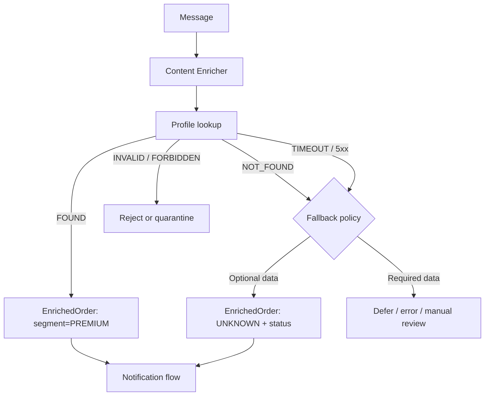
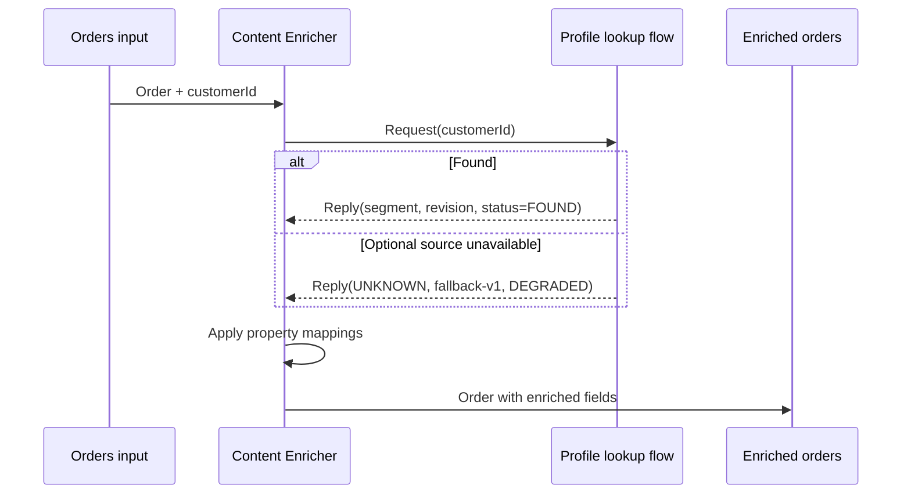
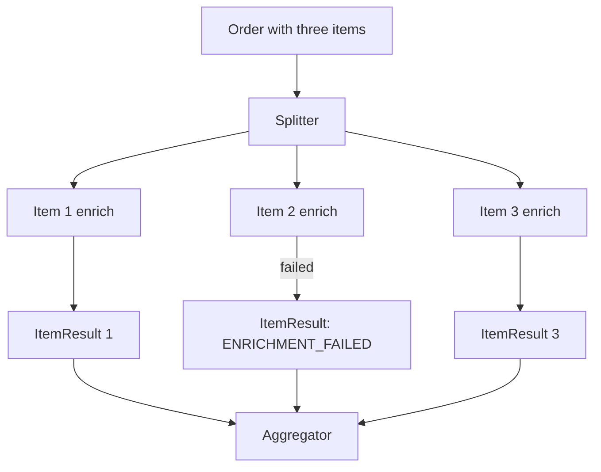
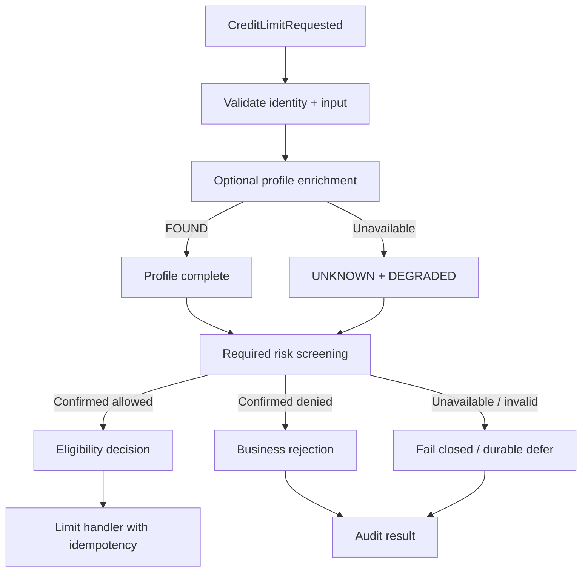

# Enrichment thất bại và chiến lược fallback

Trong **Enterprise Integration Patterns (EIP)**, **Content Enricher** bổ sung thông tin còn thiếu vào một message bằng cách tra cứu nguồn khác hoặc tính dữ liệu từ ngữ cảnh hiện có. Ví dụ, sự kiện `OrderPlaced` có `customerId` nhưng chưa có hạng khách hàng; trước khi chọn cách thông báo, luồng cần tra cứu hồ sơ để biết khách thuộc `STANDARD` hay `PREMIUM`.

Vấn đề xuất hiện khi **nguồn enrichment không trả lời, trả dữ liệu thiếu, dữ liệu lỗi hoặc dữ liệu quá cũ**. Có nên dừng đơn hàng? Dùng giá trị mặc định? Lấy bản cache gần nhất? Chuyển sang xử lý thủ công? Mỗi lựa chọn ảnh hưởng tới nghiệp vụ, bảo mật, tính đúng đắn và khả năng phát lại. **Một fallback tốt phải được định nghĩa như một quyết định nghiệp vụ có thể quan sát và kiểm thử, không chỉ là `catch (Exception)` rồi gán một giá trị bất kỳ.**

Bài học thuộc chương **Content enricher** của module `SPRING_INTEGRATION_PATTERN`, nơi thực hành Spring Integration và các mẫu Router, Filter, Transformer, Splitter, Aggregator, Gateway, retry, error channel và correlation để tạo luồng message ít phụ thuộc, dễ mở rộng, dễ kiểm thử và theo dõi từng nhánh.

Sau bài học, bạn có thể:

- Phân biệt **enrichment không tìm thấy dữ liệu**, **nguồn tạm lỗi**, **reply không đến**, **vi phạm schema** và **không có quyền đọc**.
- Chọn giữa **fail closed**, **fallback mặc định có kiểm soát**, **cache last-known-good**, **retry/defer**, **quarantine** hoặc **kết quả partial/degraded** theo mức độ bắt buộc của dữ liệu.
- Thiết kế kết quả tra cứu có **trạng thái, nguồn, phiên bản và thời điểm** thay vì biến mọi lỗi thành `null`.
- Áp dụng Spring Integration Content Enricher, một nhánh request–reply lấy dữ liệu bổ sung, cùng chính sách fallback nằm ở đúng ranh giới.
- Bảo toàn correlation, reply, idempotency và quan sát khi enrichment chạy trước Router, Gateway hoặc Splitter/Aggregator.
- Kiểm thử cả đường **đầy đủ**, **không tìm thấy**, **nguồn tạm lỗi**, **dữ liệu sai** và **fallback quá hạn**.

## 1. Luồng enrichment thành công và luồng thất bại

Giả sử ứng dụng nhận một đơn hàng và tra cứu hạng khách hàng để lựa chọn nội dung email:



Sơ đồ chỉ minh họa **chính sách của ứng dụng**, không phải mặc định mọi exception từ Spring Integration tự chuyển sang `UNKNOWN` hoặc một nhánh review. Nếu `customerSegment` chỉ dùng để cá nhân hóa lời chào, một fallback an toàn có thể dùng mẫu email trung tính. Nhưng nếu enrichment lấy **kết quả kiểm tra chống gian lận, quyền truy cập tenant, số tiền thanh toán hoặc trạng thái KYC**, thiếu dữ liệu có thể yêu cầu **dừng nhánh nhạy cảm** chứ không được tự động cho qua.

Một phép enrichment thành công nên trả lời được: *Giá trị mới đến từ đâu? Được xác minh khi nào? Theo phiên bản schema/policy nào? Có phải là dữ liệu thực hay fallback?* Việc chỉ nhìn payload được thêm `customerSegment=STANDARD` thường không đủ để phân biệt dữ liệu thật và mặc định.

## 2. Phân loại thất bại: không phải lỗi nào cũng giống nhau

| Trường hợp | Ví dụ | Có nên retry ngay? | Chiến lược thường phù hợp |
| --- | --- | --- | --- |
| **NOT_FOUND** | Không có hồ sơ `customerId=C-404`. | Thường không, trừ khi nguồn eventual-consistent. | `UNKNOWN` cho tính năng tùy chọn; review hoặc từ chối nếu bắt buộc. |
| **TIMEOUT** | Gọi profile service vượt ngân sách thời gian. | Có thể, nhưng phải có giới hạn và backoff. | Cache còn hợp lệ, fallback/defer, hoặc fail closed. |
| **SERVICE_UNAVAILABLE** | HTTP 503, đứt mạng, pool kết nối cạn. | Có thể retry có giới hạn. | Circuit breaker, bulkhead, last-known-good có TTL, hàng chờ phục hồi. |
| **INVALID_REPLY** | Có hồ sơ nhưng thiếu `segment` bắt buộc. | Không nên retry mù cùng dữ liệu. | Reject/quarantine, báo lỗi hợp đồng và phối hợp sửa producer. |
| **UNAUTHORIZED/FORBIDDEN** | Token hết quyền, không được đọc hồ sơ tenant khác. | Không tự chuyển thành dữ liệu mặc định. | Fail closed, cảnh báo bảo mật, kiểm tra quyền tại ranh giới. |
| **STALE_DATA** | Cache quá hạn hoặc version hồ sơ đã bị thu hồi. | Cần chính sách tuổi và cập nhật. | Giới hạn tuổi hoặc yêu cầu dữ liệu mới, không coi stale là dữ liệu thực. |
| **CONFLICT** | Hai nguồn trả hai phân loại trái nhau. | Không tự chọn ngẫu nhiên. | Thứ tự ưu tiên/merge policy rõ ràng, review và audit. |
| **NO_REPLY** | Request–reply gateway/enricher không nhận message trả về. | Tùy nguyên nhân; có thể timeout. | Thời hạn chờ và recovery, không giả định `null` là thành công. |
| **CANCELLED/SHUTDOWN** | Ứng dụng dừng hoặc task async bị hủy. | Theo cơ chế giao nhận và recovery. | Bảo toàn message trước khi ACK, xử lý in-flight rõ ràng. |

**Phân biệt `NOT_FOUND` với `TIMEOUT`:** `NOT_FOUND` là một kết quả có nghĩa *nguồn đã trả lời rằng không có bản ghi*, còn `TIMEOUT` là *không biết nguồn có dữ liệu hay không*. Gộp cả hai thành `null` có thể khiến nghiệp vụ chọn sai chính sách, đồng thời làm mất tín hiệu vận hành khi một dependency đang lỗi diện rộng.

### Mức độ quan trọng của trường được enrich quyết định fallback

| Dữ liệu cần bổ sung | Nếu thiếu sẽ ra sao? | Khuyến nghị mặc định |
| --- | --- | --- |
| Tên hiển thị trong email | Có thể dùng lời chào chung. | Cho phép `UNKNOWN`/không cá nhân hóa. |
| Nhóm marketing không nhạy cảm | Có thể gửi nội dung tổng quát. | Fallback có audit và metric. |
| Mức giảm giá có cam kết | Giá sai có thể gây tranh chấp. | Chỉ dùng bản giá/version được phê duyệt; nếu không có thì defer/review. |
| Đơn vị tiền tệ/số tiền phải thu | Sai dẫn tới giao dịch tài chính sai. | **Fail closed**, không tự quy đổi tùy ý. |
| Tenant/role/authorization | Sai dẫn tới lộ dữ liệu hoặc vượt quyền. | **Fail closed**, xác minh từ identity đáng tin cậy. |
| KYC/risk screening bắt buộc | Có thể vi phạm chính sách hoặc pháp lý. | **Không suy diễn `PASSED` từ lỗi lookup**. |
| Dữ liệu tham khảo cho báo cáo cuối ngày | Có thể được cập nhật sau. | Partial result + tiến trình bổ sung lại có kiểm soát. |

**Quy tắc:** Fallback không chỉ nhằm “làm cho flow chạy tiếp”, mà phải đảm bảo **quy tắc nghiệp vụ vẫn đúng trong chế độ suy giảm**.

## 3. Mô hình hóa kết quả tra cứu thay vì trả `null`

Một interface kiểu `CustomerProfile find(String customerId)` thường tạo sự mơ hồ: `null` nghĩa là không tìm thấy, không có quyền hay lỗi mạng? Nên tách **trạng thái tra cứu** khỏi **giá trị dữ liệu bổ sung**.

Ví dụ các outcome của một hệ thống tra cứu:

```java
sealed interface LookupOutcome
        permits Found, NotFound, TemporaryFailure, InvalidProfile {
}

record Found(CustomerProfile profile) implements LookupOutcome {}

record NotFound(String customerId) implements LookupOutcome {}

record TemporaryFailure(String reasonCode) implements LookupOutcome {}

record InvalidProfile(String reasonCode) implements LookupOutcome {}

record CustomerProfile(
        String customerId,
        String segment,
        String profileRevision
) {}
```

Đây là **các kiểu Java do ứng dụng định nghĩa**, không phải class có sẵn của Spring Integration. Việc phân biệt outcome giúp chính sách đưa ra quyết định một cách tường minh:

```java
enum EnrichmentStatus {
    FOUND,
    NOT_FOUND,
    DEGRADED,
    INVALID
}

record EnrichedOrder(
        String eventId,
        String orderId,
        String customerId,
        String customerSegment,
        EnrichmentStatus enrichmentStatus,
        String profileRevision
) {}
```

Một kết quả `EnrichedOrder(..., "UNKNOWN", DEGRADED, "fallback-v1")` mang thông tin hoàn toàn khác với `EnrichedOrder(..., "STANDARD", FOUND, "profile-r43")`. Cả hai có thể đi qua một DTO tương tự, nhưng downstream biết **đâu là dữ liệu xác nhận được**, đâu là giá trị thay thế.

Nếu enrichment phục vụ một quyết định nhạy cảm, **không nên tạo `EnrichedOrder` giả thành công** khi có `TemporaryFailure` hoặc `InvalidProfile`. Thay vào đó, ném lỗi/route vào nơi xử lý riêng hoặc tạo một **business result từ chối** theo hợp đồng.

### Thiết kế reason code có giới hạn

Giá trị `reasonCode` nên lấy từ danh sách đã quy định như `PROFILE_TIMEOUT`, `PROFILE_NOT_FOUND`, `PROFILE_INVALID_SCHEMA` hoặc `PROFILE_FORBIDDEN`. Không sử dụng nội dung exception thô, URL có token hoặc số tài khoản làm reason code, vì dữ liệu đó dễ bị đẩy vào log và nhãn metric.

## 4. Ma trận chiến lược fallback

Không tồn tại một cơ chế tốt nhất cho mọi trường hợp:

| Chiến lược | Hành vi | Khi phù hợp | Rủi ro cần giới hạn |
| --- | --- | --- | --- |
| **Fail closed / propagate error** | Không tạo kết quả “đủ điều kiện” nếu thiếu thông tin bắt buộc. | Thanh toán, chống gian lận, quyền, KYC. | Availability giảm; cần thông báo và recovery. |
| **Default trung tính** | Điền `UNKNOWN`, `UNCLASSIFIED`, mẫu chung. | Bổ sung thông tin tùy chọn không ảnh hưởng quyền/tiền. | Không được ngụy trang `UNKNOWN` thành giá trị thật. |
| **Cache last-known-good** | Dùng bản đã đọc thành công gần nhất. | Dữ liệu ít thay đổi, được phép stale trong giới hạn. | Cần TTL/max-age, version, tenant isolation và invalidation. |
| **Stale-while-revalidate** | Dùng bản còn trong cửa sổ stale, đồng thời làm mới. | Luồng không nhạy cảm với độ mới, ưu tiên latency. | Đừng dùng snapshot bị thu hồi quyền hoặc quá hạn cứng. |
| **Retry có giới hạn** | Thử lại lỗi tạm thời, có timeout/backoff. | Timeout/503 ngắn hạn khi còn ngân sách thời gian. | Retry storm, tăng tải, nghẽn thread và duplicate side effect. |
| **Defer / durable retry** | Giữ message và xử lý sau. | Enrichment bắt buộc nhưng dependency đang unavailable. | Phải có lưu bền vững, DLQ/parking và idempotency. |
| **Quarantine/manual review** | Gửi riêng message cần xử lý thủ công. | Conflict, schema lạ, lookup thất bại không thể tự khắc phục. | Cần owner, SLA, quyền truy cập và cơ chế replay. |
| **Partial enrichment** | Giữ các trường đã xác minh, đánh dấu trường còn thiếu. | Read model, báo cáo hoặc workflow hỗ trợ trạng thái thiếu. | Downstream phải tôn trọng `enrichmentStatus`, không suy diễn đầy đủ. |

**Không dùng `nullChannel` làm fallback cho message quan trọng** nếu mục tiêu là chờ phục hồi hay audit: đó là nơi loại bỏ có chủ đích, không phải dead-letter queue hoặc persistent store.

### Chọn chính sách theo mức độ nhất quán

Với một message dùng để gửi email giới thiệu sản phẩm, customer segment bị thiếu có thể dùng nội dung chung. Nhưng với message tạo khoản hoàn tiền, thiếu kết quả kiểm tra quyền phải **chặn xử lý**, kể cả khi hệ thống có thể tính một “phân loại tạm” để cứu availability. Đừng đánh đổi integrity hoặc isolation lấy việc tỷ lệ `enrichment_success_total` cao hơn.

## 5. Content Enricher trong Spring Integration: request–reply và property mapping

Spring Integration hỗ trợ mẫu **Content Enricher**: một endpoint có thể tạo **request bổ sung**, gửi tới channel/service tra cứu, nhận **reply** và dùng thông tin đó để bổ sung các thuộc tính vào payload hoặc headers của message gốc. Điều này khác **Header Enricher** chỉ thêm metadata, và khác một Transformer tạo một đối tượng thay thế hoàn toàn.



**Hai ranh giới cần phân biệt:**

1. **Lookup policy:** làm sao chuyển `NOT_FOUND`, `TIMEOUT` và lỗi nguồn thành một `LookupReply` hoặc một exception có nghĩa.
2. **Content Enricher mapping:** làm sao đưa các trường của `LookupReply` vào payload đích và chuyển message tiếp.

Nếu dùng fallback ở bước lookup service, Content Enricher vẫn nhận được một **reply hợp lệ** chứa `status=DEGRADED`. Nếu service ném exception hoặc không trả reply, endpoint enrichment có thể **thất bại/timeout**; không được mặc định mọi thiếu reply sẽ tự sinh ra `UNKNOWN`.

## 6. Ví dụ Java: một nguồn lookup có chính sách fallback tường minh

Ví dụ sau chỉ dùng fallback cho **nhóm khách hàng để cá nhân hóa thông báo**, không dùng để cho phép thanh toán, đánh giá gian lận hoặc cấp quyền. Mỗi request tra cứu trả **một reply có cấu trúc** để Content Enricher không phải tự suy đoán từ `null`.

### 6.1. Service tra cứu và chính sách

```java
import java.util.Set;

record CustomerProfile(String segment, String revision) {}

interface ProfileClient {
    CustomerProfile fetch(String customerId);
    // Trả null nếu nguồn xác nhận NOT_FOUND; ném lỗi nếu kết nối thất bại.
}

class ProfileUnavailableException extends RuntimeException {
    ProfileUnavailableException(String code) {
        super(code);
    }
}

class ProfileLookupReply {
    private final String segment;
    private final String status;
    private final String revision;

    ProfileLookupReply(String segment, String status, String revision) {
        this.segment = segment;
        this.status = status;
        this.revision = revision;
    }

    public String getSegment() { return segment; }
    public String getStatus() { return status; }
    public String getRevision() { return revision; }
}

class ProfileLookupService {
    private static final Set<String> ALLOWED_SEGMENTS =
            Set.of("STANDARD", "PREMIUM");

    private final ProfileClient client;

    ProfileLookupService(ProfileClient client) {
        this.client = client;
    }

    ProfileLookupReply lookupWithOptionalFallback(String customerId) {
        if (customerId == null || customerId.isBlank()) {
            throw new IllegalArgumentException("MISSING_CUSTOMER_ID");
        }

        try {
            CustomerProfile profile = client.fetch(customerId);
            if (profile == null) {
                return new ProfileLookupReply("UNKNOWN", "NOT_FOUND", "none");
            }
            if (!ALLOWED_SEGMENTS.contains(profile.segment())
                    || profile.revision() == null
                    || profile.revision().isBlank()) {
                throw new IllegalStateException("INVALID_PROFILE_SCHEMA");
            }
            return new ProfileLookupReply(
                    profile.segment(), "FOUND", profile.revision());
        } catch (ProfileUnavailableException unavailable) {
            // Chỉ fallback cho lỗi dependency được xác định trước,
            // vì segment ở bài toán này chỉ phục vụ cá nhân hóa email.
            return new ProfileLookupReply(
                    "UNKNOWN", "DEGRADED", "fallback-v1");
        }
    }
}
```

Những quyết định quan trọng:

- **`NOT_FOUND` không phải `DEGRADED`:** hai trạng thái đều có segment `UNKNOWN`, nhưng một bên là kết quả nguồn đã xác nhận, bên kia là tình trạng dependency tạm lỗi.
- **Schema sai không bị nuốt:** `INVALID_PROFILE_SCHEMA` được ném ra, không ép profile sai thành `STANDARD` hay tiếp tục như thể bình thường.
- **Không `catch (Exception)` chung:** lỗi lập trình, vi phạm quyền hoặc dữ liệu không hợp lệ không bị biến thành fallback êm ái.
- **Giá trị trả về không `null`:** một enrichment tùy chọn luôn có kết quả mô tả rõ tình trạng; khác biệt với việc endpoint không có reply.
- **Timeout phải đặt ở client/transport:** ví dụ chỉ mô tả cách xử lý exception của loại lỗi đã được phân loại; nó **không tự cấu hình timeout HTTP**.

**Cảnh báo:** `ProfileUnavailableException` là lớp ví dụ của ứng dụng. Với HTTP/JDBC thực tế, một adapter/service cần map timeout, connection refused và các lỗi retryable tương ứng sang outcome/exception đã định nghĩa. Không bắt mọi HTTP 4xx hoặc lỗi validation vào nhánh fallback.

### 6.2. Payload được enrich là một JavaBean có thuộc tính có thể ghi

Một Content Enricher bổ sung property cần đối tượng đích có cách cập nhật thuộc tính phù hợp. Để minh họa rõ, dùng JavaBean đơn giản:

```java
class OrderForNotification {
    private final String eventId;
    private final String orderId;
    private final String customerId;

    private String customerSegment;
    private String enrichmentStatus;
    private String profileRevision;

    OrderForNotification(String eventId, String orderId, String customerId) {
        this.eventId = eventId;
        this.orderId = orderId;
        this.customerId = customerId;
    }

    public String getEventId() { return eventId; }
    public String getOrderId() { return orderId; }
    public String getCustomerId() { return customerId; }

    public String getCustomerSegment() { return customerSegment; }
    public void setCustomerSegment(String value) { customerSegment = value; }

    public String getEnrichmentStatus() { return enrichmentStatus; }
    public void setEnrichmentStatus(String value) { enrichmentStatus = value; }

    public String getProfileRevision() { return profileRevision; }
    public void setProfileRevision(String value) { profileRevision = value; }
}
```

Ví dụ dùng mutable bean để thể hiện **property enrichment**. Trong hệ thống chạy đồng thời hoặc có nhiều subscriber, hạn chế chia sẻ cùng object mutable cho nhiều nhánh; có thể copy sang một payload mới bất biến bằng **Transformer** hoặc một service dựng `EnrichedOrder` nếu đó là contract phù hợp hơn. Không mặc định Content Enricher luôn deep-copy payload cho các subscriber khác.

### 6.3. Content Enricher Java DSL và flow tra cứu

```java
import org.springframework.context.annotation.Bean;
import org.springframework.context.annotation.Configuration;
import org.springframework.integration.channel.DirectChannel;
import org.springframework.integration.channel.QueueChannel;
import org.springframework.integration.config.EnableIntegration;
import org.springframework.integration.dsl.IntegrationFlow;

@Configuration
@EnableIntegration
class CustomerEnrichmentFlowConfig {

    @Bean
    DirectChannel ordersToEnrich() {
        return new DirectChannel();
    }

    @Bean
    DirectChannel profileLookupRequests() {
        return new DirectChannel();
    }

    @Bean
    QueueChannel enrichedOrders() {
        return new QueueChannel();
    }

    @Bean
    IntegrationFlow profileLookupFlow(ProfileLookupService service) {
        return IntegrationFlow.from("profileLookupRequests")
                .handle(String.class, (customerId, headers) ->
                        service.lookupWithOptionalFallback(customerId))
                .get();
    }

    @Bean
    IntegrationFlow enrichCustomerProfile() {
        return IntegrationFlow.from("ordersToEnrich")
                .enrich(spec -> spec
                        .requestChannel("profileLookupRequests")
                        .requestPayloadExpression("payload.customerId")
                        .propertyExpression("customerSegment", "payload.segment")
                        .propertyExpression("enrichmentStatus", "payload.status")
                        .propertyExpression("profileRevision", "payload.revision"))
                .channel("enrichedOrders")
                .get();
    }
}
```

Trong ví dụ:

1. Enricher nhận `OrderForNotification` có `customerId`.
2. `requestPayloadExpression` tạo request tra cứu từ `customerId` thay vì gửi toàn bộ thông tin đơn hàng ra nguồn bổ sung.
3. `profileLookupFlow` nhận customer ID, gọi service ứng dụng và **trả `ProfileLookupReply`**. Nhánh request–reply phải thực sự tạo reply; handler một chiều trả `null` sẽ không cung cấp các property cần enrich.
4. Các `propertyExpression` lấy `segment`, `status`, `revision` từ **reply** rồi cập nhật payload gốc theo cơ chế Content Enricher.
5. Message đã được bổ sung đi tới `enrichedOrders`, nơi có thể được một consumer nhận để gửi email trung tính hoặc cá nhân hóa tùy trạng thái.

Đây là **cấu hình minh họa cho API Java DSL của Spring Integration**; cần xác minh khả năng hỗ trợ các overload/property mapping theo phiên bản thư viện mà dự án dùng khi triển khai. Đặc biệt, timeout của outbound lookup hoặc no-reply cần được cấu hình tại đúng gateway/client/endpoint, không suy ra từ việc có `requestChannel`. Bài STEP 4 này chưa thực hiện Gradle hoặc Content QA học thuật.

### 6.4. Tạo client giả lập để thử tình huống mất nguồn

```java
ProfileClient fakeClient = customerId -> switch (customerId) {
    case "C-1" -> new CustomerProfile("PREMIUM", "profile-r7");
    case "C-404" -> null;
    case "C-DOWN" -> throw new ProfileUnavailableException("PROFILE_TIMEOUT");
    default -> new CustomerProfile("STANDARD", "profile-r7");
};

ProfileLookupService service = new ProfileLookupService(fakeClient);
```

`fakeClient` là fixture **thuần bộ nhớ**, không thực hiện I/O và không cần sleep để giả lỗi mạng. Điều này giúp kiểm thử `FOUND`, `NOT_FOUND` và `DEGRADED` một cách quyết định. Trong production, nên giới hạn request timeout và số lần thử lại ở adapter thực tế, không tạo một retry loop vô hạn trong `.handle(...)`.

## 7. Nếu nguồn lookup trả `null` hoặc không có reply thì sao?

Có **ba tình huống khác nhau**, không nên trộn:

1. **Nguồn tra cứu báo không tìm thấy:** service tạo **reply hợp lệ** với `status=NOT_FOUND`. Content Enricher có dữ liệu để mapping, kể cả khi `segment=UNKNOWN`.
2. **Endpoint không tạo reply:** handler trả `null`, message trả lời có thể không xuất hiện. Enricher request–reply có thể rơi vào **no-reply/timeout hoặc cơ chế xử lý khác theo cấu hình**. Không giả định bước `propertyExpression` vẫn có dữ liệu.
3. **Nguồn ném exception:** flow có thể thất bại, lỗi đồng bộ có thể lan lên caller hoặc được xử lý qua error mechanism của endpoint. Việc trả `UNKNOWN` chỉ xảy ra nếu ứng dụng đã viết **một chính sách recover có chủ đích**.

Nếu một lookup là tùy chọn, tốt nhất nên biến những outcome dự kiến thành **reply có cấu trúc** trước khi đến mapping; không đặt kỳ vọng vào framework tự tạo fallback từ `null`.

### Thiết lập ngân sách thời gian thực thi

Một Gateway ở đầu vào có thể có timeout tổng `T`. Nếu một luồng cần nhiều bước enrichment, đừng cấu hình từng bước với timeout gần bằng `T`, rồi để caller chờ tổng thời gian vượt hợp đồng.

```text
Gateway budget: 1.000 ms (minh họa)
  parse + validation: 80 ms
  profile lookup:   250 ms (timeout + bounded retry)
  other work:       320 ms
  reply margin:     350 ms
```

Các con số chỉ là **ngân sách thiết kế ví dụ**, không phải thời gian thực tế. Ngoài timeout ở HTTP client/DB driver, một endpoint request–reply còn cần quy định thời gian **chờ reply** theo framework. Với luồng bất đồng bộ, cần xác định kết quả đến muộn sẽ được xử lý, bỏ qua hay bù trừ như thế nào, thay vì mặc định nó luôn được caller chấp nhận.

## 8. Cache last-known-good: fallback có điều kiện về tuổi và nguồn

Đôi khi nguồn enrichment là hồ sơ khách hàng hoặc bảng phân loại tương đối ổn định. Cache có thể giúp tiếp tục khi nguồn bị lỗi, nhưng phải phân biệt **bản còn hợp lệ**, **bản stale được phép dùng** và **bản đã hết hạn cứng**.

Một cache entry nên có ít nhất:

```text
customerId = C-1
value = PREMIUM
sourceRevision = profile-r7
fetchedAt = 2026-11-21T03:00:00Z
expiresAt = 2026-11-21T03:05:00Z
maxStaleUntil = 2026-11-21T03:15:00Z
tenantScope = TENANT_42
```

Đây là **mô hình ứng dụng minh họa**, không phải cấu trúc cache do Spring Integration tự sinh. Khi lookup trả `PROFILE_TIMEOUT`, lựa chọn có thể như sau:

| Trạng thái cache | Hành vi gợi ý cho dữ liệu tùy chọn |
| --- | --- |
| Không có cache | `UNKNOWN` + `DEGRADED`, hoặc defer nếu cần chính xác. |
| Entry còn fresh | Dùng giá trị và ghi rõ `source=CACHE_FRESH`. |
| Entry stale nhưng còn trong giới hạn cho phép | Dùng với `status=STALE_USED`, ghi tuổi/version, kích hoạt refresh có giới hạn. |
| Entry vượt `maxStaleUntil` | Không dùng, chọn fallback khác hoặc fail closed. |
| Entry bị thu hồi quyền/cần xóa | Invalidate ngay; không áp dụng stale-while-revalidate. |

**Không dùng cache chưa được cô lập theo tenant** cho dữ liệu khách hàng: key cần bao gồm phạm vi truy cập phù hợp (`tenantId`, phiên bản policy, loại dữ liệu) và phải bảo đảm không thể đọc chéo tenant. Nếu dữ liệu điều khiển quyền, tiền hoặc gian lận, một cache stale có thể **không được phép dùng** dù ứng dụng muốn giữ availability.

### Negative caching và circuit breaker

`NOT_FOUND` có thể được cache ngắn để giảm truy vấn vô ích, nhưng **negative cache** quá lâu sẽ khiến một hồ sơ vừa được tạo vẫn bị xem là không tồn tại. Cần TTL riêng cho negative cache và invalidation khi có sự kiện hồ sơ mới.

**Circuit breaker** ngăn tiếp tục gọi một dependency đang lỗi tràn lan; nó **không tự quyết định giá trị fallback an toàn**. Khi breaker mở, service vẫn phải trả một outcome `DEGRADED`/defer/fail closed tùy hợp đồng. Kết hợp timeout, giới hạn concurrency (**bulkhead**) và retry có backoff để tránh cascade failure.

## 9. Chọn retry ở đúng ranh giới

Một lần enrichment có thể bao gồm `send request → remote lookup → receive reply → map fields`. Retry cả quá trình không phải lúc nào cũng tương đương retry riêng phần tra cứu.

| Vị trí retry | Ý nghĩa | Rủi ro |
| --- | --- | --- |
| **HTTP/DB client của lookup** | Thử lại truy vấn idempotent khi lỗi tạm thời. | Tăng latency và tải; cần deadline và jitter/backoff. |
| **Service lookup có chính sách** | Có thể áp dụng cache/circuit breaker và phân loại kết quả. | Nếu bắt rộng exception sẽ che lỗi schema/authorization. |
| **Cả Content Enricher endpoint** | Thử lại cả request–reply và mapping. | Có thể phát nhiều request hoặc side effect nếu lookup không read-only. |
| **Toàn bộ inbound message flow** | Chạy lại validation, enrichment và các bước sau. | Có thể lặp side effect downstream đã thành công. |
| **Durable retry sau queue/broker** | Trì hoãn đến khi dependency phục hồi. | Cần lưu message, idempotency, DLQ/parking và quản lý tuổi dữ liệu. |

**Ưu tiên lookup chỉ đọc và idempotent**. Nếu “enrichment” thực chất gọi một dịch vụ tạo tài khoản, trừ tiền hoặc đăng ký đối tượng, đó là **side effect nghiệp vụ** và cần idempotency key/transaction riêng. Không để một Content Enricher được phép retry vô hạn một request có thể tạo dữ liệu mới.

Ví dụ lỗi `PROFILE_TIMEOUT` sau khi remote service có thể đã xử lý request: phía caller **không biết chắc** kết quả có tồn tại hay không. Một retry phải được thiết kế phù hợp với tính idempotent của API, không chỉ dựa vào việc timeout là ngoại lệ có thể bắt được.

## 10. Fail closed, fallback có kiểm soát và manual review

### 10.1. Dữ liệu dùng cho phân quyền: fail closed

Giả sử một message `RefundRequested` cần tra cứu role và hạn mức hoàn tiền. Nếu service xác thực lỗi, **không được mặc định `role=ADMIN` hoặc `allowed=true`** để Router tiếp tục.

```text
RefundRequested
     |
     v
Lookup authorization context
     |-- CONFIRMED ALLOWED --> refund handler
     |-- CONFIRMED DENIED  --> business rejection
     |-- UNKNOWN/TIMEOUT   --> fail closed / defer / error
```

Đây là **một yêu cầu bảo mật độc lập với cơ chế Content Enricher**. Dù metadata sau enrich chứa `allowed=true`, handler nhạy cảm vẫn phải kiểm tra quyền theo contract; không coi việc message đến đúng channel là bằng chứng đã được cấp quyền.

### 10.2. Dữ liệu phụ trợ: fallback trung tính

Đối với gửi thông báo đơn hàng, thiếu hạng khách có thể dùng email chung:

```text
status=FOUND, segment=PREMIUM  -> email cá nhân hóa
status=NOT_FOUND              -> email chung, có audit lý do
status=DEGRADED               -> email chung, ghi dependency unavailable
status=INVALID                -> review/error, không tự sửa dữ liệu hỏng
```

Ngay cả khi cùng gửi email chung, `NOT_FOUND` và `DEGRADED` vẫn cần được đo riêng để phát hiện lỗi dependency, tránh che giấu tỷ lệ tra cứu thất bại.

### 10.3. Không thể tiếp tục ngay: defer/quarantine

Khi dữ liệu bắt buộc đang unavailable, có thể đưa message vào một **durable pending queue** rồi thử lại theo lịch. Điều này khác **drop message**: phải có ID bền vững, số lần thử, lý do, next-attempt time, thời hạn tối đa và nơi nhận khi vượt hạn.

Nếu lỗi là schema không hỗ trợ, dữ liệu xung đột hoặc nghi ngờ gian lận, **manual review/quarantine** có thể phù hợp hơn retry kỹ thuật. Hàng review phải có owner, SLA, quyền xem dữ liệu và quy trình xử lý/replay. Không chỉ đặt tên một channel `quarantineChannel` rồi cho rằng message đã được lưu an toàn.

## 11. Fallback cần được đưa vào contract payload hoặc metadata

Một kết quả enrichment thiếu **provenance** có thể khiến downstream xử lý sai. Đề xuất những trường sau khi có yêu cầu audit hoặc áp dụng chính sách khác nhau:

| Trường | Ý nghĩa |
| --- | --- |
| `enrichmentStatus` | `FOUND`, `NOT_FOUND`, `DEGRADED`, `STALE_USED`, `INVALID`. |
| `sourceName` | Service/cache/bản dữ liệu đã được dùng. |
| `sourceRevision` | Version/schema revision nguồn, nếu có. |
| `observedAt` | Thời điểm đọc hoặc xác nhận nguồn. |
| `fallbackPolicyVersion` | Version của quy tắc fallback đang dùng. |
| `reasonCode` | Tình huống dẫn tới fallback/từ chối theo mã hữu hạn. |
| `eventId` | ID nghiệp vụ bền vững của sự kiện để truy vết/replay. |

Không phải mọi message đều cần đầy đủ tất cả trường, nhưng **trạng thái và nguồn dữ liệu** thường quan trọng nếu downstream có thể tạo side effect khác nhau giữa dữ liệu thật và fallback.

```json
{
  "eventId": "evt-17",
  "orderId": "ORD-17",
  "customerId": "C-DOWN",
  "customerSegment": "UNKNOWN",
  "enrichment": {
    "status": "DEGRADED",
    "reasonCode": "PROFILE_TIMEOUT",
    "sourceRevision": null,
    "fallbackPolicyVersion": "profile-fallback-v1"
  }
}
```

Đây là **schema hợp đồng ứng dụng minh họa**, không phải `ErrorMessage` hoặc payload mà Spring Integration tự tạo. Với hệ thống cần replay đúng quyết định cũ, lưu version/provenance bền vững ở event envelope hoặc audit store; nếu chỉ có Spring header nội bộ, dữ liệu đó có thể bị mất qua adapter.

### Header Enricher và Content Enricher không thay thế nhau

Nếu mục tiêu chỉ là gắn `lookupStatus=DEGRADED` cho Router, **Header Enricher** có thể phù hợp. Nếu phải bổ sung `customerSegment` vào **nội dung cho consumer**, **Content Enricher** hoặc Transformer dựng payload đích phù hợp hơn. Với thông tin nhạy cảm, quyết định giữ trong payload hay header phải xét cả hợp đồng transport và quy tắc bảo mật.

## 12. Gateway, Router, Filter và correlation khi enrichment lỗi

### Gateway/request–reply

Gateway có thể chờ một reply trong thời gian hữu hạn. Nếu một Content Enricher chờ dependency không trả lời rồi cũng không tạo output, caller có thể **timeout/no-reply** tùy cấu hình. Điều đó khác với một **kết quả nghiệp vụ `ProfileUnavailable`**. Để API có hành vi xác định, quy định: trả lỗi kỹ thuật, chấp nhận xử lý sau, hay trả kết quả `DEGRADED` phù hợp; không coi tất cả trường hợp là thành công.

### Router sau enrichment

Một Router có thể chọn nhánh theo `enrichmentStatus`, ví dụ `FOUND/NOT_FOUND/DEGRADED`. Nhưng nếu một route liên quan đến quyền và tiền, **chỉ `FOUND` với dữ liệu đủ điều kiện và đã xác thực** mới được vào nhánh nhạy cảm. Đừng để `DEGRADED` dùng chung tên channel `APPROVED` nhằm giảm tỷ lệ lỗi.

### Filter trước và sau enrichment

**Filter trước enrichment** có thể loại sớm các request không hợp lệ (thiếu ID, sai schema), tránh truy vấn vô ích. **Filter sau enrichment** có thể chặn trường hợp bắt buộc không có dữ liệu; nếu predicate trả `false`, message bị **discard theo chính sách Filter**, không tự tạo một `ErrorMessage`. Khi cần lưu kết quả từ chối, sử dụng `discardChannel` có consumer hoặc một typed result + Router.

### Splitter/Aggregator

Giả sử một đơn hàng được Splitter thành ba item và mỗi item cần tra cứu thông tin kho. Nếu item thứ hai fail enrichment rồi bị bỏ, Aggregator có thể chỉ nhận **2/3** kết quả và chờ mãi khi release strategy yêu cầu đủ số lượng.



Một phương án là tạo kết quả `ItemEnrichmentFailed` **có correlation/sequence phù hợp**, để Aggregator biết một phần tử đã thất bại và quyết định hoàn tất/partial-fail. Phương án khác là timeout, expire group hoặc fail toàn batch có chủ đích. **Không biến lookup failure thành message mất dấu**, đặc biệt khi nhóm cần kết quả tổng hợp.

### Phân biệt ID

`correlationId` giúp gom nhóm các message, `sequenceNumber`/`sequenceSize` hỗ trợ release khi cần, `traceId` giúp theo dõi, còn `eventId`/`commandId` là ID bền vững của nghiệp vụ. Trạng thái enrichment (`DEGRADED`) **không thay thế** bất kỳ ID nào; cùng một trạng thái có thể áp dụng cho rất nhiều message độc lập.

## 13. Error channel và ranh giới của retry

Một exception bên trong lookup có thể xuất hiện dưới nhiều cơ chế:

| Ranh giới | Ví dụ | Điều cần biết |
| --- | --- | --- |
| **HTTP/JDBC client** | Socket timeout, pool exhausted. | Định nghĩa client timeout, retryable exception và bulkhead. |
| **Service lookup** | Map lỗi kỹ thuật thành `TemporaryFailure` hoặc ném exception. | Có chủ ý fallback, không catch lỗi lập trình/quyền. |
| **Content Enricher request–reply** | Không có reply hoặc mapping thất bại. | Quy định reply timeout/no-reply và propagation. |
| **Channel/endpoint đồng bộ** | Handler ném exception trên thread caller. | Lỗi có thể lan ngược về người gửi/Gateway. |
| **Poller/executor bất đồng bộ** | Lỗi ở task nền. | Error handler/`errorChannel` phụ thuộc cấu hình endpoint; cần test. |
| **Outbound broker** | Publish thất bại sau enrichment. | Phải xét ACK/commit và redelivery riêng, không coi enrich success là publish success. |

`errorChannel` của Spring Integration phục vụ xử lý lỗi khi hệ thống chuyển exception thành `ErrorMessage` theo cơ chế phù hợp; nó **không tự chuyển một reply `status=NOT_FOUND` thành exception**. Ngược lại, `discardChannel` của Filter không tự nhận mọi lỗi Content Enricher.

### Đặt retry ở nơi có thể phục hồi

Nếu tra cứu service báo `PROFILE_TIMEOUT`, có thể thử lại 1–2 lần trong ngân sách và sau đó dùng fallback nếu optional. Nếu nguồn trả `INVALID_PROFILE_SCHEMA`, retry ngay cùng version thường không thay đổi kết quả. Nếu một outbound consumer đã tạo side effect rồi thông báo lỗi, retry toàn flow cần **idempotency** để tránh phát nhiều thông báo/thanh toán.

**Không đảm bảo exactly once end-to-end** chỉ bằng việc Content Enricher không thay đổi dữ liệu: retry/redelivery có thể khiến downstream được gọi lại. Với nghiệp vụ quan trọng, dùng ID bền vững, durable state/outbox và cơ chế xác nhận ở ranh giới transport.

## 14. Kiểm thử fallback policy bằng JUnit 5

Ưu tiên kiểm thử logic lookup/fallback riêng trước khi tích hợp Spring, vì không cần phụ thuộc timing mạng hay circuit breaker thực. Trong các test dưới, `ProfileClient` được stub bằng lambda.

```java
import static org.junit.jupiter.api.Assertions.assertEquals;
import static org.junit.jupiter.api.Assertions.assertThrows;

import org.junit.jupiter.api.Test;

class ProfileLookupServiceTest {

    @Test
    void foundReturnsActualValueAndProvenance() {
        ProfileLookupService service = new ProfileLookupService(id ->
                new CustomerProfile("PREMIUM", "profile-r7"));

        ProfileLookupReply reply = service.lookupWithOptionalFallback("C-1");

        assertEquals("PREMIUM", reply.getSegment());
        assertEquals("FOUND", reply.getStatus());
        assertEquals("profile-r7", reply.getRevision());
    }

    @Test
    void missingProfileIsNotConfusedWithOutage() {
        ProfileLookupService service = new ProfileLookupService(id -> null);
        ProfileLookupReply reply = service.lookupWithOptionalFallback("C-404");

        assertEquals("UNKNOWN", reply.getSegment());
        assertEquals("NOT_FOUND", reply.getStatus());
    }

    @Test
    void temporaryOutageFallsBackOnlyInOptionalScenario() {
        ProfileLookupService service = new ProfileLookupService(id -> {
            throw new ProfileUnavailableException("PROFILE_TIMEOUT");
        });
        ProfileLookupReply reply = service.lookupWithOptionalFallback("C-DOWN");

        assertEquals("UNKNOWN", reply.getSegment());
        assertEquals("DEGRADED", reply.getStatus());
        assertEquals("fallback-v1", reply.getRevision());
    }

    @Test
    void invalidDataDoesNotSilentlyBecomeFallback() {
        ProfileLookupService service = new ProfileLookupService(id ->
                new CustomerProfile("UNEXPECTED", "profile-r7"));

        assertThrows(IllegalStateException.class, () ->
                service.lookupWithOptionalFallback("C-BAD"));
    }
}
```

**Các kiểm thử chỉ bảo đảm chính sách trong code mẫu**, chưa chứng minh HTTP timeout, circuit breaker, cache hay giao nhận Kafka thực. Với lookup thật, thêm test mô phỏng `401/403`, 429, 5xx, trả dữ liệu chậm, dữ liệu stale, JSON/schema invalid và trường hợp request bị hủy trong lúc ứng dụng tắt.

## 15. Integration test: một reply hoàn chỉnh và một reply degraded

Kiểm thử ở mức `IntegrationFlow` phải chứng minh **Content Enricher thực sự tạo request, nhận reply và gắn property** lên message đầu ra. Dùng Spring Test với các channel nội bộ để tránh gọi mạng.

```java
import static org.junit.jupiter.api.Assertions.assertEquals;
import static org.junit.jupiter.api.Assertions.assertNotNull;
import static org.junit.jupiter.api.Assertions.assertNull;
import static org.junit.jupiter.api.Assertions.assertTrue;

import org.junit.jupiter.api.Test;
import org.springframework.beans.factory.annotation.Autowired;
import org.springframework.beans.factory.annotation.Qualifier;
import org.springframework.context.annotation.Bean;
import org.springframework.context.annotation.Configuration;
import org.springframework.integration.channel.QueueChannel;
import org.springframework.messaging.Message;
import org.springframework.messaging.MessageChannel;
import org.springframework.messaging.support.MessageBuilder;
import org.springframework.test.annotation.DirtiesContext;
import org.springframework.test.context.junit.jupiter.SpringJUnitConfig;

@SpringJUnitConfig({CustomerEnrichmentFlowConfig.class,
        ContentEnricherFlowTest.TestLookupConfig.class})
@DirtiesContext(classMode = DirtiesContext.ClassMode.AFTER_EACH_TEST_METHOD)
class ContentEnricherFlowTest {

    @Configuration
    static class TestLookupConfig {
        @Bean
        ProfileLookupService profileLookupService() {
            ProfileClient client = id -> switch (id) {
                case "C-1" -> new CustomerProfile("PREMIUM", "profile-r7");
                case "C-DOWN" ->
                        throw new ProfileUnavailableException("PROFILE_TIMEOUT");
                default -> null;
            };
            return new ProfileLookupService(client);
        }
    }

    @Autowired @Qualifier("ordersToEnrich")
    MessageChannel input;

    @Autowired @Qualifier("enrichedOrders")
    QueueChannel output;

    @Test
    void enrichesCustomerSegmentFromLookupReply() {
        var order = new OrderForNotification("evt-1", "ORD-1", "C-1");
        assertTrue(input.send(MessageBuilder.withPayload(order)
                .setHeader("traceId", "trace-1")
                .build()));

        Message<?> actual = output.receive(1_000);
        assertNotNull(actual);
        var enriched = (OrderForNotification) actual.getPayload();
        assertEquals("PREMIUM", enriched.getCustomerSegment());
        assertEquals("FOUND", enriched.getEnrichmentStatus());
        assertEquals("profile-r7", enriched.getProfileRevision());
        assertEquals("trace-1", actual.getHeaders().get("traceId"));
        assertNull(output.receive(0));
    }

    @Test
    void keepsDegradedStatusWhenOptionalServiceIsUnavailable() {
        var order = new OrderForNotification("evt-2", "ORD-2", "C-DOWN");
        assertTrue(input.send(MessageBuilder.withPayload(order).build()));

        Message<?> actual = output.receive(1_000);
        assertNotNull(actual);
        var enriched = (OrderForNotification) actual.getPayload();
        assertEquals("UNKNOWN", enriched.getCustomerSegment());
        assertEquals("DEGRADED", enriched.getEnrichmentStatus());
        assertEquals("fallback-v1", enriched.getProfileRevision());
    }
}
```

Hai test dùng cùng flow nhưng `ProfileLookupService` giả lập các tình huống theo customer ID. `@DirtiesContext` cô lập queue/context cho mỗi test, tránh việc một kết quả cũ làm test sau pass nhầm. Khi dùng payload JavaBean mutable, chỉ dùng từng object trong phạm vi test, không chia sẻ instance đầu vào sang nhiều subscriber.

**Phạm vi kiểm thử:** Test này minh họa lookup reply hoàn chỉnh và fallback ở service. Nó **không chứng minh** rằng Content Enricher tự fallback khi request–reply mất phản hồi: cần test riêng timeout/no-reply và error propagation theo version/cấu hình Spring Integration thực tế. Các đoạn code cần được biên dịch, kiểm thử với dependency trong dự án ở bước QA tiếp theo.

### Ma trận kiểm thử cần có trước production

| Ca | Điều cần chứng minh |
| --- | --- |
| Profile `FOUND` | Property được bổ sung đúng; payload gốc không mất field; trace/correlation còn khi cần. |
| `NOT_FOUND` | Giá trị trung tính được gắn cùng status rõ ràng; không báo dependency outage. |
| Timeout được ánh xạ thành `DEGRADED` | Fallback chỉ xảy ra cho tính năng tùy chọn theo policy. |
| `INVALID_PROFILE_SCHEMA` | Không bị catch-all che giấu; chuyển sang error/review phù hợp. |
| `FORBIDDEN`/sai tenant | Fail closed; không tự trả `STANDARD`, `LOW_RISK` hay role mặc định. |
| Không có reply message | Thời gian chờ và error policy hoạt động đúng, không treo Gateway vô hạn. |
| Reply đến muộn | Không tạo hai kết quả hoặc side effect trùng, có xử lý late reply. |
| Cache fresh/stale/expired | Tuổi dữ liệu, provenance, invalidation và max-stale đúng chính sách. |
| Circuit breaker mở | Không gọi dependency quá mức; fallback/recovery vẫn đúng. |
| Retry/redelivery | Không sinh side effect trùng; giữ event ID và policy version. |
| Splitter có một item fail | Aggregator nhận failure result hoặc có timeout/release policy. |
| Đổi schema reply | Mapping fail rõ ràng, không lặng lẽ tạo dữ liệu sai. |
| Nhiều request đồng thời | Không lẫn customer ID, tenant, correlation hoặc cached response. |

## 16. Quan sát enrichment và quản lý sự cố

Một hệ thống có thể vẫn “chạy xanh” khi **mọi request đều được trả `UNKNOWN`** do nguồn profile chết. Vì vậy, đo chỉ throughput cuối flow là chưa đủ. Nên theo dõi riêng:

| Metric minh họa | Cần trả lời |
| --- | --- |
| `enrichment_lookup_total{status}` | Có bao nhiêu `FOUND`, `NOT_FOUND`, `DEGRADED`, `INVALID`? |
| `enrichment_latency_seconds{source}` | Nguồn tra cứu mất bao lâu? P95/P99 có tăng? |
| `enrichment_fallback_total{policy,reason}` | Fallback xảy ra vì lý do gì, với policy nào? |
| `enrichment_cache_age_seconds` | Bản được dùng có quá tuổi cho phép không? |
| `enrichment_retry_total{reason}` | Retry bao nhiêu lần và có vượt ngân sách không? |
| `enrichment_circuit_state{source}` | Breaker đang đóng, mở hay thử phục hồi? |
| `enrichment_missing_reply_total` | Có request–reply không có kết quả không? |
| `enrichment_recovery_pending` | Có bao nhiêu message đang chờ bổ sung lại? |

Các tên metric là **ví dụ instrument của ứng dụng**, không phải bảo đảm Spring Integration/Micrometer tự sinh đúng tên ấy. Label nên có tập giá trị hữu hạn; không gắn `customerId`, `orderId`, email, raw exception hoặc token vào metrics vì high cardinality và rò rỉ dữ liệu.

Log có cấu trúc gợi ý:

```text
eventId=evt-2 enrichment=customerProfile
status=DEGRADED reason=PROFILE_TIMEOUT fallbackPolicy=v1
resultSegment=UNKNOWN dependency=profile-service traceId=trace-2
```

Không log toàn bộ hồ sơ khách hàng hoặc headers nhạy cảm. Nếu dùng Executor, reactive bridge hoặc gọi service qua thread khác, cần truyền tracing context đúng công nghệ, không mặc định `ThreadLocal`/MDC tự lan truyền.

### Cảnh báo nên theo tỷ lệ và mức độ ảnh hưởng

- **Tăng `DEGRADED` trên toàn bộ tenant** có thể là outage nguồn; cần cảnh báo ở cấp dependency.
- **Tăng `NOT_FOUND`** sau khi đổi schema có thể là lỗi ID mapping chứ không phải nhiều khách hàng mới.
- **`INVALID_PROFILE_SCHEMA`** nên được phân biệt với timeout để nhóm xử lý contract và nhóm vận hành nhận đúng tín hiệu.
- **Dùng cache quá hạn cứng** trong nhánh bắt buộc là lỗi tính đúng/bảo mật, không chỉ lỗi performance.
- **Gateway reply timeout** cần được liên hệ với enrichment latency và số in-flight request để nhận diện điểm nghẽn.

## 17. Bài tập tình huống: bổ sung thông tin rủi ro trước khi cấp hạn mức

**Bối cảnh:** Một nền tảng tài chính nhận `CreditLimitRequested`, cần enrich với kết quả kiểm tra trạng thái tài khoản, thông tin rủi ro và mức tín nhiệm. Nguồn `CustomerProfile` đôi khi timeout; nguồn `RiskScreening` là thành phần bắt buộc theo policy. Hệ thống muốn duy trì availability mà không cấp hạn mức khi thiếu đánh giá rủi ro.



### Yêu cầu thiết kế

1. **Định nghĩa criticality của từng trường:** `displayName` có thể thiếu; `riskStatus`, `verifiedIdentity` và `allowedLimit` không được giả định an toàn khi chưa tra cứu thành công.
2. **Thiết kế typed outcomes:** tách `FOUND`, `NOT_FOUND`, `TEMPORARY_FAILURE`, `INVALID`, `FORBIDDEN`; không biến mọi failure thành `null`.
3. **Đặt timeout/deadline theo Gateway:** ràng buộc tổng thời gian; không chờ vô hạn mỗi dependency.
4. **Thiết kế cache:** bản profile có thể được stale trong thời hạn cho phép; kết quả đánh giá rủi ro cần policy tuổi/thu hồi nghiêm ngặt, không dùng cache ngoài phạm vi tenant.
5. **Bảo vệ side effect:** cấp hạn mức chỉ ở handler được phép và dùng command ID bền vững để tránh cấp hai lần khi retry.
6. **Quy định khi unavailable:** `RiskScreening` lỗi thì fail closed/defer; không gửi message sang nhánh approved. Nếu xử lý sau, phải lưu durable pending request, replay idempotent và giới hạn số lần thử.
7. **Quan sát từng kết quả:** log/metric riêng cho profile fallback và risk screening failure, không coi chúng là cùng một mức nghiêm trọng.
8. **Kiểm thử cross-boundary:** Gateway timeout, lookup late reply, Filter discard, Splitter/Aggregator partial result và broker redelivery.

### Câu hỏi tự đánh giá

**Câu 1:** Profile service timeout nhưng segment chỉ dùng để cá nhân hóa email. Có nhất thiết hủy đơn không? **Không**, nếu hợp đồng cho phép email trung tính; phải ghi `DEGRADED` và có quan sát phù hợp.

**Câu 2:** Risk service timeout, có nên mặc định `risk=LOW` để tiếp tục? **Không.** Thiếu bằng chứng không phải bằng chứng an toàn; dùng fail closed/defer theo policy.

**Câu 3:** `NOT_FOUND` có luôn đồng nghĩa nguồn bị lỗi không? **Không.** Có thể là câu trả lời hợp lệ rằng hồ sơ không tồn tại; cần phân biệt với timeout/no-reply.

**Câu 4:** Content Enricher gửi request mà handler trả `null`. Framework có tự điền `UNKNOWN` không? **Không được giả định**; cần reply fallback có cấu trúc hoặc xử lý no-reply/timeout riêng.

**Câu 5:** Một message con bị fail enrichment trước Aggregator, có thể bỏ luôn mà không quan tâm `sequenceSize` không? **Không.** Nhóm có thể chờ thiếu kết quả; cần failure result có correlation hoặc release/timeout strategy.

## Tổng kết

- **Enrichment thất bại** có nhiều loại: `NOT_FOUND`, `TIMEOUT`, `SERVICE_UNAVAILABLE`, `INVALID_REPLY`, `FORBIDDEN`, `STALE_DATA` và `NO_REPLY`; đừng gộp tất cả thành `null`.
- **Fallback phải theo criticality của dữ liệu**: thông tin tùy chọn có thể dùng `UNKNOWN` và đánh dấu `DEGRADED`; quyền, tiền và risk screening bắt buộc cần **fail closed/defer** nếu thiếu bằng chứng hợp lệ.
- Tách **chính sách lookup/fallback** khỏi **Content Enricher property mapping**; dùng reply có cấu trúc về giá trị, status và nguồn/phiên bản để downstream không nhầm fallback với kết quả thật.
- **Cache, TTL/max-stale, timeout, bounded retry, circuit breaker và bulkhead** là những cơ chế hỗ trợ resilience; không cơ chế nào tự chọn giúp một giá trị thay thế đúng nghiệp vụ.
- **Không có reply, exception và reply `NOT_FOUND` là ba tình huống khác nhau**; kiểm tra Gateway/replyChannel, Filter/discardChannel, error channel, correlation và Aggregator để không mất message hoặc treo request.
- Kiểm thử **FOUND/NOT_FOUND/DEGRADED/INVALID, no-reply, cache stale, security, retry và replay**, đồng thời quan sát tỷ lệ fallback độc lập với tỷ lệ xử lý thành công cuối flow.
