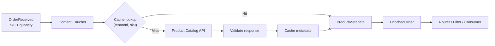
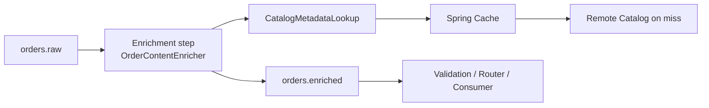

# Cache nội dung bổ sung

## 1. Vì sao Content Enricher cần cache?

Một message `OrderReceived` thường chỉ có mã hàng, số lượng và giá đã chốt. Trước khi gửi sang kho hoặc nhánh thông báo, hệ thống cần bổ sung **tên sản phẩm**, **loại hàng** và thông tin **có dễ vỡ hay không** từ Product Catalog. Nếu mỗi message đều gọi Catalog API, 1.000 đơn mỗi giây với trung bình 5 dòng hàng có thể tạo tới 5.000 lần tra cứu mỗi giây, chưa kể retry hoặc các SKU trùng nhau.

**Content Enricher** là một *Enterprise Integration Pattern* (EIP) làm giàu thông điệp bằng dữ liệu từ nguồn bổ sung. **Caching** lưu tạm kết quả tra cứu để nhiều lần enrich có thể dùng lại một giá trị, giảm số lần gọi API/DB, độ trễ và áp lực lên nguồn dữ liệu. Tuy nhiên cache tạo ra bài toán mới: dữ liệu cũ, invalidation, quyền truy cập, concurrency và xử lý lỗi khi nguồn chính không khả dụng.

Trong chương **Content enricher** của module **SPRING_INTEGRATION_PATTERN**, chúng ta học xây dựng các luồng Enterprise Integration Patterns với Spring Integration ít phụ thuộc và dễ mở rộng. Enricher thường nằm trước Router, Filter, Splitter, Aggregator, Gateway hoặc Service Activator. Thiết kế cache đúng giúp giảm tải, nhưng vẫn phải phối hợp retry, error channel, correlation, theo dõi các nhánh và kiểm thử dữ liệu đã enrich.



**Giới hạn quan trọng:** cache tối ưu *dữ liệu bổ sung*, chứ không phải bằng chứng rằng sự kiện đã được xử lý một lần, không thay thế cơ chế idempotency, transaction, message persistence hay kiểm tra quyền.

## 2. Cache cái gì, không cache cái gì?

Không phải mọi thuộc tính mà Content Enricher bổ sung đều phù hợp để cache.

| Dữ liệu bổ sung | Khả năng cache | Lưu ý |
| --- | --- | --- |
| Tên hiển thị sản phẩm | Thường phù hợp | Có thể chấp nhận độ trễ cập nhật ngắn |
| Phân loại/nhãn hàng | Thường phù hợp | Cần invalidation khi Catalog đổi |
| Thuộc tính dễ vỡ, kích thước | Có thể phù hợp | Kiểm soát độ mới nếu ảnh hưởng vận chuyển |
| Cấu hình chung theo tenant | Có thể phù hợp | Key phải bao gồm tenant và version nếu cần |
| Giá tham khảo trên trang hiển thị | Tùy hợp đồng nghiệp vụ | Phân biệt giá tham khảo và giá chốt |
| Giá cuối cùng dùng để thu tiền | Không dùng cache tùy tiện | Phải dùng quote/giá đã xác nhận có version |
| Tồn kho tại thời điểm đặt hàng | Rất nhạy với độ mới | Cần cơ chế reserve/transaction thay vì tin vào cache cũ |
| Quyền truy cập hoặc trạng thái chống gian lận | Rủi ro cao | Thường cần đánh giá tại thời điểm thực thi |
| Token/secret cá nhân | Hạn chế hoặc không cache | Đòi hỏi phân vùng, TTL, bảo mật đặc biệt |

Ví dụ trong bài **chỉ cache metadata Catalog không quyết định số tiền đã thu**. `OrderReceived` mang `quotedUnitPriceVnd` đã được xác nhận; Enricher giữ nguyên giá ấy và bổ sung tên/loại hàng từ Catalog. Nếu bài toán cần *định giá*, đó là trách nhiệm riêng với hợp đồng về version giá, hiệu lực báo giá và kiểm tra trước thanh toán.

### 2.1. Ba lớp dữ liệu nên tách biệt

1. **Event gốc:** `OrderReceived` và `eventId`, đại diện cho sự thật nghiệp vụ được phát sinh.
2. **Enrichment lookup:** `ProductMetadata` tra từ Catalog, có thể có `catalogRevision` và TTL.
3. **Output đã enrich:** `EnrichedOrder` được xây mới, lưu cả thông tin gốc cần thiết lẫn metadata bổ sung.

Không nên biến cache thành nguồn xác định `eventId`, `correlationId` hay trạng thái đã xử lý. Một message được nhận lại sau retry có thể tra cứu cache khác lần đầu; hệ thống cần biết có yêu cầu replay theo snapshot cũ hay được phép enrich lại bằng Catalog mới.

## 3. Các cách triển khai cache cho dữ liệu enrichment

### 3.1. Cache-aside

Một service dùng cache theo nguyên tắc:

```text
get(tenantId, sku):
  tìm cache key
  HIT  -> trả metadata đã lưu
  MISS -> gọi Catalog
          validate kết quả
          ghi cache theo policy
          trả metadata
```

Spring Cache abstraction có thể hỗ trợ mô hình này qua `@Cacheable`, với `CacheManager` do ứng dụng cấu hình. Cách này phù hợp khi Enricher cần gọi một service tra cứu như cách gọi Java thông thường.

### 3.2. Lưu enrichment vào message hay chỉ giữ trong cache?

| Lựa chọn | Khi nào dùng | Đánh đổi |
| --- | --- | --- |
| Tra metadata qua cache, tạo payload mới | Xử lý realtime trong cùng một flow | Message giữ snapshot ở thời điểm enrich |
| Chỉ thêm `catalogKey` vào message | Downstream có thể tự tra cứu | Mỗi nhánh có thể thấy dữ liệu khác thời điểm |
| Persist output đã enrich | Cần replay đúng nội dung cũ | Tốn lưu trữ và yêu cầu schema/version |
| Persist `catalogRevision` và dữ liệu tối thiểu | Muốn có thể tái dựng kết quả | Catalog phải hỗ trợ tra theo revision |
| Cache toàn bộ `EnrichedOrder` theo event | Chỉ phù hợp khi có hợp đồng dedupe rõ | Dễ lẫn caching với idempotency và dữ liệu nghiệp vụ đã hoàn tất |

Khuyến nghị cho hệ thống thông thường: **cache metadata tra cứu**, nhưng mỗi message khi được enrich sẽ nhận **một kết quả mới**, không giữ tham chiếu tới một object mutable được chia sẻ.

### 3.3. L1 cache và distributed cache

- **L1/in-process:** Caffeine/ConcurrentMap trong JVM, độ trễ thấp; mỗi instance có bản cache riêng, restart sẽ mất dữ liệu.
- **Distributed cache:** Redis hoặc tương đương, các instance có thể dùng chung dữ liệu, nhưng thêm network latency, vận hành, serialization và bài toán cache outage.
- **Hai tầng:** L1 trước L2 trước nguồn gốc; tối ưu hiệu năng nhưng invalidation và consistency phức tạp hơn.

Không chọn Redis chỉ vì “ứng dụng có nhiều node”. Nếu dữ liệu ít, TTL ngắn, có thể tải lại và sai khác ngắn hạn được chấp nhận, cache trong process vẫn có thể hợp lý. Ngược lại, nếu invalidation phải gần đồng bộ trên nhiều node, cần thiết kế cơ chế phát thay đổi tới từng cache hoặc dùng storage/lookup nhất quán hơn.

## 4. Mô hình ví dụ: bổ sung ProductMetadata cho OrderReceived

Ta định nghĩa các kiểu Java 17+ theo hướng output bất biến. `OrderReceived` chứa thông tin đã xác nhận từ producer; `ProductMetadata` đến từ Catalog; `EnrichedOrder` chỉ bổ sung thông tin cần thiết.

### 4.1. Các kiểu dữ liệu

```java
import java.util.List;

record OrderLine(String sku, int quantity, long quotedUnitPriceVnd) {}

record OrderReceived(
        String orderId,
        String tenantId,
        List<OrderLine> lines) {}

record ProductMetadata(
        String sku,
        String displayName,
        String category,
        boolean fragile,
        String catalogRevision) {}

record EnrichedLine(
        String sku,
        int quantity,
        long quotedUnitPriceVnd,
        String displayName,
        String category,
        boolean fragile,
        String catalogRevision) {}

record EnrichedOrder(
        String orderId,
        String tenantId,
        List<EnrichedLine> lines,
        long quotedTotalVnd) {
    EnrichedOrder {
        lines = List.copyOf(lines);
    }
}
```

`EnrichedLine` chỉ chứa value fields bất biến; `EnrichedOrder` bảo vệ collection bằng `List.copyOf`. `OrderReceived` là ví dụ nguồn: record này **chưa bảo đảm danh sách đầu vào bất biến** nếu caller truyền list mutable; Enricher sẽ chỉ đọc và xây output mới. Nếu chuyển qua executor, cần kiểm soát việc sửa input đồng thời trong lúc copy.

Chúng ta giữ `quotedUnitPriceVnd` từ message gốc thay vì lấy giá từ Catalog cache. Một metadata stale có thể làm tên hiển thị chưa cập nhật; một **giá thanh toán stale** có thể gây sai tiền. Hai trường hợp có mức độ rủi ro khác hẳn nhau.

### 4.2. Interface tra cứu nguồn dữ liệu

```java
interface RemoteProductCatalog {
    // Gọi nguồn dữ liệu gốc; một kết quả null nghĩa là không tìm thấy.
    ProductMetadata fetch(String tenantId, String sku);
}

interface CatalogMetadataLookup {
    ProductMetadata get(String tenantId, String sku);
    void invalidate(String tenantId, String sku);
}
```

Tách interface giúp unit test mock lookup mà không cần chạy Catalog API. `tenantId` là một phần của danh tính metadata: cùng SKU ở hai tenant có thể trỏ tới hai sản phẩm khác nhau.

## 5. Cache tra cứu bằng Spring `@Cacheable`

Spring Cache dùng proxy/interceptor để kiểm tra cache trước khi gọi phương thức thật. Ví dụ dưới đây dùng `@Cacheable` cho tra cứu và `@CacheEvict` để chủ động xóa key sau khi Catalog đổi.

```java
import org.springframework.cache.annotation.CacheEvict;
import org.springframework.cache.annotation.Cacheable;
import org.springframework.stereotype.Service;

@Service
class CachedCatalogMetadata implements CatalogMetadataLookup {
    private final RemoteProductCatalog remote;

    CachedCatalogMetadata(RemoteProductCatalog remote) {
        this.remote = remote;
    }

    @Override
    @Cacheable(
            cacheNames = "catalogProducts",
            unless = "#result == null")
    public ProductMetadata get(String tenantId, String sku) {
        if (tenantId == null || tenantId.isBlank()
                || sku == null || sku.isBlank()) {
            throw new IllegalArgumentException("Invalid lookup key");
        }
        return remote.fetch(tenantId, sku);
    }

    @Override
    @CacheEvict(cacheNames = "catalogProducts")
    public void invalidate(String tenantId, String sku) {
        // Việc xóa key được cache interceptor thực hiện.
    }
}
```

**Tại sao ví dụ không chỉ định `key`?** Cả `get(tenantId, sku)` và `invalidate(tenantId, sku)` có cùng danh sách **hai tham số**. `SimpleKeyGenerator` mặc định tạo một key dựa trên cả `tenantId` và `sku`; vì vậy invalidation trỏ tới cùng cache entry. Nếu sau này một phương thức có thêm tham số khác, **phải thiết kế lại key** cho đồng nhất giữa đọc và xóa.

**Quan trọng về Spring proxy:** `@Cacheable` hoạt động khi lời gọi đi qua bean proxy do Spring quản lý. Một phương thức trong `CachedCatalogMetadata` gọi `this.get(...)` có thể **bỏ qua cache interceptor** trong proxy mode mặc định. Vì thế Enricher dùng `CatalogMetadataLookup` được inject từ Spring, không gọi self-invocation.

`unless = "#result == null"` tránh ghi một kết quả không có sản phẩm vào cache theo ví dụ này. Nếu cache key không tồn tại và Catalog trả `null`, lần sau ứng dụng có thể gọi lại Catalog. Negative caching cũng có trường hợp sử dụng, nhưng cần TTL ngắn và cách phân biệt **không tìm thấy thật** với **lỗi truy cập hoặc lỗi tạm thời**.

### 5.1. Một cache manager giới hạn dung lượng và TTL

Spring Cache abstraction **không tự đặt TTL** chỉ vì ta viết `@Cacheable`. TTL và eviction phụ thuộc cache provider. Ví dụ sau dùng **Caffeine** (cần dependency Caffeine và Spring hỗ trợ Caffeine):

```java
import java.time.Duration;

import com.github.benmanes.caffeine.cache.Caffeine;
import org.springframework.cache.CacheManager;
import org.springframework.cache.caffeine.CaffeineCacheManager;
import org.springframework.cache.annotation.EnableCaching;
import org.springframework.context.annotation.Bean;
import org.springframework.context.annotation.Configuration;

@Configuration
@EnableCaching
class CatalogCacheConfiguration {

    @Bean
    CacheManager cacheManager() {
        var manager = new CaffeineCacheManager("catalogProducts");
        manager.setCaffeine(Caffeine.newBuilder()
                .maximumSize(10_000)
                .expireAfterWrite(Duration.ofMinutes(5)));
        return manager;
    }
}
```

Đây chỉ là cấu hình minh họa:

- `maximumSize(10_000)` giới hạn số entry xấp xỉ bằng chính sách eviction của Caffeine, không phải kích thước dữ liệu tính bằng byte.
- `expireAfterWrite(5 phút)` giới hạn thời gian kể từ lần ghi/refresh, không có nghĩa mọi bản ghi cập nhật ở Catalog sẽ được biết ngay.
- Cache in-process mất khi restart; mỗi node trong cluster có một cache riêng.
- Với giá trị `ProductMetadata` bất biến, cache trả cùng object reference có thể an toàn cho đọc. Với DTO mutable, nên copy trước khi trả/đưa vào payload.

Không chọn TTL “5 phút” theo cảm giác. Dựa vào tần suất cập nhật Catalog, hậu quả của metadata cũ, tốc độ đọc, thời gian hoàn thành một cache miss và mục tiêu SLA.

## 6. Viết Content Enricher tạo output mới, không sửa payload gốc

Content Enricher nhận `OrderReceived`, tìm metadata qua bean đã được cache, kiểm tra dữ liệu nguồn và xây `EnrichedOrder` bất biến.

```java
import java.util.ArrayList;
import java.util.HashMap;
import java.util.List;
import java.util.Locale;
import java.util.Map;
import java.util.Objects;
import org.springframework.stereotype.Service;

@Service
class OrderContentEnricher {
    private final CatalogMetadataLookup catalog;

    OrderContentEnricher(CatalogMetadataLookup catalog) {
        this.catalog = catalog;
    }

    EnrichedOrder enrich(OrderReceived source) {
        Objects.requireNonNull(source, "OrderReceived is required");
        if (source.orderId() == null || source.orderId().isBlank()
                || source.tenantId() == null || source.tenantId().isBlank()
                || source.lines() == null || source.lines().isEmpty()) {
            throw new IllegalArgumentException("Invalid order");
        }

        String tenantId = source.tenantId();
        List<EnrichedLine> result = new ArrayList<>();
        Map<String, ProductMetadata> perMessage = new HashMap<>();
        long quotedTotal = 0L;

        for (OrderLine original : source.lines()) {
            if (original == null || original.sku() == null
                    || original.quantity() <= 0
                    || original.quotedUnitPriceVnd() < 0) {
                throw new IllegalArgumentException("Invalid order line");
            }

            String sku = original.sku().trim().toUpperCase(Locale.ROOT);
            if (sku.isBlank()) {
                throw new IllegalArgumentException("Empty normalized SKU");
            }

            ProductMetadata metadata = perMessage.computeIfAbsent(
                    sku, key -> requireMetadata(catalog.get(tenantId, key)));

            if (!sku.equals(metadata.sku())
                    || metadata.displayName() == null
                    || metadata.category() == null
                    || metadata.catalogRevision() == null) {
                throw new IllegalStateException("Invalid Catalog reply");
            }

            result.add(new EnrichedLine(
                    sku,
                    original.quantity(),
                    original.quotedUnitPriceVnd(),
                    metadata.displayName(),
                    metadata.category(),
                    metadata.fragile(),
                    metadata.catalogRevision()));

            long lineTotal = Math.multiplyExact(
                    (long) original.quantity(),
                    original.quotedUnitPriceVnd());
            quotedTotal = Math.addExact(quotedTotal, lineTotal);
        }

        return new EnrichedOrder(
                source.orderId(),
                tenantId,
                result,
                quotedTotal);
    }

    private static ProductMetadata requireMetadata(ProductMetadata metadata) {
        if (metadata == null) {
            throw new IllegalArgumentException(
                    "Product not found in Catalog");
        }
        return metadata;
    }
}
```

Một số điểm đáng chú ý:

1. **Không có setter trên `OrderReceived` hoặc `OrderLine` được gọi.** Output dùng các `EnrichedLine` mới.
2. SKU được chuẩn hóa **trước** khi tra cache để `" sku-a "` và `"SKU-A"` chia sẻ một key logic. Contract này phải giống nhau cho mọi caller dùng `CatalogMetadataLookup`.
3. `perMessage` tránh gọi cùng một SKU hai lần **ngay trong một message**; cache xuyên các message do `@Cacheable` xử lý.
4. `tenantId` luôn được truyền vào lookup, tránh trộn metadata của các tenant.
5. `quotedUnitPriceVnd` lấy từ **event gốc**, không được thay bằng giá từ một Catalog có thể stale.
6. `Math.multiplyExact`/`Math.addExact` phát hiện overflow thay vì lặng lẽ tính sai.
7. `catalogRevision` trong kết quả cho phép ghi nhận phiên bản metadata đã sử dụng, nhưng không thay thế logic kiểm tra tính hợp lệ của dữ liệu.

**Lưu ý về consistency:** Nếu một đơn có nhiều SKU, những lần cache hit/miss có thể trả metadata thuộc **các revision khác nhau**. Nếu nghiệp vụ đòi hỏi tất cả dòng hàng cùng một Catalog snapshot, cần API tra cứu theo revision/batch snapshot hoặc transaction thích hợp; cache-aside từng key **không tự bảo đảm nhất quán liên-key**.

### 6.1. Cache giữa các message và cache trong một message khác nhau

| Cơ chế | Phạm vi | Tác dụng |
| --- | --- | --- |
| `perMessage` map | Một lần `enrich(...)` | Không lặp lookup cho hai dòng cùng SKU trong một đơn |
| `@Cacheable` | Những lời gọi qua Spring cache proxy | Dùng lại metadata ở các đơn khác nhau |
| Catalog/DB | Nguồn dữ liệu gốc | Chịu trách nhiệm cập nhật và xác nhận dữ liệu |

Không dùng `perMessage` như kho lưu toàn hệ thống: map này bị giải phóng sau khi hàm kết thúc. Cũng không dùng cache metadata làm dấu “đơn hàng đã hoàn tất”, vì nhiều order có thể dùng cùng một SKU.

## 7. Đưa Enricher vào Spring Integration Java DSL

Trong Spring Integration, EIP **Content Enricher** có thể được thể hiện qua endpoint `Enricher` request-reply, hoặc qua một bước biến đổi tạo payload mới. Với mô hình **output bất biến** ở ví dụ này, ta dùng `transform` gọi `OrderContentEnricher.enrich`, để làm giàu message mà không cần setter trên payload. Đây là một triển khai của ý tưởng Content Enricher; cú pháp khác với DSL `enrich(...)` chuyên dụng vốn có thể cấu hình phép gán property vào payload.



```java
import org.springframework.context.annotation.Bean;
import org.springframework.context.annotation.Configuration;
import org.springframework.integration.channel.DirectChannel;
import org.springframework.integration.config.EnableIntegration;
import org.springframework.integration.dsl.IntegrationFlow;
import org.springframework.messaging.MessageChannel;

interface EnrichedOrderConsumer {
    void accept(EnrichedOrder order, String eventId);
}

@Configuration
@EnableIntegration
class OrderEnrichmentFlow {

    @Bean("orders.raw")
    MessageChannel rawOrders() {
        return new DirectChannel();
    }

    @Bean("orders.enriched")
    MessageChannel enrichedOrders() {
        return new DirectChannel();
    }

    @Bean
    IntegrationFlow contentEnrichment(OrderContentEnricher enricher) {
        return IntegrationFlow.from("orders.raw")
                .transform(OrderReceived.class, enricher::enrich)
                .channel("orders.enriched")
                .get();
    }

    @Bean
    IntegrationFlow consumeEnriched(EnrichedOrderConsumer consumer) {
        return IntegrationFlow.from("orders.enriched")
                .handle(EnrichedOrder.class, (order, headers) -> {
                    String eventId = (String) headers.get("eventId");
                    if (eventId == null || eventId.isBlank()) {
                        throw new IllegalArgumentException("Missing eventId");
                    }
                    consumer.accept(order, eventId);
                    return null; // One-way consumer.
                })
                .get();
    }
}
```

`@EnableIntegration` cấu hình các endpoint Spring Integration; `@EnableCaching` trong mục 5 cấu hình Spring Cache. **Hai cơ chế có trách nhiệm khác nhau**. Producer cần tạo message có `eventId` ổn định và header khác theo hợp đồng; mặc định phải kiểm chứng header propagation ở các adapter.

### 7.1. Producer minh họa

```java
import java.util.List;
import org.springframework.beans.factory.annotation.Qualifier;
import org.springframework.messaging.MessageChannel;
import org.springframework.messaging.support.MessageBuilder;
import org.springframework.stereotype.Component;

@Component
class OrderPublisher {
    private final MessageChannel ingress;

    OrderPublisher(@Qualifier("orders.raw") MessageChannel ingress) {
        this.ingress = ingress;
    }

    void submit() {
        var received = new OrderReceived(
                "ORD-105",
                "tenant-hcm",
                List.of(
                        new OrderLine(" sku-a ", 2, 15000L),
                        new OrderLine("SKU-A", 1, 15000L)));
        ingress.send(MessageBuilder.withPayload(received)
                .setHeader("eventId", "evt-105")
                .setHeader("traceId", "trace-105")
                .build());
    }
}
```

Nếu Catalog có `ProductMetadata("SKU-A","Áo A","APPAREL",false,"rev-7")`, kết quả sẽ có hai dòng cùng metadata, tổng tiền báo giá `45.000 VND`. Trong cùng một message, chỉ cần một lookup SKU nhờ map cục bộ; giữa các message, `@Cacheable` có thể trả lại cùng metadata cho đến khi entry bị hết hạn/evict.

### 7.2. Content Enricher request-reply chuyên dụng khác gì?

Spring Integration có một **Content Enricher endpoint** hỗ trợ gửi request tới một channel tra cứu, chờ reply và dùng dữ liệu reply để enrich payload/headers theo expression. Phù hợp khi hệ thống muốn một flow con đảm nhiệm truy vấn hoặc khi payload có property cần gán.

Ví dụ về **topology**, không phải cấu hình thêm vào flow phía trên:

```text
orders.raw
  -> Content Enricher
       request -> catalog.lookup
                  -> Catalog gateway/service (được cache)
                  -> Catalog reply
       merge reply vào target fields
  -> orders.enriched
```

Trong trường hợp payload immutable, cần thiết kế một phép tạo **object mới** hoặc transformation tùy biến để merge dữ liệu; đừng cố viết vào các record components không có setter. Dùng `IntegrationFlow.transform(...)` ở ví dụ giúp ranh giới bất biến rõ ràng mà vẫn thực hiện **Content Enricher pattern**. Nếu dùng request-reply channel, cần đặt timeout, error handler và contract reply; không mặc định request không có reply sẽ được coi là “cache miss”.

## 8. Thiết kế cache key: tránh sai tenant, ngôn ngữ và phiên bản

Một cache hit **sai key** nguy hiểm hơn cache miss vì nó có thể trả dữ liệu hợp lệ về hình thức nhưng thuộc người dùng hoặc phiên bản khác.

| Chiều dữ liệu | Có cần là một phần của key? | Ví dụ |
| --- | --- | --- |
| Tenant | Có nếu Catalog tenant-specific | `tenant-hcm` |
| SKU đã chuẩn hóa | Có | `SKU-A` |
| Locale/ngôn ngữ | Có nếu tên hiển thị được dịch | `vi-VN` |
| Currency | Có nếu giá/thuộc tính phụ thuộc currency | `VND` |
| Catalog/version | Có nếu phải tra snapshot xác định | `rev-7` |
| Quyền/nhóm người dùng | Tùy chính sách bảo mật | Có thể không cache chung |

Ví dụ dịch vụ chỉ nhận `(tenantId, sku)`, nên cache key mặc định đã gồm hai giá trị này. Nếu về sau thêm `locale`, phải thêm nó **vào cả method signature và key**, hoặc chọn một key object bất biến rõ ràng. Không dùng `sku` đơn độc cho catalog đa tenant.

**Security:** cache không thay thế authorization. Nếu metadata chỉ người được phép mới xem, kiểm tra quyền phải diễn ra **trước khi trả kết quả từ cache**, kể cả khi cache hit. Không dùng cùng entry cho các principal có quyền nhìn khác nhau, trừ khi dữ liệu đã được thiết kế/public theo tenant và policy cho phép chia sẻ.

### 8.1. Canonicalization phải nhất quán

`"sku-a"`, `" SKU-A "` và `"SKU-A"` có thể cùng định danh trong Catalog. Nếu caller A chuẩn hóa còn caller B không, cache tạo nhiều key trùng nghĩa và có thể lấy kết quả không nhất quán. Hãy làm rõ chính sách chuẩn hóa và bắt buộc tất cả entrypoint áp dụng; lý tưởng service cache cũng có boundary validation/canonicalization khi được dùng ngoài flow minh họa.

Không tùy tiện `toUpperCase()` theo locale mặc định của máy: với mã SKU ASCII, `Locale.ROOT` giúp hành vi ổn định. Không được tự áp dụng uppercase nếu SKU thực tế phân biệt chữ hoa/chữ thường.

## 9. TTL, invalidation và stale data

Cache đi kèm lựa chọn quan trọng: **chấp nhận metadata cũ trong bao lâu?**

### 9.1. Những chính sách thường gặp

| Chính sách | Tác dụng | Đánh đổi |
| --- | --- | --- |
| `expireAfterWrite` | Hết hạn sau một khoảng từ lúc ghi | Có cửa sổ stale tối đa theo TTL |
| `expireAfterAccess` | Hết hạn nếu không được truy cập một thời gian | Key nóng có thể giữ bản cũ lâu nếu không có giới hạn tuổi khác |
| Explicit invalidation | Xóa khi Catalog có cập nhật | Cần cơ chế nhận và xử lý event cập nhật |
| Versioned key | Đọc theo revision xác định | Cần nguồn revision đáng tin |
| Refresh ahead / stale-while-revalidate | Giảm latency khi refresh | Có thể trả stale, phức tạp hóa semantics |
| Không cache | Luôn đọc nguồn tại điểm truy cập | Tăng độ trễ và phụ thuộc Catalog |

`expireAfterWrite` với TTL 5 phút chỉ giới hạn **tuổi kể từ lần ghi** tại cache đó; không hứa rằng dữ liệu mới được đồng bộ với Catalog ngay sau update.

### 9.2. Cập nhật Catalog và `@CacheEvict`

Khi Catalog đã đổi tên sản phẩm, một thành phần điều phối có thể gọi:

```java
// Gọi qua Spring-managed bean CatalogMetadataLookup:
catalogLookup.invalidate("tenant-hcm", "SKU-A");
```

`@CacheEvict` xóa entry tương ứng trong cache **trên instance nơi lời gọi chạy**. Với Caffeine cache nội bộ trên nhiều node, invalidation chỉ ở node A không đồng nghĩa node B đã xóa. Hãy dùng một thông báo cập nhật qua broker phát tới mọi node, một cache phân tán, hoặc kết hợp TTL ngắn tùy SLA và mức độ stale chấp nhận được.

Nếu nhận một event `ProductUpdated(tenantId, sku, revision)`, thứ tự an toàn thường là **commit thay đổi ở Catalog trước**, sau đó phát/nhận invalidation; nếu xóa cache quá sớm và một request lập tức tải dữ liệu cũ, entry stale có thể được lưu lại. Với hệ thống phức tạp, cần versioning và cơ chế chống race.

### 9.3. Không được giữ dữ liệu cũ cho mọi lỗi

*Stale fallback* có thể hữu ích với **displayName**, nhưng có thể không phù hợp với:

- Điều kiện cấm vận chuyển;
- Tình trạng sản phẩm bị thu hồi;
- Quyền truy cập bị thu hồi;
- Giá dùng để thu tiền;
- Những rule pháp lý hoặc kiểm soát rủi ro bắt buộc.

Phải có **policy theo loại trường**: dữ liệu nào được phép stale, stale tối đa bao lâu, khi nào fail closed và khi nào lưu để xử lý lại. Không viết một `catch (Exception) { return cachedValue; }` chung cho mọi loại enrichment.

## 10. Cache miss, lỗi Catalog và retry

Ba sự kiện cần tách:

1. **Cache miss bình thường:** entry chưa có hoặc đã hết hạn; gọi nguồn gốc.
2. **Catalog không tìm thấy SKU:** kết quả không tồn tại hoặc không hợp lệ; tùy hợp đồng có thể báo lỗi dữ liệu hoặc đặt một bản ghi quarantine.
3. **Catalog timeout/503:** lỗi phụ thuộc bên ngoài; có thể retry có giới hạn, backoff hoặc chuyển xử lý bất đồng bộ.

| Tình huống | Hướng xử lý | Không nên làm |
| --- | --- | --- |
| Cache hit metadata hợp lệ | Build output | Gọi Catalog lại không cần thiết |
| Miss + Catalog thành công | Validate, cache, enrich | Cache object mutable chưa copy |
| SKU không tồn tại thật | Reject/quarantine hoặc negative cache có TTL riêng | Retry vô hạn như lỗi mạng |
| Catalog 503 ngắn hạn | Timeout + retry giới hạn/backoff | Gọi retry đồng loạt vô hạn |
| Catalog down kéo dài | Circuit breaker, queue/recovery hoặc fallback được phê duyệt | Dùng metadata stale cho quyết định nhạy cảm |
| Cache provider lỗi | Chính sách đọc nguồn hoặc fail theo loại dữ liệu | Giả định hit/miss luôn miễn lỗi |
| Producer redelivery cùng event | Enrich lại theo policy, consumer idempotent | Coi cache hit là proof đã xử lý event |

### 10.1. Retry ở tầng nào?

- **Catalog client:** retry lỗi mạng có giới hạn, tốt nhất có timeout và jitter. Tra cứu đọc thường dễ retry hơn lệnh ghi.
- **Enricher endpoint:** retry có thể chạy lại toàn bộ phép enrich; nếu nguồn cache đang trống, dễ tạo nhiều lượt tải đồng thời.
- **Message adapter/broker:** nếu flow fail và message được redeliver, nó sẽ đi qua Enricher lần nữa.
- **Consumer sau Enricher:** có thể retry riêng mà không cần gọi lại Catalog nếu chỉ retry handler downstream bên trong phạm vi của nó.

Không nên đặt retry ở **mọi tầng** một cách độc lập. Ví dụ adapter thử 3 lần × Enricher thử 3 lần × HTTP client thử 3 lần có thể tạo tối đa 27 request tới Catalog cho một input gặp lỗi, trước khi tính message được phát lại lần nữa.

### 10.2. Không biến cache thành idempotency store

Cache có TTL và có thể evict do thiếu bộ nhớ. Nó **không thể** là bằng chứng bền vững rằng event `evt-105` đã được consumer xử lý. Đối với các side effect như thu tiền, cấp quyền hoặc trừ tồn kho, dùng **idempotency key ổn định** `(eventId, consumerName)`, transaction hoặc bảng inbox và cơ chế recovery riêng.

Nếu enrichment gọi một API ghi dữ liệu thay vì lookup chỉ-đọc, cần tách side effect ra thành Service Activator có transaction/idempotency. Content Enricher nên ưu tiên dữ liệu tham chiếu hoặc lệnh tra cứu được phép gọi lặp.

## 11. Cache stampede, concurrency và batch enrichment

Giả sử cache vừa hết hạn đối với SKU phổ biến. Một trăm thread đồng thời tra `SKU-A` có thể đều thấy miss và gọi Catalog. Đây là **cache stampede**.

### 11.1. Các biện pháp giảm stampede

1. **Single-flight/đồng bộ tải theo key:** một yêu cầu đang tải, các yêu cầu khác chờ kết quả. Spring Cache có tùy chọn `@Cacheable(sync = true)` trong điều kiện cache provider hỗ trợ; không kết hợp tùy tiện với `unless` trong ví dụ hiện tại vì chế độ đồng bộ có giới hạn với các thuộc tính khác.
2. **TTL có jitter:** tránh mọi key hết hạn đồng loạt; cần provider hoặc giải pháp triển khai phù hợp.
3. **Warm-up có kiểm soát:** preload một số SKU nóng nhưng không được làm ứng dụng phụ thuộc hoàn toàn vào warm-up.
4. **Batch lookup:** gom danh sách SKU duy nhất từ một đơn rồi gọi Catalog một lần, nếu API và cache hỗ trợ.
5. **Rate limit/bulkhead/circuit breaker:** bảo vệ Catalog khỏi quá tải khi nhiều cache miss xảy ra.
6. **Giới hạn concurrency tại ingress:** đặc biệt quan trọng nếu luồng dùng ExecutorChannel/PublishSubscribeChannel.

`perMessage` ở ví dụ chỉ loại bỏ lookup trùng SKU **trong cùng một đơn**; nó **không giải quyết stampede giữa nhiều thread**. `@Cacheable` mặc định không nên được xem là một lock toàn hệ thống.

### 11.2. Khi nào nên batch?

Nếu mỗi đơn có hàng trăm SKU khác nhau, 100 lần gọi catalog theo từng item tạo overhead. Một API `fetchBatch(tenantId, Set<sku>)` có thể hiệu quả hơn. Nhưng phải cân nhắc:

- Cache hit riêng từng SKU hay cache cả batch key?
- Trả kết quả theo `sku` để không lệch item khi API đổi thứ tự.
- Một SKU lỗi có làm hỏng cả batch hay chỉ một item?
- Trả dữ liệu cùng một `catalogRevision` nếu nghiệp vụ cần snapshot nhất quán.
- Cách invalidation từng SKU sau update.

Đừng cache một `List<ProductMetadata>` theo thứ tự truyền vào nếu thứ tự SKU không mang ý nghĩa; các batch tương đương có thể sinh nhiều key khó quản lý.

## 12. Giữ headers, correlation và an toàn khi fan-out

Khi chuyển từ `OrderReceived` sang `EnrichedOrder`, payload đổi kiểu nhưng **message context** vẫn phải được truyền tiếp. Một integration flow thường cần:

```text
Input:
  payload = OrderReceived(...)
  headers = eventId=evt-105, traceId=trace-105, tenantId=tenant-hcm

Content Enricher:
  lookup ProductMetadata (cached)
  build EnrichedOrder(...)

Output:
  payload = EnrichedOrder(...)
  headers = eventId=evt-105, traceId=trace-105, tenantId=tenant-hcm
```

Khi dùng Java DSL `transform(...)`, Spring Integration xử lý propagation của message headers theo framework. Khi viết custom transformer tạo `Message` bằng tay, hoặc đưa message qua HTTP/Kafka/Rabbit adapter, **phải kiểm thử** những header được giữ, lọc và chuyển kiểu theo adapter.

`eventId` hỗ trợ deduplication ở từng consumer; `traceId` hỗ trợ quan sát; `correlationId` và sequence headers (nếu có) phục vụ Splitter/Aggregator. Không thay các giá trị ấy bằng cache key. Cũng không cần mang cả object cache nội bộ hoặc credential/HTTP client qua message headers.

### 12.1. Enrich trước hay sau fan-out?

| Cách đặt Enricher | Ưu điểm | Hạn chế |
| --- | --- | --- |
| **Trước Publish-Subscribe/Recipient List** | Một lần enrich cho nhiều subscriber; cùng snapshot metadata | Nhánh không cần metadata vẫn chịu chi phí lookup; lỗi enrich chặn fan-out |
| **Sau Router ở từng nhánh** | Chỉ enrich nhánh cần; có thể có policy riêng | Nhiều lookup, các nhánh có thể thấy revision khác nhau |
| **Sau Splitter ở mỗi item** | Dễ xử lý/batch theo item độc lập | Nhiều cache lookups, cần quản lý correlation và aggregation |
| **Sau Aggregator** | Làm giàu một kết quả tổng hợp | Có thể quá muộn cho logic của các bước trước |

Chọn vị trí theo **nghĩa vụ dữ liệu của consumer** và yêu cầu snapshot consistency. Nếu tất cả recipient cần cùng metadata đã enrich, enrich trước fan-out giúp chúng nhận một payload bất biến chung. Nếu chỉ notification cần tên sản phẩm, có thể enrich riêng nhánh notification và tránh làm chậm kho.

## 13. Kiểm thử cache đúng hành vi, không chỉ kiểm tra output

Cần chứng minh ít nhất: kết quả enrich chính xác, dữ liệu nguồn không bị sửa, cache hit không gọi Catalog, invalidation buộc tải lại, tenant không trộn, và lỗi được phân biệt với cache miss.

### 13.1. Unit test Content Enricher: output bất biến và SKU trùng

Unit test dưới đây **mock lookup**, không cần Spring context. Nó kiểm tra logic enrich và map theo message:

```java
import java.util.ArrayList;
import java.util.List;
import org.junit.jupiter.api.Test;

import static org.junit.jupiter.api.Assertions.*;
import static org.mockito.Mockito.*;

class OrderContentEnricherTest {

    @Test
    void enrichesNewPayloadWithoutMutatingInputOrRepeatedLookup() {
        CatalogMetadataLookup lookup = mock(CatalogMetadataLookup.class);
        when(lookup.get("tenant-hcm", "SKU-A")).thenReturn(
                new ProductMetadata("SKU-A", "Áo A",
                        "APPAREL", false, "rev-7"));

        var sourceLines = new ArrayList<>(List.of(
                new OrderLine(" sku-a ", 2, 15_000L),
                new OrderLine("SKU-A", 1, 15_000L)));
        var source = new OrderReceived(
                "ORD-105", "tenant-hcm", sourceLines);

        EnrichedOrder output = new OrderContentEnricher(lookup)
                .enrich(source);

        assertEquals("ORD-105", output.orderId());
        assertEquals(2, output.lines().size());
        assertEquals("SKU-A", output.lines().get(0).sku());
        assertEquals("Áo A", output.lines().get(1).displayName());
        assertEquals("rev-7", output.lines().get(0).catalogRevision());
        assertEquals(45_000L, output.quotedTotalVnd());
        verify(lookup, times(1)).get("tenant-hcm", "SKU-A");

        // Input giữ SKU với khoảng trắng; thay đổi list gốc
        // sau enrichment không ảnh hưởng output.
        assertEquals(" sku-a ", sourceLines.get(0).sku());
        sourceLines.clear();
        assertEquals(2, output.lines().size());
        assertThrows(UnsupportedOperationException.class,
                () -> output.lines().clear());
    }
}
```

Test này chứng minh tránh lookup lặp **bên trong một message**. Nó **chưa** chứng minh Spring Cache đang hoạt động, vì lookup chỉ là mock. Phải có test integration xuyên proxy cho `@Cacheable`.

### 13.2. Integration test `@Cacheable` và invalidation

Ví dụ dùng Spring Test và Mockito; cache được xóa trước mỗi test để tránh dữ liệu cũ giữa các ca:

```java
import org.junit.jupiter.api.BeforeEach;
import org.junit.jupiter.api.Test;
import org.springframework.beans.factory.annotation.Autowired;
import org.springframework.cache.CacheManager;
import org.springframework.context.annotation.Bean;
import org.springframework.context.annotation.Configuration;
import org.springframework.test.context.junit.jupiter.SpringJUnitConfig;

import static org.junit.jupiter.api.Assertions.*;
import static org.mockito.Mockito.*;

@SpringJUnitConfig(classes = {
        CatalogCacheConfiguration.class,
        CachedCatalogMetadata.class,
        CachedCatalogMetadataTest.Stubs.class
})
class CachedCatalogMetadataTest {

    @Autowired
    CatalogMetadataLookup lookup;

    @Autowired
    RemoteProductCatalog remote;

    @Autowired
    CacheManager cacheManager;

    @BeforeEach
    void clearCacheAndMock() {
        cacheManager.getCache("catalogProducts").clear();
        reset(remote);
    }

    @Test
    void hitAvoidsRemoteCallAndEvictionForcesReload() {
        var first = new ProductMetadata(
                "SKU-A", "Áo A", "APPAREL", false, "rev-7");
        var second = new ProductMetadata(
                "SKU-A", "Áo A mới", "APPAREL", false, "rev-8");

        when(remote.fetch("tenant-hcm", "SKU-A"))
                .thenReturn(first, second);

        assertEquals(first, lookup.get("tenant-hcm", "SKU-A"));
        assertEquals(first, lookup.get("tenant-hcm", "SKU-A"));
        verify(remote, times(1)).fetch("tenant-hcm", "SKU-A");

        lookup.invalidate("tenant-hcm", "SKU-A");
        assertEquals(second, lookup.get("tenant-hcm", "SKU-A"));
        verify(remote, times(2)).fetch("tenant-hcm", "SKU-A");
    }

    @Test
    void cacheKeySeparatesTenants() {
        var hcm = new ProductMetadata(
                "SKU-A", "Áo A", "APPAREL", false, "rev-1");
        var hn = new ProductMetadata(
                "SKU-A", "Sản phẩm A miền Bắc",
                "APPAREL", false, "rev-2");
        when(remote.fetch("tenant-hcm", "SKU-A")).thenReturn(hcm);
        when(remote.fetch("tenant-hn", "SKU-A")).thenReturn(hn);

        assertEquals(hcm, lookup.get("tenant-hcm", "SKU-A"));
        assertEquals(hn, lookup.get("tenant-hn", "SKU-A"));
        verify(remote, times(1)).fetch("tenant-hcm", "SKU-A");
        verify(remote, times(1)).fetch("tenant-hn", "SKU-A");
    }

    @Configuration
    static class Stubs {
        @Bean
        RemoteProductCatalog remoteProductCatalog() {
            return mock(RemoteProductCatalog.class);
        }
    }
}
```

Để test expiry/TTL, tránh `Thread.sleep(5 phút)`. Có thể cấu hình TTL rất ngắn cho test, dùng ticker/clock điều khiển được của provider hoặc test chính sách bằng một cache test double. Khi dùng integration test có bean proxy, đừng gọi `new CachedCatalogMetadata(...).get(...)` rồi mong annotation cache hoạt động: object tự khởi tạo không đi qua interceptor của Spring.

### 13.3. Test flow end-to-end

Trong Spring Test context chứa `OrderEnrichmentFlow`, `OrderContentEnricher`, `CatalogCacheConfiguration`, `CachedCatalogMetadata` và fake Catalog/consumer, gửi message vào `orders.raw`. Dùng `ArgumentCaptor<EnrichedOrder>` để xác minh payload và `eventId` đến Service Activator; gửi message thứ hai có SKU đã tra để kiểm tra cache hit. Với `DirectChannel`, các handler chạy đồng bộ; nếu thay bằng executor hoặc broker phải chờ kết quả có timeout hữu hạn.

Ma trận tối thiểu:

| Kịch bản | Mong đợi |
| --- | --- |
| Lần tra đầu cùng tenant/SKU | Remote Catalog được gọi; enrich đúng |
| Lần tra thứ hai | Cache hit, không gọi lại remote |
| Hai dòng hàng trùng SKU trong một đơn | Chỉ một lookup qua `perMessage` |
| Cùng SKU, hai tenant | Hai cache entries khác nhau |
| Metadata đổi và invalidate đúng key | Lần sau nhận revision mới |
| TTL hết hạn | Miss và refresh theo chính sách |
| Cache miss, Catalog trả null | Lỗi không tìm thấy; không coi như timeout |
| Catalog 503/timeout | Retry có giới hạn; lỗi quan sát được |
| Thiếu `eventId` ở message | Chặn hoặc báo lỗi envelope, không mất dấu |
| Redelivery cùng event | Enrichment có thể lặp, consumer idempotent |
| Metadata stale ở bước nhạy cảm | Fail closed hoặc xử lý theo policy được phê duyệt |
| Hai thread miss cùng key | Đo request burst; test single-flight nếu dùng |
| Fan-out sau enrich | Các nhánh nhận snapshot bất biến nhất quán |

### 13.4. Test phần nào là cache, phần nào là EIP?

**Unit test Enricher** kiểm tra phép hợp nhất dữ liệu. **Cache integration test** kiểm tra interceptor, key, TTL và invalidation. **Flow integration test** kiểm tra wiring `MessageChannel`, `eventId`, kiểu payload và nhánh xử lý. **System test** kiểm tra timeout, retry, lỗi Catalog và broker. Mỗi mức có lỗi riêng; một test xanh ở mức khác không thay thế kiểm thử đúng tầng.

## 14. Quan sát và vận hành cache enrichment

Một hệ thống chạy tốt ở thời điểm cache nóng vẫn có thể suy giảm ngay khi restart, deployment hoặc Catalog update khiến cache lạnh. Nên đo:

| Chỉ số | Giúp phát hiện |
| --- | --- |
| Cache hit/miss ratio theo loại lookup | Cache có hữu ích hay không |
| Cache entry count, eviction count | Dung lượng và churn |
| Catalog call rate và latency | Lưu lượng/thời gian do cache miss gây ra |
| Error/timeout/retry count | Lỗi phụ thuộc nguồn dữ liệu |
| Enrichment duration (p50/p95/p99) | Độ trễ gia tăng của integration flow |
| Stale-hit/revalidation count nếu có | Mức sử dụng dữ liệu cũ |
| Quarantine và replay backlog | Message không hoàn tất enrichment |
| Chênh lệch catalogRevision nếu giám sát | Các node đang đọc version khác nhau |

Đặt `eventId`, `traceId`, `tenantId` ở log/tracing theo nguyên tắc hạn chế thông tin nhạy cảm. Không dùng SKU hoặc event ID có cardinality cao làm label metric nếu số lượng giá trị lớn; nên phân loại bằng tên cache, kết quả hit/miss, nhóm lỗi, tên endpoint. Không log toàn bộ dữ liệu Catalog hoặc bí mật truy cập.

### 14.1. Khi cache hoạt động “quá tốt”

Tỷ lệ hit cao **không chứng minh kết quả đúng**. Một key thiết kế sai có thể trả nhầm dữ liệu tenant mà vẫn ghi nhận là hit. Một TTL quá dài có thể làm cache “rất hiệu quả” nhưng metadata stale liên tục. Do đó vận hành cần kết hợp:

- Cache hit ratio + số lỗi downstream do metadata sai;
- Audit `catalogRevision` trên message đã enrich;
- Test phân vùng tenant/locale;
- Một luồng invalidation được quan sát;
- Quy trình purge/rebuild khi Catalog phát hiện dữ liệu sai.

## 15. Những lỗi thiết kế thường gặp

1. **Cache cả payload nghiệp vụ và xem đó là idempotency.** Cache không thể thay transaction/processed-events store.
2. **Dùng chỉ `sku` làm key trong hệ thống nhiều tenant.** Có thể trả metadata của tenant khác.
3. **Đặt `@Cacheable` nhưng không bật `@EnableCaching` hoặc gọi self-invocation.** Annotation không có hiệu lực như mong đợi.
4. **Không cấu hình TTL/eviction tại provider.** Cache giữ dữ liệu cũ hoặc tăng bộ nhớ không kiểm soát.
5. **Coi `@CacheEvict` trên một JVM là invalidation toàn cluster.** Các node khác có thể vẫn stale.
6. **Đọc giá thanh toán từ cache metadata rồi thu tiền.** Sai lệch với quote đã xác nhận.
7. **Cache object mutable rồi sửa object sau khi nhận.** Lần hit tiếp theo có thể trả dữ liệu bị biến đổi.
8. **Nhầm cache miss với Catalog timeout.** Retry sai, negative cache lỗi tạm thời.
9. **Cho retry ở nhiều tầng không giới hạn.** Tạo retry storm khi nguồn Catalog gặp sự cố.
10. **Không kiểm thử proxy Spring Cache thực sự.** Unit test object tự `new` không xác nhận caching.
11. **Không version dữ liệu enrichment khi replay.** Cùng event có thể cho kết quả khác sau update.
12. **Đặt Enricher trước mọi subscriber dù chỉ một nhánh cần metadata.** Tăng latency và tạo phụ thuộc không cần thiết.
13. **Không giới hạn fan-out/concurrency khi cache lạnh.** Cache stampede làm sập nguồn tra cứu.
14. **Không kiểm tra authorization trước cache hit.** Có nguy cơ rò dữ liệu giữa người dùng/tenant.
15. **Mặc định output đã enrich có cùng snapshot toàn Catalog.** Các key riêng có thể thuộc nhiều revision.

## 16. Bài tập thực hành

**Bài tập:** Thiết kế Content Enricher cho sự kiện `ShipmentRequested` có `tenantId`, `shipmentId`, `sku`, `quantity` và headers `eventId`, `traceId`. Enricher bổ sung `productName`, `packageClass` và `hazardous` từ Catalog; một số thuộc tính có thể thay đổi trong ngày.

1. Lập bảng **thuộc tính cần bổ sung / nguồn dữ liệu / TTL chấp nhận được / có được stale hay không**.
2. Tạo `CatalogMetadataLookup` qua Spring bean và `@Cacheable`, key có `tenantId` + SKU đã chuẩn hóa.
3. Cấu hình Caffeine cache giới hạn kích thước và TTL cho dữ liệu ít nhạy cảm; giải thích không dùng TTL đó cho `hazardous` nếu ảnh hưởng an toàn vận chuyển.
4. Viết Enricher tạo **payload mới bất biến**, không sửa `ShipmentRequested`.
5. Dùng Java DSL nối `shipments.raw → enrichment → shipments.enriched`; xác minh `eventId` và `traceId` đến downstream.
6. Viết test cache hit, miss, eviction, invalidation, khác tenant và negative lookup.
7. Tạo Catalog update event rồi triển khai cơ chế invalidation nhiều node; ghi rõ race giữa cập nhật nguồn và xóa cache.
8. Mô phỏng Catalog 503; phân biệt lỗi tạm thời, SKU không tồn tại và dữ liệu stale không được dùng.
9. Mô phỏng 100 request đồng thời tới SKU nóng sau hết TTL; đánh giá có cần single-flight, batch, giới hạn concurrency hoặc broker.
10. Chọn vị trí Enricher trước/sau Recipient List; giải thích lợi ích và đánh đổi về snapshot giữa các subscriber.
11. Thêm metric cache hit/miss, enrichment latency, retry và backlog; không dùng SKU có cardinality cao làm label metric.
12. Cho cùng `eventId` được redeliver; chỉ ra vì sao cache hit không thay thế consumer idempotent.

**Tự đánh giá:** Spring Cache có tự đặt TTL không? Vì sao gọi `this.get()` có thể không đi qua cache? Nếu cùng SKU ở hai tenant, key cần chứa gì? Khi metadata cập nhật giữa hai lần retry, output có thể khác nhau không? Cache miss khác Catalog timeout thế nào? Khi nào phải fail closed thay vì dùng stale fallback?

**Cache nội dung bổ sung** giúp Content Enricher giảm phụ thuộc về độ trễ và tải lên nguồn dữ liệu tham chiếu, nhưng chỉ đúng khi hiểu rõ **cache key, TTL, invalidation, dữ liệu cũ và ranh giới bảo mật**. Thiết kế output bất biến, gắn version khi cần, kiểm thử caching qua Spring proxy và giữ retry/idempotency độc lập sẽ giúp các flow Spring Integration vừa nhanh vừa dễ giải thích khi có sự cố.
