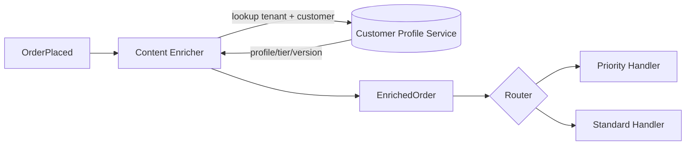
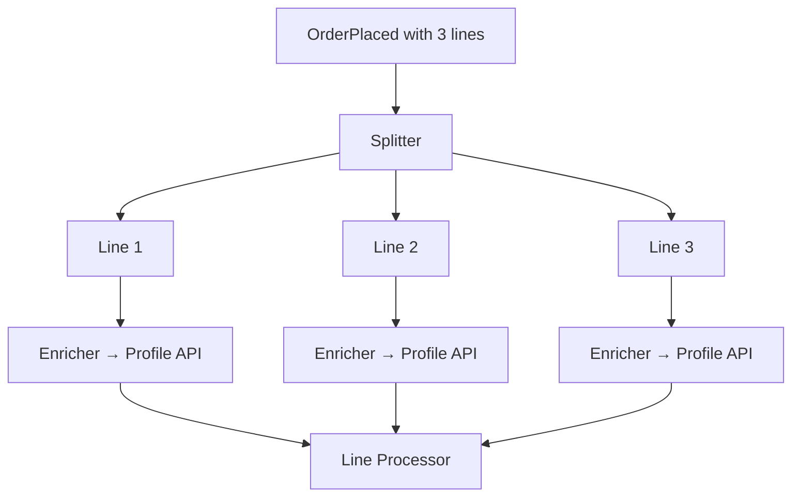
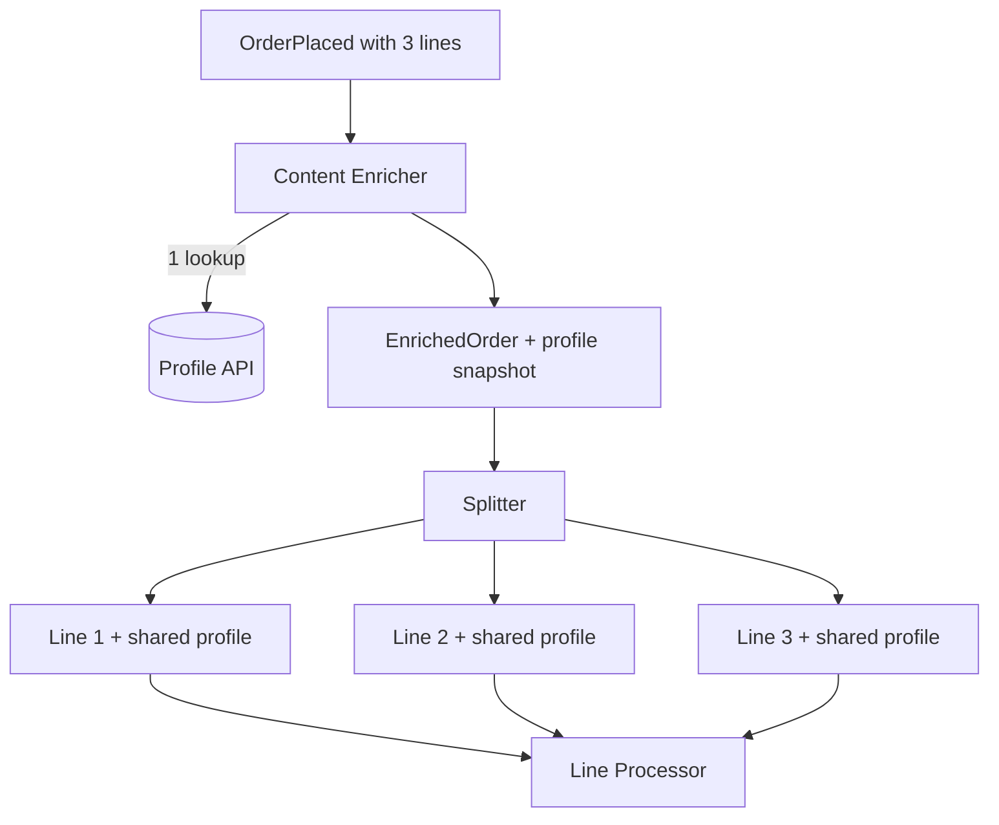
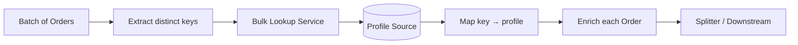
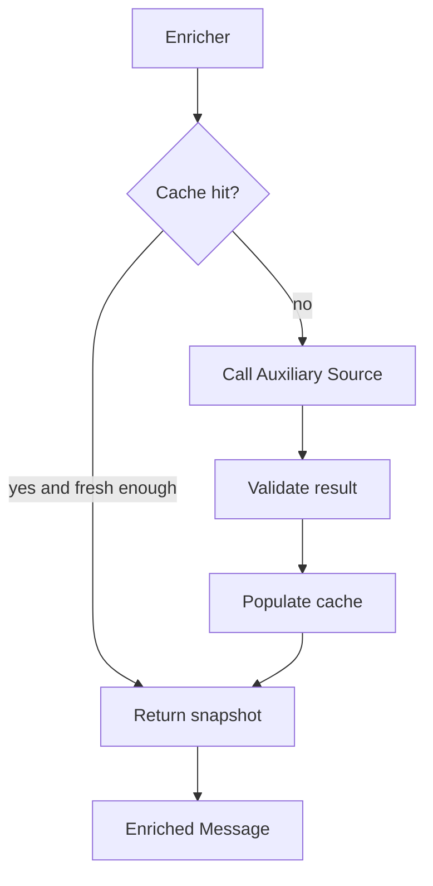
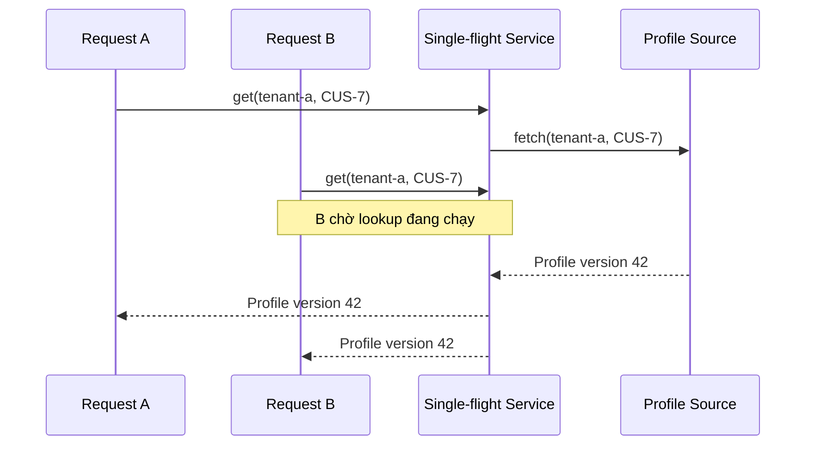
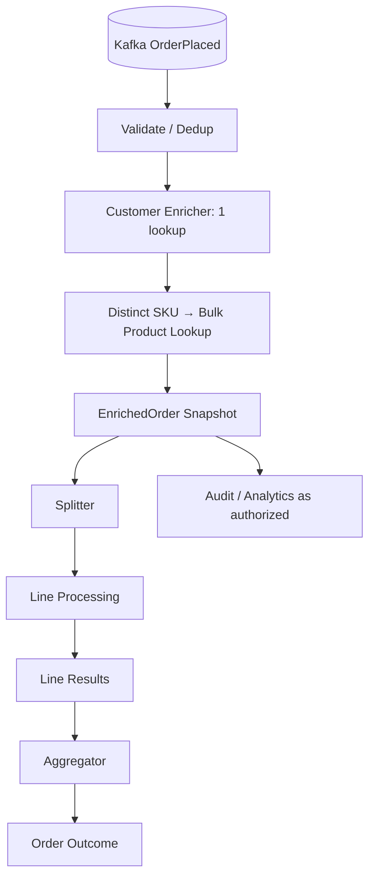

# Tránh gọi nguồn phụ nhiều lần

Trong Enterprise Integration Patterns (EIP), **Content Enricher** bổ sung dữ liệu còn thiếu cho một message bằng cách đọc từ **nguồn phụ** (*auxiliary data source*). Đơn hàng chỉ chứa mã khách hàng có thể cần thêm hạng thành viên, cấu hình giao hàng hoặc thông tin phân loại rủi ro trước khi Router và các handler downstream xử lý.

Enrichment thường là một bước rất hữu ích, nhưng cũng dễ biến thành điểm nghẽn: **một message có thể làm phát sinh nhiều lần gọi cùng một nguồn cho cùng một thông tin**. Nếu 20 dòng hàng cùng thuộc một đơn và mỗi dòng đều gọi dịch vụ hồ sơ khách hàng, hệ thống có thể thực hiện 20 request mà chỉ cần một. Nếu sự kiện sau đó được Publish-Subscribe đến ba subscriber và mỗi subscriber lại tự lookup, số request còn tăng. Khi nguồn phụ chậm, có quota hoặc gặp lỗi, các request dư thừa có thể gây timeout dây chuyền và làm khó điều tra.

Chủ đề của bài này là **“Tránh gọi nguồn phụ nhiều lần”**, thuộc chương **Content enricher** của module **SPRING_INTEGRATION_PATTERN**. Bài đặt vấn đề trong quá trình học triển khai Enterprise Integration Patterns với Spring Integration để xây dựng luồng thông điệp ít phụ thuộc, dễ mở rộng, kết hợp Router, Filter, Transformer, Splitter, Aggregator, Gateway, retry, error channel, correlation, kiểm thử và theo dõi từng nhánh.

**Mục tiêu:** Nhận biết tình huống lookup bị lặp, chọn đúng phạm vi tái sử dụng dữ liệu, đặt Content Enricher ở vị trí thích hợp, thiết kế cache/batch/single-flight không làm sai tính nhất quán và kiểm chứng số lần gọi nguồn bằng kiểm thử thay vì chỉ suy đoán.

## 1. Content Enricher bổ sung gì cho message?

Giả sử một dịch vụ phát sự kiện:

```json
{
  "eventId": "evt-101",
  "orderId": "ORD-101",
  "tenantId": "tenant-a",
  "customerId": "CUS-7",
  "lines": [
    {"sku": "SKU-1", "quantity": 2},
    {"sku": "SKU-2", "quantity": 1}
  ]
}
```

Để phục vụ xử lý đơn, ứng dụng cần biết khách thuộc hạng `GOLD` hay `STANDARD`. Thông tin này **không có trong message đầu vào** và được lấy từ dịch vụ hồ sơ khách hàng.



Message đầu ra có thể trở thành một payload mới:

```json
{
  "eventId": "evt-101",
  "orderId": "ORD-101",
  "customerId": "CUS-7",
  "customerTier": "GOLD",
  "profileVersion": 42,
  "lookupSource": "LIVE",
  "lines": [
    {"sku": "SKU-1", "quantity": 2},
    {"sku": "SKU-2", "quantity": 1}
  ]
}
```

Ví dụ này trình bày **hợp đồng payload đã enrich**, không phải định dạng JSON mà Spring Integration tự sinh. `lookupSource` là trường ứng dụng có thể dùng để phân biệt dữ liệu lấy trực tiếp từ nguồn hay cache. `profileVersion` giúp kiểm tra snapshot đã áp dụng khi chính sách thay đổi.

**Không nên nhầm Content Enricher với Transformer thuần:** Cả hai có thể tạo payload mới, nhưng Content Enricher đặc biệt nhấn mạnh việc **bổ sung thông tin từ một nguồn khác**. Nguồn phụ có thể là database, REST API, cache, dịch vụ cấu hình hay một bước request-reply nội bộ. Vì có I/O và trạng thái ngoài, Content Enricher cần quan tâm đến latency, timeout, freshness, số lần gọi, retry và dữ liệu không có sẵn.

## 2. Tại sao cùng một nguồn bị gọi nhiều lần?

Có nhiều cách khiến một lookup hợp lệ bị lặp lại ngoài ý muốn:

| Nguyên nhân | Ví dụ | Hậu quả |
| --- | --- | --- |
| Enricher đặt **sau Splitter** | Mỗi line item hỏi cùng profile khách hàng | N request cho N dòng |
| Enricher đặt trong **mỗi subscriber** | Audit, shipping, analytics cùng gọi profile | Nhân số lần theo số subscriber |
| Cùng key trong một batch | 100 đơn của cùng khách được enrich độc lập | N lookup cho một giá trị có thể tái sử dụng |
| Retry bao quanh cả flow | Handler lỗi làm chạy lại Enricher | Nhiều lookup dù lookup lần đầu thành công |
| Nhiều thread cùng miss cache | 20 request tới cùng customer ID cùng lúc | Cache stampede/thundering herd |
| Nhiều instance không chia sẻ cache | Mỗi node đều gọi nguồn | Tăng tải theo số instance |
| TTL quá ngắn hoặc cache bị vô hiệu hóa liên tục | Dữ liệu ít thay đổi vẫn fetch liên tục | Hiệu quả cache thấp |
| Không dùng batch API | 200 item → 200 HTTP calls | Tốn overhead network và quota |
| Nhiều enrichment step tương đương | Hai Transformer cùng hỏi customer tier | Khó kiểm soát và khó audit |
| Consumer redelivery | Message đã enrich nhưng được replay từ trước bước lookup | Gọi nguồn lần nữa và có thể nhận version khác |

### Ví dụ định lượng

Giả sử một đơn có **20 dòng**, mỗi dòng cần cùng hồ sơ khách và mỗi lookup mất **60 ms**:

- Enrich sau Splitter: về mặt logic tạo **20 lần gọi nguồn**. Nếu thực thi tuần tự, riêng thời gian chờ nguồn có thể lên tới khoảng 1.200 ms; nếu song song, latency có thể thấp hơn nhưng nguồn chịu 20 request.
- Enrich **trước Splitter**: thường chỉ cần **1 lần gọi nguồn** cho hồ sơ của đơn, rồi dùng lại snapshot khi xử lý 20 dòng.
- Nếu cả ba subscriber đều tự tra cứu dữ liệu giống nhau, số lần gọi có thể tiếp tục tăng, trừ khi dữ liệu đã được enrich đúng chỗ hoặc có cơ chế tái sử dụng.

Các con số chỉ minh họa. Lợi ích thực tế phụ thuộc network, concurrency, data locality, cache hit, tải của nguồn và business semantics. **Ít request hơn không tự đồng nghĩa đúng hơn** nếu mỗi nhánh cần dữ liệu mới tại một thời điểm khác.

## 3. Xác định phạm vi tránh gọi lặp trước khi dùng cache

Không phải mọi lần gọi giống nhau đều nên dùng chung kết quả. Cần xác định rõ **khi nào hai lookup thực sự tương đương**.

| Phạm vi | Có thể dùng chung trong | Thích hợp khi |
| --- | --- | --- |
| **Một lần xử lý message** | Các bước xử lý cùng một message | Nhiều handler cần cùng snapshot dữ liệu |
| **Một batch/correlation group** | Nhiều item thuộc một batch | Các item cùng tham chiếu một cấu hình hoặc khách hàng |
| **Một request/command** | Một yêu cầu đi qua nhiều step | Cần nhất quán trong suốt một giao dịch |
| **Một key trong thời gian TTL** | Nhiều event khác nhau của cùng customer | Dữ liệu thay đổi chậm và cho phép stale ngắn |
| **Những call đang chạy đồng thời** | Các thread đang lookup cùng key | Chống cache stampede dù chưa có cache dài hạn |
| **Giữa các lần retry/replay** | Cùng business event đã có enrichment snapshot | Cần quyết định ổn định, idempotency và audit |
| **Giữa nhiều instance** | Các node khác nhau cùng dùng một nguồn | Có shared cache hoặc kho snapshot bền vững hợp lệ |

Một nguyên tắc quan trọng: **tái sử dụng theo *đúng key* và *đúng thời điểm hiệu lực***.

Ví dụ lookup customer tier phải phân biệt ít nhất `tenantId` và `customerId`. Chỉ cache theo `customerId` có thể làm rò rỉ hồ sơ giữa các tenant nếu ID trùng nhau. Nếu hồ sơ có quyền truy cập phụ thuộc vào actor, quyền truy cập phải được kiểm tra đúng **trước khi trả dữ liệu từ cache**, không được coi “cache hit” là đã được ủy quyền.

### Khi nào không nên tái sử dụng?

Không nên vô điều kiện cache:

- Số dư tài khoản dùng để quyết định một lệnh chuyển tiền tại thời điểm hiện tại.
- Quyền truy cập hoặc trạng thái phong tỏa vừa bị thu hồi.
- Giá trị chống gian lận đòi hỏi dữ liệu mới trên từng giao dịch.
- Kết quả có ý nghĩa **riêng cho từng event**, như một reservation/transaction token.
- Response được cá nhân hóa theo quyền hoặc ngữ cảnh mà cache key không thể hiện.

Trong những trường hợp này, hãy ưu tiên giảm số lần gọi bằng **đặt bước đúng vị trí, batch có kiểm soát hoặc snapshot per-message**, thay vì dùng TTL cache dài hạn.

## 4. Đặt Content Enricher trước nơi nhân bản message

Quy tắc thiết kế hữu ích nhất thường không cần cache: **enrich một lần khi dữ liệu còn chung, trước khi Splitter hoặc fan-out**.

### 4.1. Thiết kế dễ gọi lặp



Cả ba dòng thuộc cùng `customerId` nhưng đều phải gọi profile service. Nếu hệ thống có hàng nghìn đơn, nguồn phụ có thể chịu tải lớn hơn nhiều so với số event đầu vào.

### 4.2. Thiết kế enrich một lần rồi mới Splitter



Khi đó, mỗi line item có thể tham chiếu một **profile snapshot bất biến** đã được làm giàu. Điều kiện để cách này đúng:

1. Mọi item **thực sự dùng chung một khóa lookup**.
2. Cùng snapshot phù hợp với yêu cầu freshness của các item.
3. Payload được dùng chung **không bị các nhánh khác sửa tại chỗ**.
4. Dữ liệu enrichment không vượt giới hạn bảo mật khi được phân phối tới các nhánh.
5. Nếu batch có nhiều khách, phải group theo key hoặc dùng batch lookup thay vì cố chọn một profile cho tất cả.

**Không đưa toàn bộ thông tin cá nhân của khách hàng vào mọi message con nếu chúng không cần.** Có thể phân phối một subset tối thiểu như tier, profile version hoặc reference ID an toàn.

### 4.3. Khi nào vẫn phải enrich sau Splitter?

Nếu mỗi item có `productId` khác nhau và cần giá/thuế riêng cho từng sản phẩm, không thể dùng một giá trị chung cho tất cả. Dù vậy, vẫn có thể:

- Tra cứu nhiều product ID bằng **batch API** trước Splitter.
- Group theo `productId` để mỗi key chỉ lookup một lần.
- Tách bước enrich chung cấp order khỏi bước enrich riêng cấp line.
- Cấp cho mỗi nhánh đúng phần dữ liệu nó cần.

**Tối ưu đúng nghĩa là bỏ request *dư thừa***, không phải xóa request cần thiết.

## 5. Mẫu Java: enrich một đơn một lần

Ta xây một contract dùng Java 17+, với payload bất biến và khách hàng được nhận diện trong phạm vi tenant.

### 5.1. DTO và profile snapshot

```java
import java.time.Instant;
import java.util.List;

record OrderLine(String sku, int quantity) {}

record OrderPlaced(
    String eventId,
    String orderId,
    String tenantId,
    String customerId,
    List<OrderLine> lines
) {
    OrderPlaced {
        lines = List.copyOf(lines);
    }
}

record CustomerProfile(
    String tenantId,
    String customerId,
    String tier,
    long version,
    Instant fetchedAt
) {}

record EnrichedOrder(
    OrderPlaced order,
    CustomerProfile profile,
    String enrichmentSource
) {}
```

`eventId` là định danh sự kiện ổn định phục vụ idempotency; `orderId` là business key; `tenantId + customerId` là khóa lookup. `version` và `fetchedAt` dùng giải thích snapshot được áp dụng.

Record bất biến không bảo đảm toàn bộ object graph là bất biến nếu chứa các object mutable ở bên trong. Ở đây `OrderLine` và `CustomerProfile` là record chứa các trường đơn giản; `List.copyOf` ngăn thay đổi danh sách qua reference của caller.

### 5.2. Client của nguồn phụ và service enrichment

```java
import java.util.Objects;

interface CustomerProfileClient {
    CustomerProfile fetch(String tenantId, String customerId);
}

final class OrderContentEnricher {
    private final CustomerProfileClient profiles;

    OrderContentEnricher(CustomerProfileClient profiles) {
        this.profiles = Objects.requireNonNull(profiles);
    }

    EnrichedOrder enrich(OrderPlaced order) {
        if (order == null
                || isBlank(order.eventId())
                || isBlank(order.orderId())
                || isBlank(order.tenantId())
                || isBlank(order.customerId())) {
            throw new IllegalArgumentException("Invalid order event");
        }

        // Chính xác một lần gọi fetch ở cấp xử lý một OrderPlaced.
        CustomerProfile profile =
            profiles.fetch(order.tenantId(), order.customerId());

        if (profile == null
                || !order.tenantId().equals(profile.tenantId())
                || !order.customerId().equals(profile.customerId())) {
            throw new IllegalStateException(
                "Profile not found or identity mismatch");
        }

        return new EnrichedOrder(order, profile, "LIVE");
    }

    private static boolean isBlank(String value) {
        return value == null || value.isBlank();
    }
}
```

Service này gọi nguồn phụ **đúng một lần trong một lần thực thi phương thức `enrich`**. Nó không gọi một lần *cho mỗi line item*. Tuy nhiên, nếu cùng event bị xử lý lại, `enrich` sẽ được gọi lại và phát sinh lookup mới, trừ khi có cơ chế reuse snapshot/cache khác. Đừng tuyên bố service trên đã loại bỏ mọi lookup trùng giữa retry hoặc nhiều message.

### 5.3. Kiểm tra kết quả lookup

Nhánh enrichment không nên chấp nhận một profile khác tenant/customer chỉ vì dịch vụ phụ trả HTTP 200. Nếu lookup dựa trên ID từ nguồn chưa xác thực, phải kiểm soát cả quyền và nguồn gốc key.

Ở ví dụ trên, mismatch gây exception thay vì tự dùng profile không đúng. Với nghiệp vụ cho phép hồ sơ thiếu, hệ thống có thể tạo **trạng thái review** hoặc dùng fallback đã duyệt; nhưng không nên tự gán tier `STANDARD` nếu mặc định này sẽ bỏ qua một bước kiểm tra bắt buộc.

## 6. Spring Integration Java DSL: enrich trước khi fan-out

Ta có thể hiện thực Content Enricher pattern bằng một service biến `OrderPlaced` thành `EnrichedOrder` trong luồng Spring Integration. Ở đây dùng `transform` để tập trung vào logic và kiểm soát số lần gọi nguồn; đây là **cách hiện thực pattern bằng một endpoint biến đổi có lookup**, không phải khẳng định chỉ có một API Content Enricher trong Spring Integration. Framework cũng hỗ trợ các cơ chế request/reply enrichment chuyên biệt tùy kiểu dữ liệu và phiên bản.

### 6.1. Gateway, channel và một điểm enrichment

```java
import org.springframework.context.annotation.Bean;
import org.springframework.context.annotation.Configuration;
import org.springframework.integration.annotation.Gateway;
import org.springframework.integration.annotation.IntegrationComponentScan;
import org.springframework.integration.annotation.MessagingGateway;
import org.springframework.integration.channel.DirectChannel;
import org.springframework.integration.channel.PublishSubscribeChannel;
import org.springframework.integration.config.EnableIntegration;
import org.springframework.integration.dsl.IntegrationFlow;
import org.springframework.messaging.MessageChannel;

interface OrderAuditService {
    void record(EnrichedOrder order);
}

interface OrderRoutingService {
    void dispatch(EnrichedOrder order);
}

@MessagingGateway
interface OrderEventGateway {
    @Gateway(requestChannel = "orders.in")
    void publish(OrderPlaced order);
}

@Configuration
@EnableIntegration
@IntegrationComponentScan
class OrderEnrichmentConfiguration {

    @Bean
    OrderContentEnricher orderContentEnricher(
            CustomerProfileClient profiles) {
        return new OrderContentEnricher(profiles);
    }

    @Bean("orders.in")
    MessageChannel orderInput() {
        return new DirectChannel();
    }

    @Bean("orders.enriched")
    PublishSubscribeChannel enrichedOrders() {
        return new PublishSubscribeChannel();
    }

    @Bean
    IntegrationFlow enrichOrderOnce(OrderContentEnricher enricher) {
        return IntegrationFlow.from("orders.in")
            .transform(OrderPlaced.class, enricher::enrich)
            .channel("orders.enriched")
            .get();
    }

    @Bean
    IntegrationFlow auditEnrichedOrders(OrderAuditService audit) {
        return IntegrationFlow.from("orders.enriched")
            .handle(EnrichedOrder.class, (order, headers) -> {
                audit.record(order);
                return null;
            })
            .get();
    }

    @Bean
    IntegrationFlow dispatchEnrichedOrders(OrderRoutingService routing) {
        return IntegrationFlow.from("orders.enriched")
            .handle(EnrichedOrder.class, (order, headers) -> {
                routing.dispatch(order);
                return null;
            })
            .get();
    }
}
```

Ứng dụng cần các dependency Spring Integration tương ứng, bean `CustomerProfileClient`, `OrderAuditService`, `OrderRoutingService` và gateway được đăng ký bằng `@IntegrationComponentScan` hoặc cấu hình tương đương.

Luồng hoạt động:

1. Gateway phát `OrderPlaced` vào `orders.in`.
2. `OrderContentEnricher.enrich` gọi profile source **một lần** cho lần xử lý event này.
3. Transformer trả `EnrichedOrder` cùng profile snapshot.
4. `orders.enriched` fan-out tới audit và routing.
5. Hai nhánh dùng **cùng dữ liệu enrichment**, không cần tự tra cứu lại customer profile.

Với `PublishSubscribeChannel` không cấu hình executor, nhánh xử lý thường chạy đồng bộ trong quá trình gửi; **bảo đảm toàn bộ subscriber thành công, thứ tự và xử lý lỗi** còn phụ thuộc cấu hình, không tự xuất hiện vì đã enrich một lần.

### 6.2. Đặt enrich sau fan-out sẽ thay đổi số lần gọi

Nếu thay `enrichOrderOnce` bằng hai flow mà **mỗi subscriber đều gọi `enricher.enrich`**, một sự kiện có thể làm phát sinh hai lookup. Khi có thêm subscriber, số lookup tăng theo số nhánh.

Đặt enrichment **trước fan-out** phù hợp khi cả audit và routing có quyền sử dụng cùng snapshot. Nếu audit chỉ cần event ID còn routing cần tier, có thể cho audit nhận event gốc và chỉ enrich nhánh routing; mục tiêu là không gọi nguồn **thừa**, không bắt mọi nhánh nhận dữ liệu không cần thiết.

### 6.3. Vị trí của Filter và Router

Một Filter có thể chặn message không hợp lệ **trước enrichment** để tránh gọi nguồn cho dữ liệu chắc chắn phải từ chối. Ví dụ event thiếu `customerId` nên bị reject trước khi gọi profile service.

Nhưng nếu Filter cần `customerTier` để quyết định, Filter ấy phải chạy **sau enrichment**. Hãy tách:

```text
Input -> Cheap validation/filter -> Content Enricher
      -> Tier-based Router -> Relevant handlers
```

Đó là cách giảm load mà vẫn giữ đúng dependency giữa các bước. Không bỏ qua bước kiểm tra cần dữ liệu nguồn phụ chỉ để “tiết kiệm request”.

## 7. Tái sử dụng snapshot trong cùng một request hoặc batch

Không phải mọi flow đều cho phép đặt Enricher trước Splitter. Một batch có thể gồm 50 đơn của 7 khách, nên muốn lookup theo từng khách **một lần trong batch**.

Một chiến lược là tạo bản đồ theo key:

```text
Batch:
  order-1 tenant-a/customer-7
  order-2 tenant-a/customer-7
  order-3 tenant-a/customer-8

Unique keys:
  (tenant-a, customer-7)
  (tenant-a, customer-8)

Lookups:
  2 thay vì 3
```

Sau đó tạo các enriched message theo đúng key. Với batch lớn, cần giới hạn số unique keys, số request đồng thời, kích thước dữ liệu và error handling từng phần.

### 7.1. Request-scoped memoization

Nếu cùng một quy trình gọi enrichment nhiều lần, có thể dùng một **context theo request/correlation scope**:

```java
import java.util.HashMap;
import java.util.Map;

record ProfileKey(String tenantId, String customerId) {}

final class BatchEnrichmentContext {
    private final Map<ProfileKey, CustomerProfile> profiles =
        new HashMap<>();

    CustomerProfile getOrFetch(
            ProfileKey key,
            CustomerProfileClient client) {
        return profiles.computeIfAbsent(
            key,
            k -> client.fetch(k.tenantId(), k.customerId()));
    }
}
```

Ở ví dụ này, `BatchEnrichmentContext` chỉ nên thuộc về **một batch/request chạy tuần tự hoặc có synchronization phù hợp**. `HashMap` **không thread-safe**: nếu Splitter chạy song song, việc dùng chung object này có thể gây race condition. Không nên đặt một `BatchEnrichmentContext` mutable làm singleton bean rồi chia sẻ cho mọi tenant và mọi message.

Cần xác định **vòng đời context**. Trong xử lý phân tán qua Kafka hoặc nhiều instance, object ở RAM không tự đi theo event. Nếu cần chia sẻ qua restart, phải dùng một snapshot persist/durable reference hoặc cache phân tán có kiểm soát.

### 7.2. Enrichment per-correlation group

Nếu Splitter tạo các phần cùng correlation ID, có thể dùng `correlationId` để liên kết chúng; nhưng correlation ID **không tự là khóa lookup**. Hai item cùng correlation có thể cần hai product profile khác nhau. Hãy xây key từ những thuộc tính thực sự quyết định response, ví dụ `tenantId + productId + locale + priceListVersion`.

**Đừng cache theo correlation ID nếu dữ liệu phụ thuộc thêm vào các trường khác.** Việc dùng key quá thô có thể giảm request nhưng trả sai dữ liệu.

## 8. Batch lookup: giảm network round-trip cho nhiều key

Nếu nguồn phụ hỗ trợ API dạng:

```text
fetchProfiles(tenantId, customerIds)
```

thay vì `fetchProfile(tenantId, customerId)`, một batch 100 item với 20 customer ID khác nhau có thể dùng **một hoặc vài** request, tùy giới hạn API.



Các điểm cần kiểm soát:

- **Không ghép nhầm tenant:** bulk API phải chia nhóm theo tenant/permission scope.
- **Thiếu dữ liệu:** response có thể thiếu một số ID; không tự gán profile của item khác.
- **Partial error:** một số key có thể lỗi, cần quyết định retry chỉ những key lỗi hay giữ cả batch.
- **Giới hạn số ID:** chunk theo kích thước request, giới hạn payload và quota.
- **Độ mới:** các profile trong cùng bulk response có thể có version/fetchedAt khác nhau.
- **Backpressure:** không gửi batch khổng lồ làm quá tải nguồn.
- **Idempotency:** nếu nguồn phụ chỉ là read, retry ít rủi ro side effect hơn; nếu API thực hiện cấp reservation/token, không được coi đó là lookup thuần.

### Pseudocode cho batch enrichment

```text
group orders by tenant and required authorization scope

for each group:
    keys = distinct customerIds
    for each bounded chunk:
        response = fetchProfiles(tenant, chunk)
        verify each returned profile belongs to requested tenant/customer

for each order:
    profile = responseMap[(tenantId, customerId)]
    if missing:
        mark enrichment missing / review / fail by policy
    else:
        emit EnrichedOrder(order, profile, source=BULK)
```

Mô hình này tối ưu **số round-trip**, nhưng bản thân bulk source vẫn có thể thực hiện nhiều query nội bộ. Do đó nên đo cả request gửi tới nguồn và thời gian xử lý của nguồn.

## 9. Cache theo key và TTL: giảm lookup giữa các message

Cache phù hợp khi cùng một dữ liệu được yêu cầu nhiều lần **trong một khoảng thời gian** và nghiệp vụ cho phép một độ cũ nhất định.

Ví dụ cache key:

```text
ProfileKey(
  tenantId,
  customerId,
  scopeOrRoleIfResponseVaries,
  profileContractVersion,
  localeIfResponseVaries
)
```

Không nhất thiết phải đưa mọi field vào key. Cần đưa **đúng những đầu vào ảnh hưởng tới nội dung response** và kiểm tra quyền truy cập độc lập ở nơi cần. Một cache key thiếu tenant là lỗi nghiêm trọng; một key chứa request ID không cần thiết sẽ làm giảm cache hit rate.

### 9.1. Ví dụ cache cục bộ có TTL

Có thể sử dụng thư viện cache như Caffeine (cần thêm dependency tương ứng):

```java
import com.github.benmanes.caffeine.cache.Cache;
import com.github.benmanes.caffeine.cache.Caffeine;
import java.time.Duration;

final class CachedCustomerProfiles implements CustomerProfileClient {
    private final CustomerProfileClient source;
    private final Cache<ProfileKey, CustomerProfile> cache =
        Caffeine.newBuilder()
            .maximumSize(10_000)
            .expireAfterWrite(Duration.ofSeconds(90))
            .build();

    CachedCustomerProfiles(CustomerProfileClient source) {
        this.source = source;
    }

    @Override
    public CustomerProfile fetch(String tenantId, String customerId) {
        ProfileKey key = new ProfileKey(tenantId, customerId);

        return cache.get(key, k ->
            source.fetch(k.tenantId(), k.customerId()));
    }

    void invalidate(String tenantId, String customerId) {
        cache.invalidate(new ProfileKey(tenantId, customerId));
    }
}
```

Ví dụ có **TTL 90 giây và giới hạn 10.000 entry**, nhưng con số này **không phải khuyến nghị chung**. Chúng cần được chọn theo thay đổi dữ liệu, memory budget, tần suất truy cập, yêu cầu bảo mật và SLA.

Quan trọng:

1. **Cache cục bộ chỉ áp dụng trong một JVM**; nhiều instance có các cache khác nhau.
2. `Cache.get` tính giá trị theo key và có cơ chế phối hợp compute để tránh nhiều load đồng thời trong cùng cache instance trong điều kiện của thư viện, nhưng không thể gộp request giữa các node.
3. Khi profile bị cập nhật, TTL không tự invalidate ngay. Nếu dữ liệu quan trọng, cần event invalidation, versioning hoặc query mới theo policy.
4. Nếu source trả `null`, cần có chính sách riêng cho “not found”; đừng nhầm giá trị thiếu với cache hit hợp lệ.
5. **Cache không được bypass authorization**. Nếu quyền xem profile phụ thuộc actor, quyền phải được kiểm tra và key/scope được thiết kế phù hợp trước khi trả cache hit.
6. Không lưu secret hoặc PII nhạy cảm quá mức vào một cache không có kiểm soát bảo mật và vòng đời.

### 9.2. Cache-aside, refresh và invalidation

Một thiết kế phổ biến là **cache-aside**:



Cần xác định rõ:

- TTL tính từ khi ghi hay từ lần truy cập gần nhất?
- Có refresh trước khi hết hạn không?
- Nếu nguồn phụ lỗi khi cache đã hết TTL, có được dùng stale value không?
- Nếu một tenant đổi quyền hoặc profile bị thu hồi, sự kiện nào invalidate?
- Có cần phân biệt cache từ version cũ và mới?
- Cache đầy thì eviction thế nào, nguồn có chịu được miss storm sau eviction không?

**Không gọi một response “đã enrich thành công” chỉ vì lấy được bất kỳ giá trị nào trong cache.** Kết quả còn phải đạt yêu cầu freshness, quyền và schema tại thời điểm sử dụng.

## 10. Single-flight: gộp các lookup đồng thời cùng key

Cache TTL giải quyết nhiều lượt truy cập theo thời gian. Nhưng khi cache đang rỗng, nhiều request **đồng thời** cùng key có thể khiến nguồn bị đánh ồ ạt (*cache stampede*).

**Single-flight** là cơ chế một thread thực hiện lookup cho một key, các caller đang chờ **chia sẻ kết quả của lookup đang chạy**, không nhất thiết lưu kết quả dài hạn.



### 10.1. Minh họa Java với CompletableFuture

```java
import java.util.concurrent.CompletableFuture;
import java.util.concurrent.CompletionException;
import java.util.concurrent.ConcurrentHashMap;

final class SingleFlightProfiles implements CustomerProfileClient {
    private final CustomerProfileClient source;

    private final ConcurrentHashMap<
        ProfileKey, CompletableFuture<CustomerProfile>> inFlight =
            new ConcurrentHashMap<>();

    SingleFlightProfiles(CustomerProfileClient source) {
        this.source = source;
    }

    @Override
    public CustomerProfile fetch(String tenantId, String customerId) {
        ProfileKey key = new ProfileKey(tenantId, customerId);
        CompletableFuture<CustomerProfile> mine =
            new CompletableFuture<>();

        CompletableFuture<CustomerProfile> existing =
            inFlight.putIfAbsent(key, mine);

        if (existing != null) {
            // Chia sẻ kết quả của lookup đang chạy.
            return existing.join();
        }

        try {
            CustomerProfile value =
                source.fetch(tenantId, customerId);
            mine.complete(value);
            return value;
        } catch (RuntimeException ex) {
            mine.completeExceptionally(ex);
            throw ex;
        } finally {
            inFlight.remove(key, mine);
        }
    }
}
```

Code minh họa **không phải một cache TTL**: ngay sau khi lookup kết thúc, entry `inFlight` được xóa. Các request đến sau đó có thể gọi lại nguồn. Code cũng chưa có timeout/deadline, cancellation propagation, giới hạn số key đồng thời, chống nguồn treo vô hạn, instrumentation hay xử lý lỗi không phải `RuntimeException`. Những yêu cầu đó cần được bổ sung trước khi dùng trong production.

**Không nên chạy nguồn I/O bên trong `ConcurrentHashMap.computeIfAbsent` với lambda có side effect phức tạp** khi chưa hiểu ngữ nghĩa concurrency và blocking. Ví dụ sử dụng `putIfAbsent` để tách rõ ownership của một lookup đang chạy.

### 10.2. Single-flight không thay thế cache hoặc durability

- Single-flight **gộp request đang chồng lấn** trong một instance.
- TTL cache **tái sử dụng kết quả** giữa các request khác thời điểm.
- Durable snapshot **giữ kết quả/phiên bản** qua restart hoặc replay nếu yêu cầu.
- Distributed cache/lock có thể phối hợp nhiều node, nhưng phức tạp về consistency, ownership, failure và timeout.

Chọn cơ chế theo nhu cầu thực. Đừng thêm distributed lock chỉ để giảm vài lookup rẻ và hiếm; nhưng cũng đừng dùng singleton in-memory map để hứa “mỗi customer chỉ lookup một lần trên toàn cluster”.

## 11. Dữ liệu có độ mới: cache hit không phải lúc nào cũng đúng

Điểm đánh đổi lớn nhất của việc tránh gọi lặp là **freshness**.

Giả sử hồ sơ khách hàng có `tier=GOLD` tại 10:00, rồi chuyển sang `STANDARD` tại 10:01. Nếu đơn đặt lúc 10:02 dùng snapshot GOLD từ cache với TTL 5 phút, Router có thể ưu tiên xử lý dựa trên một quyền lợi không còn hiệu lực.

Cần xác định một trong những hợp đồng:

| Chính sách freshness | Khi nào hợp lý | Lưu ý |
| --- | --- | --- |
| **Strong/latest-at-decision** | Quyền/thu tiền/chống gian lận yêu cầu dữ liệu mới nhất theo cơ chế đảm bảo | Có thể tốn latency; “latest” cần ngữ nghĩa nhất quán của source |
| **Bounded staleness** | Tier/thuộc tính ít thay đổi, cho phép cũ tối đa N giây | Phải đo tuổi snapshot và có giới hạn |
| **Snapshot-at-event-time** | Replay/đối soát cần giữ đúng dữ liệu thời điểm quyết định ban đầu | Cần lưu snapshot/version; không suy ra từ cache hiện tại |
| **Eventual consistency** | Analytics, gợi ý, dashboard có thể cập nhật muộn | Cần xử lý bản ghi cập nhật và out-of-order |
| **Fail closed** | Không có profile tin cậy nên không thể tiếp tục an toàn | Hold/review/reject thay vì đoán tier |

**Đừng trộn hai yêu cầu “dùng dữ liệu mới nhất” và “retry cho cùng kết quả” một cách mơ hồ.** Nếu retry từ trước Enricher, lookup có thể trả version mới; nếu giữ snapshot cũ, có thể không còn phù hợp khi chính sách an toàn thay đổi. Cần quy tắc quyết định cái nào ưu tiên.

### 11.1. Lưu snapshot theo quyết định khi cần replay ổn định

Với một lệnh đã chốt dựa trên `profileVersion=42`, record xử lý có thể lưu:

```json
{
  "eventId": "evt-101",
  "orderId": "ORD-101",
  "profileVersion": 42,
  "enrichmentSource": "LIVE",
  "enrichmentDecisionTime": "2026-11-21T04:00:00Z",
  "routingDecision": "PRIORITY",
  "status": "PENDING_DISPATCH"
}
```

Đây là **mô hình nghiệp vụ gợi ý**, không phải record Spring Integration mặc định. Khi cần tính chính xác lịch sử, có thể lưu một snapshot tối thiểu hoặc reference tới version có thể tra cứu lại; chỉ lưu số version mà nguồn không hỗ trợ historical lookup thì chưa đủ để tái dựng dữ liệu.

**Chú ý bảo mật:** Snapshot chứa PII hoặc dữ liệu nhạy cảm phải có retention, phân quyền, encryption và data minimization phù hợp. Không lưu trữ dư thừa chỉ vì thuận tiện cho cache.

## 12. Retry và timeout: không để một lỗi biến thành cơn bão lookup

Khi source phụ chậm, nhiều Enricher cùng retry có thể làm sự cố nặng hơn.

Ví dụ:

```text
100 messages đồng thời
  -> mỗi message timeout 2 giây
  -> retry 3 lần ngay lập tức
  -> 300 calls đến source đang quá tải
```

Nếu có 5 instance ứng dụng, tình hình còn phức tạp hơn. Do đó:

- Đặt **timeout/deadline** phù hợp với toàn bộ flow, không chỉ timeout mỗi HTTP call.
- Dùng **retry có giới hạn**, exponential backoff và jitter nếu hợp đồng cho phép.
- Dùng **circuit breaker** để giảm số call khi nguồn đang lỗi hàng loạt.
- Dùng **bulkhead/concurrency limit** bảo vệ số kết nối tới nguồn.
- Dùng **single-flight** cho các key hot trong cùng instance.
- Đặt **backpressure** khi nguồn bị giới hạn quota, thay vì đẩy vô hạn vào executor.
- Ghi rõ **fallback**: cache stale trong giới hạn nào, review, reject hay chờ để xử lý sau.

### 12.1. Retry ở đâu cũng quan trọng

Giả sử flow:

```text
Gateway -> Enricher -> Router -> Payment Handler
```

Nếu retry bao quanh **toàn bộ flow**, một lỗi từ Payment Handler có thể khiến Enricher chạy lại dù enrichment đã thành công. Đây là một loại duplicate lookup dễ bỏ sót.

Giải pháp tùy ngữ nghĩa:

- Đặt retry **chỉ quanh lookup** nếu nguồn profile lỗi, tránh retry cả flow khi không cần.
- Sau enrichment thành công, tạo `EnrichedOrder` và retry **chặng downstream** mà không gọi lại nguồn.
- Nếu xử lý kéo dài hoặc qua broker, lưu `EnrichedOrder`/snapshot hoặc outbox công việc theo mức bảo đảm cần thiết.
- Với quyết định phải dùng policy mới vì an toàn, hãy **rerun có chủ đích** và ghi nhận version mới, không âm thầm coi đó là retry tương đương.

### 12.2. Không mọi thất bại đều cần gọi lại

| Kết quả nguồn phụ | Có nên retry ngay? | Hướng xử lý |
| --- | --- | --- |
| `200` với profile hợp lệ | Không | Dùng snapshot theo contract |
| `404` khách không tồn tại | Thường không, nếu xác định là dữ liệu nghiệp vụ không hợp lệ | Reject/review; negative cache rất ngắn nếu thực sự phù hợp |
| `429` quota/throttle | Theo Retry-After/chính sách được phép | Backoff, giới hạn concurrency |
| `5xx` tạm thời | Có thể, với số lần/timeout giới hạn | Retry rồi hold/error path |
| Timeout chưa có response | Có thể retry nếu lookup thực sự chỉ đọc và an toàn | Không coi mọi API “lookup” là side-effect-free |
| Response sai tenant hoặc schema | Không tự dùng cache cũ để che lỗi | Fail closed, cảnh báo hợp đồng |
| TTL cache expired | Tùy độ mới và chính sách stale | Refresh hoặc hold |

**Read-only lookup** thường có rủi ro side effect thấp hơn lệnh ghi, nhưng một API được gọi là “lookup” có thể ghi nhận giao dịch, cấp token hoặc reserve resource. Phải hiểu semantics thực tế trước khi quyết định retry.

## 13. Fallback khi nguồn phụ không sẵn sàng

Nhiều ứng dụng có xu hướng điền giá trị mặc định để tiếp tục nhanh:

```text
profile lookup failed -> tier = STANDARD -> continue
```

Đây chỉ là giải pháp an toàn nếu **nghiệp vụ cho phép áp dụng tier STANDARD khi không biết giá trị thật**. Nếu profile dùng để kiểm soát hạn mức hoặc quyền ưu tiên, một giá trị mặc định có thể khiến quyết định sai.

Một fallback policy có thể là:

| Tình huống | Fallback có thể hợp lệ | Điều kiện |
| --- | --- | --- |
| Profile cache còn trong TTL | Dùng cache | Quyền và contract còn hiệu lực |
| Cache vừa hết TTL nhưng source bị lỗi | Dùng stale trong cửa sổ cho phép | Business chấp nhận bounded staleness; ghi reason |
| Không có snapshot hợp lệ | Giữ message ở review/hold | Có nơi lưu bền, chủ sở hữu và SLA |
| Lookup thất bại do unauthorized | Reject | Không retry như lỗi mạng |
| Không có customer profile vì dữ liệu thiếu | Reject/review | Không tự map sang khách khác |
| Lookup chỉ phục vụ analytics tùy chọn | Bỏ enrichment hoặc dùng field nullable | Downstream hiểu rõ dữ liệu thiếu |
| Risk/compliance bắt buộc | Fail closed | Không bỏ qua bước kiểm tra bắt buộc |

Nếu dùng cache stale, nên ghi `lookupSource=STALE_CACHE`, `fetchedAt`, `cacheAge` hoặc version phù hợp để điều tra. **Không báo “fresh” khi dùng stale snapshot**.

### Error channel khác nhánh fallback

Trong Spring Integration, error channel là nơi các thành phần bắt và công bố lỗi có thể gửi `ErrorMessage` theo cấu hình. **Chỉ có một bean tên `errorChannel` không khiến mọi exception tự xuất hiện ở đó**.

Với `DirectChannel`, exception từ Enricher thường có thể lan về caller. Với executor, poller hoặc inbound adapter, lỗi thường xuất hiện ở thread khác và phải được xử lý bởi error handler/retry advice/transport semantics phù hợp. Một nhánh `customer.lookup.review` chỉ có ý nghĩa khi application **chủ động** chuyển message đến đó khi đáp ứng policy.

Không nên nuốt exception rồi tạo `EnrichedOrder` với dữ liệu giả làm như mọi thứ thành công; downstream cần biết trạng thái enrichment thật.

## 14. Idempotency, correlation và metadata của enrichment

Một message có thể qua Gateway, Transformer, Splitter, Router và nhiều subscriber; việc tránh gọi lại nguồn nên đi cùng khả năng giải thích **dữ liệu nào đã được dùng**.

| Trường | Mục đích |
| --- | --- |
| `eventId` | Nhận diện sự kiện xuyên retry/redelivery |
| `orderId` | Business key để tra cứu |
| `tenantId` | Ngăn dùng nhầm dữ liệu giữa tenant |
| `customerId` | Khóa tra cứu profile |
| `profileVersion` | Phiên bản dữ liệu phụ đã sử dụng |
| `enrichmentSource` | LIVE, CACHE, BULK, STALE_CACHE hoặc REUSED |
| `fetchedAt` | Thời điểm snapshot nguồn được lấy |
| `enrichmentAttempt` | Số lần lookup có thực sự được thử |
| `correlationId` | Liên kết các message trong flow |
| `traceId` | Theo dõi chặng gọi nguồn khi instrumentation có bật |
| `policyVersion` | Quy tắc lựa chọn và freshness khi có policy động |

**Message ID của Spring không phải business event ID bất biến**. Transformer và adapter có thể tạo message mới. Nếu cần chống trùng, hãy dùng một ID ổn định từ hợp đồng nghiệp vụ và thiết kế idempotency tại các side effect downstream.

### Header hay payload?

- Những dữ liệu **thiết yếu để tái dựng quyết định** như business event ID, profile version hoặc tier cần có hợp đồng rõ ràng, có thể ở payload/envelope hoặc headers theo thiết kế.
- Metadata điều phối như correlation/tracing nên được truyền qua channel/adapter phù hợp.
- Đừng đặt cả **toàn bộ hồ sơ cá nhân** vào headers; chúng có thể bị log hoặc map sang hệ thống khác ngoài ý muốn.
- Khi qua HTTP/Kafka/JMS, kiểm tra header mapper và serializer; không mặc định mọi header được giữ nguyên qua transport.

Một **snapshot bất biến** được chuyển cùng payload có thể giúp downstream tránh lookup lặp trong cùng event. Nhưng snapshot đó chỉ nên chứa **dữ liệu tối thiểu mà recipient có quyền dùng**.

## 15. Quan sát có đang giảm số lần gọi nguồn thật không?

Nếu chỉ nhìn số message đã xử lý thành công, sẽ không biết Enricher đang gọi profile service dư thừa. Nên đo tách biệt:

1. **Số message cần enrich**.
2. **Số lần lookup nguồn thật sự**.
3. **Số cache hit/miss**.
4. **Số yêu cầu được gộp nhờ single-flight**.
5. **Số key distinct trong batch**.
6. **Latency lookup** và tổng latency flow.
7. **Số timeout, retry và fallback**.
8. **Tuổi snapshot** được dùng khi quyết định.

Ví dụ metric có tập nhãn nhỏ:

```text
enrichment_messages_total{type="customer-profile",result="success"}
enrichment_source_calls_total{source="profile-service",result="success"}
enrichment_cache_access_total{source="profile-service",result="hit"}
enrichment_cache_access_total{source="profile-service",result="miss"}
enrichment_coalesced_requests_total{source="profile-service"}
enrichment_fallback_total{reason="POLICY_ALLOWED_STALE"}
enrichment_lookup_duration_seconds{source="profile-service"}
```

Đây là **metric gợi ý**, không phải tên metric Spring Integration tự động sinh đầy đủ. Không đưa `customerId`, `orderId` hay `eventId` vào metric tag vì cardinality cao; để chúng trong log/trace/audit có bảo vệ.

### Kiểm tra hiệu quả theo tỷ số

Có thể theo dõi:

```text
source_call_ratio =
    số lần gọi nguồn phụ thực tế
    / số message cần enrichment

cache_hit_ratio =
    số lần đọc cache thành công
    / tổng số lần tra cứu cache

lookup_amplification =
    tổng số lần gọi nguồn
    / số unique lookup key đủ điều kiện tái sử dụng
```

Không mặc định `source_call_ratio < 1` luôn là tốt. Một message có thể cần nhiều key và nhiều nguồn. Hãy nhóm metric theo **loại enrichment và phạm vi hợp đồng** để so sánh có ý nghĩa.

### Structured log có ích

```json
{
  "event": "content_enrichment_completed",
  "businessEventId": "evt-101",
  "orderId": "ORD-101",
  "source": "profile-service",
  "lookupSource": "CACHE",
  "profileVersion": 42,
  "result": "SUCCESS",
  "durationMs": 4
}
```

Không log token, đầy đủ PII hoặc response từ profile service chỉ để chứng minh cache hoạt động. Nếu cần audit chuyên nghiệp về dữ liệu đã dùng, lưu metadata/snapshot được kiểm soát theo chính sách retention và phân quyền.

## 16. Kiểm thử số lần gọi nguồn, không chỉ payload đầu ra

Một test xác minh `EnrichedOrder.profile().tier() == GOLD` chưa chứng minh có đúng **một request nguồn**. Cần test cả **hành vi gọi**.

### 16.1. Ma trận kiểm thử

| Tình huống | Điều cần xác minh |
| --- | --- |
| Một order có 20 line | Profile source được gọi **một lần** trong lần enrich đó |
| Một event đi tới audit và routing | Hai subscriber nhận cùng snapshot, không tự gọi lại profile |
| Hai event khác nhau cùng customer | Không dùng chung nếu không có cache; dùng chung theo TTL nếu cache được bật |
| Hai tenant dùng cùng customer ID | Không trả profile chéo tenant |
| Nhiều request đồng thời cùng key | Single-flight/cache hạn chế load trùng trong một instance |
| Nhiều key khác nhau | Không gộp nhầm dữ liệu |
| TTL còn hiệu lực | Cache hit, không gọi nguồn |
| TTL hết hạn | Lookup lại hoặc fallback theo policy |
| Profile bị invalidate | Lần sau không dùng snapshot lỗi thời |
| Source trả profile sai tenant | Fail closed |
| Source trả 404 | Xử lý missing theo hợp đồng |
| Source timeout/429 | Retry/backoff giới hạn, không storm |
| Retry sau khi đã enrich | Nếu retry chỉ downstream, không gọi lookup lại |
| Retry từ trước Enricher | Có thể lookup lại; phải có policy/snapshot cho đúng ngữ nghĩa |
| Splitter/Aggregator | Correlation đủ để ghép item; snapshot chung giữ đúng scope |
| Cache/source lỗi | Error/review branch không báo nghiệp vụ hoàn tất giả |
| Broker redelivery | Event ID và idempotency key giữ ổn định |

### 16.2. JUnit 5 kiểm tra một lookup cho nhiều line

```java
import static org.junit.jupiter.api.Assertions.*;
import java.time.Instant;
import java.util.List;
import java.util.concurrent.atomic.AtomicInteger;
import org.junit.jupiter.api.Test;

class OrderContentEnricherTest {

    @Test
    void fetchesProfileOnceForOneOrderWithManyLines() {
        AtomicInteger calls = new AtomicInteger();

        CustomerProfileClient client = (tenantId, customerId) -> {
            calls.incrementAndGet();
            return new CustomerProfile(
                tenantId, customerId,
                "GOLD", 42L, Instant.now());
        };

        OrderContentEnricher enricher =
            new OrderContentEnricher(client);

        OrderPlaced input = new OrderPlaced(
            "evt-101", "ORD-101", "tenant-a", "CUS-7",
            List.of(
                new OrderLine("SKU-1", 2),
                new OrderLine("SKU-2", 1),
                new OrderLine("SKU-3", 4)
            )
        );

        EnrichedOrder output = enricher.enrich(input);

        assertEquals(1, calls.get());
        assertEquals(3, output.order().lines().size());
        assertEquals("GOLD", output.profile().tier());
        assertEquals(42L, output.profile().version());
    }

    @Test
    void rejectsProfileWithWrongTenant() {
        CustomerProfileClient badClient = (tenant, customer) ->
            new CustomerProfile(
                "other-tenant", customer,
                "GOLD", 1L, Instant.now());

        OrderContentEnricher enricher =
            new OrderContentEnricher(badClient);

        OrderPlaced input = new OrderPlaced(
            "evt-102", "ORD-102", "tenant-a", "CUS-7",
            List.of(new OrderLine("SKU-1", 1)));

        assertThrows(IllegalStateException.class,
            () -> enricher.enrich(input));
    }
}
```

Đây là unit test **một lần gọi phương thức enrichment**. Nó không chứng minh cache giữa nhiều message, không kiểm tra Java DSL và không chứng minh nguồn bên ngoài luôn chỉ bị gọi một lần khi message bị replay.

### 16.3. Integration test Java DSL với mock/spy

Trong Spring Integration test, dùng mock/spy cho `CustomerProfileClient`, `OrderAuditService` và `OrderRoutingService`. Gọi `OrderEventGateway.publish` một lần, sau đó xác minh:

```java
// Phác thảo assertions trong test fixture Spring + Mockito.
gateway.publish(orderPlaced);

verify(profileClient, times(1))
    .fetch("tenant-a", "CUS-7");

verify(auditService, times(1))
    .record(any(EnrichedOrder.class));

verify(routingService, times(1))
    .dispatch(any(EnrichedOrder.class));
```

Đoạn trên là **phác thảo phần test**, chưa phải một class tự chạy: các bean/mock/gateway/test context phải được thiết lập. Với `PublishSubscribeChannel` đồng bộ như ví dụ, sau khi gateway trả về thành công có thể xác minh hai handler đã được gọi theo cấu hình.

Một test khác nên thử đường lỗi: cho `routingService.dispatch` ném exception và kiểm tra **không có lookup thứ hai** chỉ vì handler downstream lỗi, trừ khi ứng dụng cố tình retry từ trước Enricher. Nếu đổi sang executor/broker, chờ điều kiện có giới hạn thời gian và kiểm tra side effect thực, không suy diễn từ `send` thành công.

### 16.4. Test cache và single-flight

Để kiểm tra cache/single-flight thực sự:

- Cho hai key khác nhau, xác minh không trả cùng profile.
- Cho cùng key trong thời gian TTL, xác minh chỉ một source fetch.
- Sau TTL hoặc `invalidate`, xác minh fetch mới.
- Cho hai caller cùng key chạy **đồng thời** với một lookup có chặn bằng latch; xác minh số source fetch bằng một trong phạm vi instance.
- Khi source ném exception, xác minh waiter nhận lỗi và lần sau có thể retry, không bị kẹt vô hạn.
- Với nhiều node, thực hiện test load/chaos riêng để xác định behavior dưới cache miss storm; unit test một JVM không chứng minh tính chất cluster.

Không nên dùng `Thread.sleep` để “đoán” concurrency test đã bắt đầu đúng. Latch/barrier hoặc công cụ test phù hợp giúp kiểm soát lịch chạy và tránh test chập chờn.

## 17. Bảo mật, compliance và ownership của dữ liệu cache

Giảm số lần gọi nguồn phụ không được đánh đổi bằng việc lộ thông tin:

- **Cách ly tenant:** key, namespace hoặc partition cache phải có tenant/scope thích hợp.
- **Authorization trước cache hit:** user vừa bị thu hồi quyền không được nhìn thấy dữ liệu chỉ vì cache còn bản cũ.
- **Data minimization:** chỉ enrich field downstream cần, tránh sao chép toàn bộ hồ sơ cá nhân tới mọi subscriber.
- **Retention:** TTL/cache eviction và kho snapshot phải đáp ứng thời gian lưu quy định.
- **Encryption/access control:** cache phân tán hoặc snapshot chứa dữ liệu nhạy cảm phải được bảo vệ như dữ liệu nguồn.
- **Quyền sở hữu:** team nào định nghĩa freshness, ai có quyền invalidate, ai được phép thay đổi fallback?
- **Audit policy:** khi dùng stale/cache/bulk/snapshot, cần có cách giải thích phiên bản dữ liệu.
- **Cross-boundary mapping:** metadata từ HTTP/Kafka/JMS không tự đáng tin cậy; việc dùng `tenantId` do client khai có thể làm sai khóa lookup.

**Cache poisoning** có thể xảy ra nếu dữ liệu không tin cậy được ghi vào cache bằng một key mà những request hợp lệ khác cũng dùng. Hãy kiểm tra nguồn dữ liệu, schema, identity và quyền trước khi cache hoặc phát thông tin cho recipient.

## 18. Lựa chọn chiến lược theo yêu cầu

| Nhu cầu thực tế | Giải pháp thường bắt đầu với | Đánh đổi |
| --- | --- | --- |
| Một message có nhiều line cùng customer | Enrich trước Splitter | Chỉ áp dụng khi dữ liệu chung và freshness phù hợp |
| Nhiều subscriber cần cùng snapshot | Enrich trước fan-out | Có thể phát dư field cho nhánh không cần; giới hạn quyền |
| Một batch có nhiều key lặp | Distinct/group + batch lookup | Phải xử lý partial response và giới hạn batch |
| Nhiều step trong cùng request hỏi cùng key | Request-scoped memoization | Quản lý vòng đời và thread safety |
| Nhiều request lặp trong vài phút | TTL cache | Stale/invalidation/tenant isolation |
| Nhiều request đồng thời cùng miss | Single-flight/cache loading | Chỉ trong phạm vi instance nếu không có cơ chế phân tán |
| Nhiều node cùng hỏi key | Shared cache hoặc read replica hợp lệ | Vấn đề consistency, quyền, failure mode |
| Retry cần cùng dữ liệu lịch sử | Lưu enrichment snapshot/version | Storage/PII/audit và chính sách cập nhật bắt buộc |
| Dữ liệu thay đổi liên tục và phải mới | Không dùng cache dài hạn; batch/per-message snapshot | Thêm load lên nguồn nhưng giữ tính đúng |
| Nguồn phụ đang quá tải | Timeout, backoff, bulkhead, circuit breaker | Có thể làm message chờ, cần SLA/review |

Một thiết kế hiệu quả thường kết hợp **đúng vị trí Enricher + một phạm vi reuse nhỏ và rõ ràng** trước khi thêm caching phức tạp. Nếu chỉ cần tối ưu một batch 20 item, một bulk lookup hoặc một snapshot per-message có thể đơn giản và dễ kiểm chứng hơn một distributed cache.

## 19. Bài tập: tối ưu luồng xử lý đơn hàng có Splitter và nhiều subscriber

Một ứng dụng nhận `OrderPlaced` qua Kafka. Mỗi đơn có từ 1 đến 100 line, mỗi line cần product metadata; mọi line thuộc cùng một customer. Sau xử lý, các kết quả được Aggregator ghép lại, trong khi audit và analytics cũng nhận sự kiện.

Hiện trạng:

```text
Kafka -> Splitter(order lines)
      -> Customer Profile Lookup
      -> Product Metadata Lookup
      -> Process Line
      -> Aggregator
      -> PublishSubscribe(Audit, Analytics)
```

Với một order 50 line, hệ thống gọi Customer Profile Service 50 lần. Với 50 line có 8 SKU khác nhau, Product Metadata Service cũng nhận 50 request đơn lẻ. Khi processing thất bại rồi retry từ đầu, các nguồn lại bị gọi.

Hãy thiết kế lại:



Yêu cầu:

1. Nêu khóa lookup customer và product, có cần tenant/locale/price-list version không?
2. Tính số lần gọi nguồn phụ tối thiểu theo luồng mới (giả sử bulk product API cho phép tất cả 8 SKU trong một request).
3. Chọn chỗ đặt Filter để không gọi nguồn cho những message sai schema chắc chắn phải từ chối.
4. Chọn mức caching cho customer tier và product pricing; trường nào không thể dùng snapshot cũ?
5. Thiết kế fallback khi profile service timeout nhưng cache đã hết TTL.
6. Nếu 5 message cùng customer đến đồng thời, single-flight giải quyết được gì và không giải quyết được gì trong hệ thống 4 instance?
7. Nếu consumer retry sau khi line processing lỗi, làm thế nào không phải enrich toàn bộ order lần nữa?
8. Splitter/Aggregator cần correlation ID, item ID và release policy thế nào để không đếm trùng result?
9. Nếu audit không cần PII nhưng analytics cần tier, payload/envelope nên gửi thế nào?
10. Thiết kế một test với mock profile/product client để assert **số source calls**, không chỉ nội dung `EnrichedOrder`.

**Tiêu chí hoàn thành:** Loại được lookup lặp không cần thiết, giữ đúng dữ liệu theo key và freshness, không dùng stale để bỏ qua chính sách quan trọng, có retry/idempotency/correlation hợp lý và metrics chứng minh được cải thiện.

## 20. Checklist trước khi đưa Content Enricher vào production

- [ ] Đã xác định **nguồn phụ nào** được gọi và dữ liệu đó cần cho bước nào.
- [ ] Enricher đặt trước Splitter/fan-out khi mọi nhánh dùng cùng snapshot hợp lệ.
- [ ] Đã tách enrichment **cấp order**, **cấp item** và **cấp subscriber** nếu yêu cầu khác nhau.
- [ ] Lookup key bao gồm tenant và các đầu vào ảnh hưởng response.
- [ ] Authorization không bị bỏ qua khi cache hit.
- [ ] Đã quyết định scope reuse: per-message, per-batch, per-request, TTL cache hay durable snapshot.
- [ ] TTL, eviction, invalidation, staleness và fail-closed policy được ghi rõ.
- [ ] Source timeout/retry/backoff/concurrency limit không gây retry storm.
- [ ] Có chính sách khi profile không tồn tại, sai schema, sai tenant hoặc nguồn unavailable.
- [ ] Cache/memo/single-flight không bị giả định là phân tán khi chỉ trong một JVM.
- [ ] Payload và headers giữ đúng `eventId`, correlation, schema/contract version.
- [ ] Idempotency và retry boundary tránh gọi lại nguồn phụ ngoài ý muốn.
- [ ] Có metrics cho message count, source calls, cache hit/miss, coalesced waiters và latency.
- [ ] Đã kiểm thử một lookup cho nhiều line và xử lý đồng thời cùng key.
- [ ] Không làm lộ PII hoặc thông tin giữa tenant khi cache/enrich/fan-out.
- [ ] Đã có phương án replay, durable storage và audit nếu workflow yêu cầu.

## Ghi nhớ

**Tránh gọi nguồn phụ nhiều lần** không chỉ là thêm cache vào một phương thức. Trước tiên cần **đặt Content Enricher ở vị trí đúng**, thường là trước Splitter hoặc fan-out nếu các phần và subscriber thực sự dùng chung dữ liệu. Sau đó mới cân nhắc **bulk lookup, request-scoped memoization, TTL cache và single-flight** theo phạm vi key, độ mới và concurrency.

Trong Spring Integration, hãy tách lookup khỏi side effect, giữ **business event ID, correlation và snapshot version**, kiểm soát retry/error channel, cho phép fallback chỉ khi nghiệp vụ chấp nhận, và kiểm thử trực tiếp **số lần gọi nguồn phụ**. Hệ thống tốt không phải hệ thống gọi nguồn ít nhất bằng mọi giá; đó là hệ thống loại được những cuộc gọi **thừa**, đồng thời vẫn chọn đúng dữ liệu, đúng tenant, đúng thời điểm và giữ luồng xử lý có thể quan sát, khôi phục được.

