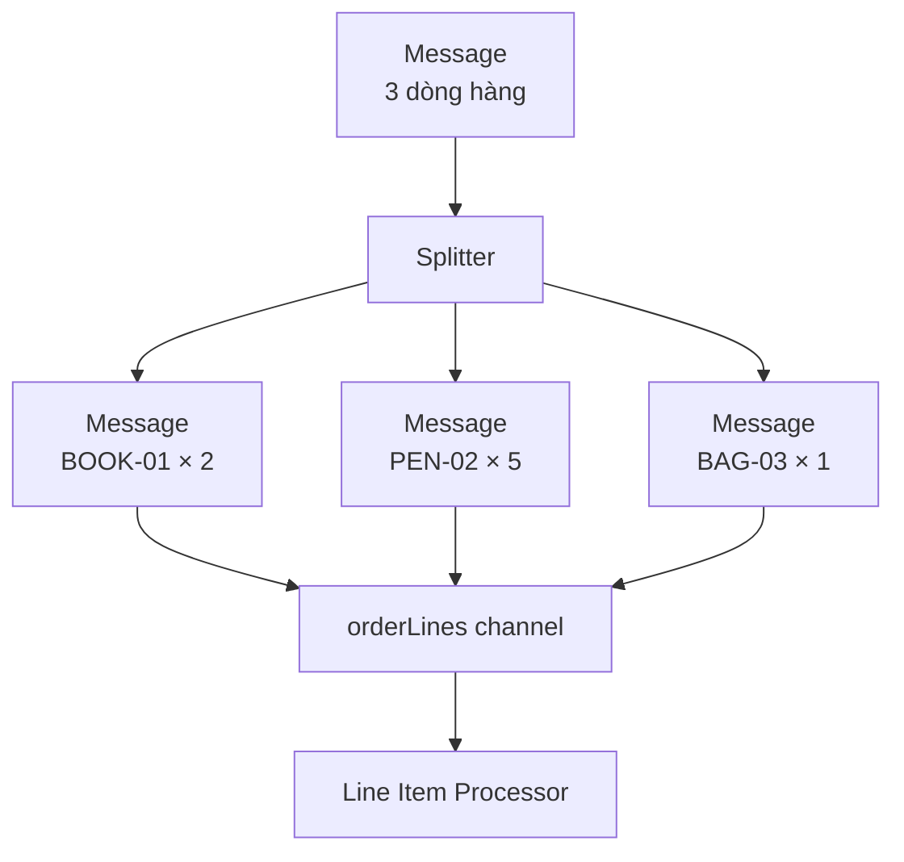
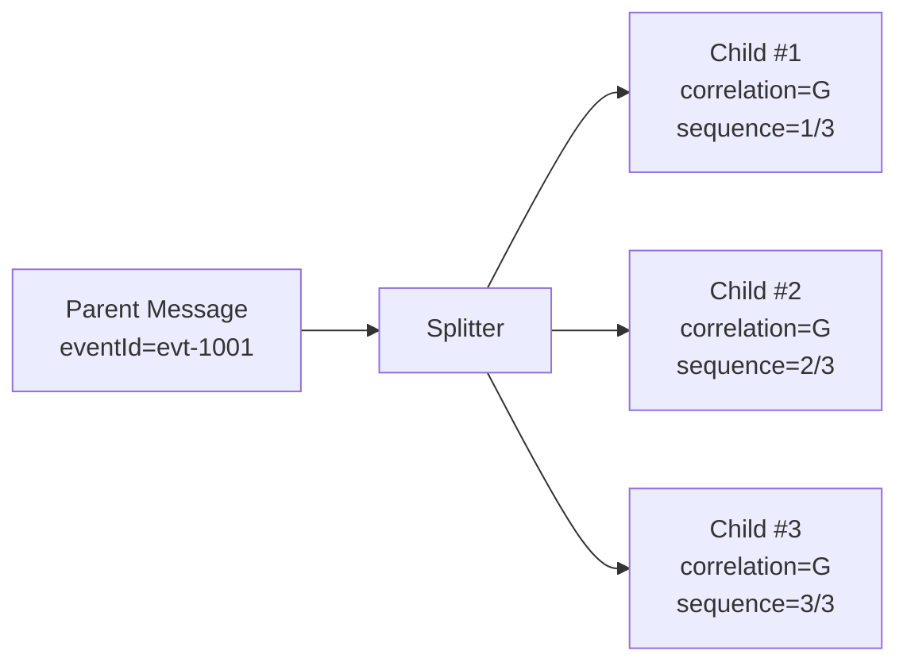
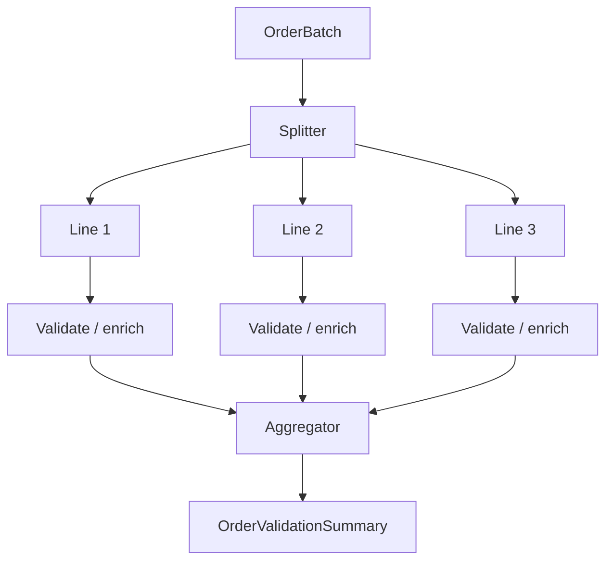
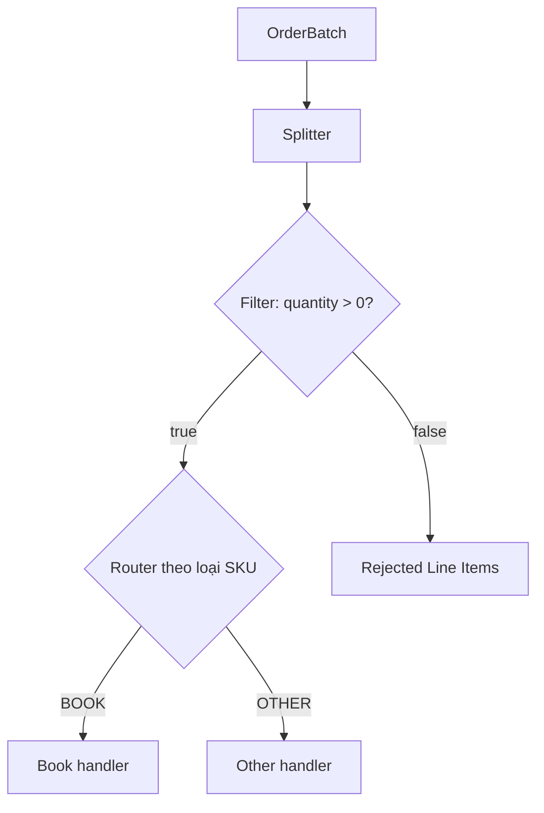
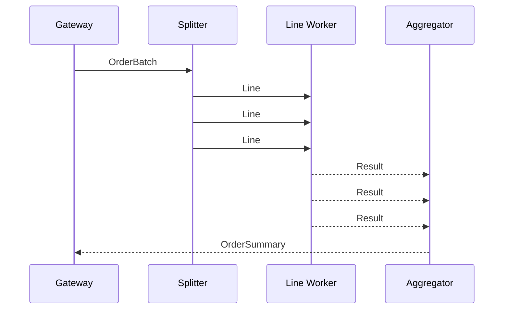

# Splitter chia một message thành nhiều message con

Một Message đi vào hệ thống tích hợp đôi khi mang **nhiều phần tử cần được xử lý riêng**: một đơn hàng chứa nhiều dòng hàng, một tệp chứa hàng nghìn bản ghi, hoặc một yêu cầu gồm nhiều sản phẩm cần kiểm tra tồn kho. Nếu một handler phải xử lý toàn bộ tập dữ liệu trong một lần gọi, logic dễ phình to, việc retry một phần tử gặp lỗi trở nên khó khăn và những bước xử lý tiếp theo khó mở rộng độc lập.

**Splitter** là mẫu *Enterprise Integration Patterns* (EIP) chuyển **một Message đầu vào thành nhiều Message đầu ra**, thường mỗi Message con mang một phần của payload gốc. Trong Spring Integration, Splitter là một endpoint có thể nhận collection, array, iterator hoặc kết quả phân tách từ một phương thức/biểu thức; framework sẽ phát từng phần tử thành Message riêng đến output channel.

Bài thuộc chương **Splitter** của module `SPRING_INTEGRATION_PATTERN`. Module tập trung triển khai các EIP bằng Spring Integration để xây dựng luồng Message ít phụ thuộc, dễ mở rộng, kết hợp Router, Filter, Transformer, Splitter, Aggregator, Gateway, retry, error channel, correlation và kiểm thử các nhánh xử lý. Mục tiêu trực tiếp của bài là hiểu **Splitter tạo Message con như thế nào, các header giúp liên hệ chúng với Message gốc ra sao, và kiểm chứng hành vi thực tế bằng Java/JUnit**.

## 1. Từ một Message lớn thành nhiều Message nhỏ

Giả sử một đơn hàng có ba dòng:

```json
{
  "orderId": "ORD-1001",
  "lines": [
    {"sku": "BOOK-01", "quantity": 2},
    {"sku": "PEN-02", "quantity": 5},
    {"sku": "BAG-03", "quantity": 1}
  ]
}
```

Ta muốn mỗi dòng được một bộ xử lý kiểm tra riêng. Splitter nhận `Message<OrderBatch>` và phát ba `Message<OrderLine>`:



Ở đây, một đơn hàng không biến thành ba **đơn hàng mới**. Nó tạo ra ba **đơn vị công việc** liên quan đến cùng một đơn hàng. Việc giữ được quan hệ này là nền tảng để Aggregator có thể gom kết quả nếu cần.

### Trước và sau khi split

| Đặc tính | Trước Splitter | Sau Splitter |
| --- | --- | --- |
| Số Message | 1 | 3 trong ví dụ |
| Kiểu payload | `OrderBatch` | `OrderLine` cho từng Message |
| Ý nghĩa nghiệp vụ | Một yêu cầu chứa nhiều dòng | Một dòng thuộc yêu cầu gốc |
| Khóa nghiệp vụ | `orderId=ORD-1001` | Cần giữ khả năng truy ngược cùng đơn |
| Correlation | Có thể chưa cần nhóm Message con | Thường cần nếu downstream sẽ gom |
| Xử lý lỗi | Một lời gọi có thể lỗi toàn batch | Có thể xử lý/retry riêng từng phần, theo kiến trúc |

**Điểm cốt lõi:** Splitter chỉ tạo Message con. Nó không tự bảo đảm các Message con được xử lý thành công, cũng không tự thu thập kết quả sau khi các nhánh xử lý xong.

## 2. Splitter khác Router, Recipient List và Publish–Subscribe

Những mẫu này đều có thể làm phát sinh nhiều lượt chuyển giao Message, nhưng mục đích và kết quả khác nhau.

| Mẫu | Câu hỏi chính | Hành vi |
| --- | --- | --- |
| **Splitter** | Làm sao tách một payload gồm nhiều phần thành các đơn vị nhỏ hơn? | Mỗi phần trở thành một Message con |
| **Router** | Message này nên đi tới channel nào? | Chọn một hay nhiều đích theo loại router |
| **Recipient List** | Những recipient nào cần nhận Message? | Gửi Message tới các recipient được chọn |
| **Publish–Subscribe** | Những subscriber nào đang quan tâm sự kiện này? | Phát Message đến các subscriber đăng ký |
| **Transformer** | Payload nên được biểu diễn dưới dạng nào? | Biến đổi dữ liệu, không mặc nhiên tăng số Message |
| **Aggregator** | Làm sao ghép các kết quả Message có liên quan? | Gom một nhóm Message thành kết quả mới |

Ví dụ, một Message đơn hàng gồm ba dòng đi qua Splitter tạo ba payload dòng hàng **khác nhau**. Cũng Message đó đi qua `PublishSubscribeChannel` với ba subscriber thì mỗi subscriber có thể nhận **cùng một payload đơn hàng**, không phải mặc nhiên mỗi subscriber nhận một dòng.

Sự khác nhau này ảnh hưởng trực tiếp tới số lượng kết quả, correlation, retry và cả cách xác định khi nào Gateway có thể trả lời.

## 3. Cơ chế Splitter trong Spring Integration

Trong Spring Integration, Splitter có thể được khai báo qua:

- Annotation `@Splitter` gắn vào phương thức trả về các phần tử cần phát.
- Java DSL `.split(...)` trong `IntegrationFlow`.
- Các splitter chuyên dụng hoặc splitter tùy chỉnh khi cần xử lý định dạng hay chiến lược phân tách phức tạp.

Về mặt khái niệm:

```text
Input:  Message<P>
        payload = [A, B, C] hoặc một object chứa [A, B, C]

Splitter: lấy ra ba phần tử A, B, C

Output: Message<A>, Message<B>, Message<C>
```

Phần tử có thể được chuyển thành payload trong Message con; các Message đầu ra còn mang headers theo cơ chế tạo Message của Spring Integration. Với cấu hình mặc định thường dùng, Splitter có thể thêm **sequence headers** hỗ trợ việc gom kết quả.

### 3.1. Không phải mọi Message mang List đều tự split

Nếu một `Transformer` trả `List<OrderLine>` và flow gửi List đó sang consumer bình thường, không nên giả định rằng List luôn được tự động trải thành nhiều Message. Hành vi tách phải được cấu hình bằng Splitter hoặc một endpoint có hợp đồng split tương đương.

Ngược lại, một `@Splitter` có thể trả nhiều phần tử từ một payload **không phải collection trực tiếp**. Ví dụ `OrderBatch` có thuộc tính `lines`; phương thức Splitter có thể trả `batch.lines()` để framework phát từng dòng.

### 3.2. Số phần tử có thể bằng 0, 1 hoặc nhiều

| Payload/điều kiện | Kết quả mong đợi về mặt thiết kế |
| --- | --- |
| Batch có 3 phần tử | Phát 3 Message con |
| Batch có 1 phần tử | Phát 1 Message con |
| Batch rỗng | Thường không có phần tử để phát; cần hợp đồng rõ |
| Dữ liệu đầu vào không hợp lệ | Validation/exception/error flow, không coi là batch thành công |
| Tập dữ liệu lớn | Cần xem xét bộ nhớ, throughput và backpressure |

Đối với batch rỗng, luồng phía sau có thể **không nhận Message nào**. Với Gateway request-reply hoặc Aggregator đang đợi một kết quả, hãy thiết kế cách kết thúc yêu cầu rỗng thay vì để nó chờ đến timeout.

## 4. Correlation và sequence headers

Khi một Message gốc sinh nhiều Message con, cần thông tin để xác định:

1. Những Message nào thuộc cùng một lần split?
2. Mỗi Message có vị trí nào trong chuỗi các phần tử?
3. Có bao nhiêu phần tử dự kiến được tạo?

Spring Integration thường dùng các header như:

| Header | Ý nghĩa | Ví dụ minh họa |
| --- | --- | --- |
| `correlationId` | Khóa nhóm để liên hệ các Message con | Cùng một giá trị cho 3 dòng |
| `sequenceNumber` | Thứ tự của Message con trong kết quả split | 1, 2, 3 |
| `sequenceSize` | Số Message trong nhóm khi biết trước | 3 |
| `eventId` | Định danh sự kiện nghiệp vụ do ứng dụng đặt | `evt-1001` |
| `businessOrderId` | Định danh đơn hàng | `ORD-1001` |

Các tên `correlationId`, `sequenceNumber`, `sequenceSize` thuộc nhóm metadata tích hợp mà framework và Aggregator có thể sử dụng. Những giá trị trong bảng là **minh họa**; cách tạo và truyền chúng phụ thuộc splitter, `applySequence`, kiểu kết quả và các endpoint nằm sau.



### 4.1. Correlation ID không phải Message ID

- `MessageHeaders.ID` định danh một Message trong Spring Messaging; Message con có thể có ID riêng.
- `eventId` là định danh **nghiệp vụ** ổn định do ứng dụng chọn, hữu ích khi một sự kiện được phát lại.
- `correlationId` giúp nhóm các Message con thuộc cùng một lần xử lý.
- `orderId` có thể xuất hiện trong **nhiều** sự kiện hoặc lần xử lý; không nên dùng nó làm khóa nhóm duy nhất nếu hai lần thực thi có thể xen kẽ.

Ví dụ, nếu hai yêu cầu cùng xử lý `ORD-1001` nhưng mang `eventId` khác nhau, Aggregator không nên vô tình gom các kết quả của hai lượt vào cùng một nhóm.

### 4.2. `sequenceSize` không phải lúc nào cũng có giá trị dương biết trước

Với một collection đã biết số phần tử, Splitter thường có thể thiết lập sequence size phù hợp. Với nguồn dữ liệu có kích thước chưa biết trước, iterator/stream hoặc cách split đặc biệt, framework có thể không có đủ thông tin ngay để ghi số phần tử cuối cùng. Lúc này cách gom dựa cứng vào `sequenceSize` có thể không phù hợp.

Khi thiết kế Aggregator, phải xác định **cơ chế kết thúc nhóm** cho cả dữ liệu kích thước cố định và dữ liệu dạng streaming, thay vì giả định mọi trường hợp đều có `sequenceSize` chính xác.

## 5. Cấu hình minh họa với `@Splitter`

Ví dụ Java 17+ sau dùng một `OrderBatch` chứa nhiều `OrderLine`. Method `splitOrder(...)` trả về danh sách dòng hàng; Spring Integration phát từng phần tử ra channel `orderLines`.

Các bean `DirectChannel` và `QueueChannel` giúp quan sát một cách đồng bộ; chưa có consumer xử lý nghiệp vụ thực tế.

```java
package example.integration;

import java.util.List;

import org.springframework.context.annotation.Bean;
import org.springframework.context.annotation.Configuration;
import org.springframework.integration.annotation.Splitter;
import org.springframework.integration.channel.DirectChannel;
import org.springframework.integration.channel.QueueChannel;
import org.springframework.integration.config.EnableIntegration;
import org.springframework.messaging.MessageChannel;
import org.springframework.messaging.PollableChannel;

@Configuration
@EnableIntegration
public class OrderSplitterConfiguration {

    public record OrderLine(String sku, int quantity) {
    }

    public record OrderBatch(String orderId, List<OrderLine> lines) {
        public OrderBatch {
            lines = List.copyOf(lines);
        }
    }

    @Bean
    public MessageChannel ordersInput() {
        return new DirectChannel();
    }

    @Bean
    public PollableChannel orderLines() {
        return new QueueChannel(50);
    }

    @Splitter(inputChannel = "ordersInput", outputChannel = "orderLines")
    public List<OrderLine> splitOrder(OrderBatch batch) {
        if (batch.orderId() == null || batch.orderId().isBlank()) {
            throw new IllegalArgumentException("orderId is required");
        }

        return batch.lines();
    }
}
```

Giải thích:

- `OrderBatch` là payload của Message đầu vào; danh sách dòng được sao chép thành một collection không cho phép sửa cấu trúc trực tiếp.
- `@Splitter` khai báo endpoint nhận từ `ordersInput` và gửi các Message con sang `orderLines`.
- `splitOrder(...)` **không tự gọi** `output.send(...)` cho từng phần tử; nó trả về các phần tử và giao việc phát Message cho framework.
- `OrderLine` là record bất biến, phù hợp cho việc gửi và xử lý riêng từng dòng.
- `QueueChannel(50)` là queue trong bộ nhớ với dung lượng hữu hạn; nó chưa bảo đảm lưu trữ bền vững.

**Lưu ý:** `List.copyOf(lines)` ném lỗi nếu `lines` là `null` hoặc có phần tử `null`. Đây là quyết định kiểm tra đầu vào của kiểu `OrderBatch`, không phải hành vi chung của mọi Splitter.

### 5.1. Phân tách không phải nhân bản đơn hàng

Nếu payload gốc là:

```java
new OrderBatch(
    "ORD-1001",
    List.of(
        new OrderLine("BOOK-01", 2),
        new OrderLine("PEN-02", 5),
        new OrderLine("BAG-03", 1)));
```

thì ba Message con có payload là ba `OrderLine` tương ứng. Chúng **không** là ba bản sao của `OrderBatch` và không chứa toàn bộ danh sách trong mỗi payload, trừ khi ứng dụng tự thiết kế kiểu payload con như vậy.

Thông tin `orderId` không nằm bên trong `OrderLine` của ví dụ; vì thế, các bước downstream cần khóa đơn hàng nên đọc **header `businessOrderId`** được truyền từ Message cha, hoặc định nghĩa một payload con bao gồm cả order ID.

## 6. Gửi batch và đọc từng Message con

Đoạn demo sau đưa một Message đầu vào qua Splitter rồi đọc ba Message từ output:

```java
package example.integration;

import java.util.List;

import org.springframework.context.annotation.AnnotationConfigApplicationContext;
import org.springframework.integration.IntegrationMessageHeaderAccessor;
import org.springframework.messaging.Message;
import org.springframework.messaging.MessageChannel;
import org.springframework.messaging.PollableChannel;
import org.springframework.messaging.support.MessageBuilder;

import example.integration.OrderSplitterConfiguration.OrderBatch;
import example.integration.OrderSplitterConfiguration.OrderLine;

public class OrderSplitterDemo {

    public static void main(String[] args) {
        try (var context = new AnnotationConfigApplicationContext(
                OrderSplitterConfiguration.class)) {

            MessageChannel input =
                    context.getBean("ordersInput", MessageChannel.class);
            PollableChannel output =
                    context.getBean("orderLines", PollableChannel.class);

            OrderBatch batch = new OrderBatch(
                    "ORD-1001",
                    List.of(
                            new OrderLine("BOOK-01", 2),
                            new OrderLine("PEN-02", 5),
                            new OrderLine("BAG-03", 1)));

            Message<OrderBatch> parent = MessageBuilder.withPayload(batch)
                    .setHeader("eventId", "evt-1001")
                    .setHeader("businessOrderId", batch.orderId())
                    .build();

            input.send(parent);

            for (int i = 0; i < batch.lines().size(); i++) {
                Message<?> child = output.receive(0);
                if (child == null) {
                    throw new IllegalStateException(
                            "Missing child Message at index " + i);
                }

                Object position = child.getHeaders().get(
                        IntegrationMessageHeaderAccessor.SEQUENCE_NUMBER);
                Object groupSize = child.getHeaders().get(
                        IntegrationMessageHeaderAccessor.SEQUENCE_SIZE);

                System.out.println(
                        position + "/" + groupSize + " = "
                        + child.getPayload());
            }
        }
    }
}
```

Trong ví dụ đồng bộ với danh sách đã biết kích thước và hành vi sequence thông thường, các dòng quan sát có dạng:

```text
1/3 = OrderLine[sku=BOOK-01, quantity=2]
2/3 = OrderLine[sku=PEN-02, quantity=5]
3/3 = OrderLine[sku=BAG-03, quantity=1]
```

Output thực tế còn phụ thuộc `toString()` của record và các header do framework gắn; ví dụ không dựa vào một chuỗi `toString()` cố định để quyết định pass/fail. Với `DirectChannel` đầu vào và queue không có consumer cạnh tranh, test có thể đọc ngay sau `send()`.

**Không dùng một lệnh `receive()` không giới hạn thời gian cho test không chắc chắn có Message.** `receive(0)` phù hợp với tình huống đã có chuyển giao đồng bộ; trong flow bất đồng bộ cần chờ có timeout hữu hạn.

## 7. Java DSL: biểu diễn bước split trong IntegrationFlow

Bên cạnh `@Splitter`, Spring Integration Java DSL cho phép tạo một bước split trực tiếp trong flow. Ví dụ ý tưởng:

```java
// Minh họa thay thế cho @Splitter; không đăng ký cả hai endpoint
// nhận từ ordersInput trong cùng ứng dụng thử nghiệm.
@Bean
public IntegrationFlow splitWithDsl() {
    return IntegrationFlow.from("ordersInput")
            .split(OrderBatch.class, OrderBatch::lines)
            .channel("orderLines")
            .get();
}
```

Đoạn minh họa giả định các kiểu `OrderBatch`/`OrderLine`, bean channel và import `IntegrationFlow` đã được khai báo như mục 5. Cú pháp overload `.split(...)` có thể khác ở các nhánh phiên bản Spring Integration; khi đưa vào dự án, cần đối chiếu API tương ứng. Về mặt mô hình, ý nghĩa không thay đổi:

1. Nhận payload `OrderBatch`.
2. Trả về danh sách `OrderLine`.
3. Phát từng item ra channel đầu ra thay vì gửi toàn bộ List như một payload.

Việc dùng annotation hay DSL là quyết định về phong cách cấu hình; **chỉ nên có một splitter endpoint cho cùng input channel** trong demo để tránh một Message bị xử lý bởi những handler ngoài dự kiến.

### 7.1. Khi nào cần custom Splitter?

Một phương thức trả danh sách phù hợp với trường hợp đơn giản. Với dữ liệu phức tạp hơn, có thể cần:

- Tách một tài liệu theo block hoặc trang.
- Tách một batch thành các nhóm nhỏ có kích thước tối đa.
- Tạo các child payload kèm thứ tự nghiệp vụ và context.
- Đọc file lớn theo streaming thay vì đưa toàn bộ nội dung vào bộ nhớ.
- Tính đến việc collection có thể rỗng, sai cấu trúc hoặc bị giới hạn số phần tử.

Khi cần thêm metadata riêng cho từng phần, có thể trả về các `Message<?>` đã được xây dựng có chủ đích hoặc dùng endpoint phù hợp. Cần để ý cách framework gắn/giữ sequence headers, tránh ghi đè metadata nhóm một cách vô tình.

## 8. Sequence, ordering và xử lý bất đồng bộ

Số thứ tự của Message con giúp xác định **vị trí trong kết quả phân tách**, nhưng không bảo đảm **thứ tự hoàn tất xử lý** của các consumer.

Ví dụ:

```text
Splitter phát:
  M1 seq=1 → Channel
  M2 seq=2 → Channel
  M3 seq=3 → Channel

Các worker xử lý song song có thể hoàn tất:
  M2 xong trước, M3 xong sau, M1 xong cuối
```

Nếu đơn hàng yêu cầu giữ đúng thứ tự xử lý, cần có cơ chế thực thi theo thứ tự, partition theo khóa nghiệp vụ, hoặc logic sắp xếp ở bước sau. Sequence header **là metadata về thứ tự logic**, không phải một khóa đảm bảo thực thi tuần tự trên nhiều thread/broker.

### 8.1. Những dạng tải thường gặp

| Trường hợp | Ý nghĩa vận hành |
| --- | --- |
| `DirectChannel` và handler đồng bộ | Các lần gửi có quan hệ thứ tự trên thread producer |
| `ExecutorChannel` | Nhiều công việc có thể thực thi song song |
| `QueueChannel` | Message có thể được xếp hàng, chờ poll/receive |
| Broker với nhiều consumer/partition | Thứ tự phụ thuộc cấu hình transport và key |
| Retry/redelivery | Một phần tử có thể được gửi hoặc xử lý lại |

Không nên xem một bộ test `QueueChannel` đơn giản như bằng chứng rằng thứ tự giữa các kết quả vẫn được bảo toàn ở mọi triển khai phân tán.

## 9. Từ Splitter đến Aggregator: mô hình xử lý từng phần rồi gom lại

Một luồng thường gặp là:



**Splitter** tạo các Message con và thường cung cấp thông tin sequence/correlation. **Aggregator** dùng những thông tin phù hợp cùng một *release strategy* để biết khi nào đủ kết quả và tạo Message tổng.

### 9.1. Ba câu hỏi bắt buộc khi thiết kế Aggregator

1. **Correlation key:** các kết quả nào thuộc cùng một batch/lần split?
2. **Release condition:** khi nào nhóm được xem là hoàn tất? Đã đủ `sequenceSize` hay đã nhận dấu kết thúc?
3. **Failure policy:** một phần tử lỗi thì chờ, phát kết quả một phần, trả lỗi hay bù trừ?

Ví dụ `sequenceSize=3` chỉ hợp lý nếu ba Message con thực sự có đường đi tạo kết quả về Aggregator. Nếu một phần tử bị Filter loại giữa chặng, Aggregator có thể chỉ nhận hai kết quả và chờ đến timeout.

### 9.2. Khi số lượng Message con không biết trước

Với dữ liệu lớn hoặc stream, số phần tử có thể chưa xác định khi Splitter bắt đầu phát. Khi đó, Aggregator dựa hoàn toàn vào một sequence size cố định là không đủ.

Các lựa chọn kiến trúc bao gồm:

- Đếm trước số phần tử nếu có thể và phù hợp về hiệu năng.
- Gửi **marker hoàn tất** khi stream kết thúc, kèm khóa correlation.
- Dùng timeout và chiến lược release nhóm một phần có chủ đích.
- Ghi số phần tử dự kiến ở một kho trạng thái riêng trước khi phát.

Không nên coi timeout là cách chứng minh mọi phần tử đã tới: timeout chỉ nói rằng **không thể tiếp tục đợi theo ngưỡng đã chọn**.

## 10. Filter và Router sau Splitter

Mỗi Message con có thể được phân loại hoặc lọc riêng:



Nhưng nếu hệ thống còn cần **gom đủ ba kết quả**, nhánh `Rejected Line Items` không nên làm mất hẳn một phần tử mà không báo cho bước gom. Một giải pháp là tạo một `LineResult` với `status=REJECTED` và đưa nó về cùng cơ chế correlation, thay vì chỉ ghi log rồi chấm dứt Message.

### 10.1. Filter trước hay sau Splitter?

| Vị trí | Quy tắc áp dụng | Hệ quả |
| --- | --- | --- |
| **Trước Splitter** | Điều kiện áp dụng toàn bộ batch | Có thể từ chối cả batch từ sớm |
| **Sau Splitter** | Điều kiện áp dụng cho từng dòng | Có thể chỉ loại một hoặc vài dòng |

Nếu một đơn có cấu trúc không hợp lệ, validation toàn batch thường nên chạy trước Splitter. Nếu chỉ một dòng hàng có số lượng không hợp lệ, Filter sau Splitter giúp phản hồi chi tiết ở cấp dòng, nhưng cần chính sách Aggregator và lỗi phù hợp.

## 11. Retry, lỗi một phần và idempotency

Một batch có thể được split và một số Message con đã được gửi hoặc xử lý thành công trước khi một Message con khác gặp lỗi.

```text
ORD-1001:
  BOOK-01 -> xử lý thành công
  PEN-02  -> timeout
  BAG-03  -> đã vào queue, chưa được xử lý
```

Nếu retry toàn batch, `BOOK-01` có thể được xử lý thêm lần nữa. Nếu retry riêng `PEN-02`, cần biết nó thuộc đơn hàng nào và bước nào đã hoàn tất.

| Loại lỗi | Điều cần cân nhắc |
| --- | --- |
| Splitter tự ném exception trước khi trả phần tử | Thông thường chưa có output từ invocation đó |
| Gửi Message con tới channel bị lỗi giữa chuỗi | Các Message con trước có thể đã tới đích |
| Consumer xử lý một dòng thất bại | Retry riêng dòng hoặc trả kết quả lỗi theo hợp đồng |
| Broker redelivery một Message con | Cần nhận biết tác vụ lặp |
| Mất một phần tử trước Aggregator | Nhóm không hoàn tất; cần timeout/recovery |

Một khóa idempotency theo phần tử có thể gồm:

```text
businessEventId = evt-1001
lineId = ORD-1001:LINE-02
operation = RESERVE_STOCK

idempotencyKey = evt-1001:LINE-02:RESERVE_STOCK
```

Đừng chỉ dùng `sku` làm khóa, vì cùng SKU có thể xuất hiện ở nhiều đơn hoặc nhiều dòng của cùng một đơn. Nếu workflow cần hỗ trợ dòng trùng, định nghĩa `lineId` ổn định ở dữ liệu đầu vào.

### 11.1. Exception không tự đi vào error channel

Trong flow đồng bộ qua `DirectChannel`, exception có thể lan đến lời gọi `send()` hoặc Gateway. Khi có executor, poller hoặc adapter inbound, hạ tầng có thể xử lý lỗi trên thread riêng và gửi `ErrorMessage` tới `errorChannel` đã cấu hình.

**Splitter không tự đưa mọi lỗi vào dead-letter queue hay rollback toàn bộ Message con đã gửi.** Muốn đảm bảo xử lý lỗi bền vững, cần transaction boundaries, retry, dead-letter, outbox hoặc broker semantics tương ứng với từng hệ thống.

## 12. Gateway và request-reply khi một yêu cầu tạo nhiều kết quả

Một Gateway nhận `OrderBatch` có thể yêu cầu **một kết quả tổng hợp**. Nếu Splitter tạo ba Message con rồi các consumer xử lý độc lập, Gateway không tự biết khi nào cả ba đã xong.



Muốn đây là một flow request-reply đáng tin, phải thiết kế:

- Correlation giữa Message con, kết quả và yêu cầu Gateway.
- Số lượng kết quả dự kiến hoặc một điều kiện kết thúc nhóm.
- Timeout và chính sách trả kết quả khi một phần tử không có reply.
- Cách xử lý lỗi một phần, retry và duplicate.
- Reply channel/metadata đủ để đưa kết quả tổng về đúng request.

Khi không cần reply cho producer, có thể để từng Message con xử lý độc lập và công bố trạng thái qua event. Trong trường hợp đó, đừng đặt Gateway request-reply đợi một kết quả mà luồng chưa hề thiết kế để trả.

## 13. Hiệu năng, backpressure và batch lớn

Tách một Message thành nhiều Message con có thể **tăng tổng số lượt chuyển giao**. Với batch chứa 10.000 dòng, một lời gọi Splitter có thể phát 10.000 Message; nếu downstream chậm, bộ nhớ, queue và broker có thể bị quá tải.

### 13.1. Giới hạn ở đâu?

| Biện pháp | Giải quyết | Không giải quyết |
| --- | --- | --- |
| Giới hạn kích thước batch đầu vào | Tránh một request tạo quá nhiều công việc | Không chặn lượng request lớn mỗi giây |
| Chia batch thành chunk | Giảm kích thước một nhóm công việc | Không tự bảo đảm retry/idempotency |
| Bounded QueueChannel | Giới hạn số Message chờ trong bộ nhớ | Không làm consumer tự nhanh hơn |
| Bounded executor | Hạn chế số task chạy song song | Không hạn chế số Message ban đầu nếu không có backpressure |
| Rate limiting | Điều tiết lượng batch/Message vào | Không giải quyết Message hỏng |
| Broker lưu bền vững | Cho phép tách rời producer/consumer và khôi phục | Không tự tạo exactly-once side effects |

**Không đồng nhất split size và concurrency.** Một batch có năm dòng tạo năm Message con; điều đó không có nghĩa có năm thread, năm request mạng hay năm transaction chạy đồng thời. Concurrency phụ thuộc channel và consumer.

### 13.2. Split list và stream

Với một `List` đã nằm trong bộ nhớ, cách split theo item tương đối đơn giản và có thể biết kích thước. Với file lớn hoặc nguồn dữ liệu streaming:

- Tránh đọc cả tệp rất lớn vào RAM nếu không cần thiết.
- Chọn cách đọc và phát phần tử có kiểm soát nhu cầu tiêu thụ.
- Xác định hành vi khi nguồn dữ liệu dừng giữa chừng.
- Làm rõ thế nào là cuối stream để downstream gom hoặc kết thúc.
- Giám sát backlog, throughput và lỗi theo từng phần.

Không phải cứ dùng `Iterator` là toàn bộ flow tự có backpressure đầu-cuối. Cần kiểm tra semantics của splitter, output channel và adapter thực tế.

## 14. Kiểm thử JUnit 5: số phần tử, payload, headers

Chỉ unit test `splitOrder(batch).size()==3` là chưa đủ: chưa chứng minh Spring Integration đã phát ba **Message** với headers và channel đúng. Một integration test nên dùng channel thật.

### 14.1. Test ba Message con và sequence

```java
package example.integration;

import static org.junit.jupiter.api.Assertions.*;

import java.util.List;

import org.junit.jupiter.api.Test;
import org.springframework.context.annotation.AnnotationConfigApplicationContext;
import org.springframework.integration.IntegrationMessageHeaderAccessor;
import org.springframework.messaging.Message;
import org.springframework.messaging.MessageChannel;
import org.springframework.messaging.PollableChannel;
import org.springframework.messaging.support.MessageBuilder;

import example.integration.OrderSplitterConfiguration.OrderBatch;
import example.integration.OrderSplitterConfiguration.OrderLine;

class OrderSplitterIntegrationTest {

    @Test
    void splitsThreeLinesIntoCorrelatedChildMessages() {
        try (var context = new AnnotationConfigApplicationContext(
                OrderSplitterConfiguration.class)) {

            MessageChannel input =
                    context.getBean("ordersInput", MessageChannel.class);
            PollableChannel output =
                    context.getBean("orderLines", PollableChannel.class);

            OrderBatch batch = new OrderBatch(
                    "ORD-1001",
                    List.of(
                            new OrderLine("BOOK-01", 2),
                            new OrderLine("PEN-02", 5),
                            new OrderLine("BAG-03", 1)));
            Message<OrderBatch> parent = MessageBuilder.withPayload(batch)
                    .setHeader("eventId", "evt-1001")
                    .setHeader("businessOrderId", "ORD-1001")
                    .build();

            assertTrue(input.send(parent));

            Message<?> first = output.receive(0);
            Message<?> second = output.receive(0);
            Message<?> third = output.receive(0);

            assertNotNull(first);
            assertNotNull(second);
            assertNotNull(third);
            assertEquals(batch.lines().get(0), first.getPayload());
            assertEquals(batch.lines().get(1), second.getPayload());
            assertEquals(batch.lines().get(2), third.getPayload());

            assertEquals(1, first.getHeaders().get(
                    IntegrationMessageHeaderAccessor.SEQUENCE_NUMBER));
            assertEquals(2, second.getHeaders().get(
                    IntegrationMessageHeaderAccessor.SEQUENCE_NUMBER));
            assertEquals(3, third.getHeaders().get(
                    IntegrationMessageHeaderAccessor.SEQUENCE_NUMBER));

            assertEquals(3, first.getHeaders().get(
                    IntegrationMessageHeaderAccessor.SEQUENCE_SIZE));
            assertEquals(3, second.getHeaders().get(
                    IntegrationMessageHeaderAccessor.SEQUENCE_SIZE));
            assertEquals(3, third.getHeaders().get(
                    IntegrationMessageHeaderAccessor.SEQUENCE_SIZE));

            Object groupId = first.getHeaders().get(
                    IntegrationMessageHeaderAccessor.CORRELATION_ID);
            assertNotNull(groupId);
            assertEquals(groupId, second.getHeaders().get(
                    IntegrationMessageHeaderAccessor.CORRELATION_ID));
            assertEquals(groupId, third.getHeaders().get(
                    IntegrationMessageHeaderAccessor.CORRELATION_ID));

            for (Message<?> child : List.of(first, second, third)) {
                assertEquals("evt-1001",
                        child.getHeaders().get("eventId"));
                assertEquals("ORD-1001",
                        child.getHeaders().get("businessOrderId"));
            }
            assertNull(output.receive(0));
        }
    }
}
```

Test này kiểm tra **số Message thực tế**, thứ tự payload trên queue đồng bộ, header sequence, correlation của nhóm và headers nghiệp vụ được chuyển tiếp. Nó không yêu cầu `correlationId` phải bằng một chuỗi cụ thể, vì mục tiêu là chứng minh các phần tử liên quan có **cùng khóa nhóm**.

Những khẳng định về `sequenceNumber` và `sequenceSize` ứng với **cấu hình Splitter mặc định thường dùng với collection đã biết kích thước**. Nếu ứng dụng thay đổi cấu hình sequence, custom splitter hoặc dùng nguồn kích thước không biết trước, test cần phản ánh hợp đồng mới.

### 14.2. Test một phần tử

Test batch chỉ có một dòng cũng quan trọng: Splitter vẫn phải phát **một Message con**, thay vì bỏ qua bước split hoặc tạo một `List` payload.

```java
@Test
void oneLineProducesOneChild() {
    try (var context = new AnnotationConfigApplicationContext(
            OrderSplitterConfiguration.class)) {

        MessageChannel input =
                context.getBean("ordersInput", MessageChannel.class);
        PollableChannel output =
                context.getBean("orderLines", PollableChannel.class);

        OrderLine line = new OrderLine("NOTE-01", 1);
        input.send(MessageBuilder.withPayload(
                new OrderBatch("ORD-2001", List.of(line))).build());

        Message<?> child = output.receive(0);
        assertNotNull(child);
        assertEquals(line, child.getPayload());
        assertNull(output.receive(0));
    }
}
```

Đây là **method test minh họa** để đặt vào class JUnit 5 có đầy đủ các import tương ứng mục 14.1; nó không phải một Java source file độc lập. Mục tiêu là khẳng định kích thước batch bằng 1 vẫn sinh một Message.

### 14.3. Các test bổ sung

| Kịch bản | Kỳ vọng |
| --- | --- |
| Batch ba dòng | Ba Message con đúng payload/headers |
| Batch một dòng | Một Message con |
| Batch rỗng | Hành vi được quy định, không để Gateway/Aggregator chờ vô hạn |
| Thiếu `orderId` | Lỗi validation trước khi phát các phần tử |
| Hai batch có cùng `orderId` nhưng event khác | Không gộp lẫn hai lần xử lý |
| Có dòng trùng SKU | Không đánh mất dòng nào nếu chính sách cho phép |
| Filter loại một Message con | Aggregator có chính sách kết thúc hoặc trả lỗi |
| Consumer một dòng timeout | Retry có giới hạn và idempotency theo dòng |
| Queue output đầy | Có xử lý lỗi/backpressure, không báo hoàn thành sai |
| Async completion khác sequence | Test chỉ đòi thứ tự logic, không đòi thứ tự hoàn tất |
| Số dòng rất lớn | Thử tải, đo peak memory và queue backlog |
| Reply Gateway | Có đủ kết quả, timeout và error response |

## 15. Quan sát quá trình split trong hệ thống chạy thật

Khi một yêu cầu tạo nhiều Message con, một log tốt cần trả lời:

- Message gốc nào được split?
- Đã tạo bao nhiêu phần tử?
- Mỗi phần tử thuộc batch nào và có sequence number nào?
- Những phần tử nào đã được gửi, xử lý, retry hoặc lỗi?
- Aggregator đang chờ bao nhiêu kết quả?

Ví dụ structured log ở tầng ứng dụng:

```json
{
  "stage": "order-splitter",
  "eventId": "evt-1001",
  "businessOrderId": "ORD-1001",
  "correlationId": "group-1001",
  "expectedChildCount": 3,
  "emittedChildCount": 3,
  "result": "EMITTED"
}
```

`correlationId` trong log là giá trị **minh họa**, không khẳng định framework mặc định sử dụng chuỗi `group-1001`. Các trường `expectedChildCount`/`emittedChildCount` cũng là trường do ứng dụng instrument; Spring Integration không tự sinh đầy đủ log JSON này.

| Chỉ số gợi ý | Mục đích |
| --- | --- |
| `splitter.input.count` | Số Message cha được nhận |
| `splitter.children.count` | Tổng Message con đã phát |
| `splitter.batch.size` | Phân bố kích thước batch |
| `splitter.failure.count` | Lỗi trước/trong quá trình split |
| `splitter.dispatch.failure` | Lỗi chuyển giao Message con |
| `splitter.duration` | Độ trễ xử lý tách |
| `splitter.output.queue.depth` | Backlog sau split |
| `child.processing.duration` | Thời gian xử lý từng phần tử |
| `aggregator.incomplete.groups` | Nhóm chờ thiếu kết quả |

Tên metric là **đề xuất**, không phải tên mặc định chắc chắn có trong Micrometer hoặc Spring Integration. Dùng `eventId`, `orderId`, `lineId` ở log/tracing có kiểm soát; tránh đưa những giá trị có cardinality rất lớn vào metric tags.

## 16. Những lỗi thiết kế thường gặp

| Triệu chứng | Nguyên nhân | Hướng xử lý |
| --- | --- | --- |
| Consumer nhận một `List` thay vì từng dòng | Dùng Transformer/handler thông thường thay Splitter | Cấu hình endpoint Splitter rõ ràng |
| Tưởng Splitter tự phát tới nhiều subscriber | Nhầm split với Publish–Subscribe | Phân biệt chia payload và nhân bản Message |
| Message con thiếu `orderId` | Kiểu payload dòng không chứa order ID, header bị mất | Giữ business header hoặc bổ sung vào child payload |
| Aggregator ghép lẫn hai lần chạy | Correlation chỉ dùng `orderId` chung | Dùng khóa theo một attempt/event cụ thể |
| Aggregator chờ mãi | Message con lỗi/bị Filter loại; release strategy cứng | Thiết kế kết quả lỗi/timeout/partial group |
| Batch lớn làm đầy queue | Fan-out tạo quá nhiều Message trong một lần | Giới hạn batch, chunking, backpressure |
| Retry làm giữ tồn kho hai lần | Phát lại batch mà consumer không idempotent | Khóa idempotency theo dòng và thao tác |
| Test không ổn định với executor | Giả định hoàn tất theo thứ tự sequence | Trace theo event + sequence và timeout hữu hạn |
| Hỏng một phần nhưng báo batch thành công | Không kiểm soát partial dispatch/partial processing | Trạng thái theo phần tử và báo lỗi tổng |
| Empty batch làm Gateway timeout | Không có Message con hay nhánh phản hồi | Quy định cách kết thúc batch rỗng |
| Trạng thái bị chia sẻ giữa các request | Handler giữ biến current-line dùng chung | Giữ dữ liệu theo Message và lập trình thread-safe |

## 17. Checklist triển khai Splitter

- **Xác định đơn vị cần tách:** một dòng hàng, một bản ghi, một chunk hay một lệnh con?
- **Phân biệt split và fan-out:** nhiều Message con không nhất thiết đi tới nhiều channel khác nhau.
- **Chọn payload con đủ ngữ cảnh:** giữ order ID/line ID qua payload hoặc header rõ ràng.
- **Kiểm soát correlation/sequence:** biết nhóm nào, phần tử thứ mấy và số phần tử kỳ vọng.
- **Xử lý batch rỗng:** không để Gateway hoặc Aggregator chờ kết quả không thể xuất hiện.
- **Không nhầm thứ tự logic và thứ tự hoàn tất:** executor/broker có thể xử lý lại và đảo thứ tự.
- **Thiết kế Aggregator đi kèm nếu cần gom:** release strategy, timeout và partial failure.
- **Tách validation batch và item:** xác định Filter đặt trước hay sau Splitter.
- **Kiểm soát tải:** batch size, queue capacity, rate limit và backpressure.
- **Quy định retry/idempotency theo phần tử:** chống side effect kép khi redelivery.
- **Kiểm thử Message thực tế:** số con, payload, headers, lỗi và những trường hợp biên.
- **Đo được tiến độ:** child count, lỗi dispatch, backlog và nhóm gom chưa hoàn tất.

**Splitter biến một Message tổng hợp thành các Message con có thể xử lý riêng nhưng vẫn cần giữ quan hệ với Message ban đầu.** Hiểu rõ payload, correlation, sequence, giới hạn tài nguyên và cách kết thúc nhóm sẽ giúp luồng Spring Integration xử lý batch hiệu quả, đồng thời tránh mất phần tử, xử lý trùng hoặc khiến Gateway/Aggregator chờ vô thời hạn.
