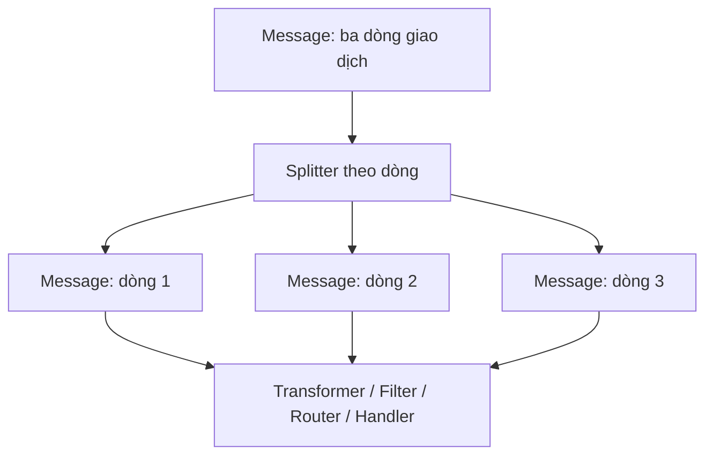
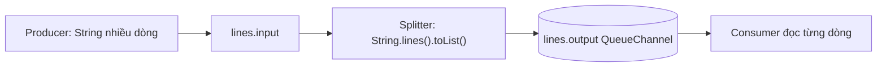
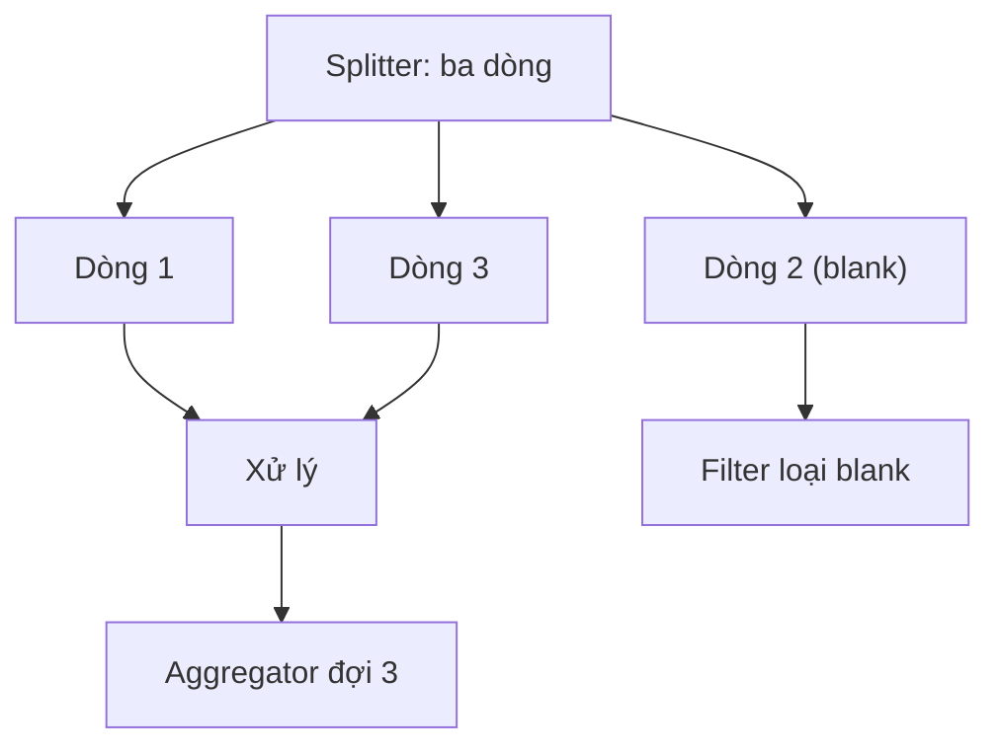
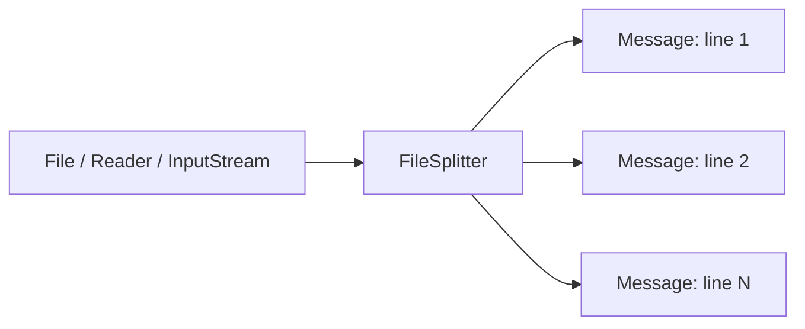
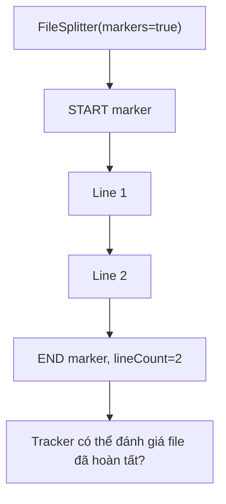
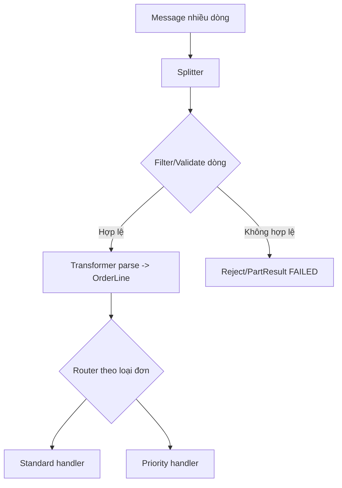
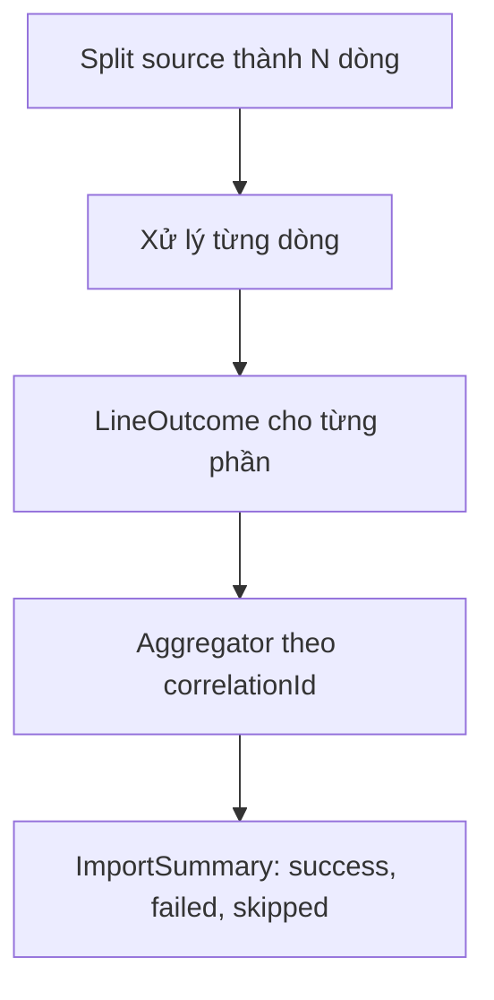
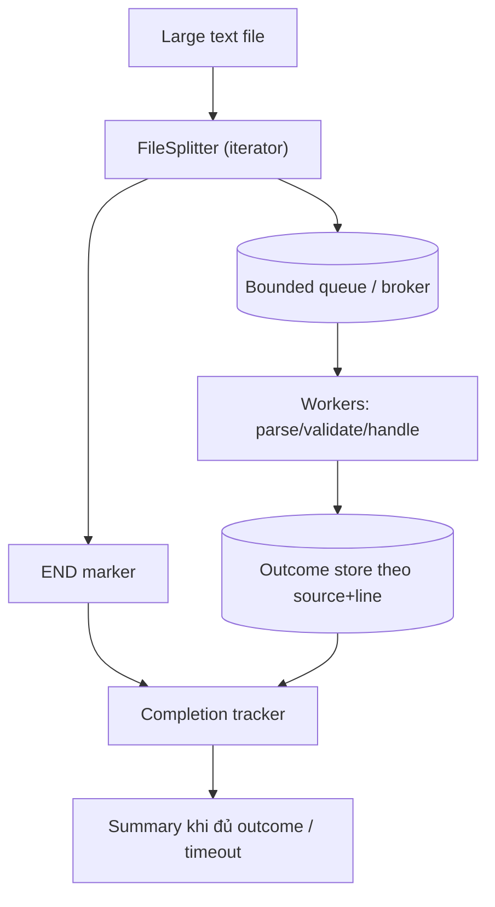

# Splitter theo dòng văn bản trong Spring Integration

## Mục tiêu bài học

Một đối tác gửi một message chứa nhiều dòng giao dịch:

```text
ORD-101,125000,VND
ORD-102,98000,VND
ORD-103,45000,VND
```

Hệ thống cần xử lý từng dòng độc lập: kiểm tra, chuyển đổi sang dữ liệu có cấu trúc, route tới nhánh nghiệp vụ, rồi theo dõi kết quả. Nếu một dòng sai, ta cần biết **dòng nào lỗi**, không chỉ biết “cả khối văn bản xử lý thất bại”.

**Splitter theo dòng văn bản** là ứng dụng của Enterprise Integration Pattern **Splitter**: từ **một message chứa nhiều dòng**, tạo ra **nhiều message con**, mỗi message mang nội dung của một dòng (hoặc một đối tượng đại diện dòng), cùng metadata để truy vết nguồn và tương quan khi cần gom kết quả.

Bài thuộc chương **Splitter** của module **SPRING_INTEGRATION_PATTERN**, hướng tới triển khai các Enterprise Integration Patterns bằng Spring Integration để tạo luồng thông điệp ít phụ thuộc và dễ mở rộng. Bài kết nối Splitter với Filter, Transformer, Router, Aggregator, Gateway, retry, error channel, correlation, kiểm thử và quan sát từng nhánh.

Sau bài, bạn có thể:

1. Thiết kế quy tắc “một dòng” rõ ràng cho `\n`, `\r\n`, `\r`, dòng trống và dấu kết thúc dòng cuối.
2. Tách một **String chứa văn bản** bằng Java DSL `.split(String.class, ...)` mà không nhầm với `FileSplitter`.
3. Dùng `FileSplitter` để phát từng dòng từ **tệp/stream** có kích thước lớn; nắm trade-off streaming và buffering.
4. Giải thích `correlationId`, `sequenceNumber`, `sequenceSize`, kể cả khi `sequenceSize=0` và khi dùng file markers.
5. Viết kiểm thử JUnit xác nhận **payload, số message, thứ tự, headers, dòng trống** và các trường hợp biên.
6. Gắn số dòng vật lý vào domain DTO để biết dòng gốc khi có Filter, parsing hoặc retry.
7. Phân biệt lỗi đọc, lỗi parse một dòng và lỗi downstream; thiết kế aggregation, timeout, idempotency và observability.

## 1. Bản chất của Splitter

Splitter lấy một message và tạo ra một tập phần tử có thể xử lý độc lập.



Ví dụ:

```text
Input:
  payload = "A\nB\nC"

Output:
  payload = "A"  (part 1)
  payload = "B"  (part 2)
  payload = "C"  (part 3)
```

Đối với một splitter có sequence metadata:

```text
Part #1: correlationId=<group>, sequenceNumber=1, sequenceSize=3
Part #2: correlationId=<group>, sequenceNumber=2, sequenceSize=3
Part #3: correlationId=<group>, sequenceNumber=3, sequenceSize=3
```

Đây là **ba Spring Messages riêng**, không phải một message mang `List<String>` được chuyển tiếp nguyên vẹn.

### Splitter khác Transformer, Filter và Router

| Pattern | Câu hỏi | Kết quả điển hình |
| --- | --- | --- |
| **Splitter** | Một message có bao nhiêu phần cần xử lý? | Một message thành nhiều message |
| **Transformer** | Một phần cần chuyển thành biểu diễn nào? | `String` dòng → `OrderLine` |
| **Filter** | Dòng này có được đi tiếp? | Chấp nhận hoặc loại message dòng |
| **Router** | Dòng này thuộc nhánh nào? | VIP, STANDARD, REVIEW |
| **Aggregator** | Khi nào gom đủ những phần của một nhóm? | Nhiều kết quả thành một summary |
| **Publish-Subscribe** | Mỗi subscriber có cần nhận cùng event không? | Phát cùng event đến nhiều nơi |
| **Recipient List** | Message cần gửi đến tập đích nào? | Fan-out theo danh sách |

**Splitter không tự phân tích CSV**, không tự bảo đảm xử lý song song và không tự tạo kết quả tổng hợp. Nó chỉ giải quyết nhiệm vụ phân rã message và phát các phần.

## 2. Xác định đúng “dòng” trước khi viết code

Dữ liệu văn bản thường dùng ba dạng ký tự xuống dòng:

| Dạng | Biểu diễn Java | Môi trường thường gặp |
| --- | --- | --- |
| LF | `\n` | Unix/Linux và nhiều giao thức |
| CRLF | `\r\n` | Nhiều tệp Windows |
| CR | `\r` | Một số nguồn cũ |

Với Java 11+ (bài dùng Java 17), `String.lines()` nhận biết `\n`, `\r\n` và `\r`, trả một `Stream<String>` các dòng **không kèm ký tự kết thúc**.

Ví dụ:

```java
String text = "alpha\r\n\r\nbeta\n";
var lines = text.lines().toList();
// ["alpha", "", "beta"]
```

Ý nghĩa:

- `alpha` là dòng 1.
- Giữa hai cụm CRLF có một **dòng trống**: `""`.
- `beta` là dòng 3.
- Dấu `\n` cuối chỉ kết thúc dòng `beta`, **không tự tạo thêm dòng thứ tư**.

### Bảng các trường hợp biên

| Văn bản đầu vào | Kết quả `String.lines().toList()` | Số dòng phát |
| --- | --- | ---: |
| `"A\nB"` | `["A", "B"]` | 2 |
| `"A\r\nB"` | `["A", "B"]` | 2 |
| `"A\rB"` | `["A", "B"]` | 2 |
| `"A\n\nB"` | `["A", "", "B"]` | 3 |
| `"A\n"` | `["A"]` | 1 |
| `"\n"` | `[""]` | 1 |
| `""` | `[]` | 0 |
| `" A \n B "` | `[" A ", " B "]` | 2 |

Các ví dụ phân biệt **dòng trống** (chuỗi `""`) với **không có dòng nào** (danh sách rỗng). Nếu nghiệp vụ muốn tính dấu xuống dòng cuối là một bản ghi trống, `String.lines()` **không phù hợp trực tiếp**; phải xác định rõ quy tắc và cài đặt parser khác.

### Tại sao không chỉ dùng `split("\n")`?

```java
String text = "A\r\nB";
String[] naive = text.split("\n");
// ["A\r", "B"] -- ký tự CR còn nằm trong phần tử đầu.
```

Ngoài vấn đề CRLF, `String.split(regex)` có quy tắc regex và xử lý phần tử rỗng cuối tùy `limit`. Có thể dùng regex rõ ràng như `split("\\R", -1)` khi cần chính sách giữ ô trống cuối, nhưng `\\R` bao quát nhiều loại line-break hơn `String.lines()`; hai lựa chọn **không hoàn toàn tương đương**.

**Đừng tự trim từng dòng** nếu khoảng trắng là dữ liệu có ý nghĩa: một dòng chữ ký, fixed-width format hoặc văn bản nhiều khoảng trắng sẽ bị thay đổi.

## 3. Ví dụ Java DSL: chia một String thành nhiều message dòng

Với đầu vào đã là `String` chứa toàn bộ văn bản, ta dùng Java DSL `.split(String.class, ...)`. Đây là một phép tách cụ thể do ứng dụng định nghĩa.



### Cấu hình hoàn chỉnh

```java
import java.util.List;
import java.util.Objects;

import org.springframework.context.annotation.Bean;
import org.springframework.context.annotation.Configuration;
import org.springframework.integration.channel.DirectChannel;
import org.springframework.integration.channel.QueueChannel;
import org.springframework.integration.config.EnableIntegration;
import org.springframework.integration.dsl.IntegrationFlow;
import org.springframework.messaging.MessageChannel;
import org.springframework.messaging.PollableChannel;

@Configuration
@EnableIntegration
public class TextLineSplitterConfig {

    @Bean("lines.input")
    MessageChannel input() {
        return new DirectChannel();
    }

    @Bean("lines.output")
    PollableChannel output() {
        // Dùng như test sink, chưa gắn poller nền.
        return new QueueChannel();
    }

    static List<String> splitLines(String text) {
        Objects.requireNonNull(text, "text");
        return text.lines().toList();
    }

    @Bean
    IntegrationFlow textLinesFlow() {
        return IntegrationFlow.from("lines.input")
            .split(String.class,
                TextLineSplitterConfig::splitLines,
                endpoint -> endpoint.applySequence(true))
            .channel("lines.output")
            .get();
    }
}
```

**Phân tích từng bước:**

1. Producer gửi một `Message<String>` có payload nhiều dòng vào `lines.input`.
2. `DirectChannel` gọi Splitter trong đường thực thi đồng bộ của ví dụ.
3. `splitLines` dùng `String.lines()` rồi thu về `List<String>` **có kích thước biết trước**.
4. Splitter phát một message cho mỗi phần tử trong danh sách, đi tiếp tới `lines.output`.
5. `applySequence(true)` yêu cầu gắn headers phục vụ correlation và đánh số phần tử.
6. `QueueChannel` cho phép test `receive()` các message con theo thứ tự enqueue.

Cách khai báo `.split(String.class, Function, endpointConfigurer)` thuộc Java DSL của Spring Integration. Khác với `.split()` mặc định, ta **cố ý chỉ định cách tách String** để loại bỏ sự mơ hồ.

### Vì sao dùng List thay cho Iterator?

`List<String>` cho Splitter biết số phần tử trước khi gửi. Khi áp dụng sequence, `sequenceSize` có thể phản ánh số dòng được tạo. Đổi lại, phải giữ danh sách dòng trong bộ nhớ. Với một message văn bản nhỏ đến vừa, đây là lựa chọn đơn giản và dễ gom kết quả.

Nếu trả `Iterator<String>` hoặc `Iterable` không xác định kích thước, Splitter không thể biết số phần trước, do đó `sequenceSize=0` trong trường hợp streaming iterator. Điều này ảnh hưởng trực tiếp tới Aggregator dựa vào kích thước nhóm.

### Gửi message đầu vào

```java
import org.springframework.messaging.MessageChannel;
import org.springframework.messaging.support.MessageBuilder;

// input được inject từ bean "lines.input".
input.send(MessageBuilder
    .withPayload("ORD-1\r\n\r\nORD-3\n")
    .setHeader("traceId", "trace-42")
    .setHeader("sourceId", "document-42")
    .build());
```

Kết quả dự kiến là ba message:

```text
#1: payload="ORD-1"; sequenceNumber=1; sequenceSize=3
#2: payload="";      sequenceNumber=2; sequenceSize=3
#3: payload="ORD-3"; sequenceNumber=3; sequenceSize=3
```

Header `traceId` và `sourceId` cần đi cùng mỗi message con để giữ ngữ cảnh của văn bản ban đầu. Các header kỹ thuật `id` và `timestamp` được framework quản lý; không dùng chúng làm business ID bất biến.

## 4. Kiểm thử tích hợp bằng JUnit 5

Bộ test phải xác nhận **số message**, **nội dung từng dòng**, **headers**, **dòng trống**, và **không có phần tử dư**.

```java
import static org.assertj.core.api.Assertions.assertThat;

import java.util.List;

import org.junit.jupiter.api.Test;
import org.springframework.beans.factory.annotation.Autowired;
import org.springframework.beans.factory.annotation.Qualifier;
import org.springframework.messaging.Message;
import org.springframework.messaging.MessageChannel;
import org.springframework.messaging.PollableChannel;
import org.springframework.messaging.support.MessageBuilder;
import org.springframework.test.context.junit.jupiter.SpringJUnitConfig;

@SpringJUnitConfig(TextLineSplitterConfig.class)
class TextLineSplitterFlowTest {

    @Autowired
    @Qualifier("lines.input")
    MessageChannel input;

    @Autowired
    @Qualifier("lines.output")
    PollableChannel output;

    @Test
    void splitsCrLfBlankAndTrailingTerminator() {
        assertThat(input.send(MessageBuilder
            .withPayload("ORD-1\r\n\r\nORD-3\n")
            .setHeader("traceId", "trace-42")
            .setHeader("sourceId", "file-import-42")
            .build())).isTrue();

        Message<?> first = output.receive(2_000);
        Message<?> second = output.receive(2_000);
        Message<?> third = output.receive(2_000);

        assertThat(first).isNotNull();
        assertThat(second).isNotNull();
        assertThat(third).isNotNull();

        assertThat(List.of(
            first.getPayload(),
            second.getPayload(),
            third.getPayload()
        )).containsExactly("ORD-1", "", "ORD-3");

        Object correlationId =
            first.getHeaders().get("correlationId");
        assertThat(correlationId).isNotNull();
        assertThat(second.getHeaders().get("correlationId"))
            .isEqualTo(correlationId);
        assertThat(third.getHeaders().get("correlationId"))
            .isEqualTo(correlationId);

        assertThat(first.getHeaders().get("sequenceNumber"))
            .isEqualTo(1);
        assertThat(second.getHeaders().get("sequenceNumber"))
            .isEqualTo(2);
        assertThat(third.getHeaders().get("sequenceNumber"))
            .isEqualTo(3);
        assertThat(first.getHeaders().get("sequenceSize"))
            .isEqualTo(3);
        assertThat(second.getHeaders().get("sequenceSize"))
            .isEqualTo(3);
        assertThat(third.getHeaders().get("sequenceSize"))
            .isEqualTo(3);

        for (Message<?> part : List.of(first, second, third)) {
            assertThat(part.getHeaders().get("traceId"))
                .isEqualTo("trace-42");
            assertThat(part.getHeaders().get("sourceId"))
                .isEqualTo("file-import-42");
        }

        assertThat(output.receive(0)).isNull();
    }

    @Test
    void emptyTextProducesNoLineMessages() {
        assertThat(input.send(
            MessageBuilder.withPayload("").build()
        )).isTrue();

        assertThat(output.receive(0)).isNull();
    }

    @Test
    void aSingleLineWithoutTerminatorProducesOneMessage() {
        assertThat(input.send(
            MessageBuilder.withPayload("ONLY-LINE").build()
        )).isTrue();

        Message<?> part = output.receive(2_000);
        assertThat(part).isNotNull();
        assertThat(part.getPayload()).isEqualTo("ONLY-LINE");
        assertThat(part.getHeaders().get("sequenceNumber"))
            .isEqualTo(1);
        assertThat(part.getHeaders().get("sequenceSize"))
            .isEqualTo(1);
        assertThat(output.receive(0)).isNull();
    }
}
```

Các test trên giả định `lines.output` không có consumer khác, test không chạy song song trên cùng một queue và `DirectChannel` xử lý đồng bộ. Khi có executor/broker hoặc nhiều producer đồng thời, các message con thuộc những group khác nhau có thể xen kẽ; **không được dùng ba lượt receive liên tiếp** để suy rằng chắc chắn cùng một source nếu không kiểm tra correlation.

### Unit test của hàm tách dòng

```java
import static org.assertj.core.api.Assertions.assertThat;

import org.junit.jupiter.api.Test;

class TextLineSplitterPolicyTest {

    @Test
    void handlesDifferentLineEndings() {
        assertThat(TextLineSplitterConfig.splitLines("A\nB"))
            .containsExactly("A", "B");

        assertThat(TextLineSplitterConfig.splitLines("A\r\nB"))
            .containsExactly("A", "B");

        assertThat(TextLineSplitterConfig.splitLines("A\rB"))
            .containsExactly("A", "B");
    }

    @Test
    void distinguishesBlankLineAndEmptyDocument() {
        assertThat(TextLineSplitterConfig.splitLines("A\n\nB"))
            .containsExactly("A", "", "B");

        assertThat(TextLineSplitterConfig.splitLines(""))
            .isEmpty();

        assertThat(TextLineSplitterConfig.splitLines("\n"))
            .containsExactly("");
    }
}
```

Unit test kiểm tra **quy tắc tách**; integration test kiểm tra **endpoint, số message và header**. Đối với dữ liệu tài chính hoặc import quan trọng, cả hai loại test đều cần thiết.

## 5. Dòng trống: giữ nguyên, bỏ qua hay báo lỗi?

Dòng trống không phải lúc nào cũng là dữ liệu không hợp lệ.

| Dạng dữ liệu | Dòng trống nên được xử lý thế nào? |
| --- | --- |
| Nhật ký đơn giản | Có thể bỏ qua nếu hợp đồng cho phép |
| Văn bản có cấu trúc theo đoạn | Dòng trống có thể phân cách đoạn, phải giữ |
| CSV một record mỗi dòng | Dòng trống cần được xử lý theo schema/policy |
| Fixed-width record | Khoảng trắng có thể là dữ liệu có nghĩa |
| JSON Lines / NDJSON | Dòng trống thường cần policy skip/reject tường minh |
| Tệp có dòng cuối kết thúc bằng newline | Không mặc định coi có thêm một record rỗng |

Có ba lựa chọn:

1. **Giữ tất cả dòng** do `String.lines()` tạo, như ví dụ chính. Consumer tự phân loại.
2. **Loại dòng trống trước khi Splitter trả danh sách**: chỉ phát message cho dòng cần xử lý.
3. **Phát tất cả dòng rồi Filter từng message con**: tiện theo dõi rejected/skipped, nhưng phải cân nhắc Aggregator.

### Lọc trước khi phát phần tử

```java
static List<String> meaningfulLines(String text) {
    return text.lines()
        .filter(line -> !line.isBlank())
        .toList();
}
```

Nếu áp dụng hàm này trong `.split(...)`, `sequenceSize` phản ánh **số dòng còn lại sau khi lọc**, không phản ánh số dòng vật lý của văn bản gốc. Đây có thể là kết quả mong muốn, nhưng khi báo lỗi người dùng sẽ khó biết một record thực tế nằm ở dòng vật lý số mấy.

### Filter sau Splitter: cẩn thận với Aggregator



Nếu Splitter đã gắn `sequenceSize=3`, nhưng Filter loại message dòng 2 **không phát một kết quả thay thế**, Aggregator chỉ nhận 2/3 và không thể release theo chiến lược “đủ số phần” mặc định.

Giải pháp:

- Loại dòng trống **trước khi Splitter lập nhóm**.
- Hoặc phát `PartOutcome(status=SKIPPED)` để Aggregator vẫn nhận kết quả cho dòng đã được xem xét.
- Hoặc dùng release strategy tùy chỉnh và timeout/end marker phù hợp.

Không tự sửa `sequenceSize` của từng message con theo ý riêng, vì group metadata phải thống nhất.

## 6. Muốn giữ số dòng vật lý: trả DTO thay cho String

Khi dòng 7 bị parse sai, một payload chỉ chứa `"BAD,DATA"` không cho biết nó đến từ dòng nào sau khi skip các dòng trống. Một giải pháp là tạo DTO chứa **chỉ số dòng vật lý**.

```java
public record TextLine(
    int physicalLineNumber,
    String content
) {}
```

Hàm Splitter:

```java
import java.util.List;
import java.util.stream.IntStream;

static List<TextLine> numberedNonBlankLines(String text) {
    List<String> all = text.lines().toList();

    return IntStream.range(0, all.size())
        .filter(i -> !all.get(i).isBlank())
        .mapToObj(i -> new TextLine(i + 1, all.get(i)))
        .toList();
}
```

Ví dụ:

```text
Input:
  physical line 1: "ORD-1"
  physical line 2: ""
  physical line 3: "ORD-3"

Output:
  TextLine(1, "ORD-1")
  TextLine(3, "ORD-3")

Sequence headers:
  first:  sequenceNumber=1, sequenceSize=2
  second: sequenceNumber=2, sequenceSize=2
```

Phân biệt hai con số:

- `physicalLineNumber`: vị trí **trong tài liệu gốc**, hữu ích cho báo lỗi và replay.
- `sequenceNumber`: vị trí **trong danh sách message do Splitter phát**, hữu ích cho correlation/aggregation.

Không nhất thiết hai số giống nhau sau khi lọc hoặc chuyển đổi.

### Header nguồn và khóa idempotency

Nên gửi header `sourceId` hoặc `documentId` cùng message gốc. Một idempotency key đơn giản có thể là:

```text
(sourceId, sourceVersion, physicalLineNumber)
```

Không chỉ dùng file path vì tệp cùng tên có thể bị ghi đè. Nếu message được replay, `sourceVersion` có thể là checksum, ingestion ID hoặc một khóa nội dung phù hợp hợp đồng. Với một dòng có thể xuất hiện nhiều lần hợp lệ, chỉ dùng nội dung dòng làm dedup key là không đúng.

## 7. Tách văn bản trong payload khác đọc tệp theo dòng

Hai bài toán có vẻ giống nhau nhưng **khác component và ngữ nghĩa đầu vào**:

| Bài toán | Payload đến Splitter | Cách phù hợp |
| --- | --- | --- |
| Message đã chứa toàn bộ văn bản | `String("A\nB")` | `.split(String.class, text -> text.lines().toList())` |
| Input là một tệp trên đĩa | `File` | `FileSplitter` |
| Input là đường dẫn đến tệp | `String("C:/data/orders.txt")` | `FileSplitter` hiểu là **đường dẫn** |
| Input là byte stream của tệp | `InputStream` hoặc `Reader` | `FileSplitter` và charset/quản lý resource |
| Input là một tập DTO | `List<OrderLine>` | Splitter collection, không phải line parser |

**Bẫy đặc biệt:** `FileSplitter` hỗ trợ payload kiểu `String` nhưng diễn giải nó là **đường dẫn tệp**, không phải chuỗi nội dung đa dòng. Không chuyển `"A\nB"` trực tiếp cho FileSplitter rồi kỳ vọng nhận hai dòng văn bản.

Với dữ liệu dạng String, dùng ví dụ `TextLineSplitterConfig` ở mục 3. Với file, dùng `FileSplitter` được thiết kế để đọc nội dung file theo dòng.

## 8. FileSplitter: đọc tệp lớn theo dòng

Spring Integration File Support có `FileSplitter` dựa trên `BufferedReader.readLine()`. Nó có thể nhận `File`, `String` đường dẫn, `InputStream` hoặc `Reader`. Mặc định, FileSplitter dùng **Iterator** để đọc và phát từng dòng khi đang duyệt, giảm nhu cầu giữ mọi dòng trong một danh sách trong bộ nhớ.



Ví dụ Java DSL:

```java
import java.nio.charset.StandardCharsets;

import org.springframework.context.annotation.Bean;
import org.springframework.integration.dsl.IntegrationFlow;
import org.springframework.integration.file.dsl.Files;

@Bean
IntegrationFlow textFileLinesFlow() {
    // Ví dụ giả định "files.input" và "files.parts"
    // là các channel đã được khai báo.
    return IntegrationFlow.from("files.input")
        .split(Files.splitter()
            .charset(StandardCharsets.UTF_8))
        .channel("files.parts")
        .get();
}
```

Phân biệt:

- **FileSplitter** đọc dòng từ nguồn file/stream và phát từng message.
- **TextLineSplitterConfig** tách một chuỗi đã nằm trọn trong memory.
- `charset(UTF_8)` điều khiển việc decode text file; với String chứa văn bản sẵn, charset đã được xử lý ở bước ingress, không cần FileSplitter decode lại.

### Iterator mode và memory

| Chế độ FileSplitter | Hành vi | Trade-off |
| --- | --- | --- |
| `iterator=true` (mặc định) | Đọc từng dòng khi duyệt | Ít RAM hơn; không biết trước tổng số dòng |
| `iterator=false` | Đọc toàn bộ dòng vào bộ nhớ trước khi phát | Có thể biết kích thước, nhưng tốn RAM; chỉ phù hợp file nhỏ/vừa |

Với file nhiều GB, không nên bật `iterator=false` chỉ để có `sequenceSize` khác 0. Hãy thiết kế completion theo file markers hoặc metadata nguồn phù hợp.

### Sequence headers khi FileSplitter streaming

Theo Spring Integration, khi `applySequence=true` và splitter dựa trên Iterator, **`sequenceSize=0`** vì tổng số phần chưa được biết. `sequenceNumber` vẫn biểu diễn vị trí mỗi message con trong lượt tách theo cơ chế sequence. Aggregator mặc định chờ đủ `sequenceSize` sẽ **không có số đích đáng tin để release**.

Khác với ví dụ `String.lines().toList()`, nơi tổng số phần đã biết trước.

## 9. File markers: xác định bắt đầu và kết thúc file

Khi xử lý streaming, không biết trước tổng số dòng nhưng vẫn cần biết **khi nào file đã đọc hết**. FileSplitter hỗ trợ marker messages:

- `FileMarker.START`: bắt đầu một file.
- `FileMarker.END`: kết thúc một file, kèm thông tin số dòng đã xử lý.
- Các message dòng giữa hai marker mang `String` payload.

Đây là những message có **payload khác kiểu**, nên consumer không được ép mọi payload thành `String`.

### Bật markers

```java
import java.nio.charset.StandardCharsets;

import org.springframework.integration.file.dsl.Files;
import org.springframework.integration.dsl.IntegrationFlow;

@Bean
IntegrationFlow fileStreamWithMarkers() {
    return IntegrationFlow.from("files.input")
        .split(Files.splitter()
            .markers()
            .charset(StandardCharsets.UTF_8))
        .channel("files.parts")
        .get();
}
```

Đây là phương án cấu hình **thay thế**, không đăng ký song song với flow mục 8 vào cùng channel input chỉ để thử hai kiểu.

Đối với `FileSplitter`:

- Khi `markers=true`, mặc định `applySequence=false`.
- Nếu **bật `applySequence(true)`** trong chế độ Iterator, `sequenceSize` vẫn bằng 0 và các marker cũng nằm trong trình tự đánh số.
- Khi file rỗng, nếu markers bật, có thể chỉ nhận START và END (lineCount bằng 0).
- Khi markers tắt, file không có dòng thường không phát ra line message.



**Marker END cho biết việc duyệt tới cuối nguồn**, không chứng minh mọi handler downstream đã xử lý các dòng thành công. Khi có queue, executor, broker hoặc retry, vẫn cần theo dõi kết quả từng dòng để biết processing completion.

### Dòng header đầu tiên của file

Với tệp văn bản có một dòng đầu làm header, `FileSplitter` hỗ trợ `firstLineAsHeader("csvHeader")`:

```java
.split(Files.splitter()
    .charset(StandardCharsets.UTF_8)
    .firstLineAsHeader("csvHeader"))
```

Đây là **trích đoạn**, không phải parser CSV hoàn chỉnh. Dòng đầu được đặt thành header trên các message dữ liệu tiếp theo và không được phát làm message dữ liệu thường. Số dòng đếm theo cơ chế FileSplitter cũng có quy tắc không tính dòng header; nếu cần báo lỗi “dòng vật lý 17”, phải tính lại offset cho đúng.

## 10. Splitter theo dòng không phải parser CSV đa dòng

Một giả định nguy hiểm: “Mỗi dòng văn bản luôn là một bản ghi”. Với CSV chuẩn, một field có thể chứa **newline bên trong dấu ngoặc kép**:

```text
id,note
1,"giao ca sáng
giao ca chiều"
2,"giao bình thường"
```

Về mặt văn bản, đây là **4 dòng vật lý**, nhưng về mặt CSV chỉ có **một header + hai record**. Splitter theo dòng đơn thuần sẽ chia sai record có nội dung nhiều dòng.

| Định dạng | Có thể dùng line splitter thuần? | Gợi ý |
| --- | --- | --- |
| Mỗi dòng một ID | Có, nếu hợp đồng rõ | `String.lines()` hoặc `FileSplitter` |
| NDJSON/JSON Lines | Có, nếu mỗi dòng là JSON hoàn chỉnh và policy xử lý blank rõ | Splitter → JSON Transformer per line |
| CSV đơn giản không cho newline trong quoted field | Có sau khi xác nhận hợp đồng | Splitter → CSV parser cho một record |
| CSV cho quoted multiline fields | **Không** với line splitter thuần | Dùng CSV parser nhận biết record boundary |
| Log nhiều dòng như stacktrace | Không phải mỗi dòng là một event | Dùng parser phân đoạn theo định dạng log |
| Binary file | Không | Decode/parse bằng công cụ đúng định dạng |

Với NDJSON, mỗi line còn cần parser JSON, validation schema và xử lý lỗi riêng. **Splitter chỉ phân tách text; nó không kiểm chứng nội dung dòng.**

## 11. Từ dòng văn bản tới DTO nghiệp vụ

Giả sử mỗi dòng có định dạng đơn giản:

```text
ORD-101,125000,VND
```

Một Transformer tiếp theo có thể parse dòng thành:

```java
import java.math.BigDecimal;

public record OrderLine(
    String orderId,
    BigDecimal amount,
    String currency
) {}
```

Hàm parse tối giản chỉ dùng cho hợp đồng **ba trường không chứa dấu phẩy escaped/quoted**:

```java
import java.math.BigDecimal;
import java.util.Set;

static OrderLine parseSimpleLine(String line) {
    String[] parts = line.split(",", -1);
    if (parts.length != 3) {
        throw new IllegalArgumentException("INVALID_COLUMN_COUNT");
    }

    String id = parts[0].trim();
    String amountText = parts[1].trim();
    String currency = parts[2].trim();

    if (id.isBlank() || !amountText.matches("[0-9]+")) {
        throw new IllegalArgumentException("INVALID_LINE");
    }
    if (!Set.of("VND", "USD").contains(currency)) {
        throw new IllegalArgumentException("UNSUPPORTED_CURRENCY");
    }

    return new OrderLine(
        id,
        new BigDecimal(amountText),
        currency
    );
}
```

Đây là ví dụ thực hành, **không phải parser CSV tổng quát**. Nếu format cho phép dấu phẩy trong dấu ngoặc kép, escaped quote, newline trong field hoặc encoding đặc biệt, phải dùng parser hỗ trợ định dạng đúng.

### Pipeline đề xuất



Ở đây Filter có thể kiểm tra dòng blank, còn Transformer parse nội dung. Nếu muốn lỗi parse có mã lý do, có thể tạo `LineOutcome(FAILED, reason)` trong error flow thay vì nuốt exception rồi bỏ message.

## 12. Correlation và sequence khi tách message

Spring Integration Splitter dựa trên `AbstractMessageSplitter` có khả năng bổ sung:

- `correlationId`: định danh nhóm các message con cùng nguồn.
- `sequenceNumber`: chỉ số của phần tử trong nhóm, thường bắt đầu từ 1.
- `sequenceSize`: tổng số phần khi biết kích thước, hoặc 0 với iterator chưa biết tổng.

Ví dụ một message `document-42` được tách thành ba phần:

```text
Message #1: traceId=trace-42; correlationId=group-42;
            sequenceNumber=1; sequenceSize=3

Message #2: traceId=trace-42; correlationId=group-42;
            sequenceNumber=2; sequenceSize=3

Message #3: traceId=trace-42; correlationId=group-42;
            sequenceNumber=3; sequenceSize=3
```

`group-42` là **giá trị minh họa**. Framework có thể tạo correlation key từ thông tin message gốc; không nên hard-code một định dạng ID do mình suy đoán. Trong kiểm thử, hãy kiểm tra các message con có correlation giống nhau và không null thay vì đoán chuỗi thực tế.

### Truyền header qua các endpoint

Khi dòng đi qua Transformer, Router hoặc các adapter, cần giữ metadata:

- `sourceId`, `sourceVersion` và `traceId` cho tra cứu, audit và chống trùng.
- `correlationId`, `sequenceNumber`, `sequenceSize` nếu Aggregator dựa vào sequence headers.
- `replyChannel`/`errorChannel` nếu flow request-reply cần chúng và header phù hợp với ranh giới tin cậy.

Nếu tự tạo `Message<?>` mới, cần kiểm soát header copy/allowlist. Không gửi object channel nội bộ sang broker ngoài tiến trình một cách mù quáng.

### Sequence không phải thứ tự hoàn thành

Một Splitter có thể phát `#1` trước `#2` trước `#3`. Nhưng sau ExecutorChannel, QueueChannel nhiều consumer hoặc broker, phần `#3` có thể hoàn tất trước phần `#1`. **Không dùng thứ tự completion để suy ra số dòng nguồn**.

## 13. Aggregator: gom kết quả sau khi xử lý từng dòng

Nếu caller cần biết mọi dòng đã được xử lý ra sao, hãy để downstream tạo **một kết quả cho mỗi phần**.

Ví dụ:

```java
public record LineOutcome(
    String sourceId,
    int physicalLineNumber,
    String status,
    String reasonCode
) {}
```

Một file có ba dòng có thể sinh:

```text
LineOutcome(sourceId=doc-42, line=1, status=SUCCEEDED)
LineOutcome(sourceId=doc-42, line=2, status=SKIPPED)
LineOutcome(sourceId=doc-42, line=3, status=FAILED, reason=INVALID_FORMAT)
```

Nếu dùng Aggregator với release strategy mặc định dựa trên sequence:

1. Mọi phần được chọn cần sinh outcome, kể cả `SKIPPED` hoặc `FAILED` theo hợp đồng.
2. Các outcome phải giữ correlation/sequence đúng.
3. Với `List` có số phần xác định, `sequenceSize` có thể dùng làm số phần kỳ vọng.
4. Với streaming `Iterator` hay `FileSplitter` có `sequenceSize=0`, **không được kỳ vọng default aggregator tự biết khi nào đủ**.
5. Nếu một message con bị Filter discard im lặng hoặc handler lỗi không sinh outcome, group có thể không release cho tới timeout/expiry.

### Sơ đồ xử lý tổng hợp



Đoạn Java DSL **minh họa**, cần kết nối thực tế từ channel outcome:

```java
import org.springframework.context.annotation.Bean;
import org.springframework.integration.dsl.IntegrationFlow;

@Bean
IntegrationFlow aggregateKnownSizeLines() {
    return IntegrationFlow.from("lines.outcomes")
        .aggregate()
        .channel("lines.summaries")
        .get();
}
```

Với một splitter phát `List` và giữ đủ sequence metadata, default aggregator có thể gom phần khi đủ. Nhưng đây **chưa phải workflow hoàn chỉnh**: phải khai báo các channel, MessageGroupStore nếu cần bền vững, completion/timeout policy và cách chuyển payload tổng hợp thành `ImportSummary`.

### Dòng lỗi có được tính vào kết quả hoàn tất?

Nếu mỗi dòng bắt buộc được **xem xét**, thì một outcome `FAILED` vẫn là một kết quả terminal cho dòng ấy; Aggregator có thể nhận đủ các outcome rồi trả summary `PARTIAL_FAILURE`. Nếu một phần đang retry, chưa nên phát kết quả terminal quá sớm khi chính sách muốn chờ retry.

### Khi dùng file markers

Với FileSplitter streaming, có thể sử dụng END marker như **tín hiệu biết số dòng nguồn đã được duyệt**, nhưng vẫn phải theo dõi số outcome xử lý thành công/thất bại đến từ từng dòng. END marker không bảo đảm các worker bất đồng bộ đã hoàn tất. Cần một tracker/release strategy có thể xử lý kết quả đến muộn, duplicate và timeout.

## 14. Không có dòng nào: hợp đồng với Gateway và Aggregator

Một message đầu vào `""` có thể tạo **0 message con**. Điều này có nhiều ý nghĩa:

| Tình huống | Cần quyết định |
| --- | --- |
| Empty document được phép | Trả summary `EMPTY` hoặc không tạo công việc |
| Empty document là lỗi | Reject input với mã `NO_LINES` |
| Gateway chờ reply | Phải tạo reply/error khi không có phần tử, nếu không có thể timeout |
| Aggregator chờ kết quả | Không tạo group kết quả nếu Splitter không phát phần nào |
| File có markers | START/END có thể biểu diễn tệp rỗng |

Một cách giải quyết nếu empty là lỗi nghiệp vụ: **Filter/validate trước Splitter** và trả response rõ.

```java
static boolean hasAtLeastOneLine(String text) {
    return text != null && text.lines().findAny().isPresent();
}
```

Hàm trên xem `"\n"` là có một dòng trống; nếu yêu cầu ít nhất một **dòng không blank**, hãy dùng:

```java
static boolean hasMeaningfulLine(String text) {
    return text != null &&
        text.lines().anyMatch(line -> !line.isBlank());
}
```

Phân biệt hai quy tắc để tránh Gateway chờ kết quả trong khi downstream không bao giờ nhận phần tử có thể xử lý.

## 15. Lỗi đọc, parse và xử lý downstream

Ba nhóm lỗi không đồng nghĩa:

| Nhóm lỗi | Ví dụ | Xử lý phù hợp |
| --- | --- | --- |
| **Đọc/decode nguồn** | Tệp không tồn tại, encoding sai, stream bị ngắt | Error flow ở adapter/FileSplitter, retry nguồn nếu an toàn |
| **Tách dòng** | Logic custom ném exception trên payload sai kiểu | Reject/schema validation, test policy |
| **Parse từng dòng** | `"ORD-X,abc,VND"` không thể parse tiền | Tạo outcome `FAILED` có số dòng, quarantine dòng |
| **Xử lý nghiệp vụ** | Ghi DB lỗi, API timeout | Retry downstream có idempotency |
| **Gom kết quả** | Thiếu một dòng, correlation sai, timeout | Completion/expiry strategy và cảnh báo |

### Lỗi giữa chừng với FileSplitter streaming

Vì FileSplitter mặc định đọc từng dòng và phát dần, nếu I/O lỗi sau dòng 100, **100 dòng đầu có thể đã được gửi xuống downstream**. Không coi cả việc đọc file là một transaction nguyên khối.

Khi replay nguồn, các dòng trước đó có thể được xử lý lại. Nên có idempotency theo `sourceId + sourceVersion + physicalLineNumber` hoặc định danh record nghiệp vụ phù hợp.

Nếu sử dụng FileSplitter `iterator=false` để đọc trước toàn bộ tệp, có thể phát hiện một số I/O lỗi **trước khi gửi line messages**; đổi lại, file phải được nạp vào bộ nhớ, không phù hợp file lớn.

### Retry không giải quyết mọi lỗi

Lỗi format một dòng không tự hết khi retry cùng dữ liệu. Ngược lại, timeout khi gọi hệ thống downstream có thể là lỗi tạm thời nhưng kết quả side effect có thể đã xảy ra. Vì vậy:

- Phân loại lỗi **permanent** và **transient**.
- Retry có giới hạn/backoff tại đúng tầng.
- Ghi `LineOutcome` và mã lỗi an toàn để điều tra.
- Thiết kế idempotency nơi có side effect.
- Không gộp “line rejected” với “file stream failed” thành một lỗi mơ hồ.

### Error channel và discard channel khác nhau

- **Filter discard channel**: đường xử lý message dòng bị loại theo predicate.
- **Error channel**: nhận `ErrorMessage` khi endpoint/adapter được cấu hình gửi lỗi qua cơ chế error handling.
- **Dead-letter/quarantine**: vùng giữ dữ liệu không xử lý được để điều tra/replay có kiểm soát.

Trong `DirectChannel`, exception có thể truyền ngược tới producer. Trong poller/executor/broker, lỗi có thể xuất hiện ở worker và được đưa đến error flow tùy cấu hình. Đừng giả định mọi exception tự rơi vào một error channel mà không xem topology thực tế.

## 16. Streaming, backpressure và tài nguyên

Với dữ liệu nhỏ, `String.lines().toList()` đơn giản và đủ tốt. Với tệp hàng triệu dòng:

1. Không đọc toàn bộ thành một `String` lớn nếu không cần.
2. Dùng `FileSplitter`/streaming và consumer có giới hạn công suất.
3. Đặt **queue capacity**, send timeout và backpressure cho downstream.
4. Đo backlog, thời gian xử lý và số dòng chưa hoàn tất.
5. Quản lý vòng đời `InputStream`/`Reader`; dùng integration adapter phù hợp để đóng resource/session.
6. Với nguồn từ xa như FTP/SFTP, kiểm tra session lifecycle và cách xử lý stream lỗi.
7. Có chính sách pause/retry/replay và source version.

### Tách theo dòng không tự song song hóa

Nếu gửi tất cả line messages tới một `DirectChannel` với handler đồng bộ, các dòng có thể được xử lý lần lượt. Muốn xử lý song song cần chọn channel/executor/poller/consumer phù hợp; điều này lại làm thay đổi giả định ordering và tác động tới Aggregator.

### Queue đầy

Nếu Splitter cố gửi message dòng vào `QueueChannel` đã đầy, thao tác gửi có thể chờ hoặc thất bại theo send timeout/cấu hình endpoint. Trong một quá trình đọc file streaming, lỗi gửi giữa chừng có thể dẫn tới **partial dispatch**. Khi thiết kế phục hồi, cần biết đã phát những dòng nào và dùng dedup khi replay.

### Một mô hình cho file lớn



Đây là **kiến trúc tham khảo**, không phải một flow Spring Integration tự có đủ các bước. Khi file marker END tới, tracker còn phải chờ outcome của các dòng được phát trước đó.

## 17. Security và dữ liệu không đáng tin

Nguồn file hoặc payload text có thể do đối tác/client cung cấp. Cần kiểm soát:

- **Kích thước:** không cho một message `String` khổng lồ tiêu thụ RAM không giới hạn; file lớn nên streaming.
- **Số dòng:** đặt giới hạn dòng tối đa hoặc chính sách quota theo tenant.
- **Độ dài từng dòng:** tránh một dòng có hàng trăm MB làm parser/regex quá tải.
- **Charset:** dùng encoding được thỏa thuận (ví dụ UTF-8), có chính sách với BOM và byte không hợp lệ.
- **Đường dẫn file:** không biến path do client nhập thành quyền đọc tùy ý trên filesystem; chặn path traversal và giới hạn thư mục được phép.
- **Payload/header trust:** không tin `tenantId` hay `role` tự khai; dùng identity đáng tin ở ingress.
- **Logging:** không ghi toàn bộ dòng dữ liệu có PII, token hoặc số thẻ thanh toán.
- **Regex/parser:** tránh biểu thức backtracking đắt đỏ từ nguồn không kiểm soát.

BOM (`U+FEFF`) ở đầu file có thể bám vào chuỗi dòng đầu sau decode; một record parser có thể thấy mã ID lạ nếu không xử lý theo policy. Cần quyết định bỏ BOM ở lớp decode/ingress **một lần**; không tự động xóa mọi ký tự `U+FEFF` trong các dòng nếu nó là dữ liệu hợp lệ.

## 18. Observability: theo dõi theo nguồn và từng dòng

Khi có nhiều message con, một metric “số message đầu vào” không đủ. Nên phân biệt:

```text
file/source accepted
  -> line emitted
  -> line started
  -> line succeeded/failed/skipped
  -> source completed/partially completed
```

Ví dụ một số metric ứng dụng có thể định nghĩa:

| Metric | Câu hỏi |
| --- | --- |
| `split_source_received_total` | Có bao nhiêu nguồn văn bản đến? |
| `split_line_emitted_total` | Có bao nhiêu line messages đã phát? |
| `split_empty_source_total` | Có bao nhiêu source không có dòng? |
| `split_line_blank_total` | Dòng trống chiếm tỷ lệ bao nhiêu? |
| `split_line_parse_failed_total{reason}` | Lỗi parse thường gặp là gì? |
| `split_line_processed_total{status}` | Bao nhiêu dòng thành công/thất bại/skip? |
| `split_duration{sourceType}` | Tốn bao lâu để tách nguồn? |
| `split_queue_depth{queue}` | Có bao nhiêu dòng đang chờ? |
| `split_source_pending_age` | Source nào còn chờ kết quả? |
| `split_replay_total` | Có bao nhiêu nguồn hoặc dòng đã replay? |

Tên metric là **gợi ý do ứng dụng tự đặt**, không khẳng định Spring Integration tự xuất theo đúng tên này. Kết hợp Micrometer/observation, structured logging, tracing và outcome store nếu cần.

Log minh họa:

```text
traceId=trace-42 sourceId=document-42
event=split_completed emittedLines=3 blankLines=1

traceId=trace-42 sourceId=document-42 lineNo=3
event=line_failed errorCode=INVALID_AMOUNT

traceId=trace-42 sourceId=document-42
event=source_summary status=PARTIAL_FAILURE succeeded=1 skipped=1 failed=1
```

Không dùng `sourceId` hay `traceId` có cardinality rất lớn làm nhãn metric; dùng chúng trong log/trace có quyền truy cập phù hợp.

### Theo dõi điều gì khi lỗi?

| Triệu chứng | Chẩn đoán |
| --- | --- |
| Có ký tự `\r` dính vào payload | Dùng `split("\n")` trên dữ liệu CRLF |
| Không thấy dòng trống cuối | `String.lines()` không tạo dòng dư do terminator cuối |
| Message “A\nB” bị coi là đường dẫn | Dùng `FileSplitter` với payload String content |
| Aggregator chờ mãi | Một phần bị Filter loại, hoặc `sequenceSize=0` khi streaming |
| Dòng #5 được báo thành #4 | Đã lọc dòng trống trước khi gắn số dòng vật lý |
| Record CSV bị tách đôi | Field CSV chứa quoted newline; line splitter không hiểu record |
| File lớn làm tăng RAM mạnh | Dùng `String.lines().toList()` cho dữ liệu khổng lồ hoặc tắt iterator |
| File END đã thấy nhưng thiếu kết quả | Worker còn xử lý, queue tồn backlog hoặc outcome chưa tới |
| Replay tạo kết quả trùng | Chưa idempotent theo source/version/line hoặc business key |
| Thứ tự kết quả đảo | Downstream bất đồng bộ/competing consumers |
| Một dòng lỗi khiến ngừng toàn nguồn | Exception chưa được chuyển thành outcome theo policy |
| Không rõ file nào sinh ra lỗi | Thiếu `sourceId`, physical line number, trace/correlation |

## 19. Bài tập thực hành

### Bài 1 — CRLF, LF, CR và dòng trống

Dùng `TextLineSplitterConfig`, gửi lần lượt `"A\nB"`, `"A\r\nB"` và `"A\rB"`. Kiểm tra payload của hai output. Sau đó gửi `"A\n\nB\n"` và xác nhận có đúng ba message, trong đó message #2 mang chuỗi rỗng.

### Bài 2 — Empty document

Gửi `""` và `"\n"`. So sánh kết quả. Định nghĩa hợp đồng cho trường hợp tài liệu rỗng có được chấp nhận hay phải trả `NO_LINES` cho caller.

### Bài 3 — Sequence và correlation

Gửi một văn bản gồm bốn dòng. Assert `sequenceNumber=1..4`, `sequenceSize=4` và các message con có cùng correlation. Thêm header `sourceId`/`traceId` và kiểm tra header propagation.

### Bài 4 — Giữ dòng vật lý sau khi lọc

Dùng `numberedNonBlankLines` để tách `"A\n\nC"`. Kiểm tra `TextLine(1,"A")` và `TextLine(3,"C")`, nhưng sequence chỉ có 1 và 2.

### Bài 5 — Parse mỗi dòng

Gửi ba dòng `"ORD-1,100,VND\nORD-2,bad,VND\nORD-3,200,USD"`. Dùng Transformer parse và tạo outcome `SUCCEEDED` hoặc `FAILED` theo từng physical line, không nuốt exception để mất dòng.

### Bài 6 — FileSplitter với tệp UTF-8

Tạo một tệp text mẫu trong bài thực hành dự án, dùng `FileSplitter` để nhận các dòng. So sánh iterator mode với chế độ nạp toàn bộ tệp về RAM; quan sát `sequenceSize` khi streaming.

### Bài 7 — START/END marker

Bật `markers()` trên FileSplitter. Tạo file rỗng và file có vài dòng; kiểm tra START/END, line count và payload type. Giải thích vì sao END marker không đồng nghĩa các worker đã xử lý xong.

### Bài 8 — Filter và Aggregator

Chia bốn dòng, Filter bỏ một dòng blank, Aggregator chờ đủ số phần. Xem group có release hay không. Sửa bằng cách filter trước khi split, hoặc phát `SKIPPED` outcome cho dòng blank.

### Bài 9 — Quoted multiline CSV

Cho một CSV record chứa ký tự newline bên trong một field được quote. Thử line splitter và giải thích vì sao record bị tách sai. Thay bằng parser CSV đọc các record logic đúng chuẩn.

### Bài 10 — Replay và chống trùng

Giả lập lỗi sau khi FileSplitter đã phát 100 dòng đầu. Replay file và dùng khóa `sourceId + sourceVersion + physicalLineNumber`; kiểm tra downstream không tạo side effect lần hai cho những dòng đã hoàn tất.

## 20. Checklist khi triển khai

1. Đầu vào là **String content** hay **File/String path/InputStream/Reader**?
2. Đã xác định CRLF/LF/CR, dòng trống, trailing terminator và encoding chưa?
3. Có cần số dòng **vật lý** để báo lỗi, hay chỉ cần sequence trong nhóm?
4. Nếu dùng String trong RAM, kích thước nguồn đã được giới hạn?
5. Nếu dùng FileSplitter, đã quyết định streaming Iterator hay load toàn bộ?
6. Có hiểu `sequenceSize=0` với Iterator và ảnh hưởng tới Aggregator?
7. Nếu dùng markers, đã xử lý payload START/END khác kiểu String?
8. Khi Filter loại dòng, Aggregator có nhận `SKIPPED` outcome hay có release policy khác?
9. Có lưu `sourceId`, version, correlation và trace qua Transformer/Router không?
10. Có phân biệt lỗi file I/O, lỗi parse dòng và lỗi handler nghiệp vụ?
11. Retry có idempotency per line, tránh replay tạo side effect trùng?
12. Queue/executor/broker có backpressure, capacity, timeout và consumer phù hợp?
13. Nếu Gateway cần reply, empty input và partial failure có tạo summary/error rõ?
14. Dữ liệu thật có thể là CSV quoted multiline, log nhiều dòng hoặc JSON Lines?
15. Có kiểm thử line endings, empty/blank, header propagation, ordering, lỗi và timeout?
16. Có theo dõi các metric từ source tới từng line và tổng kết kết quả?
17. Đã xử lý giới hạn kích thước, đường dẫn, charset và thông tin nhạy cảm ở ingress?

### Ghi nhớ

**Splitter theo dòng văn bản biến một message nhiều dòng thành nhiều message con để có thể xử lý từng dòng độc lập.** Với payload đã chứa text, dùng `.split(String.class, text -> text.lines().toList())`; với nguồn **tệp**, dùng `FileSplitter` và chú ý chế độ Iterator, encoding, markers và resource lifecycle. Hai cách không hoán đổi trực tiếp: `FileSplitter` hiểu `String` đầu vào là **đường dẫn**, không phải nội dung văn bản.

Việc tách thành công mới là bước đầu: một luồng đáng tin cậy còn cần **physical line number, correlation, sequence, skip/failure outcomes, timeout, idempotency và observability**. Đặc biệt, khi áp dụng Aggregator, không được giả định có thể đợi đủ phần bằng `sequenceSize` nếu đang streaming với kích thước chưa xác định hoặc đã discard các dòng mà không phát kết quả thay thế.

### Tài liệu tham khảo

- [Spring Integration Reference — Splitter](https://docs.spring.io/spring-integration/reference/splitter.html)
- [Spring Integration Reference — File Splitter](https://docs.spring.io/spring-integration/reference/file/splitter.html)
- [Spring Integration API — BaseIntegrationFlowDefinition](https://docs.spring.io/spring-integration/api/org/springframework/integration/dsl/BaseIntegrationFlowDefinition.html)
- [Spring Integration Reference — Aggregator](https://docs.spring.io/spring-integration/reference/aggregator.html)
- [Java SE — String.lines()](https://docs.oracle.com/en/java/javase/17/docs/api/java.base/java/lang/String.html#lines())
