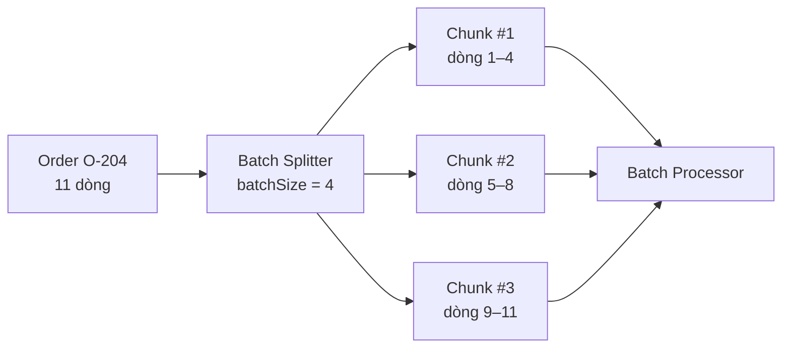
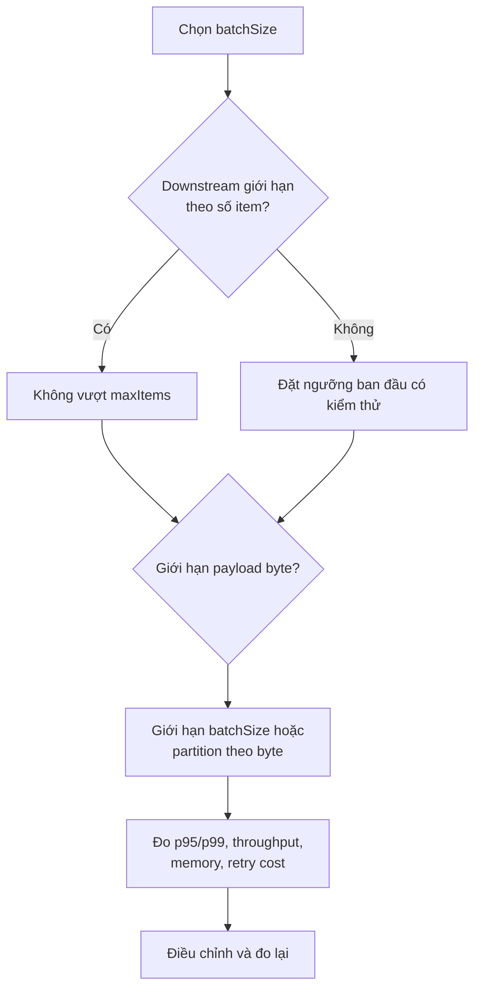
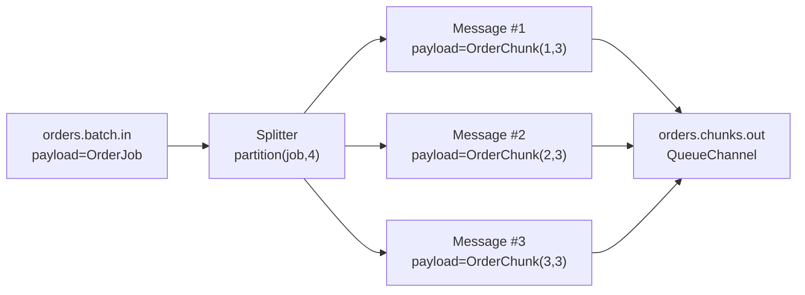
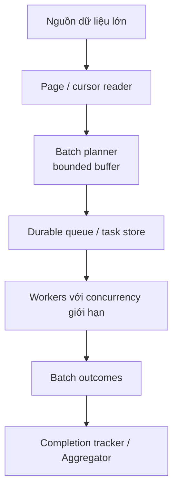
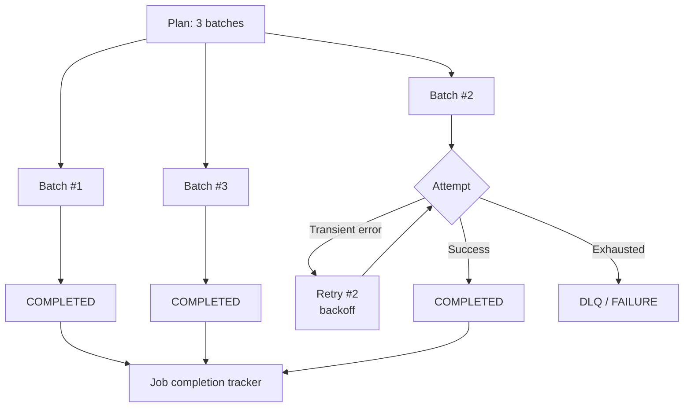
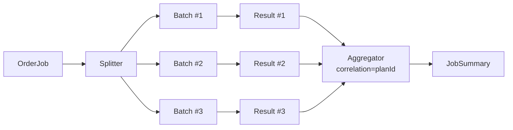

# Splitter theo batch và kích thước lô

## 1. Bài toán: một message chứa hàng nghìn phần tử

Một hệ thống nhập đơn hàng nhận message gồm 1.000 dòng sản phẩm. Dịch vụ tính giá có thể xử lý tối đa **100 dòng mỗi request**; nếu gửi cả 1.000 dòng trong một lần, API báo lỗi vì vượt giới hạn. Nhưng nếu gửi từng dòng, hệ thống phải tạo 1.000 request và chịu chi phí network, authorization, ghi log và transaction quá lớn.

Giải pháp tự nhiên là chia tập dữ liệu thành các **lô** (*batch/chunk*):

```text
Order O-204: 1.000 dòng
    → 10 lô, mỗi lô tối đa 100 dòng
    → mỗi lô trở thành một message để xử lý tiếp
```

Đây là một ứng dụng của **Splitter** trong Enterprise Integration Patterns (EIP). Thay vì tạo một message cho mỗi phần tử, ta tạo một message cho **mỗi nhóm phần tử đã được phân hoạch**.



Bài **“Splitter theo batch và kích thước lô”** thuộc chương **Splitter** của module **SPRING_INTEGRATION_PATTERN**. Module hướng dẫn triển khai Router, Filter, Transformer, Splitter, Aggregator, Gateway, retry, error channel và correlation bằng Spring Integration để xây dựng luồng thông điệp ít phụ thuộc, dễ mở rộng, dễ kiểm thử và theo dõi từng nhánh.

Sau bài học, bạn cần:

1. Phân biệt tách **từng phần tử** với tách **mỗi message thành một batch**.
2. Tính số batch và xử lý lô cuối cùng khi `N` không chia hết cho `B`.
3. Hiểu sự khác nhau giữa kích thước batch nghiệp vụ, kích thước batch của broker và `maxMessagesPerPoll`.
4. Dùng Spring Integration Java DSL tạo message có payload là một lô dữ liệu.
5. Giữ thông tin `correlationId`, `sequenceNumber`, `sequenceSize` cùng định danh nghiệp vụ bền vững.
6. Thiết kế retry, idempotency, xử lý kết quả từng batch và Aggregator.
7. Chọn batch size theo hạn mức, độ trễ, bộ nhớ, throughput và điều kiện tải.
8. Kiểm thử dữ liệu rỗng, kích thước ranh giới, lỗi một lô, phát lại và xử lý song song.

## 2. Splitter theo phần tử và Splitter theo batch khác nhau thế nào?

Một **Splitter** nhận một message và tạo ra nhiều message con. Mỗi message con có thể chứa **một phần tử** hoặc **một nhóm phần tử**, tùy hợp đồng output của splitter.

Cho tập 11 dòng:

```text
[L1,L2,L3,L4,L5,L6,L7,L8,L9,L10,L11]
```

**Tách theo phần tử**:

```text
Input: 1 message chứa List<OrderLine>(11 phần tử)
Output: 11 message, payload mỗi message là một OrderLine
```

**Tách theo batch kích thước tối đa 4**:

```text
Input: 1 message chứa List<OrderLine>(11 phần tử)
Output: 3 message, payload mỗi message là một OrderChunk

Chunk 1 = [L1,L2,L3,L4]
Chunk 2 = [L5,L6,L7,L8]
Chunk 3 = [L9,L10,L11]
```

Điểm mấu chốt: **batch size là số phần tử nghiệp vụ bên trong một message con**, không nhất thiết là số message trong queue hoặc số message worker nhận mỗi lần poll.

| Câu hỏi | Split từng phần tử | Split theo batch |
| --- | --- | --- |
| Payload message con | Một `OrderLine` | Một `OrderChunk` chứa `List<OrderLine>` |
| Với 11 dòng, batch size = 4 | 11 message | 3 message |
| Số lần downstream gọi API nếu 1 message = 1 request | 11 | 3 |
| Đơn vị retry phổ biến | Một phần tử | Một batch |
| Khi batch lỗi sau khi xử lý được vài item | Không có khái niệm phần tử cùng batch | Cần transaction/bản ghi tiến độ hoặc idempotency theo item |
| Metadata nghiệp vụ cần có | `lineId`, `orderId` | `planId`, `batchNumber`, `batchCount` và danh sách dòng |
| Khi cần gom kết quả | Gom nhiều kết quả của dòng | Gom nhiều kết quả batch; có thể cần flatten thêm |

### Không có “batching” tự động chỉ vì payload là List

Nếu kết quả của hàm splitter là `List<OrderLine>`, Spring Integration thường tạo message cho **từng OrderLine**. Để mỗi message con chứa một lô, hãy tạo danh sách các **đối tượng batch**:

```java
List<OrderChunk> chunks = planner.partition(job, 4);
```

Mỗi `OrderChunk` chứa chính xác các dòng thuộc một lô; Splitter tạo một message cho mỗi `OrderChunk`. Tránh triển khai bằng cách chỉ đặt `batchSize=4` trong Poller rồi nghĩ rằng phần payload tự chuyển thành nhóm 4 dòng.

## 3. Ba thuật ngữ “batch” thường bị nhầm

Trong một hệ thống Spring Integration có thể tồn tại ít nhất ba tầng batching khác nhau:

| Thuật ngữ | Ý nghĩa | Ví dụ |
| --- | --- | --- |
| **Business batch/chunk** | Số record trong **một message con** sau Splitter | `OrderChunk` có 100 order lines |
| **Poll batch** | Số **message** mà polling endpoint thử nhận trong một lượt | `maxMessagesPerPoll(10)` |
| **Transport/producer batch** | Cách broker/client gộp message để gửi qua network | Kafka producer có ngưỡng byte/buffer; JDBC batch insert gộp statement |

Ba số có thể khác nhau:

```text
Splitter business batch size  = 100 order lines / message
Poller maxMessagesPerPoll     = 5 messages / poll
Kafka producer batch.size     = byte buffer threshold (không phải số order lines)
```

Một Poller đọc 5 message, mỗi message chứa 100 dòng, có thể làm worker xử lý 500 dòng trong một lượt; nhưng **Poller không chia hoặc gộp payload của các message đó**.

Tương tự, `maxMessagesPerPoll(5)` không bảo đảm chạy song song 5 handler. Threading, transaction, task executor và cấu hình endpoint mới quyết định concurrency.

## 4. Tính kích thước batch và số batch

Gọi:

- `N` = tổng số phần tử đầu vào.
- `B` = số phần tử tối đa trong mỗi batch, với `B > 0`.
- `K` = số batch cần tạo khi `N > 0`.

Công thức:

\[
K = \left\lceil \frac{N}{B} \right\rceil
\]

Với `N=11`, `B=4`:

```text
K = ceil(11 / 4) = 3
Batch sizes = [4, 4, 3]
```

| N | B | K | Kích thước từng lô |
| ---: | ---: | ---: | --- |
| 1 | 4 | 1 | 1 |
| 4 | 4 | 1 | 4 |
| 5 | 4 | 2 | 4, 1 |
| 8 | 4 | 2 | 4, 4 |
| 11 | 4 | 3 | 4, 4, 3 |
| 1.000 | 100 | 10 | 10 lô × 100 |
| 1.000 | 128 | 8 | 7 lô × 128, 1 lô × 104 |

**Ràng buộc:** một lô có không quá `B` phần tử; lô cuối có thể nhỏ hơn `B`; không được tự bỏ bớt hoặc nhân đôi phần tử chỉ để mọi lô có kích thước bằng nhau.

### Với N = 0 thì sao?

Không có phần tử để tách. Nhiều Splitter sẽ phát **0 message con** nếu nhận collection rỗng. Điều đó có thể phù hợp cho một pipeline không cần reply, nhưng **nguy hiểm với Gateway/Aggregator đang chờ kết quả**: không có message nào đi tiếp để báo hoàn thành.

Cần chọn một trong các hợp đồng rõ ràng:

1. **Từ chối input rỗng** khi đơn hàng bắt buộc có dòng.
2. **Phát completion event riêng** như `EMPTY_JOB_COMPLETED` nếu job rỗng là hợp lệ.
3. **Dùng nhánh điều phối khác** để trả kết quả rỗng, không chờ một Aggregator nhận message chưa từng được tạo.

Ví dụ xuyên suốt dưới đây chọn **từ chối job rỗng**, giúp ví dụ Splitter không âm thầm làm mất reply.

### Với B = 0 hoặc B âm?

Đây là **lỗi cấu hình**, không phải tình huống tạo vô hạn message hoặc chia cho 0. Validator phải báo lỗi trước khi chạy.

## 5. Kích thước batch tối ưu không chỉ dựa trên số record

Một batch lớn giúp giảm số request nhưng có thể vượt:

- Giới hạn payload của API hoặc broker.
- Bộ nhớ ứng dụng.
- Timeout của Gateway/HTTP.
- Transaction timeout.
- Số câu lệnh mà database hỗ trợ hiệu quả trong một lần commit.
- SLA phản hồi cho phần tử đầu tiên.
- Khả năng xử lý lỗi khi một phần tử trong batch không hợp lệ.

Một batch quá nhỏ tăng overhead message, network, auth, serialization, log và transaction.



### Mô hình chi phí đơn giản

Nếu downstream có overhead cố định mỗi request là `L` mili giây, chi phí xử lý mỗi item là `p` và gửi tuần tự, một mô hình rất thô:

\[
T_{\text{sequential}} \approx K \cdot L + N \cdot p
\]

Giả sử `N=1000`, `L=20 ms`, `p=1 ms`:

- `B=10` → `K=100` → khoảng `100×20 + 1000×1 = 3000 ms`.
- `B=100` → `K=10` → khoảng `10×20 + 1000×1 = 1200 ms`.

Đây chỉ là **mô hình trực giác**, không phải kết quả benchmark Spring Integration. Với batching lớn, độ trễ per-item, giới hạn byte, serialize, GC, database lock hoặc rate limit có thể làm hiệu năng xấu đi.

Nếu xử lý song song `P` batch, thời gian thực tế còn phụ thuộc số worker, số kết nối, tải của downstream, contention và scheduling. Không lấy công thức trên để cam kết SLA production.

### Những tiêu chí để chọn B

| Tiêu chí | Batch lớn | Batch nhỏ |
| --- | --- | --- |
| Số request | Ít hơn | Nhiều hơn |
| Overhead per item | Thường giảm | Thường tăng |
| Bộ nhớ trên mỗi message | Cao hơn | Thấp hơn |
| Chi phí retry cả lô | Lặp nhiều item hơn | Phạm vi lặp ít hơn |
| Thời gian có kết quả đầu tiên | Có thể trễ | Có thể sớm |
| Khả năng chẩn đoán item lỗi | Khó hơn nếu API báo lỗi cả lô | Thường dễ hơn |
| Parallelism | Ít task nếu K quá nhỏ | Nhiều task hơn nhưng tăng overhead |
| Giới hạn API/broker | Dễ chạm | Dễ tránh hơn |

**Chọn batch size theo hợp đồng hệ thống đích và phép đo**, không theo một con số “chuẩn” áp dụng cho mọi ứng dụng.

## 6. Thiết kế data contract: một message con mang một batch

Một thiết kế dễ kiểm thử là dùng **Java record có kiểu rõ**. Message đầu vào là `OrderJob`, payload đầu ra của mỗi message con là `OrderChunk`.

Ta thêm các trường:

- `tenantId` để tránh trộn dữ liệu giữa tenant.
- `jobId` đại diện cho công việc nghiệp vụ.
- `planId` là định danh **một kế hoạch chia batch ổn định**, dùng cho retry/replay.
- `batchNumber` đánh số từ **1**, dễ đối chiếu với `sequenceNumber` của framework.
- `batchCount` là số lô theo kế hoạch.
- `lines` là danh sách phần tử trong lô.

```java
import java.util.List;
import java.util.Objects;

record OrderLine(String lineId, long amountMinor) {}

record OrderJob(
        String tenantId,
        String jobId,
        String planId,
        List<OrderLine> lines) {

    OrderJob {
        if (tenantId == null || tenantId.isBlank()
                || jobId == null || jobId.isBlank()
                || planId == null || planId.isBlank()) {
            throw new IllegalArgumentException(
                "tenantId, jobId and planId are required");
        }
        Objects.requireNonNull(lines, "lines");
        lines = List.copyOf(lines);
    }
}

record OrderChunk(
        String tenantId,
        String jobId,
        String planId,
        int batchNumber,
        int batchCount,
        List<OrderLine> lines) {

    OrderChunk {
        if (batchNumber < 1 || batchCount < 1
                || batchNumber > batchCount) {
            throw new IllegalArgumentException(
                "Invalid batch index/count");
        }
        Objects.requireNonNull(lines, "lines");
        if (lines.isEmpty()) {
            throw new IllegalArgumentException(
                "An emitted chunk cannot be empty");
        }
        lines = List.copyOf(lines);
    }
}
```

Đây là các record dùng cho **ví dụ học tập**. Trong production, cần kiểm tra thêm domain validity của `OrderLine`, kích thước tối đa, duplicate `lineId`, hạn chế dữ liệu nhạy cảm và quyền tenant.

**Vì sao sao chép danh sách?** `List.copyOf(...)` tránh một caller thay đổi danh sách mutable trong khi Splitter/consumer đang xử lý. Đây là một bản sao cấu trúc collection; nếu mỗi phần tử là object mutable thì cần áp dụng quy tắc bất biến phù hợp cho phần tử.

### Kích thước lô là một phần của kế hoạch

Nếu hôm nay chia `B=4`, ngày mai đổi `B=5` thì cùng `jobId` có thể có các nhóm dòng khác nhau. Vì vậy `planId` phải gắn với **kế hoạch đã chọn và thứ tự input**; không được tái sử dụng planId cũ cho một cách phân hoạch khác rồi coi `(planId,batchNumber)` là cùng thao tác.

Nếu một job cần được chia lại theo quy tắc mới, hãy tạo **plan revision mới**, đồng thời xử lý quan hệ với các batch của kế hoạch cũ.

## 7. Cài thuật toán phân lô có kiểm soát

Hàm sau nhận `OrderJob` và `batchSize`, trả `List<OrderChunk>`. Nó không dùng Spring Integration và không gọi mạng/database, nên rất thuận tiện cho unit test.

```java
import java.util.ArrayList;
import java.util.List;
import java.util.Objects;

final class OrderBatchPlanner {

    List<OrderChunk> partition(OrderJob job, int batchSize) {
        Objects.requireNonNull(job, "job");

        if (batchSize <= 0) {
            throw new IllegalArgumentException(
                "batchSize must be positive");
        }

        final int totalItems = job.lines().size();

        // Hợp đồng demo: đơn không có dòng là input không hợp lệ.
        if (totalItems == 0) {
            throw new IllegalArgumentException(
                "OrderJob must contain at least one line");
        }

        // Tránh (totalItems + batchSize - 1) có thể overflow int.
        final int count = 1 + (totalItems - 1) / batchSize;

        List<OrderChunk> chunks = new ArrayList<>(count);

        int start = 0;
        int batchNumber = 1;

        while (start < totalItems) {
            int size = Math.min(batchSize, totalItems - start);
            int end = start + size;

            chunks.add(new OrderChunk(
                job.tenantId(),
                job.jobId(),
                job.planId(),
                batchNumber,
                count,
                job.lines().subList(start, end)));

            start = end;
            batchNumber++;
        }

        return List.copyOf(chunks);
    }
}
```

**Bất biến của thuật toán:**

- `1 ≤ chunks.size() ≤ totalItems` với input không rỗng.
- `chunks.size() = ceil(totalItems / batchSize)`.
- Mỗi chunk có từ `1` đến `batchSize` dòng.
- Nối `lines` của các chunk theo `batchNumber` sẽ khôi phục **đúng thứ tự và đủ** danh sách đầu vào.
- `batchNumber` chạy từ 1 tới `batchCount`, không có khoảng trống.
- Input `OrderJob` không bị sửa.
- Gọi lại cùng input, cùng batch size sẽ tạo **cùng nhóm dòng và batch index**; đây là tiền đề cho replay có kiểm soát.

### Vì sao không xử lý trực tiếp trên subList mutable?

`List.subList(...)` là một view của danh sách nguồn với nhiều implementation. Nếu nguồn mutable và bị thay đổi, view có thể phản ánh dữ liệu mới hoặc ném exception. Trong ví dụ, `OrderJob` đã sao chép `lines` và `OrderChunk` tiếp tục `List.copyOf(...)`, nên mỗi batch giữ snapshot collection của mình.

Với dữ liệu rất lớn, việc sao chép và giữ toàn bộ list có thể làm tăng áp lực bộ nhớ. Khi đó nên thiết kế **pagination/streaming, cursor và chunk persistence** thay vì tải hàng triệu item vào RAM rồi chia lô.

## 8. Spring Integration Java DSL: phát mỗi batch thành một message

Sử dụng DSL `split(...)` với một hàm trả `List<OrderChunk>`:

```java
import org.springframework.context.annotation.Bean;
import org.springframework.context.annotation.Configuration;
import org.springframework.integration.channel.DirectChannel;
import org.springframework.integration.channel.QueueChannel;
import org.springframework.integration.config.EnableIntegration;
import org.springframework.integration.dsl.IntegrationFlow;

@Configuration
@EnableIntegration
public class BatchSplitterConfig {

    @Bean
    OrderBatchPlanner batchPlanner() {
        return new OrderBatchPlanner();
    }

    @Bean("orders.batch.in")
    DirectChannel batchInput() {
        return new DirectChannel();
    }

    @Bean("orders.chunks.out")
    QueueChannel chunkOutput() {
        // Chỉ là queue trong bộ nhớ để quan sát message con.
        return new QueueChannel(20);
    }

    @Bean
    IntegrationFlow splitOrderLines(OrderBatchPlanner planner) {
        return IntegrationFlow.from("orders.batch.in")
            .split(OrderJob.class,
                job -> planner.partition(job, 4))
            .channel("orders.chunks.out")
            .get();
    }
}
```

Đường đi:



**Điều quan trọng nhất:** kết quả của `partition(...)` là một collection chứa **ba OrderChunk**. Splitter phát **ba message**, không phải tự động đi sâu vào `OrderChunk.lines()` để phát 11 message. Mỗi `OrderChunk` là một payload đơn.

### Nếu muốn batch size từ cấu hình

Có thể đưa vào property cấu hình đã validate:

```java
@Bean
IntegrationFlow splitWithConfiguredSize(
        OrderBatchPlanner planner,
        BatchSizeSettings settings) {

    int batchSize = settings.validatedBatchSize();

    return IntegrationFlow.from("another.orders.batch.in")
        .split(OrderJob.class,
            job -> planner.partition(job, batchSize))
        .channel("another.orders.chunks.out")
        .get();
}
```

Đoạn code là **biến thể minh họa**, giả định `BatchSizeSettings` là một cấu hình ứng dụng đã được định nghĩa; không cài đồng thời với flow chính nếu các channel bị trùng. Khi thay đổi cấu hình động, cần snapshot batch size cho một job, lưu `planId` và plan version để retry không âm thầm tạo các chunk khác nhau.

### Nếu payload gốc là List<OrderLine>

Bạn có thể nhận `List<OrderLine>` trực tiếp, nhưng cần mang `jobId`, `tenantId` và `planId` từ header tin cậy hoặc một envelope. Với dữ liệu nghiệp vụ quan trọng, envelope có kiểu như `OrderJob` thường giúp **không làm mất correlation nghiệp vụ** khi Splitter phát message con.

## 9. Metadata: sequenceNumber, sequenceSize và correlationId

Spring Integration có cơ chế gắn **sequence metadata** lên message con khi Splitter áp dụng sequence. Các header thường dùng gồm:

- `correlationId`: xác định những message cùng xuất phát từ một lần split.
- `sequenceNumber`: vị trí của message trong tập message con, thường đánh số từ 1.
- `sequenceSize`: số lượng message con kỳ vọng, khi biết được kích thước tập.
  
Đối với một collection hữu hạn có kích thước 3 như ví dụ, các thông tin này có thể phục vụ một Aggregator nhận đủ ba batch.

```text
Input: 1 OrderJob với 11 dòng, batchSize=4

Output 1: payload=OrderChunk(batchNumber=1, batchCount=3, lines=4)
          sequenceNumber=1, sequenceSize=3
Output 2: payload=OrderChunk(batchNumber=2, batchCount=3, lines=4)
          sequenceNumber=2, sequenceSize=3
Output 3: payload=OrderChunk(batchNumber=3, batchCount=3, lines=3)
          sequenceNumber=3, sequenceSize=3

Các message con cùng một lần split có correlationId liên quan nhau.
```

**Phân biệt hai loại metadata:**

| Thuộc tính | Nguồn | Tính ổn định |
| --- | --- | --- |
| `sequenceNumber/sequenceSize/correlationId` | Metadata của Spring Integration cho một lần split | Phụ thuộc topology, cấu hình apply sequence, transport/header mapping |
| `tenantId/jobId/planId/batchNumber/batchCount` | Hợp đồng nghiệp vụ do ứng dụng tạo | Có thể được lưu và sử dụng để replay nhiều lần, nếu plan không đổi |

Không lấy `MessageHeaders.ID` hoặc correlationId do framework sinh làm **khóa idempotency end-to-end**. Một message mới hoặc một lần split lại có thể nhận ID/correlation mới. Với consumer nghiệp vụ, khóa bền vững nên dựa trên định danh như `(tenantId, planId, batchNumber)` và phạm vi thao tác.

**Sequence metadata không chứng minh xử lý thành công.** `sequenceSize=3` chỉ có nghĩa Splitter dự kiến tạo ba message con, không nói ba worker đã commit.

### Khi không biết trước số phần tử

Với stream/iterator động, việc tính `sequenceSize` có thể không đơn giản hoặc không được cung cấp theo cùng cách như collection đã materialize. Không thiết kế Aggregator **chỉ** chờ `sequenceSize` từ một nguồn vô hạn hoặc chưa xác định mà không có tín hiệu kết thúc. Khi cần streaming, thường phải có **completion marker**, expected count do planner cung cấp hoặc một release strategy/timeout rõ ràng.

## 10. JUnit: test thuật toán phân hoạch độc lập

Trước khi kiểm thử IntegrationFlow, hãy kiểm thử planner thuần.

```java
import static org.assertj.core.api.Assertions.assertThat;
import static org.assertj.core.api.Assertions.assertThatThrownBy;

import java.util.ArrayList;
import java.util.List;
import java.util.stream.IntStream;

import org.junit.jupiter.api.Test;

class OrderBatchPlannerTest {

    private final OrderBatchPlanner planner =
        new OrderBatchPlanner();

    private OrderJob job(int itemCount) {
        List<OrderLine> lines = IntStream.rangeClosed(1, itemCount)
            .mapToObj(n -> new OrderLine("L-" + n, n * 100L))
            .toList();

        return new OrderJob(
            "tenant-A", "O-204", "plan-204-v1", lines);
    }

    @Test
    void elevenItemsProduceFourFourThree() {
        OrderJob input = job(11);

        List<OrderChunk> chunks = planner.partition(input, 4);

        assertThat(chunks).hasSize(3);
        assertThat(chunks)
            .extracting(c -> c.lines().size())
            .containsExactly(4, 4, 3);
        assertThat(chunks)
            .extracting(OrderChunk::batchNumber)
            .containsExactly(1, 2, 3);
        assertThat(chunks)
            .allSatisfy(c -> {
                assertThat(c.batchCount()).isEqualTo(3);
                assertThat(c.planId()).isEqualTo("plan-204-v1");
                assertThat(c.tenantId()).isEqualTo("tenant-A");
            });

        List<OrderLine> restored = chunks.stream()
            .flatMap(c -> c.lines().stream())
            .toList();
        assertThat(restored).containsExactlyElementsOf(input.lines());
    }

    @Test
    void exactMultipleCreatesNoEmptyTail() {
        List<OrderChunk> chunks = planner.partition(job(8), 4);

        assertThat(chunks).hasSize(2);
        assertThat(chunks.get(0).lines()).hasSize(4);
        assertThat(chunks.get(1).lines()).hasSize(4);
    }

    @Test
    void batchLargerThanInputCreatesOneChunk() {
        List<OrderChunk> chunks = planner.partition(job(3), 100);

        assertThat(chunks).hasSize(1);
        assertThat(chunks.get(0).lines()).hasSize(3);
        assertThat(chunks.get(0).batchCount()).isEqualTo(1);
    }

    @Test
    void rejectsInvalidBatchSizeAndEmptyJob() {
        assertThatThrownBy(() -> planner.partition(job(3), 0))
            .isInstanceOf(IllegalArgumentException.class)
            .hasMessageContaining("batchSize");

        assertThatThrownBy(() -> planner.partition(job(0), 4))
            .isInstanceOf(IllegalArgumentException.class)
            .hasMessageContaining("at least one line");
    }

    @Test
    void chunksDoNotTrackLaterChangesToOriginalList() {
        List<OrderLine> original = new ArrayList<>();
        original.add(new OrderLine("L-1", 100));
        original.add(new OrderLine("L-2", 200));

        OrderJob job = new OrderJob(
            "tenant-A", "O-204", "plan-204-v1", original);

        List<OrderChunk> chunks = planner.partition(job, 1);
        original.clear();

        assertThat(chunks).hasSize(2);
        assertThat(chunks.get(0).lines()).hasSize(1);
        assertThat(chunks.get(1).lines()).hasSize(1);
    }
}
```

Test quan trọng không phải chỉ là số batch, mà là **toàn bộ tập đầu vào được bảo toàn, không đảo thứ tự, không mất, không lặp**. Với dữ liệu lớn, nên bổ sung property-based test cho nhiều cặp `(N,B)` hợp lệ để phát hiện lỗi tại các ranh giới.

## 11. Integration test: mỗi batch là một message, sequence khớp

Ví dụ dùng JUnit 5 + Spring Test + AssertJ. Cấu hình mục 8 có một `DirectChannel` cho input và một `QueueChannel` nhận message con.

```java
import static org.assertj.core.api.Assertions.assertThat;
import static org.assertj.core.api.Assertions.assertThatThrownBy;

import java.util.List;
import java.util.stream.IntStream;

import org.junit.jupiter.api.Test;
import org.springframework.beans.factory.annotation.Autowired;
import org.springframework.beans.factory.annotation.Qualifier;
import org.springframework.integration.channel.QueueChannel;
import org.springframework.messaging.Message;
import org.springframework.messaging.MessageChannel;
import org.springframework.messaging.support.MessageBuilder;
import org.springframework.test.context.junit.jupiter.SpringJUnitConfig;
import org.springframework.test.annotation.DirtiesContext;

@SpringJUnitConfig(BatchSplitterConfig.class)
@DirtiesContext(classMode = DirtiesContext.ClassMode.BEFORE_EACH_TEST_METHOD)
class BatchSplitterFlowTest {

    @Autowired
    @Qualifier("orders.batch.in")
    MessageChannel input;

    @Autowired
    @Qualifier("orders.chunks.out")
    QueueChannel output;

    private OrderJob job(int count) {
        List<OrderLine> lines = IntStream.rangeClosed(1, count)
            .mapToObj(n -> new OrderLine("L-" + n, n * 100L))
            .toList();
        return new OrderJob(
            "tenant-A", "O-204", "plan-204-v1", lines);
    }

    @Test
    void emitsThreeChunkMessagesWithBusinessAndSequenceMetadata() {
        Message<OrderJob> request = MessageBuilder
            .withPayload(job(11))
            .setHeader("requestId", "req-204")
            .build();

        assertThat(input.send(request)).isTrue();

        Message<?> first = output.receive(1_000);
        Message<?> second = output.receive(1_000);
        Message<?> third = output.receive(1_000);

        assertThat(first).isNotNull();
        assertThat(second).isNotNull();
        assertThat(third).isNotNull();
        assertThat(output.receive(0)).isNull();

        OrderChunk a = (OrderChunk) first.getPayload();
        OrderChunk b = (OrderChunk) second.getPayload();
        OrderChunk c = (OrderChunk) third.getPayload();

        assertThat(a.lines()).hasSize(4);
        assertThat(b.lines()).hasSize(4);
        assertThat(c.lines()).hasSize(3);
        assertThat(List.of(
            a.batchNumber(), b.batchNumber(), c.batchNumber()))
            .containsExactly(1, 2, 3);

        for (Message<?> message : List.of(first, second, third)) {
            assertThat(message.getHeaders().get("requestId"))
                .isEqualTo("req-204");
            assertThat(message.getHeaders().get("sequenceSize"))
                .isEqualTo(3);
        }

        assertThat(first.getHeaders().get("sequenceNumber"))
            .isEqualTo(1);
        assertThat(second.getHeaders().get("sequenceNumber"))
            .isEqualTo(2);
        assertThat(third.getHeaders().get("sequenceNumber"))
            .isEqualTo(3);

        Object correlation = first.getHeaders().get("correlationId");
        assertThat(correlation).isNotNull();
        assertThat(second.getHeaders().get("correlationId"))
            .isEqualTo(correlation);
        assertThat(third.getHeaders().get("correlationId"))
            .isEqualTo(correlation);
    }

    @Test
    void rejectsEmptyJobInsteadOfSilentlyProducingNoReply() {
        assertThatThrownBy(() -> input.send(
            MessageBuilder.withPayload(job(0)).build()))
            .isInstanceOf(RuntimeException.class);

        assertThat(output.receive(0)).isNull();
    }
}
```

**Giải thích giới hạn test:**

- Đây là topology **đồng bộ** tới một QueueChannel trong bộ nhớ. Nó cho thấy message con được tạo và bàn giao vào queue, **không chứng minh consumer đã xử lý**.
- Header sequence/correlation được kiểm tra theo hành vi Splitter đang cấu hình ở phiên bản phù hợp. Nếu ứng dụng chủ động tắt `applySequence` hoặc adapter làm mất header, phải điều chỉnh contract và kiểm thử lại.
- `@DirtiesContext` chỉ được dùng ở ví dụ để cô lập trạng thái QueueChannel giữa các test. Trong test suite lớn có thể dùng fixtures và quản lý context hiệu quả hơn.
- Khi thay bằng queue có consumer chạy nhiều thread, **thứ tự hoàn thành batch không được bảo đảm** chỉ vì sequenceNumber tăng dần.

## 12. Kích thước batch và giới hạn byte không giống nhau

Một dịch vụ có thể giới hạn **100 item** hoặc **1 MiB payload**. Lô 100 item có thể vẫn vượt 1 MiB nếu mỗi item chứa mô tả dài.

Vì vậy có ít nhất hai cách chia:

**Cách A — theo số lượng record (count-based):**

```text
Max 100 items per chunk
- Dễ tính batchCount và sequence.
- Phù hợp khi kích thước mỗi item tương đối ổn định.
```

**Cách B — theo tổng kích thước ước lượng (size-based):**

```text
Max 100 items AND max ~1 MiB serialized payload
- Đo/ước lượng bytes của từng item.
- Thêm vào lô cho đến khi đạt một trong các giới hạn.
- Nếu riêng một item vượt ngưỡng, phải reject,
  dùng cơ chế upload riêng hoặc xử lý theo contract.
```

Một thuật toán size-based nên có:

1. Giới hạn số item không vượt `maxItems`.
2. Giới hạn byte dựa trên **serialization thực tế hoặc ước lượng được kiểm chứng**.
3. Chi phí envelope/headers/protocol nằm trong byte budget.
4. Chương trình xử lý trường hợp một item vượt giới hạn.
5. Chính sách version hóa kế hoạch phân lô để replay nhất quán.

Đừng dùng `item.toString().length()` thay cho kích thước payload thực mà không kiểm chứng; UTF-8, JSON escaping, compression và serialization thay đổi số byte đáng kể.

## 13. Batch size có nên thay đổi động?

Có thể, nhưng cần xác định **phạm vi ổn định** của quyết định. Ví dụ một system có hai loại job:

| Loại | Ví dụ batch size | Lý do |
| --- | ---: | --- |
| Công việc nhỏ ưu tiên độ trễ | 20 | Có nhiều chunk để worker xử lý sớm |
| Công việc lớn tối ưu throughput | 100 | Giảm overhead request |
| API giới hạn 50 item/request | Tối đa 50 | Không được vượt hợp đồng |
| Dữ liệu item lớn | Theo byte budget | Count không đủ |

Các giá trị chỉ là ví dụ để so sánh. Số tối ưu thực tế cần benchmark và SLO.

Một **BatchPlanningPolicy** có thể quyết định `B` khi job đến, sau đó lưu:

```text
planId        = plan-204-v1
jobId         = O-204
batchSize     = 100
itemCount     = 1_000
batchCount    = 10
policyVersion = batch-policy-v2
plannedAt     = ...
```

Khi retry, sử dụng lại plan đã persist. Nếu batch size thay đổi giữa hai lần split cùng job, batch #2 có thể đại diện cho các item khác nhau. Điều này phá vỡ khóa idempotency `(planId,batchNumber)` và làm Aggregator khó quyết định khi nào đủ kết quả.

### Không cập nhật batchSize “giữa chừng”

Một cách sai là đọc config mỗi vòng lặp trong planner:

```java
// Anti-pattern: batchSize có thể đổi trong lúc lập cùng một plan.
while (hasMoreItems()) {
    int size = remoteConfig.currentBatchSize();
    createNextChunk(size);
}
```

Nếu muốn batch thích ứng theo tải, hãy quyết định cho **job hoặc phiên bản plan** và lưu đủ metadata để tái hiện. Nếu thật sự cần co/giãn trong khi chạy, phải thiết kế chunk assignment và idempotency theo item/work-unit chứ không chỉ dựa vào ordinal batch.

## 14. Memory, backpressure và dữ liệu cực lớn

Ví dụ `OrderBatchPlanner.partition(...)` tạo danh sách các chunk trong bộ nhớ trước khi Spring Integration split. Điều này đơn giản nhưng không phù hợp với mọi kích thước dữ liệu.

Với 1.000.000 dòng, giữ toàn bộ record, các list con và các message queue trong memory có thể dẫn đến:

- Tăng heap, GC pause, OutOfMemoryError.
- Queue đầy và upstream không thể gửi tiếp.
- Latency lớn trước khi consumer có lô đầu tiên.
- Process crash làm mất các lô chưa persist.
- Chi phí serialization tăng.



Với dữ liệu lớn, cân nhắc:

- Đọc từ database theo page/cursor có snapshot nhất quán hoặc keyset pagination.
- Giữ **buffer hữu hạn** thay vì gọi `findAll()` rồi tạo toàn bộ chunk.
- Gửi các chunk vào broker/persistent delivery store có giới hạn tốc độ.
- Điều chỉnh concurrency theo downstream capacity.
- Kiểm soát retry riêng theo chunk, không để một chunk lỗi chặn mãi toàn bộ dữ liệu.
- Có tín hiệu kết thúc kế hoạch và expected count nếu tổng số chunk không biết lúc bắt đầu.

**Lưu ý:** khi Splitter trả một Iterator/Stream, hành vi áp dụng sequenceSize, thời điểm tiêu thụ và lifecycle phụ thuộc implementation. Không được mặc định sequenceSize chính xác như khi trả một `List<OrderChunk>` đã materialize. Muốn hỗ trợ streaming cần viết test trên phiên bản Spring Integration thực tế và định nghĩa rõ completion protocol.

### QueueChannel không phải broker bền vững

`QueueChannel(20)` trong ví dụ là queue trong bộ nhớ. Nó không đảm bảo:

- Dữ liệu tồn tại qua restart.
- Message đã được consumer commit.
- Retry/ack tự động khi consumer lỗi.
- Giữ đúng thứ tự hoàn tất của các batch chạy song song.

Nếu nghiệp vụ quan trọng, cần broker/persistent store với ack, retry, DLQ, retention và idempotency phù hợp.

## 15. Parallelism không tự xuất hiện khi dùng Splitter

Splitter tạo nhiều message **nhưng không mặc nhiên thực thi chúng đồng thời**.

- Với `DirectChannel`, handler phía sau thường chạy trên thread gửi.
- Với `ExecutorChannel`, công việc có thể được chuyển cho executor.
- Với `QueueChannel`, message chờ polling consumer.
- Với broker, việc consumer song song phụ thuộc partition, consumer group, concurrency và ack policy.

Một luồng chia 100 batch nhưng chỉ có một consumer có thể vẫn xử lý tuần tự. Ngược lại, một luồng có bốn consumer có thể xử lý bốn batch song song, nhưng còn giới hạn connection pool, rate limit và transaction của downstream.

### Số batch phải đủ để khai thác concurrency

Nếu một job có `N=1000` và hệ thống có 8 worker nhưng `B=500`, chỉ có **2 batch**: tối đa hai task độc lập ở cấp batch. Nếu `B=100`, có 10 batch, worker có thể được sử dụng tốt hơn — nếu downstream cho phép.

Đổi lại, batch nhỏ tăng overhead và số retry. Vì vậy tiêu chí chọn batch size phải bao gồm **số lượng worker và chi phí mỗi task**, không chỉ giới hạn API.

### Order preservation

Một Splitter tạo chunk #1, #2, #3 theo thứ tự danh sách. Nhưng nếu downstream xử lý bất đồng bộ:

```text
Dispatch order:   1 → 2 → 3
Completion order: 2 → 3 → 1  (hoàn toàn có thể)
```

Nếu cần giữ thứ tự nghiệp vụ tuyệt đối, phải thiết kế key/partitioning hoặc tuần tự hóa theo job. `sequenceNumber` có thể hỗ trợ tái sắp xếp **sau khi có đủ kết quả**, nhưng bản thân nó không ép consumer thực hiện tuần tự.

## 16. Lỗi một batch: retry cái gì?

Giả sử ba batch:

```text
Batch #1: processed (commit)
Batch #2: timeout
Batch #3: processed (commit)
```

Nếu producer gửi lại **toàn bộ OrderJob** để Splitter tạo cả ba batch một lần nữa, downstream có thể nhận lại cả #1 và #3. Nếu chúng ghi database/API có side effect, dữ liệu có thể bị xử lý trùng.

Thiết kế đáng tin cậy thường là:

1. Tạo và lưu kế hoạch phân batch với `planId` ổn định.
2. Phát task cho từng `(planId,batchNumber)`.
3. Worker ghi trạng thái từng task.
4. Khi batch #2 lỗi, retry **chỉ batch #2**.
5. Batch #1 và #3 vẫn được giữ trạng thái hoàn tất.
6. Khi mọi batch bắt buộc hoàn tất, mới đánh dấu toàn job thành công.



**Không nhầm retry một batch với retry từng item trong batch.** Nếu downstream bắt đầu xử lý batch #2, ghi được ba item rồi lỗi ở item thứ tư, việc retry cả batch có thể làm ba item đầu lặp lại. Có hai hợp đồng phổ biến:

- **All-or-nothing per batch:** downstream cập nhật tất cả item trong một transaction, rollback khi một item lỗi.
- **Partial results:** downstream trả trạng thái từng item; hệ thống retry **chỉ những item chưa thành công** hoặc bảo đảm idempotency per item.

Chọn cách nào phải dựa vào khả năng của database/API; Splitter không tự cung cấp transaction nguyên tử cho các side effect khác nhau.

## 17. Idempotency key ở cấp batch và item

Hai cấp idempotency khác nhau:

| Cấp | Key gợi ý | Mục đích |
| --- | --- | --- |
| Cả job | `(tenantId,jobId,jobVersion)` | Không tạo hai job nghiệp vụ cho cùng input |
| Kế hoạch | `(tenantId,planId)` | Không tạo hai plan trùng do retry kỹ thuật |
| Một batch | `(tenantId,planId,batchNumber)` | Không xử lý lại batch đã hoàn tất |
| Một item trong batch | `(tenantId,jobId,lineId,operationVersion)` | Tránh side effect trùng nếu batch chỉ thành công một phần |

Định danh batch phải gắn với **nội dung và phạm vi plan ổn định**. Nếu lô #2 thay nội dung sau khi đổi B, chỉ dùng `batchNumber=2` làm key là sai.

### Ba thời điểm dễ gây nhầm

```mermaid
sequenceDiagram
    participant B as Broker
    participant W as Batch worker
    participant DB as Business DB
    participant S as Delivery store
    B->>W: Batch #2
    W->>DB: ghi item/batch
    DB-->>W: commit thành công
    W->>S: ghi COMPLETED
    S-->>W: thành công
    Note over B,W: Crash trước ACK broker
    B->>W: Redeliver Batch #2
    W->>S: tra key đã hoàn tất
    S-->>W: COMPLETED
    Note over W: Không lặp side effect; ACK lại theo hợp đồng
```

Sơ đồ trên mô tả một **kịch bản mong muốn** khi hệ thống có trạng thái hoàn tất nhất quán. Nếu DB và delivery store ở hai hạ tầng khác nhau, việc ghi DB xong nhưng ghi COMPLETED chưa xong sẽ tạo **khoảng lỗi**. Cần transaction chung, cơ chế idempotency ở business DB hoặc recovery protocol phù hợp.

Một concurrent set trong JVM giúp giảm duplicate ngắn hạn nhưng không bảo đảm chống lặp qua restart hoặc nhiều instance. Broker at-least-once càng làm cơ chế idempotency quan trọng.

## 18. Batch status nên được mô hình hóa ra sao?

Một bản ghi trạng thái có thể có:

| Trường | Ví dụ | Ý nghĩa |
| --- | --- | --- |
| `tenantId` | `tenant-A` | Ranh giới truy cập |
| `jobId` | `O-204` | Công việc nguồn |
| `planId` | `plan-204-v1` | Kế hoạch phân hoạch |
| `planVersion` | `batch-policy-v2` | Rule dùng để chia batch |
| `batchNumber` | `2` | Lô thứ hai |
| `batchCount` | `3` | Số lô kỳ vọng |
| `itemCount` | `4` | Số item dự kiến trong lô |
| `status` | `PENDING/PROCESSING/COMPLETED/FAILED` | Trạng thái xử lý |
| `attemptCount` | `3` | Số lần worker thử |
| `lastErrorCode` | `DOWNSTREAM_TIMEOUT` | Lý do thất bại gần nhất |
| `nextAttemptAt` | Thời điểm tới | Điều phối retry |
| `contentDigest` | SHA-256 theo schema ổn định | Phát hiện thay đổi nội dung ngoài kế hoạch |
| `completedAt` | Thời điểm đã commit | Audit và kiểm tra SLA |

Đây là **schema gợi ý ở tầng ứng dụng**, không phải schema do Spring Integration tự sinh. Khi nhiều worker có thể xử lý cùng batch, update trạng thái phải có transaction/claim nguyên tử; không thực hiện thao tác “SELECT chưa có → INSERT” tách rời mà thiếu unique constraint hoặc concurrency control.

### Plan được coi là hoàn tất khi nào?

Một định nghĩa đơn giản:

```text
CompletedBatches(planId) == ExpectedBatches(planId)
AND no mandatory batch is in FAILED/PENDING/PROCESSING
```

Nếu có xử lý partial item, điều kiện còn phải tính số item thành công hoặc business result theo từng lô. “Đã dispatch đủ 3 batch” không đồng nghĩa “đã xử lý đủ 11 dòng”.

## 19. Aggregator sau Batch Splitter

**Splitter** là *fan-out*, còn **Aggregator** thực hiện *fan-in*. Khi muốn gom kết quả của các batch thành một kết quả cho toàn job, cần xác định:

- Correlation key theo `planId` hoặc theo metadata Splitter phù hợp.
- Số lượng result **kỳ vọng** theo `batchCount`.
- Thế nào là một kết quả batch hoàn chỉnh.
- Cách xử lý duplicate result/retry và out-of-order.
- Timeout khi một batch không bao giờ trả về.
- Output cuối là danh sách các batch result hay danh sách item đã flatten.



Một Aggregator thường có thể dùng sequence/correlation headers do Splitter tạo; nhưng khi vượt qua broker, tạo Message mới hoặc replay, metadata có thể thay đổi. Với job dài hạn/multi-service, một **business correlation key** rõ ràng như `(tenantId,planId)` thường đáng tin cậy hơn.

### Aggregator không tự biết nội dung batch

Nếu Splitter phát ba payload `OrderChunk`, một Aggregator có thể nhận ba `BatchResult`. Việc kết hợp những result đó thành một `JobSummary` là **logic tổng hợp do ứng dụng định nghĩa**, không phải hành vi “tự nối lại danh sách input” trong mọi cấu hình.

Một aggregator muốn phát kết quả **đúng một lần** phải cân nhắc:

1. Duplicate batch result.
2. Một batch retry trả cùng result với `attemptId` khác.
3. Batch #3 hoàn tất trước #1.
4. Batch #2 thất bại vĩnh viễn.
5. Source không tạo batch vì job rỗng.
6. Timeout/release policy khi chưa đủ kết quả.
7. Restart sau khi một phần kết quả đã được nhận.

### Khi Filter nằm giữa Splitter và Aggregator

Giả sử Splitter tạo 3 batch với `sequenceSize=3`, nhưng Filter loại batch #2 mà không tạo một kết quả tương ứng. Aggregator vẫn đợi đủ ba nếu dùng completion theo sequence size. Cần:

- Phát **skipped result** có ý nghĩa cho batch #2.
- Hoặc thay đổi release strategy để biết expected count thực tế.
- Hoặc xử lý timeout/partial theo chính sách.
  
Không tự chỉnh `sequenceSize` trên từng message con một cách tùy tiện rồi hy vọng Aggregator “tự hiểu”.

## 20. Những trường hợp đặc biệt

### 20.1. Một item riêng lẻ có lỗi

Nếu dữ liệu sai trong một dòng, phải quyết định:

- Reject toàn job trước split.
- Reject riêng batch chứa item đó.
- Trả result per item gồm success/failure.
- Có thể tách item lỗi sang recovery riêng, nhưng phải giữ correlation.

Một chính sách hợp lý cho đơn hàng tài chính có thể **fail-fast trên toàn input** nếu dữ liệu không hợp lệ, còn dữ liệu báo cáo ít quan trọng có thể bỏ qua item lỗi và ghi audit. Không có chính sách đúng chung.

### 20.2. Lô cuối ít phần tử

API nhận tối đa 4 phần tử không có nghĩa phải gửi đúng 4 phần tử. Thường lô cuối 1–3 phần tử được chấp nhận. Nếu API yêu cầu kích thước cố định, có thể cần padding/sentinel **do hợp đồng cho phép**, nhưng không thêm “dòng giả” rồi tính như đơn thật.

### 20.3. Thứ tự input thay đổi trong quá trình lấy trang

Nếu database paging theo OFFSET trên tập dữ liệu đang thay đổi, các bản ghi có thể bị trùng hoặc bị bỏ giữa các trang. Cần snapshot/transaction isolation, keyset pagination hoặc một danh sách công việc được cố định trước khi lập plan.

### 20.4. Batch quá lớn theo số byte

Một item lớn có thể khiến payload vượt giới hạn dù batch có đúng 1 item. Phải có đường xử lý “oversize item”, ví dụ external object storage + reference hoặc reject rõ ràng; chia theo count không giải quyết được mọi giới hạn.

### 20.5. Nhiều tenant có cùng job ID

Không dùng `jobId` đơn lẻ làm correlation/idempotency global. Nếu `tenant-A/O-204` và `tenant-B/O-204` là hai job hợp lệ, khóa phải bao gồm tenant đã xác thực.

### 20.6. Đổi batch size khi có batch đang chạy

Không âm thầm phát lại toàn job theo batch size mới. Hoặc tiếp tục plan cũ, hoặc thực hiện **replan** có kiểm soát và quyết định xử lý những item đã commit dưới plan cũ ra sao.

## 21. Khi nào dùng Splitter, khi nào nên để API batch xử lý trực tiếp?

Có trường hợp downstream API **tự nhận một list** và thực hiện partition tối ưu nội bộ. Khi đó Splitter trong hệ thống gửi có thể không cần thiết.

| Phương án | Khi phù hợp | Đánh đổi |
| --- | --- | --- |
| Splitter trước outbound adapter | Downstream giới hạn request size; cần parallel/retry per chunk | Thêm message, correlation, plan state |
| Một request chứa toàn list | Dữ liệu nhỏ, API xử lý batch tốt | Ít kiểm soát retry từng phần |
| Database batch insert ngay trong handler | Tập dữ liệu thuộc cùng DB transaction | Giới hạn transaction/lock, không tự có fan-out |
| Streaming/chunk reader | Tập dữ liệu rất lớn, không thể materialize trong memory | Cần cursor, completion marker và state bền vững |
| Scheduler tạo task per chunk | Job dài hạn và cần durable tracking | Phức tạp hơn nhưng phục hồi tốt |

**Splitter là một công cụ thể hiện cách chia message, không phải mục tiêu tự thân.** Nếu một API đã hỗ trợ streaming ổn định, thêm Splitter để tạo hàng nghìn message có thể làm kiến trúc phức tạp hơn mà không đem lại lợi ích.

## 22. Bảo mật dữ liệu khi tách batch

Một message gốc có thể chứa dữ liệu khách hàng nhạy cảm. Khi tách thành nhiều chunk, số bản sao message và nơi dữ liệu có thể được lưu/log cũng tăng.

Cần:

- Chỉ đưa trường cần thiết vào `OrderChunk`, không copy nguyên object chứa token/PII không liên quan.
- Đảm bảo `tenantId` được xác thực tại ingress, không tin header tùy ý từ client.
- Tránh log toàn bộ payload của tất cả batch; log `planId`, batch number, count và error code an toàn.
- Có giới hạn số batch/job để tránh một request nhỏ gây hàng triệu task.
- Xác thực quyền khi replay batch từ DLQ/failure store.
- Kiểm soát schema/version để một chunk của tenant A không bị đưa sang worker/queue của tenant B.
- Áp dụng retention/masking phù hợp cho broker, persistent MessageStore, metrics và audit.
- Không dùng tên channel nội bộ hoặc biểu thức đánh giá do client cung cấp để quyết định route.
- Thận trọng với enrichment trước/giữa split: mỗi chunk có thể chứa bản sao dữ liệu đã enrich; đừng lan truyền dữ liệu nhạy cảm tới những recipient không được phép.

## 23. Observability: đo đúng cấp batch

Một metric “3 message sent” không trả lời “11 dòng đã xử lý hết chưa?”. Nên đo theo ba cấp:

**Job:** số job đã nhận, đã phân hoạch, đã hoàn tất, thất bại; tổng thời gian end-to-end.

**Batch:** số batch tạo, số lần retry, latency, backlog, số batch đang xử lý hoặc vào DLQ.

**Item:** số item được nhận/xử lý thành công/thất bại; có bị trùng hoặc bỏ sót không.

Gợi ý metric ứng dụng:

| Metric | Ý nghĩa |
| --- | --- |
| `splitter.jobs.total` | Số job được lập kế hoạch |
| `splitter.items.total` | Tổng phần tử đầu vào |
| `splitter.chunks.created.total` | Số chunk được tạo |
| `splitter.chunk.size` | Phân bố số phần tử/chunk |
| `splitter.partition.duration` | Thời gian lập batch plan |
| `batch.processing.duration` | Thời gian xử lý một chunk |
| `batch.retry.total{reason}` | Số lần retry theo nguyên nhân |
| `batch.failed.total{reason}` | Số lô thất bại |
| `batch.oldest.pending.age` | Độ tuổi backlog lâu nhất |
| `job.completed.total` | Job đã có kết quả toàn bộ |

Đây là **các tên metric đề xuất**, không khẳng định Spring Integration mặc định phát đúng các metric này. Không dùng `jobId` hoặc `planId` có cardinality cao làm metric label; hãy dùng trace/log có quyền truy cập phù hợp để tìm thông tin từng job.

### Structured log minh họa

```text
event=batch_processing_failed
tenantScope=tenant-A
jobId=O-204
planId=plan-204-v1
batchNumber=2
batchCount=3
itemCount=4
attempt=2
errorCode=DOWNSTREAM_TIMEOUT
retryable=true
```

Chỉ log những định danh được phép; không log đầy đủ thông tin khách hàng, payload nhạy cảm hay credential. Nếu một batch có lỗi per item, nên lưu failure record theo item với retention/ACL phù hợp thay vì nhét toàn bộ dữ liệu vào exception string.

## 24. Chẩn đoán lỗi thường gặp

| Triệu chứng | Nguyên nhân có thể | Hướng kiểm tra |
| --- | --- | --- |
| Mong 3 batch nhưng nhận 11 message | Splitter trả `List<OrderLine>` thay vì `List<OrderChunk>` | Xem kiểu phần tử collection được trả về |
| Lô cuối bị mất | Vòng lặp chỉ chạy khi đủ batchSize | Kiểm thử `N=5,B=4` và `N=11,B=4` |
| Có batch rỗng | Tạo batch sau khi đã xử lý hết input | Kiểm thử N chia hết cho B |
| BatchSize 0 làm flow lỗi khó hiểu | Thiếu preflight config | Validate > 0, báo lỗi sớm |
| Không có reply khi input rỗng | Splitter tạo 0 message nhưng Gateway/Aggregator chờ | Định nghĩa empty completion hoặc reject |
| Correlation khác nhau giữa các batch result | Message mới qua adapter mất headers | Dùng business `planId` và kiểm thử header mapping |
| Aggregator không release | Thiếu batch, Filter drop, sequenceSize không khớp | Kiểm tra expected count, duplicate, timeout |
| Batch xử lý trùng | Producer phát lại cả job sau partial success | Retry per chunk và idempotency |
| Một item được xử lý hai lần khi retry batch | Batch có partial commit | Per-item idempotency hoặc transaction all-or-nothing |
| Queue ngày càng đầy | Splitter tạo chunk nhanh hơn downstream xử lý | Backpressure, worker capacity, rate limiting |
| Batch nhỏ nhưng request vẫn vượt byte limit | Item size biến động, không tính envelope | Partition theo byte budget |
| Throughput kém dù có Splitter | Không có concurrency hoặc chunk quá nhỏ | Đo worker utilization và API overhead |
| Đơn khác tenant bị trộn | Correlation/idempotency thiếu tenant | Dùng khóa tenant-scoped |
| Replay chia nhóm khác lúc đầu | Batch size hoặc danh sách item đã đổi | Ghim version và lưu plan/partition |

## 25. Bài thực hành

### Bài 1 — Dự đoán số batch

Cho N lần lượt bằng `0,1,4,5,8,11,1000` và B bằng `4` hoặc `100`. Tính số chunk và kích thước lô cuối. Đối với N = 0, nêu hợp đồng bạn chọn: reject hay completion event riêng.

### Bài 2 — Cài và kiểm thử thuật toán phân lô

Dựa trên `OrderBatchPlanner.partition(...)`, viết test cho `N=11,B=4`, `N=8,B=4`, `N=3,B=10` và B không hợp lệ. Xác minh tập dòng khôi phục bằng cách nối tất cả chunk **bằng đúng** tập input theo thứ tự.

### Bài 3 — Chạy Splitter Java DSL

Dùng `BatchSplitterConfig` và gửi `OrderJob` chứa 11 dòng. Kiểm tra output queue nhận đúng ba message, kiểu payload là `OrderChunk`, kích thước `[4,4,3]` và metadata `sequenceNumber/sequenceSize` phù hợp.

### Bài 4 — Retry một batch

Ba batch đã được tạo; batch #1 và #3 thành công, batch #2 lỗi tạm thời. Xây delivery status theo `(tenantId,planId,batchNumber)`, retry đúng #2 và xác minh consumer của #1/#3 không có side effect mới.

### Bài 5 — Một item lỗi trong batch

Một API xử lý batch có thể commit hai item rồi trả timeout ở item thứ ba. Thiết kế hai giải pháp: transaction all-or-nothing và per-item result/idempotency. Kiểm thử retry không làm lặp item đã thành công.

### Bài 6 — Aggregator và batch đến sai thứ tự

Cho batch result đến thứ tự #3, #1, #2. Tạo Aggregator group theo planId, gom khi đủ ba kết quả. Thêm kết quả trùng cho #2 và một trường hợp #2 không bao giờ đến; xác định release/timeout và tránh summary trùng.

### Bài 7 — Batch size theo byte budget

Giả sử API giới hạn tối đa 10 item **và** 1 MiB serialized request. Viết planner đảm bảo cả hai ngưỡng, xử lý riêng item vượt 1 MiB. Đo serialized bytes thay vì giả định số ký tự bằng số byte.

### Bài 8 — Streaming một triệu dòng

Thiết kế cursor/page reader kết hợp durable task store. Chọn kích thước page, batch size, concurrency và completion marker. Giải thích cách khôi phục sau crash mà không tạo/chấp nhận lại item đã xử lý theo plan cũ.

### Bài 9 — Đổi batch size giữa hai lần retry

Một job đã được lập `plan-204-v1` với B=4; sau đó cấu hình đổi B=5. Chứng minh `batchNumber=2` không còn biểu diễn cùng dữ liệu. Đề xuất pinning plan và cách replan khi thay đổi là có chủ đích.

### Bài 10 — So sánh hiệu năng

Đo trên dữ liệu đại diện với B bằng 10, 50, 100, 250, giữ nguyên downstream capacity. Theo dõi throughput, p95/p99, bytes, heap, retry rate và thời gian hoàn tất toàn job. Viết kết luận dựa trên số liệu thay vì chọn batch lớn nhất theo trực giác.

**Tiêu chí hoàn thành:** người học phải giải thích được **một chunk chứa gì**, **số lượng message được tạo**, **metadata nào giúp gom kết quả**, **batch size ảnh hưởng throughput và retry thế nào**, và **vì sao một batch được gửi không đồng nghĩa mọi item đã xử lý thành công**.

## 26. Checklist trước khi triển khai production

- [ ] Hợp đồng rõ: split từng item hay split theo batch.
- [ ] `batchSize > 0` và được kiểm tra trước khi xử lý.
- [ ] Có kết quả xác định cho input rỗng.
- [ ] Số batch và kích thước lô cuối được kiểm thử.
- [ ] Không bỏ, đảo, nhân đôi phần tử khi partition.
- [ ] DTO batch mang tenant/job/plan và số thứ tự nghiệp vụ ổn định.
- [ ] Không dùng Message ID framework như idempotency key chính.
- [ ] Batch size và thứ tự input được cố định cho từng plan/replay.
- [ ] Có giới hạn theo **item count** và **payload bytes** nếu downstream yêu cầu.
- [ ] Metadata correlation/sequence được kiểm tra qua ranh giới channel/adapter.
- [ ] Có policy timeout/release/partial result nếu dùng Aggregator.
- [ ] Concurrency và backpressure được đo với downstream thật.
- [ ] Retry theo chunk; nếu có partial commit thì chống trùng per item.
- [ ] Không dựa vào QueueChannel in-memory làm lưu trữ bền vững.
- [ ] Có delivery status hoặc durable completion tracking khi job quan trọng.
- [ ] Có giám sát lỗi, backlog, throughput, latency và duplicate.
- [ ] Không làm rò rỉ dữ liệu nhạy cảm khi fan-out nhiều chunk.
- [ ] Có test cho N=0, N<B, N=B, N>B, B lỗi, lỗi một batch, restart và replay.

## 27. Tổng kết

**Splitter theo batch** chia một tập phần tử thành **nhiều message, mỗi message chứa một nhóm phần tử**. Với `N=11` và `B=4`, kết quả đúng là ba batch có kích thước `[4,4,3]` — không phải 11 message và cũng không phải ba batch đều có bốn dòng.

Trong Spring Integration, cách triển khai rõ ràng là để một hàm phân hoạch trả `List<OrderChunk>`, rồi dùng `split(...)` để phát một message cho từng chunk. Hợp đồng batch nên có **planId, batchNumber, batchCount** bên cạnh metadata correlation/sequence của framework.

Khi tích hợp vào luồng thực tế, kích thước batch phải được chọn theo **khả năng downstream, byte limit, độ trễ, concurrency, bộ nhớ và chi phí retry**. Nếu một batch lỗi sau khi đã có side effect, cần retry có kiểm soát và idempotency ở cấp batch hoặc item. Nếu cần ghép kết quả, Aggregator phải có correlation, expected count, timeout và chính sách xử lý duplicate rõ ràng.

**Chia message thành batch là bước tổ chức công việc; độ tin cậy của toàn công việc còn phụ thuộc vào cách ghi trạng thái, xử lý từng lô và xác nhận hoàn tất.**

## Tài liệu tham khảo

- [Spring Integration Reference — Splitter](https://docs.spring.io/spring-integration/reference/splitter.html)
- [Spring Integration Reference — Aggregator](https://docs.spring.io/spring-integration/reference/aggregator.html)
- [Spring Integration Reference — Java DSL](https://docs.spring.io/spring-integration/reference/dsl.html)
- [Spring Integration Reference — Message Channels](https://docs.spring.io/spring-integration/reference/channel.html)
- [Spring Integration Reference — Polling Consumer](https://docs.spring.io/spring-integration/reference/endpoint/polling-consumer.html)
- [Spring Integration Reference — Error Handling](https://docs.spring.io/spring-integration/reference/error-handling.html)
- [Spring Integration Reference — Message History](https://docs.spring.io/spring-integration/reference/message-history.html)
- [Enterprise Integration Patterns — Splitter](https://www.enterpriseintegrationpatterns.com/patterns/messaging/Sequencer.html)
- [Enterprise Integration Patterns — Aggregator](https://www.enterpriseintegrationpatterns.com/patterns/messaging/Aggregator.html)
- [Enterprise Integration Patterns — Correlation Identifier](https://www.enterpriseintegrationpatterns.com/patterns/messaging/CorrelationIdentifier.html)

Các ví dụ dùng Java 17+ (records), Spring Integration Java DSL và JUnit 5. API cụ thể, cấu hình applySequence, header mapping, concurrency, transaction và broker semantics cần được xác minh theo dependency đang chạy. Đây là tài liệu STEP 4 NEW; biên dịch/chạy hệ thống và vòng Content QA chuyên môn nằm ở các bước tiếp theo.
