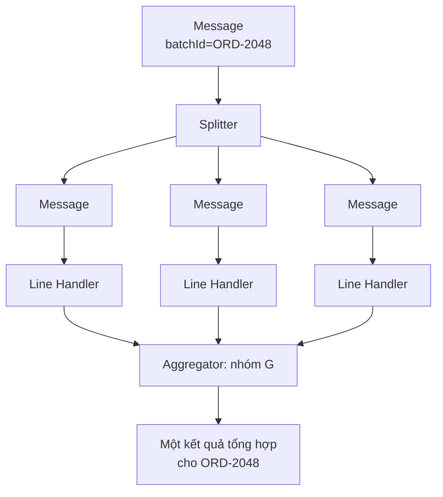
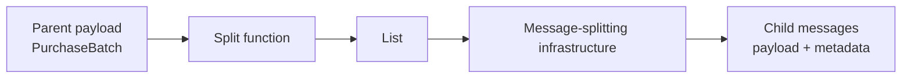
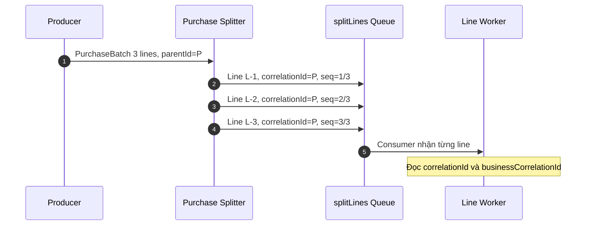
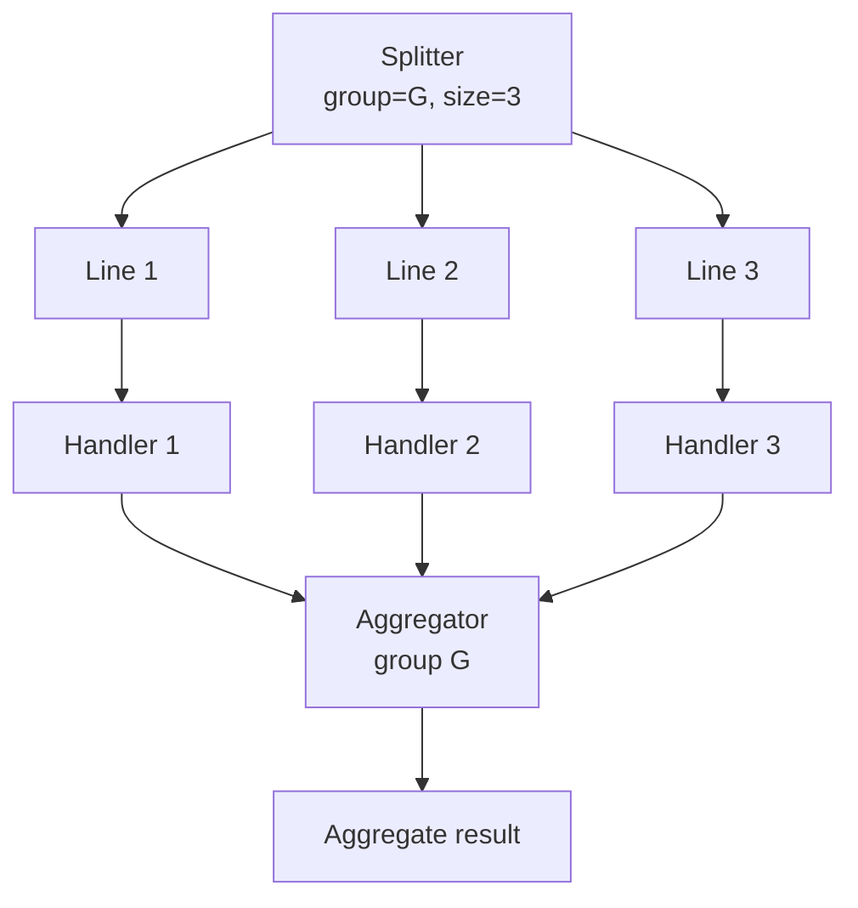
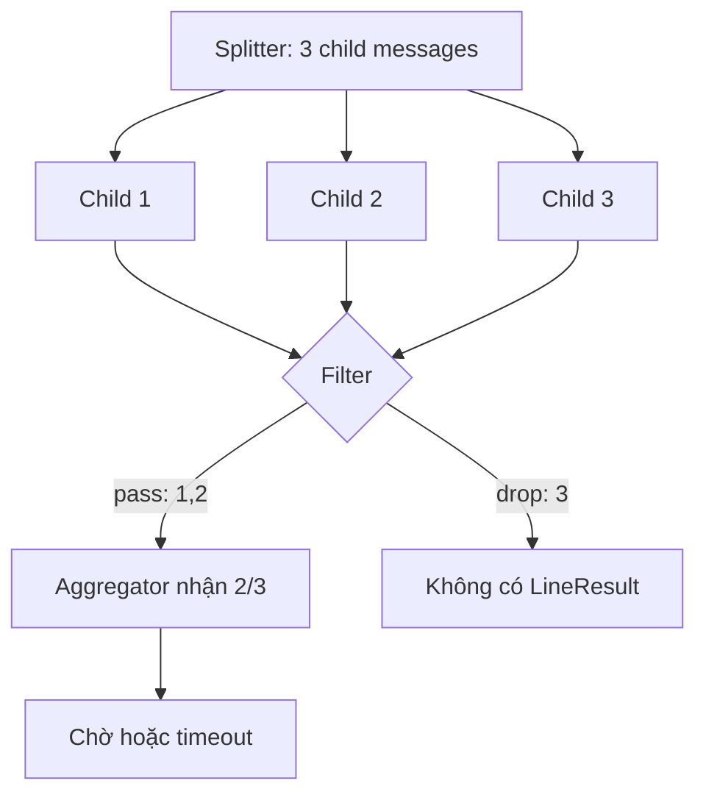
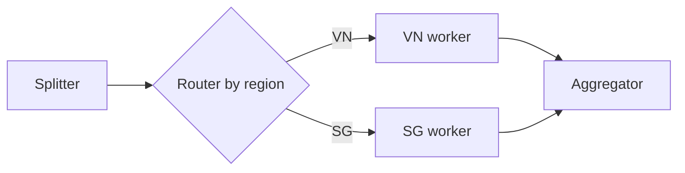
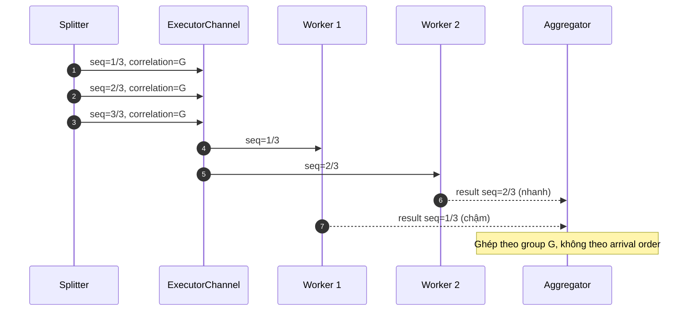
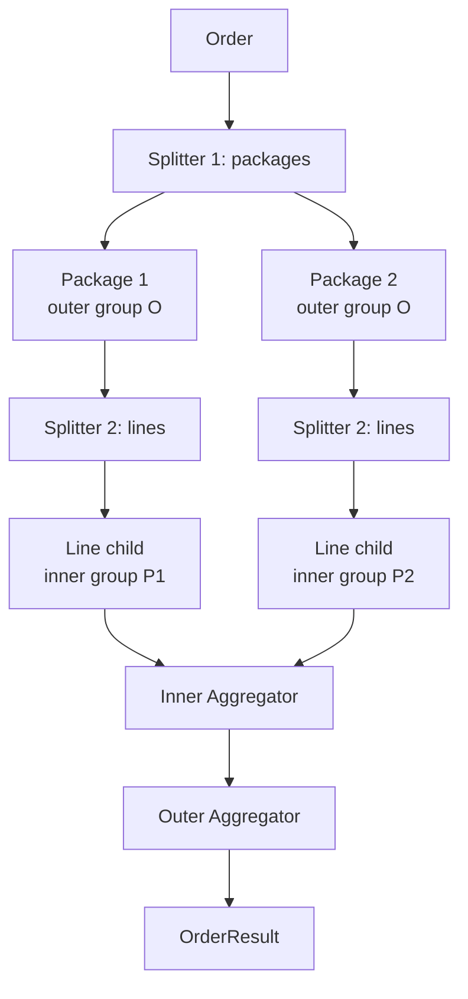
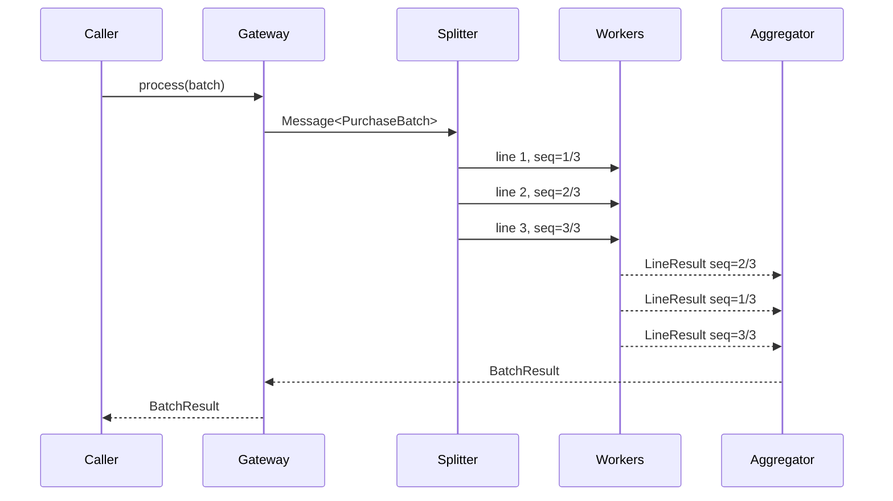

# Splitter giữ correlation metadata trong Spring Integration

> **Chương:** Splitter  
> **Bài học:** Splitter giữ correlation metadata  
> **Phạm vi:** Triển khai Enterprise Integration Patterns (EIP) với Spring Integration, phối hợp Splitter, Aggregator, Router, Filter, Transformer, Gateway, retry và error channel, đồng thời theo dõi các nhánh xử lý bằng correlation.

## 1. Bài toán: tách một đơn hàng nhưng vẫn biết các phần thuộc về đâu

Giả sử một hệ thống thương mại điện tử nhận đơn hàng `ORD-2048` gồm ba dòng sản phẩm. Hệ thống muốn xử lý từng dòng độc lập để tra cứu tồn kho, tính phí vận chuyển, hoặc xác định đơn vị thực hiện. Khi tất cả các dòng hoàn thành, một Aggregator phải ghép kết quả thành phản hồi của đơn hàng.

Vấn đề là sau khi tách:

- Làm sao biết ba message con thuộc **cùng một lần split**?
- Làm sao xác định dòng nào đứng thứ nhất, thứ hai, thứ ba?
- Aggregator biết lúc nào đã nhận đủ kết quả để release?
- Nếu một dòng được chuyển tới Router, Transformer hoặc worker bất đồng bộ, metadata nhóm có còn không?
- Nếu message bị Filter loại hoặc lỗi tại một nhánh, Aggregator phải làm gì?
- ID dùng để gom nhóm có phải chính là `orderId` hoặc trace ID không?



**Đáp án nền tảng:** Splitter có thể gắn **sequence/correlation headers** vào các message con. Các bước sau phải **giữ đúng metadata đó** để Aggregator ghép nhóm và quyết định khi nào hoàn tất.

Trong Spring Integration, ba header thường quan trọng nhất là:

- `correlationId`: định danh **nhóm message con**.
- `sequenceNumber`: vị trí của message con trong chuỗi.
- `sequenceSize`: số lượng phần tử được kỳ vọng trong nhóm **khi biết được kích thước**.

Điều quan trọng không kém là **phân biệt correlation kỹ thuật của nhóm với correlation nghiệp vụ và tracing**. Một đơn hàng có thể được tách nhiều lần; các nhóm kỹ thuật không nhất thiết dùng cùng khóa `orderId`.

### Kết quả học tập

Sau bài này, bạn có thể:

1. Giải thích cách Splitter tạo các message con và metadata nhóm.
2. Đọc, truyền và kiểm thử `correlationId`, `sequenceNumber`, `sequenceSize`.
3. Tách bạch `businessCorrelationId`, `traceId` và `MessageHeaders.id`.
4. Xây một ví dụ Splitter bằng Spring Integration Java DSL và JUnit 5.
5. Thiết kế một Aggregator chỉ release khi điều kiện nhóm phù hợp.
6. Tránh mất metadata khi qua Transformer, Router, Filter hoặc adapter ngoài JVM.
7. Xử lý dữ liệu streaming, nested Splitter, lỗi nhánh và retry/redelivery.
8. Quan sát toàn bộ hành trình của mỗi phần tử mà không gây nhầm nhóm.

## 2. Splitter thực sự làm gì với Message?

**Splitter** là pattern biến một message chứa dữ liệu tổng hợp thành nhiều message có payload nhỏ hơn, thường là một phần tử của danh sách, một phần của tài liệu hoặc một tác vụ con.

Ví dụ payload ban đầu:

```json
{
  "batchId": "ORD-2048",
  "lines": [
    {"lineId": "L-1", "sku": "BOOK-1", "quantity": 2},
    {"lineId": "L-2", "sku": "MUG-9", "quantity": 1},
    {"lineId": "L-3", "sku": "PEN-2", "quantity": 5}
  ]
}
```

Sau Splitter, các output mang ba payload độc lập:

```text
Message 1 payload = PurchaseLine("L-1", "BOOK-1", 2)
Message 2 payload = PurchaseLine("L-2", "MUG-9", 1)
Message 3 payload = PurchaseLine("L-3", "PEN-2", 5)
```

Về **payload**, chúng là ba đối tượng khác nhau. Về **nguồn gốc**, chúng phải được nhận diện như ba phần của cùng một nhóm.

Splitter trong Spring Integration là một endpoint của luồng message, không phải một lệnh `stream.map(...)` Java thuần. Nó phải tính đến:

- Message headers trước và sau khi tách.
- Quan hệ giữa parent message và child messages.
- Sequence information cho downstream.
- Việc gửi từng output tới channel tiếp theo.
- Lỗi phát sinh trong khi tách hoặc khi dispatch.

### Tách payload và đánh dấu nhóm là hai trách nhiệm liên quan

Một hàm tách có thể chỉ trả về `List<PurchaseLine>`. Framework biết danh sách phần tử và có thể tạo các message output, bổ sung sequence metadata theo cấu hình Splitter.



Không nên buộc business method xử lý danh sách phải tự đoán cách tạo `correlationId` rồi viết lại các header chuẩn. Hãy sử dụng khả năng sequence/correlation của Splitter và kiểm thử hợp đồng output.

## 3. Ba correlation/sequence header quan trọng

### 3.1. `correlationId`: khóa nhận diện nhóm

Đối với một lần tách, các message con thường chia sẻ một `correlationId`. Với Splitter áp dụng sequence theo cấu hình thông thường, giá trị này gắn với identity của message đầu vào tại điểm split, thay vì nhất thiết là mã đơn hàng.

Ví dụ:

```text
Parent message ID = 5ecb... (UUID)
Parent payload.batchId = ORD-2048

Child 1 correlationId = 5ecb...
Child 2 correlationId = 5ecb...
Child 3 correlationId = 5ecb...
```

**Không được mặc định rằng `correlationId == orderId`.** Một `orderId` có thể xuất hiện trong nhiều event hoặc nhiều lần Splitter được gọi; dùng ID nghiệp vụ làm group ID mà không xác định scope có thể trộn các nhóm không liên quan.

Khi Aggregator có correlation strategy theo `correlationId`, nó đặt các message con cùng key vào một group. Nếu key bị mất hoặc bị ghi đè giữa chừng, Aggregator có thể tạo nhóm khác, không thể release hoặc ghép sai dữ liệu.

### 3.2. `sequenceNumber`: thứ tự phần tử

Các output có thể mang số thứ tự:

```text
Child 1 sequenceNumber = 1
Child 2 sequenceNumber = 2
Child 3 sequenceNumber = 3
```

Số thứ tự giúp nhận diện vị trí trong **tập message được tách**, nhưng không có nghĩa rằng mọi nhánh downstream hoàn tất theo đúng thứ tự đó.

Đặc biệt sau `ExecutorChannel`, broker hoặc các handler có độ trễ khác nhau, message thứ ba có thể hoàn tất **trước** message thứ nhất. Nếu kết quả cần sắp xếp theo thứ tự gốc, hãy dùng metadata hoặc domain field `lineIndex` với quy tắc rõ ràng khi tổng hợp.

### 3.3. `sequenceSize`: số phần tử được kỳ vọng

Khi Splitter biết đầu vào tạo ra ba phần tử, các message con thường có:

```text
sequenceSize = 3
```

Một Aggregator dùng release strategy dựa vào kích thước có thể hoàn tất khi nhận đủ số lượng phần tử hợp lệ.

**Nhưng không phải mọi Splitter đều biết size trước khi phát.** Nếu nguồn là Iterator/streaming hoặc số phần tử không xác định tại thời điểm split, sequence size có thể không xác định (một số trường hợp biểu diễn bằng `0`). Khi đó **không được** áp dụng quy tắc máy móc “chờ đúng sequenceSize message” mà không có completion marker, timeout hoặc release strategy khác.

### Bảng tổng hợp

| Header | Ý nghĩa | Giá trị minh họa | Điều không được suy ra |
| --- | --- | --- | --- |
| `correlationId` | Nhóm message con | UUID của parent message | Không mặc định bằng `orderId` |
| `sequenceNumber` | Vị trí trong chuỗi | `1`, `2`, `3` | Không bảo đảm thứ tự hoàn tất |
| `sequenceSize` | Số phần tử kỳ vọng khi biết size | `3` | Không luôn có số dương |
| `MessageHeaders.id` | ID của một message cụ thể | UUID khác nhau cho mỗi child | Không dùng làm group key chung |
| `businessCorrelationId` | Liên kết hành trình nghiệp vụ | `order:ORD-2048` | Không thay thế correlation kỹ thuật |
| `traceId` | Nhận diện trace phân tán | Tracing ID theo hệ thống | Không phải khóa grouping mặc định |

## 4. Metadata do Splitter tạo và metadata do ứng dụng giữ

Cần phân biệt hai lớp thông tin.

**Lớp kỹ thuật:**

- `correlationId`, `sequenceNumber`, `sequenceSize`.
- Có thể có metadata phụ trợ cho chuỗi lồng nhau tùy cấu hình.
- Được dùng bởi infrastructure và Aggregator.

**Lớp nghiệp vụ/quan sát:**

- `businessCorrelationId` hoặc `orderId`.
- `eventId`, `tenantId` đã xác thực, `traceId`.
- Được dùng để tìm audit, kiểm tra nguồn dữ liệu, đối soát nghiệp vụ.

```text
Original message
  id                    = UUID-P
  businessCorrelationId = order:ORD-2048
  traceId               = TRACE-T
  payload               = PurchaseBatch(ORD-2048, 3 lines)

After Splitter (child 2)
  id                    = UUID-C2
  correlationId         = UUID-P
  sequenceNumber        = 2
  sequenceSize          = 3
  businessCorrelationId = order:ORD-2048
  traceId               = TRACE-T
  payload               = PurchaseLine(L-2, MUG-9, 1)
```

Ở đây `UUID-P` đại diện group correlation của lần split, còn `order:ORD-2048` nối toàn bộ nghiệp vụ. Hai giá trị phục vụ mục đích khác nhau.

Một hệ thống có thể có **hai lần split khác nhau của cùng đơn hàng**. Chúng nên có group identity tách biệt nếu hai lần tách không thuộc cùng một nhóm Aggregator, dù có chung `businessCorrelationId`.

### Vì sao không tự gán `correlationId=orderId`?

Nếu cùng đơn được xử lý lại sau timeout và Splitter phát một nhóm mới, Aggregator có thể trộn phần tử của nhóm cũ với nhóm mới nếu chỉ dựa trên order ID và không có chính sách deduplication/group lifecycle.

Khi thật sự cần grouping theo business key, hãy thiết kế một **correlation strategy tường minh** bao gồm phạm vi workflow, batch attempt/version hoặc stage phù hợp. Đó là quyết định ở cấp orchestration/Aggregator, không phải tác dụng phụ ngẫu nhiên của một handler.

## 5. Java DSL: Splitter chia một batch thành ba message

Ví dụ sử dụng Spring Integration Java DSL, Java 17+ và JUnit 5/Spring Test cho phần kiểm thử. Một `PurchaseBatch` chứa danh sách `PurchaseLine`. Chúng ta muốn output có sequence metadata và giữ business correlation header.

### 5.1. DTO bất biến

```java
package example.integration;

import java.util.List;

public record PurchaseLine(
    String lineId,
    String sku,
    int quantity
) {}

public record PurchaseBatch(
    String batchId,
    List<PurchaseLine> lines
) {
    public PurchaseBatch {
        if (batchId == null || batchId.isBlank()) {
            throw new IllegalArgumentException("Thiếu batchId");
        }
        if (lines == null || lines.isEmpty()) {
            throw new IllegalArgumentException("Batch phải có line");
        }
        lines = List.copyOf(lines);
    }
}
```

Hai record giúp payload không bị sửa tùy tiện trong ví dụ. `List.copyOf` giữ danh sách ở trạng thái không thể sửa thông qua reference của record và từ chối phần tử null. Các field của `PurchaseLine` là những giá trị đơn giản; nếu một phần tử chứa object mutable, cần thêm defensive copy phù hợp.

### 5.2. Cấu hình channel và Splitter

```java
package example.integration;

import org.springframework.context.annotation.Bean;
import org.springframework.context.annotation.Configuration;
import org.springframework.integration.channel.DirectChannel;
import org.springframework.integration.channel.QueueChannel;
import org.springframework.integration.config.EnableIntegration;
import org.springframework.integration.dsl.IntegrationFlow;
import org.springframework.messaging.MessageChannel;

@Configuration
@EnableIntegration
public class PurchaseSplitterConfiguration {

    @Bean
    public MessageChannel batchInput() {
        return new DirectChannel();
    }

    @Bean
    public QueueChannel splitLines() {
        return new QueueChannel();
    }

    @Bean
    public IntegrationFlow splitPurchaseBatch() {
        return IntegrationFlow.from("batchInput")
            .split(PurchaseBatch.class, PurchaseBatch::lines)
            .channel("splitLines")
            .get();
    }
}
```

Điểm đáng chú ý:

- `batchInput` nhận message chứa toàn bộ `PurchaseBatch`.
- `.split(PurchaseBatch.class, PurchaseBatch::lines)` trích danh sách các dòng từ payload.
- Infrastructure của Splitter tạo message con và áp dụng sequence metadata theo cơ chế Splitter hiện hành.
- `splitLines` là `QueueChannel` để kiểm tra từng message sau khi split.
- Chưa có business handler; mỗi phần tử đang ở hàng chờ trong bộ nhớ.

Với Splitter được cấu hình thông thường để áp dụng sequence và nguồn `List` có kích thước xác định, các child messages có `correlationId` chung và `sequenceNumber`/`sequenceSize` thể hiện vị trí/kích thước. Nếu một ứng dụng đã tùy chỉnh cơ chế sequence, phải kiểm tra cấu hình cụ thể, không suy luận từ tên method `split`.

### 5.3. Gửi một batch vào Splitter

```java
import java.util.List;

import org.springframework.messaging.Message;
import org.springframework.messaging.support.MessageBuilder;

PurchaseBatch batch = new PurchaseBatch(
    "ORD-2048",
    List.of(
        new PurchaseLine("L-1", "BOOK-1", 2),
        new PurchaseLine("L-2", "MUG-9", 1),
        new PurchaseLine("L-3", "PEN-2", 5)
    )
);

Message<PurchaseBatch> input = MessageBuilder.withPayload(batch)
    .setHeader("businessCorrelationId", "order:ORD-2048")
    .setHeader("traceId", "trace-101")
    .build();

// batchInput là MessageChannel được inject.
boolean sent = batchInput.send(input);
```

Khi flow là `DirectChannel` và `QueueChannel` đồng bộ, việc gửi có thể hoàn thành sau khi Splitter đã phát các message con tới queue. Nhưng `sent=true` **không chứng minh ba line đã được xử lý nghiệp vụ**; chúng chỉ đang chờ consumer.

`QueueChannel` trong bộ nhớ cũng không đảm bảo phục hồi qua restart. Nếu đây là công việc bắt buộc không được mất, cần broker, persistent store hoặc outbox tương ứng.

## 6. Theo dõi một lần split theo từng message con

Với input ba phần tử, đường đi kỳ vọng:



Trong cùng JVM, worker có thể đọc metadata từ `message.getHeaders()`:

```java
import org.springframework.messaging.Message;

public void inspectLine(Message<PurchaseLine> message) {
    var headers = message.getHeaders();

    Object group = headers.get("correlationId");
    Object sequence = headers.get("sequenceNumber");
    Object size = headers.get("sequenceSize");
    Object business = headers.get("businessCorrelationId");

    // Demo: giá trị này có thể đưa vào structured logging.
    System.out.printf(
        "group=%s seq=%s/%s business=%s line=%s%n",
        group, sequence, size, business,
        message.getPayload().lineId());
}
```

Trong production không dùng `System.out.println` làm hệ thống quan sát chính. Dùng logger, metric và tracing framework phù hợp; tránh đưa dữ liệu cá nhân nhạy cảm vào log.

### Sequence size là thông tin của **lần split**, không phải số phần tử đã hoàn thành

`sequenceSize=3` nghĩa là nguồn split tạo **ba phần tử trong nhóm**. Nó không có nghĩa ba service đã trả kết quả. Aggregator chỉ nên release sau khi đã nhận đủ **message kết quả** hoặc khi release strategy khác được thỏa.

## 7. JUnit 5: chứng minh Splitter giữ correlation metadata

Một bài test tốt không chỉ assert rằng có ba payload, mà còn phải chứng minh chúng thuộc cùng nhóm và vẫn mang header nghiệp vụ.

### 7.1. Test đi qua IntegrationFlow thật

```java
package example.integration;

import static org.junit.jupiter.api.Assertions.*;

import java.util.HashSet;
import java.util.List;
import java.util.Set;

import org.junit.jupiter.api.Test;
import org.springframework.beans.factory.annotation.Autowired;
import org.springframework.beans.factory.annotation.Qualifier;
import org.springframework.integration.channel.QueueChannel;
import org.springframework.messaging.Message;
import org.springframework.messaging.MessageChannel;
import org.springframework.messaging.support.MessageBuilder;
import org.springframework.test.context.junit.jupiter.SpringJUnitConfig;

@SpringJUnitConfig(PurchaseSplitterConfiguration.class)
class PurchaseSplitterTest {

    @Autowired
    @Qualifier("batchInput")
    private MessageChannel batchInput;

    @Autowired
    @Qualifier("splitLines")
    private QueueChannel splitLines;

    @Test
    void childrenHaveCommonCorrelationAndCorrectSequence() {
        var batch = new PurchaseBatch(
            "ORD-2048",
            List.of(
                new PurchaseLine("L-1", "BOOK-1", 2),
                new PurchaseLine("L-2", "MUG-9", 1),
                new PurchaseLine("L-3", "PEN-2", 5)
            ));

        Message<PurchaseBatch> parent = MessageBuilder
            .withPayload(batch)
            .setHeader("businessCorrelationId", "order:ORD-2048")
            .setHeader("traceId", "trace-101")
            .build();

        assertTrue(batchInput.send(parent));

        Set<Object> groupIds = new HashSet<>();
        Set<Integer> sequenceNumbers = new HashSet<>();
        Set<String> lineIds = new HashSet<>();

        for (int i = 0; i < 3; i++) {
            Message<?> child = splitLines.receive(1_000);
            assertNotNull(child);
            assertInstanceOf(PurchaseLine.class, child.getPayload());

            PurchaseLine line = (PurchaseLine) child.getPayload();
            lineIds.add(line.lineId());

            Object correlationId =
                child.getHeaders().get("correlationId");
            assertNotNull(correlationId);
            groupIds.add(correlationId);

            Number seq = (Number) child.getHeaders()
                .get("sequenceNumber");
            Number size = (Number) child.getHeaders()
                .get("sequenceSize");

            assertNotNull(seq);
            assertNotNull(size);
            sequenceNumbers.add(seq.intValue());
            assertEquals(3, size.intValue());

            assertEquals("order:ORD-2048",
                child.getHeaders().get("businessCorrelationId"));
            assertEquals("trace-101",
                child.getHeaders().get("traceId"));
        }

        assertEquals(1, groupIds.size());
        assertEquals(Set.of(1, 2, 3), sequenceNumbers);
        assertEquals(
            Set.of("L-1", "L-2", "L-3"), lineIds);

        assertNull(splitLines.receive(0));
    }
}
```

Test xác minh:

1. Ba output đều là `PurchaseLine`.
2. `correlationId` có mặt và **giống nhau trong cả nhóm**.
3. Mỗi output có sequence number riêng từ 1 đến 3.
4. `sequenceSize` bằng 3 đối với input dạng `List` đã biết kích thước.
5. Business correlation và trace header của parent được mang đến các child.
6. Không có message thứ tư ngoài ý muốn.

**Lưu ý về giá trị chính xác của group ID:** test cố ý kiểm tra `correlationId` cùng nhóm mà không bắt buộc phải hard-code một UUID hay luôn bằng `parent.getHeaders().getId()` trong mọi cấu hình Splitter. Với nested split, tùy chỉnh sequence hoặc giải pháp correlation riêng, framework có thể quản lý thông tin nhóm khác với ví dụ đơn giản. Hợp đồng downstream quan trọng nhất là **mọi message cùng nhóm có thể được Aggregator nhận diện nhất quán**.

### 7.2. Test nhiều batch không bị trộn nhóm

Một test khác nên gửi `ORD-2048` và `ORD-2049` vào cùng Splitter rồi xác minh:

- Mỗi batch tạo nhóm correlation riêng.
- Mỗi nhóm có `sequenceNumber` bắt đầu từ 1.
- Business correlation khác nhau theo đơn.
- Aggregator không trộn message của hai batch.
- Nếu các message tới xen kẽ do executor, kết quả vẫn được nhóm đúng.

Tránh test bằng cách giả định mỗi batch luôn hoàn thành cùng một lúc. Khi có bất đồng bộ, xử lý message có thể xen kẽ hợp lệ.

## 8. Aggregator sử dụng metadata của Splitter như thế nào?

**Aggregator** là pattern thường đi cùng Splitter: nó nhận các message con đã xử lý rồi nhóm chúng dựa trên một **correlation strategy** và quyết định lúc nào release dựa trên một **release strategy**.



Thông thường, Aggregator của Spring Integration có thể khai thác:

- `correlationId` để xác định message group.
- `sequenceSize` để biết số phần tử kỳ vọng.
- `sequenceNumber` để hỗ trợ trình tự hoặc một chiến lược release/aggregation tương ứng.

### Grouping và release là hai quyết định khác nhau

| Câu hỏi | Thành phần | Ví dụ |
| --- | --- | --- |
| Message thuộc nhóm nào? | Correlation strategy | `correlationId=G` |
| Nhóm đã đủ chưa? | Release strategy | Đã nhận 3 phần tử khác nhau, size=3 |
| Kết quả nhóm là gì? | Output processor / aggregation strategy | `List<LineResult>` |
| Nhóm quá hạn thì sao? | Expiry/timeout policy | Partial result, error hoặc discard được theo dõi |

Không được nhầm `sequenceSize=3` với “Aggregator tự xử lý đúng mọi tình huống có ba message”. Nếu có duplicate, missing result, lỗi hoặc unknown size, cần một chiến lược phù hợp hơn việc đếm thô.

### Flow minh họa Splitter → Transformer → Aggregator

```java
@Bean
public IntegrationFlow aggregateProcessedLines(
        LineProcessor processor) {

    return IntegrationFlow.from("batchForAggregation")
        .split(PurchaseBatch.class, PurchaseBatch::lines)
        .transform(PurchaseLine.class, processor::process)
        .aggregate()
        .channel("batchResults")
        .get();
}
```

Đây là **một biến thể flow khác** với demo `PurchaseSplitterConfiguration` ở mục 5, không đăng ký đồng thời cùng tên channel nếu mục tiêu chỉ là minh họa. Để chạy thật, cần định nghĩa `batchForAggregation`, `batchResults` và `LineProcessor`.

Ví dụ contract cho processor:

```java
public record LineResult(
    String lineId,
    boolean processed,
    String reasonCode
) {}

public final class LineProcessor {
    public LineResult process(PurchaseLine line) {
        // Minh họa: thay bằng xử lý thật có idempotency.
        return new LineResult(line.lineId(), true, "OK");
    }
}
```

Khi Transformer trả payload mới theo cơ chế chuẩn, Spring Integration thường chuyển tiếp headers thích hợp từ request message sang output message. **Tuy nhiên phải kiểm thử** rằng group correlation vẫn còn sau bước transform, nhất là khi sử dụng custom code tự dựng `Message<?>` hoặc adapter ngoài JVM.

### Không gộp nhầm theo batchId khi có replay

Nếu một batch bị phát lại sau crash, hai lần split có thể tạo hai tập message con cùng `batchId`. Nếu tùy chỉnh Aggregator group theo `batchId` duy nhất, kết quả cũ/chưa hoàn tất có thể lẫn với kết quả replay mới.

Giải pháp có thể là group theo `(batchId, processingAttemptId)` hoặc một workflow run ID bền vững, kết hợp cơ chế deduplication theo `eventId`/`lineId`. Chọn chiến lược dựa trên delivery semantics của hệ thống.

## 9. Header propagation qua Transformer và Service Activator

Một chuỗi thực tế thường có các bước:

```text
Splitter
  -> Transformer: PurchaseLine -> LineCommand
  -> Router theo skuCategory
  -> Service Activator
  -> Aggregator
```

Nếu một endpoint nhận message con rồi tạo message mới, cần xác định **header nào được giữ**. Một sai lầm phổ biến là tự xây một `Message<?>` chỉ với payload và mất `correlationId`.

### 9.1. Phản mẫu: tạo message mới mà không giữ metadata

```java
import org.springframework.messaging.Message;
import org.springframework.messaging.support.MessageBuilder;

public Message<LineResult> wrongTransform(
        Message<PurchaseLine> input) {

    LineResult result = new LineResult(
        input.getPayload().lineId(), true, "OK");

    return MessageBuilder.withPayload(result)
        .build(); // Không mang correlation/sequence của input.
}
```

Output không giữ các header nhóm của input. Nếu message này đến Aggregator, nó có thể không được ghép đúng với các message con khác hoặc gây lỗi grouping.

### 9.2. Mẫu rõ ràng: giữ headers cần thiết

```java
import org.springframework.messaging.Message;
import org.springframework.messaging.support.MessageBuilder;

public Message<LineResult> preservingTransform(
        Message<PurchaseLine> input) {

    LineResult result = new LineResult(
        input.getPayload().lineId(), true, "OK");

    return MessageBuilder.withPayload(result)
        .copyHeaders(input.getHeaders())
        .build();
}
```

Trong cùng flow nội bộ, `copyHeaders(...)` giúp truyền metadata có trong input. Những header hệ thống như ID/timestamp có quy tắc tạo/copy riêng của message builder; **không dùng Java object identity hoặc ID của output message để thay group correlation**.

**Cảnh báo:** không sao chép mù quáng mọi header khi gửi qua HTTP/Kafka/AMQP hoặc ranh giới trust khác. `replyChannel`, `errorChannel` và dữ liệu nhạy cảm có thể không phù hợp để đưa ra ngoài. Tại ranh giới transport, dùng header mapper/allowlist và xác định rõ các giá trị phải giữ như group correlation, sequence và business ID.

### 9.3. Không tự đặt lại sequence sau khi xử lý

Một handler có thể muốn ghi `sequenceNumber=1` chỉ vì nó nhận một request đơn lẻ. Làm vậy phá metadata mà Splitter đã gán. Nếu cần đếm các bước nội bộ của handler, dùng header riêng như `processingStage` hoặc log field, không tái sử dụng `sequenceNumber` của nhóm.

## 10. Filter giữa Splitter và Aggregator: vì sao dễ gây thiếu nhóm?

Giả sử Splitter tạo ba phần tử:

```text
G / 1 of 3
G / 2 of 3
G / 3 of 3
```

Một Filter được đặt giữa Splitter và Aggregator chỉ cho phép hai message đầu đi tiếp; message thứ ba bị drop.



**Vấn đề:** Aggregator kỳ vọng đủ ba kết quả nhưng không biết message thứ ba đã bị loại có chủ đích. Điều đó có thể dẫn đến nhóm không release cho đến timeout/expiry.

### Các hướng xử lý

1. **Tạo kết quả reject có cấu trúc** cho message bị Filter loại, ví dụ `LineResult(lineId, false, "NOT_ELIGIBLE")`, rồi gửi nó đến Aggregator.
2. Dùng `discardChannel` tới một handler có thể tạo result hoặc xử lý recovery phù hợp.
3. Nếu chỉ cần tổng hợp các phần tử pass, cấu hình release strategy theo chính sách đó và có tín hiệu kết thúc nhóm.
4. Nếu điều kiện có thể kiểm tra trước khi split, loại/phân loại đầu vào từ trước để kích thước nhóm phản ánh đúng phần tử cần xử lý.
5. Dùng timeout/expiry strategy có giám sát nếu một nhóm được phép thiếu phần tử.

**Không giải quyết bằng cách sửa `sequenceSize` xuống 2 một cách tùy tiện ở một child message.** Các child khác vẫn có size=3; metadata nhóm sẽ mâu thuẫn.

### Business error khác mất message

Nếu một dòng bị từ chối do hết hàng, nhiều hệ thống vẫn muốn trả về `LineResult(status=OUT_OF_STOCK)` để có kết quả tổng hợp đầy đủ. Nếu message bị mất do lỗi hạ tầng, cần retry/recovery. Phân biệt rõ hai trường hợp giúp release strategy phản ánh thực tế nghiệp vụ.

## 11. Router và Publish-Subscribe có thể ảnh hưởng correlation thế nào?

### 11.1. Router chọn một đích theo nội dung

Ví dụ Splitter tạo từng line, Router chọn kho xử lý theo `warehouseRegion`.



Với Router unicast, mỗi message con đi đúng một nhánh và vẫn cần mang metadata nhóm khi quay về Aggregator. Router bình thường không cần đổi payload hoặc `correlationId` để chọn channel.

Mỗi handler có thể xử lý và trả result có cùng `correlationId`, nhưng **thời điểm hoàn tất giữa hai nhánh không nhất thiết theo sequenceNumber**.

### 11.2. Publish-Subscribe nhân message tới nhiều subscriber

Giả sử sau Splitter, mỗi line được publish cho Audit và Inventory, cả hai cùng tạo reply rồi gửi về một Aggregator. Nếu không xác định rõ contribution count, Aggregator có thể nhận **hai kết quả cho mỗi line** trong khi `sequenceSize` ban đầu vẫn mô tả **số line**, không phải số reply.

Điều này dẫn đến group đủ số lượng sớm nhưng thiếu dữ liệu một nhánh, hoặc duplicate/unexpected sequence.

```text
Splitter: 3 lines, sequenceSize=3
  |
  v
Pub/Sub: mỗi line tới 2 subscriber
  |
  +-- Audit reply x3
  +-- Inventory reply x3

Aggregator có thể thấy 6 result,
không phù hợp với release "3 lines".
```

Khi cần fan-out và gom kết quả, phải thiết kế **một grouping/completion contract mới**: xác định mỗi subscriber tạo mấy result, correlation key nào, sequence metadata nào và trường hợp nhánh lỗi/timeout.

Không tự giả định metadata của Splitter ban đầu vẫn đủ để Aggregator tổng hợp mọi nhánh của Pub/Sub.

## 12. Bất đồng bộ không làm mất nghĩa của correlation

Một flow có thể chuyển sau Splitter sang `ExecutorChannel` hoặc worker queue.



Điều cần lưu ý:

- Header nằm trong message có thể theo message qua thread boundary nếu flow giữ header.
- `ThreadLocal`, MDC, security context và transaction của sender **không tự động** đi theo worker.
- Completion order có thể khác emission order.
- Một worker có thể fail/retry trong khi các worker khác đã hoàn tất.
- Cần backpressure/executor capacity phù hợp khi một batch chứa rất nhiều dòng.

### Không sử dụng thứ tự đến làm thứ tự nghiệp vụ

Nếu Aggregator tạo danh sách theo thứ tự nhận message, thứ tự dòng có thể thay đổi theo load. Khi order quan trọng, sắp theo `sequenceNumber` hoặc domain field ổn định phù hợp với contract.

Ví dụ nghiệp vụ có `lineIndex` bắt đầu từ 0 sẽ giúp khôi phục thứ tự một cách minh bạch, kể cả khi message đi qua broker hoặc được replay.

### Correlation không phải phân vùng thứ tự

`correlationId` giúp nhóm message, nhưng không tự bảo đảm các message cùng nhóm chạy trên cùng thread hoặc được serialize theo thứ tự. Nếu cần xử lý tuần tự cho cùng khóa nghiệp vụ, phải thiết kế executor partitioning, keyed routing hoặc cơ chế ordering ở transport.

## 13. Streaming và unknown sequence size

Không phải mọi nguồn đều là `List` đã biết số phần tử. Một Splitter có thể tách Iterator hoặc stream lớn, nơi kích thước không thể tính trước mà không tiêu thụ toàn bộ dữ liệu.

Khi đó có một số nguy cơ:

- `sequenceSize` không biết trước hoặc được biểu diễn bằng 0 tùy cơ chế Splitter.
- Một Aggregator chỉ dựa trên size dương sẽ không thể biết khi nào toàn nhóm đã xong.
- Giữ mọi phần tử trong RAM có thể gây áp lực bộ nhớ.
- Nếu xử lý theo kiểu streaming, nguồn có thể fail giữa chừng mà không phát đủ phần tử.

### Thiết kế completion có chủ đích

Một số phương án:

1. **End-of-batch marker:** phát một sự kiện cuối nhóm có ý nghĩa rõ; Aggregator có strategy nhận biết marker và số phần tử đã xử lý.
2. **Bộ đếm phần tử được lưu:** producer xác định kích thước từ metadata/bảng dữ liệu trước khi bắt đầu, nếu đáng tin.
3. **Timeout/expiry:** release partial group hoặc chuyển xử lý lỗi sau một khoảng thời gian theo SLA.
4. **Window-based aggregation:** nhóm theo cửa sổ hoặc checkpoint thay vì chờ toàn bộ stream không có hồi kết.
5. **Giới hạn chunk:** split theo các batch nhỏ để kiểm soát memory/backpressure.

Không nên điền `sequenceSize=999999` hoặc `0` như một “giá trị tạm” mà không định nghĩa chính sách release tương ứng.

### Nếu empty input thì sao?

Một batch rỗng có thể tạo **không message con**, khiến downstream Aggregator không có dữ liệu để bắt đầu nhóm. Trong ví dụ mục 5, ta chọn **validate batch không rỗng** để tránh trường hợp đó.

Với nghiệp vụ cho phép đơn rỗng, cần thiết kế kết quả `EMPTY_BATCH` riêng hoặc Completion message để caller không chờ mãi.

## 14. Nested Splitter: nhiều cấp correlation

Một đơn hàng có nhiều kiện; mỗi kiện chứa nhiều dòng sản phẩm. Ta có thể:

1. Splitter thứ nhất: Order → Packages.
2. Splitter thứ hai: Package → Lines.
3. Aggregator trong: Lines → PackageResult.
4. Aggregator ngoài: PackageResults → OrderResult.



Một hệ thống nhiều tầng không thể chỉ coi một `correlationId` duy nhất là **tất cả các cấp** grouping.

Trong Spring Integration, các cơ chế sequence có thể mang thêm thông tin về nhóm lồng nhau để phối hợp nested split/aggregate. Tuy nhiên, chi tiết phụ thuộc loại endpoint, việc áp dụng sequence và cấu hình aggregator. Không nên giả định rằng chỉ đổi một header là đủ khôi phục mọi cấp.

### Nguyên tắc nested aggregation

- Xác định riêng correlation scope ở cấp package và cấp order.
- Không ghi đè một cách tùy tiện outer correlation khi xử lý inner group.
- Nếu dùng custom correlation strategy, nêu rõ nó xử lý cấp nào.
- Kiểm thử cả hai mức release, bao gồm một package có nhiều line và nhiều package cùng order.
- Khi có retry, tránh trộn kết quả của các nested run khác nhau.
- Không dùng mỗi `orderId` cho mọi nhóm lồng nhau nếu các group có vòng đời khác nhau.

### Business correlation vẫn xuyên mọi cấp

Dù technical group thay đổi theo từng tầng, `businessCorrelationId=order:ORD-2048` có thể được truyền xuyên suốt để người vận hành tìm tất cả line/package trong cùng đơn. Nhưng header này **không nhất thiết** được dùng làm correlation key mặc định cho bất kỳ Aggregator nào.

## 15. Retry, duplicate và redelivery ảnh hưởng group thế nào?

### Retry một line handler

Một line đã split với:

```text
correlationId = G
sequenceNumber = 2
sequenceSize = 3
eventId = EV-2
```

Nếu handler timeout, retry **cùng line** nên giữ metadata nhóm. Khi hoàn tất, Aggregator vẫn thấy result thuộc `G`.

Tuy nhiên, nếu lần xử lý đầu đã tạo side effect mà response bị mất, retry có thể làm side effect trùng. Cần **idempotency** theo event/operation key, không chỉ dựa vào correlation.

### Replay toàn bộ batch

Nếu parent batch được redeliver và Splitter tạo ra message mới với group ID khác, hệ thống có thể đồng thời có hai nhóm cùng `batchId`. Đây là điều cần tính toán ở tầng delivery.

| Tình huống | Rủi ro | Kiến trúc gợi ý |
| --- | --- | --- |
| Retry đúng child message | Handler làm side effect trùng | Idempotency theo event/line |
| Redelivery toàn parent | Phát lại toàn bộ children | Deduplication/outbox, batch run ID |
| Child kết quả đến muộn | Aggregator đã expire group | Late-message policy |
| Một child phát hai result | Group có duplicate | Unique child identity / release strategy |
| Nhiều pod xử lý cùng nhóm | Group state phân tán | Shared persistent MessageStore phù hợp |
| Crash giữa khi split | Một số child chưa đến | Broker/transaction/recovery contract |

### Vì sao không xem correlationId là idempotency key duy nhất?

Mọi child cùng nhóm dùng cùng `correlationId`. Nếu dùng nó làm khóa idempotency cho tất cả, sau khi xử lý child đầu tiên hệ thống có thể từ chối những child còn lại như duplicate.

Ví dụ một khóa hợp lý hơn cho side effect ở cấp dòng:

```text
idempotencyKey = (businessEventId, lineId, operationType)
```

Nếu có nhiều lần xử lý hợp lệ cho cùng line, thêm run/attempt/version phù hợp. Khóa chính xác phụ thuộc nghiệp vụ và semantics của producer.

### Không dùng sequenceNumber làm ID toàn cục

`sequenceNumber=1` tồn tại trong rất nhiều nhóm khác nhau. Khi lưu trạng thái, dùng `(correlationId, sequenceNumber)` hoặc một định danh message/line có phạm vi rõ ràng, không chỉ số thứ tự.

## 16. Error channel và recovery của một nhóm message

Nếu một child gặp lỗi, hành vi default phụ thuộc ranh giới thực thi:

- Trên `DirectChannel` đồng bộ, exception có thể lan về thread gửi.
- Sau `ExecutorChannel` hoặc broker listener, lỗi có thể đến error handler/error channel hoặc chính sách recovery của adapter.
- Một retry advice có thể thử lại handler theo số lần giới hạn.
- Lỗi cấu hình channel không giống lỗi nghiệp vụ của line.

**Lỗi child không có nghĩa framework tự động phát một `LineResult.FAILED` cho Aggregator.** Nếu downstream không có reply/result, group có thể vẫn thiếu phần tử.

### Mẫu recovery tạo kết quả lỗi có cấu trúc

Hợp đồng kết quả có thể là:

```java
public record LineResult(
    String lineId,
    String status,
    String errorCode
) {
    public static LineResult success(String lineId) {
        return new LineResult(lineId, "SUCCESS", null);
    }

    public static LineResult failure(
            String lineId, String errorCode) {
        return new LineResult(lineId, "FAILED", errorCode);
    }
}
```

Một recovery handler có thể dựng `LineResult.failure(...)` và gửi về Aggregator **cùng metadata nhóm của child ban đầu**. Nếu tạo message khác mà làm mất `correlationId`/sequence headers, Aggregator vẫn không thể hoàn tất.

Chọn chính sách tổng hợp:

- **All-or-nothing:** một child fail thì cả batch thất bại; có thể cancel/expire các child còn lại.
- **Partial result:** trả những line thành công và danh sách thất bại.
- **Compensation:** nếu một phần đã thực hiện side effect, cần bù trừ theo nghiệp vụ.
- **Manual review:** giữ batch trạng thái chờ và lưu bằng chứng lỗi.

Không gọi tất cả trường hợp trên là retry. Retry chỉ phù hợp với lỗi có khả năng tạm thời và phải được giới hạn.

## 17. Message headers khi đi qua HTTP, Kafka hoặc AMQP

Trong cùng JVM, message headers đi theo Spring Messaging infrastructure. Khi gửi sang transport ngoài, chúng phải qua **header mapper/serializer** và có thể thay đổi kiểu dữ liệu.

Ví dụ qua Kafka:

```text
Spring Message<PurchaseLine>
   headers:
      correlationId = UUID
      sequenceNumber = Integer
      sequenceSize = Integer
      businessCorrelationId = String

   -> Kafka producer adapter
   -> serialized Kafka record and headers
   -> Kafka consumer adapter
   -> Spring Message<PurchaseLine>
```

**Không mặc định** UUID/Integer tự được khôi phục đúng kiểu sau ranh giới broker. Tùy mapper, header có thể là bytes/string hoặc bị bỏ nếu không nằm trong danh sách được phép. Aggregator default nếu kỳ vọng kiểu header nhất định có thể không hoạt động như trong test nội bộ.

Nên kiểm tra:

1. Tên header nào được xuất/nhập qua adapter?
2. Giá trị sau deserialize có đúng kiểu mà correlation strategy/release strategy cần không?
3. `replyChannel`/`errorChannel` của JVM có bị gửi ra ngoài không cần thiết không?
4. Header có chứa dữ liệu nhạy cảm hoặc quá lớn không?
5. Có cơ chế bảo mật, schema version và idempotency ở transport không?
6. Khi message xử lý ở nhiều instance, group state nằm ở đâu?

**Lưu ý:** `replyChannel` trong JVM có thể là tham chiếu channel, không phải địa chỉ giao tiếp giữa hai tiến trình. Khi dùng request-reply qua broker, cần hợp đồng reply-to/correlation riêng, không chỉ copy mọi header như cũ.

### Dữ liệu đủ bền vững cho replay

Nếu yêu cầu có thể replay một nhóm sau restart, không nên chỉ dựa vào `MessageHeaders.id` ngẫu nhiên của parent khi phát lại nếu business contract cần nối kết quả cũ. Có thể lưu một `batchRunId` hoặc group key có phạm vi rõ và ánh xạ nó trong correlation strategy. Điều này phải đi cùng deduplication, group lifecycle và chính sách xử lý message đến muộn.

## 18. Gateway request-reply khi phía sau có Aggregator

Một Gateway có thể gửi một `PurchaseBatch` và chờ một `BatchResult` sau khi mọi line hoàn tất.



Những điều phải thiết kế rõ:

- Splitter tạo đủ child messages theo contract.
- Các handler trả message kết quả có metadata nhóm phù hợp.
- Aggregator có correlation/release strategy và output processor tạo đúng `BatchResult`.
- Reply cuối quay về Gateway; không có nhiều child reply cạnh tranh trực tiếp với caller.
- Gateway có timeout và recovery phù hợp khi một line thiếu hoặc xử lý lâu.
- Flow bất đồng bộ cần khả năng lưu trạng thái nếu thời gian xử lý vượt SLA.

### Tránh để child reply đi trực tiếp về Gateway

Nếu mỗi child handler tự trả reply về `replyChannel` gốc mà không qua Aggregator, Gateway có thể nhận một result đơn lẻ thay vì `BatchResult` hoặc gặp hành vi reply không xác định. Khi thiết kế flow split-and-aggregate, **Aggregator là nơi phát reply cuối**.

Không tự sửa reply channel ở mỗi child để khắc phục thiếu grouping. Hãy định nghĩa cấu trúc flow và output channel phù hợp với một kết quả tổng hợp.

## 19. Observability: kiểm tra được mọi message con

Một hệ thống split có fan-out lớn cần biết từng child đang ở giai đoạn nào. Log/metric hữu ích có thể được tổ chức theo:

```text
batchId=ORD-2048
businessCorrelationId=order:ORD-2048
groupId=G
expectedSize=3
receivedCount=3
completedCount=2
failedCount=1
aggregationStatus=COMPLETED_WITH_ERRORS
```

### Log sự kiện cho từng child

```text
stage=SPLIT_DISPATCHED batchId=ORD-2048 group=G sequence=1/3 lineId=L-1
stage=SPLIT_DISPATCHED batchId=ORD-2048 group=G sequence=2/3 lineId=L-2
stage=SPLIT_DISPATCHED batchId=ORD-2048 group=G sequence=3/3 lineId=L-3

stage=LINE_COMPLETED group=G sequence=2/3 lineId=L-2 status=SUCCESS
stage=LINE_COMPLETED group=G sequence=1/3 lineId=L-1 status=SUCCESS
stage=LINE_COMPLETED group=G sequence=3/3 lineId=L-3 status=FAILED

stage=AGGREGATE_RELEASED group=G received=3 status=PARTIAL_SUCCESS
```

Các dòng này là **ví dụ về contract logging**, không phải log mặc định Spring Integration tự tạo. Có thể dùng Micrometer Observation/OpenTelemetry để theo dõi span theo từng handler và business correlation ID.

### Metrics có giá trị

| Metric | Ý nghĩa |
| --- | --- |
| Số parent message vào Splitter | Tổng batch |
| Số child message được phát | Fan-out volume |
| Child per batch | Batch size distribution |
| Child processing latency | Độ trễ mỗi nhánh |
| Active/incomplete message groups | Aggregator đang giữ bao nhiêu nhóm |
| Group age và timeout count | Có nhóm bị treo không |
| Missing/duplicate child count | Tỷ lệ không đủ hoặc xử lý trùng |
| Retry/dead-letter count | Mức lỗi và recovery |
| Aggregation release latency | Thời gian từ split tới kết quả cuối |
| Correlation/header mapping failures | Metadata lỗi hoặc mất khi qua adapter |

Không gắn từng `batchId` hoặc `lineId` vào label của metric có cardinality cao. Để tra một group cụ thể, dùng structured logs, trace và audit store có khả năng tìm theo business key.

## 20. Các sai lầm thường gặp

### 20.1. Nhầm `correlationId` với `businessCorrelationId`

`correlationId` của một lần split không nhất thiết bằng mã đơn hàng. Một business object có thể tham gia nhiều nhóm kỹ thuật. Hãy giữ hai khái niệm riêng và thiết kế correlation strategy theo đúng phạm vi nhóm.

### 20.2. Tự dựng message kết quả rồi làm mất headers

Nếu handler chỉ gọi `MessageBuilder.withPayload(result).build()`, nó không tự lấy metadata từ child input. Cần dùng cơ chế propagation của endpoint hoặc copy những headers cần thiết với contract rõ.

### 20.3. Dùng `sequenceNumber` để suy luận thứ tự hoàn tất

Worker bất đồng bộ có thể hoàn tất lệch thứ tự. Nếu output cần đúng thứ tự gốc, phải sắp xếp theo metadata/domain index hoặc dùng aggregation strategy phù hợp.

### 20.4. Cho Aggregator chờ size từ nguồn không biết số phần tử

Với Iterator/streaming, không phải lúc nào có sequence size dương. Cần completion signal, timeout hoặc release strategy khác.

### 20.5. Filter drop một child rồi không nói cho Aggregator

Group thiếu phần tử và có thể không release. Đưa child bị reject qua nhánh tạo kết quả lỗi có cấu trúc hoặc thiết kế lại completion contract.

### 20.6. Tạo group key chỉ bằng `orderId` không xét replay

Lần split cũ và lần split mới có thể bị trộn. Cần workflow run/attempt ID hoặc chính sách deduplication phù hợp.

### 20.7. Coi `correlationId` là idempotency key cho từng child

Tất cả child cùng group dùng chung ID. Dùng một khóa đó cho mọi side effect có thể làm child thứ hai bị coi là duplicate. Phải có định danh từng child/operation.

### 20.8. Không xử lý nested split

Hai mức split tạo nhiều mức grouping. Nếu dùng một `correlationId` cho tất cả mà không có scope, Aggregator trong/ngoài có thể ghép sai.

### 20.9. Tin header sẽ tự tồn tại qua mọi broker

Transport có header mapper, serializer và giới hạn riêng. Phải kiểm thử producer-consumer end-to-end, bao gồm kiểu giá trị sau deserialize.

### 20.10. Gateway chờ vô hạn khi thiếu child result

Một handler `void` hoặc error bị nuốt có thể khiến Aggregator thiếu kết quả. Đặt timeout/recovery và trả kết quả lỗi phù hợp thay vì để caller không biết tình trạng batch.

### 20.11. Coi Group đủ số lượng là Group đúng

Nếu group nhận duplicate hoặc kết quả của run khác, đếm đúng N không chứng minh đã nhận **đúng N phần tử duy nhất**. Cần kiểm tra child identity và completion semantics khi yêu cầu chính xác cao.

### 20.12. Dùng QueueChannel trong RAM làm lưu trữ bền vững

QueueChannel phù hợp minh họa/test, nhưng message chưa chắc tồn tại qua restart. Với dữ liệu quan trọng cần dùng broker hoặc persistence theo yêu cầu delivery.

## 21. Bài thực hành: Splitter đơn vận chuyển, Aggregator kết quả kho

**Bối cảnh:** hệ thống nhận `ShipmentBatch(batchId, packages)` gồm nhiều kiện hàng, mỗi kiện có `packageId`, `region` và `weight`. Cần tách từng kiện, định tuyến đến kho phù hợp và tổng hợp kết quả.

### Yêu cầu

1. Định nghĩa immutable `ShipmentBatch` và `ShipmentPackage`.
2. Tạo `shipmentInput` và một IntegrationFlow dùng Splitter tách danh sách packages.
3. Gắn `businessCorrelationId=shipment:<batchId>` ở ingress đã xác thực.
4. Kiểm tra output của Splitter có cùng `correlationId`, `sequenceNumber` khác nhau và `sequenceSize` bằng số kiện khi biết kích thước.
5. Dùng Router chọn `vnWarehouse` hoặc `sgWarehouse` theo `region`, không sửa metadata nhóm.
6. Mỗi warehouse handler tạo `PackageResult` và bảo toàn group correlation.
7. Đưa cả kết quả thành công và thất bại nghiệp vụ về Aggregator.
8. Viết test các message tới Aggregator sai thứ tự vẫn được nhóm đúng.
9. Giả lập Filter loại một kiện; thay vì drop âm thầm, tạo `PackageResult.REJECTED` để nhóm có thể kết thúc.
10. Tạo test hai batch chạy xen kẽ mà không trộn group.
11. Thử duplicate/replay một package và xác định idempotency key theo `packageId` và operation.
12. Mô tả sự khác nhau khi xử lý bằng `ExecutorChannel` hoặc Kafka consumer ở nhiều instance.
13. Nếu đầu vào là streaming Iterator, xác định completion marker/timeout thay vì phụ thuộc size đã biết.
14. Quan sát số nhóm chưa hoàn tất, số message lỗi và số lần timeout.

### Bảng hành vi kỳ vọng

| Trường hợp | Correlation | Kết quả cần thấy |
| --- | --- | --- |
| Batch A có 3 package | Cả 3 cùng technical group A | Aggregator tạo một batch result |
| Batch B có 2 package | Technical group B khác A | Không bị trộn với group A |
| Một package thất bại nghiệp vụ | Giữ group và sequence | Aggregator nhận failed result |
| Một package bị drop không có kết quả | Group thiếu phần tử | Timeout/expiry hoặc recovery rõ |
| Message đến sai thứ tự | Correlation không đổi | Grouping vẫn đúng |
| Một package redeliver | Cùng logical operation | Không tạo side effect trùng |
| Qua broker | Header mapper giữ metadata cần thiết | Aggregator vẫn nhận đúng nhóm |
| Nested split package → items | Có inner/outer group scope | Hai mức aggregation đúng |

### Câu hỏi tự đánh giá

**Câu 1.** Vì sao các output của Splitter cần `correlationId`?

*Để các endpoint downstream, đặc biệt là Aggregator, biết các message con thuộc cùng một nhóm xử lý.*

**Câu 2.** `sequenceNumber=2` có bảo đảm child này hoàn tất trước child số 3 không?

*Không. Nó là số thứ tự trong nhóm; thứ tự hoàn tất có thể khác khi chạy bất đồng bộ.*

**Câu 3.** `sequenceSize` có luôn là số dương không?

*Không. Với nguồn không xác định kích thước trước, size có thể không biết; cần release strategy/termination signal phù hợp.*

**Câu 4.** Có nên dùng `correlationId` làm khóa chống xử lý trùng cho mỗi dòng đơn hàng không?

*Không nên dùng một mình. Nhiều child dùng chung correlationId; phải có child/event/operation ID trong khóa idempotency.*

**Câu 5.** Nếu custom Transformer làm mất `correlationId`, chuyện gì có thể xảy ra?

*Aggregator có thể không nhóm đúng result, không release hoặc phát sinh lỗi theo cấu hình.*

**Câu 6.** Vì sao business correlation và technical correlation có thể khác nhau?

*Business ID nối toàn bộ vòng đời một đơn; technical group ID chỉ một lần split hoặc một cấp aggregation cụ thể.*

## 22. Checklist thiết kế trước khi chạy production

- **Hợp đồng Splitter:** xác định loại payload con, nguồn collection/iterator và quy tắc với input rỗng.
- **Sequence:** xác nhận cơ chế áp dụng `correlationId`/`sequenceNumber`/`sequenceSize` cho endpoint thực tế.
- **Group scope:** không đồng nhất technical correlation với business ID nếu có nhiều lần split/replay.
- **Payload:** ưu tiên immutable DTO, tránh chia sẻ object mutable giữa worker.
- **Headers:** giữ group metadata qua Transformer, Router, Service Activator và custom message builder.
- **Aggregator:** khai báo grouping, release, output processor và timeout/expiry phù hợp.
- **Unknown size:** có completion strategy riêng cho Iterator/streaming.
- **Filter:** không drop child quan trọng khi Aggregator đang kỳ vọng đủ result.
- **Error:** thiết kế recovery result cho child thất bại và error channel phù hợp với ranh giới sync/async.
- **Idempotency:** khóa theo child/operation, không chỉ dùng group correlation ID.
- **Replay:** xác định xử lý group ID khi parent/child được phát lại, có deduplication và late-message policy.
- **Nested split:** kiểm thử hai cấp grouping và aggregation.
- **Transport:** header mapper/serializer giữ tên, kiểu và giá trị metadata cần thiết.
- **Gateway:** chỉ Aggregator tạo final reply theo hợp đồng, có timeout cho batch không hoàn tất.
- **Concurrency:** không giả định các output đến theo thứ tự số sequence.
- **Durability:** chọn broker/persistent MessageStore khi cần chịu được restart.
- **Observability:** metric group chưa hoàn tất, child lỗi, duplicate, timeout và thời gian release.
- **Testing:** test đủ single batch, multiple batches, out-of-order, rejection, failure, replay và cross-process.

## 23. Kết luận

**Splitter không chỉ chia payload**; nó còn gắn hoặc truyền thông tin để message con có thể được **liên kết lại thành một nhóm có ý nghĩa**. Trong Spring Integration, `correlationId` giúp nhận diện group, `sequenceNumber` cho biết vị trí của từng phần tử, và `sequenceSize` biểu diễn kích thước nhóm khi có thể xác định được.

Để “Splitter giữ correlation metadata” đúng trong toàn bộ hệ thống, cần kiểm tra cả chặng **sau khi split**: Transformer, Router, Filter, Service Activator, retry, error flow, broker và Aggregator. Đừng ghi đè group headers, đừng dùng business ID thay technical group một cách tùy tiện, và đừng để một child bị mất khiến Aggregator đợi mãi.

Khi kết hợp metadata rõ nghĩa, idempotency, release/timeout strategy và kiểm thử đầy đủ, pipeline Splitter → xử lý từng phần → Aggregator trở nên dễ đối soát, dễ vận hành và đáng tin hơn ngay cả khi nhiều nhánh xử lý không đồng bộ.
