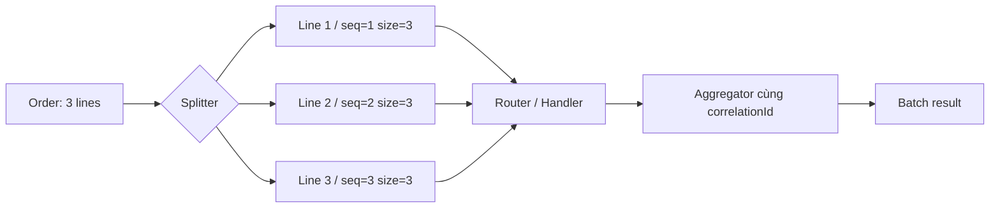
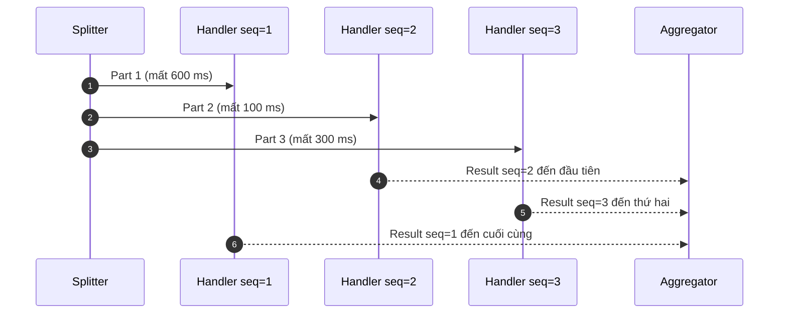
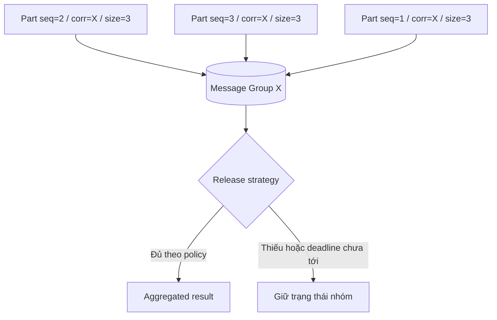
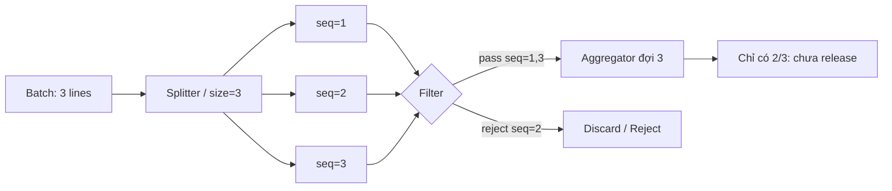
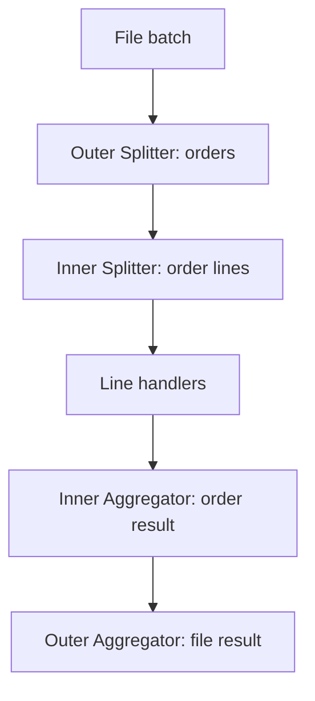

# Sequence size và sequence number

Khi hệ thống nhận một đơn hàng chứa nhiều dòng sản phẩm, **Splitter** có thể tách một message lớn thành nhiều message con để mỗi dòng được kiểm tra giá, tồn kho hoặc điều kiện vận chuyển riêng. Tách được payload mới chỉ là một nửa bài toán: nếu những dòng đó được xử lý ở nhiều nhánh, **làm sao nhận biết chúng thuộc cùng đơn hàng, thứ tự ban đầu của mỗi dòng và khi nào đủ kết quả để ghép lại?**

Trong **Spring Integration**, các header **`sequenceNumber`**, **`sequenceSize`** và **`correlationId`** giúp biểu diễn thông tin cần thiết để theo dõi một nhóm message sau khi split. Đây là những khái niệm thuộc **Enterprise Integration Patterns (EIP)**: Splitter phát ra các phần tử, Router/Filter/Transformer xử lý từng phần, còn Aggregator có thể gom các kết quả theo nhóm nếu có chiến lược correlation và completion phù hợp.

Bài **“Sequence size và sequence number”**, thuộc chương **Splitter** của module `SPRING_INTEGRATION_PATTERN`, tập trung vào ngữ nghĩa, cách tạo/đọc header, phân biệt thứ tự và tính đầy đủ, những tình huống làm sai sequence metadata, ví dụ Java DSL và JUnit 5, cách kết hợp Router, Filter, Gateway, retry, error channel, correlation và observability để xây dựng luồng thông điệp **ít phụ thuộc, dễ mở rộng và kiểm thử được**.

> **Ghi nhớ:** **`sequenceNumber`** thường là **vị trí một phần tử trong nhóm** (bắt đầu từ 1); **`sequenceSize`** là **số phần tử dự kiến của nhóm** khi xác định được; **`correlationId`** là **khóa nhận diện nhóm**. Chúng phục vụ ba câu hỏi **khác nhau**. Không đồng nhất `sequenceNumber` với thứ tự hoàn thành, `sequenceSize` với số message đã đến, hoặc `correlationId` với business ID/idempotency key.

## 1. Bài toán thực tế: một đơn gồm ba dòng hàng

Giả sử producer gửi một message chứa:

```json
{
  "batchId": "BATCH-202",
  "orderId": "ORD-101",
  "lines": [
    {"sku": "PEN-01", "quantity": 2},
    {"sku": "BOOK-02", "quantity": 1},
    {"sku": "BAG-03", "quantity": 3}
  ]
}
```

Một luồng xử lý có thể:

1. Validate đơn hàng và các dòng hàng.
2. **Splitter** tách danh sách ba `OrderLine`.
3. **Router** chuyển từng dòng theo loại sản phẩm hoặc vùng kho.
4. **Transformer/Service Activator** kiểm tra tồn kho hoặc tính giá.
5. **Aggregator** gom ba kết quả nếu nghiệp vụ cần trả lời một lần cho cả đơn.



Ví dụ sau split khi biết trước số phần:

| Header | Message dòng 1 | Message dòng 2 | Message dòng 3 |
| --- | --- | --- | --- |
| `correlationId` | Cùng một khóa nhóm, ví dụ ID message gốc | Cùng khóa đó | Cùng khóa đó |
| `sequenceNumber` | `1` | `2` | `3` |
| `sequenceSize` | `3` | `3` | `3` |
| Payload | `PEN-01` | `BOOK-02` | `BAG-03` |

Đặc biệt, `sequenceSize = 3` **không có nghĩa Aggregator đã nhận đủ ba message**. Nó mô tả kỳ vọng về nhóm tại lúc split; nhóm có thể mới nhận 1/3 hoặc 2/3.

## 2. Ba header giải quyết ba câu hỏi khác nhau

### 2.1. `sequenceNumber` — “Đây là phần thứ mấy?”

Với danh sách có ba phần, sequence number thường được đánh từ **1 đến 3**. Nó có ý nghĩa **trong một nhóm được tách**, không phải bộ đếm global trên toàn ứng dụng:

```text
Đơn A: seq=1, seq=2, seq=3
Đơn B: seq=1, seq=2
Đơn C: seq=1, seq=2, seq=3, seq=4
```

Hai message cùng `sequenceNumber=1` không nhất thiết là một message; chúng có thể thuộc hai nhóm khác nhau. Muốn xác định vị trí có ý nghĩa, phải xét **`correlationId` cùng với `sequenceNumber`**.

**Đừng hiểu `sequenceNumber=1` là message này đã được consumer xử lý trước.** Nó chỉ mô tả **vị trí/sequence metadata lúc tạo**, còn thứ tự tới đích và hoàn tất có thể đổi khi có executor, retry, network hoặc nhiều partition.

### 2.2. `sequenceSize` — “Nhóm kỳ vọng có bao nhiêu phần?”

Nếu Splitter nhận một collection có kích thước xác định, một cấu hình sequencing thông dụng sẽ gắn cùng **`sequenceSize=N`** cho các message con. Ví dụ `N=3`:

```text
part-1: correlation=X, sequenceNumber=1, sequenceSize=3
part-2: correlation=X, sequenceNumber=2, sequenceSize=3
part-3: correlation=X, sequenceNumber=3, sequenceSize=3
```

Ý nghĩa của size:

- Giúp một **release strategy** của Aggregator biết số phần **dự kiến**.
- Giúp dashboard phát hiện nhóm thiếu/đến muộn.
- Hữu ích cho validate input: không nên có một nhóm cùng lúc khai báo cả size 3 và size 5 mà không có lý do được thiết kế.
- **Không bảo đảm** tất cả message đã được phát, gửi thành công hoặc consumer đã commit.

Với luồng tách từ **iterator/stream có kích thước chưa biết trước** hoặc với cấu hình không gắn sequence headers, **không được mặc định `sequenceSize` luôn là N dương**. Tùy API, kiểu nguồn và phiên bản, giá trị có thể biểu diễn “không biết”, ví dụ `0` trong các cơ chế hỗ trợ, hoặc header không tồn tại. Khi đó, Aggregator không thể suy ra điểm kết thúc chỉ bằng bộ đếm kích thước.

### 2.3. `correlationId` — “Những phần nào thuộc cùng một nhóm?”

Trong nhiều cấu hình Splitter thông thường của Spring Integration, sequence metadata dùng **ID của message đầu vào** làm correlation ID cho các output message. Vì thế các dòng của cùng batch chia sẻ một correlation key.

Nhưng **message ID kỹ thuật không tự là `orderId` hoặc `batchId` của nghiệp vụ**:

```text
Message gốc A: id=UUID-A, payload.orderId=ORD-101
  → các phần có correlationId=UUID-A

Message gốc B: id=UUID-B, payload.orderId=ORD-101
  → các phần có correlationId=UUID-B
```

Hai lần gửi lại cùng `ORD-101` có thể trở thành **hai nhóm correlation khác nhau**, trừ khi hệ thống định nghĩa tương quan ổn định xuyên replay. Nếu cần **gom theo business batch**, dùng correlation strategy/id ứng dụng rõ ràng và thiết kế state/idempotency phù hợp.

### 2.4. Bảng phân biệt nhanh

| Câu hỏi | Header/khái niệm | Không nên dùng thay cho |
| --- | --- | --- |
| Message thuộc nhóm nào? | `correlationId` | `sequenceNumber`. |
| Message là phần thứ mấy? | `sequenceNumber` | Thứ tự hoàn tất hoặc offset broker. |
| Có bao nhiêu phần dự kiến? | `sequenceSize` khi biết | Số phần đã nhận hoặc số phần thành công. |
| Có phải duplicate? | `eventId`/`partId`, state chống trùng | Chỉ dùng `sequenceSize`. |
| Khi nào gom xong? | Aggregator **release strategy** | Chỉ kiểm tra một message có `sequenceNumber=sequenceSize`. |
| Bị timeout nhóm chưa? | Group deadline/expiry | `sequenceNumber`. |
| Kết quả có đúng business order? | `orderId`/`batchId` và validation | Mặc định message correlation ID. |

## 3. Các header trong Spring Integration

Spring Messaging cung cấp `Message<?>`, `MessageHeaders` và những header do framework/ứng dụng bổ sung. Spring Integration có `IntegrationMessageHeaderAccessor` chứa các tên header kỹ thuật dùng cho correlation/sequence.

Ví dụ đọc thông tin sau khi Splitter tạo message con:

```java
import org.springframework.integration.IntegrationMessageHeaderAccessor;
import org.springframework.messaging.Message;

void inspectPart(Message<?> part) {
    Object correlationId = part.getHeaders().get(
        IntegrationMessageHeaderAccessor.CORRELATION_ID);
    Integer sequenceNumber = part.getHeaders().get(
        IntegrationMessageHeaderAccessor.SEQUENCE_NUMBER, Integer.class);
    Integer sequenceSize = part.getHeaders().get(
        IntegrationMessageHeaderAccessor.SEQUENCE_SIZE, Integer.class);

    System.out.println("correlation=" + correlationId);
    System.out.println("part=" + sequenceNumber);
    System.out.println("expected=" + sequenceSize);
}
```

Đây là ví dụ kiểm tra **metadata kỹ thuật**, không phải đề xuất log toàn bộ message trong production. Trước khi đưa `correlationId` vào log hoặc trace, phải xét chính sách phân quyền và dữ liệu nhạy cảm.

### 3.1. Header values có kiểu thực tế

- `sequenceNumber` và `sequenceSize` thông thường là **số nguyên**, không nên coi là String `"1"` hay `"3"` chỉ vì log hiển thị như vậy.
- `correlationId` là một **đối tượng khóa nhóm**, thường gắn với ID kỹ thuật của message gốc trong cấu hình Splitter mặc định; không được giả định luôn là String.
- `MessageHeaders.ID` của **mỗi message con** thường là ID riêng; không đồng nhất nó với `correlationId`.
- Một adapter HTTP/Kafka/AMQP có thể **serialize, đổi tên, loại bỏ hoặc tái tạo header** theo header mapping; phải kiểm tra đường đi thực tế qua transport.

Nếu tự xây message mới bằng `MessageBuilder.withPayload(...)` hoặc đưa qua Transformer/adapter, cần biết metadata nào được **copy** và metadata nào bị **mất**. Một số endpoint Spring Integration có cơ chế giữ headers theo quy tắc riêng; không nên suy từ một ví dụ local mà mọi message sau serialization đều giữ nguyên.

### 3.2. Tên header và nguồn sự thật

Với group aggregation, hãy dựa trên **header/strategy được framework và hợp đồng của ứng dụng định nghĩa**. Đừng dùng chuỗi tự chế `"seq"` hoặc `"group"` rồi kỳ vọng Aggregator mặc định tự hiểu. Ngược lại, nếu dùng business key `batchId`, phải cấu hình **correlation strategy** tương ứng ở Aggregator.

Đừng dùng trực tiếp header được client ngoài khai `correlationId=admin` hoặc `sequenceSize=999999` như dữ liệu điều khiển đáng tin. Hãy validate hoặc dựng metadata nhóm ở ranh giới nội bộ.

## 4. Khi nào Splitter tạo sequence metadata?

Trong một flow Splitter thông thường nhận `Collection`/mảng mà có **số phần xác định**, framework có thể gắn sequence information khi `applySequence` được bật. Các splitter tiêu chuẩn thường được cấu hình để hỗ trợ điều đó, nhưng **phải kiểm chứng cấu hình và API/phiên bản đang dùng**.

```text
Input Message<List<OrderLine>>
    headers:
        id: UUID-BATCH
        batchId: BATCH-202
    payload: [line-A, line-B, line-C]
         |
         v
       Splitter
         |
         +--> Message<OrderLine>(line-A)
         |      correlationId = UUID-BATCH
         |      sequenceNumber = 1
         |      sequenceSize   = 3
         |
         +--> Message<OrderLine>(line-B)
         |      correlationId = UUID-BATCH
         |      sequenceNumber = 2
         |      sequenceSize   = 3
         |
         +--> Message<OrderLine>(line-C)
                correlationId = UUID-BATCH
                sequenceNumber = 3
                sequenceSize   = 3
```

### 4.1. `applySequence` không có nghĩa mọi thông điệp đều có kích thước biết trước

Sequence headers phụ thuộc vào:

1. **Splitter implementation**: tiêu chuẩn hay do ứng dụng tự viết.
2. **Payload được trả về**: `Collection`, mảng, `Iterator`, `Stream` hoặc kiểu khác.
3. **Cấu hình `applySequence`** và chính sách tạo metadata của endpoint.
4. **Tầng message adapter/transformer sau Splitter** có giữ headers không.

Với nguồn streaming không biết N, **đừng thiết kế Aggregator bắt buộc chờ `sequenceSize = N` nếu không có cách biết N**. Cần một completion signal, kích thước được tính ở upstream khi có thể, hoặc group timeout/release strategy riêng.

### 4.2. Tắt sequencing ảnh hưởng đến Aggregator

Nếu ứng dụng tắt cơ chế gắn sequence, các output message vẫn có thể được tách ra, nhưng Aggregator mặc định **có thể không có đủ metadata** để biết chúng thuộc nhóm nào và bao giờ đủ. Khi đó cần:

- tự đặt correlation/sequence metadata hợp lệ;
- hoặc cấu hình Aggregator dùng **custom correlation strategy** và **release strategy** có contract rõ;
- hoặc không dùng Aggregator nếu business flow thật sự là xử lý độc lập từng phần.

Không tắt `applySequence` chỉ để giảm vài header mà chưa xem luồng downstream có dựa vào chúng không.

## 5. Java DSL: Splitter tách danh sách thành các message con

Ví dụ dùng Java hỗ trợ `record`, Spring Integration Java DSL và Spring Test/JUnit 5 tương thích. Luồng này chỉ **tách và đưa output vào `QueueChannel`** để test sequence metadata; chưa có broker/DB hoặc side effect.

### 5.1. Định nghĩa phần tử dữ liệu

```java
// OrderLine.java
public record OrderLine(String sku, int quantity) {}
```

Đầu vào của flow là `Message<List<OrderLine>>`. Mỗi phần được Splitter chuyển thành một `Message<OrderLine>` theo cách xử lý payload tập hợp của splitter tiêu chuẩn.

### 5.2. Khai báo IntegrationFlow

```java
// SplitterSequenceConfiguration.java
import org.springframework.context.annotation.Bean;
import org.springframework.context.annotation.Configuration;
import org.springframework.integration.channel.QueueChannel;
import org.springframework.integration.config.EnableIntegration;
import org.springframework.integration.dsl.IntegrationFlow;

@Configuration
@EnableIntegration
public class SplitterSequenceConfiguration {

    @Bean("orders.parts")
    QueueChannel orderParts() {
        return new QueueChannel(32);
    }

    @Bean
    IntegrationFlow splitOrderLines() {
        return IntegrationFlow.from("orders.batch.in")
            .split()
            .channel("orders.parts")
            .get();
    }
}
```

Giải thích:

1. `orders.batch.in` nhận danh sách các `OrderLine` đã validate.
2. `.split()` dùng splitter tiêu chuẩn cho payload dạng tập hợp, tạo một message con cho mỗi line.
3. Trong cấu hình sequencing thông thường và đầu vào có kích thước xác định, mỗi message con được gắn correlation/sequence metadata.
4. `orders.parts` là `QueueChannel` có capacity 32 để test nhận từng phần.

**Lưu ý:** Queue test trong memory không tự lưu bền qua restart. Trong production có thể chuyển từng phần vào executor, router, broker hoặc handler, nhưng phải xác định **guarantee về thứ tự, redelivery và metadata headers** tại mỗi ranh giới.

### 5.3. Payload và sequence metadata là hai lớp thông tin

Ngay cả khi payload `OrderLine` có trường `lineIndex`, không nên tự động coi nó tương đương `sequenceNumber`:

| Trường | Ý nghĩa |
| --- | --- |
| `OrderLine.lineIndex` do nghiệp vụ định nghĩa | Vị trí dòng trong tài liệu thương mại; có thể bắt đầu từ 0, bỏ số hoặc đã sắp xếp khác. |
| `sequenceNumber` do Splitter gắn | Vị trí message con **trong lần split hiện tại**; thường đánh từ 1. |
| Kafka offset | Vị trí bản ghi **trong partition**; không phải vị trí dòng của order. |
| Event processing timestamp | Thời gian một handler chạy; không phải số thứ tự. |

Chỉ dùng giá trị nào làm thứ tự nghiệp vụ khi **hợp đồng của hệ thống đã quy định rõ**.

## 6. Kiểm thử JUnit 5: số phần, vị trí và khóa nhóm

Test sau gửi danh sách ba dòng rồi xác minh **ba message output** có `sequenceNumber` tương ứng, `sequenceSize=3` và cùng correlation ID.

```java
import static org.junit.jupiter.api.Assertions.*;

import java.util.ArrayList;
import java.util.List;
import java.util.Map;
import java.util.function.Function;
import java.util.stream.Collectors;
import org.junit.jupiter.api.Test;
import org.springframework.beans.factory.annotation.Autowired;
import org.springframework.context.ApplicationContext;
import org.springframework.integration.IntegrationMessageHeaderAccessor;
import org.springframework.integration.channel.QueueChannel;
import org.springframework.messaging.Message;
import org.springframework.messaging.MessageChannel;
import org.springframework.messaging.support.MessageBuilder;
import org.springframework.test.context.junit.jupiter.SpringJUnitConfig;

@SpringJUnitConfig(SplitterSequenceConfiguration.class)
class SplitterSequenceTest {

    @Autowired ApplicationContext context;

    @Test
    void emitsThreePartsWithCorrelationAndSequenceHeaders() {
        List<OrderLine> lines = List.of(
            new OrderLine("PEN-01", 2),
            new OrderLine("BOOK-02", 1),
            new OrderLine("BAG-03", 3));

        Message<List<OrderLine>> input = MessageBuilder
            .withPayload(lines)
            .setHeader("batchId", "BATCH-202")
            .build();

        MessageChannel ingress =
            context.getBean("orders.batch.in", MessageChannel.class);
        assertTrue(ingress.send(input));

        QueueChannel parts = context.getBean(
            "orders.parts", QueueChannel.class);
        List<Message<?>> received = new ArrayList<>();
        for (int i = 0; i < 3; i++) {
            Message<?> part = parts.receive(0);
            assertNotNull(part);
            received.add(part);
        }
        assertNull(parts.receive(0)); // Không có phần dư.

        Object expectedCorrelation = input.getHeaders().getId();

        for (Message<?> part : received) {
            assertInstanceOf(OrderLine.class, part.getPayload());
            assertEquals(expectedCorrelation,
                part.getHeaders().get(
                    IntegrationMessageHeaderAccessor.CORRELATION_ID));
            assertEquals(3,
                part.getHeaders().get(
                    IntegrationMessageHeaderAccessor.SEQUENCE_SIZE,
                    Integer.class));
            assertEquals("BATCH-202",
                part.getHeaders().get("batchId"));
        }

        Map<Integer, Message<?>> byNumber = received.stream()
            .collect(Collectors.toMap(
                part -> part.getHeaders().get(
                    IntegrationMessageHeaderAccessor.SEQUENCE_NUMBER,
                    Integer.class),
                Function.identity()));

        assertEquals(3, byNumber.size());
        assertEquals(lines.get(0), byNumber.get(1).getPayload());
        assertEquals(lines.get(1), byNumber.get(2).getPayload());
        assertEquals(lines.get(2), byNumber.get(3).getPayload());
    }
}
```

**Tại sao gom vào `Map` theo sequenceNumber thay vì assert thứ tự `receive(...)`?** Trong test local này, queue có thể nhận theo thứ tự Splitter gửi. Nhưng một luồng thực tế có executor, nhiều consumer, retry hoặc broker có thể **xử lý/hoàn thành sai thứ tự**. Dùng số thứ tự để đối chiếu phần tử giúp test tập trung vào **metadata**, không phụ thuộc vào thời gian nhận.

### 6.1. Test minh họa điều gì và chưa minh họa điều gì?

**Đã kiểm tra:**

- `.split()` tách đúng ba phần từ List.
- Các message có cùng correlation key của **lần split** trong cấu hình mẫu.
- `sequenceSize` bằng số phần dự kiến và số thứ tự là 1, 2, 3.
- Header ứng dụng `batchId` được giữ trong flow nội bộ mẫu.
- Không có message dư trong queue test.

**Chưa kiểm tra:**

- Kiểu nguồn streaming không biết số phần.
- Gửi qua Kafka/RabbitMQ/HTTP và chuyển đổi header.
- Out-of-order delivery, retry, duplicate và idempotency.
- Aggregator release/timeout hoặc khả năng lưu group sau restart.
- Deadline request–reply và độ bền dữ liệu trên môi trường thật.

Nếu flow thay bằng bất đồng bộ, test cần **chờ theo điều kiện với timeout** thay vì gọi `receive(0)` ngay sau `send(...)`.

## 7. Sequence number không phải thứ tự message hoàn tất

Giả sử ba dòng hàng được gửi song song:



**Thứ tự sequence:** 1, 2, 3.

**Thứ tự Aggregator nhận:** 2, 3, 1.

Đây không phải lỗi của Splitter. `sequenceNumber` diễn tả vị trí ban đầu; xử lý song song có thể khiến **thứ tự tới** thay đổi. Nếu output cần giữ đúng vị trí ban đầu, hãy dùng **resequence hoặc sắp xếp theo sequence number sau khi đã xác định nhóm đủ**.

### 7.1. Resequencer khác Aggregator

| Thành phần | Mục đích |
| --- | --- |
| **Resequencer** | Đưa các message trong nhóm về **đúng thứ tự sequence** trước khi phát tiếp. |
| **Aggregator** | Tích lũy các message cùng nhóm và phát ra **một kết quả tổng hợp** khi đạt điều kiện release. |
| **Router** | Chọn nhánh theo nội dung/header. |
| **Splitter** | Tạo các phần tử/message con từ message lớn. |

Một Aggregator có thể tạo kết quả được sắp xếp nếu **group processor/strategy** được thiết kế để làm vậy, nhưng không nên dựa vào việc message tới theo đúng thứ tự khi dùng async/broker. Nếu cần **phát riêng từng message theo thứ tự**, Resequencer diễn đạt trách nhiệm rõ hơn.

### 7.2. Thứ tự không tự được bảo đảm qua broker

Trong Kafka, thứ tự delivery được xác định theo partition trong những điều kiện cụ thể; các phần thuộc cùng batch có thể đi qua nhiều partition hoặc group. Trong RabbitMQ, nhiều consumer, nack/requeue và handler song song có thể khiến **thứ tự hoàn thành** khác thứ tự phát. `sequenceNumber` là metadata; nó không biến một hệ thống phân tán thành FIFO toàn cục.

Nếu bắt buộc thứ tự, cần **ràng buộc phân vùng/consumer concurrency**, xử lý duplicate và thiết kế resequencing hoặc kết quả có `lineIndex` theo nghiệp vụ.

## 8. Aggregator sử dụng size và correlation như thế nào?

Khi các phần đã được xử lý, Aggregator cần:

1. **Correlation strategy** — phần nào thuộc một nhóm?
2. **Message group store** — giữ các phần đã nhận ở đâu?
3. **Release strategy** — khi nào nhóm đủ điều kiện phát kết quả?
4. **Message group processor** — gộp các phần thành payload kết quả nào?
5. **Expiry/timeout** — nhóm thiếu phần thì giữ, trả partial hay báo lỗi?



Với pattern Splitter–Aggregator thông dụng, **sequence size** có thể giúp release strategy xác định lúc đã nhận đủ số phần mong đợi. Nhưng **chỉ có số lượng chưa đủ trong mọi trường hợp**:

- Hai message trùng `seq=1` có thể khiến đếm đủ 3 dù `seq=3` chưa xuất hiện, nếu strategy/store không loại duplicate.
- Một message bị Filter drop có thể khiến group mãi còn 2/3.
- Nhiều nhóm có thể trộn nếu correlation key đặt sai.
- Một phần đến sau deadline có thể xuất hiện khi group đã release/expire.
- Với nguồn unknown size, Aggregator không biết N từ sequenceSize.

### 8.1. Ví dụ dùng Aggregator trong Java DSL

Một biến thể nối tiếp có thể là:

```java
record LineResult(String sku, String status) {}

@Bean("orders.grouped")
QueueChannel groupedOrders() {
    return new QueueChannel(8);
}

@Bean
IntegrationFlow processAndGroupLines() {
    return IntegrationFlow.from("orders.group.in")
        .split()
        .transform(OrderLine.class,
            line -> new LineResult(line.sku(), "CHECKED"))
        .aggregate()
        .channel("orders.grouped")
        .get();
}
```

Đây là **ví dụ một flow bổ sung**, cần khai báo trong configuration có `@EnableIntegration` và bean `OrderLine` tương ứng. Nó minh họa trường hợp các phần **đều có kết quả, không qua queue async và metadata correlation/sequence được giữ**. Payload aggregated thực tế phụ thuộc group processor, còn **release strategy/configuration của phiên bản Spring Integration cần được kiểm thử**.

Nếu mỗi part phải gọi ERP hoặc broker, đừng coi đoạn code ngắn này đã có transaction, recovery, retry, expiry hoặc chống trùng.

### 8.2. Không nhầm `sequenceSize` với `MessageGroup.size()`

Giả sử group khai `sequenceSize=4`:

| Thời điểm | Expected size | Message group hiện nhận | Có đủ chưa? |
| --- | ---: | ---: | --- |
| T1 | 4 | 1 | Chưa. |
| T2 | 4 | 2 | Chưa. |
| T3 | 4 | 3 | Chưa. |
| T4 | 4 | 4 | Có thể đủ, **nếu** đúng các phần và release policy. |

`sequenceSize` là **metadata trên message**; `group.size()` là **trạng thái nhóm đã lưu**. Hệ thống đáng tin phải quyết định hành vi với duplicate, thiếu sequence number hoặc các giá trị size mâu thuẫn.

## 9. Filter làm mất phần: vì sao Aggregator có thể chờ mãi?

Giả sử Splitter phát ba dòng hàng với `sequenceSize=3`, nhưng Filter loại dòng thứ hai vì `quantity=0`:



**Filter không tự sửa sequenceSize của các message đã qua**. Nếu một phần bị drop, release strategy chờ N phần có thể không bao giờ được thỏa mãn.

### 9.1. Ba cách giải quyết

**Cách A — Kết quả từ chối cũng được gom:** thay vì drop phần lỗi, tạo `LineResult(status=REJECTED)` với correlation/sequence metadata và cho nó đi tới Aggregator. Khi đó số kết quả vẫn bằng số dòng ban đầu.

**Cách B — Partial result theo policy:** Aggregator có group timeout/expiry hoặc một tín hiệu kết thúc riêng; đến hạn sẽ trả kết quả có danh sách dòng thiếu hoặc thất bại, không giả định toàn bộ thành công.

**Cách C — Filter trước khi Splitter:** nếu nghiệp vụ chỉ muốn xử lý danh sách dòng hợp lệ, chuẩn hóa/tạo danh sách đã lọc **trước** khi split để N phản ánh đúng số phần sẽ phát. Tuy nhiên việc loại dòng phải là lựa chọn nghiệp vụ được công bố và có audit nếu cần.

| Điều kiện nghiệp vụ | Cách phù hợp |
| --- | --- |
| Cần trả kết quả cho mọi dòng, kể cả lỗi | A — có result cho rejected part. |
| Cho phép hoàn thành batch một phần | B — partial release/expiry rõ. |
| Chỉ quan tâm dòng hợp lệ theo hợp đồng | C — lọc danh sách trước khi split. |

### 9.2. Router cũng có thể làm thất lạc một phần

Một Router chuyển một dòng hàng chưa hỗ trợ sang `orders.unmatched` nhưng nhánh đó không trả kết quả về Aggregator sẽ tạo tình huống giống Filter drop. Router **không tự tăng/giảm sequenceSize để bù**. Cần thiết kế fallback consumer trả trạng thái lỗi, dead-letter/quarantine có đối soát hoặc quy tắc completion cho nhóm.

## 10. Retry, duplicate và xử lý lại message con

Một phần `seq=2` có thể được gửi lại sau network timeout hoặc broker redelivery. Khi đó group có thể nhận:

```text
correlation=X, sequenceSize=3
part seq=1
part seq=2
part seq=2   ← duplicate
part seq=3
```

Chỉ biết **nhóm dự kiến có 3 phần** chưa đủ để nhận diện duplicate. Nếu không có chính sách chống trùng, một Aggregator hoặc handler có thể xử lý lặp, tính tổng hai lần hoặc release sai.

### 10.1. Chống trùng theo identity phù hợp

Một identity hay dùng có thể gồm:

```text
(businessBatchId, partId)
```

hoặc một khóa phần tử ổn định do nghiệp vụ tạo. Một cặp `(correlationId, sequenceNumber)` có thể hữu ích **trong một lần split cụ thể**, nhưng nếu Splitter tạo correlation mới khi replay, cặp đó **không ổn định xuyên các lần phát lại**.

Chiến lược production:

- Gắn **`eventId`/`partId` bền vững** tại nguồn hoặc theo hợp đồng batch.
- Dùng idempotency store/transaction khi handler có side effect.
- Kiểm tra sequence number **duy nhất trong mỗi group** nếu release strategy dựa trên đủ các vị trí.
- Phân biệt redelivery của **cùng part** với một đợt split mới của **cùng batch**.
- Quyết định xử lý khi group đã complete mà duplicate đến muộn.

**Không dùng `sequenceNumber` riêng lẻ làm khóa chống trùng global**. Số 1 xuất hiện trong mọi nhóm.

### 10.2. Timeout không chứng minh part chưa được xử lý

Một Service Activator có thể đã commit DB nhưng reply bị chậm. Khi gateway/consumer retry `seq=2`, part đó có thể bị xử lý lại. `sequenceSize=3` không liên quan đến trạng thái commit. Cần **idempotency và chính sách redelivery** ở ranh giới handler/DB/broker.

## 11. Sequence size chưa biết: Iterator và nguồn streaming

Một tình huống đặc biệt là Splitter lấy dữ liệu từng phần từ `Iterator`/`Stream` hoặc adapter streaming **không biết trước tổng số item**.

```text
Input: một Iterator trả từng record khi đọc
     |
     v
Splitter
     |
     +--> part 1
     +--> part 2
     +--> part 3
     +--> ... chưa biết phần cuối
```

Nếu upstream không cung cấp N, **không thể suy từ part 1 rằng size sẽ là 10 hay 1.000**. Một số cơ chế biểu diễn kích thước chưa biết bằng `sequenceSize=0` hoặc metadata tương đương; hành vi cụ thể phụ thuộc loại splitter, API và phiên bản đang dùng.

### 11.1. Vì sao đây là vấn đề với Aggregator?

Một release strategy kiểu “đợi đúng `sequenceSize` kết quả” không có ý nghĩa đầy đủ khi **không có size dương**. Để hoàn thành nhóm, phải có một trong các hợp đồng:

1. **Biết số phần trước khi split**: materialize/list nếu kích thước có giới hạn và bộ nhớ cho phép.
2. **End-of-stream/completion marker** đáng tin cậy, gắn với batch/correlation.
3. **Group timeout/expiry** cho phép partial result rõ ràng.
4. **Metadata upstream về expected parts** hoặc một release signal phát sau khi generator kết thúc.

Không tự tạo một bộ đếm ở Aggregator và kết luận “đã thấy part có số lớn nhất nên đủ”. Part cuối cùng có thể tới trước các phần khác.

### 11.2. Materialize trước có chi phí

Chuyển một stream 10 triệu dòng thành `List` chỉ để biết N có thể làm quá tải heap. Với dữ liệu lớn, cân nhắc:

- Chia thành **bounded chunks** mỗi chunk có size rõ.
- Dùng broker/event store và group theo `chunkId`/`batchId`.
- Xử lý từng phần độc lập nếu không thật sự cần aggregate toàn bộ.
- Dùng tín hiệu hoàn tất cùng persisted progress thay vì giữ mọi phần trong memory.

Mục tiêu không phải **bằng mọi giá có một `sequenceSize`**, mà là có **completion contract** vừa đúng vừa chịu tải.

## 12. Nested split: một message có thể thuộc nhiều cấp nhóm

Giả sử một file chứa **3 đơn**, mỗi đơn có **2 dòng**:

```text
File batch (3 orders)
  ├── Order 1 (2 lines)
  ├── Order 2 (2 lines)
  └── Order 3 (2 lines)
```

Nếu một Splitter tách **file → orders**, rồi Splitter thứ hai tách **order → lines**, có **hai cấp correlation/sequence**:

| Cấp | `sequenceSize` ví dụ | `sequenceNumber` |
| --- | --- | --- |
| Outer split: file → 3 orders | 3 | 1, 2, 3 (order trong file). |
| Inner split: mỗi order → 2 lines | 2 | 1, 2 (line trong mỗi order). |

**Không thể mặc định cùng ba header phẳng là đủ để mô tả mọi cấp lồng nhau.** Một splitter downstream có thể ghi sequence metadata cho nhóm mới; các header hiện có có thể bị thay/không tự biểu diễn toàn bộ đường cây.

### 12.1. Khi cần tổng hợp nhiều cấp

Có thể tổ chức:



Thiết kế phải xác định rõ:

- **File/batch correlation key** ổn định ở cấp ngoài.
- **Order/inner-group key** ở cấp dòng.
- **Sequence order** của order trong file và của line trong order.
- Metadata cần giữ khi chuyển giữa inner aggregator và outer aggregator.
- Release/expiry/late-reply policy cho **cả hai cấp**.

Nếu cần lưu cả hai cấp metadata, dùng các header ứng dụng rõ nghĩa như `fileId`, `orderId`, `lineIndex` bên cạnh sequence headers của EIP, rồi cấu hình correlation strategy theo từng Aggregator. **Không dựa vào việc một tên header `sequenceNumber` lưu được cả hai vị trí**.

## 13. Publish–Subscribe/Recipient List có thể tạo thêm nhiều kết quả

Giả sử Splitter tạo ba message và mỗi message được gửi đồng thời tới **Inventory** và **Pricing**:

```text
Splitter: 3 lines
     |
     +--> part1 --> Inventory + Pricing
     +--> part2 --> Inventory + Pricing
     +--> part3 --> Inventory + Pricing
```

Nếu cả hai nhánh đều trả kết quả, downstream có thể nhận **6 kết quả nghiệp vụ**, dù original `sequenceSize=3`.

**Đừng dùng sequenceSize=3 để kết luận Aggregator đã nhận đủ khi mới có ba trong sáu kết quả**. Cần một kiến trúc rõ:

- Aggregate hai kết quả của **mỗi line** trước, rồi aggregate ba line.
- Hoặc dùng correlation/release strategy biết **số recipient thực sự được chọn cho mỗi line**.
- Hoặc đặt mỗi loại kết quả vào group độc lập, sau đó join theo `lineId`/`batchId`.

Các kiểu fan-out như `PublishSubscribeChannel` hoặc Recipient List có thể có cơ chế thêm sequence metadata theo cấu hình. Nếu chúng thay đổi sequence headers, phải kiểm tra cách bảo toàn metadata của Splitter. Một message qua nhiều EIP **không mặc nhiên giữ nguyên một sequence context duy nhất**.

## 14. Gateway request–reply và xử lý lỗi trong một batch

Một Java Gateway có thể che topology:

```java
import java.util.List;
import org.springframework.integration.annotation.MessagingGateway;

@MessagingGateway(defaultRequestChannel = "orders.batch.in")
interface OrderBatchGateway {
    BatchReceipt submit(List<OrderLine> lines);
}

// BatchReceipt là DTO ứng dụng định nghĩa.
// Để trả BatchReceipt phải có Aggregator/handler/reply path phù hợp.
```

Ví dụ trên **không thể chạy hoàn chỉnh chỉ với SplitterSequenceConfiguration**: flow ở mục 5 đưa từng phần vào `QueueChannel` và **không tự tạo reply `BatchReceipt`**. Muốn request–reply cần:

1. Handler cho từng part (hoặc rejection result).
2. Correlation và sequence metadata được bảo toàn hoặc được định nghĩa lại.
3. Aggregator có release strategy/group processor tạo `BatchReceipt`.
4. Reply channel và timeout phù hợp Gateway.
5. Error path khi một part không thành công hoặc đến trễ.

### 14.1. Reply timeout khác group timeout

| Timeout | Nghĩa |
| --- | --- |
| **Gateway reply timeout** | Caller không nhận được reply đúng hạn. |
| **Message channel send timeout** | Chờ bàn giao một message tại channel hỗ trợ. |
| **Handler HTTP/DB timeout** | I/O hoặc nghiệp vụ phụ thuộc ngoài vượt giới hạn. |
| **Aggregator group timeout/expiry** | Nhóm thiếu phần quá lâu, cần release/expire/partial theo policy. |

Gateway timeout **không làm mọi part đang chạy tự bị hủy**, và group timeout **không khôi phục** được một phần mà producer chưa gửi. Retry/redelivery cần idempotency.

### 14.2. Error channel không tự là nơi gom parts thất bại

Lỗi từ Handler đồng bộ có thể lan về sender; lỗi ở polling/async adapter có thể trở thành `ErrorMessage` khi cấu hình phù hợp. Nhưng **ErrorMessage không mặc nhiên là một `LineResult(REJECTED)`** mà Aggregator đang chờ. Nếu muốn tổng hợp cả thất bại, cần chuyển lỗi thành một **outcome có correlation và part identity**, không chỉ đưa exception vào logging.

## 15. Tính bền vững của group state

Spring Integration có các kiểu `MessageGroupStore` phục vụ Aggregator. Một group nằm trong memory có thể mất khi JVM restart. Kể cả input message đã được broker lưu bền, **trạng thái nhóm đã gom chưa chắc được phục hồi**.

Ví dụ:

```text
Group X dự kiến 3 parts
    nhận seq=1, seq=2 → lưu trong memory
    process restart
    chỉ seq=3 đến sau restart
```

Nếu group state không được phục hồi/replay đầy đủ, Aggregator có thể **chờ vô hạn hoặc trả kết quả không đúng**.

Khi cần phục hồi:

- Dùng **persistent MessageGroupStore** hoặc thiết kế state bền vững phù hợp.
- Định nghĩa xử lý group expiry, restart và duplicate.
- Xác định broker acknowledgment và transaction/commit boundary của từng part.
- Không hứa **exactly-once end-to-end** chỉ nhờ header sequence hoặc group store.
- Kiểm thử crash sau khi lưu part, trước khi release và sau khi tạo output trước ack.

**Metadata giúp nhận diện nhóm, không tự bảo đảm data durability**.

## 16. Bảo mật và kiểm soát dữ liệu sequence

Sequence headers là metadata kỹ thuật, nhưng chúng có thể được truyền qua hệ thống ngoài hoặc xuất hiện trong log/error message. Một producer không đáng tin có thể giả mạo:

```text
correlationId = another-tenant-batch
sequenceNumber = 1
sequenceSize = 999999999
```

Nếu Aggregator tin toàn bộ dữ liệu này, hệ thống có thể bị **trộn nhóm khác tenant**, tạo group quá lớn, giữ state quá lâu hoặc ảnh hưởng khả năng vận hành.

Biện pháp:

1. **Đặt hoặc xác thực group identity tại trusted ingress**, không lấy tùy ý từ client.
2. Kiểm tra **giới hạn `sequenceSize`** và số phần tối đa cho phép.
3. Kiểm tra `sequenceNumber > 0` và tương quan hợp lý với size khi size dương.
4. Tách group theo tenant/security boundary nếu nghiệp vụ yêu cầu.
5. Phân quyền các topic/queue và service có quyền publish group messages.
6. Không dùng token, email, số tài khoản làm correlation key.
7. Không log raw message, credentials hoặc payload nhạy cảm trong error flow.
8. Có giới hạn memory/disk và TTL cho MessageGroupStore.

Một correlation ID hợp lệ về kiểu dữ liệu chưa chắc hợp lệ về **quyền truy cập**. Downstream consumer vẫn phải enforce authorization theo nghiệp vụ.

## 17. Observability: đếm đủ phần và biết phần nào bị thiếu

Một dashboard tốt phải nhìn **nhóm** thay vì chỉ số lượng message:

| Tín hiệu gợi ý | Mục đích |
| --- | --- |
| `split_batches_total` | Số message/batch đã đi qua Splitter. |
| `split_parts_emitted_total` | Số message con được phát ra. |
| `split_expected_parts` | Tổng số phần dự kiến khi biết trước. |
| `split_unknown_size_batches_total` | Các nhóm không biết số phần để chủ động chọn release policy khác. |
| `aggregator_open_groups` | Số nhóm đang chờ kết quả. |
| `aggregator_group_age_seconds` | Thời gian nhóm chờ; phát hiện nhóm kẹt. |
| `aggregator_parts_received_total` | Số part Aggregator nhận, tách biệt expected size. |
| `aggregator_duplicate_parts_total` | Tín hiệu nhận phần lặp, tùy dedup strategy. |
| `aggregator_expired_groups_total` | Nhóm hết hạn/chưa đủ phần. |
| `aggregator_late_arrivals_total` | Message đến sau release/expiry. |
| `group_completion_latency` | Thời gian từ bắt đầu nhóm đến khi kết quả được release. |

Các metric trên là **gợi ý thiết kế**, không phải tất cả đều được Spring Integration tạo sẵn. Nên thêm tracing/logs để giải thích đường đi của **một** nhóm mà không đưa mỗi correlation ID vào **metric label** gây high cardinality.

### 17.1. Ví dụ log an toàn

```text
event=splitter_part_emitted
flow=orderBatch
batch_ref=opaque-batch-ref
sequence_number=2
sequence_size=3
outcome=dispatched
trace_id=<opaque-trace-id>
```

```text
event=aggregator_group_expired
flow=orderBatch
expected_parts=3
received_unique_parts=2
missing_sequence_numbers=2
outcome=PARTIAL_FAILURE
```

Đây là **format minh họa**; để xác định `missing_sequence_numbers` thực tế, ứng dụng phải lưu/kiểm tra những số thứ tự đã nhận. Không suy từ `group.size()` mà chắc chắn biết được part nào thiếu nếu có duplicate hoặc metadata sai.

### 17.2. Khi số liệu mâu thuẫn

Giả sử:

```text
split_expected_parts=100
aggregator_received_parts=100
aggregator_completed_groups=0
```

Không kết luận ngay rằng Aggregator bị hỏng. Có thể:

- Các part thuộc **nhiều correlation group khác nhau**.
- Có **duplicate** nên chưa đủ 100 vị trí duy nhất.
- `sequenceSize` hoặc release strategy không khớp.
- Một số group đã hết hạn, release chưa được cấu hình.
- Metadata bị đổi khi đi qua Router/adapter.

Quan sát theo **group identity, distinct part IDs, release policy** sẽ hữu ích hơn một tổng đếm thô.

## 18. Những sai lầm thường gặp

### Sai lầm 1 — “`sequenceNumber=1` là message đến đầu tiên”

**Sai.** Nó là vị trí trong lần split; xử lý song song có thể khiến part 2 hoặc part 3 đến trước.

### Sai lầm 2 — “`sequenceSize=3` nghĩa là Aggregator đã có ba part”

**Sai.** Đó là số phần **dự kiến**, không phải số message đã được lưu trong group.

### Sai lầm 3 — “Có `sequenceSize` là tự aggregate được”

**Sai.** Còn cần correlation strategy, message group store, release strategy, group processor và handling cho missing/late/duplicate parts.

### Sai lầm 4 — “Correlation ID luôn chính là `orderId`”

**Sai.** Trong một splitter thông thường, nó có thể được tạo từ **ID message gốc**. Cần chiến lược riêng nếu muốn correlation theo business key qua replay.

### Sai lầm 5 — “Filter bỏ một part thì `sequenceSize` tự giảm”

**Sai.** Nhóm downstream có thể chỉ nhận 2/3 và chờ mãi. Phải tạo rejected outcome hoặc policy release/expiry phù hợp.

### Sai lầm 6 — “Duplicate seq=2 là một phần mới”

**Không nên.** Redelivery có thể tạo duplicate. Phải có identity/idempotency strategy, không chỉ đếm số message.

### Sai lầm 7 — “Splitter luôn biết N, kể cả streaming vô hạn”

**Sai.** Một Iterator/Stream có thể không biết kích thước trước; phải thiết kế completion contract khác.

### Sai lầm 8 — “Một bộ ba header đủ cho nested split nhiều cấp”

**Không mặc nhiên.** Inner split có thể thay metadata; cần key/sequence riêng cho từng cấp hoặc custom strategy.

### Sai lầm 9 — “Thêm Recipient List chỉ tăng số consumer, `sequenceSize` vẫn đủ để đếm kết quả”

**Sai.** Broadcast có thể tạo nhiều output cho mỗi part; group completion phải xét số **kết quả kỳ vọng thật sự**.

### Sai lầm 10 — “Có sequence headers là có durability”

**Sai.** Broker delivery, MessageGroupStore persistence, transaction và idempotency là các ranh giới riêng.

## 19. Bài tập thực hành

**Bài 1 — Đọc sequence headers.** Gửi `List<OrderLine>` gồm năm phần. Viết test kiểm tra đúng tập `sequenceNumber={1,2,3,4,5}`, `sequenceSize=5` và mọi output có cùng correlation ID.

**Bài 2 — Out-of-order arrival.** Cho part 3 tới trước part 1 và part 2. Viết một group processor hoặc Resequencer trả lại thứ tự dựa trên `sequenceNumber`, không dựa vào thứ tự handler hoàn tất.

**Bài 3 — Filter làm thiếu phần.** Split batch 4 dòng, Filter loại 1 dòng. Thiết kế kết quả `REJECTED` giữ part ID/correlation để Aggregator vẫn có thể trả kết quả cho cả bốn dòng.

**Bài 4 — Duplicate do retry.** Gửi hai lần part `seq=2` cùng identity. Kiểm tra hệ thống không cộng hai lần vào tổng và không release sai khi part 3 chưa đến.

**Bài 5 — Unknown sequence size.** Thiết kế splitter xử lý một Iterator chưa biết N. So sánh materialize List, completion marker và group expiry theo giới hạn bộ nhớ/deadline.

**Bài 6 — Nested split.** Một file chứa ba đơn, mỗi đơn hai dòng. Định nghĩa `fileId`, `orderId`, outer/inner correlation và chiến lược gom kết quả hai cấp.

**Bài 7 — Publish–Subscribe sau Splitter.** Mỗi part cần Pricing và Inventory. Thiết kế hai mức gom để một part chỉ được xem là hoàn thành sau khi đủ **hai** kết quả, rồi toàn batch hoàn thành sau khi đủ N part.

**Bài 8 — Gateway timeout.** Gateway chờ `BatchReceipt` tối đa hai giây, một part tra cứu mất năm giây. Nêu tác động đến reply timeout, group expiry, late reply và idempotency.

**Bài 9 — Broker restart.** Dùng MessageGroupStore bền vững và broker test, giả lập restart khi đã nhận 2/3 part. Kiểm tra khôi phục, redelivery và duplicate handling.

**Bài 10 — Phòng vệ dữ liệu ngoài.** Client gửi `sequenceSize` rất lớn và correlation ID của tenant khác. Thiết kế validation, limit và kiểm tra quyền trước khi tạo group.

## 20. Checklist trước khi dùng Splitter–Aggregator trong production

| Câu hỏi | Tiêu chí kiểm tra |
| --- | --- |
| Payload có số phần được xác định không? | Biết N hoặc đã có completion policy khác cho stream. |
| Splitter có tạo sequence metadata không? | Kiểm tra `applySequence` và output headers thật. |
| `sequenceNumber` có ý nghĩa rõ không? | Hiểu vị trí trong nhóm, bắt đầu từ 1 ở ví dụ tiêu chuẩn. |
| `sequenceSize` có ý nghĩa rõ không? | Không nhầm expected size với received/completed count. |
| `correlationId` có ổn định phù hợp không? | Có group identity đúng; nếu cần replay, dùng business key được thiết kế. |
| Header có được giữ qua Transformer/adapter không? | Có test tại mỗi ranh giới HTTP/Kafka/AMQP/JMS dùng thật. |
| Có xử lý parallel/out-of-order không? | Không dựa vào thứ tự arrival; có resequence/sort nếu cần. |
| Có Filter hoặc Router bỏ một phần không? | Có rejected outcome hoặc partial/expiry policy. |
| Có duplicate do retry/redelivery không? | Có stable part ID, idempotency và deduplication. |
| Có nested split hoặc fan-out không? | Có correlation/sequence riêng theo cấp và đủ expected outcomes. |
| Aggregator có release strategy rõ không? | Có logic hoàn thành, không chỉ dựa vào đếm thô khi có duplicate. |
| Có group timeout/expiry không? | Có chính sách partial, fail, retry hoặc quarantine. |
| Group state có cần survive restart không? | Có MessageGroupStore bền vững hoặc recovery đã kiểm chứng. |
| Gateway request–reply có deadline không? | Có reply contract, late result và timeout riêng với group. |
| Có bảo mật metadata điều khiển group không? | Không tin sequence/correlation từ client ngoài, có size limits. |
| Có quan sát được nhóm thiếu phần không? | Có expected/received/unique/duplicate/group age metrics. |
| Có test đủ và test lỗi không? | Có đơn giản, async, duplicate, missing, unknown size và restart. |

## Kết luận

**Sequence size và sequence number** là hai mảnh metadata trọng tâm để hiểu điều gì xảy ra sau **Splitter**. `sequenceNumber` cho biết **vị trí một part trong nhóm**, `sequenceSize` cho biết **số part dự kiến nếu xác định được**, còn `correlationId` giúp nhận diện **những part thuộc cùng một nhóm**. Chúng giúp Aggregator và các thành phần quan sát suy luận về tính đầy đủ, nhưng **không tự bảo đảm thứ tự hoàn thành, không chống duplicate, không tạo durability và không thay thế release strategy**.

Trong Spring Integration, hãy kiểm tra sequence headers được tạo và truyền qua **đúng flow thực tế**, đặc biệt khi có Filter loại phần, Router chuyển nhánh, Recipient List/Publish–Subscribe fan-out, Splitter lồng nhau hoặc nguồn streaming chưa biết kích thước. Bằng cách kết hợp **correlation ổn định, kết quả cho phần thất bại, group timeout/expiry, idempotency, retry và observability**, ta có thể ghép lại kết quả **đúng nhóm, đúng điều kiện và có khả năng phục hồi** ngay cả khi các message con được xử lý không theo thứ tự.
