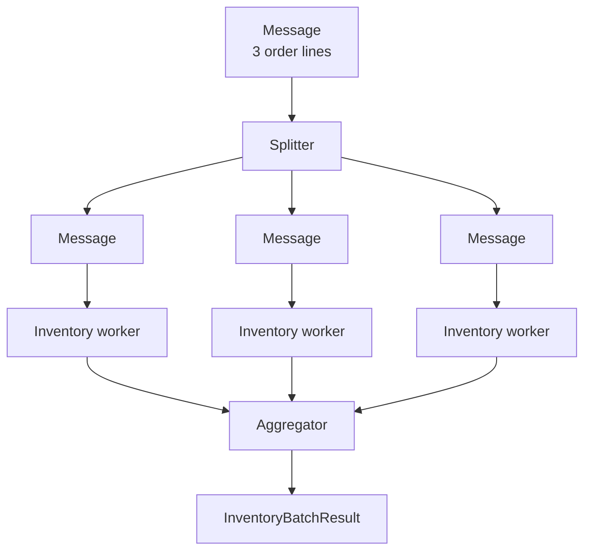
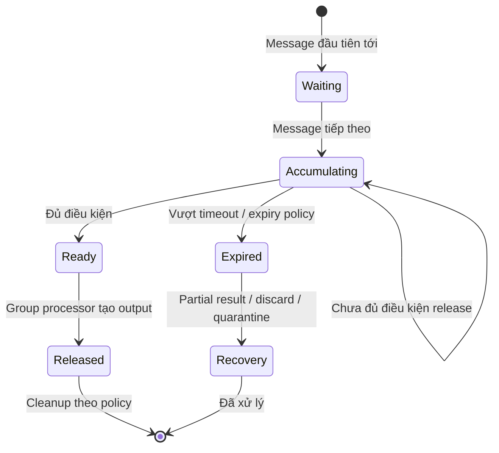
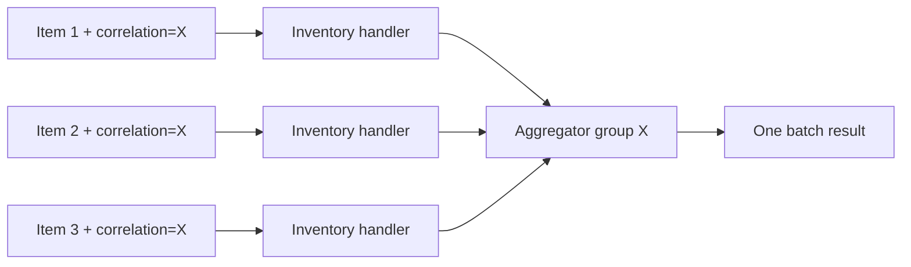
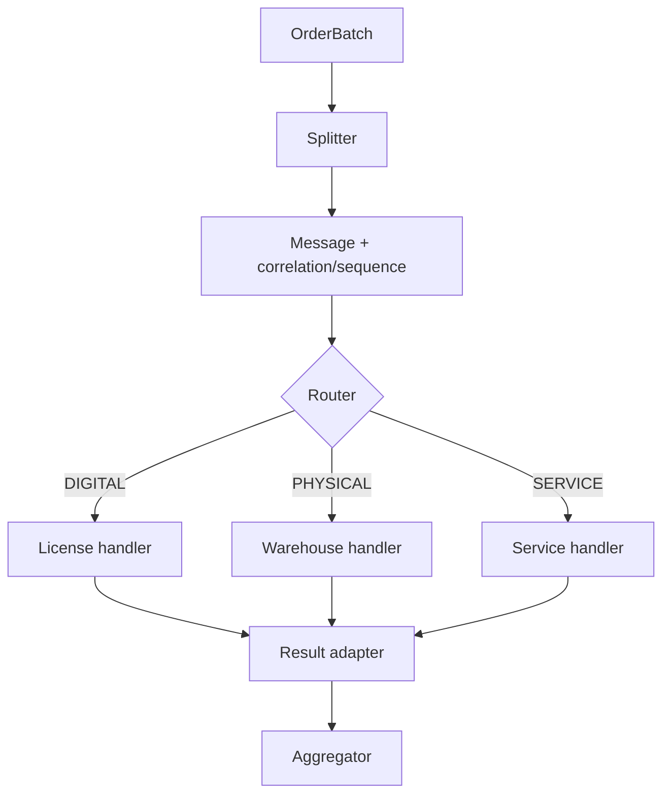
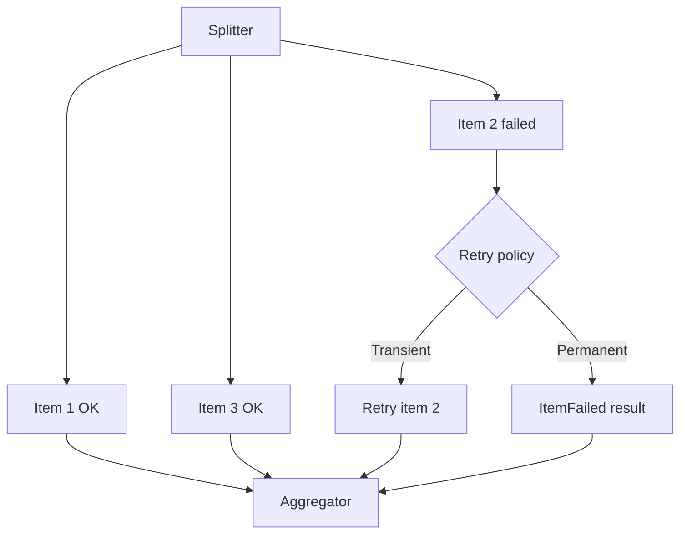
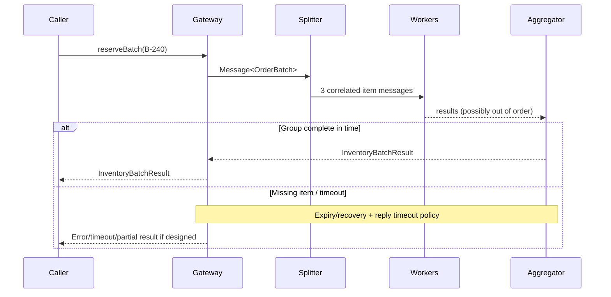
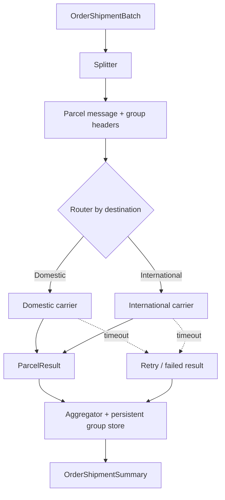

# Message group cho các phần được tách

Trong **Spring Integration**, một message đầu vào có thể chứa một tập phần tử: đơn hàng gồm nhiều dòng hàng, một lô sự kiện gồm nhiều bản ghi, hoặc một yêu cầu cần kiểm tra nhiều tài liệu. **Splitter** tách cấu trúc đó thành các message nhỏ để mỗi phần tử được xử lý độc lập. Tuy nhiên, sau khi tách, làm sao hệ thống biết **những message nào vốn thuộc cùng một đầu vào**, mỗi message đứng ở vị trí nào, và bao giờ có thể gom kết quả?

Câu trả lời nằm ở **correlation và sequence headers** mà Splitter có thể gắn lên message đầu ra, kết hợp với **Message Group** do một **Aggregator** hoặc thành phần tương quan quản lý khi nhận các message liên quan. Đó là trọng tâm bài **“Message group cho các phần được tách”** thuộc chương **Splitter** của module `SPRING_INTEGRATION_PATTERN`: học triển khai Enterprise Integration Patterns (EIP) bằng Spring Integration để tạo luồng ít phụ thuộc, dễ mở rộng, kết hợp Router, Filter, Transformer, Splitter, Aggregator, Gateway, retry, error channel và khả năng quan sát từng nhánh.

Sau bài học, bạn có thể:

- Giải thích sự khác nhau giữa **tập message con có cùng correlation** và một **Message Group thực sự đã được lưu** ở Aggregator.
- Đọc đúng `correlationId`, `sequenceNumber`, `sequenceSize`, phân biệt chúng với `id`, `batchId` và `eventId`.
- Dự đoán cách hình thành nhóm, release kết quả, timeout/expiry và hệ quả khi một phần tử bị mất hoặc xử lý lặp.
- Thiết kế Splitter bằng Java annotation/DSL và kiểm thử headers ở các message con.
- Bảo toàn thông tin nhóm qua Filter, Router, Transformer, channel bất đồng bộ và ranh giới broker.
- Chọn release strategy và MessageGroupStore phù hợp với yêu cầu dữ liệu, độ bền và phục hồi.

## 1. Bài toán: Một message gốc, nhiều kết quả cần liên hệ

Giả sử hệ thống giao vận nhận một lệnh đặt hàng:

```text
OrderBatch(batchId = "B-240")
  items:
    - LINE-1: 2 sản phẩm
    - LINE-2: 1 sản phẩm
    - LINE-3: 3 sản phẩm
```

Một Splitter có thể phát ba message, mỗi message chứa **một** `OrderLine`. Các handler ở downstream xử lý từng dòng, có thể chạy trên thread hoặc worker khác nhau.



Nếu các worker trả kết quả theo thứ tự 3, 1, 2, **thứ tự nhận không còn phản ánh thứ tự trong payload gốc**. Nếu có nhiều đơn cùng chạy, việc nhóm theo tên channel hay loại item cũng không đủ. Mỗi message con cần mang **danh tính nhóm** và thông tin thứ tự để downstream có thể nhận biết.

### Group logic và group được lưu không phải một khái niệm

**Ngay sau Splitter**, ba message có thể thuộc cùng một **nhóm logic** nhờ các headers chung. Điều đó **không có nghĩa** Splitter đã tự tạo một đối tượng `MessageGroup` trong database hoặc `MessageGroupStore`.

**Khi Aggregator nhận các message**, nó có thể gom những message có cùng correlation key vào một **Message Group** do một `MessageGroupStore` quản lý. Từ đó release strategy quyết định thời điểm nhóm đủ điều kiện được xuất kết quả. Không có Aggregator hoặc thành phần nhóm tương ứng thì các message vẫn có correlation headers, nhưng chưa tồn tại quy trình gom kết quả.

| Khái niệm | Vai trò | Thường nằm ở đâu? |
| --- | --- | --- |
| Message gốc | Chứa `OrderBatch` và metadata đầu vào. | Trước Splitter. |
| Message con | Chứa từng `OrderLine`. | Đầu ra của Splitter. |
| **Correlation key** | Cho biết các message con thuộc cùng nhóm xử lý. | Header của từng message con. |
| **Sequence metadata** | Cho biết vị trí và số lượng dự kiến của các phần. | Header của từng message con. |
| **Message Group** | Tập hợp message đã đến bộ gom, dưới một group key. | Aggregator/MessageGroupStore. |
| **Release strategy** | Quyết định khi nào đủ điều kiện tạo output từ nhóm. | Aggregator. |
| **Group processor** | Tạo kết quả tổng hợp từ tập message trong nhóm. | Aggregator. |

## 2. Cấu trúc metadata của các message con

Với một Splitter cấu hình sequence metadata, hình dung một message đầu vào có ID của Spring là `M-ROOT-UUID` và ba phần tử:

```text
INPUT
  payload: OrderBatch(B-240, [LINE-1, LINE-2, LINE-3])
  headers:
    id = M-ROOT-UUID
    traceId = trace-240

OUTPUT 1
  payload: OrderLine(LINE-1)
  headers:
    id = M-CHILD-1
    correlationId = M-ROOT-UUID
    sequenceNumber = 1
    sequenceSize = 3
    traceId = trace-240

OUTPUT 2
  payload: OrderLine(LINE-2)
  headers:
    id = M-CHILD-2
    correlationId = M-ROOT-UUID
    sequenceNumber = 2
    sequenceSize = 3
    traceId = trace-240

OUTPUT 3
  payload: OrderLine(LINE-3)
  headers:
    id = M-CHILD-3
    correlationId = M-ROOT-UUID
    sequenceNumber = 3
    sequenceSize = 3
    traceId = trace-240
```

Đây là sơ đồ minh họa, không phải giá trị UUID hoặc log do Spring tự in. Trong cách dùng phổ biến với **`applySequence` được bật**, Spring Integration Splitter tạo những headers sau:

| Header | Vai trò | Quy tắc cần nhớ |
| --- | --- | --- |
| `correlationId` | Định danh **nhóm message con** phát sinh từ một message đầu vào. | Thường dựa trên ID của message gốc khi Splitter tạo sequence metadata. |
| `sequenceNumber` | Số thứ tự của phần tử trong nhóm. | Thường bắt đầu từ **1**, không phải 0. |
| `sequenceSize` | Tổng số phần tử của nhóm mà Splitter biết được. | Có thể không xác định được trước với nguồn streaming/iterator, tùy cơ chế. |
| `id` | ID của **từng message**. | Mỗi message con có vòng đời riêng; không dùng `id` của nó làm group key. |
| `traceId` hoặc tracing context | Quan sát đường đi qua các nhánh. | Không phải group key hay chứng cứ được cấp quyền. |
| `batchId` trong payload | ID nghiệp vụ ổn định của lô. | Không mặc định được framework gắn làm `correlationId`. |

**Điểm rất quan trọng:** `correlationId` do Splitter tạo thường gắn với **ID của message đầu vào tại lần split**, không nhất thiết bằng `batchId` trong payload. Khi cùng `OrderBatch` được xây dựng thành một Spring message mới sau replay, message ID có thể thay đổi. Muốn xử lý idempotent hoặc tái tạo nhóm xuyên restart, cần có ID nghiệp vụ bền vững trong hợp đồng dữ liệu.

## 3. `applySequence` và giới hạn của `sequenceSize`

Spring Integration có khả năng gắn sequence metadata cho các message con khi Splitter tạo output. Tùy endpoint/API, hành vi chịu ảnh hưởng bởi cấu hình **`applySequence`**; với các Splitter thông thường, sequence thường được bật để hỗ trợ Aggregator phía sau.

### Khi biết được số lượng phần tử

Với một collection có ba phần tử, Splitter biết `sequenceSize=3`; downstream có thể cấu hình release strategy dựa vào việc đã nhận đủ ba message **thuộc cùng một nhóm**.

```text
B-240 logical group
  seq=1 / size=3
  seq=2 / size=3
  seq=3 / size=3

Aggregator sees three distinct, expected sequence positions
  -> group may be ready to release
```

Thực tế, việc “đủ nhóm” còn tùy release strategy, cấu hình Aggregator, duplicate policy, error handling và điều kiện nhận được output của mỗi worker. Không nên suy luận chỉ từ một header mà bỏ qua các yếu tố khác.

### Khi chưa biết số lượng trước

Một Splitter có thể xử lý iterator/stream không xác định kích thước trước. Khi đó, framework có thể sử dụng **`sequenceSize=0`** hoặc một cơ chế biểu diễn kích thước chưa biết, tùy phiên bản và kiểu đầu ra.

**Không đặt release strategy kiểu “đã nhận `sequenceSize` phần tử” nếu size không thực sự được biết.** Cần một cơ chế báo kết thúc, một release strategy phù hợp, timeout/expiry hoặc thiết kế thêm một marker kết thúc được quy định trong hợp đồng.

### Có thể tắt sequence không?

Có các cấu hình cho phép thay đổi việc áp dụng sequence metadata. Việc tắt để giảm headers hoặc vì không cần Aggregator có thể hợp lý trong luồng **chỉ tách rồi gửi xử lý độc lập**. Nhưng nếu phía sau có Aggregator mặc định dựa trên correlation/sequence, tắt sequence có thể làm các message **không còn dữ liệu đủ để gom đúng**.

Đừng tự loại `correlationId` khỏi message con chỉ để giảm dung lượng mà không xem xét downstream.

## 4. Vòng đời Message Group tại Aggregator

**Message Group** được quản lý theo một khóa tương quan; với Spring Integration Aggregator, khóa này thường được lấy từ header `correlationId` theo correlation strategy. Group store ghi nhận các message đã đến; release strategy quyết định khi nào phát kết quả.



Sơ đồ là mô hình thiết kế tổng quát; tên trạng thái không phải một enum chuẩn do framework tự công bố.

| Giai đoạn | Câu hỏi cần trả lời |
| --- | --- |
| **Nhận phần tử đầu** | Key của nhóm là gì? Có cùng version/tenant/batch không? |
| **Tích lũy** | Group store có bền vững không, có bảo vệ concurrency không? |
| **Phần tử mới** | Có phải duplicate? Sequence có hợp lệ không? Có đến muộn không? |
| **Release** | Dựa trên count, size, marker, timeout hay business completion? |
| **Tổng hợp** | Kết quả có thứ tự theo sequence hay chỉ theo thứ tự arrival? |
| **Sau release** | Group bị xóa/đánh dấu hoàn thành thế nào? Late message có bị tạo nhóm mới? |
| **Expiry** | Partial result được phép không? Message còn thiếu được truy hồi hay thông báo lỗi? |
| **Restart** | Những group chưa xong có được phục hồi từ store và tiếp tục không? |

### Group store không đồng nghĩa một queue

Một `QueueChannel` chứa nhiều message chờ consumer, nhưng **không tự phân loại chúng thành các nhóm correlation**. `MessageGroupStore` phục vụ lưu các message trong một group của Aggregator/Resequencer; nó không tự thực hiện nghiệp vụ, không tự phát reply cho Gateway và không bảo đảm durable nếu đang dùng store trong bộ nhớ.

Nếu cần phục hồi các group đang chờ sau restart, phải lựa chọn **persistent MessageGroupStore** phù hợp, xử lý transaction/recovery và kiểm tra khả năng tương thích khi nâng cấp ứng dụng. Một in-memory store không bảo đảm dữ liệu sống qua process restart.

## 5. Ví dụ Java 17: Splitter phát message có group metadata

Ví dụ hoàn chỉnh tối thiểu dùng **Java 17+**, Spring Integration annotation và `QueueChannel` để quan sát từng message con. Chúng ta chưa gọi dịch vụ tồn kho thật.

### 5.1. Hợp đồng dữ liệu bất biến

```java
import java.util.List;

record OrderLine(String lineId, long quantity) {}

record OrderBatch(String batchId, List<OrderLine> lines) {
    OrderBatch {
        if (batchId == null || batchId.isBlank()) {
            throw new IllegalArgumentException("BATCH_ID_REQUIRED");
        }
        lines = List.copyOf(lines);
    }
}
```

Sử dụng `List.copyOf` nhằm tránh việc producer sửa danh sách sau khi gửi. Bất biến **nông** vẫn cần cân nhắc nếu các item con chứa object mutable. Với record chứa chỉ chuỗi và số nguyên ở ví dụ, việc đọc song song từ các nhánh tương đối đơn giản.

### 5.2. Channel và Splitter được đăng ký với Spring

```java
import java.util.List;

import org.springframework.context.annotation.Bean;
import org.springframework.context.annotation.Configuration;
import org.springframework.context.annotation.Import;
import org.springframework.integration.annotation.Splitter;
import org.springframework.integration.channel.DirectChannel;
import org.springframework.integration.channel.QueueChannel;
import org.springframework.integration.config.EnableIntegration;
import org.springframework.stereotype.Component;

@Configuration
@EnableIntegration
@Import(OrderLineSplitter.class)
class OrderSplitterConfiguration {

    @Bean
    DirectChannel batchInput() {
        return new DirectChannel();
    }

    @Bean
    QueueChannel lineMessages() {
        return new QueueChannel();
    }
}

@Component
class OrderLineSplitter {

    @Splitter(inputChannel = "batchInput", outputChannel = "lineMessages")
    public List<OrderLine> split(OrderBatch batch) {
        return batch.lines();
    }
}
```

Các bước:

1. `batchInput` nhận `Message<OrderBatch>`.
2. Splitter đọc `OrderBatch.lines()` và trả `List<OrderLine>` có thứ tự.
3. Spring Integration tách kết quả collection thành các **message con**, mỗi message chứa một `OrderLine`.
4. Khi sequence metadata được áp dụng, các message con cùng mang correlation key và mỗi message có vị trí riêng.
5. `lineMessages` là `QueueChannel` để đọc lại kết quả trong test. Một consumer có thể lấy từng message bằng `receive()`.

**Điểm cần kiểm chứng trên phiên bản Spring Integration của dự án:** endpoint `@Splitter` và việc áp dụng sequence headers cần được kiểm thử thực tế. Ví dụ trên diễn giải cơ chế mặc định thường dùng; bước viết tài liệu STEP 4 không thực thi Gradle.

### 5.3. Gửi một batch mẫu

```java
import java.util.List;

import org.springframework.messaging.Message;
import org.springframework.messaging.MessageChannel;
import org.springframework.messaging.support.MessageBuilder;

void sendBatch(MessageChannel batchInput) {
    var batch = new OrderBatch("B-240", List.of(
            new OrderLine("LINE-1", 2),
            new OrderLine("LINE-2", 1),
            new OrderLine("LINE-3", 3)
    ));

    Message<OrderBatch> rootMessage = MessageBuilder.withPayload(batch)
            .setHeader("traceId", "trace-240")
            .build();

    batchInput.send(rootMessage);
}
```

`batchId=B-240` vẫn nằm trong **payload** nếu cần nghiệp vụ dùng lại. Các `OrderLine` sau split **không tự chứa `batchId`** trừ khi model hoặc bước tạo message đưa vào; không nên giả định Aggregator sẽ đọc được `batchId` từ payload con chỉ vì nó tồn tại ở message gốc.

Một cách chắc chắn để giữ định danh nghiệp vụ qua nhiều hệ thống là đưa `batchId` vào `OrderLineCommand` hoặc envelope con, thay vì chỉ dựa vào correlation header mang tính kỹ thuật của một lượt split.

## 6. Kiểm thử correlation và sequence trên message thật

Unit test của `OrderLineSplitter.split()` chỉ chứng minh nó trả ba phần tử. **Integration test** mới kiểm tra rằng Spring Integration thực sự gắn metadata nhóm và gửi đúng ba message vào channel đích.

```java
import static org.junit.jupiter.api.Assertions.assertEquals;
import static org.junit.jupiter.api.Assertions.assertNotNull;
import static org.junit.jupiter.api.Assertions.assertNull;
import static org.junit.jupiter.api.Assertions.assertTrue;

import java.util.HashMap;
import java.util.List;
import java.util.Map;

import org.junit.jupiter.api.Test;
import org.springframework.beans.factory.annotation.Autowired;
import org.springframework.beans.factory.annotation.Qualifier;
import org.springframework.integration.IntegrationMessageHeaderAccessor;
import org.springframework.integration.channel.QueueChannel;
import org.springframework.messaging.Message;
import org.springframework.messaging.MessageChannel;
import org.springframework.messaging.support.MessageBuilder;
import org.springframework.test.annotation.DirtiesContext;
import org.springframework.test.context.junit.jupiter.SpringJUnitConfig;

@SpringJUnitConfig(OrderSplitterConfiguration.class)
@DirtiesContext(classMode = DirtiesContext.ClassMode.AFTER_EACH_TEST_METHOD)
class OrderSplitterGroupTest {

    @Autowired @Qualifier("batchInput")
    MessageChannel input;

    @Autowired @Qualifier("lineMessages")
    QueueChannel output;

    @Test
    void emitsThreeRelatedMessagesWithSequenceMetadata() {
        var batch = new OrderBatch("B-240", List.of(
                new OrderLine("LINE-1", 2),
                new OrderLine("LINE-2", 1),
                new OrderLine("LINE-3", 3)
        ));

        Message<OrderBatch> root = MessageBuilder.withPayload(batch)
                .setHeader("traceId", "trace-240")
                .build();

        assertTrue(input.send(root));

        Map<Integer, Message<?>> bySequence = new HashMap<>();

        for (int i = 0; i < 3; i++) {
            Message<?> child = output.receive(1_000);
            assertNotNull(child);

            assertEquals(root.getHeaders().getId(),
                    child.getHeaders().get(
                            IntegrationMessageHeaderAccessor.CORRELATION_ID));
            assertEquals(3, child.getHeaders().get(
                    IntegrationMessageHeaderAccessor.SEQUENCE_SIZE));
            assertEquals("trace-240", child.getHeaders().get("traceId"));

            Integer number = (Integer) child.getHeaders().get(
                    IntegrationMessageHeaderAccessor.SEQUENCE_NUMBER);
            assertNotNull(number);
            assertTrue(number >= 1 && number <= 3);
            assertNull(bySequence.put(number, child));
        }

        assertEquals(3, bySequence.size());
        assertEquals("LINE-1", ((OrderLine) bySequence.get(1).getPayload()).lineId());
        assertEquals("LINE-2", ((OrderLine) bySequence.get(2).getPayload()).lineId());
        assertEquals("LINE-3", ((OrderLine) bySequence.get(3).getPayload()).lineId());
        assertNull(output.receive(0));
    }
}
```

`@DirtiesContext` tránh để queue của một ca kiểm thử bị chia sẻ với ca khác. Với flow đồng bộ đến `QueueChannel`, test có thể đọc ngay các message sau khi gửi. Khi đổi sang `ExecutorChannel`, broker adapter hoặc xử lý reactive, hãy dùng timeout/latch và **không giả định thứ tự arrival bằng thứ tự sequence**.

Điểm đáng chú ý: test dùng `Map` theo `sequenceNumber` thay vì chỉ kiểm tra `receive()` lần 1 là LINE-1. Thứ tự phát ban đầu có thể có ý nghĩa trong ví dụ đồng bộ, nhưng logic gom nhóm an toàn cần dựa vào **sequence metadata** nếu downstream có thể thực thi đồng thời.

### Ca kiểm thử rỗng

Với `OrderBatch("B-EMPTY", List.of())`, Splitter có thể **không phát message con**. Điều này không phải tự sinh ra một group “đã đủ 0 phần tử” và một reply thành công. Nếu caller là Gateway chờ kết quả cho batch rỗng, phải có **nhánh riêng** trả `EmptyBatchResult` hoặc một chính sách no-reply/validation rõ ràng.

## 7. Từ message con đến Message Group tại Aggregator

Sau khi từng phần tử được xử lý, ví dụ mỗi `OrderLine` trở thành `InventoryResult`, ta có thể gửi kết quả tới Aggregator.



Để Aggregator gom đúng, mỗi kết quả từ worker phải giữ hoặc tái tạo **các headers correlation/sequence** theo hợp đồng. Nếu worker chỉ tạo `MessageBuilder.withPayload(result).build()` mà bỏ các header nhóm, Aggregator có thể **không biết** các kết quả thuộc cùng một lần split.

### Điều kiện release và cấu hình của Aggregator

Một release strategy điển hình muốn chờ **đúng số phần tử dự kiến** cho một nhóm. Khi `sequenceSize=3`, ý tưởng là đợi ba message có cùng correlation key rồi tạo một kết quả tổng hợp.

```text
Group X:
  received seq 3    -> waiting
  received seq 1    -> waiting
  received seq 2    -> candidate for release
  group processor   -> InventoryBatchResult
```

Nhưng trong hệ thống thật có thể phát sinh **duplicate**, message bị thiếu, message đến muộn, hoặc một worker tạo hai output cho cùng một input. Tính đủ nhóm không thể chỉ dựa vào tổng số message khi hợp đồng yêu cầu **đủ các vị trí sequence duy nhất**.

Các thành phần Spring Integration thường dùng:

| Thành phần | Công dụng |
| --- | --- |
| Correlation strategy | Xác định khóa nhóm, thường từ `correlationId`. |
| `MessageGroupStore` | Lưu các message đang chờ của từng group. |
| Release strategy | Quyết định nhóm đã sẵn sàng xuất kết quả chưa. |
| Group processor | Tạo payload/kết quả tổng hợp từ nhóm. |
| Expiry/timeout policy | Xử lý nhóm không bao giờ nhận đủ phần tử. |
| Late-arrival policy | Quyết định xử lý message đến sau khi nhóm đã release. |

**Tùy phiên bản Spring Integration**, API DSL cho `.aggregate(...)`, lựa chọn store và release strategy có khác biệt; nên kiểm thử trên phiên bản đang dùng thay vì sao chép cấu hình dựa trên số đếm đơn thuần và coi nó bảo đảm đúng khi retry.

### Sắp xếp kết quả theo sequence

Không nên giả định `List<InventoryResult>` do một group processor tạo sẽ luôn có thứ tự giống collection gốc **chỉ vì các message đến từ một Splitter**. Khi thứ tự nghiệp vụ quan trọng, hãy sắp theo `sequenceNumber` hoặc một trường thứ tự được hợp đồng xác định.

Có thể giữ mỗi result cùng sequence metadata rồi dựng batch output theo thứ tự 1, 2, 3. Nếu thứ tự không quan trọng (ví dụ chỉ tính tổng số dòng được xử lý thành công), chiến lược gom có thể đơn giản hơn.

## 8. Một group cần bao nhiêu message mới được coi là hoàn tất?

Trả lời phụ thuộc vào **dữ liệu, cách fan-out và chính sách release**.

| Tình huống | Chiến lược |
| --- | --- |
| Splitter tạo collection hữu hạn có kích thước xác định. | Chờ các phần tử theo `sequenceSize` và xử lý duplicate/late message. |
| Số lượng item chỉ biết khi stream kết thúc. | Cần end marker, release trigger hoặc chính sách riêng; không giả định `sequenceSize > 0`. |
| Mỗi item có thể bị Filter loại. | Cần `ItemSkipped`/`ItemRejected` hoặc giảm số lượng dự kiến bằng hợp đồng rõ ràng. |
| Một item có thể thất bại vĩnh viễn. | Có thể release partial result sau timeout hoặc fail toàn group. |
| Nhóm được xử lý nhiều giờ. | Persistent store, expiry, recovery và quan sát tiến trình. |
| Một item sinh nhiều kết quả. | Correlation/sequence theo tầng hoặc thiết kế group key cho kết quả con, không dùng size gốc một cách máy móc. |

### Không xóa group ngay nếu còn late messages mà không có policy

Giả sử group X nhận đủ ba message và release kết quả. Sau đó một retry khiến message `seq=2` tới lần nữa. Nếu group đã bị xóa khỏi store, message mới **có thể hình thành một group X mới** hoặc gặp logic duplicate/late-message tùy cấu hình. Cần quyết định sẽ **bỏ qua, ghi audit, từ chối, deduplicate hay khởi tạo lại một lượt xử lý mới**.

Không suy luận việc `expireGroupsUponCompletion` hoặc một tùy chọn cleanup sẽ tự cung cấp exactly-once processing. Khóa idempotency và trạng thái hoàn tất bền vững phải được thiết kế độc lập.

## 9. Filter sau Splitter: điều gì xảy ra khi một phần tử bị loại?

Đây là lỗi kiến trúc rất phổ biến.

```text
Batch X -> Splitter -> 4 item messages
                  |
                  +-- seq 1 ---> processed ---> Aggregator
                  +-- seq 2 ---> processed ---> Aggregator
                  +-- seq 3 ---> Filter false
                  +-- seq 4 ---> processed ---> Aggregator

Aggregator receives only 3 of 4 messages.
```

Nếu release strategy cần đủ `sequenceSize=4` mà seq 3 bị loại hoàn toàn, **group có thể không bao giờ hoàn tất**. Filter từ chối không tự sửa `sequenceSize` trên ba message còn lại và không tự tạo kết quả bù.

Có ba hướng:

1. **Lọc trước Splitter** nếu có thể: tạo collection cuối cùng chỉ gồm các item cần xử lý, để sequence metadata khớp số phần tử thực.
2. **Giữ chỗ cho item bị loại:** discard branch tạo `ItemRejected` hoặc `ItemSkipped` mang correlation và sequence, gửi về Aggregator cùng các kết quả được chấp nhận.
3. **Chấp nhận partial group có chủ đích:** dùng timeout/release policy, định nghĩa dữ liệu trả về và xử lý những item bị thiếu.

Nếu một item bị loại do sai hợp đồng, đừng mặc định kết quả batch thành công chỉ vì ba item còn lại đã xử lý. Có thể cần `PARTIAL_FAILURE`, `REJECTED` hoặc fail toàn batch theo nghiệp vụ.

## 10. Router, Publish–Subscribe và nhiều nhánh xử lý

Sau Splitter, mỗi message con có thể được Router gửi tới kênh khác nhau theo loại sản phẩm:



Router chọn **đích** nhưng **không tự đổi group key**. Các message cùng batch có thể đi những branch khác nhau và vẫn cần quay về cùng Aggregator. Điều kiện là các nhánh trả kết quả với metadata nhóm tương thích.

Cần phân biệt:

- **Splitter:** một payload có N item tạo N message con.
- **Recipient List Router / Publish–Subscribe:** một message có thể được gửi cho **nhiều recipient**; không nhất thiết tương đương N phần tử nghiệp vụ.
- **Aggregator:** gom các message tương quan để phát một kết quả chung.

Nếu message con được broadcast tới hai subscriber và **cả hai đều gửi kết quả** về Aggregator, số message nhận có thể thành **2N**, không còn khớp `sequenceSize=N`. Lúc này cần thiết kế **hai tầng correlation**, thêm dimension recipient, hoặc các group riêng; không đặt cả hai kết quả vào cùng group với release strategy chỉ dựa trên N.

## 11. Nested Splitter: tách nhiều tầng

Giả sử `OrderBatch` gồm nhiều shipment, mỗi shipment lại gồm nhiều line. Nếu Splitter thứ nhất tách shipment, Splitter thứ hai tách line, sẽ có **hai tầng nhóm**:

```text
OrderBatch B-240
  |
  +-- Shipment S-1 (outer seq=1/2)
  |      |
  |      +-- Line L-1 (inner seq=1/3)
  |      +-- Line L-2 (inner seq=2/3)
  |      +-- Line L-3 (inner seq=3/3)
  |
  +-- Shipment S-2 (outer seq=2/2)
         |
         +-- Line L-4 (inner seq=1/2)
         +-- Line L-5 (inner seq=2/2)
```

Nếu chỉ còn một `correlationId` đơn giản sau khi tách tầng trong, Aggregator ở tầng ngoài có thể **không phân biệt được** group shipment và group order. Spring Integration có cơ chế metadata sequence chi tiết hơn cho một số cách xử lý lồng nhau (ví dụ sequence details); tuy nhiên không nên dựa vào một cấu trúc header cụ thể mà chưa kiểm chứng version và topology.

### Hai cách kiến trúc có thể hiểu được

**Cách A — Gom từng tầng:** Splitter shipment → Splitter line → Aggregator line theo shipment → Aggregator shipment theo order. Cần giữ đúng identity và sequence của **từng tầng**.

**Cách B — Tách phẳng một lần:** Tạo `LineWorkItem(batchId, shipmentId, lineId, ...)`, sau đó xử lý độc lập và dùng **custom correlation strategy** theo business key cần gom. Cách này có thể giảm độ phức tạp nested sequence, đổi lại phải định nghĩa số item kỳ vọng, version và deadline rõ ràng.

Dù chọn cách nào, cần có test nhiều batch chạy đồng thời để chứng minh **không gom nhầm** những item khác batch nhưng trùng `lineId` hoặc `shipmentId`.

## 12. Message ID, business ID, correlation ID và idempotency

Một message có thể mang nhiều ID với chức năng khác nhau:

| Trường | Đại diện cho | Có ổn định qua replay không? |
| --- | --- | --- |
| `MessageHeaders.id` | Một Spring message cụ thể. | Không được mặc định ổn định khi message được dựng lại. |
| `correlationId` | Một nhóm message để Aggregator xử lý. | Phụ thuộc cách tạo và propagation; có thể đổi khi split lại. |
| `sequenceNumber` | Vị trí trong một lần split. | Phụ thuộc input order và cách split; không nhất thiết là khóa nghiệp vụ. |
| `batchId` | Lô đơn hàng theo hợp đồng nghiệp vụ. | Nên ổn định theo contract. |
| `eventId` | Một sự kiện hoặc command theo contract. | Nên ổn định khi redelivery/replay cùng sự kiện. |
| `traceId` | Chuỗi quan sát/request context. | Có thể đổi giữa các lượt xử lý; không dùng để deduplicate. |

**Ví dụ:** broker phát lại cùng `OrderBatch(batchId=B-240)`. Splitter chạy lại với **message đầu vào mới**, sinh correlation group khác dù business batch ID giống nhau. Nếu downstream lưu kết quả hai lần chỉ vì group khác nhau, sẽ xuất hiện side effect trùng.

Đối với inventory reservation hoặc payment, cần **idempotency theo `batchId + lineId + operation`** hoặc một khóa command bền vững phù hợp, không lấy sequenceNumber hay Spring message ID làm khóa duy nhất.

### Có nên tự thay `correlationId = batchId`?

Có thể dùng **custom correlation strategy** theo business key nếu đó là yêu cầu kiến trúc, nhưng phải định nghĩa kỹ ranh giới lượt xử lý. Nếu cùng `batchId` được phép chạy lại nhiều lần để tính lại, hai lượt không nên vô tình trộn kết quả. Cần phân biệt `batchId`, `attemptId`, `planVersion` hoặc `runId` khi phù hợp.

Không ghi đè correlation metadata tùy tiện chỉ vì tên giá trị business ID dễ nhìn hơn. Một Aggregator phải có **group identity duy nhất trong phạm vi vòng đời** của nó.

## 13. Retry, lỗi và thứ tự xử lý

### Một phần tử thất bại không nhất thiết làm các phần tử khác dừng

Nếu các message con đi qua executor hoặc broker, một item có thể thất bại sau khi các item khác đã hoàn tất. Cần xác định **đơn vị retry**: retry item riêng hay retry cả batch. Retry cả batch có thể tái thực hiện các side effect đã thành công ở item khác.



**Nguyên tắc vận hành:**

- Lỗi dữ liệu (`INVALID_SKU`, amount âm) thường cần kết quả thất bại có kiểu, không retry vô hạn.
- Lỗi phụ thuộc tạm thời có thể retry item với timeout/backoff, giới hạn số attempt và deadline của group.
- Nếu handler có side effect, dùng idempotency key ổn định và xử lý kết quả “đã xử lý rồi”.
- Khi xuất một `ItemFailed`, giữ metadata correlation/sequence cần thiết để Aggregator biết kết quả đó thuộc vị trí nào.
- Nếu một flow kết thúc mà không tạo output (`return null`, Filter discard không có result), cần có expiry/recovery; không tự kỳ vọng Aggregator nhận đủ phần tử.

### Error channel không thay thế kết quả nhóm

Một lỗi trong handler đồng bộ có thể lan tới caller; lỗi trong task async/poller có thể được chuyển thành `ErrorMessage` qua error handler phù hợp. **Không mặc định** `errorChannel` của một item sẽ tự làm `Aggregator` nhận `ItemFailed`. Muốn gom failure result, phải **chuyển đổi lỗi sang message kết quả có correlation** bằng một flow hoặc recovery adapter được thiết kế rõ.

### Thứ tự trong nhóm không phải thứ tự hoàn thành

`sequenceNumber=1` không chứng minh item 1 hoàn thành trước item 2. Khi chạy song song, item 3 có thể xử lý nhanh nhất; không dùng sequenceNumber để suy diễn thời gian hoặc transaction order. Nếu thứ tự side effect quan trọng (ví dụ cập nhật tuần tự số dư), cần thiết kế ordering/serial processing tại handler hoặc store, không chỉ dựa trên việc message có sequence header.

## 14. Gateway, timeout và thông điệp nhóm rỗng

Một Gateway có thể gửi `OrderBatch` vào flow rồi chờ `InventoryBatchResult`. Nhưng từ Splitter tới Aggregator có thể không tạo đủ kết quả trong ngân sách chờ của Gateway.



**Các lựa chọn cần quyết định:**

1. **Batch rỗng:** Splitter có thể không phát message con; nếu Gateway cần reply, tạo một nhánh `EmptyBatchResult` trước Splitter.
2. **Một phần tử lỗi:** Có cần dừng toàn batch ngay không, hay trả `PARTIAL_FAILURE`?
3. **Group timeout:** Bao lâu thì release partial output, và ai ghi/giải quyết những phần tử chưa đến?
4. **Gateway timeout:** Nếu caller đã hết thời gian chờ nhưng Aggregator sau đó vẫn release, late reply và side effect được xử lý thế nào?
5. **Nguồn broker:** ACK/commit offset có diễn ra sau khi kết quả từng item được lưu bền vững không? Một message đến `QueueChannel` không tự đảm bảo offset đã commit.

Không chỉ bật timeout rồi xem như xong. **Expiry của Message Group và reply timeout của Gateway là hai thời hạn có nhiệm vụ khác nhau**.

## 15. Cross-process: message group cần dữ liệu bền vững và header mapping

Trong cùng JVM, correlation headers thường thuận tiện. Nhưng khi message con được gửi ra Kafka, RabbitMQ hoặc HTTP, không thể mặc định mọi Spring header đều được giữ nguyên.

```text
Spring Splitter
  -> Message<OrderLine> + correlation/sequence
  -> Outbound adapter / serializer / header mapper
  -> Broker record
  -> Inbound adapter / deserializer
  -> New Spring Message
  -> Worker result
  -> Aggregator
```

Nếu `correlationId`, `sequenceNumber` hoặc `sequenceSize` bị rơi ở bước mapping, Aggregator có thể không nhóm được hoặc nhóm sai. Cần test end-to-end **trên chính adapter và version đang dùng**.

Một envelope bền vững có thể mang:

```json
{
  "batchId": "B-240",
  "groupRunId": "B-240/run-1",
  "lineId": "LINE-2",
  "position": 2,
  "expectedCount": 3,
  "eventId": "evt-240-2",
  "operation": "RESERVE_INVENTORY"
}
```

Đây là **schema do ứng dụng quy định**, không phải JSON tiêu chuẩn của `MessageGroup`. Khi consumer tạo lại Spring message, nó có thể ánh xạ các trường này vào correlation/sequence headers phù hợp hoặc sử dụng custom correlation strategy. Cách làm giúp dữ liệu nhóm không phụ thuộc hoàn toàn vào message ID của một JVM.

Nếu yêu cầu khôi phục group đang chờ sau restart, hãy xem xét **persistent MessageGroupStore**, store transaction và cơ chế dọn group đã release/expired. Cần kiểm thử **restart giữa chừng**, duplicate redelivery và late reply, thay vì chỉ test happy path.

## 16. Kiểm thử đầy đủ hơn trước production

Ngoài test sequence ở mục 6, một flow có Aggregator nên có ma trận kiểm thử sau:

| Ca | Điều cần chứng minh |
| --- | --- |
| Batch ba item hợp lệ | Ba message con cùng correlation, sequence duy nhất từ 1 đến 3, size = 3. |
| Hai batch gửi xen kẽ | Không gom nhầm message của batch khác. |
| Message xử lý đảo thứ tự | Aggregator release đúng nhóm và output giữ thứ tự nếu nghiệp vụ yêu cầu. |
| Batch rỗng | Có kết quả/validation phù hợp, không để Gateway chờ vô hạn. |
| Một phần tử bị Filter loại | Có failure/skipped result hoặc timeout/release policy, không chờ thiếu mãi. |
| Một phần tử retry hai lần | Duplicate không làm release sớm hoặc tạo side effect trùng. |
| Message đến sau release | Late-arrival policy được kiểm chứng, không tạo group mới ngoài ý muốn. |
| Splitter phát iterator có size chưa biết | Release strategy không dựa mù vào sequence size. |
| Nested split | Không nhầm correlation/sequence của tầng trong với tầng ngoài. |
| Qua broker rồi restart | Metadata/envelope và MessageGroupStore có recovery đúng. |
| Cùng group nhưng khác tenant | Không trộn dữ liệu, có phân quyền và validation group key. |
| Worker trả message mới | Headers correlation/sequence không bị mất. |
| Một handler không tạo output | Group expiry và cảnh báo hoạt động. |
| Gateway có reply timeout | Caller nhận lỗi hoặc partial result theo contract, không treo. |
| High concurrency | Group store, ordering, locking và memory/queue bounds đáp ứng tải. |

Không chỉ kiểm tra `.size()` của một danh sách kết quả. Với luồng có duplicate/retry, phải kiểm tra **identity của từng item và vị trí sequence**.

## 17. Quan sát Message Group và cảnh báo nhóm bị kẹt

Một hệ thống có thể vẫn xử lý nhiều item/giây nhưng Aggregator tích lũy hàng nghìn group **không hoàn tất**. Chỉ nhìn số message vào Splitter sẽ không thấy vấn đề.

Nên có những metric và log riêng:

| Tín hiệu minh họa | Câu hỏi trả lời |
| --- | --- |
| `split_input_total` | Bao nhiêu message gốc đã được split? |
| `split_item_emitted_total` | Bao nhiêu message con đã phát ra? |
| `aggregate_group_created_total` | Bao nhiêu group mới hình thành? |
| `aggregate_group_open` | Hiện còn bao nhiêu group đang chờ? |
| `aggregate_group_completed_total` | Bao nhiêu group release thành công? |
| `aggregate_group_expired_total` | Bao nhiêu group vượt deadline? |
| `aggregate_group_age_seconds` | Nhóm già nhất đã chờ bao lâu? |
| `aggregate_duplicate_item_total` | Bao nhiêu item bị nhận lặp? |
| `aggregate_late_message_total` | Bao nhiêu message đến sau khi nhóm đã release? |
| `split_item_failure_total{reason}` | Thất bại ở từng item có nguyên nhân gì? |

Đây là các tên metric **minh họa**, không phải cam kết Spring Integration tự sinh đúng tên này. Nhãn metric nên gồm tập hữu hạn như `flow`, `outcome`, `reason`; **không** dùng `batchId`, `eventId`, toàn bộ `correlationId` làm label vì high cardinality.

Log có thể ghi:

```text
batchId=B-240 groupRunId=B-240/run-1
correlationId=<spring-correlation> sequence=2/3
eventId=evt-240-2 outcome=PROCESSED
traceId=trace-240
```

Giá trị có thể được log có kiểm soát để truy vết, nhưng không nên log payload hoặc headers chứa dữ liệu nhạy cảm. Khi dùng executor/reactive bridge, cần kiểm tra tracing context propagation; không giả định `ThreadLocal` hay MDC tự đi theo mọi task.

### Cảnh báo nên tập trung vào sự bất thường của nhóm

- **Nhiều group open tăng liên tục:** có thể thiếu message con, handler lỗi hoặc release strategy sai.
- **Group age gần expiry:** một nhánh đang chậm, retry quá lâu hoặc đã bị Filter drop.
- **Duplicate tăng sau restart:** nguồn có redelivery hoặc idempotency key không ổn định.
- **Correlation bị thiếu:** Transformer/adapter đã làm rơi metadata.
- **Nhiều late messages:** timeout, release hoặc queue latency chưa phù hợp.

## 18. Bài tập tình huống: xử lý đơn hàng nhiều kiện

**Bối cảnh:** Mỗi đơn có tối đa 100 kiện. Splitter tách kiện; một số kiện giao nội địa, số khác giao quốc tế. Router chọn nhánh vận chuyển; mỗi nhánh trả một `ShipmentResult`. Aggregator cần tạo `OrderShipmentSummary`. Có broker redelivery, lỗi mạng, yêu cầu phục hồi sau restart và hạn chót 10 phút cho mỗi đơn.



### Các câu hỏi thiết kế

1. **Group key:** Nếu cùng đơn được xử lý lại, có gom với group cũ không? Phải phân biệt `orderId` và `runId`/`shipmentPlanVersion`.
2. **Số lượng kỳ vọng:** Nên tính số kiện hợp lệ **trước** khi Splitter tạo sequence, hay tạo `ParcelRejected` để duy trì đủ kết quả?
3. **Thứ tự:** Summary có cần giữ thứ tự kiện trong đơn hay chỉ là tập kết quả? Quy định rõ thay vì dựa vào arrival order.
4. **Idempotency:** Redelivery cùng kiện phải không tạo hai vận đơn. Khóa dựa trên `orderId + parcelId + operation` hoặc command ID phù hợp.
5. **Timeout:** Sau 10 phút, nhóm partial được release như `PARTIAL_FAILURE`, đưa vào review hay vẫn chờ? Thời hạn và recovery phải có owner.
6. **Persistence:** Khi JVM restart với 72/100 kết quả đã đến, hệ thống phải phục hồi group bằng store phù hợp; không được mặc định in-memory store làm được.
7. **Headers:** Broker adapters có giữ correlation/sequence không? Nếu không, phải dùng envelope bền vững và tái tạo group identity có kiểm soát.
8. **Bảo mật:** Không sử dụng correlation key do client chưa xác minh để trộn kết quả giữa các tenant.

### Câu hỏi tự đánh giá

**Câu 1:** Splitter phát ba message có `correlationId` giống nhau, đã có một `MessageGroup` trong store chưa? **Chưa chắc.** Chúng là nhóm logic; một Aggregator/Resequencer phù hợp mới quản lý group được lưu.

**Câu 2:** `sequenceSize=4` nhưng Filter loại một item và không trả kết quả. Aggregator mặc định chờ đủ phần tử có thể ra sao? **Có thể chờ mãi hoặc tới expiry/timeout**, cần result thay thế hoặc release policy khác.

**Câu 3:** `sequenceNumber=2` có nghĩa item 2 hoàn tất thứ hai không? **Không.** Nó phản ánh vị trí trong chuỗi do Splitter tạo, không phải thứ tự hoàn thành.

**Câu 4:** Hai lần replay cùng một business batch có luôn cùng `correlationId` do Splitter tạo không? **Không được giả định.** Spring message mới có thể có ID mới; cần khóa nghiệp vụ bền vững nếu phải deduplicate.

**Câu 5:** Bật persistent MessageGroupStore có bảo đảm exactly once cho side effect của worker không? **Không.** Còn phụ thuộc idempotency, transaction, broker acknowledgements và chính sách xử lý duplicate.

## Tổng kết

- **Splitter** tách một message gốc thành nhiều message con; **correlation/sequence headers** giúp nhận biết chúng thuộc cùng lượt tách và vị trí tương ứng.
- Khi `applySequence` được sử dụng, các message con thường mang **`correlationId`, `sequenceNumber`, `sequenceSize`**. `correlationId` không tự đồng nghĩa ID đơn hàng; `sequenceNumber` không nói lên thứ tự hoàn thành.
- **Nhóm logic của các message con khác với `MessageGroup` được Aggregator lưu**. Aggregator cần correlation strategy, group store, release strategy, group processor và policy expiry/late arrival.
- **Filter drop, handler không có output, iterator chưa biết size, nested split và fan-out nhiều recipient** có thể làm release dựa trên `sequenceSize` trở nên sai hoặc không bao giờ hoàn tất.
- **Retry/redelivery** đòi hỏi idempotency bền vững theo nghiệp vụ; message ID/correlation kỹ thuật của một lần split không thay thế business event ID.
- Kiểm thử **headers, group identity, sequence, hai batch xen kẽ, duplicate, timeout, restart và transport mapping**; giám sát số nhóm còn mở và tuổi nhóm để tránh backlog âm thầm.
